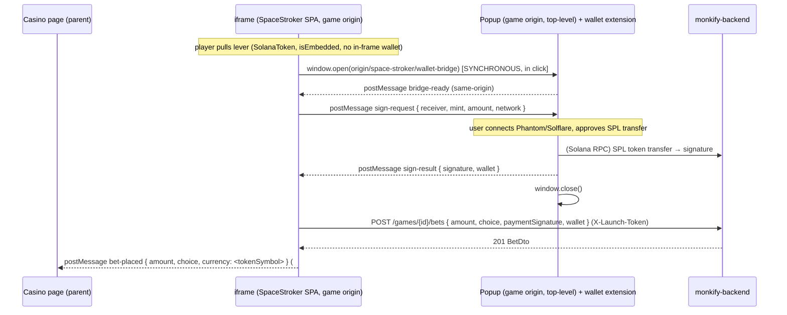
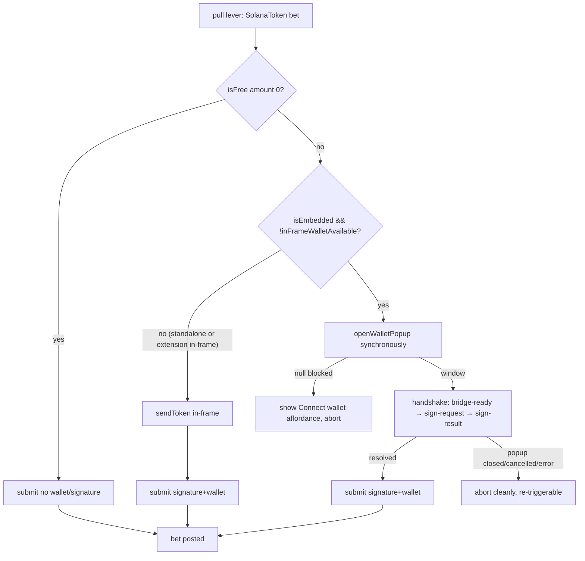

# SpaceStroker — "Embedded (iframe) crypto (SolanaToken) games" Feature — Implementation Spec

> **Status: Shipped** — merged to `main` via `feature/iframe-crypto-games` on 2026-07-14 (stacked on
> card #3 `iframe-embedding`; one merge of this branch landed both). Distilled in
> `../features/iframe-crypto-games.md`. Trello card
> [Make embedded (iframe) play work for SolanaToken (crypto) games](https://trello.com/c/PVUH9zJZ)
> (spec 2026-07-10).
> Repos affected: `monkify-front`, and this doc in `monkify-meta`. **`monkify-backend`: none.**
>
> **Purpose:** Let a player place a **paid `SolanaToken` (on-chain) bet from inside the embedded
> `<iframe>`** delivered by card #3. Wallet extensions (Phantom / Solflare) do not inject into a
> cross-origin iframe, so bet-time wallet connect + SPL transfer + signing are moved into a
> **same-origin popup on the game host** (a top-level window where the extension *does* inject); the
> popup returns the on-chain signature + wallet to the iframe via `postMessage` and the existing
> `bet()` POST runs unchanged. Standalone play and the in-frame path (when an extension *is* present)
> are byte-for-byte unchanged.

---

## 0. Dependency on card #3 (READ FIRST — hard prerequisite)

This feature is a **direct extension of card #3 "Make the game Iframe-able"**
([RGvJZNTW](https://trello.com/c/RGvJZNTW), `specs/iframe-embedding.md`) and picks up #3's explicit
**"Out of scope → Crypto / Solana-wallet-in-iframe (deferred)"** item.

- **#3 is implemented and committed.** #3's front implementation is committed on `feature/iframe-embedding`
  (`monkify-front` @ `4e53e02`) and pushed: `src/hooks/useEmbed.ts`, `src/utils/embed.ts` (`postToParent`,
  the `{ source:'space-stroker', type, payload }` envelope), `src/components/EmbedRelaunching.vue`,
  `public/embed-example.html`, `EMBEDDING.md`, plus edits to `App.vue`, `useOperator.ts`, `useGame.ts`,
  `mainService.ts`, `main.css`, `nginx.conf`. #3's meta spec is committed too (`feature/iframe-embedding`
  in `monkify-meta`). Neither is on `main` yet.
- **This branch is stacked on #3, and its front is rebased onto #3's commit.** `feature/iframe-crypto-games`
  was cut from `feature/iframe-embedding` in both repos; after #3's front implementation was committed, the
  `monkify-front` side of this branch was fast-forwarded onto it (@ `4e53e02`), so **this worktree already
  contains #3's code** to build on. The `monkify-meta` side stacks on #3's committed spec.
- **Ordering / merge:** #3 and #41 **merge to `main` together** — this feature's branch already contains
  #3's work, so a single merge of `feature/iframe-crypto-games` → `main` (per repo) brings both. Do
  not merge #3 to `main` separately. Every "Change (#3)" row in §10 edits #3 code that is present on this
  base.
- Everywhere below, **`isEmbedded`** and **`postToParent`** are #3's (`useEmbed`, `utils/embed.ts`).
  This card adds **no new parent-facing contract** — it reuses #3's envelope and only adds an
  **internal, same-origin** popup↔iframe channel (`source: 'space-stroker-wallet'`, §7.3).

---

## 1. Summary

Card #3 makes the SPA framable and emits a lifecycle postMessage API to the parent casino, but its
scope is **regulated (Standard/USD) operators only** — for those the wallet cluster is already hidden
and no wallet is needed. Since the shipped **payment-methods refactor**
(`features/payment-methods.md`, merged 2026-07-08), "crypto" is a **`GameParameters.PaymentMethod
= SolanaToken`** game type any operator can offer, settled **on-chain in the operator's registered
token** via the standalone `solana-wallets-vue` flow (`useConnection.sendToken` →
`useGame.bet()`). That on-chain flow needs a wallet **extension**, which browsers refuse to inject
into a cross-origin iframe. This card makes paid SolanaToken games playable **inside** the #3
iframe by **adapting** that flow — not rebuilding it.

The only genuinely new piece is **how the wallet connection + signature are acquired in embedded
mode.** Everything downstream (the SPL transfer built by `sendToken`, the signature, the `bet()`
POST with `X-Launch-Token`, backend validation) is unchanged.

| Concern | Standalone (today, unchanged) | Embedded — extension present in-frame | Embedded — extension blocked/absent (the real case) |
| --- | --- | --- | --- |
| **Wallet connect** | `solana-wallets-vue` in the page | same, in the iframe | **same-origin popup** on the game host connects the wallet |
| **SPL transfer + sign** | `useConnection.sendToken` in the page | same, in the iframe | popup runs `sendToken`, returns the **signature + wallet** to the iframe via `postMessage` |
| **Bet POST** | `useGame.bet()` → `POST /games/{id}/bets` | identical | identical (iframe posts with its own `X-Launch-Token`) |
| **Popup timing** | n/a | n/a | **opened synchronously in the bet-click handler** (dodges popup-blockers); visible "click to connect" affordance if still blocked |
| **Amounts** | token-native (`tokenSymbol`/`tokenDecimals`) | token-native | token-native — **never USD** |
| **Free SolanaToken (amount 0)** | no wallet | no wallet | **no wallet, no popup** — already works, verify only |

**Detection rule ("try in-frame first, else popup"):** on a paid SolanaToken bet, if
`isEmbedded && !inFrameWalletAvailable()` → popup handoff; otherwise (standalone, or an extension is
actually present in-frame) → the existing in-frame `sendToken` path. `inFrameWalletAvailable()` is a
**synchronous** check (`connected || wallet.readyState === 'Installed'`) so the popup can be opened
inside the user gesture. In a real cross-origin iframe no adapter injects (`readyState` is
`NotDetected`) → popup; the in-frame branch still serves standalone and the same-origin `?embed=1`
dev case.

---

## 2. Constraints (MANDATORY)

From `monkify-meta/constraints.md` (full list there):

- **Worktree-per-repo (§2):** `feature/iframe-crypto-games` in `monkify-front` and `monkify-meta`,
  each in its own worktree under `.worktrees/iframe-crypto-games/<repo>`; hubs stay on `main`.
  **Stacked on #3** — branches were cut from `feature/iframe-embedding`, not `main` (§0). Push after
  branch work. **No backend branch** — there is no backend surface.
- **Backend integration-test mandate — N/A (§8).** The "every new feature ships a backend integration
  test" rule is **backend/game-flow scoped**. This card has **no backend surface** (no handler,
  consumer, entity, endpoint, DTO, SignalR-contract, or game-flow change), so it introduces no
  backend happy path to exercise. No `SpaceStroker.Tests.Integration` test is added — consistent with #3
  and other frontend-only features (`audio-overhaul`, `game-pot-display`, `iframe-embedding`).
- **Frontend has no unit-test harness.** `monkify-front/package.json` exposes only `serve`, `build`,
  `lint`, `lint:fix` — no `test`/jest/vitest and no `.spec`/`.test` files under `src/`. Verification is
  **`yarn lint` + `yarn build` clean + manual QA in the running app** (§13). Do **not** introduce a
  test framework for this change.
- **Vague operator messaging (§6):** an inactive/expired operator or expired token while embedded uses
  the **same** #3 `token-expired`/relaunch path — **never** reveal contract status, no expiry-specific
  copy, no reason string in any payload.
- **Secrets/config (§1):** no secrets. The **launch token must never appear in the popup URL or any
  `postMessage` payload** (internal or parent-facing). Mint / receiver / amount / network / signature /
  wallet are **public** data and are the only things exchanged. Env files stay mock-only.
- **EF mapping / Migrations / DB:** not touched (no backend).

---

## 3. Resolved product decisions

| # | Decision |
| --- | --- |
| 1 | **Adapt, don't rebuild.** Reuse the standalone `solana-wallets-vue` connect + `useConnection.sendToken` + `useGame.bet()` path. Only the *wallet-connection acquisition in embedded mode* is new; the transfer, signature handling, and bet POST are unchanged. |
| 2 | **Wallet in frame = try-then-fallback.** Attempt the extension **in-frame** first; when it is blocked/absent, open a **same-origin popup** on the game host (where the extension injects). The popup connects + signs + sends the SPL transfer, then `postMessage`s the **on-chain signature + wallet** back into the iframe so `bet()` posts normally. |
| 3 | **Wallet scope = same adapters as today** (Phantom / Solflare via `solana-wallets-vue`). **No** WalletConnect / mobile wallets (out of scope). |
| 4 | **Popup opened synchronously in the bet-click handler** (user gesture) to avoid popup-blockers; if still blocked, show a clear "click to connect wallet" affordance — **never** a silent failure. |
| 5 | **Free `SolanaToken` games already embed** (amount 0 skips wallet-connect) — in scope only to **verify no regression**, no new work expected. |
| 6 | **No new parent-facing contract.** Reuse #3's `{ source:'space-stroker', type, payload }` envelope and its lifecycle events. The wallet handoff is an **internal, same-origin** iframe↔popup channel (`source:'space-stroker-wallet'`). All payloads stay secret-free (mint / receiver are public data). |
| 7 | **Backend impact: none expected** — SolanaToken bet-time settlement is validation-only and already runs API-side (payment-methods); the frame changes nothing server-side. Confirm during implementation. |
| 8 | **In-frame vs popup decision is synchronous** (`connected \|\| wallet.readyState === 'Installed'`) so the popup opens inside the click gesture. The card's "connect-attempt timeout/rejection" fallback is realized as: use in-frame **iff** the extension is actually present in-frame, else popup. |
| 9 | **Amounts token-native.** Embedded SolanaToken amounts render and are emitted in the token's own units (`tokenSymbol`/`tokenDecimals`), **never** converted to USD. The lifecycle postMessage payloads (#3 emits USD for Standard) become **method-aware** (§7.6). |

---

## 4. Data model

**No change.** No entities, columns, EF mapping, or migrations — frontend-only, no persisted state.
N/A.

---

## 5. Configuration

### 5.1 No new env var

Embedded mode is #3's runtime detection (`window.self !== window.top` \| `?embed=1`); this card adds
no `.env` flag. The popup targets the game host via **`window.location.origin`** (the iframe document's
own origin *is* the game host per #3) — not a configured URL. Existing Solana env
(`VUE_APP_SOLANA_NETWORK`, `VUE_APP_TRANSACTION_CONFIRMATION_TIMEOUT`, `VUE_APP_GAME_TOKEN_ADDRESS`,
`USDC_TOKEN_ADDRESS`) is reused unchanged by the popup's `useConnection`.

### 5.2 New route: the wallet-bridge popup

A route `WalletBridge` at **`/space-stroker/wallet-bridge`** (registered in production too — it is part of the
same-origin handoff and must work in prod embedding). It renders the popup page (§7.2). It carries
**no** launch token and **no** operator context in its URL. `App.vue`'s boot already runs
`loadOperator()` **only** for `route.name === 'Game' | 'Game'` (`App.vue:31`), so the bridge route
**skips** the operator/launch boot and cannot dead-end on `/error` — this is why a dedicated route
(not a raw reload of `/space-stroker/game/...`) is required.

---

## 6. Backend behaviour

**None.** SolanaToken bet-time settlement (on-chain signature validation) already runs in
`SpaceStroker.Api` (`RegisterBetHandler` + `SolanaTokenPaymentMethodService`, validation-only). The iframe
changes nothing server-side: the bet POST still carries the same `X-Launch-Token` header + `wallet` +
`paymentSignature` body it does standalone; the origin pair the API sees is unchanged. `monkify-backend`
is not opened. **Confirm during implementation** (decision #7) and record the confirmation.

---

## 7. Frontend behaviour

All changes are in `monkify-front`, **layered on #3's branch**. Line references are `origin/main` @
`9e3fa77` (the base #3 was cut from); after #3 is implemented, `useGame.ts` / `App.vue` also carry
#3's edits, which §7.6 amends.

### 7.1 New: `src/hooks/useEmbeddedWallet.ts` — the popup orchestration (singleton)

Module-scope singleton (mirrors `useEmbed` / `useConnection` style). Owns opening the same-origin
popup, the internal handshake, and the popup-blocked state.

Exposed surface:

- `inFrameWalletAvailable(): boolean` — **synchronous**. `true` when a wallet is usable in-frame:
  `connected.value || wallet.value?.readyState === 'Installed'` (from `solana-wallets-vue`
  `useWallet()`). In a real cross-origin iframe this is `false` (no adapter injects).
- `openWalletPopup(): Window | null` — **called synchronously inside the bet-click gesture.**
  `window.open(`${window.location.origin}/space-stroker/wallet-bridge`, 'space-stroker-wallet',
  'width=460,height=680,...')`. Returns the handle, or `null` when the browser blocks it.
- `requestSignatureFromPopup(popup, req): Promise<{ signature: string; wallet: string }>` — drives the
  handshake against an already-opened `popup` for `req = { receiver, mint, amount, network }`:
  1. `addEventListener('message', …)`; **ignore** any event whose `origin !== window.location.origin`
     or `source !== popup` (§7.3 security).
  2. On `bridge-ready` → post `sign-request` `{ receiver, mint, amount, network }` to
     `popup.postMessage(…, window.location.origin)`.
  3. On `sign-result` → resolve `{ signature, wallet }`, remove the listener, and (if still open)
     `popup.close()`.
  4. On `sign-error` → reject with a generic reason.
  5. **Cancellation:** a `setInterval` watches `popup.closed`; if it closes before `sign-result`,
     reject (`'cancelled'`). Clears the interval + listener in a `finally`. Also honors an explicit
     `cancelled` message.
- `walletPopupBlocked: Ref<boolean>` (read-only computed) + `clearPopupBlocked()` — drives the
  "click to connect wallet" affordance (§7.8).

No secrets are stored or posted. The composable never reads the launch token.

### 7.2 New: `src/pages/WalletBridgePage.vue` — the popup page (top-level, same origin)

Runs the SPA at `/space-stroker/wallet-bridge` in the **popup** (top-level window → `window.self ===
window.top` → #3's `isEmbedded` is **false**, so no `postToParent` / relaunch overlay fires here). It:

1. **On mount:** post `{ source:'space-stroker-wallet', type:'bridge-ready' }` to `window.opener`
   (`window.opener.postMessage(…, window.location.origin)`); if there is no opener, render a neutral
   "open this from the game" note and stop.
2. **Wallet connect UI:** reuse the existing connect affordance (`WalletMultiButton` /
   `header/WalletButtons.vue`) so the user picks Phantom / Solflare and approves — a genuine
   top-level window, so the extension injects and prompts normally.
3. **On `sign-request`** (validated origin `=== window.location.origin` and `source === opener`):
   ensure connected (if not, surface the connect UI and wait), then
   `await startConnection()` (`useConnection`, builds the RPC `connection`) and
   `await sendToken(new PublicKey(receiver), new PublicKey(mint), amount)` (unchanged transfer).
   - success → post `{ source:'space-stroker-wallet', type:'sign-result', payload:{ signature, wallet:
     publicKey.value!.toString() } }` then `window.close()`.
   - user rejection / transfer failure → post `{ …type:'sign-error', payload:{ reason:'failed' } }`
     (generic; no contract status), keep the window open so the user can retry or close.
4. **On close/cancel:** the opener detects `window.closed` (§7.1); no extra signalling required.

Chrome: the global `GameHeader` still mounts (App.vue renders it on all routes); acceptable, but the
bridge page's own content is a minimal, self-contained connect/sign panel. Optionally hide the header
on this route (`v-if="route.name !== 'WalletBridge'"` in `App.vue`) for a clean popup — low-priority
polish, not required for correctness.

### 7.3 New: `src/utils/walletBridge.ts` — the internal (same-origin) envelope

Distinct from #3's parent-facing `utils/embed.ts`. Not exposed to the casino.

```ts
export const WALLET_BRIDGE_SOURCE = 'space-stroker-wallet' as const;

export type WalletBridgeMessage =
  | { source: typeof WALLET_BRIDGE_SOURCE; type: 'bridge-ready' }
  | { source: typeof WALLET_BRIDGE_SOURCE; type: 'sign-request';
      payload: { receiver: string; mint: string; amount: number; network: string } }
  | { source: typeof WALLET_BRIDGE_SOURCE; type: 'sign-result';
      payload: { signature: string; wallet: string } }
  | { source: typeof WALLET_BRIDGE_SOURCE; type: 'sign-error'; payload: { reason: string } }
  | { source: typeof WALLET_BRIDGE_SOURCE; type: 'cancelled' };
```

**Security invariants (both sides):** always target and verify `window.location.origin` (same origin
— never `'*'`); verify `event.source` is the expected window (opener ↔ popup handle); ignore anything
that doesn't match. Payloads carry **only public data** — never the launch token or any secret.

### 7.4 Change: `src/hooks/useGame.ts` — `bet()` SolanaToken branch acquires the signature via in-frame **or** popup

Today (`useGame.ts:272–289`) the SolanaToken branch always calls `sendToken` in-frame. Split the
signature acquisition so embedded-without-in-frame-wallet uses the popup. **Open the popup
synchronously before any `await`** (the branch runs before the first `await` on the paid path):

```ts
// inside bet(), SolanaToken branch — receiver/mint/amount computed synchronously as today
const network = process.env.VUE_APP_SOLANA_NETWORK || 'devnet';
let signature: string;
let betWallet = wallet; // publicKey.value?.toString() ?? '' (as today)

if (isEmbedded && !inFrameWalletAvailable()) {
  const popup = openWalletPopup();          // SYNCHRONOUS — inside the click gesture
  if (!popup) {                              // popup-blocked → visible affordance, no silent fail
    setPopupBlocked(true);
    isLoadingBet.value = false;
    betOutput.value = 'Click “Connect wallet” to place your crypto bet';
    return;
  }
  try {
    const res = await requestSignatureFromPopup(popup, {
      receiver, mint, amount, network,
    });
    signature = res.signature;
    betWallet = res.wallet;                  // wallet from the popup (in-frame publicKey is empty)
  } catch {
    isLoadingBet.value = false;              // cancelled/closed/failed → abort cleanly, re-triggerable
    betOutput.value = 'There was an error processing your bet';
    return;
  }
} else {
  try {
    signature = (await sendToken(new PublicKey(receiver), new PublicKey(mint), amount)) as string;
  } catch {
    isLoadingBet.value = false;
    betOutput.value = 'There was an error processing your bet';
    return;
  }
}

await submit({ amount, choice, paymentSignature: signature, wallet: betWallet, seed });
return;
```

- Import `useEmbed` (`isEmbedded`) + `useEmbeddedWallet` (`inFrameWalletAvailable`, `openWalletPopup`,
  `requestSignatureFromPopup`, `setPopupBlocked`).
- **Free bet path unchanged** (`isFree` still returns before this — no wallet, no popup): AC #6.
- **Standalone unchanged**: `isEmbedded` false → `else` branch = today's `sendToken`: AC #1.
- The bet POST (`submit → mainService.applyBet`) still sends `X-Launch-Token` from the iframe; a
  401/expired token there is handled by #3's `mainService` interceptor (embedded → `token-expired` +
  relaunch): AC #9.

### 7.5 Change: `src/components/game/GameConsole.vue` — relax the in-frame `connected` gate when embedded

`placeBet()` (`GameConsole.vue:60–67`) blocks the bet when
`requiresWallet && !connected && !isFreeBetActive`. In embedded mode the in-frame wallet is **not**
connected (it lives in the popup), so this gate would prevent the popup from ever opening. Relax it:

```ts
import { useEmbed } from '@/hooks/useEmbed';
const { isEmbedded } = useEmbed();

// When embedded, the wallet is acquired via the popup handoff on click, so an in-frame `connected`
// wallet is not required to start the bet.
const walletGateBlocks = computed(
  () => requiresWallet.value && !connected.value && !isFreeBetActive.value && !isEmbedded,
);
// …use walletGateBlocks in the placeBet() guard instead of the inline (requiresWallet && !connected …)
```

Standalone behaviour is unchanged (`isEmbedded` false → identical gate). The rest of `placeBet()`
(word-length, duplicate-char, `allowBets`) is untouched.

### 7.6 Change (#3): make the lifecycle postMessage payloads method-aware (token-native for SolanaToken)

#3 emits `bet-placed` / `bet-settled` / `game-started` with `currency: 'USD'` and USD amounts
(#3 §7.6). For an embedded **SolanaToken** game those must be **token-native** (AC #7). After #3 is
implemented, amend #3's emit sites in `useGame.ts` (and any in `App.vue`) so the currency/amount are
derived from the selected game's method:

```ts
const isSolana = selectedGame.value?.paymentMethod === PaymentMethod.SolanaToken;
const currency = isSolana ? (selectedGame.value?.tokenSymbol ?? 'TOKEN') : 'USD';
// amount stays the game's native amount (token units for SolanaToken; USD for Standard) — no conversion
postToParent('bet-placed', { gameId, amount, choice, currency });
```

Apply the same `currency` derivation to `game-started` (`requiredAmount`) and `bet-settled`
(stake). **No new event types, no new parent contract** — same #3 envelope, correct currency (decision
#6/#9). This is the only edit to #3's parent-facing behaviour.

### 7.7 New route registration + boot: `src/routes.ts`, `src/App.vue`

- `routes.ts` — add the `WalletBridge` route at `/space-stroker/wallet-bridge` →
  `require('@/pages/WalletBridgePage.vue').default`. Registered unconditionally (prod-embedding needs
  it), like `Admin`.
- `App.vue` — **no boot change needed**: `loadOperator()` already runs only for `Game`/`Game`
  (`App.vue:31`), so the bridge popup skips it. The global `watch(connected, startConnection)` already
  starts the RPC when the popup connects. Optional: hide `GameHeader` on the bridge route (§7.2).

### 7.8 New: popup-blocked affordance (visible, never silent)

When `openWalletPopup()` returns `null` (browser blocked it), `useGame.bet()` sets
`walletPopupBlocked` and a message (§7.4). Surface a **"Connect wallet"** affordance the player can
click (a fresh user gesture) to retry — e.g. a small button/overlay in `GameConsole.vue` (or the
`GameHeader` wallet slot) shown `v-if="isEmbedded && walletPopupBlocked"` that calls a
`retryWalletConnect()` which re-runs `openWalletPopup()` + the handshake and, on success, re-submits
the pending bet (or simply re-enables the lever for the player to pull again). Keep it minimal and
retro-styled; the requirement (AC #4) is **visible, actionable, never a silent fail**.

### 7.9 Not changed (documented)

- **`useConnection.sendToken` / `sendSol` / balance** — reused verbatim by the popup page; no change.
- **`GameHeader` wallet cluster** — already shown for SolanaToken games
  (`showWallet = paymentMethod === SolanaToken`, `GameHeader.vue:32`). In the iframe it renders; the
  in-frame `WalletMultiButton` simply won't connect (no extension), which is why betting routes through
  the popup. `TokenBalance` may read 0 in-frame — acceptable (balance is informational; the authoritative
  balance/approval happens in the popup). Document; no behavioural change required for this card.
- **Standard (USD) games** — untouched: `isEmbedded` gating only affects the SolanaToken branch;
  Standard embedding is #3's job and stays as-is.
- **`adminService` / admin portal** — not embedded; out of scope (as in #3).
- **Backend** — not opened (§6).

---

## 8. Flow diagrams

### 8.1 Embedded SolanaToken bet — popup handoff (the new path)



### 8.2 In-frame path (extension present) + free bet + cancel



---

## 9. Out of scope

- **WalletConnect / mobile-wallet support** — deferred (decision #3).
- **Per-operator embed-origin allow-listing** — #3's deferred hardening; the launch token stays the
  boundary.
- **Any backend change**; admin-portal embedding.
- **Deep small-screen / mobile responsiveness** → card #5.
- **Standard (USD) embedding** — delivered by #3, not re-done here.

---

## 10. File checklist

### 10.1 Backend (`monkify-backend`)

**None.** (Confirm no server-side change is needed — decision #7.)

### 10.2 Frontend (`monkify-front`)

| # | File | Change |
| --- | --- | --- |
| 1 | `src/hooks/useEmbeddedWallet.ts` | **New.** `inFrameWalletAvailable()` (sync), `openWalletPopup()` (sync, same-origin `/space-stroker/wallet-bridge`), `requestSignatureFromPopup(popup, req)` (handshake + origin/source validation + `popup.closed` cancel watch), `walletPopupBlocked` + `setPopupBlocked`/`clearPopupBlocked`. |
| 2 | `src/pages/WalletBridgePage.vue` | **New.** Popup page: post `bridge-ready` to opener; wallet connect UI (`WalletMultiButton`/`WalletButtons`); on `sign-request` → `startConnection()` + `sendToken` → post `sign-result { signature, wallet }` + `window.close()`; generic `sign-error` on reject/fail; validates origin === own + source === opener. |
| 3 | `src/utils/walletBridge.ts` | **New.** `WALLET_BRIDGE_SOURCE = 'space-stroker-wallet'`, `WalletBridgeMessage` union, same-origin targeting/validation helpers. Internal only (not parent-facing). |
| 4 | `src/hooks/useGame.ts` | `bet()` SolanaToken branch: acquire signature in-frame (`sendToken`) **or** via popup (`openWalletPopup` synchronously → `requestSignatureFromPopup`); popup-blocked → `setPopupBlocked` + message + abort; cancel/close/error → abort cleanly. Free & Standard paths unchanged. Plus §7.6: make #3's lifecycle emit `currency`/amount method-aware (token-native for SolanaToken). |
| 5 | `src/components/game/GameConsole.vue` | Relax the in-frame `connected` gate in `placeBet()` when `isEmbedded` (popup provides the wallet). Standalone gate unchanged. Add the popup-blocked "Connect wallet" affordance (§7.8). |
| 6 | `src/routes.ts` | Add `WalletBridge` route `/space-stroker/wallet-bridge` → `WalletBridgePage.vue` (registered in prod too). |
| 7 | `src/App.vue` | No boot change required (bridge route already skips `loadOperator`). Optional: hide `GameHeader` on the bridge route. Confirm the global `watch(connected, startConnection)` covers the popup. |
| 8 | `public/embed-example.html` | **Extend #3's example page.** Add a **SolanaToken** game to the demo and document/observe the in-frame-then-popup wallet flow (the page already logs #3's lifecycle events; note the popup opens as a separate window). |
| 9 | `EMBEDDING.md` | **Extend #3's README.** Document the SolanaToken embedding flow: in-frame-then-popup wallet handoff, the same-origin popup (`/space-stroker/wallet-bridge`), synchronous open on click, token-native amounts, popup-blocked affordance, and that the internal handshake is same-origin/secret-free. |

### 10.3 Meta (`monkify-meta`)

| # | File | Change |
| --- | --- | --- |
| 1 | `specs/iframe-crypto-games.md` | This spec (new). |
| 2 | `INDEX.md` | Add the spec row (status **Ready**); update "Feature currently in flight". |

---

## 11. Unit tests

**None — the frontend has no unit-test harness** (see §2). Adding a framework is out of scope.
Verification is `yarn lint` + `yarn build` clean + the manual QA in §13. Backend `SpaceStroker.Tests` /
`SpaceStroker.Tests.Integration` are untouched — there is no backend change.

---

## 12. Acceptance criteria

Mapped 1:1 from the Trello **Acceptance Criteria** checklist:

1. **Standalone unchanged.** Given a paid SolanaToken game loaded standalone (not embedded), when
   the player bets, then wallet-connect + on-chain transfer + bet POST work exactly as today with no
   regression. *(§7.4 `else` branch; `isEmbedded` false)*
2. **In-frame extension present.** Given a paid SolanaToken game loaded embedded and the wallet
   extension injects in-frame, when the player bets, then the existing in-frame connect/sign/`sendToken`
   path runs and the bet posts with the on-chain signature + wallet. *(§7.1 `inFrameWalletAvailable`
   true → §7.4 `else` branch)*
3. **Popup handoff on blocked/absent extension.** Given a paid SolanaToken game loaded embedded and
   the extension is blocked/absent in-frame, when the player bets, then the game opens a same-origin
   popup on the game host where the player connects + signs + sends the SPL transfer, and the signature
   + wallet are returned to the iframe (via postMessage) so the bet posts. *(§7.1–§7.4, §8.1)*
4. **Synchronous popup + blocked affordance.** Given the popup handoff is required, when the bet button
   is clicked, then the popup is opened **synchronously** in that click handler (not popup-blocked); if
   the browser still blocks it, the player sees a clear "click to connect wallet" affordance and never a
   silent failure. *(§7.4 sync open, §7.8)*
5. **Cancel mid-connect aborts cleanly.** Given the popup is closed or cancelled mid-connect, when
   control returns to the iframe, then the bet aborts cleanly with no stuck state and the wallet connect
   is re-triggerable. *(§7.1 `popup.closed` watch → reject → §7.4 abort branch)*
6. **Free SolanaToken embeds.** Given a FREE SolanaToken game (amount 0) loaded embedded, when the
   player bets, then no wallet-connect or popup occurs and the bet posts. *(§7.4 `isFree` returns first)*
7. **Token-native + #3 lifecycle + secret-free.** Given an embedded SolanaToken bet, when it settles,
   then amounts render token-native (`tokenSymbol`/`tokenDecimals`, never USD) and the game emits card
   #3's existing lifecycle postMessage events (`bet-placed` / `bet-settled`) with no new parent-facing
   contract, and no token or secret appears in the popup URL or any postMessage payload. *(§7.6, §7.3,
   §5.1)*
8. **Docs.** Given the example embed page + integration README shipped by card #3, when updated by this
   card, then they include a SolanaToken (crypto) game demonstrating the in-frame-then-popup wallet
   flow and document it. *(§10.2 #8/#9)*
9. **Inactive operator / expired token = vague relaunch.** Given an inactive/expired operator or expired
   token while embedded, when the crypto bet path handles it, then it uses card #3's vague
   `token-expired`/relaunch path and never reveals contract status. *(§7.4 bet POST 401 → #3
   `mainService` interceptor; §2 §6)*
10. **Manual devnet demo.** Given the owner's devnet-USDC browser wallet, when a paid SolanaToken bet is
    placed from inside the embedded example page on devnet, then it completes end-to-end (connect →
    transfer → bet → settle). *(§13)*

---

## 13. Manual QA

Run the local stack (`docker compose up` for the backend on `:6001`; `yarn serve` for the front) with a
seeded **SolanaToken** game (the dev operator seeds 6L/6N/6X SolanaToken defaults — payment-methods)
and the owner's **devnet-USDC** wallet:

1. **Standalone unchanged:** open the game directly (not framed), pick a SolanaToken game → connect
   wallet + bet + on-chain transfer + settle behave exactly as today. No popup.
2. **Embedded, popup handoff:** open #3's `/embed-example.html` (or `?embed=1`), launch a SolanaToken
   game → pull the lever → a same-origin popup opens **synchronously**; connect Phantom/Solflare in
   the popup, approve the transfer → the popup closes and the bet posts; the example page logs
   `bet-placed` with a **token-native** amount/currency (not USD).
3. **In-frame path (dev):** with a wallet extension present and `?embed=1` on the same origin (so the
   extension is in-frame), bet → no popup, the in-frame `sendToken` path runs.
4. **Popup blocked:** enable the browser's popup blocker → bet → no silent fail; the "Connect wallet"
   affordance appears; clicking it opens the popup and the bet completes.
5. **Cancel:** open the popup, close it before signing → the bet aborts cleanly, the lever resets, and a
   second pull re-opens the popup.
6. **Free SolanaToken:** a free (amount 0) SolanaToken game embedded → bet posts with no wallet/popup.
7. **Secret-free:** in devtools confirm the popup URL is `…/space-stroker/wallet-bridge` (no token) and every
   `space-stroker-wallet` and `spacestroker` postMessage payload contains no token/secret; the internal handshake
   is same-origin.
8. **Token expiry:** force a 401 on the bet POST while embedded → #3's `token-expired` + relaunch state
   (no `/error`), never revealing contract status.
9. `yarn lint` and `yarn build` are clean.

---

## 14. Trello / pipeline

- **Source card:** [Make embedded (iframe) play work for SolanaToken (crypto) games](https://trello.com/c/PVUH9zJZ)
  — list **Specs created**; the **Implementation** section on the card lists branch + spec + worktree.
- **Prerequisite:** card #3 [Make the game Iframe-able](https://trello.com/c/RGvJZNTW) must be
  implemented + merged first (or shipped together) — this branch is stacked on `feature/iframe-embedding`
  (§0).
- **After implementation:** `/monkify-implement-feature Make embedded (iframe) play work for SolanaToken (crypto) games`
- **After merge:** `/monkify-ship-feature …` (reads branch from card).

---

## 15. Revision log

| Date | Change |
| --- | --- |
| 2026-07-10 | Initial spec from refined card #41 (`PVUH9zJZ`), grounded in `useGame.ts` (`bet()`), `useConnection.ts` (`sendToken`), `GameConsole.vue` (`placeBet` gate), `GameHeader.vue` (`showWallet`), `types/index.ts` (`PaymentMethod`, token fields), `App.vue` (boot gate), `routes.ts`, `main.ts` (wallet plugin) on `origin/main` @ `9e3fa77`, and card #3's `specs/iframe-embedding.md` (`useEmbed`, `postToParent`, example page + README). Stacked on `feature/iframe-embedding`. |
