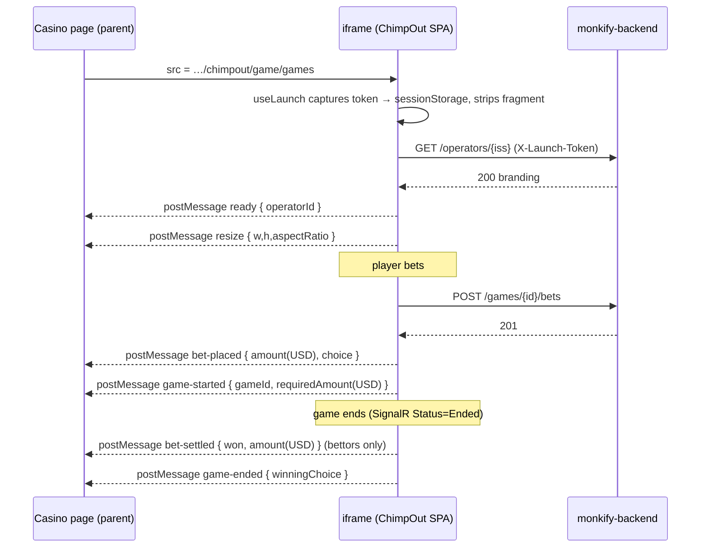
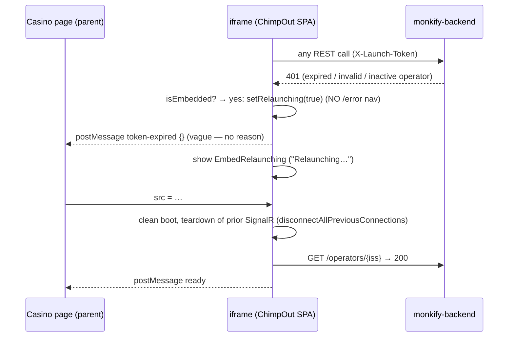

# ChimpOut — "Make the Game Iframe-able" Feature — Implementation Spec

> **Status: Shipped** — merged to `main` via `feature/iframe-crypto-games` on 2026-07-14 (stacked
> with card #41 `iframe-crypto-games`; one merge landed both). Distilled in
> `../features/iframe-embedding.md`. Trello card
> [Make the game Iframe-able](https://trello.com/c/RGvJZNTW/3-make-the-game-iframe-able) (spec 2026-07-08).
> Repos affected: `monkify-front`, and this doc in `monkify-meta`. **`monkify-backend`: none.**
>
> **Purpose:** Let a **regulated (Model A) operator casino** embed the ChimpOut game inside an
> `<iframe>` on its own site — the white-label delivery path for the B2B integration — with a stable
> parent↔iframe `postMessage` API, an embedded-mode re-launch flow that never dead-ends on `/error`,
> a static example embed page, and an integration README. Production-grade but demo-able now.
> **Crypto operators keep launching standalone** (browser wallet extensions block cross-origin iframe
> injection) and are out of scope for embedding.

---

## 1. Summary

Today the SPA has **zero iframe awareness**. It boots, captures a signed launch token from the URL
fragment (`useLaunch`), decodes the operator from the token's `iss` claim (`useOperator`), and on any
auth failure **hard-navigates the document to `/error`** (`mainService.ts` 401 interceptor +
`useOperator.loadOperator`). Inside a casino frame a dead-end `/error` is fatal: the casino can't
recover the player and there is no signal back to the parent.

This feature adds a thin **embedded-mode** layer, entirely in `monkify-front`, on top of the existing
launch-token flow:

| Concern | Standalone (today, unchanged) | Embedded (new) |
| --- | --- | --- |
| **Detection** | n/a | `useEmbed` → `isEmbedded = window.self !== window.top` (or `?embed=1`) |
| **Token handoff** | `#launch_token=<jwt>` fragment → `useLaunch` | **identical** (works unchanged in a frame) |
| **Auth failure (401 / bad token / inactive operator)** | `window.location.assign('/error')` | emit `token-expired` postMessage + show a light in-frame "relaunching" state (no `/error`) |
| **Re-launch** | reload page | casino re-sets the iframe `src` with a fresh `#launch_token=` → clean full reload, resumes at game-select |
| **Parent signalling** | none | stable `postMessage` envelope: `ready`, `token-expired`, `game-started`, `bet-placed`, `bet-settled`, `game-ended`, `resize` |
| **Sizing** | viewport | fills 100%×100% of the casino's box; emits a one-time size **hint** only |
| **Chrome** | wallet cluster shown for Solana games | regulated = Standard games → wallet already hidden; no frame-busting top-level nav |

**The signed RS256 launch token is the security boundary**, not the frame header: a forged embed can't
mint a valid token, and every API call is validated server-side. The frame header is a permissive
deploy concern (§5.4). Per-operator origin allow-listing is deferred hardening (§9).

**No backend surface changes** — auth is the `X-Launch-Token` **header** (no cookies), SignalR is
WebSockets-only (works in frames), and the iframe document's origin is still the game host, so the
API sees the same origin pair as today. CORS is unaffected.

---

## 2. Constraints (MANDATORY)

From `monkify-meta/constraints.md` (full list there):

- **Worktree-per-repo (§2):** `feature/iframe-embedding` in each affected repo (`monkify-front`,
  `monkify-meta`), each in its own worktree under `.worktrees/iframe-embedding/<repo>`; hubs stay on
  `main`. Push after branch work. **No backend branch** — there is no backend surface.
- **Backend integration-test mandate — N/A (§8).** The "every new feature ships a backend integration
  test" rule is **backend/game-flow scoped**. This card has **no backend surface** (no handler,
  consumer, entity, endpoint, DTO, SignalR-contract, or game-flow change), so it introduces no
  backend happy path to exercise. No `ChimpOut.Tests.Integration` test is added — consistent with prior
  frontend-only features (`audio-overhaul`, `game-pot-display`).
- **Frontend has no unit-test harness.** `monkify-front/package.json` exposes only `serve`, `build`,
  `lint`, `lint:fix` — no `test`/jest/vitest and no `.spec`/`.test` files under `src/`. Verification is
  **`yarn lint` + `yarn build` clean + manual QA in the running app** (§13). Do **not** introduce a
  test framework for this change.
- **Vague operator messaging (§6):** the embedded relaunch/error state must **never reveal contract
  status**. An inactive/expired operator uses the **same** `token-expired` path as an expired token —
  no expiry-specific copy, no reason string in any payload.
- **Secrets/config (§1):** no secrets. `postMessage` payloads **must never carry the launch token or
  any secret**; env files stay mock-only.
- **EF mapping / Migrations / DB:** not touched (no backend).

---

## 3. Resolved product decisions

| # | Decision |
| --- | --- |
| 1 | **Primary goal:** build production-grade embedding **and** keep it demo-able for the pitch first. |
| 2 | **Wallet scope: regulated (Model A) only.** No Solana wallet inside the iframe (extensions like Phantom/Solflare block cross-origin injection). Crypto operators are out of scope for embedding and keep launching standalone. |
| 3 | **Security posture: permissive frame header; the signed RS256 launch token is the real boundary.** A forged embed can't produce a valid token. Per-operator origin allow-listing is deferred (§9). |
| 4 | **Embedded detection:** `useEmbed` composable → `isEmbedded = window.self !== window.top`, with an explicit `?embed=1` override for local testing. Standalone behaviour is byte-for-byte unchanged. |
| 5 | **Token handoff (unchanged):** the casino sets the iframe `src` to `…/chimpout/game/games#launch_token=<jwt>`; the existing `useLaunch` fragment capture handles it inside a frame (token → `sessionStorage`, stripped from URL, operator id decoded from `iss`). |
| 6 | **Re-launch (the core fix):** in embedded mode, a 401 / invalid / expired token / inactive operator must **not** hard-route to `/error`. Instead emit a `token-expired` postMessage and show a light in-frame "relaunching…" state; the casino re-launches by re-setting the iframe `src` with a fresh `#launch_token=` (full clean reload). Inbound `relaunch`-with-token message (no-reload) is **deferred** (§9). |
| 7 | **postMessage API:** stable envelope `{ source: 'chimpout', type, payload }`, outbound `targetOrigin: '*'`, payloads carry **no secrets/tokens**. Events: `ready`, `token-expired`, `game-started`, `bet-placed`, `bet-settled` (carries `won`), `game-ended`, `resize` (ideal/min size **hint** only — not continuous auto-height). Lifecycle amounts are **USD** (the settlement currency) so the casino can refresh the player's displayed balance. |
| 8 | **Sizing:** the game fills 100%×100% of whatever box the casino sizes; it only **emits** a size hint (once on mount / on significant layout change) and never drives continuous auto-height. Genuine small-screen/mobile responsiveness stays owned by card #5 ("(DESIGN) Mobile layout for the game screen"). |
| 9 | **Embedded chrome:** the wallet cluster is already hidden for regulated games (Standard payment method → `showWallet === false`); additionally, in embedded mode no in-app action performs a **top-level** navigation that breaks out of the frame. |
| 10 | **Deliverables in this card:** the in-app embedding work + a **static example embed page** in `monkify-front` (an iframe host that logs every event and demonstrates re-launch) + an **integration README** (snippet, fragment, event reference, re-launch flow). The full fake-operator/mock-wallet sales demo stays on card #22. |
| 11 | **`bet-placed` = the embedded player's own bet** (emitted on a successful `applyBet`), not every bet on the `/Bets` stream — its purpose is a balance-refresh hint for the current player. |
| 12 | **`bet-settled` is bettors-only** — emitted only when the embedded player actually bet this game (mirrors the existing victory/lose one-shot gate `ownBetChoices.length > 0`). Spectators get `game-ended` but no `bet-settled`. |

---

## 4. Data model

**No change.** No entities, columns, EF mapping, or migrations — the feature is frontend-only and adds
no persisted state. This section is N/A.

---

## 5. Configuration

### 5.1 No new env var required

Embedded mode is detected at runtime (`window.self !== window.top`) with a `?embed=1` query override
for local testing — **not** an `.env` flag. The existing `VUE_APP_*` conventions
(`featureFlags.ts`) are untouched; no new flag is introduced.

### 5.2 Token handoff (unchanged, documented for the README)

`utils/launchToken.ts` already defines the contract the casino uses:

- `LAUNCH_TOKEN_FRAGMENT_KEY = 'launch_token'` → the casino appends `#launch_token=<jwt>`.
- `LAUNCH_TOKEN_HEADER = 'X-Launch-Token'` → sent on every REST call (`mainService` request interceptor).
- `getOperatorIdFromToken` decodes the operator GUID from the token's `iss` claim (public, not a secret).

### 5.3 Example page + README (new static assets)

- `public/embed-example.html` — served statically by the front (both `yarn serve` and the nginx docker
  build serve `public/`), reachable at `/embed-example.html`.
- `EMBEDDING.md` — repo-root integration guide for operators.

### 5.4 Frame-embedding HTTP header (deploy dependency + committed nginx)

For the game to frame at all, the host serving `index.html` must **not** send
`X-Frame-Options: DENY|SAMEORIGIN` and should set a permissive `Content-Security-Policy: frame-ancestors *`
(permissive posture — token is the boundary).

- The committed `monkify-front/nginx.conf` (baked into the docker image via `dockerfile`) currently
  sends **no** `X-Frame-Options` (nginx adds none by default), so the docker-served build is already
  embeddable. This spec **adds an explicit permissive `frame-ancestors *` header** to `nginx.conf` so
  the intent is captured in-repo and the docker/local build is verifiably frame-able.
- **Production GCP host** (whatever serves `index.html` there — the card notes the front isn't hosted
  yet) must apply the **same** header at hosting setup. This is the AC #14 deploy dependency; it is
  verified at hosting time, not fully committable today.

> Mock/placeholder note: no secret involved — this is a static response header.

---

## 6. Backend behaviour

**None.** No SignalR change, no new event, no entity/enum, no EF mapping/migration, no endpoint, no
DTO. Auth stays the `X-Launch-Token` header (no cookies → no `SameSite` iframe problem); SignalR stays
WebSockets-only (`HttpTransportType.WebSockets` in `useGame.startConnection`), which works in
frames; the iframe document's origin is still the game host, so CORS sees the same origin pair as
today. `monkify-backend` is not opened.

---

## 7. Frontend behaviour

All changes are in `monkify-front`. Line references are from the files read during spec authoring
(`origin/main` @ `9e3fa77`).

### 7.1 New: `src/hooks/useEmbed.ts` — embedded-mode state (singleton)

Module-scope singleton (same pattern as `useOperator`'s module-scope `operatorId`):

```ts
import { computed, ref } from 'vue';

// True when the app is rendered inside a cross-origin/parent frame, OR forced via ?embed=1 for local
// testing. Evaluated once at module load — the framing context does not change during a page's life.
const detectEmbedded = (): boolean => {
  try {
    const forced = new URLSearchParams(window.location.search).get('embed') === '1';
    return forced || window.self !== window.top;
  } catch {
    // Cross-origin access to window.top throws in some browsers → we ARE framed.
    return true;
  }
};

const embedded = detectEmbedded();
// Light in-frame "relaunching…" state shown instead of routing to /error when embedded.
const relaunching = ref(false);

export const useEmbed = () => ({
  isEmbedded: embedded,
  relaunching: computed(() => relaunching.value),
  setRelaunching: (v: boolean) => { relaunching.value = v; },
});
```

### 7.2 New: `src/utils/embed.ts` — the postMessage emitter

```ts
export const EMBED_SOURCE = 'chimpout' as const;

export type EmbedEventType =
  | 'ready'
  | 'token-expired'
  | 'game-started'
  | 'bet-placed'
  | 'bet-settled'
  | 'game-ended'
  | 'resize';

// Post a message to the embedding parent. No-op when there is no parent (standalone) so callers can
// emit unconditionally without an isEmbedded guard at every site. Payloads MUST contain no token/secret.
export function postToParent(type: EmbedEventType, payload: Record<string, unknown> = {}): void {
  try {
    if (window.parent && window.parent !== window.self) {
      window.parent.postMessage({ source: EMBED_SOURCE, type, payload }, '*');
    }
  } catch {
    // ignore — cross-origin/security errors must never break gameplay
  }
}
```

> `postToParent` is a no-op standalone, so the lifecycle call-sites in `useGame` don't each need an
> `isEmbedded` branch; only the **auth-failure** branch (§7.4/§7.5) checks `isEmbedded` because it
> changes control flow (relaunch state vs `/error`).

### 7.3 New: `src/components/EmbedRelaunching.vue` — light in-frame state

A minimal full-fill overlay (retro style, matching `ErrorPage.vue`'s tone but neutral/positive), shown
only when `isEmbedded && relaunching`. Copy is generic — **never** contract-specific:

```html
<template>
  <div class="min-h-screen flex items-center justify-center text-white">
    <p class="blink">Relaunching…</p>
  </div>
</template>
```

### 7.4 Change: `src/services/mainService.ts` — branch the 401 handler (the core fix)

Today (lines 30–40) any 401 does `window.location.assign('/error')`. In embedded mode, instead emit
`token-expired` and flip the relaunch state — **no** navigation:

```diff
+import { useEmbed } from '@/hooks/useEmbed';
+import { postToParent } from '@/utils/embed';
 ...
 mainAPI.interceptors.response.use(
   (response) => response,
   (error) => {
-    if (error?.response?.status === 401 && window.location.pathname !== '/error') {
-      window.location.assign('/error');
-    }
+    if (error?.response?.status === 401) {
+      const { isEmbedded, setRelaunching } = useEmbed();
+      if (isEmbedded) {
+        // Embedded: never dead-end on /error. Signal the casino to re-launch with a fresh token and
+        // show a light in-frame state. Vague by design (constraints §6) — no reason in the payload.
+        postToParent('token-expired');
+        setRelaunching(true);
+      } else if (window.location.pathname !== '/error') {
+        window.location.assign('/error');
+      }
+    }
     return Promise.reject(error);
   }
 );
```

### 7.5 Change: `src/hooks/useOperator.ts` — branch the `/error` routes

`loadOperator` calls `router.replace('/error')` in three spots (no/invalid token, missing branding,
catch). In embedded mode these must take the same relaunch path instead of routing to `/error`. Extract
a small helper and use it at all three sites:

```ts
const { isEmbedded, setRelaunching } = useEmbed();

const failAuth = async () => {
  if (isEmbedded) {
    postToParent('token-expired');   // vague — never reveals contract status (§6)
    setRelaunching(true);
    return;
  }
  await router.replace('/error');
};
```

Replace each `await router.replace('/error'); return null;` with `await failAuth(); return null;`.

### 7.6 Change: `src/hooks/useGame.ts` — emit lifecycle events

Emit via `postToParent` (no-op standalone) at the existing transitions. **No new state**, USD amounts,
no token/secret:

- **`game-started`** — in the `${gameId}/Status` handler, when `statusData.status` becomes
  `GameStarting` (first transition past `WaitingBets`). Fire once per game (guard with a
  `startedEmittedForGame` marker, mirroring `endAudioFiredForGame`). Payload:
  `{ gameId, gameTypeId, requiredAmount, currency: 'USD' }`.
- **`bet-placed`** — in `bet()` → `submit()`, immediately after `await mainService.applyBet(...)`
  succeeds (next to `recordOwnChoice(choice)`). This is the **player's own** bet (decision #11).
  Payload: `{ gameId, amount, choice, currency: 'USD' }` (amount is `0` for a free bet).
- **`bet-settled`** — in the `GameStatus.Ended` block, inside the existing bettors-only guard
  (`didBet && ...`), where `won` is already computed. **Bettors-only** (decision #12). Payload:
  `{ gameId, won, amount: <the player's stake, USD>, currency: 'USD' }`.
- **`game-ended`** — in the `GameStatus.Ended` block (for everyone, unguarded). Payload:
  `{ gameId, winningChoice: statusData.result?.firstChoiceTyped ?? null }`.

> On rollover, `updateNewGame` already tears down connections and re-arms one-shot markers; add the
> new `startedEmittedForGame` reset there alongside `endAudioFiredForGame = null`.

### 7.7 Change: `src/App.vue` — `ready`, `resize`, relaunch overlay, fill

- **`ready`** — in `onMounted`, after `setupInterceptors()` and the operator/rates boot, emit
  `postToParent('ready', { operatorId: operatorId.value ?? undefined })` (operator GUID is public).
  Emit it whether or not the operator resolved — `ready` means "the frame is up and listening".
- **`resize` hint** — after mount (and on window `resize`, debounced), emit
  `postToParent('resize', { width, height, aspectRatio })` as a **one-time-ish hint**, not a
  continuous stream (decision #8). A simple `resize` listener that emits the current
  `document.documentElement` size is sufficient; do **not** implement auto-height.
- **Relaunch overlay** — render `<EmbedRelaunching v-if="isEmbedded && relaunching" />` above/instead
  of the `<router-view>` (e.g. wrap the `<main>` content). When shown, gameplay is paused visually; a
  full reload (casino re-sets `src` with a fresh token) resets `relaunching` naturally.
- Import `useEmbed` for `isEmbedded` / `relaunching`.

### 7.8 Change: `src/main.css` — fill the iframe box (no letterbox)

The root today is `min-h-screen` (`min-height:100vh`) with no `html,body,#app` height chain. Add the
height chain so the app fills the frame with no letterboxing (AC #8):

```css
html, body, #app { height: 100%; }
```

Keep the existing background/overflow behaviour. The `@media (min-width:2200px){ main{ zoom:135% } }`
rule is left as-is (irrelevant at typical embed sizes; mobile/responsive is card #5). No fixed
`max-width` letterbox exists today, so none to remove.

### 7.9 Change: `nginx.conf` — permissive frame header (see §5.4)

Add inside the `server` block:

```nginx
add_header Content-Security-Policy "frame-ancestors *" always;
```

(Explicitly do **not** add `X-Frame-Options`.) Documents the permissive posture in-repo for the
docker/local build; prod GCP host must match.

### 7.10 New: `public/embed-example.html` — static example host

A dependency-free HTML page that:

1. Renders an `<iframe>` sized by the host page (e.g. a fixed box) pointing at the game.
2. Has a **launch-token input** + a **Launch / Re-launch** button that sets the iframe `src` to
   `${GAME_ORIGIN}/chimpout/game/games#launch_token=${token}` (and re-sets it on re-launch → full
   reload). In local dev without a token, the button may instead point the iframe at `/chimpout/game`
   (the dev landing with the Enter-dev button) so the page is demoable without a real casino redirect.
3. Registers `window.addEventListener('message', …)`, filters `event.data.source === 'chimpout'`, and
   **logs every event** (`ready`, `token-expired`, `game-started`, `bet-placed`, `bet-settled`,
   `game-ended`, `resize`) to an on-page console.
4. On `token-expired`, demonstrates the re-launch flow (prompt for / reuse a fresh token and re-set
   `src`), proving the recovery path (AC #4/#12).

### 7.11 New: `EMBEDDING.md` — integration README

Operator-facing guide documenting: the `<iframe>` snippet; the `#launch_token=<jwt>` fragment handoff;
the full `postMessage` event reference (envelope `{ source:'chimpout', type, payload }`, each type's
payload, USD amounts, "no secrets in payloads", `targetOrigin '*'`); the **re-launch flow** on
`token-expired`; the frame-header requirement (§5.4); and the regulated-only / crypto-standalone scope.

### 7.12 Not changed (documented)

- **Wallet cluster (AC #9):** `GameHeader.showWallet = selectedGame.paymentMethod === SolanaToken`.
  Regulated operators run **Standard** games → `showWallet === false` → wallet already hidden. No
  change needed; document that embedding is regulated-only so the wallet never appears.
- **`adminService.ts` 401 → `/error`:** the operator **admin portal** (`/chimpout/admin`) is **not**
  embedded (operators reach it standalone via their own `#admin_token=` redirect). Its 401→`/error` is
  intentionally left unchanged. Out of scope.
- **Logo `RouterLink`** in `GameHeader` is an SPA navigation (stays inside the frame) — not a
  frame-busting top-level navigation, so no guard needed. There is **no** operator-homepage / external
  link in the current code; if one is added later it must open `target="_blank"` (AC #9). Documented.

---

## 8. Flow diagrams

### 8.1 Embedded launch + lifecycle



### 8.2 Embedded re-launch on token expiry (the core fix)



---

## 9. Out of scope

- **Crypto / Solana-wallet-in-iframe** (popup/new-tab wallet flow) — deferred; crypto operators launch
  standalone.
- **Per-operator embed-origin allow-listing** (`Operator.AllowedEmbedOrigins` + edge-stamped
  `frame-ancestors`) — deferred hardening; the launch token is the boundary for v1.
- **Inbound `relaunch`-with-token message** (re-launch without a full reload) — optional future
  enhancement.
- **The full fake-operator + mock-wallet sales demo** → card #22.
- **Deep small-screen / mobile responsiveness** → card #5.
- **Any backend change**, admin-portal embedding, and continuous auto-height sizing.

---

## 10. File checklist

### 10.1 Backend (`monkify-backend`)

**None.**

### 10.2 Frontend (`monkify-front`)

| # | File | Change |
| --- | --- | --- |
| 1 | `src/hooks/useEmbed.ts` | **New.** `isEmbedded` (`window.self !== window.top` \| `?embed=1`) + module-scope `relaunching` ref + `setRelaunching`. |
| 2 | `src/utils/embed.ts` | **New.** `EMBED_SOURCE`, `EmbedEventType`, `postToParent(type, payload)` — envelope `{source:'chimpout',type,payload}`, `targetOrigin '*'`, no-op standalone, secret-free. |
| 3 | `src/components/EmbedRelaunching.vue` | **New.** Light full-fill "Relaunching…" in-frame state (generic copy, no contract status). |
| 4 | `src/services/mainService.ts` | Branch the 401 interceptor: embedded → `postToParent('token-expired')` + `setRelaunching(true)` (no nav); standalone → existing `/error`. |
| 5 | `src/hooks/useOperator.ts` | Replace the three `router.replace('/error')` sites with a `failAuth()` helper that, when embedded, emits `token-expired` + sets relaunch instead of routing to `/error`. |
| 6 | `src/hooks/useGame.ts` | Emit `game-started` (Status→GameStarting, once/game via new `startedEmittedForGame` marker + reset in `updateNewGame`), `bet-placed` (after successful `applyBet`), `bet-settled` (bettors-only, in the Ended guard with `won`), `game-ended` (Ended, all). All via `postToParent`, USD, secret-free. |
| 7 | `src/App.vue` | Emit `ready` (onMounted) + `resize` hint (mount + debounced window resize, not auto-height); render `<EmbedRelaunching v-if="isEmbedded && relaunching" />`; import `useEmbed`. |
| 8 | `src/main.css` | Add `html, body, #app { height: 100%; }` so the app fills the iframe box (no letterbox). |
| 9 | `nginx.conf` | Add `add_header Content-Security-Policy "frame-ancestors *" always;`; do not add `X-Frame-Options`. |
| 10 | `public/embed-example.html` | **New.** Static example host: iframe + launch-token input + (re)launch button + on-page event log for every documented event; demonstrates re-launch. |
| 11 | `EMBEDDING.md` | **New.** Integration README: snippet, `#launch_token=` fragment, full postMessage event reference, re-launch flow, frame-header requirement, regulated-only scope. |

### 10.3 Meta (`monkify-meta`)

| # | File | Change |
| --- | --- | --- |
| 1 | `specs/iframe-embedding.md` | This spec (new). |
| 2 | `INDEX.md` | Add the spec row (status **Ready**); update "Feature currently in flight". |

---

## 11. Unit tests

**None — the frontend has no unit-test harness** (see §2). `monkify-front` ships no test runner and no
`src` tests; adding a framework for this change is out of scope. Verification is `yarn lint` +
`yarn build` clean + the manual QA in §13. Backend `ChimpOut.Tests` / `ChimpOut.Tests.Integration` are
untouched — there is no backend change.

---

## 12. Acceptance criteria

Mapped 1:1 from the Trello **Acceptance Criteria** checklist:

1. **Embedded detection.** Given the game loads inside an iframe (`window.self !== window.top`), when it
   boots, then `isEmbedded` is true and embedded behaviour applies; loaded standalone, behaviour is
   exactly as today. *(§7.1)*
2. **Fragment handoff.** Given a casino sets the iframe `src` to
   `…/chimpout/game/games#launch_token=<jwt>`, when the game loads, then it captures the token from
   the fragment, strips it from the URL, and opens the operator's game-select with no `/operatorId`
   path segment. *(existing `useLaunch` — verified unchanged in a frame)*
3. **No /error when embedded on 401.** Given the game is embedded and a REST call returns 401
   (missing/expired/invalid token), when handled, then the game does **not** route to `/error` but
   posts `token-expired` to the parent and shows a light in-frame "relaunching" state. *(§7.4)*
4. **Clean re-launch.** Given the game is embedded and previously emitted `token-expired`, when the
   casino re-sets the iframe `src` with a fresh `#launch_token=`, then the game reloads cleanly and
   resumes at the operator's game-select with no stale SignalR state from the prior game.
   *(full reload + existing `disconnectAllPreviousConnections`)*
5. **`ready` envelope.** Given the game is embedded, when it finishes booting, then it posts a `ready`
   message using `{ source:'chimpout', type:'ready', payload }`. *(§7.7)*
6. **Lifecycle events.** Given the game is embedded, when a game starts, a bet is placed, a bet
   settles (won/lost), or a game ends, then it posts the matching lifecycle message
   (`game-started` / `bet-placed` / `bet-settled` / `game-ended`) with a non-sensitive USD
   payload. *(§7.6)*
7. **Resize hint, not auto-height.** Given the game is embedded, when it mounts or its layout changes
   significantly, then it posts a `resize` message carrying an ideal/min size (aspect-ratio) hint, and
   it does **not** drive continuous auto-height. *(§7.7)*
8. **Fills the box.** Given the game is embedded, when it renders, then it fills 100%×100% of the iframe
   box with no letterboxing at the casino's chosen size (deep small-screen responsiveness is card #5).
   *(§7.8)*
9. **Regulated chrome / no frame-bust.** Given the game is embedded for a regulated operator, when it
   renders, then the wallet cluster is hidden and no in-app action performs a top-level navigation that
   breaks out of the frame (operator-homepage link opens in a new tab or is hidden). *(§7.12)*
10. **Secret-free postMessage.** Given any outbound postMessage event, when emitted, then its payload
    contains no token or secret and it is sent with `targetOrigin '*'`. *(§7.2)*
11. **Inactive operator = vague relaunch.** Given an inactive/expired operator while embedded, when the
    game handles it, then it uses the same vague `token-expired`/relaunch path and never reveals
    contract status. *(§7.4/§7.5 + §2 §6)*
12. **Example page.** Given the example embed page shipped in `monkify-front`, when opened, then it
    embeds the game in an iframe, handles/logs every documented event, and demonstrates re-launch on
    `token-expired`. *(§7.10)*
13. **README.** Given the integration README, when an operator reads it, then it documents the iframe
    snippet, the `#launch_token=` fragment, the full postMessage event reference, and the re-launch
    flow. *(§7.11)*
14. **Frame header (deploy dependency).** Given whatever GCP host serves `index.html`, when the game is
    embedded, then the host does **not** send `X-Frame-Options: DENY/SAMEORIGIN` and sets a permissive
    `frame-ancestors` (verified at hosting setup). *(§5.4/§7.9 — committed for the nginx/docker build;
    prod host verified at deploy)*

---

## 13. Manual QA

Run the local stack (`setup_local_environment.bat` / the front's `yarn serve`) and:

1. **Standalone unchanged:** open the game directly (not framed) → dev landing / play flow behaves
   exactly as today; a 401 still routes to `/error`; no postMessage emitted.
2. **Embedded detection:** open `/embed-example.html` (or add `?embed=1`) → `isEmbedded` true; the
   example page logs `ready` + a `resize` hint on boot.
3. **Fragment launch:** from the example page, launch with a valid dev token in the fragment → the game
   opens at game-select inside the frame, URL fragment stripped, no `/operatorId` segment.
4. **Lifecycle:** place a bet and let a game run → the example page logs `bet-placed`,
   `game-started`, and on end `bet-settled` (with `won`) + `game-ended`; as a spectator (no bet),
   `bet-settled` is **not** logged but `game-ended` is.
5. **Token expiry → relaunch:** force a 401 (expired/invalid token) while embedded → no `/error`; the
   frame shows "Relaunching…" and the example page logs `token-expired`; re-launch with a fresh token
   from the example page → clean reload back to game-select, no stale SignalR/pot/terminal state.
6. **Payloads:** confirm every logged event has `source:'chimpout'` and **no token/secret** in the
   payload; amounts read as USD.
7. **Fill:** the game fills the iframe box with no letterbox at a couple of casino-chosen sizes.
8. **Regulated chrome:** on a Standard (regulated) game the wallet cluster is absent; no click
   breaks out of the frame.
9. **Frame header:** build the docker image and confirm the response for `index.html` carries
   `Content-Security-Policy: frame-ancestors *` and no `X-Frame-Options`.
10. Confirm `yarn lint` and `yarn build` are clean.

---

## 14. Trello / pipeline

- **Source card:** [Make the game Iframe-able](https://trello.com/c/RGvJZNTW/3-make-the-game-iframe-able)
  — list **Specs created**; the **Implementation** section on the card lists branch + spec + worktree.
- **After implementation:** `/monkify-implement-feature Make the game Iframe-able`
- **After merge:** `/monkify-ship-feature Make the game Iframe-able` (reads branch from card).

---

## 15. Revision log

| Date | Change |
| --- | --- |
| 2026-07-08 | Initial spec from refined card #3 (`RGvJZNTW`), grounded in `useLaunch.ts`, `useOperator.ts`, `mainService.ts`, `useGame.ts`, `App.vue`, `main.css`, `nginx.conf` on `origin/main` @ `9e3fa77`. |
