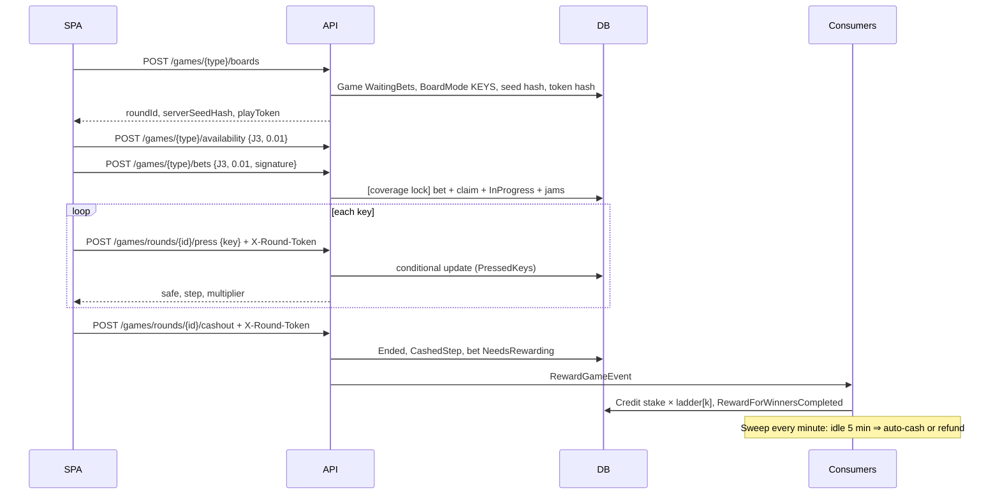

# SpaceStroker — "Key Mines" Feature — Implementation Spec

> **Status: Ready for implementation** — refined via Trello card
> [#204 Key Mines — mines game on Edson's keyboard (variant 1a, 98% RTP)](https://trello.com/c/KQyT1Ini) (2026-10-27).
> Repos affected: `monkify-backend`, `monkify-front`, `monkify-lp`, and this doc in `monkify-meta`.
> Branch / worktree: `feature/key-mines` → `.worktrees/key-mines/<repo>` (`monkify-lp` is based on
> `master`, the others on `main`).
> Change level: **Feature** ⇒ a mandatory happy-path integration test in `SpaceStroker.Tests.Integration`
> (plus one per complex flow, §11.2) and a `features/key-mines.md` KB doc at ship.
> Builds on the house-edge machinery in [`../features/hyper-roll.md`](../features/hyper-roll.md) and
> [`../features/hyper-roll-word-lines.md`](../features/hyper-roll-word-lines.md).
>
> **Purpose:** every mode today is a typer race or a weighted draw, and none lets the player decide when
> to stop. **Key Mines** is a solo player-vs-house **Mines** game on Edson's 26-key QWERTY: the player
> picks a stake and how many keys hide a jam (1, 3, 5 or 10), presses keys one at a time to climb a
> multiplier ladder, and cashes out whenever they want. A jam loses the stake. The treasury pays at
> **98% RTP, exact at every step**. Prototype (variant **1a**):
> https://claude.ai/design/p/2b5051fc-9a7c-4434-b030-f73a4dbfefce?file=Key+Mines+Playable.html

---

## 1. Summary

| | Hyper Roll (Word Lines) | **Key Mines** |
|---|---|---|
| Game type | `IsHouseEdge` | `IsHouseEdge` **+ new `IsKeyMines`** |
| What the player chooses | Stake | Stake **+ jam count `M ∈ {1,3,5,10}`** |
| Bet `Choice` | `spin` | **`J{M}`** (`J1`, `J3`, `J5`, `J10`) |
| What decides the round | One weighted draw by the typer | **The player's presses** against `M` hidden jams |
| Typer / `RunGameEvent` | Yes (~2 s) | **None** |
| What is provably fair | The drawn outcome row | **The jam set** (`M` picks without replacement from the seed keystream) |
| Payout | `stake × row pay` | **`stake × ladder[k]`** at cash-out after `k` safe presses; 0 on a jam |
| RTP | 98% | **98%, exact at every step** |
| Worst case per round | `stake × 10` (1 SOL at 0.1) | **`stake × ladder[lastStep] ≤ 1 SOL`** (the cap truncates the ladder) |
| Stake bounds | 0.002 – 0.1 SOL | **0.002 – 0.05 SOL** |
| Round end | Typer finishes | Jam, cash-out, cap/full-clear auto-cash, or **5-min inactivity** sweep |
| Consumers restart mid-round | `GameEndedAbruptely` + manual review | **Survives** |
| Orbit auto-bet | Yes | **No** (`AllowOrbit = false`) |
| Orbit manual / streamer play bets | Yes | **Yes** |

What does **not** change: open-then-bet solo rounds (`POST /games/{typeId}/boards`), the seed commit at
open, the house-edge coverage advisory lock + fail-closed balance read, treasury payouts through
`RewardGameConsumer`, the maintenance switch, board TTL/cleanup, refunds, last-stake memory, the
house-seed exit, Orbit manual and streamer bet paths.

---

## 2. Constraints (MANDATORY)

From `monkify-meta/constraints.md` (full list there):

- **Worktree per repo:** `feature/key-mines` at `.worktrees/key-mines/<repo>`; hubs stay on `main`
  (`master` for `monkify-lp`). Never `git checkout -b` on a hub. Push after commits.
- **Unit tests:** `scripts/run_tests.bat` — never a bare `dotnet test` (the `ProductionSessions` Monte
  Carlo suite is slow). Report changed tests at the end.
- **Integration tests are mandatory** (Level = `Feature`): `SpaceStroker.Tests.Integration`
  (Testcontainers), `scripts/run_integration_tests.bat`. One happy path plus one per complex flow (§11.2).
- **EF mapping inline** in `SpaceStrokerDbContext.OnModelCreating`; no `IEntityTypeConfiguration`.
  ⚠️ The context is **NoTracking**: every state change here is a conditional `ExecuteUpdate`.
- **Migrations** under `SpaceStroker.Infrastructure/Migrations/`, applied only by `SpaceStroker.Consumers`.
  Regenerate the snapshot with `dotnet ef migrations add`; never hand-edit it.
- **Secrets/config:** `spacestrokersettings.json` is product config; no credentials anywhere.
- **Vague refusals** (`constraints.md` §6): every press/cash-out refusal is one generic 400
  (`KeyMinesRequestInvalid`, *"That move could not be processed."*); a bad round token, a wrong round, an
  ended round and a repeated key are indistinguishable. Maintenance/uncoverable stake keep **"Mode is
  under maintenance. Please try again later."**
- **Money path:** whether a paid bet is accepted is decided inside the existing house-edge coverage
  advisory lock, in the same transaction as the insert (unchanged `RegisterHouseEdgeBet`).
- **Host split:** the API handles press/cash-out as **conditional state writes + one event publish**; no
  Solana call, no ledger row, no money movement in the API. Payouts and refunds stay in Consumers.
- **Provably-fair KEEP-IN-SYNC triad:** `ProvablyFair.cs`, `monkify-front/src/utils/provablyFair.ts`,
  `monkify-front/public/verify.html` get the same jam-derivation function and a pinned known-answer
  vector (§11.1).
- **New game mode ⇒ guide + LP** (`conventions/general.md`): `HOW KEY MINES WORKS` section, lobby/guide
  archetype maps, LP card + mode-count + roadmap + terms clause, all on this branch. LP legal copy is
  owner-reviewed before merge.
- **Prod logs are Warning-only:** anything ops must see (sweep actions, a sweep failure) logs at Warning.

---

## 3. Resolved product decisions

Owner decisions from the refined card (2026-10-27, short mode).

| # | Decision |
| --- | --- |
| 1 | **Variant 1a only:** classic QWERTY, the player presses the keys. Other prototype frames are follow-ups. |
| 2 | **Payout cap 1 SOL per round** (`MaxPayoutPerRound`). The ladder is truncated at the last step with `stake × ladder[k] ≤ 1`; that step auto-cashes. |
| 3 | **Stake bounds 0.002 – 0.05 SOL and the cap are create-only**, like Hyper Roll. Moving them on an existing DB is guarded SQL + an `ActiveParameters` cache drop; the front controls move with them. |
| 4 | **Jam counts `{1,3,5,10}`**, a config list validated at startup. Adding 15/20 later is config only. |
| 5 | **Lobby badge: fixed copy `UP TO 250X`.** The real best reachable step at the minimum stake is 267.66× (10 jams, step 9); "500×" (cap ÷ min) is unreachable and must never appear. |
| 6 | **Inactivity window 5 min.** ≥ 1 safe press ⇒ auto-cash at the current step (a **win**, shown as **AUTO CASH**). 0 presses ⇒ the stake is **refunded**. Hangfire sweep every minute. |
| 7 | **`IsHouseEdge = true` + new `IsKeyMines`.** `IsKeyMines` is checked **first** in every typer / weighted-draw / Word Lines branch, which steps aside. |
| 8 | **Round state = nullable columns on `Game`** (§4.1). |
| 9 | **Press and cash-out over HTTP**, idempotent, owner-guarded, rate-limited. |
| 10 | **Survives a Consumers restart** — excluded from `CloseOngoingGames`. |
| 11 | **Wallet, Orbit manual (`POST /orbit/wagers`) and streamer play bets from day one.** Win/refund lands where the stake came from. **No Orbit auto-bet** (`AllowOrbit = false`). |
| 12 | **Hall of Fame counts Key Mines** (it is type-agnostic: `Won / Amount`). **Explorer stays the four original modes.** `GameModeClassifier` returns a new `keyMines` mode, checked before `IsHouseEdge`, so a Key Mines win never unlocks `firstHyperRollWin`/`hyperHit` nor counts as Hyper Roll for explorer. Key Mines wins **do** count for `winStreak3`/`winStreak5`. |
| 13 | **Practice mode included** (`/game/practice?mode=key-mines`, front-only). |
| 14 | **Mid-round:** self-exclusion, the maintenance switch and a restart refuse **new bets only**; press and cash-out on a bet round always work. |
| 15 | **Won = payout > stake.** Every cash-out is ≥ 1.0192×, so a cash-out is a win; a jam is a loss. |

### 3.1 Spec-time decisions (flag at implementation start)

| # | Decision | Why |
| --- | --- | --- |
| S1 | **Round play token** (✅ confirmed by the owner 2026-10-27). `POST /games/{typeId}/boards` on a Key Mines type returns a one-time random `playToken` (32 bytes, base64url) and stores **only its SHA-256** on `Game.KeyMinesTokenHash`. Press and cash-out require header **`X-Round-Token`**; a mismatch is the vague 400. The SPA keeps the token with the stored board (`readStoredBoard`/`storeBoard`). | ⚠️ **Gap the card did not resolve.** A wallet-paid bet has no session, and round ids are public (history, feed, verification). Without a secret, anyone could press keys on someone else's round and lose their stake. A per-board token proves "I opened this board" for every bet source with no per-press signature. Lost token (other device) ⇒ the 5-min sweep settles the round, so no money is ever stranded. |
| S2 | **`Game.BoardMode = "KEYS"`** (`KeyMinesRules.BoardMode`) marks a Key Mines round; history, verify and the front branch on it, like `LINES`. | The column is already carried by history, verification and `ActiveGameDto`. |
| S3 | **No `GameBoardChoices` rows** for a Key Mines round; coverage prices it with `HouseEdgeRoundBook.FlatMultiplier = ladder[lastStep]`. | The ladder is a formula, not rows (decision on the card). `FlatMultiplier` already exists for exactly this. |
| S4 | **The bet starts the round in its own transaction:** inside `RegisterHouseEdgeBet`, after the solo claim, a conditional `WaitingBets → InProgress` update sets `StartDate`, `KeyMinesJamCount`, `KeyMinesJamKeys` (derived now, §6.3), `KeyMinesPressedKeys = ""` and `KeyMinesLastActionAt = now`. `BetPlacedConsumer` **returns early** for `IsKeyMines` (no `TryStartGame`, no `RunGameEvent`). | The jams depend on the bet seed (the prefix includes it), so they can only be derived once the bet exists; doing it in the same transaction means a bet never exists without its jams. |
| S5 | **Ending a round is one conditional update** on `(Id, Status = InProgress, KeyMinesPressedKeys = <expected>)` that sets `Status = Ended`, `EndDate`, `KeyMinesEnd`, `KeyMinesCashedStep`, `WinningChoice` (`C{k}` or `JAM`), and (cash-out) the bet `NeedsRewarding`; then one `RewardGameEvent` publish. A jam ends with the bet left `Made`; `RewardGameConsumer` closes it `RewardForWinnersCompleted` with nothing to pay (its existing no-winners path). | Optimistic concurrency on the pressed sequence makes press vs press vs cash-out vs sweep race-safe: exactly one update matches (AC 8). |
| S6 | **`CalculateHouseEdgeReward` gets a Key Mines branch:** multiplier = `KeyMinesLadder.Multiplier(M, k, RtpPercent)` from the round's columns, reward = `Truncate9(stake × multiplier) − AlreadyCreditedAmount`. | The shipped code keys the multiplier on a board choice; Key Mines has none. |
| S7 | **Ladder arithmetic is exact rational in `decimal`:** `pay(stake, M, k) = Truncate9(stake × RtpPercent × C(26,k) / (100 × C(26−M,k)))` — multiply first, divide last, `MidpointRounding.ToZero` at 9 dp. `C(26,13) = 10,400,600` fits in `long`. The **display multiplier** is the same expression with `stake = 1`, rounded to 4 dp for UI only. | One formula in C# and TS, no float drift between server and client. |
| S8 | **Inactivity refund ends the round `GameEndedAbruptely`** with `KeyMinesEnd = "refund"`, sets the bet `NeedsRefunding` and publishes `RefundInvalidBetEvent` (with `FundedByOrbit`/streamer flags as the existing per-bet refund paths do). | It leaves `UnsettledStatuses`, so exposure is released; stats ignore it; the 12 h pending-refund sweep is the retry. |
| S9 | **Keys = `qwertyuiopasdfghjklzxcvbnm`** (`KeyMinesRules.Keys`, the draw pool in this exact order). Pressed keys and jams are stored as lowercase letter strings in press / pick order. | Fixed, published order is what makes the draw reproducible. |
| S10 | **Bump `ActiveParameters:v4` → `:v5`.** | `GameParametersDto` gains `IsKeyMines`, `JamOptions`, `MaxPayoutPerRound`. |
| S11 | **Rate limits** (AspNetCoreRateLimit `GeneralRules`): `post:/games/rounds/*/press` **240/m**, `post:/games/rounds/*/cashout` **30/m**, per IP. | A full 1-jam clear is 25 presses; generous enough for fast play, tight enough to stop scripted grinding. |
| S12 | **Verification cache:** `GetGameVerificationHandler`'s cache gate requires `CharactersTyped.HasValue`; for `KEYS` rounds it requires `KeyMinesEnd != null` instead. | A typer-less round would otherwise never be cached (harmless but wasteful). |

---

## 4. Data model

### 4.1 Entity changes

`SpaceStroker.Domain/Games/Entities/GameParameters.cs` (next to `IsHouseEdge` :50):

```csharp
public bool IsKeyMines { get; set; }                 // default false
public string? KeyMinesJamOptions { get; set; }      // "1,3,5,10" — reconciled from config
public decimal? MaxPayoutPerRound { get; set; }      // 1.0 — create-only, like MaximumStake
```

`SpaceStroker.Domain/Games/Entities/Game.cs` (next to `WordLinesGrid` :198):

```csharp
public int? KeyMinesJamCount { get; set; }           // M, locked by the bet
public string? KeyMinesJamKeys { get; set; }         // M letters, pick order; never exposed before the end
public string? KeyMinesPressedKeys { get; set; }     // letters in press order ("" after the bet)
public int? KeyMinesCashedStep { get; set; }         // k paid at the end (null on a jam / refund)
public string? KeyMinesEnd { get; set; }             // cashout | cap | clear | idle | jam | refund
public DateTime? KeyMinesLastActionAt { get; set; }  // bet time, then every press
public string? KeyMinesTokenHash { get; set; }       // SHA-256 hex of the board's play token
```

### 4.2 EF configuration (inline, `SpaceStrokerDbContext.OnModelCreating`)

- GameParameters (:74-79): `IsKeyMines` `HasDefaultValue(false)`; `KeyMinesJamOptions` `HasMaxLength(32)`;
  `MaxPayoutPerRound` `HasPrecision(18, 9)`.
- Game (:187-190): `KeyMinesJamKeys` / `KeyMinesPressedKeys` `HasMaxLength(26)`; `KeyMinesEnd`
  `HasMaxLength(8)`; `KeyMinesTokenHash` `HasMaxLength(64)`.
- New filtered index for the sweep:
  `HasIndex(g => g.KeyMinesLastActionAt).HasFilter("\"KeyMinesJamCount\" IS NOT NULL AND \"Status\" = 4")`
  (4 = `InProgress`; confirm the enum value in the migration).

### 4.3 Migration

Additive only. From `src/`:

```bash
dotnet ef migrations add KeyMines -p SpaceStroker.Infrastructure -s SpaceStroker.Consumers
```

Latest existing migration: `20261027141713_ClearPartnerSelfReferrals`.

---

## 5. Configuration

`SpaceStroker.Common/spacestrokersettings.json` → `GeneralSettings:Operator:DefaultGames`, a new entry after
"Hyper Roll" (:276):

```json
{
  "Name": "Key Mines",
  "Description": "Press Edson's keys, dodge the jams, cash out before you hit one.",
  "RequiredAmount": 0.002,
  "MinimumNumberOfPlayers": 1,
  "AllowOrbit": false,
  "HouseEdge": {
    "RtpPercent": 98,
    "MaximumStake": 0.05,
    "KeyMines": { "JamOptions": [1, 3, 5, 10], "MaxPayoutPerRound": 1.0 }
  }
}
```

(Copy every other field — alphabet, `ChoiceRequiredLength`, `AcceptDuplicatedCharacters`, etc. — from the
Hyper Roll entry where `ToGameParameters` requires it; `ChoiceRequiredLength` is irrelevant because the
Key Mines branch in `ChoiceIsValidForGame` runs first, §6.3.)

`OperatorSettings.cs`: `HouseEdgeSettings` (:158) gains `KeyMinesSettings? KeyMines` with
`List<int> JamOptions` and `decimal MaxPayoutPerRound`; `IsKeyMines => KeyMines != null`. ⚠️ The binder
**appends** to pre-initialised lists — leave `JamOptions` uninitialised (default `new()` only in code that
reads it) so config is the single source.

`GeneralSettings:Games` (next to `HouseEdgeBoardTtlMinutes` :152): `KeyMinesInactivityMinutes: 5`,
`KeyMinesSweepIntervalMinutes: 1` (same names on `GameSettings.cs`, code defaults 5 / 1).

`IpRateLimiting:GeneralRules` (next to `boards` :101): `post:/games/rounds/*/press` 240/1m,
`post:/games/rounds/*/cashout` 30/1m.

Seeding / reconcile:

- `Consumers/Program.cs` `ToGameParameters` (:790, house-edge block :811-845): when `HouseEdge.IsKeyMines`,
  set `IsHouseEdge = true`, `IsKeyMines = true`, `MaximumStake`, `RtpPercent`, `MaxPayoutPerRound`,
  `KeyMinesJamOptions = "1,3,5,10"`, **no** `PresetChoices`, no `OutcomeTable`, no ladder/modes.
  `CreateDefaultGameParametersAsync` (:479) then inserts it on first boot.
- `HouseEdgeReconciler.Reconcile` (:47): for a Key Mines type, self-heal **only** `RtpPercent`,
  `KeyMinesJamOptions`, `IsKeyMines`, `Description`; skip every word/ladder/outcome/mode branch and the
  Word Lines cutover sweep. Never touch `RequiredAmount`, `MaximumStake`, `MaxPayoutPerRound` (create-only).
- `KeyMinesRules.Validate(parameters)` (fail closed, logged at Error, the type **opens no round**): RTP in
  (0, 100); jam list non-empty, distinct, each in 1..25; `0 < RequiredAmount ≤ MaximumStake`;
  `MaxPayoutPerRound ≥ MaximumStake × ladder[M][1]` for every `M` (every stake can make at least one step).

---

## 6. Backend behaviour

### 6.1 Domain — new `SpaceStroker.Domain/Games/Services/KeyMinesRules.cs` + `KeyMinesLadder.cs`

```csharp
public static class KeyMinesRules {
  public const string BoardMode = "KEYS";
  public const string Keys = "qwertyuiopasdfghjklzxcvbnm";   // N = 26, draw order
  public const string JamChoicePrefix = "J";               // "J3"
  public static bool TryParseChoice(string? choice, IReadOnlyCollection<int> options, out int m);
  public static IReadOnlyList<int> ParseJamOptions(string? csv);
  public static string? Validate(GameParameters p);        // null = valid, else the reason
}
public static class KeyMinesLadder {
  public static long Binomial(int n, int k);
  public static decimal Pay(decimal stake, int m, int k, decimal rtpPercent);      // S7, 9 dp ToZero
  public static decimal Multiplier(int m, int k, decimal rtpPercent);             // Pay(1, …)
  public static int LastStep(decimal stake, int m, decimal rtpPercent, decimal cap); // last k with Pay ≤ cap, ≤ 26−m
  public static decimal WorstCase(decimal stake, int m, decimal rtp, decimal cap)
      => Pay(stake, m, LastStep(stake, m, rtp, cap), rtp);
}
```

`LastStep` is always ≥ 1 for a valid type (validated in §5). Reaching `LastStep` auto-cashes; `LastStep ==
26 − m` is a full clear (`KeyMinesEnd = "clear"`), otherwise a cap stop (`"cap"`).

### 6.2 Opening a board — `GameService.OpenSoloBoard` (:684) / `DrawHouseEdgeBoard` (:615)

- `DrawHouseEdgeBoard` branches **first** on `parameters.IsKeyMines`: no `GameBoardChoices`, `BoardMode =
  "KEYS"`, everything else as today (TTL, seed + hash committed at open :700-702).
- Generate the play token (S1): 32 random bytes → base64url string returned once; persist
  `KeyMinesTokenHash = hex(SHA256(UTF8(token)))` in the same save.
- `OpenHouseEdgeBoardHandler` (:29) returns `playToken` on the response DTO only for Key Mines (null
  otherwise). The `mode` argument is ignored.

### 6.3 Placing the bet — `RegisterBetHandler` (+ the two Orbit paths)

1. **Choice:** for `IsKeyMines`, `Choice` must parse as `J{M}` with `M` in the type's jam options; else the
   vague invalid-choice refusal (paid ⇒ refunded through the existing path). Insert the Key Mines check at the
   **top** of `BetDomainService.ChoiceIsValidForGame` (:81) / `HouseEdgeChoiceIsValid` (:274), before the
   length check. `RegisterBetHandler` :153-157 (`_isWordLines`/empty choice/`spin`) must not rewrite a Key
   Mines choice; `BetPreChecks.Check` :52 likewise (and skip the duplicate-choice and per-round checks as for
   house-edge, :84/:92).
2. **Coverage** (`RegisterHouseEdgeBet` :701, lock :716, evaluate :735): the new bet's `Multiplier` =
   `KeyMinesLadder.Multiplier(M, LastStep(stake, M, rtp, cap), rtp)` instead of `WordLinesMaxPay()` (:1292).
   Streamer bets keep skipping coverage.
3. **Start the round (S4)** after `ClaimSoloRound` (:1335), in the same transaction: derive the jams,
   then `ExecuteUpdate` `WaitingBets → InProgress` with `StartDate = now`, `KeyMinesJamCount = M`,
   `KeyMinesJamKeys`, `KeyMinesPressedKeys = ""`, `KeyMinesLastActionAt = now`. 0 rows ⇒ roll back, vague
   refusal (paid ⇒ refunded).
4. **Jam derivation** — new `ProvablyFair.KeyMinesJams(string serverSeed, string prefix, int m)`:

   ```text
   ks   = new Keystream(serverSeed, prefix + "|jams")      // prefix = BuildPrefix(gameId, orderedBetSeeds)
   pool = "qwertyuiopasdfghjklzxcvbnm" as a list
   for i in 0..m-1: idx = NextIndex(ks, pool.Count); jams += pool[idx]; pool.RemoveAt(idx)
   ```

   The only bet is this one, so `orderedBetSeeds = [bet.Seed]`.
5. `BetPlacedEvent` is still published (:361); **`BetPlacedConsumer` returns early for `IsKeyMines`**
   (before :126/:198/:205).
6. **Orbit manual** (`PlaceOrbitWagerHandler` :105/:267 `BetChoiceFor`, `PlaceManualOrbitBetConsumer`
   :181): pass the body's `J{M}` through (never `spin`). **Streamer** branch type gate (:179-181) already
   admits `IsHouseEdge` — no change beyond the choice. Orbit's 10 s board-freshness margin applies as today.
7. Self-exclusion / maintenance / `ComingSoon` refuse new bets exactly as today (decision 14).

### 6.4 Press and cash-out — new `KeyMinesRoundService` (Infrastructure, used by API handlers and the sweep)

Routes (`GamesController`, `[Route("games")]`):

- `POST /games/rounds/{roundId}/press` body `{ key }` → `KeyMinesMoveDto` (route shape of the shipped `rounds/{roundId}/duel-cancel`).
- `POST /games/rounds/{roundId}/cashout` (no body) → `KeyMinesMoveDto`.
- Both require `X-Round-Token`. Handlers: `Handlers/Games/PressKeyMinesKey/*`, `Handlers/Games/CashOutKeyMines/*`.

```csharp
public sealed record KeyMinesMoveDto(
  string Result,            // "safe" | "jam" | "cashed"
  int Step,                 // safe presses so far
  decimal Multiplier,       // ladder[Step] (display, 4 dp); 0 on a jam
  decimal? Payout,          // stake × ladder[k] when the round ended paid
  bool Ended, string? End,  // KeyMinesEnd when Ended
  string? JamKeys,          // revealed only when Ended
  string? ServerSeed);      // revealed only when Ended
```

**Press** (in order; any failure ⇒ vague 400, nothing changes):

1. Load the round + parameters (no tracking). Refuse unless `IsKeyMines`, `Status = InProgress`, token hash
   matches (constant-time compare), `key` is one lowercase letter of `Keys` and not already in
   `KeyMinesPressedKeys`.
2. **Idempotent repeat:** if the request repeats the **last** pressed key of an already-ended round, return
   the stored outcome (no write). A repeated key on a live round is refused.
3. `pressed' = pressed + key`.
   - **Jam** (`key ∈ JamKeys`): S5 end with `KeyMinesEnd = "jam"`, `WinningChoice = "JAM"`, bet stays `Made`.
   - **Safe, k = |pressed'| = LastStep(stake, M, rtp, cap)**: S5 end as a cash-out at `k`, `KeyMinesEnd =
     "clear"` when `k = 26 − M`, else `"cap"`.
   - **Safe otherwise:** conditional update `PressedKeys = pressed'`, `LastActionAt = now` where
     `PressedKeys = pressed`. 0 rows ⇒ vague 400 (lost a race).
4. Any end publishes `RewardGameEvent(roundId)`. The status write goes through the existing
   `GameService.UpdateGameStatus` path so the SignalR status frame is sent as for every round.

**Cash-out:** same guards; refused when `|pressed| = 0` (nothing to cash — the player waits or the sweep
refunds). S5 end at `k = |pressed|` with `KeyMinesEnd = "cashout"`, `WinningChoice = "C{k}"`. Repeating a
cash-out on a round already ended by **this** cash-out returns the stored result (idempotent).

**Concurrency:** every write is `ExecuteUpdate … WHERE Id = @id AND Status = InProgress AND
KeyMinesPressedKeys = @expected`. The bet's `NeedsRewarding` flip runs in the same transaction as the round
end. Exactly one of {press, press, cash-out, sweep} wins; the others get the vague 400 (or, for an exact
repeat, the stored result).

### 6.5 Settlement — `RewardGameConsumer` / `BetDomainService`

- `BetDomainService.CalculateHouseEdgeReward` (:313) branches **first** on Key Mines (S6). Commission stays 0.
- `RewardGameConsumer` is otherwise unchanged: wallet ⇒ `settlement.Credit` on-chain, Orbit-funded ⇒
  `CreditWin`, streamer ⇒ `RewardStreamerWinner`; running-balance treasury check (uncoverable ⇒
  `NeedsManualAnalysis` + `ErrorWhenProcessingRewards`); `payouts[]` on `RewardForWinnersCompleted`.
- A jam round reaches the consumer with no `NeedsRewarding` bet and is closed `RewardForWinnersCompleted` by
  the existing early path (:68) — confirm it sets that status; if it does not, add it for `KEYS` rounds
  (stats only count `RewardForWinnersCompleted`).

### 6.6 Inactivity sweep — new `Jobs/KeyMinesInactivitySweepJob.cs` (Consumers)

- Registered like `HouseEdgeBoardCleanupJob` (`Program.cs` :91 `AddScoped`, :355 `AddOrUpdate`), id
  `key-mines-inactivity-sweep`, cron every `KeyMinesSweepIntervalMinutes`.
- Selects `KEYS` rounds `InProgress` with `KeyMinesLastActionAt < now − KeyMinesInactivityMinutes` (the §4.2
  index), batch 100.
  - `|pressed| ≥ 1` ⇒ `KeyMinesRoundService.CashOut(..., end: "idle", skipTokenCheck: true)`.
  - `|pressed| = 0` ⇒ S8 refund end.
- Each action logs at **Warning** (`"KEY MINES — idle round {id} auto-cashed at step {k}"` / `"… refunded"`).
  A per-round failure is logged at Error and retried next tick.

### 6.7 Restart and startup

- `GameService.CloseOngoingGames` (:578): exclude rounds whose parameters are `IsKeyMines` (join on
  `ParametersId`). A Key Mines round stays `InProgress` across a restart.
- Startup skips at `Consumers/Program.cs` :933 / :967 / :1022, `GameParametersCreatedConsumer.cs:39`,
  `HouseSeedBetService.cs:107`, `OrbitSoloAutoBetSweepJob.cs:50` already key on `IsHouseEdge` — verify none of
  them runs typer code for a Key Mines type.

### 6.8 Everything that must step aside for `IsKeyMines`

Check `IsKeyMines` first in: `SpaceStrokerTyper.cs` (house-edge branches :23-30, :147, :207-211, :221,
:260, :314-320, :385 — never constructed for Key Mines), `RunGameConsumer.cs` :56/:74 (never reached),
`BetPlacedConsumer.cs` :126/:198 (early return), `GameService.cs` `SecondsUntilGameStarts` :454-466,
`DrawHouseEdgeBoard` :633/:641, the Word Lines grid :341-356 / :393, `RunGame` :293; the `LINES`/`spin`
branches in `RegisterBetHandler` :153/:157/:736, `BetDomainService` :27/:315, `BetPreChecks` :52,
`CheckBetAvailabilityHandler` :105/:118, `PlaceOrbitWagerHandler` :268, `PlaceManualOrbitBetConsumer` :181,
`GetHouseEdgeRoundHandler` :44.

### 6.9 Read paths and contracts

- **`GameParametersDto`**: `IsKeyMines`, `JamOptions: int[]`, `MaxPayoutPerRound`. `RtpPercent` 98 (STATS
  badge `98% RTP`), `CommissionPercentage` 0, `Outcomes`/`Modes`/`PresetChoices` empty. Cache key `:v5` (S10).
- **`ActiveGameDto`** (live round via `GET /games/rounds/{id}` and `GET /games/{typeId}?wallet=`):
  `KeyMinesJamCount`, `KeyMinesPressedKeys`, `KeyMinesStep`, `KeyMinesEnd`, `KeyMinesCashedStep`, and
  `KeyMinesJamKeys` **only when the round is in `GameEndedStatus`**. Never the token or its hash.
- **`CheckBetAvailabilityHandler`** (:60/:105): for Key Mines, `{ choice: "J{M}", amount }` is priced at
  `WorstCase` (decision 2 coverage). Invalid `M` ⇒ `{ available: false }`.
- **`GetGameVerificationHandler`** + `GameVerificationDto`: `BoardMode = KEYS`, `KeyOrder` (= `Keys`),
  `JamCount`, `PressedKeys`, `KeyMinesEnd`, `CashedStep`, and after the reveal `JamKeys`. Cache gate per S12.
- **History** (`GameHistoryService.cs`, `GameHistoryDto` + `ClonePublic`): `KeyMinesJamCount`,
  `KeyMinesCashedStep`, `KeyMinesEnd`. "Won" = payout > stake (already the LINES rule — extend it to `KEYS`).
- **Player/global/per-type stats** (`PlayerStatsService`, `GlobalStatsService`, `GameStatsService`): extend the
  `LINES` "won = credited > stake" rule to `KEYS`.
- **Profile** (`GameModeClassifier.cs` :8-27): add `KeyMines = "keyMines"`, checked **before** `IsHouseEdge`.
  `PlayerProfileService` (:150-160, :183-193, :246): `allModes` for explorer stays the original four; Key
  Mines rounds count for streaks; never for `firstHyperRollWin` / `hyperHit`.
- **Leaderboards**: no change (`LeaderboardService` :426-466 is type-agnostic). Streamer bets stay excluded.

---

## 7. Frontend behaviour (`monkify-front`)

### 7.1 Types — `src/types/index.ts`

`ActiveGame` (23): `isKeyMines?: boolean`, `jamOptions?: number[]`, `maxPayoutPerRound?: number`.
`GameInstance` (476): `keyMinesJamCount`, `keyMinesPressedKeys`, `keyMinesStep`, `keyMinesEnd`,
`keyMinesCashedStep`, `keyMinesJamKeys`. New `KeyMinesMove` (the §6.4 DTO). `GameVerification` (592) and
`GameHistoryRow` (~229) gain the §6.9 fields. `ProfileMode` (376) gains `'keyMines'`.

### 7.2 New `src/utils/keyMines.ts` (mirrors `KeyMinesLadder`)

`KEY_MINES_KEYS`, `binomial`, `pay(stake, m, k, rtp)` (BigInt-safe exact rational, truncated to 9 dp),
`multiplier(m, k, rtp)`, `lastStep(stake, m, rtp, cap)`, `ladderWindow(m, step, rtp, size = 8)`,
`parseJamChoice`, `jamChoice(m) => 'J' + m`. Unit-test it against the §11.1 table.

### 7.3 Archetype, lobby, art

- `utils/gameArchetype.ts`: add `'keyMines'` to the union and resolve `if (game.isKeyMines) return 'keyMines'`
  **before** `isHouseEdge` (:19+). `utils/gameCatalogue.ts:20` `SHOWN_ORDER`: insert `'keyMines'` after
  `'houseEdge'`.
- `utils/gameArt.ts` (:42/:61/:72/:117): `'key-mines'` art + poster placeholder in `assets/types/` (brief: Edson
  at a typewriter, one key smoking — placeholder ships).
- Every archetype-keyed map: `GuideModeCards.vue` `BLURB` (98) / `ARCHETYPE_LABEL` (121) / `ARCHETYPE_ACCENT`
  (131) (⚠️ a missing key crashes the block); `GameTypeCard.vue` `tag` (145) = `'26 KEYS · PICK YOUR JAMS'`,
  `badges` (274) = `1P · VS HOUSE` + `UP TO 250X`, chip "from <min> SOL" (393), `.accent-keyMines` CSS;
  `header/GameSwitcher.vue` (134/318); `useLiveGames.ts:101`; `GameStatsPanel.vue` (65-120) /
  `GameStatsPage.vue` (345-356); `admin/GameTypeList.vue` `modeLabel` (23); `PlayerProfilePage.vue` `ART`
  (208) + rows meta (214-236).
- Orbit: `orbit/OrbitGameTiles.vue`, `useOrbit.ts` (902-990), `useOrbitAutoBet.ts` (88-90),
  `useOrbitRedirect.ts:135` — Key Mines is never an auto-bet tile (`AllowOrbit = false` keeps it out of
  `eligibleGameTypes`), but every `isHouseEdge` test there must not treat it as Hyper Roll.
- All modes on **one desktop row**: `GameTypes.vue` `lg:grid-cols-4` → re-check 1024/1280/1440 px with five
  cards; if they no longer fit, redesign the cards (`conventions/general.md`), don't wrap.

### 7.4 Game screen

- `GamePage.vue` `onPlate` (45-50) adds `isKeyMines`. `GameConsole.vue` (865) and `GameTerminal.vue`
  (~1058) get a **first** branch to new `KeyMinesConsole.vue` / `KeyMinesScreen.vue` (self-contained like the
  duel screen), on `ConsolePlate.vue`. `GameMonkey.vue:113` handles the archetype.
- **Screen (owner design V4, 2026-10-28): letters only.** The tube holds two things, in Hyper Roll's
  terminal look (green on black, the reel blocks of `WordLinesGrid`): the **paired steps** row
  (`KeyMinesLadder.vue`, an 8-step `ladderWindow` with lead 6 so the first letters stay in view) — each
  pressed letter in a race-lane square (`RaceLanes` cells) over the multiplier that press reached in a reel
  block — and the **keyboard** (`KeyMinesKeyboard.vue`), 26 reel blocks. No title, chips, CRT box, seed /
  COMMIT / VERIFY lines. One status line appears at the bottom only when needed (PLACING BET, the
  `blockedLine`, a refusal, the read-only note), plus the dev FREE BET toggle in dev builds. The commit and
  the post-round check live in the header's FAIR panel.
- **Colour = Hyper Roll's tier ladder** (`keyMinesTier` = `tierForPay`: green < 2×, blue < 5×, purple < 8×,
  gold ≥ 8×; `WORD_LINES_TIER_HEX/RIM`). A reached multiplier fills in its own tier, NEXT is outlined in the
  tier it would reach, a safe key fills in the tier of the step it reached, the NOW / PAID readouts wear the
  tier. Red only for a jam. The cash-out card is `HyperRollWinFx variant="win"` with **no colour override**,
  so its colour, coins, shake, gold ring and fanfare (`playWinSting`) all follow the paid multiplier exactly
  as a Hyper Roll win. Safe presses tick up Word Lines' trace scale; a jam plays Edson's curse.
- **Ready:** stake plate (HALF / ×2 / MAX like Word Lines, bounds 0.002–0.05), the jam keys `1 · 3 · 5 · 10`
  as the board's number-key sprites (`buttons/button{n}-gray|gold.png`, picked one gold and pressed in,
  engraved `JAMS`; ⚠️ `button10-*` is a stand-in until the 10 key is drawn), the first-key LCD, lever/START.
  **Live:** NOW / CASH OUT FOR readouts; CASH OUT enabled from step 1. **Jam:** the jam's step and key red,
  every jam revealed. **Cashed:** the win card + `PAID` on the plate, 9 s hold then rollover to a fresh
  board.
- Keyboard input: physical key presses map to the on-screen keys while the round is live (ignored while an
  input has focus).

### 7.5 `src/hooks/useKeyMines.ts` (+ `useGame.ts` integration)

- Open board via the existing `openHouseEdgeBoard` (`mainService.ts:115`); store `{ roundId, playToken }`
  with `storeBoard` (`useGame.ts:134`). Restore on reload through `getHouseEdgeRound` (`:120`) and resume
  presses with the stored token. No token (other device) ⇒ the screen shows the round read-only with *"This
  round finishes on its own in a few minutes."*
- Bet via the existing `runBet` (`useGame.ts:1737`) with `choice = 'J' + M`: bounds + fee headroom, then
  `checkGameAvailability` (`:199`) with that choice, then the wallet / Orbit (`placeFromOrbit` :1606) /
  streamer source from `nextBetSource` (:644). Add Key Mines to `isStreamerPlayable` (:624). The stake
  helpers gated `if (!game?.isHouseEdge)` (:2413-2497) work unchanged; last-stake memory applies.
- New `mainService.pressKeyMines(roundId, key, token)` / `cashOutKeyMines(roundId, token)` sending
  `X-Round-Token`. A press is **serialized** (one request in flight; extra key taps are dropped, never queued).
  A 400 on press ⇒ re-read the round (`getHouseEdgeRound`) and render whatever the server says.
- The solo-round safety net (`useGame.ts` :2982-3075) treats a `KEYS` round as unsettled while `InProgress`
  **without** the 60 s "delayed" stall (a live Key Mines round can legitimately sit idle for 5 min).

### 7.6 History, fair panel, verify, profile

- `GameHistoryPage.vue` (45-52): a `KEYS` row reads `3 JAMS · STEP 7 · 2.63×` / `JAMMED AT STEP 4` /
  `AUTO CASH · STEP 7`, with `WON x` for a paid round and `LOST` for a jam.
- `GameFairPanel.vue` (113/127/306): decided-by `JAM DRAW - KEY MINES`, shows jams vs presses.
  `utils/provablyFair.ts` + `public/verify.html`: add `keyMinesJams(serverSeed, prefix, m)` (KEEP-IN-SYNC,
  §6.3 algorithm) with the §11.1 vector quoted in both, and render keys pressed / jams / step / payout.
- Profile recent rounds render `keyMines` with its art.

### 7.7 Practice — `/game/practice?mode=key-mines`

`constants/practiceGame.ts` `PracticeMode` (404) + `resolvePracticeMode` (416); new
`hooks/usePracticeKeyMines.ts` (model: `usePracticeHyperRoll.ts`) with `Math.random` jams and the same
ladder; `PracticePage.vue:36`, `PracticeTerminal.vue` (78-83), `PracticeConsole.vue` branch on it;
`useHowToPlay.ts` `practiceMode` (26) / `openPractice` (55). No backend call.

### 7.8 How to play

`constants/guideSections.ts`: `GuideSectionId` `'key-mines'`, a `GUIDE_SECTIONS` entry after `hyper-roll`
(:219) titled `HOW KEY MINES WORKS`; new `components/guide/sections/GuideKeyMines.vue` (tag chip, one intro
paragraph, five-step `GuideRail`: set stake → pick jams → press keys → cash out or jam → verify; one closing
line; `GuideTip` **THE WHOLE GAME**). Step art = 2× nearest-neighbour crops of the live cabinet
(`assets/guide/key-mines-*.png`), dev-only controls hidden. No figures that go stale. Update the THE MODES
intro that counts the kinds of table.

---

## 8. Flow



---

## 9. Out of scope

- Orbit auto-bet (variant 1b) and the other prototype frames (Edson auto-press, phone lever, sudden death,
  word bonus).
- Final pixel-art poster (a placeholder ships).
- A Key Mines trophy; changing explorer.
- A SignalR transport for presses.
- Resuming a live round from a device that does not hold its play token.

---

## 10. File checklist

### 10.1 Backend (`monkify-backend/src`)

| # | File | Change |
| --- | --- | --- |
| 1 | `SpaceStroker.Domain/Games/Entities/GameParameters.cs` | `IsKeyMines`, `KeyMinesJamOptions`, `MaxPayoutPerRound` |
| 2 | `SpaceStroker.Domain/Games/Entities/Game.cs` | Seven `KeyMines*` columns (§4.1) |
| 3 | **new** `SpaceStroker.Domain/Games/Services/KeyMinesRules.cs`, `KeyMinesLadder.cs` | §6.1 |
| 4 | `SpaceStroker.Domain/Games/Services/ProvablyFair.cs` | `KeyMinesJams` (§6.3) |
| 5 | `SpaceStroker.Domain/Configs/Entities/OperatorSettings.cs`, `GameSettings.cs` | `KeyMinesSettings`; inactivity/sweep settings |
| 6 | `SpaceStroker.Domain/Bets/Services/BetDomainService.cs` | Key Mines choice validation first; reward branch (S6) |
| 7 | `SpaceStroker.Infrastructure/Data/Context/SpaceStrokerDbContext.cs` | §4.2 mapping + sweep index |
| 8 | **new** `SpaceStroker.Infrastructure/Migrations/*_KeyMines.cs` | Additive |
| 9 | `SpaceStroker.Infrastructure/Services/Games/GameService.cs` | `DrawHouseEdgeBoard` branch, token, `CloseOngoingGames` exclusion |
| 10 | `SpaceStroker.Infrastructure/Services/Games/HouseEdgeReconciler.cs` | Key Mines heal set; skip word/ladder/cutover |
| 11 | `SpaceStroker.Infrastructure/Services/Games/HouseEdgeCoverageService.cs` | `LoadAsync`: Key Mines book with `FlatMultiplier = WorstCase multiplier` |
| 12 | **new** `SpaceStroker.Infrastructure/Services/Games/KeyMinesRoundService.cs` (+ interface) | Press / cash-out / end (S5) |
| 13 | `Handlers/Games/OpenHouseEdgeBoard/*` | `playToken` on the response |
| 14 | `Handlers/Games/RegisterBet/RegisterBetHandler.cs` | Choice passthrough, coverage multiplier, S4 start + jams |
| 15 | `Handlers/Games/BetPreChecks.cs`, `CheckBetAvailability/*` | `J{M}` handling + pricing |
| 16 | **new** `Handlers/Games/PressKeyMinesKey/*`, `Handlers/Games/CashOutKeyMines/*` | §6.4 |
| 17 | `Handlers/Games/GetHouseEdgeRound/*`, `Contracts/Games/ActiveGameDto.cs` | Key Mines fields, jams only when ended |
| 18 | `Handlers/Games/GetGameVerification/*`, `Contracts/Games/GameVerificationDto.cs` | §6.9 + S12 |
| 19 | `Contracts/Games/GameParametersDto.cs`, `GetActiveParameters` handler | DTO fields; cache `:v5` |
| 20 | `Handlers/Orbit/PlaceOrbitWager/*`, `Consumers/OrbitBetPlacement/PlaceManualOrbitBetConsumer.cs` | Pass `J{M}` through |
| 21 | `Consumers/BetPlaced/BetPlacedConsumer.cs` | Early return for Key Mines |
| 22 | `Consumers/RewardGame/RewardGameConsumer.cs` | Verify the jam-round close path (§6.5) |
| 23 | **new** `Jobs/KeyMinesInactivitySweepJob.cs` | §6.6 |
| 24 | `Services/Games/GameHistoryService.cs`, `GameHistoryDto` | Key Mines fields, won rule |
| 25 | `Services/Players/PlayerStatsService.cs`, `Services/Games/GlobalStatsService.cs`, `GameStatsService.cs` | won rule for `KEYS` |
| 26 | `Services/Players/GameModeClassifier.cs`, `PlayerProfileService.cs` | `keyMines` mode, explorer unchanged |
| 27 | `SpaceStroker.Api/Controllers/GamesController.cs` | `press`, `cashout` routes + `X-Round-Token` |
| 28 | `SpaceStroker.Consumers/Program.cs` | `ToGameParameters` Key Mines block, job registration |
| 29 | `SpaceStroker.Common/spacestrokersettings.json` | Default game, games settings, rate limits |
| 30 | `SpaceStroker.Tests.Integration/Harness/IntegrationGameParameters.cs` | `KeyMines` test type (0.002 / 0.05 / cap 1 / jams 1,3,5,10) |

### 10.2 Frontend (`monkify-front/src`)

| # | File | Change |
| --- | --- | --- |
| 1 | `types/index.ts`, `types/orbit.ts` | §7.1 |
| 2 | **new** `utils/keyMines.ts` | §7.2 |
| 3 | `utils/gameArchetype.ts`, `gameCatalogue.ts`, `gameArt.ts` | Archetype, order, art |
| 4 | `components/game-selection/GameTypeCard.vue`, `header/GameSwitcher.vue`, `guide/GuideModeCards.vue` | Maps, badges, accent |
| 5 | `pages/GamePage.vue`, `components/game/GameConsole.vue`, `GameTerminal.vue`, `GameMonkey.vue` | First branch to Key Mines |
| 6 | **new** `components/game/KeyMinesConsole.vue`, `KeyMinesScreen.vue`, `KeyMinesKeyboard.vue`, `KeyMinesLadder.vue` | §7.4 |
| 7 | **new** `hooks/useKeyMines.ts`; `hooks/useGame.ts` | §7.5 |
| 8 | `services/mainService.ts` | `pressKeyMines`, `cashOutKeyMines` |
| 9 | `pages/GameHistoryPage.vue`, `components/game/GameFairPanel.vue`, `utils/provablyFair.ts`, `public/verify.html` | §7.6 |
| 10 | `pages/PlayerProfilePage.vue`, `GameStatsPanel.vue`, `pages/GameStatsPage.vue`, `admin/GameTypeList.vue`, `useLiveGames.ts` | Archetype handling |
| 11 | `orbit/OrbitGameTiles.vue`, `hooks/useOrbit.ts`, `useOrbitAutoBet.ts`, `useOrbitRedirect.ts` | Never treat as Hyper Roll |
| 12 | `constants/practiceGame.ts`, **new** `hooks/usePracticeKeyMines.ts`, `hooks/usePracticeGame.ts`, `pages/PracticePage.vue`, `components/practice/*`, `hooks/useHowToPlay.ts` | §7.7 |
| 13 | `constants/guideSections.ts`, **new** `components/guide/sections/GuideKeyMines.vue`, `assets/guide/key-mines-*.png` | §7.8 |
| 14 | `assets/styles/colors.css`, `tailwind.config.js` | Hazard tokens |

### 10.3 Landing page (`monkify-lp/src`, branch from `master`)

| # | File | Change |
| --- | --- | --- |
| 1 | `components/GameModes.vue` | Key Mines card in lobby order; `accent` union gains `"keymines"`; five cards on one desktop row |
| 2 | `assets/cards/keymines-poster.png` | Placeholder poster |
| 3 | `pages/index.astro:371` | "Five ways…" mode-count copy |
| 4 | `components/SpaceRoadmap.vue:53` | "All 5 game modes live — races, Hyper Roll, Key Mines, Monkey Duel & lotteries" |
| 5 | `pages/terms.astro` | Key Mines clause after Monkey Duel (:91): vs the house, no house cut, 98% RTP, payout `stake × ladder step`, 1 SOL cap per round, auto-cash after 5 min idle, provably-fair jams; bump `LAST_UPDATED` |

### 10.4 Meta (`monkify-meta`)

| # | File | Change |
| --- | --- | --- |
| 1 | `specs/key-mines.md` | This spec |
| 2 | `INDEX.md` | Map row + feature in flight |
| 3 | `features/key-mines.md` | At ship (`/monkify-ship-feature`) |

---

## 11. Tests

### 11.1 Unit — `SpaceStroker.Tests` (`scripts/run_tests.bat`)

Ladder reference values (RTP 98, multiplier = `0.98 × C(26,k) / C(26−M,k)`):

| M | k=1 | k=3 | k=5 | k=8 | last full-clear / notable |
|---|---|---|---|---|---|
| 1 | 1.0192 | 1.1078 | 1.2133 | 1.4156 | k=24 12.7400 · k=25 25.4800 |
| 3 | 1.1078 | **1.4387** | 1.9158 | 3.1225 | k=15 15.4424 · k=21 254.8000 |
| 5 | 1.2133 | 1.9158 | 3.1679 | 7.5239 | k=10 14.7583 · k=16 255.8111 |
| 10 | 1.5925 | 4.5500 | 14.7583 | 118.9611 | k=9 267.6625 |

`LastStep` at cap 1 SOL: M=1 ⇒ 25/25/25/25/24 for stake 0.002/0.005/0.01/0.02/0.05; M=3 ⇒ 21/20/19/18/15;
M=5 ⇒ 16/15/14/12/10; M=10 ⇒ 9/8/7/6/5.

| Test file | Test cases | Expected |
| --- | --- | --- |
| **new** `UnitTests/Domain/Games/KeyMinesLadderTests.cs` | Table above (multiplier, 4 dp); `Pay(0.01, 3, 3) = 0.014387351` (9 dp ToZero); `LastStep` table; `WorstCase ≤ cap` for every (stake grid 0.002..0.05, M); every step's EV = 0.98 exactly (`Pay(1)·P(k)`) | Exact |
| **new** `UnitTests/Domain/Games/KeyMinesRulesTests.cs` | `TryParseChoice` (`J3` ok; `J2`, `j3`, `J`, `spin`, `J30` refused); `Validate` (bad RTP, empty/duplicate/out-of-range jams, cap below one step) | As stated |
| `UnitTests/Domain/Games/ProvablyFairTests.cs` | **V5 vector:** seed `4f3c2a1b…aa00` (V3's), prefix `11111111-1111-1111-1111-111111111111|seedA`, M = 3 and M = 10 → freeze the returned jam strings, quote them in `provablyFair.ts` / `verify.html`; jams are distinct letters of `Keys` | Frozen |
| `UnitTests/Domain/Games/BetDomainServiceTests.cs` | Key Mines: `J3` valid, `spin`/word invalid, stake bounds; reward = `Pay(stake, M, k)` for cashed k; redelivery subtracts prior credit; jam round ⇒ no winner | Exact |
| `UnitTests/Domain/Games/HouseEdgeCoverageTests.cs` | A Key Mines book with `FlatMultiplier` prices `stake × ladder[lastStep]` | ≤ 1 SOL |
| `UnitTests/Handlers/RegisterBetHandlerTests.cs` | `J3` stored as is, round → InProgress with 3 jams + `LastActionAt`; invalid M refused (paid refunded); uncoverable refused | |
| `UnitTests/Handlers/CheckBetAvailabilityHandlerTests.cs` | Key Mines priced at `WorstCase`; invalid M ⇒ unavailable | |
| `UnitTests/Handlers/OpenHouseEdgeBoardHandlerTests.cs` | Key Mines: no board rows, `KEYS`, seed hash, token returned, hash stored | |
| **new** `UnitTests/Services/KeyMinesRoundServiceTests.cs` | safe press; jam; cap auto-cash (`cap`); full clear (`clear`); cash-out; cash-out with 0 presses refused; repeated key refused; wrong token refused; ended round refused; exact repeat of the last press/cash-out returns the stored result; lost race (expected `PressedKeys` changed) refused | (⚠️ NoTracking: assert persisted state) |
| **new** `UnitTests/Jobs/KeyMinesInactivitySweepJobTests.cs` | idle ≥ 1 press ⇒ `idle` cash-out; idle 0 presses ⇒ refund event; fresh round untouched; non-Key-Mines untouched | |
| `UnitTests/Services/GameServiceTests.cs` | `CloseOngoingGames` leaves a Key Mines `InProgress` round alone, still closes a Hyper Roll one | |
| `UnitTests/Services/HouseEdgeReconcilerTests.cs` | Key Mines: heals RTP/jams, never stake bounds/cap, no word/outcome writes | |
| `UnitTests/Consumers/BetPlacedHandlerTests.cs` | Key Mines bet ⇒ no `TryStartGame`, no `RunGameEvent` | |
| `UnitTests/Consumers/RewardGameConsumerTests.cs` | Cash-out: wallet credit / Orbit `CreditWin` / streamer play ledger; jam ⇒ `RewardForWinnersCompleted`, nothing paid | |
| `UnitTests/Services/GameModeClassifierTests.cs`, `PlayerProfileServiceTests` | Key Mines ⇒ `keyMines`; not `firstHyperRollWin`; explorer unchanged; streak counts | |
| `UnitTests/Services/GameHistoryServiceTests.cs`, stats tests | `KEYS` won = credited > stake | |
| `UnitTests/Api/*Binding*Tests.cs`, `DefaultGameSeedingTests` | Key Mines default binds (jams, cap, bounds) and seeds once | |
| `UnitTests/Handlers/AdminGameTypeHandlerTests.cs` | Cache key `ActiveParameters:v5` | |

Front: unit-test `utils/keyMines.ts` against the same table if the repo has a TS test runner; otherwise a
build + type-check and a manual check of the ladder window against §11.1.

### 11.2 Integration — `SpaceStroker.Tests.Integration` (`scripts/run_integration_tests.bat`)

New `KeyMinesFlowTests` (`[Collection(IntegrationCollection.Name)]`, pattern `HyperRollWordLinesFlowTests`).
The test reads `Game.KeyMinesJamKeys` from the DB to choose safe/jam keys.

1. **Happy path (mandatory):** open board (token, `KEYS`, seed hash) → wallet bet 0.01 SOL `J3` → 3 safe
   presses → cash out ⇒ `RewardForWinnersCompleted`, one `Credit` of **0.014387351 SOL** to the wallet in
   `FakeSolanaService.Transfers`, no commission, history row won.
2. **Jam:** bet → press a jam ⇒ Ended → `RewardForWinnersCompleted`, no transfer, jams + seed revealed.
3. **Cap auto-cash:** bet 0.05 `J10` → 5 safe presses ⇒ auto-ended `cap` at step 5, paid `Pay(0.05,10,5)`.
4. **Inactivity:** run `KeyMinesInactivitySweepJob` with the clock past 5 min — (a) 2 presses ⇒ `idle` cash-out
   paid; (b) 0 presses ⇒ refunded, bet `Refunded`.
5. **Restart survival:** bet + 2 presses → run `CloseOngoingGames` ⇒ round still `InProgress`, bet not
   `NeedsManualAnalysis` → press + cash out ⇒ paid.
6. **Orbit manual:** funded Orbit player → `POST /orbit/wagers` `J3` → presses → cash out ⇒ `CreditWin` to custody.
7. **Streamer:** active streamer → play bet → cash out ⇒ play-ledger credit, no transfer, no `TransactionLog`.
8. **Concurrency:** two simultaneous cash-outs (or press + cash-out) ⇒ exactly one `Credit`.
9. **Verify round-trip:** after the end, `GET /games/{id}/verification` exposes jams and seed;
   `ProvablyFair.KeyMinesJams` recomputed from them matches; before the end no endpoint returns the jams.

Also update `DefaultGameSeedingTests` (Key Mines seeded) and confirm `HyperRoll*`, `OrbitSoloAutoBetFlowTests`
and `StreamerWalletsFlowTests` stay green.

---

## 12. Rollout

Order **Consumers → API → front**, back to back, off-peak; LP after the app is live.

- Migration `KeyMines` is additive. First Consumers boot inserts the "Key Mines" type (live in
  `/games/active-types` at once).
- ⚠️ **Known window:** until the new front is served, the old front resolves Key Mines as `houseEdge` (it
  has `isHouseEdge`) and shows the Word Lines UI; a bet from it sends `spin` and is refused + refunded (no
  money lost). Deploy the front right after the API. The old API (until the new revision is live) cannot
  open a working Key Mines board either — same vague refusal.
- `ActiveParameters:v5` rebuilds on first read.
- Treasury: the per-round worst case is 1 SOL; coverage already blocks a bet the treasury can't cover.
- Prove it: `/games/active-types` lists Key Mines with `isKeyMines: true`, `jamOptions [1,3,5,10]`,
  `rtpPercent 98`; one `POST /games/{type}/boards` returns `boardMode: KEYS` + a `playToken`.

---

## 13. Acceptance criteria

From the Trello card's **Acceptance Criteria** checklist (21 items):

1. Given an open Key Mines board, when a wallet bets 0.01 SOL with 3 jams, presses 3 safe keys and cashes out, then the round ends Ended → RewardForWinnersCompleted and the wallet is paid 0.01 × 1.4387 = 0.014387 SOL on-chain with one Credit row and no commission (integration happy path).
2. Given a live Key Mines round, when the owner presses a jammed key, then the round ends, nothing is paid, every jam is revealed with the server seed, and the bet counts as a loss in history and stats.
3. Given jam count M and stake S, when the ladder is computed, then ladder[k] = 0.98 / (C(26−M,k)/C(26,k)) for every k, and the last reachable step is the last k with S × ladder[k] ≤ 1 SOL (e.g. 0.002 SOL / 10 jams → step 9 at 267.66×; 0.05 SOL / 1 jam → step 24 at 12.74×), pinned by a unit-test table.
4. Given a round whose next safe press reaches the last step the 1 SOL cap allows (or clears every safe key), when that key is pressed, then the round auto-cashes at that step and pays stake × ladder[lastStep] (integration test).
5. Given a Key Mines round with ≥ 1 safe press and no action for 5 minutes, when the every-minute sweep runs, then the round auto-cashes at its current step, counts as a win, and history shows AUTO CASH (integration test).
6. Given a placed Key Mines bet with 0 presses and no action for 5 minutes, when the sweep runs, then the stake is refunded to where it came from (wallet, Orbit custody or the streamer play ledger) and the bet ends Refunded (integration test).
7. Given a Key Mines round InProgress with presses, when Consumers restarts, then the round is NOT moved to GameEndedAbruptely, its bet is NOT NeedsManualAnalysis, and the owner can keep pressing and cash out afterwards (integration test).
8. Given concurrent press/cash-out requests (or a press racing the sweep) on one round, when they land together, then exactly one state change wins, the others get a vague 400, and money moves at most once; repeating a cash-out returns the same result.
9. Given a non-owner, an ended round, a repeated key, an invalid key or a non-Key-Mines round, when press or cash-out is called, then it is refused with a vague 400 and nothing changes.
10. Given a bet with jam count outside {1,3,5,10} or a stake outside 0.002–0.05 SOL, when it is placed, then it is refused (vague InvalidAmount / invalid choice) and a verified paid stake is refunded.
11. Given unsettled Key Mines rounds, when coverage is evaluated (bet backstop and /availability), then each round reserves stake × ladder[lastStep] (≤ 1 SOL) next to Hyper Roll and jackpot exposure, a bet the treasury cannot cover is refused with the maintenance message, and streamer play rounds reserve nothing.
12. Given an opened board, when the round ends, then GET /games/{id}/verification exposes the server seed and jam keys, and recomputing the M picks without replacement from HMAC-SHA256(serverSeed, prefix + "|jams") in ProvablyFair.cs, provablyFair.ts and verify.html matches the stored jams and a pinned known-answer vector (integration round-trip). Before the end, no endpoint reveals a jam.
13. Given a player with a funded Orbit balance, when they bet Key Mines via POST /orbit/wagers and cash out a win, then the win is credited to Orbit custody (CreditWin) and no wallet signature was needed (integration test).
14. Given an active streamer wallet, when it plays Key Mines and cashes out, then the win is credited to the play ledger only, no on-chain transfer or TransactionLog row exists, and money stats/leaderboards are unchanged (integration test).
15. Given a Key Mines round, when it runs, then no typer, RunGameEvent, weighted draw or Word Lines grid is produced, the house seed bet does not fire, and Orbit auto-bet never lists or plays the type (AllowOrbit = false).
16. Given a self-exclusion or HouseEdgeEnabled = false set after a bet was placed, when the owner presses or cashes out, then both still work; new Key Mines bets are refused.
17. Given a cashed-out Key Mines win, when trophies are derived, then GameModeClassifier returns the Key Mines mode, firstHyperRollWin is NOT unlocked, explorer still requires only the four original modes, winStreak3/5 count the win, and the Hall of Fame ranks its multiplier.
18. Given a reload mid-round, when the page opens, then GET /games/rounds/{id} restores pressed keys, step and the ladder window without exposing jams, and the player can continue.
19. Given the lobby, when it renders, then Key Mines shows as archetype key-mines with badges 1P · VS HOUSE and UP TO 250X, all modes fit one desktop row at 1024/1280/1440px, and GuideModeCards renders without error.
20. Given /how-to-play and /game/practice?mode=key-mines, when opened, then a HOW KEY MINES WORKS section (five-step GuideRail, live-cabinet crops, no stale figures) is present and a front-only practice round plays with random jams and no backend call.
21. Given monkify-lp, when built, then GameModes.vue has a Key Mines card in lobby order, the mode-count copy and roadmap line include it, and terms.astro has an owner-reviewed Key Mines clause (vs house, 98% RTP, 1 SOL per-round cap, inactivity auto-cash) with LAST_UPDATED bumped.

Spec-time additions (S1): 22. Given a press or cash-out without the board's `X-Round-Token`, then it is
refused with the same vague 400 (integration case inside test 8/9).

---

## 14. Manual QA (local stack)

1. Rebuild the local stack (this card **has** a migration). Copy the hub `yarn.lock` into the front worktree
   before building; verify the served bundle changed.
2. `/games/active-types`: Key Mines with `isKeyMines`, `jamOptions`, `rtpPercent 98`, min 0.002 / max 0.05.
3. Lobby: five cards on one row at 1024/1280/1440; Key Mines badges `1P · VS HOUSE` / `UP TO 250X`.
4. Play with free bets on (dev toggle) and with a paid devnet bet: ready → press safe keys (ladder advances,
   letters fill the steps row, colours climb green → blue → purple → gold) → cash out (paid amount =
   stake × ladder[k]; the win card wears the paid multiplier's tier).
5. Hit a jam: red key, all jams revealed; FAIR (header) verifies the round; `verify.html` reproduces the jams.
6. Reload mid-round: keys and step restore; continue and cash out.
7. Leave a round idle 5 min: AUTO CASH in history; a bet with no press is refunded.
8. Restart the consumers container mid-round: continue and cash out.
9. Orbit-funded bet and a streamer bet (local streamer override) each settle to the right ledger.
10. `/game/practice?mode=key-mines` and `HOW KEY MINES WORKS`; LP `npm run build`, `#modes` on desktop + phone.

---

## 15. Trello / pipeline

- **Source card:** [#204](https://trello.com/c/KQyT1Ini) — list **Specs created**; the **Implementation**
  block on the card carries the branch, worktree and level.
- **Next:** `/monkify-implement-feature` → then `/monkify-ship-feature`.

---

## 16. Revision log

| Date | Change |
| --- | --- |
| 2026-10-27 | Initial spec from the refined card (#204) after a code pass over `GameParameters`/`Game`, `SpaceStrokerDbContext`, `spacestrokersettings.json`, `OperatorSettings`, `HouseEdgeRules`/`HouseEdgeCoverage(Service)`, `HouseEdgeReconciler`, `GameService` (open/Ended/CloseOngoingGames), `RegisterBetHandler`, `BetPlacedConsumer`, `RunGameConsumer`, `BetDomainService`, `RewardGameConsumer`, `BetPreChecks`, availability, verification, the Orbit wager paths, profile/leaderboard services, Hangfire wiring, the integration harness, and the front (archetype maps, `useGame`, console/terminal, practice, guide, history, fair panel, verify) and LP. Added S1 (round play token) for the wallet-bet ownership gap. |
| 2026-10-28 | Owner design V4 (Claude Design, 5 versions): letters-only screen (paired steps over the keyboard, Hyper Roll reel blocks), jam keys as board sprites, and colour / win card / fanfare on Hyper Roll's tier ladder instead of fixed hazard yellow (§7.4). Verification moves to the header FAIR panel. |
