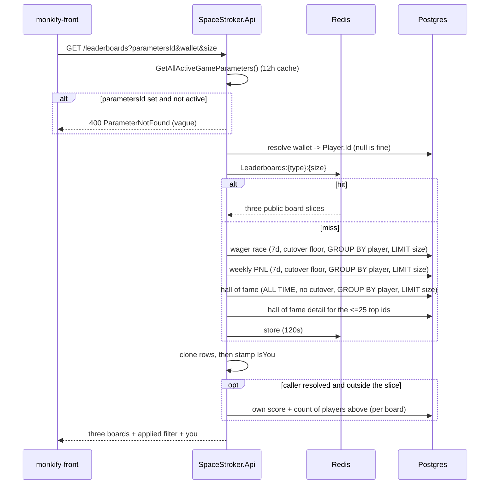

# Space Stroker — "Leaderboards" Feature — Implementation Spec

> **Status: Ready for implementation** — refined via Trello card
> [Leaderboards (#182)](https://trello.com/c/80OsGlGn/182-leaderboards) (2026-09-01).
> Repos affected: `monkify-backend`, `monkify-front`, and this doc in `monkify-meta`.
>
> **Purpose:** give players a way to see how they compare to everyone else. Three read-only boards in
> one carousel — a rolling-7-day **Wager race**, a rolling-7-day **Weekly PNL**, and an all-time
> **Hall of Fame** of biggest win multipliers — on the home page and on a shareable `/leaderboard`
> route. Status and distribution only: **this feature moves no money and writes nothing.**

---

## 1. Summary

Today the app reports totals but never ranks. `GET /games/stats` is deployment-wide,
`GET /games/{id}/stats` is per type, and `GET /players/stats?wallet=` is a private mirror you can only
read if you already know the wallet. Nothing puts two players next to each other.

This card adds one public read that returns three ranked boards, and the UI to show them.

| Board | Metric | Window | Cutover floor | Money shown |
| --- | --- | --- | --- | --- |
| **Wager race** (default slide) | `Σ` paid stake | rolling 7 days | **yes** | yes (token-native) |
| **Weekly PNL** | `Σ` credits − `Σ` paid stakes (may be negative) | rolling 7 days | **yes** | yes (token-native) |
| **Hall of Fame** | `max(credit ÷ own stake)`, one row per player | **all time** | **no** — see §3 decision 9 | **never** |

Each board is filterable by game type (All types / one `GameParameters`), shows the top **10** in the
home-page section and the top **25** on `/leaderboard`, and pins the caller's own row below the list
when they rank outside the visible slice.

**What this is NOT:** there is no prize, no pool, no season, no freeze, no payout. The rejected
alternative — a `LeaderboardSeason` / `LeaderboardAward` pair with a `PayLeaderboardPrizeConsumer` —
is out of scope by explicit owner decision (§3 decision 2, §9).

---

## 2. Constraints (MANDATORY)

From `monkify-meta/constraints.md` (full list there):

- **Worktree per repo:** `feature/leaderboards` in `monkify-backend`, `monkify-front` and
  `monkify-meta`, each at `.worktrees/leaderboards/<repo>`. The shared checkouts stay on `main`.
- **Unit tests:** add/extend in `SpaceStroker.Tests` (run via `scripts/run_tests.bat`, never the full
  `dotnet test` suite); report the changed tests at the end of implementation.
- **Integration test is MANDATORY** — the card is `Level: Feature` (`AGENTS.md` rule 8). See §11.2.
- **EF mapping:** inline in `SpaceStrokerDbContext.OnModelCreating`. **Not applicable here — this
  feature adds no entity, no column, no index and no migration.**
- **Secrets/config:** mock-only values in committed files. This feature *reads* four configured public
  keys; it must never log or return a private key, and a `MOCK_` value is treated as "not configured".
- **Vague messaging (`constraints.md` §6):** an unknown or deactivated `parametersId` collapses to the
  same `ErrorMessages.ParameterNotFound` every other type-scoped read returns. The endpoint must never
  become a channel for probing which types or wallets exist.
- **No referral leak:** `ReferralCode` and partner data appear on no DTO, no SignalR event and no
  public endpoint. This response is no exception.

---

## 3. Resolved product decisions

| # | Decision |
| --- | --- |
| 1 | **Card #178 is not merged in.** #182 was refined standalone by owner decision; #178's rake-funded pool, floor/ceiling and anti-farm positions are explicitly **not** carried in. |
| 2 | **No prizes, no payouts, no money movement.** Chosen over hand-paid prizes and over an automated payout consumer. The ranking logic is the valuable, testable part; a prize can be added later as its own card without changing any of it. Consequence: no season/freeze table, no prize wallet, no payout consumer, no solvency guard. |
| 3 | **"Weekly" means rolling 7 days**, reusing the shipped `StatsWindow.Week` / `StatsWindowExtensions.EffectiveCutoff`. A UTC calendar week was rejected: with no prize there is nothing to freeze and pay, it would be the system's **first** calendar-week and week-start/timezone decision, and the board reads near-empty every Monday morning. |
| 4 | **Three metric slides + a game-type filter**, not a slide per type. Delivers the "Cosmic Sprint leaderboard" the card asked for without the carousel growing with the catalogue. Filter defaults to **All types**. |
| 5 | **House-controlled wallets are excluded by configured public key**, never by a marker column. The house seed bet is deliberately an ordinary bet with *"no marker column, no DTO field, no flag, no branch anywhere"* (`features/games.md` §14) and a `Player.IsHouse` column would break that. All four house accounts already publish a `PublicKey` in config (§6.4), so this needs no key derivation and no migration. |
| 6 | **The shipped money predicate is reused verbatim** — only `RewardForWinnersCompleted` rounds; free bets (`Amount == 0`) excluded from money; refunded / `NotEnoughPlayersToStart` / `ErrorWhenProcessingRewards` / `GameEndedAbruptely` excluded; `SettlementCutoverUtc` as a floor on the two weekly boards. A board whose numbers do not reconcile with the Stats page for the same player is a defect. |
| 7 | **Orbit bets count.** They are ordinary paid bets carried on the real player's `Player` row (`Bet.PlayerId`), so this needs no special handling at all. The **Orbit custody account is never a leaderboard entity** — it signs, it does not own the bet. |
| 8 | **No minimum participation on any board.** One qualifying bet is enough. With no prize there is nothing to farm, and a lucky one-round result is the same shareable asset the Hall of Fame exists for. |
| 9 | **The Hall of Fame is EXEMPT from `SettlementCutoverUtc` and shows NO amounts.** A multiplier is `credit ÷ stake` with **both sides in the same era's asset**, so it is dimensionless and a pre-cutover 47× is directly comparable to a post-cutover one. A board that only reaches back to 2026-08-20 is not "permanent". **Hard constraint:** the row carries `×n` + player + date + game type and **never a SOL figure** — otherwise a USDC-era amount ships wearing a SOL symbol, which is the exact class of bug the cutover exists to prevent. This is the **only** read in the system that reaches past the cutover; it needs a comment saying why and a test pinning that no amount is exposed. |
| 10 | **Hall of Fame ranks people, not moments** — one row per player, their single best multiplier ever. One row per winning bet was rejected: a single hot streak would fill the board. |
| 11 | **Identity is `Player.DisplayName` falling back to a truncated wallet, with no opt-out.** A `Player.HideFromLeaderboard` column was rejected — it is a migration plus a signature-gated write, and it makes the board quietly not the real top N. Accepted cost: the board makes the biggest wallets discoverable in one click, which per-wallet stats today do not. |
| 12 | **Self-excluded players are hidden from all three boards while the exclusion is active.** Putting a self-excluded person's name on a gambling leaderboard uses their identity to promote a product they formally asked to be kept away from. Reuses `Player.SelfExcludedAt` / `SelfExcludedUntil`; they reappear when it lapses. Belongs in `features/legal.md` at ship time. |
| 13 | **Top 10 in the home section, top 25 on `/leaderboard`, plus the caller's own row pinned** when outside the visible slice. "Where am I?" is the question a leaderboard exists to answer. |
| 14 | **One endpoint returns all three boards.** A carousel is a widget the user *will* swipe, so lazy-loading per slide buys nothing and costs a spinner on every swipe. It also holds the home dashboard at **eight** reads on mount instead of ten (`specs/home-dashboard.md` decision 32 argued that count explicitly), and keeps the window/cutover asymmetry in one handler where it is explained once. |
| 15 | **Placement: a carousel section on `/` plus a dedicated `/leaderboard` page.** ⚠️ **It gets NO ☰ menu cell** — the pad is a 3-column **nine**-cell grid and `features/frontend-ux.md` is explicit that a tenth cell is not an option. Entry is the home section and a link from `/game/stats`; the route is otherwise unlisted, exactly like `/partner`. |
| 16 | **Tie-break is deterministic**: score descending, ties by **earliest qualifying bet** ascending. Never by wallet string (a permanent alphabetical advantage) and never unordered. |
| 17 | **No SignalR and no polling.** Fetch on mount and on `visibilitychange` focus, the pattern `specs/home-dashboard.md` decision 32 settled. `useGameHub` keeps its one-connection / one-group invariant. |
| 18 | **5 mockup variants of the whole carousel** (not 5 per board), one chosen and pinned on the card before implementation. The three boards are one component with different columns. ⚠️ The Claude Design MCP was **not connected** during refinement (`FIRST_PARTY_AUTH_REJECTED`) — run `/design-login` first. |

---

## 4. Data model

**No change. This is the section that stays empty on purpose.**

- **No entity, no property, no EF mapping, no index, no migration.** Every figure is aggregated on
  demand from existing `Game` / `Bet` / `TransactionLog` / `Player` rows.
- This is consistent with the **deliberate, documented reversal** recorded in
  `features/stats-and-history.md`: the maintained-counter table was tried, rejected and removed, and
  the cost was solved by aggregating in Postgres rather than by a rollup.
- The existing covering indexes are what this feature depends on —
  `IX_Games_ParametersId_Status_EndDate_CreatedDate` (`AddQueryCoveringIndexes`). ⚠️ **Do not add an
  index speculatively.** `SpaceStrokerDbContext` carries a MEASURED verdict against a speculative
  `Bet` index ("NO INDEX ON Status — tried, MEASURED, and removed"); if a leaderboard query turns out
  to need one, measure first and add it in a follow-up with the numbers attached.

---

## 5. Configuration

**No new configuration key.** The feature *reads* four values that already exist under
`GeneralSettings:Operator:Token`:

| Key | Type | Role here |
| --- | --- | --- |
| `TokenOwnerPublicKey` | `TokenSettings` | Treasury — excluded |
| `Orbit:PublicKey` | `OrbitSettings` | Player custody — excluded |
| `HouseSeed:PublicKey` | `HouseSeedSettings` | The seed bettor — **the one that actually matters**; it bets in every round on every type |
| `ReferralPayout:PublicKey` | `ReferralPayoutSettings` | Partner payouts — excluded |

Two existing values are also read, unchanged: `SettlementCutoverUtc` (the floor) and
`Symbol` / `Decimals` (the currency descriptor echoed on the response).

⚠️ **`MOCK_` counts as absent.** Every one of the four settings classes already documents the
fail-closed `MOCK_` convention (`HouseSeedSettings.IsConfigured`, `ReferralPayoutSettings.IsConfigured`,
`OrbitAccountResolver`'s treatment of `MOCK_ORBIT_PUBLIC_KEY`). The exclusion list must **skip blank
and `MOCK_`-prefixed values** rather than putting them in the `NOT IN`, so a dev stack does not carry
four meaningless literals into every query.

---

## 6. Backend behaviour

Everything lives on the stateless **`SpaceStroker.Api`**. Nothing runs in `SpaceStroker.Consumers` —
no job, no consumer, no scheduled work, no message.

### 6.1 Endpoint — `GET /leaderboards`

```
GET /leaderboards?parametersId=<guid>&wallet=<base58 address>&size=<10|25>
```

New `SpaceStroker.Api/Controllers/LeaderboardsController.cs`, following `PlayersController` /
`GamesController`:

- **Public.** No auth header. Identity, when present, is the `wallet` query param — the same contract
  as `GET /players/stats` and `GET /players/preferences`.
- Wrapped in the standard `ApiResult<T>` envelope by `BaseController.ProcessRequest`.
- **`[HttpOptions("")]`** for CORS preflight, matching `PlayersController`'s existing
  `[HttpOptions("stats")]`.
- **`parametersId` omitted or blank ⇒ All types.** A `parametersId` that does not resolve to an active
  type ⇒ `ErrorMessages.ParameterNotFound` (§6.7).
- **`size`** is clamped to `[1, 25]` at the edge with a default of `10`, mirroring the games-history
  page-size clamp. Out-of-range coerces, it never 400s.
- **200 always**, except the vague `ParameterNotFound`. No wallet, an unknown wallet, or a wallet that
  never bet all return the boards with `you: null` on each.

```csharp
/// <summary>
/// The three public leaderboards in one read: the rolling-7-day wager race, the rolling-7-day PNL
/// board, and the all-time hall of fame of biggest win multipliers. Public and wallet-keyed exactly
/// like GET /players/stats — it ranks facts that are already publicly readable by address. An
/// unknown wallet gets the boards with no own-rank row, never an existence-revealing error.
/// </summary>
/// <response code="200">Returns the three boards (each possibly empty).</response>
/// <response code="400">The game type was not found.</response>
[HttpGet]
public async Task<IActionResult> GetLeaderboards(
    [FromQuery] Guid? parametersId = null, [FromQuery] string? wallet = null, [FromQuery] int size = 10)
    => await ProcessRequest(new GetLeaderboardsRequest(parametersId, wallet, LeaderboardSize.Clamp(size)));
```

### 6.2 Request + handler — `Handlers/Leaderboards/GetLeaderboards/`

`GetLeaderboardsRequest.cs`

```csharp
public record GetLeaderboardsRequest(Guid? ParametersId, string? Wallet, int Size)
    : IRequest<LeaderboardsDto>;
```

`GetLeaderboardsHandler.cs` — modelled on `GetGlobalStatsHandler` (resolve → aggregate → map), with
the caller-resolution step copied from `GetGamesHistoryHandler.ResolveCallerPlayerId`:

1. `_gameService.GetAllActiveGameParameters()` → the active catalogue. This is the same read
   `GetGlobalStatsHandler` makes, and it is `ActiveParameters`-cached (12 h).
2. If `request.ParametersId` is set and is **not** in that dictionary → `ParameterNotFound` (§6.7).
   Otherwise the type id list is either the one requested type or every active type.
3. Resolve the caller's `Player.Id` from `wallet` — `Players.AsNoTracking().FirstOrDefaultAsync(x =>
   x.ExternalPlayerId == wallet)`, null when blank/unknown. **Null is not an error.**
4. `_leaderboardService.GetLeaderboards(typeIds, request.ParametersId, callerPlayerId, request.Size, ct)`.
5. `LeaderboardsDto.From(result, _settings.Operator.Token, activeTypes)`.

### 6.3 `ILeaderboardService` / `LeaderboardService` — `Services/Leaderboards/`

New folder `SpaceStroker.Infrastructure/Services/Leaderboards/` holding `ILeaderboardService.cs`,
`LeaderboardService.cs` and the plain result models `Leaderboards.cs` / `LeaderboardEntry.cs` — the
same shape `Services/Games/` uses for `GlobalStats` / `GlobalStatsService`.

⚠️ **This service follows `GlobalStatsService`, not `PlayerStatsService`.** `PlayerStatsService` pulls
one player's whole bet history into memory with `.ToListAsync()` and aggregates in C#; that is
acceptable for **one** player and catastrophic across all of them. Every figure below is aggregated by
Postgres and every result set is bounded by a `Take`.

#### 6.3.1 The two shared building blocks

```csharp
/// <summary>
/// Completed rounds of these types.
///
/// ⚠️ <paramref name="applyCutover"/> is the ONE asymmetry in this service. The two weekly boards sum
/// MONEY, so they take the rolling-7-day window floored at SettlementCutoverUtc — otherwise a total
/// would add USDC-era figures to SOL-era ones and report a number in no currency at all. The hall of
/// fame ranks a RATIO (credit / own stake, both sides in the same era's asset), which is
/// dimensionless and therefore comparable across the cutover, so it applies no bound at all and is
/// deliberately the only read in the system that reaches past it. See specs/sol-settlement.md §6.4
/// and decision 9 above. The hall of fame row carries NO amount, which is what makes this safe.
///
/// ⚠️ The date bound is NOT written as (EndDate ?? CreatedDate) >= cutoff. A COALESCE is unsargable
/// and would forfeit IX_Games_ParametersId_Status_EndDate_CreatedDate. Both arms below are
/// index-usable — the identical predicate GlobalStatsService uses.
/// </summary>
private IQueryable<Game> CompletedRounds(List<Guid> typeIds, bool applyCutover)
{
    var completed = _context.Games
        .Where(round => typeIds.Contains(round.ParametersId)
                     && round.Status == GameStatus.RewardForWinnersCompleted);

    if (!applyCutover)
        return completed;

    var cutoff = StatsWindowExtensions.EffectiveCutoff(
        StatsWindow.Week, _settlementCutoverUtc, DateTime.UtcNow);

    if (cutoff == null)
        return completed;

    return completed.Where(round => round.EndDate >= cutoff
                                 || (round.EndDate == null && round.CreatedDate >= cutoff));
}

/// <summary>
/// The players who may appear on a board: not a house-controlled wallet, and not currently
/// self-excluded.
///
/// ⚠️ The self-exclusion predicate is written INLINE and is the exact negation of
/// Player.IsSelfExcluded(now). It cannot call that method — it is a C# method EF Core cannot
/// translate, and calling it would silently fall back to client evaluation over every Player row (or
/// throw, depending on the provider). Keep the two in step by hand; the unit test in §11.1 pins them
/// against each other.
/// </summary>
private IQueryable<Player> EligiblePlayers(DateTime now)
    => _context.Players.Where(player =>
        !_houseWallets.Contains(player.ExternalPlayerId)
        && (player.SelfExcludedAt == null
            || (player.SelfExcludedUntil != null && player.SelfExcludedUntil <= now)));

/// <summary>Credits summed per bet — the shipped payout source (TransactionLogType.Credit).</summary>
private IQueryable<BetPayout> WonByBet()
    => _context.TransactionLogs
        .Where(log => log.Type == TransactionLogType.Credit && log.BetId != null)
        .GroupBy(log => log.BetId!.Value)
        .Select(perBet => new BetPayout { BetId = perBet.Key, Won = perBet.Sum(x => x.Amount) });
```

#### 6.3.2 Board 1 — Wager race (rolling 7 days, cutover floored)

```csharp
var rounds = CompletedRounds(typeIds, applyCutover: true);

var paidBets = _context.GameBets
    .Where(bet => bet.Amount > 0m && bet.PlayerId != null)
    .Join(rounds, bet => bet.GameId, round => round.Id, (bet, _) => bet);

var scores = paidBets
    .Join(EligiblePlayers(now), bet => bet.PlayerId!.Value, player => player.Id,
          (bet, player) => new { player.Id, player.DisplayName, player.ExternalPlayerId,
                                 bet.Amount, bet.CreatedDate })
    .GroupBy(x => new { x.Id, x.DisplayName, x.ExternalPlayerId })
    .Select(perPlayer => new LeaderboardEntry
    {
        PlayerId = perPlayer.Key.Id,
        DisplayName = perPlayer.Key.DisplayName,
        Wallet = perPlayer.Key.ExternalPlayerId,
        Score = perPlayer.Sum(x => x.Amount),
        FirstQualifyingAt = perPlayer.Min(x => x.CreatedDate),
    });
```

Ordered `Score` desc, then `FirstQualifyingAt` asc, then `.Take(size)`. **One row per player, bounded
by `size`** — the `GROUP BY` runs in Postgres and the `LIMIT` is in the same statement.

#### 6.3.3 Board 2 — Weekly PNL (rolling 7 days, cutover floored)

Net is `Σ credits − Σ paid stakes` over the same rounds, in **one** statement via a left join:

```csharp
var perBet =
    from bet in paidBets
    join won in WonByBet() on bet.Id equals won.BetId into payouts
    from won in payouts.DefaultIfEmpty()
    select new { bet.PlayerId, bet.Amount, bet.CreatedDate, Won = won == null ? 0m : won.Won };

var scores = perBet
    .Join(EligiblePlayers(now), x => x.PlayerId!.Value, player => player.Id, (x, player) => new { … })
    .GroupBy(x => new { x.Id, x.DisplayName, x.ExternalPlayerId })
    .Select(perPlayer => new LeaderboardEntry
    {
        …,
        Score = perPlayer.Sum(x => x.Won) - perPlayer.Sum(x => x.Amount),   // negative is a real answer
        FirstQualifyingAt = perPlayer.Min(x => x.CreatedDate),
    });
```

- ⚠️ **Never clamp `Score`.** A losing week is a negative number and the board ranks it as one —
  the same rule `PlayerStatsService` already documents for `PlayerStats.Net`.
- Restricting to **paid** bets loses nothing: a free bet stakes 0 and receives 0
  (`features/money.md` §1), so it can contribute to neither side.
- `DefaultIfEmpty()` is what keeps a player who staked and won nothing on the board at a negative
  score. An inner join would silently drop every losing player — i.e. most of the board.

#### 6.3.4 Board 3 — Hall of Fame (all time, cutover-exempt, ratio only)

**Two bounded steps.** Step one ranks players; step two fetches the detail of the top N's best win.

```csharp
// STEP 1 — one row per player, bounded by size.
var roundsAllTime = CompletedRounds(typeIds, applyCutover: false);   // ← no bound at all. Decision 9.

var winningBets =
    from bet in _context.GameBets.Where(b => b.Amount > 0m && b.PlayerId != null)
                                 .Join(roundsAllTime, b => b.GameId, r => r.Id,
                                       (b, r) => new { b.Id, b.PlayerId, b.Amount,
                                                       r.ParametersId, At = r.EndDate ?? r.CreatedDate })
    join won in WonByBet() on bet.Id equals won.BetId         // INNER join: only bets that were paid
    select new { bet.PlayerId, bet.ParametersId, bet.At, Multiplier = won.Won / bet.Amount };

var scores = winningBets
    .Join(EligiblePlayers(now), …)
    .GroupBy(x => new { x.Id, x.DisplayName, x.ExternalPlayerId })
    .Select(perPlayer => new LeaderboardEntry
    {
        …,
        Score = perPlayer.Max(x => x.Multiplier),
        FirstQualifyingAt = perPlayer.Min(x => x.At),
    });

// STEP 2 — for those <= 25 player ids only, the single best winning bet, for the date + type columns.
var topIds = top.Select(x => x.PlayerId).ToList();
var best = await winningBets
    .Where(x => topIds.Contains(x.PlayerId!.Value))
    .GroupBy(x => x.PlayerId!.Value)
    .Select(g => g.OrderByDescending(x => x.Multiplier).ThenBy(x => x.At).First())
    .ToListAsync(cancellationToken);
```

- Step 2 is deliberately a **second query over a fixed id list** rather than a lateral subquery folded
  into step 1: it keeps step 1 a plain `GROUP BY` that Postgres can plan simply, and it is bounded to
  at most 25 rows by construction. Matching the best row **by re-ordering**, never by comparing the
  multiplier decimal for equality — a `decimal` equality match on a computed ratio is a bug waiting to
  happen.
- ⚠️ `Score` here is a **multiplier**, not money. `LeaderboardEntry.Score` is reused for all three
  boards; the DTO's `board` field is what tells the client how to format it, and §6.6 forbids any
  money field being populated on this board.
- The `At` used for the date column and for the tie-break is `EndDate ?? CreatedDate` — the same
  fallback games-history uses, because `Game.EndDate` is nullable even on completed rounds.

#### 6.3.5 Ordering and tie-break (all three boards)

```csharp
.OrderByDescending(entry => entry.Score)
.ThenBy(entry => entry.FirstQualifyingAt)
.Take(size)
```

Deterministic by construction (decision 16). **Never** order by `Wallet` — a base58 string tie-break
hands a permanent advantage to addresses starting with a low character, forever.

### 6.4 The house-wallet exclusion — `Services/Leaderboards/HouseWallets.cs`

One shared helper, **not four inline literals**, resolved once from `GeneralSettings`:

```csharp
/// <summary>
/// The house-controlled wallets that must never appear on a leaderboard. All four accounts already
/// publish a PublicKey in config, so this needs no keypair derivation and no new setting.
///
/// ⚠️ The HouseSeed wallet is the one that actually matters: it places one ordinary paid bet in EVERY
/// newly created round on every type (specs/house-seed-bet.md), so without this filter it would
/// permanently own the top of the wager race. The other three are excluded on principle — they are
/// house money and could bet.
///
/// ⚠️ A marker column was REJECTED. The seeded bet's defining property is that it has "no marker
/// column, no DTO field, no flag, no migration, no branch anywhere" and is indistinguishable from a
/// player's bet in the database and in every payload (features/games.md §14). Filtering by configured
/// address preserves that; a Player.IsHouse column would end it.
///
/// ⚠️ Blank and MOCK_ values are SKIPPED, not added to the list — the fail-closed convention every one
/// of these settings classes already documents. Putting "MOCK_HOUSE_SEED_PUBLIC_KEY" in a NOT IN is
/// harmless but meaningless, and a blank string in the list is noise in every generated query.
///
/// ⚠️ It reads the SAME config the wallets are configured from. Rotating a house key must move this
/// filter with it automatically — hard-coding an address here is how a rotated key silently returns
/// to the board.
/// </summary>
public static IReadOnlyList<string> Resolve(TokenSettings token) => …
```

Registered as part of `LeaderboardService`'s construction (the settings are already injected as
`GeneralSettings`), materialised once per service instance into `_houseWallets`.

### 6.5 The caller's own rank

Computed **live on every request**, never cached (§6.8). Skipped entirely when `callerPlayerId` is
null, and skipped per board when the caller is already inside the returned slice.

```csharp
var mine = await scores.FirstOrDefaultAsync(entry => entry.PlayerId == callerPlayerId, ct);
if (mine == null) return null;                       // never bet in the window, or is not eligible

var above = await scores.CountAsync(entry =>
        entry.Score > mine.Score
     || (entry.Score == mine.Score && entry.FirstQualifyingAt < mine.FirstQualifyingAt), ct);

mine.Rank = above + 1;
```

⚠️ **The tie-break in the rank count must be the SAME comparison as the ordering in §6.3.5**, or the
pinned row shows a rank that does not match where the player would appear in the list.

⚠️ **A caller who is a house wallet or is currently self-excluded gets `you: null`.** They are not in
`EligiblePlayers`, so they have no rank — deliberately, and the same answer a wallet that never bet
gets. This is correct: a self-excluded player must not be shown their own standing on a board they
have been removed from.

### 6.6 DTOs — `Contracts/Leaderboards/`

```csharp
public class LeaderboardsDto
{
    public LeaderboardBoardDto WagerRace { get; set; }
    public LeaderboardBoardDto WeeklyPnl { get; set; }
    public LeaderboardBoardDto HallOfFame { get; set; }

    /// <summary>
    /// The type filter that was APPLIED (null = all types). The client captions from THIS, not from
    /// what it requested — the same contract GlobalStatsDto.Window carries, and for the same reason.
    /// </summary>
    public Guid? ParametersId { get; set; }
    public IList<LeaderboardGameTypeDto> AvailableTypes { get; set; }

    public string? TokenSymbol { get; set; }
    public int? TokenDecimals { get; set; }
}

public class LeaderboardBoardDto
{
    /// <summary>"wagerRace" | "weeklyPnl" | "hallOfFame" — how the client formats Score.</summary>
    public string Board { get; set; }
    /// <summary>"week" | "all" — the window APPLIED to this board. The two are deliberately different.</summary>
    public string Window { get; set; }
    /// <summary>True on the hall of fame only: Score is a ratio, so the client must not append a symbol.</summary>
    public bool ScoreIsMultiplier { get; set; }
    public IList<LeaderboardRowDto> Rows { get; set; }
    /// <summary>The caller's own row when they rank outside Rows. Null otherwise. Never cached.</summary>
    public LeaderboardRowDto? You { get; set; }
}

public class LeaderboardRowDto
{
    public int Rank { get; set; }
    public string? DisplayName { get; set; }
    public string Wallet { get; set; }          // the client truncates; same as every other identified surface
    public decimal Score { get; set; }
    public bool IsYou { get; set; }
    /// <summary>Hall of fame only — when the best win happened, and on which type. Null on the others.</summary>
    public DateTime? AchievedAt { get; set; }
    public string? GameTypeName { get; set; }

    /// <summary>
    /// A copy with the caller-specific fields cleared. ⚠️ Cached rows MUST be cloned before IsYou is
    /// stamped — the identical rule GameHistoryDto.ClonePublic() exists for. Stamping a shared cache
    /// entry in place poisons it with one caller's identity for every subsequent reader, and this
    /// codebase has already shipped that bug once on the history endpoint.
    /// </summary>
    public LeaderboardRowDto ClonePublic() => …;
}
```

⚠️ **No money field exists on a hall-of-fame row.** `Score` there is the multiplier and `AchievedAt` /
`GameTypeName` are the only extra columns. The DTO has no place to put a SOL amount, which is how
decision 9's hard constraint is enforced structurally rather than by remembering it.

⚠️ **No `ReferralCode` and no partner field anywhere on this response.**

### 6.7 Errors and coercion

| Input | Result |
| --- | --- |
| `parametersId` absent / blank | All active types |
| `parametersId` unknown, inactive, or malformed | `ErrorMessages.ParameterNotFound` — the same vague message `GetGameTypeStatsHandler` and `GetGamesHistoryHandler` return. Existence and status are never revealed. |
| `size` out of `[1,25]` | Clamped, **200** |
| `wallet` absent / blank / unknown / never bet | 200, boards populated, `you: null` on each |
| A type with no qualifying rounds | 200, that board's `Rows` is **empty** — an empty state, never a row of zeros and never an error |

### 6.8 Caching

```csharp
// The three PUBLIC board slices for one filter. 120s, matching GenerateGlobalStatsCacheSettings —
// these are the same aggregates over the same rows, and the same staleness argument applies.
//
// ⚠️ Keyed on the FILTER ONLY (type + size). The caller's wallet is deliberately NOT in the key: the
// public slice is identical for everyone, and keying by wallet would mint one entry per address on a
// public endpoint — the unbounded-key-growth trap specs/games-history.md documents for page numbers.
// The caller's own rank is joined LIVE on every request instead, and the cached rows are CLONED
// before IsYou is stamped.
//
// The 120s TTL also bounds the rolling window's boundary drift, exactly as it does for global stats.
public static CacheSettings GenerateLeaderboardsCacheSettings(Guid? parametersId, int size)
    => new($"Leaderboards:{parametersId?.ToString() ?? "all"}:{size}", TimeSpan.FromSeconds(120));
```

No invalidation: the TTL bounds it, and there is no write path to hook. A just-completed round can lag
the public slice by up to 120 s — accepted, and identical to the games-history trade-off. **The
caller's own rank never lags**, because it is not cached.

### 6.9 Rate limiting

**No new rule.** `RateLimitSettingsTests.GeneralRules_AreExactlyTheThreeQuotaProtectingPatterns` pins
the rule set to `*:/rpc`, `*:/solana/*`, `*:/solana/balance/live`; every other endpoint is
deliberately unlimited app-side. `/leaderboards` joins `/players/stats` and `/games/*/history` as an
unlimited read behind Cloud Armor's per-IP rule. ⚠️ Adding a rule here would break that exact-set test
by design — do not.

---

## 7. Frontend behaviour

### 7.1 Route and placement

- New route `Leaderboard` at **`/leaderboard`** in `src/routes.ts`.
  - ⚠️ **Unlisted in the ☰ pad**, with the same comment `Partner` carries: the pad is a 3-column
    nine-cell grid and a tenth cell would start a fourth row the grid can never fill.
  - Reached from the home-page section's "view full leaderboard" link and from a link on
    `/game/stats`.
  - **Not** an `isPlayerRoute()` in `App.vue` — it renders no display name of its own and its state
    comes from `useLeaderboards`. Matches `/orbit`, `/partner` and `/responsible-gaming`.
- Add `'Leaderboard'` to **`EMBED_REDIRECT_ROUTES`** in `src/main.ts`. ⚠️ `'Home'` is **already** in
  that set, so the home-page section needs no separate embed guard — do not add a redundant
  `isEmbedded` check there.

### 7.2 The home-page section

- New `src/components/home/HomeLeaderboard.vue`, rendered in `HomePage.vue` **between
  `<home-player-stats>` and `<home-floor>`** — the page's beat is act → learn → trust → capability →
  *your* numbers → **everyone's ranking** → floor.
- Built on `HomeSection.vue`. ⚠️ It **must** pass a `title` — the prop is optional only because of the
  token card's `header` slot, and an untitled panel is a bug, not a variant. `tone: 'line'` (it is an
  informational panel, not a player-scoped one; cyan is reserved).
- Shows the top **10**, with a link through to `/leaderboard`.
- ⚠️ It does **not** gate on `connected`, unlike `<home-player-stats v-if="connected">`: a leaderboard
  is worth seeing before you have a wallet. The caller's own pinned row simply does not render.

### 7.3 The carousel

**No carousel component exists in the app today** — this is the first. It goes in
`src/components/leaderboard/` and is shared by the home section and the page:

| File | Role |
| --- | --- |
| `LeaderboardCarousel.vue` | The three slides + the tab/dot control. Default slide = **Wager race**. |
| `LeaderboardBoard.vue` | One board's table. Formats `Score` from `board` / `scoreIsMultiplier`. |
| `LeaderboardRow.vue` | One row: rank, identity, score. `IsYou` gets the same treatment as the `YOU` label elsewhere. |
| `LeaderboardTypeFilter.vue` | All types / one type, from `availableTypes`. Defaults to All. |

- Swiping between slides costs **no request** — all three arrive in one response (decision 14).
- Changing the type filter refetches once.
- Identity: `displayName` when set, otherwise a truncated `wallet` — the fallback every identified
  surface already uses.
- Money renders **token-native** through the shared `useAmountFormatter` / `formatSol`.
  ⚠️ **The Hall of Fame slide renders `×n` and no amount, ever** — read `scoreIsMultiplier` and never
  append the token symbol on that board.
- Empty board → the `> no rounds yet` empty state, never a row of zeros.

### 7.4 Data

- New `src/hooks/useLeaderboards.ts` — fetch on mount and on `visibilitychange` focus. **No SignalR
  group is joined and no interval is set** (decision 17).
- New call in `src/services/mainService.ts`, following `getGlobalStats` / `getPlayerStats`: wrapped in
  `singleFlight`, and ⚠️ **deliberately not in `runWithRecovery`** — a leaderboard failure renders
  inline (`> leaderboard offline — retry`) and must never route the front door to `/error`, the same
  reasoning `getPlayerStats` carries.
- New types in `src/types/` mirroring §6.6.
- New `leaderboard` entry in `src/constants/icons.ts` (every page and feature carries an identity
  mark), rendered by `ui/AppIcon.vue`. ⚠️ Display-face copy carrying `$` or `!` goes through
  `ui/PixelText.vue`; `×` is safe in both faces.

---

## 8. Flow diagram



---

## 9. Out of scope

- **Any prize, pool, payout or funding model.** No `LeaderboardSeason`, no `LeaderboardAward`, no
  prize wallet, no payout consumer, no solvency guard. A prize is its own card.
- **Calendar weeks, seasons and freezes** — and any timezone or week-start decision.
- **A per-referrer / affiliate board** — blocked on the referral program and its own concern.
- **Anti-farm caps, qualification thresholds, one-prize-per-entity rules** — only meaningful with a
  prize attached.
- **A ☰ menu cell**, and any restructuring of the 3×3 icon pad.
- **An opt-out preference** (`Player.HideFromLeaderboard`).
- **SignalR / live-updating boards.**
- **Card #178** — refined standalone by owner decision; not merged into this card.

---

## 10. File checklist

### 10.1 Backend (`monkify-backend`)

| # | File | Change |
| --- | --- | --- |
| 1 | `src/SpaceStroker.Api/Controllers/LeaderboardsController.cs` | **New.** `GET /leaderboards` + `[HttpOptions]` preflight; clamps `size` at the edge |
| 2 | `src/SpaceStroker.Infrastructure/Handlers/Leaderboards/GetLeaderboards/GetLeaderboardsRequest.cs` | **New.** `(Guid? ParametersId, string? Wallet, int Size)` |
| 3 | `src/SpaceStroker.Infrastructure/Handlers/Leaderboards/GetLeaderboards/GetLeaderboardsHandler.cs` | **New.** Active-type resolve → vague `ParameterNotFound` → caller resolve → aggregate → map |
| 4 | `src/SpaceStroker.Infrastructure/Services/Leaderboards/ILeaderboardService.cs` | **New.** `GetLeaderboards(typeIds, parametersId, callerPlayerId, size, ct)` |
| 5 | `src/SpaceStroker.Infrastructure/Services/Leaderboards/LeaderboardService.cs` | **New.** The three bounded aggregates, the cutover asymmetry, eligibility, own rank |
| 6 | `src/SpaceStroker.Infrastructure/Services/Leaderboards/HouseWallets.cs` | **New.** Resolves the four configured public keys; skips blank/`MOCK_` |
| 7 | `src/SpaceStroker.Infrastructure/Services/Leaderboards/Leaderboards.cs` · `LeaderboardEntry.cs` | **New.** Plain result models (the `GlobalStats` shape) |
| 8 | `src/SpaceStroker.Infrastructure/Contracts/Leaderboards/LeaderboardsDto.cs` · `LeaderboardBoardDto.cs` · `LeaderboardRowDto.cs` · `LeaderboardGameTypeDto.cs` | **New.** Response DTOs + `ClonePublic()` |
| 9 | `src/SpaceStroker.Infrastructure/Services/Cache/CacheHelper.cs` | Add `GenerateLeaderboardsCacheSettings(parametersId, size)` — 120 s, filter-keyed |
| 10 | `src/SpaceStroker.Infrastructure/DependencyInjection.cs` | Register `ILeaderboardService` |
| 11 | `src/SpaceStroker.Api/Program.cs` (CORS/route wiring only if the controller needs it) | Verify the new controller is covered by the existing convention; no new policy |

**No migration. No `SpaceStrokerDbContext` change. No `SpaceStroker.Consumers` change.**

### 10.2 Frontend (`monkify-front`)

| # | File | Change |
| --- | --- | --- |
| 1 | `src/pages/LeaderboardPage.vue` | **New.** Top-25 carousel + type filter |
| 2 | `src/components/leaderboard/LeaderboardCarousel.vue` · `LeaderboardBoard.vue` · `LeaderboardRow.vue` · `LeaderboardTypeFilter.vue` | **New.** Shared by the page and the home section |
| 3 | `src/components/home/HomeLeaderboard.vue` | **New.** Top-10 `HomeSection` (must pass `title`), links through |
| 4 | `src/pages/HomePage.vue` | Render `<home-leaderboard>` between player stats and the floor |
| 5 | `src/hooks/useLeaderboards.ts` | **New.** Fetch on mount + `visibilitychange`; no hub, no interval |
| 6 | `src/services/mainService.ts` | `getLeaderboards(parametersId?, wallet?, size)` — `singleFlight`, **not** `runWithRecovery` |
| 7 | `src/types/index.ts` | `Leaderboards`, `LeaderboardBoard`, `LeaderboardRow`, `LeaderboardGameType` |
| 8 | `src/routes.ts` | `Leaderboard` → `/leaderboard`, with the unlisted-route comment |
| 9 | `src/main.ts` | Add `'Leaderboard'` to `EMBED_REDIRECT_ROUTES` |
| 10 | `src/constants/icons.ts` | New `leaderboard` pixel mark |
| 11 | `src/pages/GameStatsPage.vue` | A link through to `/leaderboard` (the second entry point) |

### 10.3 Meta (`monkify-meta`)

| # | File | Change |
| --- | --- | --- |
| 1 | `specs/leaderboards.md` | **New.** This document |
| 2 | `INDEX.md` | Map row + "Feature currently in flight" |
| 3 | `features/leaderboards.md` | **At ship time** (`/monkify-ship-feature`) — `Level: Feature` |
| 4 | `features/legal.md` | **At ship time** — record that self-excluded players are hidden from the boards |

---

## 11. Tests

### 11.1 Unit tests — `monkify-backend/src/SpaceStroker.Tests`

Run with `scripts/run_tests.bat` (never the full `dotnet test` suite — `ProductionSessions` is a slow
Monte Carlo suite).

| Test file | Test cases | Expected |
| --- | --- | --- |
| `UnitTests/Services/LeaderboardServiceTests.cs` | Wager race ranks by summed paid stake, desc | Highest staker first |
| | Weekly PNL returns a **negative** score for a losing player | Not clamped, ranked below zero |
| | Weekly PNL keeps a player who won nothing on the board | The `DefaultIfEmpty` left join — an inner join would drop them |
| | Hall of Fame returns **one row per player**, their max multiplier | A player with three big wins appears once |
| | Hall of Fame includes a pre-`SettlementCutoverUtc` win | Cutover-exempt (decision 9) |
| | Wager race and PNL **exclude** pre-cutover rounds | Cutover floor applied |
| | Free bets (`Amount == 0`) contribute to neither weekly board | Score unchanged |
| | Rounds not `RewardForWinnersCompleted` contribute nothing | Refunded / under-subscribed / errored / abrupt |
| | Ties resolve by earliest qualifying bet, and twice identically | Deterministic |
| | Own rank uses the **same** comparison as the ordering | Pinned rank matches list position |
| | Own rank is null for a caller who never bet | Not an error |
| `UnitTests/Services/LeaderboardEligibilityTests.cs` | The house seed wallet is excluded | Absent from all three boards |
| | Treasury / Orbit / referral-payout wallets are excluded | Absent |
| | A changed `HouseSeed:PublicKey` is what gets excluded | Reads config, not a literal |
| | Blank and `MOCK_` public keys are **skipped**, not added to the filter | The list holds only real addresses |
| | A currently self-excluded player is excluded | Absent from all three |
| | A player whose exclusion has **lapsed** is included | `SelfExcludedUntil <= now` |
| | A **permanently** excluded player (`SelfExcludedUntil == null`) is excluded | The two-column rule |
| | ⚠️ The inline predicate matches `Player.IsSelfExcluded(now)` for every combination | Pins the hand-kept pair (§6.3.1) |
| `UnitTests/Handlers/GetLeaderboardsHandlerTests.cs` | Unknown / inactive `parametersId` → vague `ParameterNotFound` | Nothing reveals existence |
| | Blank `parametersId` → all active types | |
| | Blank / unknown wallet → 200 with `you: null` | Never 400, never 404 |
| | `size` out of range is clamped, not rejected | |
| | The response **echoes the applied** `parametersId` | The client captions from it |
| | The response carries **no `ReferralCode`** and no partner field | Contract check |
| `UnitTests/Contracts/LeaderboardRowDtoTests.cs` | `ClonePublic()` clears `IsYou` / `Rank` | The cache-poisoning guard |
| | A hall-of-fame row exposes **no money field** | Decision 9's hard constraint, structurally |

### 11.2 Integration test — `SpaceStroker.Tests.Integration/LeaderboardsFlowTests.cs`

**Mandatory** (`AGENTS.md` rule 8 — `Level: Feature`). Follow `GlobalStatsFlowTests` /
`PlayerStatsFlowTests` for the fixture shape.

**Happy path, end to end through two real hosts:** seed several completed rounds with paid bets from
three player wallets → `GET /leaderboards` → assert all three boards rank the players in the expected
order, with the expected scores, and that the applied filter is echoed.

Plus, in the same file:

1. **The house wallet is absent** from all three boards, even though it bet in every seeded round.
2. **A self-excluded player is absent** from all three boards.
3. **The Hall of Fame carries no amount** — assert on the serialized payload, not just the DTO.
4. **The caller's own rank** comes back pinned for a wallet outside the top slice, and `null` for a
   wallet that never bet.
5. **Two different wallets** hitting the same filter (second served from cache) get responses that do
   **not** carry each other's `IsYou` — the clone-before-stamp guard.

⚠️ **Harness facts worth knowing before extending these** (from `features/referral-program.md`):
seeding a `Player` through a handler's own in-memory context throws an EF identity conflict — seed
through a separate context, as `OrbitHandlerTestsBase` does; and `IntegrationTestFixture` configures
settings via `GeneralSettings__…` env vars **before the hosts build**, which is how the test supplies
a house-seed public key to exclude.

**`monkify-front` has no test runner** — `lint` + `build` only.

---

## 12. Acceptance criteria

Mapped 1:1 from the Trello **Acceptance Criteria** checklist (23 items).

1. Given completed rounds in the last 7 days, when a player opens the Leaderboard, then the Wager race is the default slide and ranks players by total paid stake descending over that rolling window.
2. Given a player whose credits are less than their stakes over the window, when the Weekly PNL board is read, then their net is ranked as a negative value and is never clamped to zero.
3. Given a player with several big wins, when the Hall of Fame is read, then they appear exactly once with their single best multiplier rendered as `×n`, and no SOL amount appears in the row or anywhere in that board's payload.
4. Given rounds that completed before `SettlementCutoverUtc`, when the Wager race or Weekly PNL board is read, then those rounds contribute nothing to either total.
5. Given a winning bet in a round that completed before `SettlementCutoverUtc`, when the Hall of Fame is read, then its multiplier is included in the ranking, because the ratio carries no currency.
6. Given the house seed wallet has placed a bet in every round, when any of the three boards is read, then the house wallet appears on none of them.
7. Given the house seed wallet is changed in `GeneralSettings`, when any board is read, then the newly configured address is excluded and no address is special-cased outside that configuration.
8. Given a bet placed by the Orbit engine on a player's behalf, when the boards are read, then it counts toward that player's row and the Orbit custody account never appears as an entry.
9. Given a player whose self-exclusion is currently active, when any of the three boards is read, then that player is absent from all of them; and given the exclusion has lapsed, when the boards are next read uncached, then they appear again.
10. Given a round that was refunded or ended `NotEnoughPlayersToStart`, `ErrorWhenProcessingRewards` or `GameEndedAbruptely`, when any board is read, then its bets contribute nothing to any ranking.
11. Given a free bet with `Amount == 0`, when the Wager race or Weekly PNL board is read, then it contributes nothing to either total.
12. Given a ranked player with a `DisplayName`, when a board renders, then the display name is shown; and given a ranked player with none, then a truncated wallet address is shown instead.
13. Given two players with an identical score on a board, when that board is read twice, then both reads return them in the same order, tied on earliest qualifying bet and never on wallet string or at random.
14. Given a connected wallet that ranks outside the visible slice, when a board is read, then the caller's own row is returned with their true rank and is pinned below the list.
15. Given no wallet, an unknown wallet, or a wallet that has never bet, when the leaderboards are read, then HTTP 200 is returned with the boards populated and the caller's own rank null on each — never a 400 or a 404.
16. Given a `parametersId` that does not exist or has been deactivated, when the leaderboards are read, then the same vague `ParameterNotFound` is returned and nothing in the response reveals whether that type exists.
17. Given an unrecognised filter value, when the leaderboards are read, then HTTP 200 is returned with the default filter applied and the response echoes the filter that was actually applied, which is what the client captions from.
18. Given a game type with no qualifying completed rounds, when its board is read, then an empty state is rendered rather than a row of zeros or an error.
19. Given two different wallets request the same filter and the second is served from cache, when both responses are compared, then neither carries the other caller's own-rank row, proving the cached rows were cloned before stamping.
20. Given the Leaderboard is open, when the page is inspected, then no SignalR group has been joined and no polling interval is running; the data refreshes on mount and when the tab regains focus.
21. Given the app is running embedded in an iframe, when the home page renders, then the leaderboard section is absent and `/leaderboard` redirects like the other embed-excluded routes.
22. Given the leaderboard section on the home page and the `/leaderboard` page, when both render for the same filter, then the home section shows the top 10 and the page shows the top 25, and the header menu still has exactly nine cells.
23. Given any leaderboard response, when it is inspected, then it carries no `ReferralCode` and no referral-partner information of any kind.

---

## 13. Manual QA

1. Bring up the local stack (`setup_local_environment.bat`) and fill a few rounds — `/fill-crypto-clash`
   is the fastest way to get completed rounds with several distinct players.
2. Open `/` → the leaderboard section renders below your own record, showing the top 10, Wager race
   selected.
3. Swipe/tab across all three slides — **no network request fires** (check devtools). Change the type
   filter — exactly one request fires.
4. `GET /leaderboards` directly and confirm: the house seed wallet is absent, `parametersId` is echoed,
   and the `hallOfFame` rows carry no amount field.
5. Self-exclude a wallet via `/responsible-gaming`, wait for the 120 s TTL, reload — that wallet is
   gone from all three boards.
6. Open `/leaderboard` with a connected wallet ranked below 25 — your row is pinned below the list
   with a rank matching where you would appear.
7. Load the app embedded (`?embed=1` or an iframe) — the home section is gone and `/leaderboard`
   redirects to the lobby.

---

## 14. Trello / pipeline

- **Source card:** [Leaderboards (#182)](https://trello.com/c/80OsGlGn/182-leaderboards) — list
  **Specs created**; the **Implementation** section on the card carries the branch, worktree, spec
  path and `Level`.
- **Worktrees:** `.worktrees/leaderboards/{monkify-backend,monkify-front,monkify-meta}`, branch
  `feature/leaderboards`, pushed to `origin`.
- **Next:** `/monkify-implement-feature 182` — ⚠️ run `/design-login` first, the 5 carousel mockups
  are a prerequisite of implementation (decision 18).
- **After merge:** `/monkify-ship-feature 182`.

---

## 15. Revision log

| Date | Change |
| --- | --- |
| 2026-09-01 | Initial spec from the refined card (#182) + the refinement conversation. Code touchpoints verified against `GlobalStatsService`, `PlayerStatsService`, `StatsWindowExtensions`, `CacheHelper`, `Player`, the four `*Settings` public keys, `routes.ts` and `main.ts`. |
