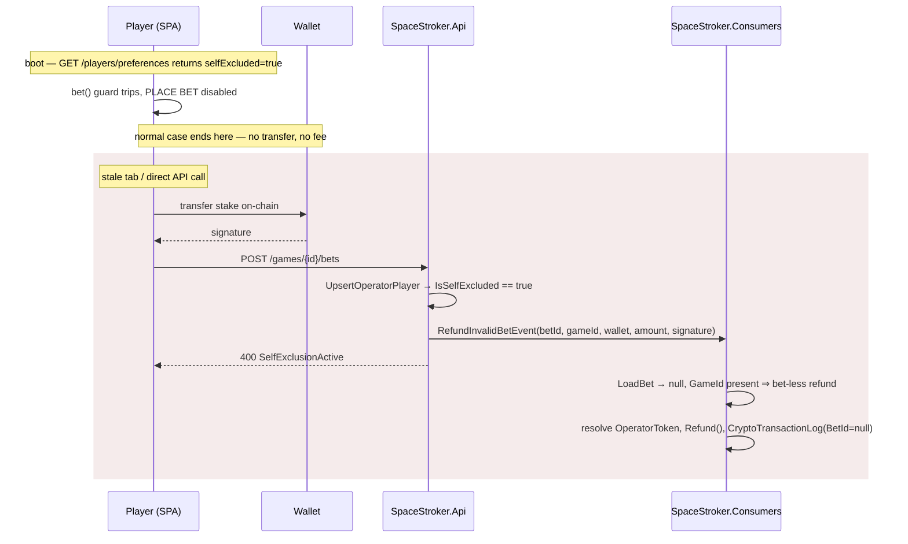

# Space Stroker — "Legal Documentation & Per-Wallet Self-Exclusion" — Implementation Spec

> **Status: Ready for implementation** — refined via Trello card
> [#125 Add some legal documentation for crypto users](https://trello.com/c/3kPjRxsJ) (2026-07-29).
> Repos affected: `monkify-backend`, `monkify-front`, `monkify-lp`, and this doc in `monkify-meta`.
> Branch: `feature/legal-docs-self-exclusion` (worktree `.worktrees/legal-docs-self-exclusion/<repo>`).
>
> **Purpose:** Space Stroker takes real money from anonymous crypto players and publishes no terms,
> no age statement and no responsible-gambling content. This card adds an 18+/Terms entry gate on
> both public properties, a Terms page, a responsible-gambling page, and a **per-wallet
> self-exclusion** tool that genuinely blocks bets — plus the money-path fix without which the tool
> would take an excluded player's stake.

---

## 1. Summary

Four deliverables, three of them content/frontend and one a money-path feature.

| # | Deliverable | Repos | Backend? |
| --- | --- | --- | --- |
| 1 | 18+/Terms **entry gate** (blocking modal, ACCEPT + DECLINE), remembered in an `ss_terms` cookie shared by `www.` and `app.` | `monkify-lp`, `monkify-front` | No |
| 2 | **Terms & Conditions** page (`/terms`) | `monkify-lp` | No |
| 3 | **Responsible gambling** page (`/responsible-gambling`) | `monkify-lp` | No |
| 4 | **Per-wallet self-exclusion** — signature-proved, 24h→permanent, enforced on the bet path | `monkify-backend`, `monkify-front` | **Yes** |

Deliverable 4 carries a **prerequisite fix**: the inline reject-and-refund path in
`RegisterBetHandler` does not actually refund anything today (§6.1). Self-exclusion routed through it
as-is would reject a paid crypto bet and silently keep the stake.

**Level: `Feature`** ⇒ mandatory happy-path integration test + a `features/legal-docs-self-exclusion.md`
doc at ship.

---

## 2. Constraints (MANDATORY)

From `monkify-meta/constraints.md` (full list there):

- **Worktree-per-repo:** `feature/legal-docs-self-exclusion` in all four repos; hubs stay on their
  default branch (`main`, and `master` for `monkify-lp`). Push after branch work.
- **Unit tests:** update/add in `SpaceStroker.Tests`; **report changed tests** at the end.
- **Integration test:** `Feature` level ⇒ mandatory happy path in `SpaceStroker.Tests.Integration`,
  plus a dedicated test for the complex refund flow (§11.2).
- **EF mapping:** inline in `SpaceStrokerDbContext.OnModelCreating`; no `IEntityTypeConfiguration`.
- **Migrations:** under `SpaceStroker.Infrastructure/Migrations/`; applied only by `SpaceStroker.Consumers`.
- **Secrets/config:** mock-only values in committed files. The published contact address is public by
  design, not a secret.
- **Operator messaging:** vague errors for operator availability. **Does not apply** to self-exclusion
  — an RG denial is *player* state, and `features/rg-pre-bet-hook.md` establishes that specific copy
  is correct there.
- **`SpaceStrokerDbContext` is `NoTracking` by default** — load-mutate-`SaveChanges` silently persists
  nothing. Use `ExecuteUpdate` or `AsTracking()`.

---

## 3. Resolved product decisions

Decisions 1–14 come from the refined card; 15–18 were taken at spec time from code exploration and
**correct** the card where noted.

| # | Decision |
| --- | --- |
| 1 | Gate ships on **both** `www.spacestroker.com` and `app.spacestroker.com`. LP-only would miss anyone landing on the app directly. Pages are hosted on the LP; the app links out. |
| 2 | Gate is a **blocking modal** with **ACCEPT + DECLINE**. Decline → a terminal "you can't use Space Stroker" state linking the RG page, with no route into the game. |
| 3 | The shipped cookie `ConsentBanner` renders **only after** the gate is accepted. Merging the two overlays is **rejected** — bundling analytics consent with terms acceptance invalidates the cookie consent. |
| 4 | **Embedded (iframe) ⇒ no gate, no legal links, no self-exclusion UI** (`useEmbed()`), matching analytics and the header menu. |
| 5 | Terms are generic in structure but **true to shipped behaviour** (§7.4). **No restricted-jurisdictions clause** — we do not geo-block, and an unenforced clause is worse than silence. |
| 6 | The RG page commits to **self-exclusion only** — no deposit/loss limits, no reality checks. |
| 7 | Self-exclusion flags the whole **`OperatorPlayer` row**, blocking **paid and free** bets, scoped to one operator. For `SolanaToken` that row is keyed by wallet ⇒ literally "per wallet". |
| 8 | Durations **24h / 7d / 30d / 90d / permanent**, **no early undo**. Expiry is the only reversal. |
| 9 | Enforcement is three layers: frontend pre-pay guard, backend authority, refund backstop (§6). |
| 10 | Setting an exclusion **requires an ed25519 wallet signature** over a nonce-bearing message. |
| 11 | Mobile Tier-1 deeplink gains **`signMessage`** (verified absent today). |
| 12 | App entry point is a new **RESPONSIBLE GAMING** entry in the header ☰ menu. |
| 13 | Shipped as **one card**, not split. |
| 14 | Terms name no legal entity and no governing law (**known gap**); contact is **space.stroker@gmail.com** + Telegram **@SpaceStroker**. |
| 15 | **⚠️ Corrects the card.** The card said to reuse `ErrorMessages.RgSelfExcluded`. Its copy is *"Please contact your operator"*, which is wrong when we **are** the operator. A **new** `SelfExclusionActive` message is added instead (§6.4). |
| 16 | **⚠️ Corrects the card.** The card said to route rejections through `RefundInvalidBet`. That path **does not refund** today (§6.1). The fix is to refund **from the event, with no `Bet` row** — chosen over persisting a `NeedsRefunding` bet, which would let a rejected bet enter the typer and change round outcomes (§6.2). |
| 17 | `CryptoTransactionLog.BetId` becomes **nullable** so a bet-less refund is still auditable (its sibling `TransactionLogId` is already nullable). |
| 18 | Exclusion state is served on the **existing** `GET /players/preferences`, not a new boot request — #104/#110 exist to reduce boot calls. |

---

## 4. Data model

### 4.1 Entity changes

**`SpaceStroker.Domain/Games/Entities/OperatorPlayer.cs`** — two columns:

```csharp
// Self-exclusion (first-party responsible gaming). SelfExcludedAt is the flag: non-null => excluded.
// SelfExcludedUntil is the expiry; NULL WITH SelfExcludedAt SET MEANS PERMANENT.
public DateTime? SelfExcludedAt { get; set; }
public DateTime? SelfExcludedUntil { get; set; }
```

Two columns rather than one deliberately: a single nullable `SelfExcludedUntil` cannot distinguish
"not excluded" from "excluded forever".

Domain helper on the same entity (keeps the rule in one place — handlers and the bet path must not
re-implement it):

```csharp
public bool IsSelfExcluded(DateTime now)
    => SelfExcludedAt != null && (SelfExcludedUntil == null || SelfExcludedUntil > now);
```

**`SpaceStroker.Domain/Bets/Entities/CryptoTransactionLog.cs`** — `BetId` becomes `Guid?` so a refund
issued for a bet that was never persisted (§6.2) still gets a ledger row.

### 4.2 EF configuration (inline)

In `SpaceStrokerDbContext.OnModelCreating`, extend the existing `OperatorPlayer` block (currently
lines 106–116). No index is added: every read is already by the unique
`(OperatorId, ExternalPlayerId)`.

```csharp
modelBuilder.Entity<OperatorPlayer>(builder =>
{
    // … existing configuration unchanged …
    builder.Property(x => x.SelfExcludedAt);
    builder.Property(x => x.SelfExcludedUntil);
});
```

In the `CryptoTransactionLog` block (currently line ~226), relax the FK:

```csharp
builder.HasOne(x => x.Bet).WithMany().HasForeignKey(x => x.BetId)
       .IsRequired(false).OnDelete(DeleteBehavior.Restrict);
```

### 4.3 Migration

```bash
dotnet ef migrations add AddSelfExclusionAndNullableCryptoLogBet \
  --project src/SpaceStroker.Infrastructure --startup-project src/SpaceStroker.Consumers
```

Two nullable column adds plus one FK-nullability change — all widening, so `Down` is a straight
reversal and no data backfill is needed. Never hand-edit the model snapshot.

---

## 5. Configuration

No new `GeneralSettings` block, no new secret, no new env var on the backend.

**Frontend (`monkify-front`)** — no new env var. **LP (`monkify-lp`)** — no new env var. The contact
address and Telegram handle are page content, not configuration.

**Rate limiting:** the new endpoint sits under `/players`, which is already covered by the general
rules in `SpaceStroker.Common/spacestrokersettings.json`. No new `IpRateLimiting` rule — a
self-exclusion is a once-per-player action, and adding a tighter bucket risks blocking a legitimate
retry after a rejected signature.

---

## 6. Backend behaviour

### 6.1 The pre-existing defect this card must fix (read first)

Verified in code, not inferred:

1. `RegisterBetHandler.RefundInvalidBet` (line ~300) publishes
   `RefundInvalidBetEvent(_bet.Id, wallet, _bet.Amount, reason)` and then throws via
   `Messaging.ReturnValidationFailureMessage` → `ValidationFailureException`.
2. The bet is only persisted later, in `RegisterBet()` → `_gameService.InsertBet(_bet)` (line ~279).
   **Every** `RefundInvalidBet` call site runs before that; the two inside `RegisterBet()` run when
   the insert threw or returned `false`, so no row exists there either.
3. `SolanaTokenPaymentMethodService.Debit` (line 36) only validates the signature — it writes no
   ledger row (`WriteLedger` is called by `Credit`/`Refund` only), so nothing else persists the bet.
4. `RefundInvalidBetConsumer.LoadBet` (line ~73) is
   `GameBets.FirstOrDefaultAsync(x => x.Id == betId)` → **null** →
   `Log.Warning("Refund requested for bet {BetId} that could not be loaded")` → return.

**Net effect:** for a paid `SolanaToken` bet, the four inline reject-and-refund paths —
choice-already-taken, duplicate bet, game-not-valid-for-bets, invalid choice — publish a refund for a
row that never existed, **no money moves**, and the player is shown
`ErrorMessages.RefundWarning` promising a refund.

A second, narrower defect from the same family: `RunPreBetCheck` (line ~136) runs **after**
`ValidateSolanaPayment` and rejects with `ReturnValidationFailureMessage` — not even an attempted
refund. It has never fired in production only because no operator has an RG adapter configured.

### 6.2 The fix — refund from the event, with no `Bet` row

**Rejected alternative:** persisting the bet as `NeedsRefunding` so the shipped sweep drives it.
Verified blocking reason — **nothing filters bets by status**: `GameService.GetBetsByGameId`
(line 133) has no status predicate and feeds both the typer and the verification replay;
`RunGameConsumer` line ~63 promotes winners with `game.Bets.Where(x => x.Choice == …)` with no status
check; and `Bet.PublicBetStatus` (line 80) is declared but **never referenced anywhere**. A persisted
rejected bet would therefore enter the typer's target set, could win the round, and would change the
provably-fair outcome. That is not a filter to add in this card.

**Chosen design:**

- Extend `RefundInvalidBetEvent` with `GameId` (and the payment signature, already the value carried
  as the bet's `ExternalTransactionReference`).
- `RefundInvalidBetConsumer` gains a **bet-less branch**: when `LoadBet` returns `null` **and** the
  event carries a `GameId` + signature, resolve the game's `Parameters.OperatorToken` directly and
  call `IPaymentMethodService.Refund` with the event's wallet and amount. The existing bet-backed
  branch is untouched, so the 12h `PendingRefundSweepJob` path and the admin
  `POST /admin/bets/refund` path keep working exactly as today.
- **Idempotency** is keyed on the incoming payment signature: before refunding, check
  `CryptoTransactionLogs.AnyAsync(x => x.Signature == <incoming signature> && x.Reason != null)`.
  This is safe because `ValidateSolanaPayment` already enforces that a signature is used at most once
  across `CryptoTransactionLogs` and `GameBets`.
- The refund writes a `CryptoTransactionLog` with `BetId = null` (§4.1) and `TransactionLogId = null`,
  so the money movement is auditable without inventing a bet.
- On failure: `Log.Error` and let the endpoint's existing MassTransit redelivery apply. **Known
  limitation, state it in the KB at ship:** an exhausted bet-less refund has **no** recovery path —
  the sweep only picks up `NeedsRefunding` **bets**, and `POST /admin/bets/refund` finds bets by
  `ExternalTransactionReference`, so neither can help. Recovery is a manual on-chain transfer.

`RegisterBetHandler.RefundInvalidBet` is updated to pass `GameId` + signature into the event. All
four existing callers inherit a refund that actually moves money — that is the point, not a
side effect.

### 6.3 Self-exclusion — setting it

New endpoint on the existing `PlayersController` (`[Route("players")]`, already inside
`LaunchTokenValidationMiddleware.ProtectedPrefixes`, so it is launch-token gated for free):

| Method | Path | Body |
| --- | --- | --- |
| `POST` | `/players/self-exclusion` | `{ wallet, duration, nonce, signature }` |

- `duration` is an enum: `TwentyFourHours | SevenDays | ThirtyDays | NinetyDays | Permanent`.
- The client first calls `GET /players/self-exclusion/nonce` (same controller) to obtain a
  short-lived single-use nonce. Store issued nonces in **Redis** with a 5-minute TTL keyed
  `SelfExclusionNonce:{operatorId}:{wallet}` — no entity, no migration, and it expires itself.
- The signed message is human-readable and binds every parameter, so a signature captured for one
  duration cannot be replayed for another:

  ```
  Space Stroker self-exclusion
  Wallet: <wallet>
  Duration: <90 days | permanent | …>
  Nonce: <nonce>
  ```

- **Verification uses `Solnet.Wallet`, already referenced** (`SpaceStroker.Infrastructure.csproj`
  line 41) — `new PublicKey(wallet).Verify(Encoding.UTF8.GetBytes(message), Convert.FromBase64String(signature))`.
  **No new NuGet package.**
- Reject (400, vague) when: the nonce is unknown/expired/already consumed, the wallet is not a valid
  base58 public key, or `Verify` returns false. Consume the nonce **only** on a successful verify, so
  a mistyped signature does not force a new nonce round-trip.
- On success, upsert the `OperatorPlayer` row (it may not exist — a player can self-exclude before
  ever betting) and set `SelfExcludedAt = UtcNow`, `SelfExcludedUntil = UtcNow + duration` (or `null`
  for permanent).
- **Extend-only rule:** if the row is already excluded, apply the new value **only** if it extends the
  block. A shorter duration is accepted by the API (200, idempotent) but does not shorten the
  existing block, and nothing downgrades `Permanent`.
- Write via `ExecuteUpdate` or `AsTracking()` — the context is `NoTracking`.
- Log each set at `Information` with operator, wallet and resulting expiry. **No PII beyond the
  wallet, which is already public.**

### 6.4 Self-exclusion — enforcement on the bet path

New message in `SpaceStroker.Common/Resources/ErrorMessages.resx`:

```xml
<data name="SelfExclusionActive" xml:space="preserve">
  <value>You have self-excluded from betting. You will be able to bet again when your self-exclusion period ends.</value>
</data>
```

This replaces the card's instruction to reuse `RgSelfExcluded`, whose copy ("Please contact your
operator") is wrong for a first-party exclusion on Main (decision 15).

In `RegisterBetHandler.HandleRequest`, the check runs **immediately after
`UpsertOperatorPlayerAsync` and before `ValidateSolanaPayment`** — i.e. before the handler validates
(and thereby accepts) the on-chain payment, and before any Standard debit:

```csharp
if (operatorPlayer != null && operatorPlayer.IsSelfExcluded(DateTime.UtcNow))
{
    // Paid SolanaToken: the transfer may already be on-chain (stale tab / direct API call), so refund.
    // Free and Standard: nothing has moved yet — reject only.
    if (_isSolana && !_isFreeBet)
        await RefundInvalidBet(ErrorMessages.SelfExclusionActive);

    Messaging.ReturnValidationFailureMessage(ErrorMessages.SelfExclusionActive);
}
```

Placement notes:

- It runs for **every** operator, always. This is deliberately **not** routed through
  `IPreBetCheckResolver`, which is opt-in per operator via `GeneralSettings.OperatorRgChecks` and
  returns `null` for Main — see `features/rg-pre-bet-hook.md`.
- It runs **before** `ValidateBetParameters`, so an excluded player is told they are excluded rather
  than being told their choice is a duplicate.
- It applies to **free bets** (decision 7); the `_isSolana && !_isFreeBet` branch only decides whether
  a refund is warranted, not whether the bet is blocked.
- Expiry needs no scheduled job: `IsSelfExcluded(now)` is evaluated per bet.

### 6.5 Fixing the adapter RG deny path

`RunPreBetCheck`'s `Denied` and `Unavailable` arms get the same treatment as §6.4: for a paid
`SolanaToken` bet, call `RefundInvalidBet(<mapped message>)` before
`ReturnValidationFailureMessage`. With §6.2 in place this now returns real money. The existing
`RgPreBetCheckTests` integration test exercises the **Standard** path only (it asserts
`TransactionLogType.Debit`), which is why this was never caught — §11.2 adds the crypto case.

### 6.6 Reading exclusion state

`GetPlayerPreferencesHandler` already resolves identity as `wallet ?? token sub` and returns
`PlayerPreferencesDto`. Add to that DTO:

```csharp
public bool SelfExcluded { get; set; }
public DateTime? SelfExcludedUntil { get; set; }   // null + SelfExcluded => permanent
```

The `Defaults(...)` path returns `SelfExcluded = false`. No new request, no new `singleFlight` entry
— the SPA already calls this on boot.

---

## 7. Frontend behaviour

### 7.1 The entry gate (`monkify-front` + `monkify-lp`)

Cookie contract, mirroring the shipped `ss_consent` exactly (`monkify-lp/src/components/ConsentBanner.vue`
lines 4–19 is the reference implementation):

| Property | Value |
| --- | --- |
| Name | `ss_terms` |
| Value | `v1` (a **version string**, not a boolean — a future material change bumps it and re-prompts with no new mechanism) |
| Max-age | 180 days |
| Path | `/` |
| SameSite | `Lax` |
| Domain | `.spacestroker.com` — **omitted** unless `location.hostname.endsWith('spacestroker.com')`, because a domain the browser rejects writes no cookie at all and would re-prompt forever |
| Secure | only when `location.protocol === 'https:'` |

**Where it must NOT render** — the gate is skipped entirely when any of these hold:

- embedded (`useEmbed()`) — app only;
- `route.meta.chromeless` (`/space-stroker/wallet-bridge`, `/space-stroker/background`);
- `/error`;
- `/space-stroker/admin` (an operator portal, not a player);
- the LP legal pages `/terms`, `/responsible-gambling`, `/cookies` — someone in trouble must be able
  to reach the help links **without** accepting anything.

**Ordering:** `ConsentBanner` becomes conditional on the gate being accepted, in both repos. On a
first visit the player sees the legal gate, then (after ACCEPT) the cookie banner. A returning
visitor with `ss_terms` but no `ss_consent` sees only the cookie banner.

**Decline** sets no cookie and renders a terminal state — a short "You can't use Space Stroker"
panel with a link to `/responsible-gambling` and no dismiss control.

**App styling rules** (`conventions/frontend.md`): the modal must use **`<Teleport to="#app">`**
(`PlayerCustomizationModal.vue` line 140 is the reference) because `GameHeader.vue`'s
`backdrop-blur-md` makes it the containing block for `position: fixed` descendants; and it must carry
**no `backdrop-filter`, blur or infinite animation**, since `usePerfMode` forces
`html.light-graphics` on every phone.

**LP rendering:** the gate is a Vue island. The page HTML still ships in full (static Astro + client
island), so crawlers and the sitemap are unaffected.

### 7.2 Responsible-gaming modal (`monkify-front`)

A new **RESPONSIBLE GAMING** entry in the header ☰ menu (`GameHeader.vue`, alongside Settings ·
Stats · Fair · History, gated on `hasOperatorContext` and hidden when embedded). The modal contains:

- a short plain-English summary and out-links to the LP `/responsible-gambling` and `/terms`;
- when **not** excluded: the duration picker (24h / 7d / 30d / 90d / permanent) → SIGN → confirm.
  **Permanent requires a second, explicit confirmation naming the wallet** — it cannot be undone and
  there is no support path;
- when **excluded**: the state and the end date (or "permanent"), and no way to lift it;
- when no wallet is connected: a connect prompt (the *set* action needs a signature; the *block*
  itself does not depend on a connected wallet, since it lives on the `OperatorPlayer` row).

⚠️ **Sequence against card #124** ([NIMydn5I](https://trello.com/c/NIMydn5I)), which consolidates the
modal shell. If #124 lands first, build on its shell; if not, follow `GameFairModal.vue`'s current
chrome rather than inventing a sixth variant.

### 7.3 Pre-pay guard and signing

**Guard.** `useGame.bet()` already has the precedent at lines 447–456 (choice exclusivity blocks
before payment). Add an equivalent guard immediately after the idle check: if the player is
self-excluded, set `betOutput` to the exclusion message, call `onBetFail?.()` and return **before**
any wallet interaction. `GameConsole.vue` (and the mobile compact panel) disable PLACE BET with the
same message. Best-effort by design — the backend is authoritative.

**Desktop signing.** `useWallet()` from `solana-wallets-vue` exposes `signMessage`; `useConnection.ts`
currently destructures only `publicKey, sendTransaction, signTransaction` (line 137).

**Mobile deeplink signing — net-new.** Verified: `utils/mobileWalletProtocol.ts` builds `connect`
(line ~179) and `signAllTransactions` deeplinks only; there is **no** `signMessage`. Add:

- `buildSignMessageDeeplink(app, args)` — same encrypted `x25519` session, payload
  `{ session, message: base58(utf8 bytes), display: 'utf8' }`;
- `parseSignMessageReturn(params, sharedSecretB58)` → `{ signature }`;
- a new return kind in the existing return-detection classifier, plus the `localStorage` pending-hop
  handling `useMobileWallet.ts` already uses for the connect hop (this is what prevents the Android
  new-tab loop).

### 7.4 Page content (`monkify-lp`)

New Astro pages in the arcade skin, structured like `cookies.astro`, linked from `Footer.vue`
(which today links only `/cookies`) and picked up automatically by the sitemap integration.

**`/terms`** — grounded in shipped behaviour, not boilerplate:

- non-custodial: we never hold keys; stakes move on-chain to the game's token account;
- USDC on Solana; no accounts, no KYC;
- provably-fair outcomes, linking the verification surface;
- the **0.5% house cut on crypto winnings**, taken from profit above the player's own stake
  (`features/crypto-commission.md`);
- exactly when a bet **is** auto-refunded (under-subscribed round, invalid bet, choice already taken)
  and when it is **not** (a placed bet in a round that runs);
- as-is / no warranty / no liability; 18+; we may change or retire game types at any time;
- disputes → space.stroker@gmail.com / Telegram @SpaceStroker;
- **an explicit statement that this is not legal advice and has not been reviewed by a lawyer.**

**`/responsible-gambling`**:

- what responsible play means here; "entertainment, not income";
- the honest crypto caveats — stakes are **on-chain and irreversible**, no chargebacks, no account to
  freeze;
- a short self-assessment checklist; preventing underage play;
- links to BeGambleAware, GamCare, Gamblers Anonymous, Gambling Therapy;
- the self-exclusion tool, **including its honest limitation**: it is per wallet, and connecting a
  different wallet bypasses it. Say it plainly; do not imply a hard block.

⚠️ The card's reference page (`solcasino.io/doc/responsible-gambling`) returns **HTTP 403** to
automated fetches and was **not** read. These sections stand on their own merits — do not claim
parity with it.

---

## 8. Flow diagrams

Paid `SolanaToken` bet by a self-excluded player — the normal path costs nothing, the stale path
refunds:



---

## 9. Out of scope

- Geoblocking / restricted-jurisdiction enforcement (own card).
- Deposit / loss / time limits and reality checks (own card).
- KYC or any identity verification.
- Cross-operator or cross-wallet exclusion.
- Reversing an exclusion on request; any support/ticketing system.
- Naming a legal entity or governing law (known gap, decision 14).
- Localisation — English only, matching the LP.
- Card #124's modal-shell consolidation — this card **consumes** it if it lands first.
- Adding status filters to `GetBetsByGameId` / the winner promotion / stats / history. Explicitly
  **not** needed under the §6.2 design, and doing it would be a separate, risky card.

---

## 10. File checklist

### 10.1 Backend (`monkify-backend`)

| # | File | Change |
| --- | --- | --- |
| 1 | `SpaceStroker.Domain/Games/Entities/OperatorPlayer.cs` | Add `SelfExcludedAt`, `SelfExcludedUntil`, `IsSelfExcluded(now)` |
| 2 | `SpaceStroker.Domain/Bets/Entities/CryptoTransactionLog.cs` | `BetId` → `Guid?` |
| 3 | `SpaceStroker.Infrastructure/Data/Context/SpaceStrokerDbContext.cs` | Map the two columns (block at ~106); relax the `CryptoTransactionLog` FK (~226) |
| 4 | `SpaceStroker.Infrastructure/Migrations/…_AddSelfExclusionAndNullableCryptoLogBet.cs` | New migration |
| 5 | `SpaceStroker.Common/Resources/ErrorMessages.resx` (+ `.Designer.cs`) | Add `SelfExclusionActive` |
| 6 | `SpaceStroker.Api/Controllers/PlayersController.cs` | `GET /players/self-exclusion/nonce`, `POST /players/self-exclusion` |
| 7 | `SpaceStroker.Infrastructure/Handlers/Players/SetSelfExclusion/*` | New request + handler: nonce consume, `PublicKey.Verify`, extend-only upsert |
| 8 | `SpaceStroker.Infrastructure/Handlers/Players/GetSelfExclusionNonce/*` | New request + handler: issue nonce into Redis, 5-min TTL |
| 9 | `SpaceStroker.Infrastructure/Handlers/Players/GetPlayerPreferences/PlayerPreferencesDto.cs` | Add `SelfExcluded`, `SelfExcludedUntil` |
| 10 | `…/GetPlayerPreferences/GetPlayerPreferencesHandler.cs` | Populate the two new fields; defaults return `false` |
| 11 | `SpaceStroker.Infrastructure/Handlers/Games/RegisterBet/RegisterBetHandler.cs` | Self-exclusion check after upsert / before `ValidateSolanaPayment`; refund on the RG deny + unavailable arms; pass `GameId` + signature into `RefundInvalidBet` |
| 12 | `SpaceStroker.Infrastructure/Consumers/RefundBet/RefundInvalidBetEvent.cs` | Add `GameId` + payment signature |
| 13 | `SpaceStroker.Infrastructure/Consumers/RefundInvalidBet/RefundInvalidBetConsumer.cs` | Bet-less refund branch + signature-keyed idempotency + `Log.Error` on failure |
| 14 | `SpaceStroker.Infrastructure/Services/Payments/SolanaTokenPaymentMethodService.cs` | `WriteLedger` tolerates a null `BetId` |

### 10.2 Frontend (`monkify-front`)

| # | File | Change |
| --- | --- | --- |
| 1 | `src/utils/legalGate.ts` *(new)* | `ss_terms` read/write, version constant, host-safe `domain` |
| 2 | `src/components/LegalGate.vue` *(new)* | Blocking `<Teleport to="#app">` modal, ACCEPT / DECLINE, decline state |
| 3 | `src/App.vue` | Mount `LegalGate`; make `ConsentBanner` conditional on acceptance |
| 4 | `src/components/header/ResponsibleGamingModal.vue` *(new)* | Summary, out-links, duration picker → sign → confirm, excluded state |
| 5 | `src/components/GameHeader.vue` | RESPONSIBLE GAMING menu entry + modal mount |
| 6 | `src/hooks/useSelfExclusion.ts` *(new)* | State from preferences, nonce fetch, sign (desktop + mobile), submit |
| 7 | `src/hooks/useConnection.ts` | Expose `signMessage` from `useWallet()` |
| 8 | `src/utils/mobileWalletProtocol.ts` | `buildSignMessageDeeplink`, `parseSignMessageReturn`, new return kind |
| 9 | `src/hooks/useMobileWallet.ts` | Drive the signMessage hop + pending-hop resume |
| 10 | `src/hooks/useGame.ts` | Pre-pay self-exclusion guard in `bet()` |
| 11 | `src/components/game/GameConsole.vue` | Disable PLACE BET while excluded, with the message |
| 12 | `src/services/mainService.ts` | `getSelfExclusionNonce`, `setSelfExclusion` (**not** in the `singleFlight` allow-list) |
| 13 | `src/types/index.ts` | `selfExcluded` / `selfExcludedUntil` on the preferences type; duration enum |

### 10.3 Landing page (`monkify-lp`)

| # | File | Change |
| --- | --- | --- |
| 1 | `src/pages/terms.astro` *(new)* | Terms page (§7.4) |
| 2 | `src/pages/responsible-gambling.astro` *(new)* | RG page (§7.4) |
| 3 | `src/components/LegalGate.vue` *(new)* | Gate island, `ss_terms` |
| 4 | `src/layouts/Layout.astro` | Mount the gate; gate the `ConsentBanner` behind acceptance; skip on legal pages |
| 5 | `src/components/Footer.vue` | Link `/terms` and `/responsible-gambling` beside `/cookies` |

### 10.4 Meta (`monkify-meta`)

| # | File | Change |
| --- | --- | --- |
| 1 | `specs/legal-docs-self-exclusion.md` | This spec |
| 2 | `INDEX.md` | Spec row + "Feature currently in flight" |
| 3 | `features/legal-docs-self-exclusion.md` | **At ship** (`Feature` level) |
| 4 | `features/rg-pre-bet-hook.md`, `features/choice-exclusivity.md` | **At ship** — correct the refund claims per §6.1/§6.2 |

---

## 11. Tests

### 11.1 Unit tests — `monkify-backend/src/SpaceStroker.Tests`

| Test file | Test cases | Expected |
| --- | --- | --- |
| `UnitTests/Handlers/RegisterBetHandlerTests.cs` | Active exclusion + paid crypto bet | 400 `SelfExclusionActive`; `RefundInvalidBetEvent` published with `GameId` + signature; no bet inserted |
| | Active exclusion + free bet | Rejected; **no** refund event |
| | Active exclusion + Standard bet | Rejected before the wallet debit; no debit call |
| | Expired `SelfExcludedUntil` | Bet accepted |
| | Permanent (`SelfExcludedUntil == null`, `SelfExcludedAt` set) | Rejected |
| | Not excluded | Unchanged behaviour |
| | RG adapter `Denied` + paid crypto bet | Refund event published (the §6.5 fix) |
| `UnitTests/Handlers/SetSelfExclusionHandlerTests.cs` *(new)* | Valid signature + fresh nonce | Row upserted; nonce consumed |
| | Bad signature / wrong wallet / malformed base58 | Rejected; nonce **not** consumed; no write |
| | Unknown, expired, or reused nonce | Rejected; no write |
| | Extend-only: shorter duration over an active block | 200; stored expiry unchanged |
| | Extend-only: nothing downgrades `Permanent` | Stored value stays permanent |
| | Player with no existing `OperatorPlayer` row | Row created and excluded |
| `UnitTests/Handlers/GetPlayerPreferencesHandlerTests.cs` | Excluded / expired / absent player | `SelfExcluded` + `SelfExcludedUntil` correct; defaults `false` |
| `UnitTests/Consumers/RefundInvalidBetConsumerTests.cs` | Event with `GameId`, no bet row | Bet-less refund performed; `CryptoTransactionLog` with `BetId == null` |
| | Same signature replayed | Second call is a no-op |
| | Refund failure | `Log.Error`; no ledger row |

### 11.2 Integration tests — `SpaceStroker.Tests.Integration`

Follow `ChoiceExclusivityFlowTests.cs`, which is the closest analogue (real API + Consumers hosts,
`FakeSolanaService` for the crypto path). Fixture helpers available: `GetParameterAsync`,
`SeedWaitingBetsGameAsync`, `MintToken`, `PlaceBetRawAsync`, `GetBetsAsync`, `CreateLaunchClient`,
`CryptoOperatorId`, `RgOperatorId`, `LogSink`.

**New file `SelfExclusionFlowTests.cs`:**

1. **Happy path (mandatory).** Generate a real Solnet `Account` so the wallet is a genuine base58
   public key — the harness's usual `"excl-a-…"` placeholder wallets **cannot** be used, because the
   endpoint verifies an ed25519 signature. Fetch a nonce, sign the message, `POST
   /players/self-exclusion`; then place a paid crypto bet and assert **400** with
   `SelfExclusionActive` and that `GetBetsAsync` shows no bet.
2. **Complex flow (required by `constraints.md` §3).** Same setup, bet posted directly to the API so
   the payment is "already made"; assert the rejection **and** that a refund `CryptoTransactionLog`
   row exists for the signature with `BetId == null`.
3. **Expiry.** Seed a row whose `SelfExcludedUntil` is in the past; assert the bet is accepted.
4. **Signature rejection.** A signature from a different keypair is rejected and writes nothing.

**Extend `RgPreBetCheckTests.cs`:** add a **crypto** deny case (today it only covers Standard, which
is why §6.1 went unnoticed) asserting the refund ledger row.

---

## 12. Acceptance criteria

Mapped 1:1 from the Trello **Acceptance Criteria** checklist (21 items).

1. Given a first-time visitor with no `ss_terms` cookie, when they open `www.` or `app.spacestroker.com`, then a blocking modal is shown stating 18+ and Terms acceptance, with ACCEPT and DECLINE, and the cookie-consent banner is **not** shown yet.
2. Given the gate is shown, when the visitor presses ACCEPT, then an `ss_terms` cookie carrying the terms version is written for `.spacestroker.com` (180 days, `SameSite=Lax`, `Secure` on https), the modal closes, and the cookie-consent banner then appears.
3. Given acceptance on `www.`, when the visitor follows a Play CTA to `app.`, then the gate is not shown again.
4. Given the gate is shown, when the visitor presses DECLINE, then no cookie is written, a terminal "you can't use Space Stroker" state with an RG link is shown, and there is no route into the lobby or a game.
5. Given the app is embedded (`useEmbed()` true), then the gate, the legal links and the RESPONSIBLE GAMING entry are all absent and no `ss_terms` cookie is written.
6. Given no acceptance cookie, when a `chromeless` route, `/error`, `/space-stroker/admin` or any LP legal page is opened, then the gate is not shown and the page works normally.
7. Given the LP is built, when `/terms` and `/responsible-gambling` are requested, then both render in the arcade skin with HTTP 200, appear in the sitemap, are linked from the footer, and publish the contact route.
8. Given the Terms page, then it states the non-custodial model, USDC on Solana, no accounts, provably-fair verification, the 0.5% crypto house cut, exactly when a bet is and is not auto-refunded, as-is/no-liability, 18+, and that it is not legal advice and has not been reviewed by a lawyer.
9. Given the responsible-gambling page, then it covers responsible play, the irreversible on-chain/no-chargeback caveats, a self-assessment checklist, preventing underage play, the four help-organization links, and states plainly that self-exclusion is per wallet and can be bypassed with a different wallet.
10. Given a non-embedded player with operator context, when they open the header ☰ menu, then a RESPONSIBLE GAMING entry appears alongside Settings / Stats / Fair / History and opens a modal offering 24h, 7d, 30d, 90d and permanent, with links to both LP pages.
11. Given a connected wallet, when the player picks a duration and confirms, then the wallet signs a human-readable message containing the duration and a single-use nonce, and the exclusion is recorded only after the backend verifies that signature against the wallet address.
12. Given a request whose signature is absent, malformed, signed by a different wallet, or replays a used nonce, then it is rejected and no `SelfExcludedAt` is written.
13. Given an active exclusion, when the player opens any game of that operator, then the bet UI is disabled with the exclusion message, PLACE BET cannot open the wallet, and the modal shows the state and end date (or "permanent").
14. Given a self-excluded wallet, when a bet request reaches `POST /games/{id}/bets` directly, then it is rejected with the exclusion message and no bet row is persisted — for paid, free and Standard bets alike.
15. Given a self-excluded wallet whose SolanaToken transfer already confirmed on-chain, when the bet is rejected, then a refund is issued and the stake returned — the bet is never both rejected and unrefunded.
16. Given an operator with a configured `IPreBetCheckService` that denies a paid SolanaToken bet, then the already-paid stake is refunded through the same path.
17. Given a wallet whose `SelfExcludedUntil` has passed, when the player next bets, then it is accepted with no manual step and no scheduled job; and given `SelfExcludedUntil` is null with `SelfExcludedAt` set, the block never lifts.
18. Given an active exclusion, when a new request arrives for the same wallet, then it applies only if it extends the block; a shorter duration never shortens it and nothing downgrades permanent.
19. Given bets already placed in a running round, when the player self-excludes mid-round, then those bets settle and pay normally; only subsequent bets are refused.
20. Given a mobile player on the Tier-1 deeplink adapter, when they self-exclude, then the signature is obtained in place via a `signMessage` deeplink round-trip, without falling back to the wallet's in-app browser.
21. Given the Testcontainers suite, then the mandatory happy-path test (exclude → bet rejected) and the complex-flow test (paid crypto bet post-payment is refunded) both pass.

---

## 13. Manual QA

1. `scripts/setup_local_environment.bat`; open the app with no `ss_terms` cookie → gate appears, no cookie banner behind it.
2. ACCEPT → gate closes, cookie banner appears. Reload → neither reappears.
3. Clear `ss_terms` only → gate returns, cookie banner stays away until acceptance.
4. DECLINE → terminal state, no route into the lobby.
5. Open `/space-stroker/background` and `/space-stroker/wallet-bridge` with no cookie → no gate.
6. Load the embed example page → no gate, no RESPONSIBLE GAMING entry.
7. Connect a devnet wallet, self-exclude for 24h, sign → modal shows the state and end date.
8. Try to bet → PLACE BET disabled with the exclusion message; no wallet popup.
9. `POST /games/{id}/bets` by hand with a real prior transfer → 400 + a refund `CryptoTransactionLog`
   with `BetId` null.
10. Set `SelfExcludedUntil` into the past via `SpaceStroker.DbConsole` → betting works again.
11. Phone (or a mobile UA): repeat 7 through the deeplink adapter and confirm the return hop resumes
    without a connect loop.
12. Check both LP pages render, are linked from the footer, and appear in `sitemap-index.xml`.

---

## 14. Trello / pipeline

- **Source card:** [#125 Add some legal documentation for crypto users](https://trello.com/c/3kPjRxsJ)
  — list **Specs created**; the **Implementation** section on the card carries branch, worktree, spec
  and level.
- **Next:** `/monkify-implement-feature Add some legal documentation for crypto users`, then
  `/monkify-ship-feature`.

---

## 15. Revision log

| Date | Change |
| --- | --- |
| 2026-07-29 | Initial spec from the refined card, plus four spec-time corrections found by code exploration: the inline refund path never refunds (§6.1), persisting a rejected bet would corrupt round outcomes so refunds are issued bet-less (§6.2), `RgSelfExcluded`'s copy is wrong for a first-party exclusion (§6.4), and mobile deeplink `signMessage` does not exist yet (§7.3). |
