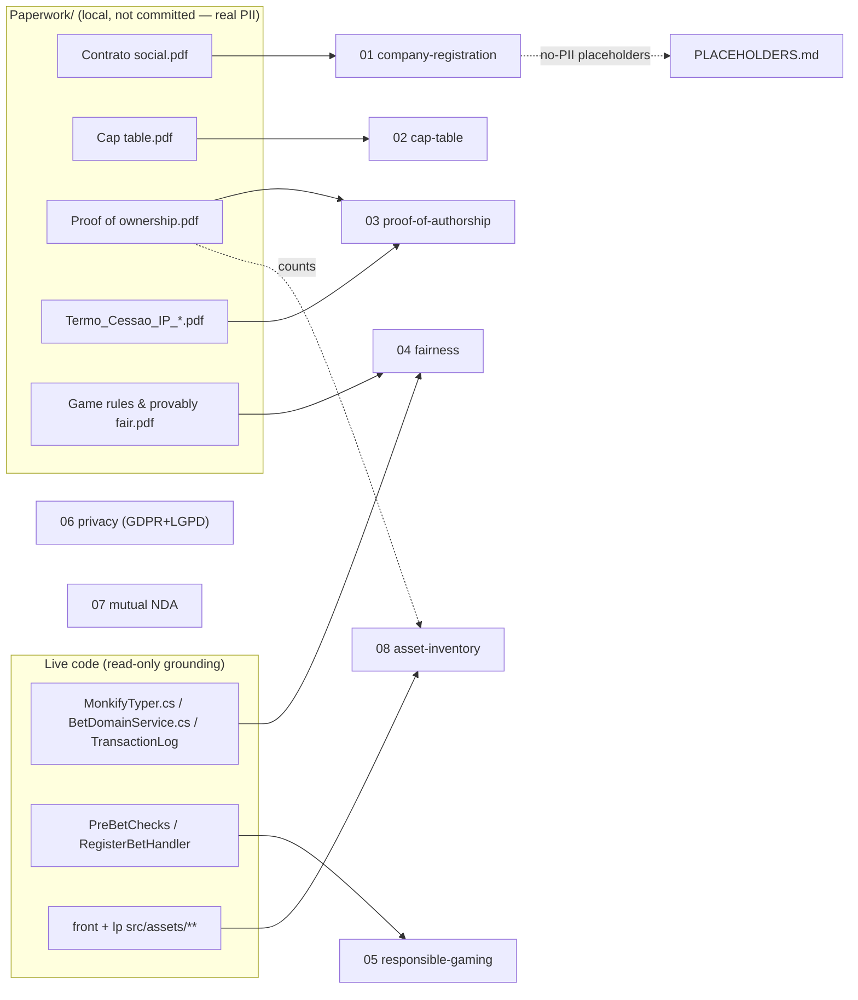

# Monkify — "Legal/Pitch Documents — Batch 1 (8 documents)" — Implementation Spec

> **Status: Ready for implementation** — refined via Trello card
> [Create legal/pitch documents — Batch 1 (8 documents)](https://trello.com/c/CPenrIlV) (2026-07-01).
> Repos affected: **`monkify-meta`** (write target — the deliverable + this spec).
> `monkify-backend` and `monkify-front` are **read-only grounding sources** (no branches, no code changes).
>
> **Purpose:** Produce the first batch of 8 legal/pitch documents used to sell Monkify as a SaaS /
> managed game license to casinos. This is a **non-code, document-production** story: the deliverable
> is a set of standardized Markdown documents committed under `monkify-meta/legal/`, each following a
> free/DIY ($0) route, with **no real PII** committed and every paid step marked **DEFERRED**.

---

## 1. Summary

The parent card [Setup legal documents for selling the game as a SAAS](https://trello.com/c/ZowgQHZg)
decided **what** documents are needed and the $0 route for each. This batch is the **execution** of the
first 8. A key refinement discovery reshaped the work: **documents #1–#4 already exist as real PDFs**
under the local `Paperwork/` folder (not committed to git), so the job is to **create new
*standardized* Markdown versions** of those (reconciled with current code where relevant) and to
**author the 4 genuinely-missing documents** (#5 RG, #6 Privacy, #7 NDA, #8 asset-license audit).

The 8 documents, their source, and the action required:

| # | Document | Source under `Paperwork/` | Action | Extra language |
| --- | --- | --- | --- | --- |
| 1 | Company registration | `Contrato social.pdf` (real PT-BR cert) | Author EN good-standing **summary** (placeholders) that points to the real cert | + PT-BR |
| 2 | Cap table / ownership statement | `Cap table.pdf` (Capitalization & IP Ownership Statement) | **Standardize** into the shared template | — |
| 3 | Proof of authorship / IP ownership | `Proof of ownership.pdf` (+ `Termo_Cessao_IP_Icaro.pdf`, `Termo_Cessao_IP_Vitor.pdf`) | **Standardize**; keep regenerable (git-evidence based) | — |
| 4 | Fairness & game-rules | `Game rules & provably fair.pdf` (v2.0) | **Standardize + RECONCILE** with current backend code | — |
| 5 | Responsible-gaming integration | — (new) | **Author**, grounded in the shipped `rg-pre-bet-hook` | — |
| 6 | Privacy policy + data-processing | — (new) | **Author** (GDPR) | + PT-BR (LGPD) |
| 7 | Mutual NDA | — (new) | **Author** from a free reputable template | — |
| 8 | Third-party asset / license inventory | partial: asset counts in `Proof of ownership.pdf` | **Author / complete** — audit the live asset trees | — |

**Deliverable location:** `monkify-meta/legal/` — files `01-…` … `08-…` plus a shared `_TEMPLATE.md`,
a `PLACEHOLDERS.md` substitution map, and a `README.md` index.

---

## 2. Constraints (MANDATORY)

From `monkify-meta/constraints.md` (full list there) and the refined card:

- **Branch-per-repo:** `feature/legal-pitch-documents-batch-1` — created in `monkify-meta` only
  (the only write target). No branches in backend/front because there are **no code changes**.
- **No real PII / secrets committed (§1 of constraints):** committed Markdown uses **placeholders**
  (`[OWNER]`, `[ENTITY]`, `[CNPJ]`, `[NIRE]`, `[ADDRESS]`, `[CONTRIBUTOR_1]`, `[CONTRIBUTOR_2]`,
  `[DPO_NAME]`, `[DPO_EMAIL]`, party names). Real values stay **only** in the local, un-committed
  `Paperwork/` PDFs. `legal/PLACEHOLDERS.md` maps each placeholder to its source but contains **no
  real values**.
- **Zero-budget:** every artifact uses its free/DIY route. Every cost-incurring step (GLI/BMM lab RNG
  certification, trademark filing, lawyer review, source-code escrow agent) is tagged **DEFERRED** —
  never presented as done.
- **IP-protection discipline:** nothing sensitive shared before a signed NDA + agreement; documents
  are drafts (`Status: Draft — not legal advice`).
- **No production data / external calls (§5):** git-evidence for #3 is generated from local repos
  only; no production DB/API access.
- **Non-code work:** no backend/frontend changes, no EF mapping, no migrations, **no unit tests**
  (§3 test discipline does not apply — see §11). Backend/front are read **only** to ground #4/#5/#8.
- **Operator messaging:** N/A to these documents (no user-facing operator error copy is produced).

---

## 3. Resolved product decisions

| # | Decision |
| --- | --- |
| 1 | Deliverable = **8 standardized Markdown docs** under `monkify-meta/legal/` (`01`–`08`), each on **one shared template**; plus `_TEMPLATE.md`, `PLACEHOLDERS.md`, `README.md`. |
| 2 | These are **new standardized versions** built from the `Paperwork/` PDFs as source content — **not** verbatim ports and **not** just an index/pointer. |
| 3 | **No PII in the repo.** Placeholders only; real values remain in the local `Paperwork/` PDFs; `PLACEHOLDERS.md` maps placeholder → source (no real values). |
| 4 | **Language:** English is the working language for all 8; **PT-BR additionally** for #1 (company registration) and #6 (privacy/LGPD). |
| 5 | The `[C][L][R]` (crypto / lightly-regulated / fully-regulated) track legend is **dropped** — not used in these docs. |
| 6 | **#4 (fairness) must be reconciled with current code:** remove `CommissionPercentage` payout math and `RefundLog`; use the unified `TransactionLog`; re-verify RNG / character pool / rolling-window / pacing / fallback / replay against `MonkifyTyper.cs`. |
| 7 | **Ground the net-new technical docs in code:** #5 in the shipped `rg-pre-bet-hook` (`IPreBetCheckService`: allow/deny/**fail-closed**); #8 in the **live** `monkify-front` + `monkify-lp` asset trees (which have drifted from the old inventory). |
| 8 | **Zero-budget:** all paid steps tagged **DEFERRED**. |
| 9 | On completion, mark the matching items **HAVE** on parent card #1 (`ZowgQHZg`). |

---

## 4. Document-set architecture

### 4.1 Folder layout (`monkify-meta/legal/`)

```
legal/
  README.md                         index: what each doc is, status, source
  _TEMPLATE.md                      the shared document template (below)
  PLACEHOLDERS.md                   placeholder -> source map (NO real values)
  01-company-registration.md        (+ 01-company-registration.pt-BR.md)
  02-cap-table.md
  03-proof-of-authorship.md
  04-fairness-and-game-rules.md
  05-responsible-gaming-integration.md
  06-privacy-policy.md              (+ 06-privacy-policy.pt-BR.md)
  07-mutual-nda.md
  08-third-party-asset-inventory.md
```

PT-BR variants use the `.pt-BR.md` suffix and carry the same structure as their English master.

### 4.2 Shared document template (`_TEMPLATE.md`)

Every document opens with the same front block, then a Purpose and body, and closes with Document
control:

```markdown
# Monkify — <Document Title>

> **Version:** <n> · **Date:** <YYYY-MM-DD>
> **Owner:** [OWNER] · **Entity:** [ENTITY] · **Registration:** [CNPJ]
> **Status:** Draft — not legal advice.

## Purpose
<one short paragraph: what this document is and who it is for.>

## <body sections — per document>

## Document control
- **Real-value source:** `Paperwork/<file>.pdf` (local, not committed) — see `PLACEHOLDERS.md`.
- **Grounded in / regenerate:** <code path or generator, or "n/a">.
- **Deferred (paid) steps:** <list, or "none">.
```

### 4.3 `PLACEHOLDERS.md` (no real values)

A table mapping each placeholder token to a human description and its source document — used by a
human to fill real values *outside* the repo before sending to a buyer:

| Placeholder | Meaning | Source (local, not committed) |
| --- | --- | --- |
| `[OWNER]` | Legal owner full name | `Paperwork/Contrato social.pdf` |
| `[ENTITY]` | Legal entity / trade name | `Paperwork/Contrato social.pdf` |
| `[CNPJ]` | Company registration number | `Paperwork/Contrato social.pdf` |
| `[NIRE]` | Board-of-trade registration id | `Paperwork/Contrato social.pdf` |
| `[ADDRESS]` | Registered address | `Paperwork/Contrato social.pdf` |
| `[CONTRIBUTOR_1]`, `[CONTRIBUTOR_2]` | Co-creator names | `Paperwork/Termo_Cessao_IP_*.pdf` |
| `[DPO_NAME]`, `[DPO_EMAIL]` | Data-contact / DPO | to be chosen |

(The producer must **not** paste real CNPJ/address/names anywhere in the repo.)

---

## 5. Per-document production plan

### 5.1 `01-company-registration.md` (+ PT-BR)
- **What:** An English **good-standing / company-registration summary** (entity type = Brazilian sole
  proprietorship / ME) with all identifiers as placeholders, explicitly pointing to the authoritative
  PT-BR `Contrato social.pdf` as the real instrument.
- **PT-BR variant:** a short cover in Portuguese stating the entity is registered and the official
  `Contrato social` is the source of truth.
- **Deferred:** none (registration already exists).

### 5.2 `02-cap-table.md`
- **What:** Standardize `Cap table.pdf` ("Capitalization & IP Ownership Statement"): owning entity,
  **single 100% owner** (sole proprietorship — *no multi-party equity*), 100% IP ownership across
  `monkify-backend`, `monkify-front`, `monkify-lp`, `monkify-meta`, and a note that contributor
  contributions are assigned via written IP-assignment agreements (see #3). Profit-participation is a
  personal payment obligation, not equity — keep that framing.
- **Deferred:** none.

### 5.3 `03-proof-of-authorship.md`
- **What:** Standardize `Proof of ownership.pdf`: (a) declaration of authorship (names →
  placeholders); (b) **git evidence** per repo (remote, mainline branch, commit count, first/latest
  commit hash+date, author breakdown); (c) **media asset inventory** summary; (d) verification
  commands (`git rev-list --count`, `git log`, `git shortlog -sne`, `git ls-files`).
- **Regenerable:** the git-evidence table is generated from the local repos; note the commands so it
  can be refreshed. Copyright is automatic — **no registration filing** (that stays out).
- **Deferred:** none. **Cross-check:** keep asset totals consistent with #8 (single source of truth =
  the live audit in #8; #3 may summarize).

### 5.4 `04-fairness-and-game-rules.md` — **RECONCILE with code**
- **What:** Standardize `Game rules & provably fair.pdf` v2.0 into the template, but **correct the
  drift** before publishing. Ground truth = `monkify-backend/src/Monkify.Domain/Sessions/Services/MonkifyTyper.cs`
  and the operator-wallet-api money changes.
- **Required corrections (verified against current code / KB):**
  - **Remove commission:** §9 "Payout fairness" must **not** apply `pot *= (1 - CommissionPercentage)`.
    Per `BetDomainService.SetPotAmount`, the pot is the full sum of stakes (+ `LotteryPot`); the whole
    pot is paid to winners. `TokenSettings.CommisionPercentage` was removed (grep confirms no such
    symbol in `.cs`). Note the future commission-per-bet work as tracked separately (Trello #26) if
    mentioned at all.
  - **RefundLog → TransactionLog:** §8 "Audit & replay log sources" must list the **unified
    `TransactionLog`** (discriminator `Credit | Debit | Refund`, nullable `Reason` /
    `ExternalTransactionReference` / `Signature`) and **drop the `RefundLog` table** (the `Refunds`
    table was dropped by migration `AddOperatorWalletLedger`). Refund audit rows are `Refund`-typed
    `TransactionLog` entries.
  - **Re-verify** the RNG seeding method (SHA-256 over server entropy + every `Bet.Seed`), character
    pool construction, rolling-window win detection, wall-clock pacing (presentation-only), and the
    deterministic fallback winner against the current `MonkifyTyper.cs`. Keep the replay procedure.
- **Deferred:** paid lab RNG certification (GLI/BMM) stays **DEFERRED** (pilot-milestone / operator
  funded). Do not claim certification exists.

### 5.5 `05-responsible-gaming-integration.md` — **NEW, ground in code**
- **What:** Describe how a regulated operator's responsible-gaming controls integrate with Monkify,
  grounded in the shipped `rg-pre-bet-hook` feature. Cover:
  - Monkify owns **no RG state** and stores **no player PII**; it calls a pluggable **per-operator
    pre-bet check adapter** (`IPreBetCheckService` via `IPreBetCheckResolver`).
  - **Opt-in per operator, both payment models**; unconfigured operator → check **skipped**.
  - **Placement:** in `RegisterBetHandler`, after local validation, **before** the wallet debit; a
    denied bet is **never debited or persisted**.
  - **Outcomes:** Allowed → proceed; **Denied(reason)** → specific player message
    (`SelfExcluded | LimitReached | CoolingOff | KycRequired | Blocked | Other`); **Unavailable /
    timeout / error → fail-closed** (rejected, "temporarily unavailable, please try again").
  - **Where operator controls plug in:** the adapter is where self-exclusion / deposit-time limits /
    cooling-off / KYC / block checks live (operator-owned).
  - **Audit = log-only** (Serilog), no DB table, no PII.
  - Cite a **free public RG framework** as reference (e.g. a recognized responsible-gambling code) —
    reference only, no paid membership.
- **Grounded in:** `Monkify.Infrastructure/Services/PreBetChecks/*`,
  `Monkify.Infrastructure/Handlers/Sessions/RegisterBet/RegisterBetHandler.cs` (`RunPreBetCheck`).
- **Deferred:** none (log-only; certification not required for this doc).

### 5.6 `06-privacy-policy.md` (+ PT-BR) — **NEW**
- **What:** Privacy policy + data-processing description. **English master (GDPR)** and a **PT-BR
  variant (LGPD)** — the two legally-required jurisdictions.
- **Key factual anchor (from the fairness doc §2.1 + operator-player-identity):** Monkify stores **no
  player PII** beyond the operator-supplied `ExternalPlayerId` (casino-owned reference) or the crypto
  wallet public key; it does **not** store CPF, email, phone, or legal name. State controller vs
  processor roles (operator = controller of player identity; Monkify = processor of game-outcome
  data). Appoint a data-contact / DPO: `[DPO_NAME]` / `[DPO_EMAIL]` placeholders.
- **Deferred:** paid legal review DEFERRED (draft from free reputable templates).

### 5.7 `07-mutual-nda.md` — **NEW**
- **What:** Mutual non-disclosure agreement adapted from a **free reputable template**. Must include:
  **non-use**, **no-reverse-engineering**, **no-derivative**, **no-circumvention** clauses; mutual
  confidentiality; term and survival; governing law placeholder. Parties as placeholders
  (`[PARTY_A]` = Monkify entity, `[PARTY_B]` = counterparty).
- **Deferred:** paid lawyer review DEFERRED.

### 5.8 `08-third-party-asset-inventory.md` — **NEW / complete, ground in live trees**
- **What:** Audit **every** media / audio / font asset across `monkify-front` and `monkify-lp`,
  classify each **owned vs third-party**, record its **license**, and **flag** anything lacking
  commercial rights for **removal from the sales demo**.
- **Live asset trees (verified — note they have drifted from the old `Proof of ownership.pdf`
  inventory, so re-audit, do not copy old counts):**
  - `monkify-front/src/assets/` → `audios/`, `bg/`, `game/`, `gifs/`, `styles/`, `types/`
  - `monkify-lp/src/assets/` → `backstory/`, `cards/`, `elements/`, `team/`
- **Method:** enumerate with `git ls-files` per repo; group by type (PNG/GIF/SVG/ICO/WAV/font);
  for each, mark `Owned` (created for Monkify) or `Third-party` (+ source + license + commercial-use
  y/n). Include fonts referenced in `styles/` / CSS.
- **Output:** a table + an explicit **"remove before demo"** list for any non-licensed asset.
- **Deferred:** none.

---

## 6. Code-grounding requirements (read-only)

The producer must read the live code before finalizing #4, #5, #8 — the KB `features/` docs are the
map, the code is the ground truth. Confirmed touchpoints:

| Doc | Read (no edits) | Confirm |
| --- | --- | --- |
| #4 | `Monkify.Domain/Sessions/Services/MonkifyTyper.cs`; `Monkify.Domain/Bets/Services/BetDomainService.cs`; `Monkify.Domain/Bets/Entities/TransactionLog.cs`; `Monkify.Domain/Bets/ValueObjects/TransactionLogType.cs` | No commission math; unified `TransactionLog`; RNG/pacing/fallback/replay accurate |
| #5 | `Monkify.Infrastructure/Services/PreBetChecks/*`; `Monkify.Infrastructure/Handlers/Sessions/RegisterBet/RegisterBetHandler.cs` (`RunPreBetCheck`, `MapDenyReasonToMessage`) | allow/deny/fail-closed; opt-in; placement before debit; log-only |
| #6 | `features/operator-player-identity.md`; fairness doc §2.1 | Monkify stores no player PII beyond `ExternalPlayerId`/wallet |
| #8 | `monkify-front/src/assets/**`, `monkify-lp/src/assets/**` (+ `git ls-files`) | Complete, live, owned-vs-third-party + license |

---

## 7. Frontend / backend behaviour

**None.** No code is written in either app. All references above are **read-only** grounding for the
prose in documents #4/#5/#6/#8.

---

## 8. Document source & dependency map



---

## 9. Out of scope

- The remaining parent-card documents — Pilot agreement, Source-code escrow, Compliance roadmap, MSA,
  Trademark — are **future batch(es)**.
- Building the pitch deck / demo video / promotional art (separate cards).
- Any **paid** step now: trademark filing, lab RNG/GLI/BMM certification, lawyer drafting, escrow
  agent — all **DEFERRED**.
- A **PDF/Docx export pipeline** — Markdown in `monkify-meta/legal/` is the Batch-1 deliverable;
  formatted export is optional / a separate step.
- Any application **code change**, EF mapping, migration, or unit test.
- Committing any **real PII** or secrets.

---

## 10. File checklist

### 10.1 Backend (`monkify-backend`)
None (read-only grounding — no files changed).

### 10.2 Frontend (`monkify-front`)
None (read-only grounding — no files changed).

### 10.3 Meta (`monkify-meta`)

| # | File | Change |
| --- | --- | --- |
| 1 | `legal/README.md` | New — index of the 8 docs (title, status, source) |
| 2 | `legal/_TEMPLATE.md` | New — shared document template (§4.2) |
| 3 | `legal/PLACEHOLDERS.md` | New — placeholder → source map, **no real values** (§4.3) |
| 4 | `legal/01-company-registration.md` (+ `.pt-BR.md`) | New — EN summary (placeholders) + PT-BR cover |
| 5 | `legal/02-cap-table.md` | New — standardized capitalization & IP ownership statement |
| 6 | `legal/03-proof-of-authorship.md` | New — declaration + git evidence + asset summary |
| 7 | `legal/04-fairness-and-game-rules.md` | New — standardized **and reconciled** with current code |
| 8 | `legal/05-responsible-gaming-integration.md` | New — grounded in `rg-pre-bet-hook` |
| 9 | `legal/06-privacy-policy.md` (+ `.pt-BR.md`) | New — GDPR master + LGPD PT-BR |
| 10 | `legal/07-mutual-nda.md` | New — mutual NDA from a free template |
| 11 | `legal/08-third-party-asset-inventory.md` | New — live owned-vs-third-party asset audit |
| 12 | `specs/legal-pitch-documents-batch-1.md` | This spec |
| 13 | `INDEX.md` | Add spec row + set "Feature currently in flight" |

---

## 11. Unit tests

**Not applicable.** This is a non-code, document-production story — no backend behavior changes, so
`Monkify.Tests` is not touched and the §3 test-discipline constraint does not apply. "Verification"
is the §12 acceptance-criteria review (see §13 Manual QA), not automated tests.

---

## 12. Acceptance criteria

Mapped 1:1 from the Trello **Acceptance Criteria** checklist:

1. Given the `monkify-meta/legal/` folder, when Batch-1 is complete, then 8 standardized Markdown docs
   (01–08) exist, each following the shared template (title, version/date, owner/entity placeholders,
   Status: Draft, Purpose, body, Document control).
2. Given any committed legal doc, when inspected, then it contains no real PII/secrets — CNPJ, address,
   legal names, and party names appear only as placeholders, and `legal/PLACEHOLDERS.md` maps each
   placeholder to its source (`Paperwork/*.pdf`).
3. Given doc #4 (fairness), when reviewed against current backend code, then it contains no
   `CommissionPercentage` payout math and no `RefundLog` reference (uses unified `TransactionLog`), and
   its RNG seeding / character pool / rolling-window / pacing / fallback / replay description matches
   `MonkifyTyper.cs`.
4. Given doc #5 (responsible-gaming), when reviewed, then it references the shipped pre-bet RG hook
   (`IPreBetCheckService`: allow / deny(reason) / fail-closed), describes where operator
   self-exclusion/limits controls plug in, and cites a free public RG framework.
5. Given doc #6 (privacy), when reviewed, then it covers both GDPR and LGPD, states Monkify stores no
   player PII beyond the operator-supplied `ExternalPlayerId` / wallet pubkey, names a data-contact/DPO
   placeholder, and a PT-BR version exists for LGPD.
6. Given doc #7 (mutual NDA), when reviewed, then it includes non-use, no-reverse-engineering,
   no-derivative, and no-circumvention clauses, with parties as placeholders.
7. Given doc #8 (asset inventory), when reviewed, then every media/audio/font asset in `monkify-front`
   and `monkify-lp` is classified owned vs third-party with its license, and any asset lacking
   commercial rights is flagged for removal from the demo.
8. Given any paid step (GLI/BMM lab RNG cert, trademark filing, lawyer review, escrow agent), when it
   appears in any doc, then it is marked **DEFERRED** and never presented as already done.
9. Given the produced doc set, when validated, then #1 (company registration) and #6 (privacy/LGPD)
   include the legally-required PT-BR content and all other docs are in English.
10. Given all 8 artifacts are produced, when Batch-1 closes, then the matching items on parent card #1
    (`ZowgQHZg`) are marked **HAVE**.

---

## 13. Manual QA (review checklist)

1. `grep -rInE '[0-9]{2}\.[0-9]{3}\.[0-9]{3}/[0-9]{4}-[0-9]{2}'  monkify-meta/legal/` → **no** CNPJ
   matches (PII check). Repeat for the real owner name / address strings.
2. Each of the 8 files opens with the shared front block and closes with **Document control**.
3. `04-fairness-and-game-rules.md`: no occurrence of `commission`/`CommissionPercentage`/`RefundLog`
   except when explicitly describing their **removal**.
4. `05-…`: mentions `IPreBetCheckService`, allow/deny/fail-closed, and placement before the debit.
5. `06-…` + `06-….pt-BR.md` both exist; `01-….pt-BR.md` exists.
6. `08-…`: cross-check totals against a fresh `git ls-files` in front + lp; each asset has an
   owned/third-party + license verdict.
7. Every `DEFERRED` paid step is visibly labelled; nothing paid is claimed as done.
8. After merge, tick the matching items on parent card #1 (`ZowgQHZg`).

---

## 14. Trello / pipeline

- **Source card:** [Create legal/pitch documents — Batch 1 (8 documents)](https://trello.com/c/CPenrIlV)
  — moved to **Specs created**; the **Implementation** section on the card lists the branch + spec path.
- **Parent card:** [Setup legal documents for selling the game as a SAAS](https://trello.com/c/ZowgQHZg)
  — mark the 8 matching items **HAVE** when the artifacts are produced.
- **After the docs are produced & merged:** run `/monkify-ship-feature Create legal/pitch documents — Batch 1`
  (reads the branch from the card). Note: ship-feature's backend-test / KB-sync steps are largely N/A
  here; the KB "sync" is that `legal/` now holds the batch-1 documents.

---

## 15. Revision log

| Date | Change |
| --- | --- |
| 2026-07-01 | Initial spec from refined card #29 (same-chat refinement). Grounded in shipped `operator-wallet-api` (commission/`RefundLog` removed) and `rg-pre-bet-hook`; asset trees verified live. |
