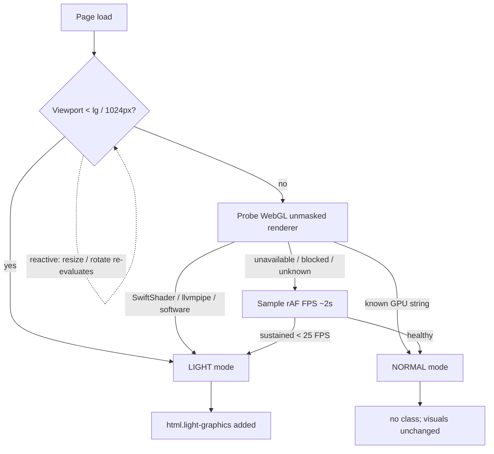

# Space Stroker — "Light graphics mode (software-rendering performance)" — Implementation Spec

> **Status: Ready for implementation** — refined via Trello card
> [game is super laggy when hardware acceleration is off in chrome](https://trello.com/c/wsiDoPfK) (#83, 2026-07-22).
> Repos affected: `monkify-front`, `monkify-lp` (branch `master`), and this doc in `monkify-meta`.
> **`monkify-backend` is not affected.**
>
> **Purpose:** when Chrome runs without hardware acceleration (software rasterization), Space Stroker
> is close to unplayable — the CPU has to composite blurred blend-mode surfaces, dozens of moving
> images and several infinite animations every frame. This spec deletes the worst offender outright
> (the nebula layer) and adds an automatic **light graphics mode** that strips the expensive effects
> when the renderer is weak, so the game stays playable at ~30 FPS with no input lag. There is **no
> user-facing setting** — the mode is decided by detection alone, and mobile is always light.

---

## 1. Summary

Two independent changes, shipped together:

| # | Change | Applies to | User-visible when |
| --- | --- | --- | --- |
| A | **Delete `NebulaField.vue`** and every reference to it | `monkify-front` | Always — for everyone, in both modes |
| B | **Light graphics mode** — automatic, no UI | `monkify-front` + `monkify-lp` | Only when detection says the renderer is weak, or on mobile |

**Mode matrix:**

| Context | Mode |
| --- | --- |
| Desktop, hardware acceleration ON | **Normal** — unchanged visuals (minus the nebula) |
| Desktop, hardware acceleration OFF (SwiftShader / llvmpipe / software ANGLE) | **Light** |
| Desktop, WebGL blocked/masked **and** the FPS sample is bad | **Light** |
| Desktop, WebGL blocked/masked **and** the FPS sample is fine | **Normal** |
| Viewport `< lg` (1024px) — portrait or landscape phone | **Light**, unconditionally |
| Embedded in an operator iframe | Same rules as above (auto only) |

Change A is the confirmed dominant win: the nebula was commented out in a live session with
hardware acceleration off and produced a large, immediately visible improvement. Change B covers the
remaining cost (blur, animated backgrounds, infinite animations, glows).

**This is a bug fix / QOL change, not a new feature.** No backend, DB, API, SignalR or game-flow
change ⇒ per `constraints.md` §3 there is **no integration test** and no `SpaceStroker.Tests` update.

---

## 2. Constraints (MANDATORY)

From `monkify-meta/constraints.md` (full list there):

- **Worktree-per-repo:** `feature/light-graphics-mode` in `monkify-front`, `monkify-lp` and
  `monkify-meta`, each in its own worktree under `.worktrees/light-graphics-mode/<repo>`. The shared
  checkouts stay on `main` / `master` and are never switched.
- **`monkify-lp`'s default branch is `master`,** not `main` — its worktree was created off
  `origin/master`.
- **Unit tests:** N/A — no backend change. Neither frontend repo has a test suite.
- **Integration test:** **not required** (`constraints.md` §3 — bug fix / QOL, no game-flow change).
- **EF / migrations / secrets:** N/A — nothing outside the two frontends is touched.
- **Normal mode must look unchanged** apart from the nebula being gone. This is a performance fix,
  not a redesign; no palette, layout or copy drift.
- **No user-facing setting.** Do not add a toggle, a settings row, a query param, or any persisted
  preference. `PlayerCustomizationModal.vue` is not modified by this spec.

---

## 3. Resolved product decisions

| # | Decision |
| --- | --- |
| 1 | `NebulaField.vue` is **deleted permanently** from `monkify-front`, along with its import + mount in `App.vue`. Not kept, not gated, not reintroduced in normal mode. |
| 2 | A **light graphics mode** exists with exactly two states: normal or light. It is decided by **detection alone**, on every load. |
| 3 | **No picker.** No toggle, no settings row, no `localStorage`, no URL param. The customization modal is untouched. |
| 4 | **Detection order:** WebGL unmasked renderer string first; if unavailable or inconclusive, a short (~2 s) rAF FPS sample. If both are inconclusive → **normal** mode (never punish good hardware). |
| 5 | **Mobile (`< lg` / 1024px) is always light**, unconditionally, regardless of the detection verdict. Reuses the existing `useIsMobile` breakpoint. |
| 6 | Light mode removes: all `backdrop-filter` / `filter: blur()`; the infinite CSS animations (`bar-scan`, `pulse`, `blink`, `crt-flicker`, `wobble`, LP `drift-*` / `coinFloat` / `marquee` / `sectionBgScroll`); `mix-blend-mode` overlays; multi-layer `box-shadow` / `text-shadow` glows. |
| 7 | Light mode **keeps the background drifting**, heavily reduced: element cap ~8, frame target ~15 FPS, no scrolling `background-position`, `TorpedoSpawner` disabled. It is deliberately **not** frozen. |
| 8 | The animated mascot (`GameMonkey`) and the LP mode GIFs **stay animated** in light mode. |
| 9 | Scope is **all surfaces**: game screen, lobby, admin/dev pages, and the landing page. |
| 10 | The LP gets the same automatic treatment and, like the app, **no UI control**. |
| 11 | Embedded (iframe) contexts run the same detection. The postMessage embed contract is unchanged — **no new events**. |
| 12 | `.section-vignette` **stays** — reviewed and confirmed free (one static linear gradient, no blur/blend/animation). With the nebula gone it is the only thing framing the screen edges. |
| 13 | An **efficiency audit** of the remaining animation loops is in scope, provided it does not change how normal mode looks. |
| 14 | Terminal / typer rendering is **out of scope**. |

---

## 4. Data model

**N/A** — no entity, column, EF mapping or migration change. This feature is entirely client-side
presentation.

---

## 5. Configuration

**N/A** — no new env var, no `GeneralSettings` key, no seed data. The mode is derived at runtime from
the browser itself, deliberately avoiding a `VUE_APP_*` flag (a build-time flag cannot know whether
the *player's* browser has acceleration).

---

## 6. Backend behaviour

**None.** `monkify-backend` is not touched: no handler, consumer, endpoint, DTO, SignalR contract or
migration change. The game lifecycle, bets, payouts, chat and stats all behave identically.

---

## 7. Frontend behaviour — `monkify-front`

### 7.1 Delete the nebula layer

`src/components/background/NebulaField.vue` is **deleted**. It renders 5 clouds, each a 40–82 **vw**
radial gradient carrying **both** `filter: blur(24–54px)` and `mix-blend-mode: screen`, with inline
styles rewritten on every rAF tick — the single most expensive thing on the page under software
rasterization.

Remove, in the same commit:

- `src/App.vue:16` — the `import NebulaField from './components/background/NebulaField.vue';` line.
- `src/App.vue:122-126` — the explanatory comment block **and** the `<nebula-field :speed-multiplier="typingSpeed" />` mount.
- `src/assets/styles/arcade.css:220-224` — the `.section-vignette` header comment still claims "the
  coloured nebula itself is now a live drifting layer (NebulaField.vue)". Rewrite it to describe the
  vignette alone.

Keep `.section-vignette` and its `<div>` in `App.vue:127` exactly as they are.

> **Do not confuse this with the LP.** `monkify-lp` has an unrelated **CSS class** called
> `.nebula-field` (`src/styles/global.css:483` and `.nebula-field--tinted:505`) — static
> `background-image` gradients on the section backdrops, not a Vue component and not animated. It is
> **not** deleted by this spec. See §7.6.

### 7.2 New composable — `src/hooks/usePerfMode.ts`

Module-scoped singleton state, in the style of the existing `useIsMobile.ts` (shared `ref` created
once at module load, exposed through a `useX()` function), so every consumer reads the same verdict
and detection runs once per page load.

```ts
// Shape (not literal code — implement in the repo's style)
const lightMode: Ref<boolean>            // final verdict: mobile OR weak renderer
const detectionSettled: Ref<boolean>     // false while the FPS fallback is still sampling
export function usePerfMode() { return { lightMode, detectionSettled }; }
```

**Resolution order:**

1. **Mobile short-circuit.** Reuse `useIsMobile()`; while `isMobile.value` is `true`, `lightMode` is
   `true` — no probing needed. This must be **reactive**, not a one-shot read, so rotating a phone or
   resizing a desktop window across the `lg` boundary updates the verdict (`useIsMobile` already
   subscribes to the media query).
2. **WebGL renderer probe** (synchronous, once, on module init when not mobile). Create a throwaway
   `canvas`, request `webgl2` then `webgl`, read `WEBGL_debug_renderer_info` →
   `UNMASKED_RENDERER_WEBGL`, then discard the context. Match case-insensitively against a
   software-renderer list: `swiftshader`, `llvmpipe`, `software`, `softwarerasterizer`,
   `microsoft basic render`, `google swiftshader`, `angle (software`. A match ⇒ `lightMode = true`,
   `detectionSettled = true`.
3. **FPS fallback** when the context or the extension is unavailable, or the string matches nothing
   known: sample `requestAnimationFrame` for ~2 s, discarding the first ~250 ms (load spike). If the
   sustained average is below **25 FPS** ⇒ `lightMode = true`. Otherwise leave it `false`. Either way
   set `detectionSettled = true`.
4. **Both inconclusive** ⇒ stay in **normal** mode.

Requirements:

- Every probe is wrapped so a throwing/blocked WebGL implementation can never break boot. On any
  exception, fall through to the FPS sample; if that also fails, stay normal.
- The probe must not retain the canvas or the GL context (release after reading).
- Guard `typeof window` for safety, matching `useIsMobile.ts`.
- Export it from `src/hooks/index.ts` alongside the existing exports, or import directly — follow
  whichever pattern the touched components already use (`index.ts` currently re-exports only
  `useConnection` and `useOperator`; most newer composables are imported by path).

### 7.3 Applying the mode

`App.vue` applies a single root-level hook so CSS can react without prop-drilling:

- Watch `lightMode` and toggle a class on `document.documentElement` — `light-graphics` — with
  `immediate: true`. Use the root element (not the app wrapper) so it also covers teleported content
  (toasts) and the LP-style global CSS overrides.
- Gate `<torpedo-spawner />` with `v-if="!lightMode"`.
- Pass `lightMode` into `GameBackground` (see §7.4) or let it read the composable directly — prefer
  reading the composable inside `GameBackground` to keep `App.vue` thin.

CSS then keys everything off `:root.light-graphics …`. All overrides live in one clearly-marked block
at the bottom of `src/assets/styles/arcade.css` (plain CSS, **not** `@layer components` — see the
existing note at the top of that file about Vue CLI's css-loader).

### 7.4 `GameBackground.vue` under light mode

Two instances are mounted (`#secondary-bg` with 30 initial elements, `#main-bg`). Under light mode:

| Knob | Normal | Light |
| --- | --- | --- |
| `MAX_ELEMENTS` | 64 | **8** |
| `TARGET_FPS` | 30 | **15** |
| `initialElements` prop | 30 / default 10 | clamp to **≤ 8** |
| `bgPosition` scroll | animated | **frozen** (skip the `bgPosition` update; leave `backgroundPositionX` at its initial value) |
| spawn interval | `timeout / effectiveSpeed` | at least 2× longer, and never below the element cap check |

The element cap must be applied to the **existing** list too, not just to new spawns: on entering
light mode, trim `elements.value` down to the cap rather than waiting for elements to drift off
screen.

Drift itself stays on — decision #7.

### 7.5 Effects stripped under light mode (`monkify-front`)

| File | What light mode overrides |
| --- | --- |
| `src/main.css:81` | `.space-stroker-toast` — drop `backdrop-filter: blur(6px)`; make the background opaque instead of `color-mix(... 88%, transparent)` |
| `src/main.css:89-100` | `.space-stroker-toast::after` — drop the `mix-blend-mode: overlay` scanline overlay |
| `src/main.css:8-14` | `.blink` / `.blink-fast` — `animation: none` (note both use `!important`, so the override needs `!important` too) |
| `src/components/GameHeader.vue:94` | header — drop `backdrop-blur-md`; make the `bg-[color-mix(...82%,transparent)]` fully opaque |
| `src/components/game-selection/GameTypes.vue:70,83` | `.header-content` / `.retro-box` — drop `backdrop-blur-md` |
| `src/components/game-selection/GameTypes.vue:141-161` | `.retro-bar::before` — `animation: none` (the `bar-scan` loop) |
| `src/components/game-selection/GameTypes.vue:163-173` | `.scanlines` — drop `mix-blend-mode: overlay` |
| `src/components/game-selection/GameTypeCard.vue:173-176` | `.card-content` — drop `backdrop-filter: blur(8px)`, opaque background |
| `src/components/game-selection/GameTypeCard.vue:199` | `.lottery-badge` — drop the infinite `pulse` |
| `src/components/game-selection/GameTypeCard.vue:259-261` | `.blink` — `animation: none` |
| `src/components/game-selection/GameTypeCard.vue:286-288` | `.pixelated-card:hover .card-content` — drop `crt-flicker` |
| `src/components/game-selection/GameTypeCard.vue:219-231` | `.character-img` — drop the `drop-shadow` filters (both rest and hover) |
| `src/assets/styles/arcade.css:98-114` | `.glow-primary` / `.glow-cyan` — collapse to a flat 1px ring; `.text-glow-*` — `text-shadow: none` |
| `src/assets/styles/arcade.css:38-59` | `.arcade-panel*` — collapse the 4-layer `box-shadow` stack to a single hard 1–2px edge (keeps the beveled read at a fraction of the cost) |
| `src/assets/styles/arcade.css:91-96` | `.crt-screen` — drop the large inset blur shadow |
| `src/components/game/GameMonkey.vue:279-280` | `.animate-wobble` — `animation: none` (the mascot **image** still animates; this is the wrapper's infinite wobble transform) |

Scoped-style caveat: `GameTypes.vue`, `GameTypeCard.vue` and `GameMonkey.vue` use `<style scoped>`,
so a `:root.light-graphics .x { }` rule written **inside** them will not match (the scope attribute
lands on the inner selector, and the root is outside the component). Use `:global(...)` in the scoped
block, or — preferred for consistency — put every override in the single `arcade.css` light-mode
block and rely on the component classes being globally unique. Verify by inspection, not assumption:
a silently non-matching override is the most likely bug in this change.

`.section-vignette` is **not** overridden (decision #12).

### 7.6 Frontend behaviour — `monkify-lp`

The LP has no rAF loop; its background is CSS-animation driven, which is cheaper but still costly in
software because of per-element `hue-rotate` filters and two continuously animated
`background-position` layers.

- **Detection:** port the same logic. Options, in order of preference:
  1. A tiny inline script in `src/layouts/Layout.astro` that runs the same renderer probe and stamps
     `document.documentElement.classList.add('light-graphics')` before paint — no framework needed,
     no flash of the heavy version.
  2. A shared `.ts` helper imported by that script if the logic grows.
  The FPS fallback may be kept, but it must not delay first paint.
  **Mobile is always light** — the LP check reuses the same `(max-width: 1023px)` media query
  (`matchMedia`), matching the app's breakpoint.
- **Reuse the existing reduced-motion block.** `src/styles/global.css:637-670` already disables
  exactly the right set: `.marquee__track`, `.coin-float`, `.hero-ship`, `.blink`, `.drift-float-a/b`,
  `.drift-spin`, `.drift-comet`, `.section-backdrop`. Extend that selector list so the same rules
  apply under `:root.light-graphics` (either duplicate the block or hoist the shared declarations to
  a selector list covering both). This is the cheapest correct implementation — do not re-derive it.
- **`SpaceBackground.vue`** — under light mode: cap the elements (≤ 8, and pass a smaller
  `initialElements`), lengthen the spawn interval, drop the per-element `hue-rotate-[…]` colour
  classes (`getRandomColorClass`, `SpaceBackground.vue:31-41,82-86`), and stop the
  `moveRight` background scroll (`.image-animation`, `SpaceBackground.vue:179-204`).
- **`.section-backdrop`** (`global.css:449-463`) — freeze `sectionBgScroll` (already covered by the
  reduced-motion block above) and drop `will-change: background-position`.
- **`.nebula-field` / `.nebula-field--tinted`** (`global.css:483-519`) — **keep the gradients**; drop
  the `filter: hue-rotate(...) saturate(...)` under light mode. The per-section tint is lost, which is
  an accepted trade. **Do not delete these classes** — they are unrelated to the app's deleted
  `NebulaField.vue`.
- **`index.astro:459` `.hero-comet`** — `animation: none` (already handled at `:469` for reduced
  motion; extend the same way).
- **No UI control.** LP mode GIFs (`cosmicsprint.gif`, `beastmode.gif`, `spacejackpot.gif`) keep
  animating (decision #8).

### 7.7 Efficiency audit (in scope, normal mode must not change)

Findings from code exploration; fix what profiling confirms:

1. **`GameBackground.vue:278-285`** — `getElementTransform` / `getElementOpacity` are called from the
   template, so Vue rebuilds a fresh inline-style object for **every element on every frame**, and
   the whole `v-for` list re-renders because `elements` is a deep reactive array mutated each tick.
   Options: `shallowRef` + manual triggering, precomputing the style string on the element object, or
   writing `transform` directly to element refs and keeping the list out of the reactive render path.
2. **`GameBackground.vue:274-276`** — `removeElement` allocates a new filtered array; the animate
   loop already splices in place at `:186-188`. `removeElement` appears unused — delete it if so
   (same for `getRandomRotation`'s unused `elementConfig` parameter at `:79`).
3. **`TorpedoSpawner.vue:85-97`** — the `blast` keyframe animates the **`right`** property, which
   forces layout on every frame instead of running on the compositor. Switch to `transform:
   translateX(...)` (visually identical, dramatically cheaper) — this benefits normal mode too.
4. **`GameBackground.vue:130-191` / `NebulaField`'s former loop** — two independent rAF loops each
   doing their own frame throttling. With the nebula deleted only one remains; no consolidation
   needed.
5. **`SpaceBackground.vue` (LP)** — `getRandomElement` rebuilds the whole rarity-weighted pool on
   every spawn (`:43-58`); hoist it to a module-level constant. Same pattern exists in the app's
   `GameBackground.vue:61-68`.

Anything that would alter normal mode's appearance is out of bounds — if a "fix" changes the look,
skip it and note why.

---

## 8. Flow diagram — mode resolution



---

## 9. Out of scope

- **Terminal / typer rendering** — `GameTerminal.vue` and the per-character DOM churn in
  `useGame.ts`. Not touched.
- Any backend, DB, SignalR or game-flow change.
- The animated mascot and the LP mode GIFs (kept animated in light mode).
- Redesigning normal mode — it must look unchanged apart from the deleted nebula.
- Any user-facing setting, toggle, URL param or persisted preference.
- A server-side or per-operator performance setting.
- Deleting the LP's unrelated `.nebula-field` CSS classes.

---

## 10. File checklist

### 10.1 Backend (`monkify-backend`)

**None** — repo not touched.

### 10.2 Frontend (`monkify-front`)

| # | File | Change |
| --- | --- | --- |
| 1 | `src/components/background/NebulaField.vue` | **Delete** the file |
| 2 | `src/App.vue` | Remove the `NebulaField` import (`:16`) + comment/mount (`:122-126`); add the `light-graphics` root-class watcher; gate `<torpedo-spawner />` with `v-if="!lightMode"` |
| 3 | `src/hooks/usePerfMode.ts` | **New** — mobile short-circuit + WebGL renderer probe + rAF FPS fallback; exposes `lightMode`, `detectionSettled`. No persistence, no setter |
| 4 | `src/hooks/index.ts` | Re-export `usePerfMode` if following the barrel pattern |
| 5 | `src/components/background/GameBackground.vue` | Light-mode branch (cap 8, 15 FPS, frozen bg scroll, longer spawn interval, trim on entry) + the §7.7 per-frame cleanups |
| 6 | `src/assets/styles/arcade.css` | Fix the stale nebula comment (`:220-224`); add the single `:root.light-graphics` override block (glows, panel shadows, crt-screen, and the component-class overrides per §7.5) |
| 7 | `src/main.css` | Light-mode overrides for `.space-stroker-toast` blur + scanline blend and the `.blink*` animations (`!important` needed) |
| 8 | `src/components/GameHeader.vue` | Header blur → opaque under light mode |
| 9 | `src/components/game-selection/GameTypes.vue` | Drop `backdrop-blur-md`, `bar-scan`, scanline blend under light mode |
| 10 | `src/components/game-selection/GameTypeCard.vue` | Drop card blur, `pulse`, `blink`, `crt-flicker`, `drop-shadow` filters under light mode |
| 11 | `src/components/game/GameMonkey.vue` | Drop the infinite `wobble` wrapper animation under light mode (mascot art still animates) |
| 12 | `src/components/background/TorpedoSpawner.vue` | `blast` keyframe `right` → `transform: translateX()` (benefits both modes) |

### 10.3 Frontend (`monkify-lp`, branch `master`)

| # | File | Change |
| --- | --- | --- |
| 1 | `src/layouts/Layout.astro` | Inline pre-paint script: mobile media query + WebGL renderer probe (+ optional FPS fallback) → adds `light-graphics` to `<html>` |
| 2 | `src/styles/global.css` | Extend the reduced-motion block (`:637-670`) to also match `:root.light-graphics`; drop `filter` on `.nebula-field*`; drop `will-change` on `.section-backdrop` |
| 3 | `src/components/SpaceBackground.vue` | Light-mode: element cap ≤ 8, longer spawn interval, no `hue-rotate` colour classes, frozen `moveRight` scroll; hoist the rarity pool out of `getRandomElement` |
| 4 | `src/pages/index.astro` | `.hero-comet` animation off under light mode (mirror the existing reduced-motion rule at `:469`) |

### 10.4 Meta (`monkify-meta`)

| # | File | Change |
| --- | --- | --- |
| 1 | `specs/light-graphics-mode.md` | **New** — this spec |
| 2 | `INDEX.md` | Spec row (status Ready) + "Feature currently in flight" entry |

---

## 11. Unit tests

**None.** `monkify-backend` is untouched, so `SpaceStroker.Tests` needs no change and — per
`constraints.md` §3 — **no integration test is required** (bug fix / QOL, no game-flow change).
Neither `monkify-front` nor `monkify-lp` has a test suite; verification is the build + lint + the
manual QA in §13.

---

## 12. Acceptance criteria

From the Trello checklist, with the four superseded items replaced (see the card's **Revisions**
section — the Trello API cannot edit existing checklist text, so the replacements were appended and
prefixed `[REVISED]`).

1. Given the repo after this change, when `NebulaField` is searched for, then the component file is
   deleted and no import, mount, asset or doc reference to it remains, and both builds pass with no
   unused-import warning.
2. Given Chrome with hardware acceleration disabled, when the player opens the lobby or the game
   screen, then light mode engages automatically without any user action.
3. Given Chrome with hardware acceleration disabled, when a game runs end to end with light mode
   active, then the lobby and game screen sustain roughly 30 FPS with no perceptible input lag on
   clicks, typing, or bet placement.
4. Given the WebGL unmasked renderer reports a software rasterizer (SwiftShader / llvmpipe /
   Software / ANGLE software), when the app boots, then light mode is selected from that signal alone
   without waiting for an FPS sample.
5. Given WebGL is unavailable, blocked, or the renderer string is inconclusive, when the app boots,
   then a short (~2 s) rAF FPS sample decides the mode — sustained low FPS engages light mode, a
   healthy sample leaves normal mode active.
6. Given detection is inconclusive on both signals, when the app boots, then normal mode is used.
7. Given any surface of the app or the LP, when the player looks for a graphics/performance setting,
   then none exists — the customization modal is unchanged, nothing is written to or read from
   `localStorage`, and the mode comes from detection alone on every load.
8. Given a viewport below the `lg` breakpoint (1024px, portrait or landscape phone), when the app or
   the LP loads, then light mode is active unconditionally regardless of what detection would have
   returned.
9. Given a desktop viewport, when the window is resized or a phone rotated across the `lg` breakpoint
   mid-game, then the mode follows the breakpoint (below `lg` always light, above `lg` back to the
   detection verdict) without remounting the terminal, dropping the SignalR connection, or restarting
   audio.
10. Given light mode is active, when any app surface renders (header, lobby panels, game-type cards,
    game screen, admin/dev pages), then no `backdrop-filter` or `filter: blur()` is applied and those
    surfaces use a solid or lightly tinted background instead.
11. Given light mode is active, when the space background runs, then it still drifts but with at most
    ~8 elements, a reduced frame target (~15 FPS), no scrolling `background-position`, and
    `TorpedoSpawner` disabled.
12. Given light mode is active, when the lobby and game screen render, then the infinite CSS
    animations (`bar-scan`, `pulse`, `blink`, `crt-flicker`, `wobble`), `mix-blend-mode` overlays, and
    multi-layer `box-shadow` / `text-shadow` glows are replaced by static styling.
13. Given light mode is active, when the game screen and the LP render, then the animated mascot and
    the LP mode GIFs still animate.
14. Given hardware acceleration is off, when the landing page loads, then the same detection engages
    its reduced-cost branch (no blur, no infinite animations, cheaper `SpaceBackground`) with no
    toggle UI shown.
15. Given the game is embedded in an operator iframe on a software-rendering browser, when it loads,
    then light mode engages automatically and the existing postMessage embed contract is unchanged
    (no new or missing events).
16. Given a game is in progress, when the mode flips (the FPS sample resolving), then the terminal is
    not remounted, the SignalR connection stays up, own-bet cues and audio are uninterrupted, and only
    the visuals change.
17. Given the tab is hidden and then restored, when either mode is active, then the existing
    `visibilitychange` pause/resume still works with no runaway or double-scheduled rAF loop.
18. Given `prefers-reduced-motion` is set, when the app renders in either mode, then motion is at
    least as reduced as it is today and never more animated than before this change.
19. Given hardware acceleration is ON and no mobile viewport, when the app and LP render, then normal
    mode is used and the accelerated visuals are unchanged from today apart from the removed nebula
    layer.
20. Given the animation loops are profiled, when avoidable per-frame work is found (rebuilt style
    objects, reactive-array churn, redundant re-renders), then it is removed with no visible change to
    normal mode.
21. Given the change is complete, when `yarn lint` and `yarn build` run in `monkify-front` and
    `npm run build` runs in `monkify-lp`, then all pass and browser QA in both modes shows 0 console
    errors.

---

## 13. Manual QA

Hardware acceleration is toggled in Chrome at **Settings → System → "Use graphics acceleration when
available"** (requires a browser restart). Verify the verdict in DevTools with
`document.documentElement.classList.contains('light-graphics')`, and confirm the renderer string at
`chrome://gpu`.

1. **Accel ON, desktop** — load `/space-stroker/game/games` and `/space-stroker/game/play`. No
   `light-graphics` class. Visuals match `main` except no nebula. 0 console errors.
2. **Accel OFF, desktop** — restart Chrome, reload. `light-graphics` present. Blur gone from header /
   lobby cards, glows flat, no `pulse`/`blink`/`bar-scan`/`crt-flicker`, background still drifting but
   sparse. Play a full game: place a bet, watch the typer, reach a result — responsive throughout.
3. **Mobile** — DevTools device emulation (or a real phone) below 1024px, both orientations, with
   accel **ON**: `light-graphics` must still be present (decision #5).
4. **Breakpoint crossing** — with a game running, drag the window across 1024px. Mode flips; terminal
   keeps its content, chat stays connected, audio does not restart.
5. **LP** — load the landing page with accel off: no blur, marquee/coin/ship/drift animations frozen,
   background scroll stopped, mode GIFs still playing.
6. **Embedded** — open `public/embed-example.html` with accel off: light mode engages; the parent
   still receives `ready` / `game-started` / `bet-placed` and no new event types.
7. **Reduced motion** — enable `prefers-reduced-motion` in DevTools rendering options; confirm nothing
   animates more than before, in either mode.
8. **Builds** — `yarn lint && yarn build` (front), `npm run build` (LP).

---

## 14. Trello / pipeline

- **Source card:** [#83 — game is super laggy when hardware acceleration is off in chrome](https://trello.com/c/wsiDoPfK)
  — list **Specs created**; the **Implementation** section on the card carries branch, worktree and
  spec path.
- **Worktrees:** `.worktrees/light-graphics-mode/{monkify-front,monkify-lp,monkify-meta}`; branch
  `feature/light-graphics-mode` in all three (LP's is off `origin/master`).
- **Next:** `/monkify-implement-feature` to build it, then `/monkify-ship-feature` to sync the KB and
  merge. Note for ship: the LP merges into **`master`**, the other two into **`main`**.

---

## 15. Revision log

| Date | Change |
| --- | --- |
| 2026-07-22 | Initial spec from refined card #83, incorporating the same-session revisions (nebula deleted permanently, no picker, mobile always light) and a live perf check confirming the nebula as the dominant cost |
