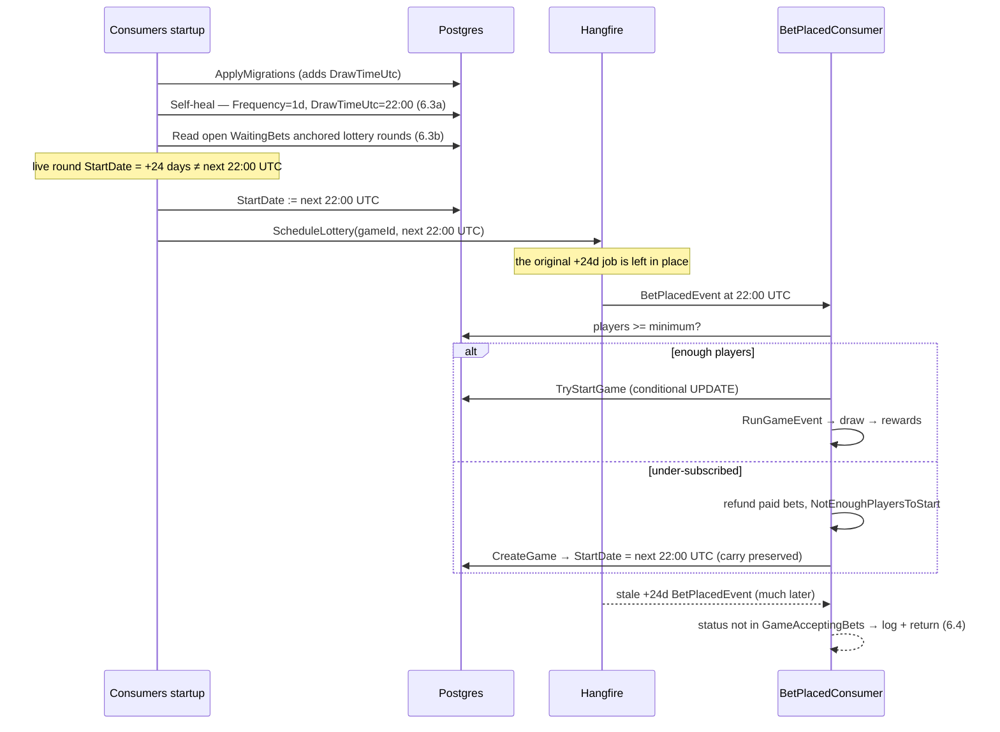

# SpaceStroker — "Lottery draw time (UTC anchor)" — Implementation Spec

> **Status: Ready for implementation** — refined via Trello card
> [#132 Space Jackpot: fix the 24-day TimeSpan trap + fixed daily draw time (UTC anchor)](https://trello.com/c/cGlkxiYo)
> (2026-07-30).
> Repos affected: `monkify-backend`, `monkify-front`, and this doc in `monkify-meta`.
> Branch: `feature/lottery-draw-time` (worktrees at `.worktrees/lottery-draw-time/<repo>`).
>
> **Purpose:** Space Jackpot is advertised everywhere as a **daily** jackpot but is configured to draw
> every **24 days**, because `"24:00:00"` parses as 24 days in .NET. Fix that, and — because a draw
> time that is merely "one period after whenever the round happened to be created" drifts forever —
> give a lottery an optional **fixed UTC time-of-day anchor** so it lands on a stable wall-clock slot.

---

## 1. Summary

Two things ship together.

| | Today | After |
| --- | --- | --- |
| **Space Jackpot frequency** | `"24:00:00"` in config ⇒ **24 days** | `"1.00:00:00"` ⇒ **1 day** |
| **When the draw happens** | `StartDate = UtcNow + Frequency` at round creation — drifts by however long the previous round took | `StartDate` = next slot on a fixed UTC grid anchored to `DrawTimeUtc` (**22:00 UTC** for Space Jackpot); zero drift |
| **Existing seeded rows** | Never rewritten from config (create-only by name) — so a config fix reaches nobody | A narrow **startup self-heal** patches lottery `Frequency` + `DrawTimeUtc` |
| **The round already open** | Keeps its 24-day `StartDate` and Hangfire job across restarts forever | **Corrected at startup** and rescheduled |
| **Lotteries with no anchor** | rolling `UtcNow + Frequency` | **unchanged** (`DrawTimeUtc` is nullable) |

### 1.1 How a lottery actually draws (verified during spec exploration — read this first)

This is not obvious from the code and the implementation depends on it:

- **A lottery bet does not publish `BetPlacedEvent`.** `RegisterBetHandler.cs:130` publishes it **only
  when `LotteryParameters == null`**. Races evaluate on every bet; lotteries do not.
- Therefore the **only** `BetPlacedEvent` a lottery round ever receives is the **Hangfire job
  scheduled by `GameService.ScheduleLottery` at `game.StartDate`**. `StartDate` genuinely *is* the
  draw instant, and the Hangfire job is the *sole* trigger.
- Consequence: **changing `StartDate` without rescheduling the job does nothing**, and rescheduling
  without changing `StartDate` does nothing either. The startup correction must do **both**.
- At the draw, `BetPlacedConsumer` counts distinct players. Under the minimum ⇒ refund every paid bet,
  `NotEnoughPlayersToStart`, roll over carrying the jackpot. At or above ⇒ `TryStartGame` ⇒
  `RunGameEvent`.

---

## 2. Constraints (MANDATORY)

From `monkify-meta/constraints.md` (full list there):

- **Worktree per repo** (§2): `feature/lottery-draw-time` in `monkify-backend`, `monkify-front`,
  `monkify-meta`; work happens in `.worktrees/lottery-draw-time/<repo>`; hubs stay on `main`. Push to
  `origin` after branch work.
- **Unit tests** (§3): update/add in `SpaceStroker.Tests`; **report exactly which tests changed** at the
  end of implementation. Game-flow change ⇒ also update `SpaceStroker.Tests.Integration`
  (`scripts/run_integration_tests.bat`).
- **Level `Feature`** ⇒ **mandatory happy-path integration test** and a `features/lottery-draw-time.md`
  KB doc at ship.
- **EF mapping** (§4): inline in `SpaceStrokerDbContext.OnModelCreating`; no `IEntityTypeConfiguration`.
- **Migrations** (§4): under `SpaceStroker.Infrastructure/Migrations/`, applied **only** by
  `SpaceStroker.Consumers`. Never hand-edit `SpaceStrokerDbContextModelSnapshot.cs`.
- **Secrets/config** (§1): mock-only values in committed files.
- **Host split** (§8): the API stays stateless and does not migrate; scheduling work stays in
  `SpaceStroker.Consumers`.

Feature-specific:

- **Coordination with card #115** ([dwPf7li8](https://trello.com/c/dwPf7li8)) — it extracts
  `monkify-front/src/utils/lotteryFrequency.ts` from the same two formatters this spec edits.
  Whichever merges second rebases onto the shared util rather than re-duplicating the maths.

---

## 3. Resolved product decisions

| # | Decision |
| --- | --- |
| 1 | Config value becomes `"1.00:00:00"` (unambiguous 1 day). **Never write `"24:00:00"`.** |
| 2 | Existing seeded rows fixed by a **startup self-heal** (`ExecuteUpdate`), not manual `DbConsole` and not a data migration. Accepted: config becomes authoritative for lottery scheduling on existing rows. |
| 3 | Self-heal scope is **lottery `Frequency` + `DrawTimeUtc` only**. `LotteryPot` and every other field stay create-only. |
| 4 | The already-open round is **corrected at startup** (recompute `StartDate` + reschedule), not by teardown+reseed (which would discard live bets — real money on prod). |
| 5 | New nullable **`DrawTimeUtc`** time-of-day anchor on `LotteryParameters`. |
| 6 | **Anchor *and* period both kept.** `Frequency` stays the period; the anchor pins the clock time. Null anchor ⇒ today's rolling behavior, untouched. |
| 7 | **UTC only.** No IANA timezone, no DST handling — a DST jump can duplicate or skip a wall-clock hour, which is unacceptable on a money-moving draw. |
| 8 | Space Jackpot is anchored to **22:00 UTC**. |
| 9 | If the next slot is closer than a **minimum lead time**, skip to the following slot, so the betting window is never uselessly short. |
| 10 | Minimum lead time is **global config, default 600 s (10 min)**. Invariants in §5.2. |
| 11 | The stale 24-day Hangfire job is **left in place**; the status guards make it a no-op. **Verified — see §6.4.** |
| 12 | The anchor is **exposed on the DTO and displayed** (lobby badge + terminal `FREQUENCY:` line). The countdown needs no change. |
| 13 | **Admin portal is out of scope** — no draw-time input; the anchor is config-only. A lottery created through the admin page cannot be anchored. |
| 14 | **No seed-time validation guard** (explicitly declined). `GameParametersValidation` stays admin-endpoint-only. Accepted hazard in §5.3. |

---

## 4. Data model

### 4.1 Entity change

`monkify-backend/src/SpaceStroker.Domain/Games/Entities/LotteryParameters.cs`

```csharp
public decimal LotteryPot { get; set; }
public TimeSpan Frequency { get; set; }

/// <summary>
/// Optional fixed draw time-of-day, in UTC (e.g. 22:00 ⇒ 22:00:00). NULL ⇒ the legacy rolling
/// schedule (StartDate = UtcNow + Frequency at round creation, which drifts). When set, draws land
/// on the fixed grid described in LotterySchedule.NextDrawTime.
/// MUST be >= TimeSpan.Zero and < 24h — it is a time of day, not a duration.
/// </summary>
public TimeSpan? DrawTimeUtc { get; set; }
```

**Why `TimeSpan?` and not `TimeOnly?`:** `Frequency` on the same entity is already `TimeSpan`
(Npgsql `interval`), and the .NET configuration binder round-trips `"22:00:00"` into `TimeSpan?`
without a converter. `TimeOnly` was considered and rejected on binder-support risk for the config
path. Keep the same JSON wire shape as `LotteryFrequency`.

### 4.2 Config-side mirror

`monkify-backend/src/SpaceStroker.Domain/Configs/Entities/OperatorSettings.cs` →
`DefaultGameSettings`:

```csharp
public decimal? LotteryPot { get; set; }
public TimeSpan? LotteryFrequency { get; set; }
public TimeSpan? DrawTimeUtc { get; set; }          // NEW — optional anchor

public bool IsLottery => LotteryPot.HasValue && LotteryFrequency.HasValue;   // UNCHANGED
```

`IsLottery` deliberately does **not** consider `DrawTimeUtc`, so the anchor stays genuinely optional.

### 4.3 EF configuration (inline)

`monkify-backend/src/SpaceStroker.Infrastructure/Data/Context/SpaceStrokerDbContext.cs`, in the
existing `modelBuilder.Entity<LotteryParameters>` block:

```csharp
builder.Property(x => x.LotteryPot).HasPrecision(18, 2).IsRequired();
builder.Property(x => x.Frequency).IsRequired();
builder.Property(x => x.DrawTimeUtc);        // NEW — nullable, no default
```

### 4.4 Migration

```bash
dotnet ef migrations add AddLotteryDrawTimeUtc \
  --project src/SpaceStroker.Infrastructure \
  --startup-project src/SpaceStroker.Consumers
```

Expected: one `AddColumn<TimeSpan>("DrawTimeUtc", "LotteryParameters", nullable: true)` and its
inverse. Every pre-existing lottery row gets `NULL` ⇒ rolling behavior preserved. Applied only by
`SpaceStroker.Consumers` at startup. Latest migration on `main` is `20260729190119_RemoveOperators`.

---

## 5. Configuration

### 5.1 Seeded game type

`monkify-backend/src/SpaceStroker.Common/spacestrokersettings.json`, under
`GeneralSettings:Operator:DefaultGames` → **Space Jackpot**:

```json
{
    "Name": "Space Jackpot",
    "Description": "Grab a ticket, the pot fattens all day, one degen bags the daily jackpot.",
    "AllowedCharacters": 2,
    "ChoiceRequiredLength": 6,
    "RequiredAmount": 2,
    "MinimumNumberOfPlayers": 2,
    "AcceptDuplicatedCharacters": true,
    "PresetChoices": [],
    "LotteryPot": 0,
    "LotteryFrequency": "1.00:00:00",
    "DrawTimeUtc": "22:00:00"
}
```

`LotteryPot: 0` is **correct and unchanged** — it was `0` before `remove-operators` too
(verified at `0b28ebc^`). Do not "fix" it here.

### 5.2 New global setting

`monkify-backend/src/SpaceStroker.Domain/Configs/Entities/GameSettings.cs`:

```csharp
/// <summary>
/// Minimum betting window an anchored lottery round must have. If the next anchored slot is closer
/// than this, the round is scheduled for the slot after it. Only applies to anchored lotteries.
/// MUST be greater than MinimumWaitPeriodForBets (see the invariant below) and less than the
/// lottery's Frequency.
/// </summary>
public int MinimumLotteryDrawLeadSeconds { get; set; } = 600;   // 10 minutes
```

and in `spacestrokersettings.json` → `GeneralSettings:Games`:

```json
"MinimumLotteryDrawLeadSeconds": 600,
```

**Two invariants the implementer must respect and test:**

1. **Lead < Frequency.** Otherwise every slot is "too close" and the lottery skips forever.
2. **Lead > `MinimumWaitPeriodForBets`** (currently `15`). This one is load-bearing and non-obvious:
   at the draw, `BetPlacedConsumer` (line 65) does
   `if (elapsedSinceCreation <= MinimumWaitPeriodForBets) return;` **before** the under-subscribed
   refund branch. Since a lottery gets no other `BetPlacedEvent` (§1.1), a round drawn sooner than
   `MinimumWaitPeriodForBets` after creation would return early and then **never be evaluated again —
   a permanently stuck round holding real money**. The 600 s default clears 15 s comfortably;
   integration tests that shrink the lead must shrink `MinimumWaitPeriodForBets` too.

### 5.3 Accepted hazard — no validation guard

Per decision 14 there is **no** seed-time validation. Two consequences to document, not to fix:

- `DrawTimeUtc` inherits the same days-vs-hours trap: it **must** be written `"22:00:00"` and stay
  **below** `"24:00:00"`. `"24:00:00"` would bind to 24 *days* and produce a nonsensical anchor.
- With the self-heal live, a wrong config value now **overwrites previously-correct DB rows on every
  boot**, where before it could only affect a fresh create.

`GameParametersValidation.MinLotteryFrequency` / `MaxLotteryFrequency` (1 min – 7 days) stay
**untouched** and continue to apply only to admin-created types.

---

## 6. Backend behaviour

### 6.1 New pure scheduling helper

New file `monkify-backend/src/SpaceStroker.Domain/Games/Services/LotterySchedule.cs`. Pure and
static so it is exhaustively unit-testable without a DB; all DB/Hangfire glue stays outside it.

```csharp
public static class LotterySchedule
{
    /// <summary>
    /// The instant a lottery round created/evaluated at <paramref name="nowUtc"/> should draw.
    /// Unanchored (drawTimeUtc == null) ⇒ legacy rolling behavior: nowUtc + frequency.
    /// Anchored ⇒ the earliest slot on the fixed grid { epoch + drawTimeUtc + k*frequency, k in Z }
    /// that is at least minimumLead away from nowUtc. The epoch is DateTime.MinValue (NOT "today"),
    /// so the grid is identical across restarts, hosts and rollovers.
    /// </summary>
    public static DateTime NextDrawTime(
        DateTime nowUtc, TimeSpan frequency, TimeSpan? drawTimeUtc, TimeSpan minimumLead)
    {
        if (drawTimeUtc is null)
            return nowUtc.Add(frequency);

        var earliest = nowUtc.Add(minimumLead);
        var anchor = DateTime.SpecifyKind(DateTime.MinValue.Add(drawTimeUtc.Value), DateTimeKind.Utc);

        // Integer maths only. Ticks since year 1 (~6.4e17) exceed double's exact-integer range
        // (~9e15), so Math.Ceiling on a double quotient would silently land on the wrong slot.
        var elapsedTicks = earliest.Ticks - anchor.Ticks;
        var freqTicks = frequency.Ticks;
        var periods = elapsedTicks / freqTicks;
        if (periods * freqTicks < elapsedTicks) periods++;      // ceiling

        return anchor.AddTicks(periods * freqTicks);
    }
}
```

Behaviour that falls out of the grid, and must be asserted in tests:

- `frequency = 24h`, `anchor = 22:00` ⇒ **always 22:00 UTC**, every day, forever (24 h divides a day).
- `frequency = 4h`, `anchor = 22:00` ⇒ 02:00 / 06:00 / 10:00 / 14:00 / 18:00 / 22:00 UTC.
- A frequency that does **not** divide 24 h (e.g. 5 h) still produces a deterministic global grid; it
  simply drifts relative to the calendar day. Acceptable and documented, not an error.
- Because the grid is absolute, a round created 1 s after the previous draw and a round created 3 h
  later land on the **same** next slot — this is exactly what kills the drift.

### 6.2 `GameService.CreateGame`

`monkify-backend/src/SpaceStroker.Infrastructure/Services/Games/GameService.cs` (~line 420):

```csharp
if (parameters.LotteryParameters != null)
{
    game.StartDate = LotterySchedule.NextDrawTime(
        DateTime.UtcNow,
        parameters.LotteryParameters.Frequency,
        parameters.LotteryParameters.DrawTimeUtc,
        TimeSpan.FromSeconds(_settings.Games.MinimumLotteryDrawLeadSeconds));
}
```

Everything after it (`ScheduleLottery`, `GameCreatedEvent`, the SignalR broadcast) is unchanged. This
one call site covers **both** creation paths — startup `OpenNewGames` and every rollover
(`BetPlacedConsumer` under-subscription, `RewardGameConsumer` after a draw).

### 6.3 Startup, `SpaceStroker.Consumers/Program.cs`

Current order (line 172-176) is `ApplyMigrations` → `ScheduleRecurringJobs` → `CloseOngoingGames` →
`CreateDefaultGameParametersAsync` → `OpenNewGames`. Insert **one new step** between
`CreateDefaultGameParametersAsync` and `OpenNewGames`:

```
ApplyMigrations
ScheduleRecurringJobs
CloseOngoingGames
CreateDefaultGameParametersAsync      ← extended with the self-heal (6.3a)
CorrectScheduledLotteryDraws          ← NEW (6.3b)
OpenNewGames
```

Ordering is load-bearing: the self-heal must have written the new `Frequency`/`DrawTimeUtc` before the
correction recomputes slots from them.

#### 6.3a Self-heal (inside `CreateDefaultGameParametersAsync`, after the existing create pass)

Mirrors the shipped `AllowFreeBet` self-heal directly below it. Use `ExecuteUpdate` — the
`SpaceStrokerDbContext` is `NoTracking` by default, so load-mutate-`SaveChanges` silently persists
nothing.

Two-step, to keep the EF translation trivial:

```csharp
foreach (var cfg in defaults.Where(x => x.IsLottery))
{
    var parametersId = context.GameParameters
        .AsNoTracking()
        .Where(x => x.Name == cfg.Name)
        .Select(x => (Guid?)x.Id)
        .FirstOrDefault();

    if (parametersId is null) continue;      // not seeded yet; the create pass just made it correctly

    var patched = context.LotteryParameters
        .Where(x => x.ParametersId == parametersId
                 && (x.Frequency != cfg.LotteryFrequency!.Value || x.DrawTimeUtc != cfg.DrawTimeUtc))
        .ExecuteUpdate(s => s
            .SetProperty(x => x.Frequency, cfg.LotteryFrequency!.Value)
            .SetProperty(x => x.DrawTimeUtc, cfg.DrawTimeUtc));

    if (patched > 0)
    {
        cacheService.Remove(CacheHelper.GenerateActiveParametersCacheSettings());
        Log.Information(
            "Patched lottery schedule for {Name}: Frequency={Frequency}, DrawTimeUtc={DrawTime}.",
            cfg.Name, cfg.LotteryFrequency, cfg.DrawTimeUtc);
    }
}
```

Note `x.DrawTimeUtc != cfg.DrawTimeUtc` compares two nullables — in EF/SQL, `NULL != '22:00:00'`
does not evaluate true. Write the predicate so a **NULL → value** transition is caught, e.g.
`(x.DrawTimeUtc == null) != (cfg.DrawTimeUtc == null) || x.DrawTimeUtc != cfg.DrawTimeUtc`, or
simply drop the change-detection predicate and patch unconditionally (the row count then always
reports the type count — adjust the log accordingly). **This is the single most likely bug in the
whole feature: if the NULL case is missed, the live Space Jackpot never gets anchored and the card
appears to do nothing.**

#### 6.3b `CorrectScheduledLotteryDraws` (new)

```csharp
void CorrectScheduledLotteryDraws(WebApplication app)
{
    using var scope = app.Services.CreateScope();
    var context = scope.ServiceProvider.GetRequiredService<SpaceStrokerDbContext>();
    var gameService = scope.ServiceProvider.GetRequiredService<IGameService>();
    var settings = scope.ServiceProvider.GetRequiredService<GeneralSettings>();
    var lead = TimeSpan.FromSeconds(settings.Games.MinimumLotteryDrawLeadSeconds);

    // ONLY anchored lotteries. An unanchored round's "expected" time is UtcNow + Frequency, which
    // differs from its StartDate on every boot — correcting those would push the draw out forever.
    var openRounds = context.Games
        .Include(g => g.Parameters).ThenInclude(p => p.LotteryParameters)
        .AsNoTracking()
        .Where(g => g.Status == GameStatus.WaitingBets
                 && g.Parameters.LotteryParameters != null
                 && g.Parameters.LotteryParameters.DrawTimeUtc != null)
        .ToList();

    foreach (var game in openRounds)
    {
        var lp = game.Parameters.LotteryParameters!;
        var expected = LotterySchedule.NextDrawTime(DateTime.UtcNow, lp.Frequency, lp.DrawTimeUtc, lead);

        if (game.StartDate == expected) continue;

        context.Games.Where(x => x.Id == game.Id)
            .ExecuteUpdate(s => s
                .SetProperty(x => x.StartDate, expected)
                .SetProperty(x => x.UpdatedDate, DateTime.UtcNow));

        gameService.ScheduleLottery(game.Id, expected);

        Log.Information(
            "Corrected lottery draw for game {GameId}: {Old} -> {New}.", game.Id, game.StartDate, expected);
    }
}
```

Correcting in **both** directions is deliberate:

- `StartDate` too far out (our 24-day round, and any off-grid legacy value) ⇒ pulled in to the next slot.
- `StartDate` already in the **past** (Consumers was down across a draw) ⇒ pushed to the next future
  slot and re-armed. Today such a round is stuck forever, because `OpenNewGames` skips types with a
  live round and the lottery gets no other `BetPlacedEvent`. Recovering it is a free bonus of this step.
- A correctly-scheduled anchored round is **already on the grid and in the future**, so `expected`
  equals its `StartDate` and it is skipped — the step is idempotent across restarts.

**No instant draw.** With an anchor the next slot is always at least `lead` in the future, so the
"corrected time is already in the past" case cannot arise. `ScheduleLottery` still clamps a negative
delay to zero as a backstop.

### 6.4 The stale Hangfire job — verified safe, no change needed

Decision 11 was conditional on this; it holds. `ScheduleLottery` adds a **new** job and does not
cancel the old one, so the original 24-day job still fires. When it does:

- `BetPlacedConsumer.cs:40` — `if (!Game.GameAcceptingBets.Contains(game.Status)) return;` with
  `GameAcceptingBets = [WaitingBets, GameStarting]`. By then the round has long ended
  (`RewardForWinnersCompleted`), so the consumer logs and returns.
- Even in the impossible case where it arrived while the round was still `WaitingBets`,
  `GameService.TryStartGame` is a conditional
  `UPDATE ... WHERE "Id" = @id AND "Status" = @WaitingBets` returning `affectedRows`, so only the
  first caller ever starts the game and only that caller publishes `RunGameEvent`.

**No double run, no double payout, no new column.** Do not add job-id tracking.

### 6.5 DTO

`monkify-backend/src/SpaceStroker.Infrastructure/Contracts/Games/GameParametersDto.cs`:

```csharp
public class LotteryParametersDto(GameParameters parameters)
{
    public decimal? LotteryPot { get; set; } = parameters.LotteryParameters?.LotteryPot;
    public TimeSpan? LotteryFrequency { get; set; } = parameters.LotteryParameters?.Frequency;
    public TimeSpan? DrawTimeUtc { get; set; } = parameters.LotteryParameters?.DrawTimeUtc;   // NEW
}
```

Serializes like `LotteryFrequency` does — `"22:00:00"`, `null` when unanchored. Flows to
`GET /games/active-types` and the game-instance payload. **No admin DTO change** (decision 13).

### 6.6 Explicitly untouched

`GameParametersValidation`, `GameTypeAdminDto`, `LotterySettingsBody` and the admin create path,
`LotteryPot`, `LotteryPotCarry` / `CarriedExtra`, reward and refund maths, `RegisterBetHandler`,
`RunGameConsumer`, `RewardGameConsumer`.

---

## 7. Frontend behaviour

`monkify-front`. No test runner in this repo ⇒ manual QA (§13).

### 7.1 Type

`src/types/index.ts`:

```ts
export interface LotteryParameters {
  lotteryFrequency: string;
  lotteryPot: number;
  drawTimeUtc?: string | null;   // NEW — ".NET TimeSpan" time of day, e.g. "22:00:00"; null = unanchored
}
```

### 7.2 Shared formatting

Both existing formatters parse a .NET TimeSpan by hand and disagree slightly. Add **one** helper for
the anchor and reuse it in both:

```ts
// "22:00:00" -> "22:00 UTC". Null/undefined -> null.
const formatDrawTime = (t?: string | null) => {
  if (!t) return null;
  const [h, m] = t.split(':');
  return `${h.padStart(2, '0')}:${m} UTC`;
};
```

⚠️ Card #115 is extracting `src/utils/lotteryFrequency.ts` from these same two functions. If #115 has
merged by implementation time, put `formatDrawTime` in that util and import it in both places instead
of duplicating. If it has not, keep the change minimal and local so the rebase is trivial.

### 7.3 Lobby badge — `src/components/game-selection/GameTypeCard.vue`

`formatFrequency` already returns `DAILY` for `1.00:00:00` and `EVERY 24 DAYS` for `24.00:00:00`, so
the backend fix alone makes it read `DAILY`. Add the anchor as a **third line** inside the existing
badge rather than appending to line 2 — the badge is `text-[8px]` in a narrow clipped box and
appending overflows:

```html
<div v-if="isLottery" class="lottery-badge">
  <div class="text-[6px] ...">LOTTERY</div>
  <div class="text-[8px] ...">{{ formatFrequency(game.lotteryParameters.lotteryFrequency) }}</div>
  <div v-if="drawTime" class="text-[6px] ...">{{ drawTime }}</div>
</div>
```

Unanchored lotteries render exactly as today (the third line is absent).

### 7.4 Terminal — `src/components/game/GameTerminal.vue`

`formatLotteryFrequency` currently returns `576 HOURS` for the broken value and `24 HOURS` once
fixed. Extend it:

- period `24h` exactly ⇒ `DAILY` (instead of `24 HOURS`)
- anchored ⇒ append ` AT <hh:mm> UTC`

So the `> FREQUENCY:` line reads `DAILY AT 22:00 UTC` for Space Jackpot, and `4 HOURS AT 22:00 UTC`
for a hypothetical anchored 4-hour lottery (read as: every 4 hours, aligned to 22:00 UTC).
Unanchored ⇒ unchanged output.

The same function feeds `> REWARDS SENT. NEXT DRAW: …` (line 264) — it inherits the new text for free.

### 7.5 No change

`lotteryCountdown` and `> DRAW IN hh:mm:ss` already derive from `gameInstance.startDate`, which is now
the anchored instant — they become correct automatically. Do not touch the countdown, the bet panel,
the POT line, or `useGame.ts`.

---

## 8. Flow diagram



---

## 9. Out of scope

- Any seed-time or startup **validation guard** (decision 14, explicitly declined).
- **Admin portal** draw-time input — `GameTypeForm`, `LotterySettingsBody`, `GameTypeAdminDto`,
  create-type validation (decision 13).
- Configurable **IANA timezone** / DST handling (decision 7).
- `LotteryPot` for Space Jackpot — `0` is the pre-existing intended value, not a regression.
- Deduping the two TimeSpan formatters into `src/utils/lotteryFrequency.ts` — card #115 owns that.
- Landing page (`monkify-lp`) copy.
- Recovering an **unanchored** lottery round whose draw was missed during downtime (pre-existing
  behaviour; §6.3b only covers anchored rounds).
- Any change to reward, refund, commission or pot-carry maths.

---

## 10. File checklist

### 10.1 Backend (`monkify-backend`)

| # | File | Change |
| --- | --- | --- |
| 1 | `src/SpaceStroker.Common/spacestrokersettings.json` | Space Jackpot `LotteryFrequency` `"24:00:00"` → `"1.00:00:00"`, add `"DrawTimeUtc": "22:00:00"`; add `GeneralSettings:Games:MinimumLotteryDrawLeadSeconds: 600` |
| 2 | `src/SpaceStroker.Domain/Games/Entities/LotteryParameters.cs` | Add nullable `DrawTimeUtc` |
| 3 | `src/SpaceStroker.Domain/Configs/Entities/OperatorSettings.cs` | `DefaultGameSettings.DrawTimeUtc`; `IsLottery` unchanged |
| 4 | `src/SpaceStroker.Domain/Configs/Entities/GameSettings.cs` | Add `MinimumLotteryDrawLeadSeconds` (default 600) |
| 5 | `src/SpaceStroker.Domain/Games/Services/LotterySchedule.cs` | **NEW** — pure `NextDrawTime` (§6.1) |
| 6 | `src/SpaceStroker.Infrastructure/Data/Context/SpaceStrokerDbContext.cs` | Map `DrawTimeUtc` inline in the `LotteryParameters` block |
| 7 | `src/SpaceStroker.Infrastructure/Migrations/*_AddLotteryDrawTimeUtc.cs` | **NEW** — generated |
| 8 | `src/SpaceStroker.Infrastructure/Services/Games/GameService.cs` | `CreateGame` uses `LotterySchedule.NextDrawTime` |
| 9 | `src/SpaceStroker.Infrastructure/Contracts/Games/GameParametersDto.cs` | `LotteryParametersDto.DrawTimeUtc` |
| 10 | `src/SpaceStroker.Consumers/Program.cs` | `ToGameParameters` carries the anchor; self-heal (6.3a); new `CorrectScheduledLotteryDraws` (6.3b) wired between seeding and `OpenNewGames` |

### 10.2 Frontend (`monkify-front`)

| # | File | Change |
| --- | --- | --- |
| 1 | `src/types/index.ts` | `LotteryParameters.drawTimeUtc?: string \| null` |
| 2 | `src/components/game-selection/GameTypeCard.vue` | `formatDrawTime` + optional third badge line |
| 3 | `src/components/game/GameTerminal.vue` | `formatLotteryFrequency` → `DAILY` for 24 h, ` AT hh:mm UTC` when anchored |

### 10.3 Meta (`monkify-meta`)

| # | File | Change |
| --- | --- | --- |
| 1 | `specs/lottery-draw-time.md` | **NEW** — this spec |
| 2 | `INDEX.md` | Spec row + "Feature currently in flight" |
| 3 | `features/lottery-draw-time.md` | At **ship** time (`Feature` level), not now |

---

## 11. Unit tests

Project: `monkify-backend/src/SpaceStroker.Tests`.

| Test file | Test cases | Expected |
| --- | --- | --- |
| `UnitTests/Domain/Games/LotteryScheduleTests.cs` **(new)** | `NextDrawTime_NoAnchor_ReturnsNowPlusFrequency` | Unanchored ⇒ exactly `now + frequency`; lead ignored |
| | `NextDrawTime_DailyAnchor_ReturnsNext22hUtc` (theory over several `now` values, incl. 21:59, 22:00:01, 03:00) | Always the next 22:00:00 UTC; `TimeOfDay == 22:00` in every case |
| | `NextDrawTime_DailyAnchor_IsStableAcrossCreationTimes` | Two `now`s inside the same day → identical result (drift is gone) |
| | `NextDrawTime_FourHourAnchor_ReturnsGridSlot` | Lands on 02/06/10/14/18/22 UTC |
| | `NextDrawTime_SlotWithinLead_SkipsToFollowingSlot` | `now` = 21:55, lead 10 min ⇒ **next day** 22:00, not today's |
| | `NextDrawTime_SlotExactlyAtLeadBoundary_IsAccepted` | `now + lead == slot` ⇒ that slot (boundary is inclusive) |
| | `NextDrawTime_MidnightAnchor_HandlesDayBoundary` | Anchor `00:00:00` ⇒ next midnight UTC |
| | `NextDrawTime_UsesIntegerMaths_NoPrecisionLoss` | Assert exact equality against a hand-computed `DateTime` for a 2026 `now` — guards the `double` trap in §6.1 |
| `UnitTests/Services/GameServiceTests.cs` (extend) | `CreateGame_AnchoredLottery_SetsStartDateToNextSlot` | `StartDate` matches `LotterySchedule.NextDrawTime`; `ScheduleLottery` called with the same instant |
| | `CreateGame_UnanchoredLottery_KeepsRollingSchedule` | `StartDate ≈ UtcNow + Frequency` (unchanged behaviour) |
| | `CreateGame_NonLottery_LeavesStartDateNull` | Regression guard |
| `UnitTests/Consumers/DefaultGameParametersTests.cs` or equivalent seeding test (extend) | `SpaceJackpot_SeedsOneDayFrequencyAndAnchor` | `Frequency == TimeSpan.FromDays(1)`, `DrawTimeUtc == 22:00`, `LotteryPot == 0` |
| | `SeededTimeSpans_HaveNoBareHourAbove23` | Scans configured lottery TimeSpans; fails on a value whose `Days > 0 && TotalDays > 7` — cheap regression pin for the original trap without adding a runtime guard |
| `UnitTests/Domain/Games/GameParametersValidationTests.cs` | **unchanged** | Confirms decision 14 — validation stays admin-only |

Report exactly which tests were added/changed at the end of implementation (`constraints.md` §3).

---

## 12. Acceptance criteria

Mapped 1:1 from the Trello **Acceptance Criteria** checklist on card #132.

1. Given a fresh stack seeded from config, when `GET /games/active-types` is called, then Space Jackpot returns `lotteryFrequency` `"1.00:00:00"` (one day) and never `"24.00:00:00"`.
2. Given an environment whose Space Jackpot row was already seeded with the 24-day frequency, when `SpaceStroker.Consumers` restarts, then the row's frequency is patched to one day and its `DrawTimeUtc` is set to 22:00 UTC with no manual DB step.
3. Given a lottery type with `DrawTimeUtc` 22:00 and Frequency 24h, when a new round is created at any time of day, then `StartDate` is the next 22:00 UTC that is at least the minimum lead time away.
4. Given a lottery type with `DrawTimeUtc` 22:00 and Frequency 4h, when a new round is created, then `StartDate` is the next slot in 02:00 / 06:00 / 10:00 / 14:00 / 18:00 / 22:00 UTC.
5. Given a lottery type whose `DrawTimeUtc` is null, when a new round is created, then `StartDate` is `UtcNow + Frequency` exactly as today and the minimum-lead-time skip does not apply.
6. Given an anchored lottery whose next slot is closer than the configured minimum lead time, when the round is created, then `StartDate` is the following slot instead, so the betting window is never shorter than that minimum.
7. Given an anchored daily lottery whose previous round took an unusually long time to run and settle, when the successor round is created, then its `StartDate` is still exactly 22:00 UTC, so no drift accumulates across rounds.
8. Given the live Space Jackpot round sitting in `WaitingBets` with a `StartDate` 24 days out, when `SpaceStroker.Consumers` restarts after this change, then its `StartDate` is recomputed to the next 22:00 UTC, the draw is rescheduled, and its existing bets are untouched.
9. Given the open-round correction rescheduled a draw, when the original 24-day Hangfire job later fires against the by-then-ended game, then nothing happens: no second run, no double payout, no error status.
10. Given an anchored lottery with at least `MinimumNumberOfPlayers` bets, when the anchored draw time arrives, then the round runs, a winner is decided and settlement reaches `RewardForWinnersCompleted` (**mandatory happy-path integration test**).
11. Given an anchored lottery with fewer than `MinimumNumberOfPlayers` bets, when the anchored draw time arrives, then the round goes to `NotEnoughPlayersToStart` and stakes are refunded exactly as today.
12. Given a lottery round that rolls over with an un-won carried jackpot, when the anchored successor round is created, then `CarriedExtra` is preserved unchanged and the POT display still reflects it.
13. Given the anchored Space Jackpot, when a player opens the lobby, then the card badge shows the daily period together with 22:00 UTC and never reads `576 HOURS` or `EVERY 24 DAYS`.
14. Given the anchored Space Jackpot, when a player opens the game screen, then the terminal `> FREQUENCY:` line shows the daily period plus 22:00 UTC and the `> DRAW IN hh:mm:ss` countdown counts down to that slot.
15. Given a lottery type with no anchor, when a player opens the lobby and the game screen, then both render exactly as they do today with no draw-time text.
16. Given an existing database, when `SpaceStroker.Consumers` starts with the new migration, then it applies cleanly, every pre-existing lottery row gets a null `DrawTimeUtc`, and no non-lottery game type changes behavior.

### 12.1 Integration tests (`SpaceStroker.Tests.Integration`)

`Feature` level ⇒ at least one happy-path test is **mandatory**. New
`LotteryDrawTimeFlowTests.cs`, following the `LotteryPotStackingFlowTests` / `GameFlowTests` pattern:

- **Happy path (AC 10)** — seed an anchored lottery, place enough free bets, wait for the anchored
  draw, assert the round reaches `RewardForWinnersCompleted` with a winner.
- **Startup correction (AC 8)** — write a `WaitingBets` lottery round with a deliberately wrong
  far-future `StartDate`, run the correction, assert `StartDate` moved onto the grid and a Hangfire
  job exists for it.

Timing: the harness (`IntegrationTestFixture`) already sets `MinimumWaitPeriodForBets=1`. Add
`GeneralSettings__Games__MinimumLotteryDrawLeadSeconds` to it with a **small** value, and keep the
§5.2 invariant `lead > MinimumWaitPeriodForBets` intact (e.g. lead `3`, wait `1`). Use a short
`Frequency` (the existing lottery tests use 1 minute) so the anchored grid produces a slot within the
test's patience.

---

## 13. Manual QA

1. Fresh local stack (`docker compose up`, Consumers migrates + seeds).
2. `GET /games/active-types` → Space Jackpot shows `"lotteryFrequency":"1.00:00:00"` and
   `"drawTimeUtc":"22:00:00"`.
3. Lobby → Space Jackpot badge reads `LOTTERY / DAILY / 22:00 UTC`.
4. Open the game → terminal reads `> FREQUENCY: DAILY AT 22:00 UTC`, and `> DRAW IN hh:mm:ss` counts
   down to the next 22:00 UTC (not 576 hours, not 24 days).
5. **Self-heal proof:** with the stack already seeded, `docker compose down`, hand-edit the
   `LotteryParameters` row back to `24.00:00:00` / `NULL` via `SpaceStroker.DbConsole`, then
   `docker compose up`. On boot the row is patched back **and** the open round's `StartDate` is
   corrected — check the two `Log.Information` lines from §6.3a/§6.3b.
6. **Unanchored regression:** create a lottery through the admin portal (no anchor possible) and
   confirm the lobby badge and terminal render exactly as before, with no UTC line.
7. `yarn lint` + `yarn build` in `monkify-front`; check the badge on a phone viewport and under
   `html.light-graphics`.

---

## 14. Trello / pipeline

- **Source card:** [#132](https://trello.com/c/cGlkxiYo) — list **Specs created**; the
  **Implementation** section on the card carries branch, spec path, worktree and Level.
- **Level:** `Feature` ⇒ mandatory happy-path integration test **and** a `features/lottery-draw-time.md`
  KB doc at ship.
- **Next:** `/monkify-implement-feature 132`, then `/monkify-ship-feature 132`.

---

## 15. Revision log

| Date | Change |
| --- | --- |
| 2026-07-30 | Initial spec from refined card #132, plus code exploration findings: lottery bets do not publish `BetPlacedEvent` (§1.1), the `MinimumWaitPeriodForBets` stuck-round invariant (§5.2), the stale-Hangfire-job verification that confirmed decision 11 (§6.4), and the nullable-comparison trap in the self-heal (§6.3a) |
