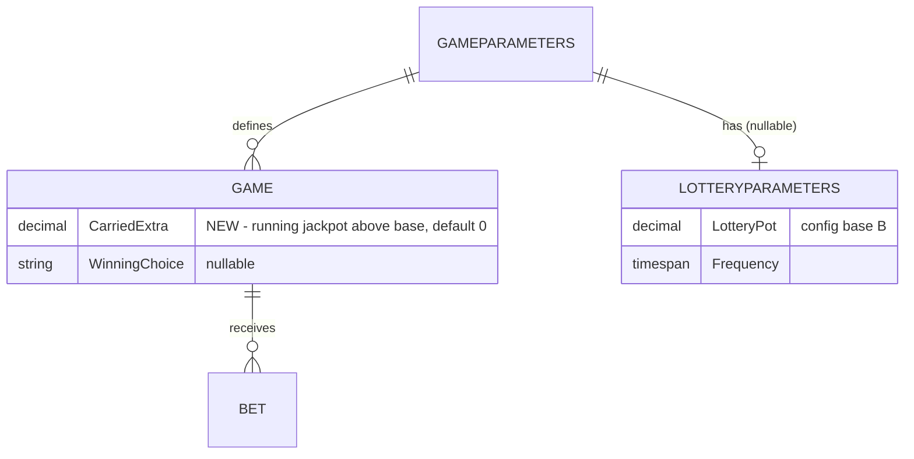

# ChimpOut — "Lottery Pot Stacking" Feature — Implementation Spec

> **Status: Shipped** — merged to `main` via `feature/lottery-pot-stacking` on 2026-07-14. Refined via
> Trello card
> [Make sure lottery works as expected (and stacks the previous rewards)](https://trello.com/c/1Mhgvlq6/53-make-sure-lottery-works-as-expected-and-stacks-the-previous-rewards).
> Distilled summary: `../features/lottery-pot-stacking.md`.
> Repos affected: `monkify-backend`, `monkify-front`, and this doc in `monkify-meta`.
>
> **Purpose:** Make lottery pots behave like a real jackpot. When a lottery round pays **no one**,
> the un-won money must **roll over ("stack") into the next round** of that same lottery instead of
> vanishing. When an operator **deactivates** a lottery that is holding un-won money, they must
> **transfer that pot to another eligible lottery** so it is never destroyed. Ships with a seeded
> **1-minute preset lottery** so the behaviour is testable in dev.

---

## 1. Summary

A lottery round can fail to pay a winner in two distinct ways. Today both throw the un-won pot away
and the successor game restarts at the static config base (`LotteryParameters.LotteryPot`, default
`4`). This feature carries a running jackpot forward.

**Grounding fact (why "no one wins" is possible at all):** a lottery that actually **draws** always
produces a winner **except for preset lotteries**. `ChimpOutTyper.SetBets`
(`ChimpOut.Domain/Games/Services/ChimpOutTyper.cs:199-208`) pre-registers **every** preset choice
with count `0`; `CheckForWinners` (`:107-117`) and `DecideFallbackWinner` (`:162-172`) end the round
the instant the typed window (or the fallback draw) matches **any** key in the `Bets` dictionary —
including a preset **nobody bet on**, yielding `NumberOfWinners == 0`. A **free-type** lottery's
`Bets` dictionary only contains actually-placed choices, so a drawn free-type lottery always has a
winner.

| Un-won case | How it happens | Stakes today | What must carry forward |
| --- | --- | --- | --- |
| **(P) Preset no-winner draw** | Preset lottery draws a choice with **0 bettors** (`NumberOfWinners == 0`) | Not refunded, kept by operator, lost | **Whole un-won pot** = `prev.CarriedExtra + Σ predecessor stakes` (real jackpot rollover; stakes still **not** refunded) |
| **(U) Under-subscription** | Fewer than `MinimumNumberOfPlayers` by draw time; draw never runs (`NotEnoughPlayersToStart`) | Refunded (unchanged) | Carry `prev.CarriedExtra` **unchanged** (base already in the jackpot carries; no growth from an idle round) |
| **Paid win** (incl. a free-bet winner) | A bet on the drawn choice exists (`NumberOfWinners > 0`) | Paid into winnings | Reset — successor `CarriedExtra = 0` (back to config base) |

**Accumulation model — single running jackpot, base seeded once.** A new `decimal Game.CarriedExtra`
(default `0`) holds the un-won money **on top of** the config base. Effective pot:

```
PotAmount = Σ bets + LotteryParameters.LotteryPot (base B) + Game.CarriedExtra
```

Worked example (B = 4): R1 preset no-win w/ 5 stakes → carry `5` (next pot = 4+5 = 9); R2
under-subscribed, stakes refunded → carry unchanged `5`; R3 preset no-win w/ 6 stakes → carry `11`;
R4 pays a winner (takes 4+11+its stakes) → successor carry `0`. Base is present every round and never
double-counted.

**Deactivation transfer.** When an admin deactivates a lottery whose current game
`CarriedExtra > 0`, they must supply a `TargetLotteryId`. The un-won `CarriedExtra` is moved into the
target lottery's current bet-accepting game. Eligibility: **same operator, active, is a lottery,
same `PaymentMethod`, and (for `SolanaToken`) the same `OperatorTokenId`**. No eligible target →
**block** the deactivation (never forfeit). `CarriedExtra == 0` → deactivation unchanged from today.

**Scope:** both `Standard` and `SolanaToken` lotteries. Player-facing `> POT:` line reflects the
stacked jackpot.

---

## 2. Constraints (MANDATORY)

From `monkify-meta/constraints.md` (full list there):

- **Worktree-per-repo:** `feature/lottery-pot-stacking` in `monkify-backend`, `monkify-front`,
  `monkify-meta`; the shared checkout stays on `main`. (Already created + pushed by
  `/monkify-create-spec`.)
- **Unit tests:** update/add in `ChimpOut.Tests`; **report changed/added tests** at end of
  implementation; run the suite via `scripts/run_tests.bat` (never the full `dotnet test` — the
  `ProductionGames` Monte-Carlo suite is slow).
- **Integration test (mandatory):** this **is a game-flow change**, so `ChimpOut.Tests.Integration`
  (Testcontainers) **must** get at least one happy-path test (the preset no-winner carry, §11.2) plus
  dedicated tests for the two complex flows (under-subscription carry, deactivation transfer). Run via
  `scripts/run_integration_tests.bat`.
- **EF mapping:** inline in `ChimpOutDbContext.OnModelCreating`; no `IEntityTypeConfiguration`.
- **Migrations:** under `ChimpOut.Infrastructure/Migrations/`; applied only by `ChimpOut.Consumers`. Do
  not hand-edit the snapshot.
- **Secrets/config:** mock-only values in committed files.
- **Operator messaging:** player-facing surfaces never reveal operator/contract state; **admin**
  endpoints may return specific field-level validation errors (already the norm — see
  `features/operator-admin-page.md`).
- **Host split:** money / state-machine / typer stays in `ChimpOut.Consumers`; `ChimpOut.Api` stays
  stateless. The deactivation transfer is a **synchronous admin API** mutation (see §6.4) — it moves
  a number between rows, no settlement — which is acceptable in the API.

---

## 3. Resolved product decisions

| # | Decision |
| --- | --- |
| 1 | "No one wins" = **(P)** a preset lottery draws a choice with 0 bettors, or **(U)** under-subscription (draw never runs). Free-type lotteries always have a winner when drawn. |
| 2 | **(P)** carries the whole un-won pot (`prev.CarriedExtra + Σ predecessor stakes`); losing stakes are **NOT** refunded. |
| 3 | **(U)** keeps refunding stakes as today; carries `prev.CarriedExtra` **unchanged**. |
| 4 | Any **paid win** (`NumberOfWinners > 0`, incl. a free-bet-only winner) resets successor `CarriedExtra` to `0`. |
| 5 | Single running jackpot stored as `Game.CarriedExtra` (default 0); base seeded once; `pot = Σ bets + LotteryPot + CarriedExtra`. No base double-counting. |
| 6 | Applies to **both** `Standard` and `SolanaToken` lotteries. |
| 7 | Deactivation requires a `TargetLotteryId` **only when `CarriedExtra > 0`**. |
| 8 | Transfer eligibility: same operator, active, lottery, same `PaymentMethod`, same `OperatorTokenId` for `SolanaToken`, not the source itself. |
| 9 | No eligible target → **block** deactivation with a clear admin error; never forfeit/destroy the pot. |
| 10 | Transfer moves `CarriedExtra` only (the config base is untouched — the target keeps its own base) into the target's current bet-accepting game. |
| 11 | Seed a Standard **1-minute preset** lottery (8 animals, len 6, base pot 4, min 2, free bets on) — dev seed only. Only a preset lottery can exercise the no-winner jackpot. |
| 12 | Player `> POT:` line reflects `LotteryPot + CarriedExtra + Σ live bets`. |

---

## 4. Data model

### 4.1 Entity / column change

File: `monkify-backend/src/ChimpOut.Domain/Games/Entities/Game.cs` (alongside `ServerSeed`/
`ServerSeedHash`, ~line 45):

```csharp
/// <summary>Running lottery jackpot carried in from prior un-won rounds, ON TOP of the config
/// base (LotteryParameters.LotteryPot). 0 for non-lottery games and for a fresh lottery or the
/// round after a paid win. See specs/lottery-pot-stacking.md.</summary>
public decimal CarriedExtra { get; set; }   // default 0
```

The `Game(Guid parametersId)` constructor (`:29-33`) does **not** set it — default `0` applies; the
carry is assigned in `CreateGame` (§6.1).

### 4.2 EF configuration (inline)

File: `monkify-backend/src/ChimpOut.Infrastructure/Data/Context/ChimpOutDbContext.cs`, inside the
existing `modelBuilder.Entity<Game>` block (`:134-150`), mirroring `Bet.Amount`'s precision:

```csharp
builder.Property(x => x.CarriedExtra).HasPrecision(18, 9).IsRequired().HasDefaultValue(0m);
```

`(18,9)` holds both USD (Standard) and token-native (SolanaToken) amounts.

### 4.3 Migration

```bash
# from monkify-backend/src/ChimpOut.Infrastructure
dotnet ef migrations add AddGameCarriedExtra \
  --startup-project ../ChimpOut.Consumers/ChimpOut.Consumers.csproj \
  --context ChimpOutDbContext
```

Adds non-nullable `CarriedExtra numeric(18,9)` default `0` on `Games`. Latest existing migration is
`20260710170016_ProvablyFair` — the new one sorts after it. Do not hand-edit
`ChimpOutDbContextModelSnapshot.cs`; let EF regenerate it.

### 4.4 ER (delta)



---

## 5. Configuration & seed data

### 5.1 Seeded 1-minute preset lottery (dev only)

File: `monkify-backend/src/ChimpOut.Consumers/DefaultGameParameters.cs`.

The existing `Lottery(...)` factory (`:90-95`) builds a **free-type** lottery (no presets) and the
`Preset(...)` factory (`:83-88`) builds a **non-lottery** preset race. Add a combined factory and one
seed entry so the type is a **preset lottery** (the only shape that exercises case P):

```csharp
private static GameParameters PresetLottery(string name, string description, int length,
    TimeSpan frequency, params string[] choices)
{
    var parameters = Base(name, description, GameCharacterType.Letters, length);
    parameters.PresetChoices = choices.Select(choice => new PresetChoice(choice)).ToList();
    parameters.LotteryParameters = new LotteryParameters { LotteryPot = 4, Frequency = frequency };
    return parameters;
}
```

Add to `GenerateDefaultParameters()` (dev Standard defaults list):

```csharp
// --- 1-minute preset lottery (DEV ONLY — exercises pot stacking) ---
PresetLottery("6L Minute Menagerie",
    "DEV: 1-minute preset lottery over 8 six-letter animals; the pot stacks when the drawn animal has no backers. Min 2 - 1 token - free bets.",
    6, TimeSpan.FromMinutes(1),
    "rabbit", "monkey", "donkey", "pigeon", "cougar", "falcon", "turtle", "jaguar"),
```

`Base(...)` already sets `RequiredAmount = 1`, `MinimumNumberOfPlayers = 2`,
`AcceptDuplicatedCharacters = true`, `AllowFreeBet = true`, `PaymentMethod = Standard`. `TimeSpan.FromMinutes(1)`
is exactly `GameParametersValidation.MinLotteryFrequency` (inclusive), so it is valid; seeded
defaults do not route through that validator anyway.

> **Dev-only note:** these are non-production seed defaults (attached to the seeded DEV operator).
> No production seed change.

---

## 6. Backend behaviour

### 6.0 Carry rule helper (single source of truth)

Add a small static helper so every rollover site computes the carry identically. Suggested location:
`monkify-backend/src/ChimpOut.Domain/Games/Services/LotteryPotCarry.cs`.

```csharp
public static class LotteryPotCarry
{
    /// <summary>The CarriedExtra the SUCCESSOR game should start with, given how the just-ended
    /// game finished. Base (LotteryParameters.LotteryPot) is added separately by SetPotAmount.</summary>
    public static decimal NextCarriedExtra(Game ended)
    {
        // Draw never ran (under-subscription) or abrupt close: stakes were refunded / left as-is;
        // carry the running jackpot unchanged.
        if (ended.Status == GameStatus.NotEnoughPlayersToStart ||
            ended.Status == GameStatus.GameEndedAbruptely)
            return ended.CarriedExtra;

        // A drawn round: paid win when at least one bet backed the winning choice → reset.
        bool hadWinner = !string.IsNullOrEmpty(ended.WinningChoice)
                         && ended.Bets.Any(b => b.Choice == ended.WinningChoice);
        if (hadWinner)
            return 0m;

        // Preset no-winner draw: the whole un-won pot rolls forward (stakes NOT refunded).
        return ended.CarriedExtra + ended.Bets.Sum(b => b.Amount); // free bets Amount==0 contribute nothing
    }
}
```

This helper is only meaningful for lottery types; callers gate on `LotteryParameters != null`.

### 6.1 `GameService.CreateGame` — accept and persist the carry

File: `monkify-backend/src/ChimpOut.Infrastructure/Services/Games/GameService.cs` (`:423-455`)
and interface `IGameService.cs:33`.

```csharp
public async Task CreateGame(GameParameters parameters, decimal carriedExtra = 0)
{
    var game = new Game(parameters.Id) { CarriedExtra = carriedExtra };  // was: new Game(parameters.Id)
    ...
}
```

Default `0` keeps the four non-lottery / first-game call sites unchanged.

### 6.2 `BetDomainService.SetPotAmount` — include the carry

File: `monkify-backend/src/ChimpOut.Domain/Bets/Services/BetDomainService.cs` (`:114-122`):

```csharp
PotAmount = game.Bets.Sum(x => x.Amount);
if (game.Parameters?.LotteryParameters != null)
    PotAmount += game.Parameters.LotteryParameters.LotteryPot;
PotAmount += game.CarriedExtra;   // NEW — 0 for non-lottery; the running jackpot for lottery
```

`CalculateRewardForBet` (`:64-84`) needs no change — it divides the (now larger) `PotAmount`.

### 6.3 Rollover sites — thread the carry

Both rollover sites are in `ChimpOut.Consumers`.

**(a) Normal end-of-draw rollover** — `RunGameConsumer.cs:49-51`. The ended `game` (with `Bets`
loaded at `:38`) and its `WinningChoice` (set by `UpdateGameStatus(game, Ended, monkey)` at
`:43`) are in scope:

```csharp
var parameters = await gameService.GetActiveParametersForRollover(game.ParametersId);
if (parameters != null)
{
    decimal carry = parameters.LotteryParameters != null
        ? LotteryPotCarry.NextCarriedExtra(game)   // paid win → 0; preset no-winner → prev + Σ stakes
        : 0m;
    await gameService.CreateGame(parameters, carry);
}
```

**(b) Under-subscribed lottery rollover** — `BetPlacedConsumer.cs:60-85`. At the `CreateGame` call
(`:82`) the game was just set to `NotEnoughPlayersToStart` (`:81`), so the helper returns the
unchanged carry; stakes are still refunded exactly as today:

```csharp
await gameService.UpdateGameStatus(game, GameStatus.NotEnoughPlayersToStart);
await gameService.CreateGame(game.Parameters, LotteryPotCarry.NextCarriedExtra(game)); // carry unchanged
```

**(c) Startup backfill** — `ChimpOut.Consumers/Program.cs:369`. To survive a restart mid-jackpot, when
recreating a lottery type's game, inherit from the type's most recent game:

```csharp
// inside the seeding loop, for lottery types with no live game:
var last = /* most recent Game of parameter.Value by CreatedDate, Bets + WinningChoice + Status loaded */;
decimal carry = (parameter.Value.LotteryParameters != null && last != null)
    ? LotteryPotCarry.NextCarriedExtra(last) : 0m;
gameService.CreateGame(parameter.Value, carry).GetAwaiter().GetResult();
```

Add a small `IGameService.GetMostRecentGame(Guid parametersId)` read (Bets + WinningChoice +
Status) for this. Non-lottery types pass `0`.

**Idempotency:** the carry is applied once, at successor creation. `RunGameConsumer` already creates
exactly one successor per ended game; do **not** introduce a second create path. If a
`RunGameEvent`/`BetPlacedEvent` is redelivered, the successor must not be created (and the carry
re-applied) twice — reuse the existing "one successor per predecessor" guard (a lottery type has at
most one open game; `CreateGame` for an already-rolled type must be a no-op or guarded). Document
any residual exposure; do not couple to the separately-tracked `RewardGameConsumer` double-credit
race.

### 6.4 Admin deactivation transfer

**Request** — `monkify-backend/src/ChimpOut.Infrastructure/Handlers/Admin/DeactivateGameType/DeactivateGameTypeRequest.cs`:
add `Guid? TargetLotteryId` (ctor `(Guid operatorId, Guid gameTypeId, Guid? targetLotteryId = null)`).

**Controller** — `monkify-backend/src/ChimpOut.Api/Controllers/AdminController.cs:87`
`POST admin/game-types/{id}/deactivate`: accept an optional body and forward the target:

```csharp
public async Task<IActionResult> DeactivateGameType(Guid id, [FromBody] DeactivateGameTypeBody? body = null)
    => ... new DeactivateGameTypeRequest(_adminContext.OperatorId, id, body?.TargetLotteryId) ...;
// DeactivateGameTypeBody { public Guid? TargetLotteryId { get; set; } }  (new small contract)
```

**Handler** — `DeactivateGameTypeHandler.cs:26-46`. Insert the transfer **before** flipping
`Active = false` / publishing `GameTypeDeactivatedEvent`, running synchronously so it precedes the
async `GameTypeDeactivatedConsumer` that refunds/closes the source's waiting games:

1. Load source `GameParameters` (active, tracked) — as today.
2. Load the source's **current open game** (`Game.ActiveGamesStatus`, most recent) →
   `sourceCarry = current?.CarriedExtra ?? 0`.
3. If `sourceCarry > 0`:
   - If `request.TargetLotteryId is null` → return a validation failure
     `LotteryDeactivationRequiresTransferTarget` (do not deactivate).
   - Load the target: `GameParameters` where `Id == TargetLotteryId && OperatorId == request.OperatorId
     && Active && LotteryParameters != null && PaymentMethod == source.PaymentMethod &&
     (source.PaymentMethod != SolanaToken || OperatorTokenId == source.OperatorTokenId) && Id != source.Id`.
     If none → validation failure `NoEligibleLotteryTransferTarget` (do not deactivate — pot preserved).
   - Load the target's current **bet-accepting** game (`Game.GameAcceptingBets`, most recent),
     add `sourceCarry` to its `CarriedExtra`, save. (A live lottery always has a `WaitingBets` game;
     if it is momentarily mid-draw with none accepting bets, apply to its most recent game so the
     next rollover inherits it.)
   - Set the source current game `CarriedExtra = 0` (tidy; the source game is closed next anyway).
4. Flip `Active = false`, invalidate `ActiveParameters:{operatorId}` cache, publish
   `GameTypeDeactivatedEvent(current.Id)` — unchanged from today.

When `sourceCarry == 0`, steps 3 is skipped entirely and deactivation is byte-for-byte today's
behaviour (no target needed).

### 6.5 Admin list — surface each lottery's current jackpot

File: `GetOperatorGameTypesHandler.cs:18-25` + `Contracts/Admin/GameTypeAdminDto.cs`.

Add `decimal? CarriedExtra` (and optionally `decimal? EffectiveJackpot = LotteryPot + CarriedExtra`)
to `GameTypeAdminDto`. Populate by joining each lottery type's current open game's
`CarriedExtra` (left join on the type's most-recent `GameAcceptingBets` game; `null`/`0` for
non-lottery types). The DTO already exposes `PaymentMethod`, `OperatorTokenId`, and `Lottery` — the UI
uses those plus `CarriedExtra` to (a) know which lotteries carry un-won money and (b) filter eligible
transfer targets.

> Incidental (optional): the list handler does not `.Include(x => x.OperatorToken)`, so `TokenLabel` is
> currently always null from this path. Not required for this feature; fix only if convenient.

### 6.6 Active-game DTO — surface the carry to players

File: `Contracts/Games/ActiveGameDto.cs:13-31` (constructed in
`GetActiveGameForParameterHandler.cs:49` from the full `Game`):

```csharp
CarriedExtra = game.CarriedExtra;   // NEW
```

SignalR `GameCreatedEvent` stays **unchanged** — on rollover the frontend re-fetches the
active-game via `GET games/{gameTypeId}` (`updateNewGame` → `getBets`), so the new
`CarriedExtra` reaches the client without a contract change.

---

## 7. Frontend behaviour

### 7.1 Types — `monkify-front/src/types/index.ts`

- `GameInstance` (`:92-102`): add `carriedExtra?: number;`.
- `GameTypeAdmin` (`:194-208`): add `carriedExtra?: number;` (and `effectiveJackpot?: number` if the
  DTO exposes it) to drive eligible-target filtering.

### 7.2 Player POT — `monkify-front/src/hooks/useGame.ts`

In `getBets` seeding (`:130-136`), add the carry:

```ts
const lotteryBase =
  gameData.isLottery && selectedGame.value?.lotteryParameters
    ? selectedGame.value.lotteryParameters.lotteryPot
    : 0;
currentPot.value = lotteryBase + (gameData.carriedExtra ?? 0) + totalBetsAmount;
```

Live accumulation (`:298`), reset (`:544`), and the two `GameTerminal.vue` `> POT:` renders
(`:375-378`, `:455-459`) are unchanged — they already read the shared `currentPot`. The jackpot grows
across rounds because each rolled-over game's `getBets` reseeds from its larger `carriedExtra`.

### 7.3 Admin deactivate + transfer

- **Service** — `monkify-front/src/services/adminService.ts:52-57`:
  `deactivateGameType(gameTypeId, targetLotteryId?)` → `POST /admin/game-types/{id}/deactivate`
  with body `{ targetLotteryId }` when provided.
- **UI** — `components/admin/GameTypeManager.vue` (`deactivate`, `:84-94`) + `GameTypeList.vue`:
  when the row being deactivated is a lottery with `carriedExtra > 0`, prompt the admin to choose a
  **target lottery** from a dropdown of eligible types (client-filtered: `lottery != null`, `active`,
  `paymentMethod === type.paymentMethod`, `operatorTokenId === type.operatorTokenId` when SolanaToken,
  `gameTypeId !== type.gameTypeId`). Pass the chosen id to the service. Surface the backend
  `LotteryDeactivationRequiresTransferTarget` / `NoEligibleLotteryTransferTarget` errors as clear
  toasts (e.g. "Activate another matching lottery before deactivating this one — it still holds an
  un-won pot."). When `carriedExtra === 0`, keep today's simple confirm-and-deactivate.

---

## 8. Flow diagrams

### 8.1 Rollover carry decision (per lottery round)

```mermaid
flowchart TD
    A[Lottery round ends] --> B{How did it end?}
    B -->|Under-subscribed<br/>NotEnoughPlayersToStart| C[Refund stakes as today]
    C --> D[successor.CarriedExtra = prev.CarriedExtra]
    B -->|Drawn, winning choice<br/>has ≥1 bet| E[Pay winners<br/>pot = Σbets+Base+CarriedExtra]
    E --> F[successor.CarriedExtra = 0]
    B -->|Drawn, winning choice<br/>has 0 bets (preset)| G[No payout;<br/>stakes NOT refunded]
    G --> H[successor.CarriedExtra = prev.CarriedExtra + Σ stakes]
```

### 8.2 Deactivation transfer

```mermaid
sequenceDiagram
    participant Admin as Admin UI
    participant API as DeactivateGameTypeHandler
    participant DB as PostgreSQL
    Admin->>API: POST deactivate {id, targetLotteryId?}
    API->>DB: load source + current game.CarriedExtra
    alt CarriedExtra == 0
        API->>DB: Active=false; publish GameTypeDeactivated
        API-->>Admin: OK
    else CarriedExtra > 0
        alt no targetLotteryId OR no eligible target
            API-->>Admin: validation error (not deactivated)
        else eligible target
            API->>DB: target.currentGame.CarriedExtra += sourceCarry
            API->>DB: Active=false; publish GameTypeDeactivated
            API-->>Admin: OK (pot transferred)
        end
    end
```

---

## 9. Out of scope

- Changing the always-a-winner behaviour of **free-type** lotteries.
- The escrow refactor (Trello #54–56) and any new commission logic — do **not** couple to it.
- Transferring a pot across payment methods, different tokens/mints, or different operators.
- Fixing the separately-tracked `RewardGameConsumer` redelivery double-credit race.
- Knowledge-base `features/` update (handled by `/monkify-ship-feature` after merge).

---

## 10. File checklist

### 10.1 Backend (`monkify-backend`)

| # | File | Change |
| --- | --- | --- |
| 1 | `ChimpOut.Domain/Games/Entities/Game.cs` | New `decimal CarriedExtra` property |
| 2 | `ChimpOut.Infrastructure/Data/Context/ChimpOutDbContext.cs` | Inline `CarriedExtra` mapping (`HasPrecision(18,9)`, default 0) |
| 3 | `ChimpOut.Infrastructure/Migrations/*_AddGameCarriedExtra.*` | New migration (applied by Consumers) |
| 4 | `ChimpOut.Domain/Games/Services/LotteryPotCarry.cs` | **New** — `NextCarriedExtra(Game)` helper (§6.0) |
| 5 | `ChimpOut.Domain/Bets/Services/BetDomainService.cs` | `SetPotAmount` adds `game.CarriedExtra` |
| 6 | `ChimpOut.Infrastructure/Services/Games/GameService.cs` | `CreateGame(parameters, carriedExtra = 0)`; set on new Game; add `GetMostRecentGame` read |
| 7 | `ChimpOut.Infrastructure/Services/Games/IGameService.cs` | Update `CreateGame` signature; add `GetMostRecentGame` |
| 8 | `ChimpOut.Infrastructure/Consumers/RunGame/RunGameConsumer.cs` | Compute carry via helper, pass to `CreateGame` |
| 9 | `ChimpOut.Infrastructure/Consumers/BetPlaced/BetPlacedConsumer.cs` | Under-sub rollover passes carry (unchanged) |
| 10 | `ChimpOut.Consumers/Program.cs` | Startup backfill inherits carry for lottery types |
| 11 | `ChimpOut.Consumers/DefaultGameParameters.cs` | `PresetLottery(...)` factory + 1-min "6L Minute Menagerie" seed |
| 12 | `ChimpOut.Infrastructure/Handlers/Admin/DeactivateGameType/DeactivateGameTypeRequest.cs` | Add `Guid? TargetLotteryId` |
| 13 | `ChimpOut.Infrastructure/Handlers/Admin/DeactivateGameType/DeactivateGameTypeHandler.cs` | Transfer logic (§6.4) |
| 14 | `ChimpOut.Api/Controllers/AdminController.cs` | Deactivate action accepts optional `{ targetLotteryId }` body |
| 15 | `ChimpOut.Infrastructure/Contracts/Admin/DeactivateGameTypeBody.cs` | **New** small body contract |
| 16 | `ChimpOut.Infrastructure/Handlers/Admin/GetOperatorGameTypes/GetOperatorGameTypesHandler.cs` | Join current game `CarriedExtra` per lottery |
| 17 | `ChimpOut.Infrastructure/Contracts/Admin/GameTypeAdminDto.cs` | Add `CarriedExtra` (+ optional `EffectiveJackpot`) |
| 18 | `ChimpOut.Infrastructure/Contracts/Games/ActiveGameDto.cs` | Add `CarriedExtra = game.CarriedExtra` |
| 19 | `ChimpOut.Common/Resources/*` (error messages) | New `LotteryDeactivationRequiresTransferTarget`, `NoEligibleLotteryTransferTarget` |

### 10.2 Frontend (`monkify-front`)

| # | File | Change |
| --- | --- | --- |
| 1 | `src/types/index.ts` | `GameInstance.carriedExtra?`, `GameTypeAdmin.carriedExtra?` |
| 2 | `src/hooks/useGame.ts` | Seed `currentPot` with `carriedExtra` |
| 3 | `src/services/adminService.ts` | `deactivateGameType(id, targetLotteryId?)` sends body |
| 4 | `src/components/admin/GameTypeManager.vue` | Target-lottery prompt when `carriedExtra > 0`; error toasts |
| 5 | `src/components/admin/GameTypeList.vue` | Eligible-target dropdown on the deactivate row |

### 10.3 Meta (`monkify-meta`)

| # | File | Change |
| --- | --- | --- |
| 1 | `specs/lottery-pot-stacking.md` | This spec |
| 2 | `INDEX.md` | Spec row + "Feature currently in flight" |
| 3 | `features/games.md` | Updated at **ship time** by `/monkify-ship-feature` (not now) |

---

## 11. Tests

### 11.1 Unit — `monkify-backend/src/ChimpOut.Tests` (report all changed/added)

| Test file | Test case | Expected |
| --- | --- | --- |
| `UnitTests/Domain/Games/BetDomainServiceTests.cs` | Lottery game with `CarriedExtra = 7`, base 4, Σbets 5 | `PotAmount == 16` |
| `UnitTests/Domain/Games/BetDomainServiceTests.cs` | Non-lottery game, `CarriedExtra = 0` | pot unchanged (Σbets) |
| `UnitTests/Domain/Games/LotteryPotCarryTests.cs` (**new**) | Ended `NotEnoughPlayersToStart`, carry 9 | `NextCarriedExtra == 9` |
| " | Drawn, winning choice has a bet | `0` |
| " | Drawn, winning choice has **no** bet, carry 3, Σstakes 6 | `9` |
| " | Drawn, winner is a **free** bet only | `0` (paid win resets) |
| `UnitTests/Background/RunGameHandlerTests.cs` (or existing RunGame test) | Preset no-winner draw | `CreateGame` called with carry `prev + Σstakes` |
| `UnitTests/Background/RunGameHandlerTests.cs` | Paid win | `CreateGame` called with carry `0` |
| `UnitTests/Background/BetPlacedHandlerTests.cs` (mock at `:393`) | Under-subscribed lottery | `CreateGame` called with `prev.CarriedExtra`; stakes refunded |
| `UnitTests/Background/CreateGameTests.cs` | `CreateGame(params, 12)` | new Game persisted with `CarriedExtra == 12` |
| `UnitTests/Handlers/AdminGameTypeHandlerTests.cs` | Deactivate lottery, carry 0, no target | succeeds (today's behaviour) |
| " | Deactivate lottery, carry > 0, no target | `LotteryDeactivationRequiresTransferTarget`; still active |
| " | Deactivate, carry > 0, ineligible target (diff method/token/operator/inactive/non-lottery) | `NoEligibleLotteryTransferTarget`; still active |
| " | Deactivate, carry > 0, eligible target | target game `CarriedExtra += sourceCarry`; source `Active == false` |

### 11.2 Integration — `monkify-backend/src/ChimpOut.Tests.Integration` (Testcontainers)

**No lottery integration test exists today — this feature adds the first.** New file
`LotteryPotStackingFlowTests.cs`, following the `ProvablyFairFlowTests.cs` driving pattern
(`PlaceBetAsync`, `MintToken`, `SetMaxTyperCharacters`).

**Deterministic no-winner seam.** `ServerSeed` is committed via
`GameService.EnsureServerSeedCommitted` with `... WHERE "ServerSeed" IS NULL` (first-writer-wins,
`GameService.cs:204-213`). A test can **pre-fix** the seed by writing `ServerSeed` +
`ServerSeedHash = ProvablyFair.HashServerSeed(seed)` onto the seeded `WaitingBets` game **before the
first bet** (via the fixture DB scope); `EnsureServerSeedCommitted` then no-ops. Combined with
`SetMaxTyperCharacters(small)` to force `DecideFallbackWinner` (which picks
`orderedChoices[FallbackIndex(seed, prefix, n)]` over **all** presets), the drawn winner is fully
deterministic. Choose bets so the fallback winner is an **un-bet** preset (the test can compute
`ProvablyFair.FallbackIndex` in-process to pick a seed, or iterate candidate seeds until the index
lands on an un-bet preset).

| Test (mandatory / complex-flow) | Scenario | Assert |
| --- | --- | --- |
| **A — preset no-winner carry (HAPPY PATH, mandatory)** | Create a Standard preset lottery (2 presets, e.g. `aaaaaa`/`bbbbbb`; min 2). Pre-fix seed + force fallback so the winner is the **un-bet** preset. 2 distinct players bet the other preset. Run the draw. | Game ends `RewardForWinnersCompleted` with **no** payout; the **successor** game's `CarriedExtra == Σ stakes` (prev 0 + stakes); `GET games/{type}` shows the successor's effective pot = `LotteryPot + CarriedExtra`. |
| **B — under-subscription carry (complex flow)** | Lottery with `MinimumNumberOfPlayers` unmet; elapse the betting window and fire the draw evaluation. | Paid stakes **refunded** (TransactionLog Refund rows); successor `CarriedExtra == predecessor.CarriedExtra` (unchanged). May require lowering `MinimumWaitPeriodForBets` in test config or publishing the scheduled `BetPlacedEvent` after the window. |
| **C — deactivation transfer (complex flow)** | Two eligible Standard lotteries, same operator; give the source a `CarriedExtra` (seed a game row). `POST deactivate {source, targetLotteryId}`. | Target's current game `CarriedExtra` increased by the source carry; source `Active == false`. Also assert deactivating with carry>0 and **no** target is rejected and leaves it active. |

---

## 12. Acceptance criteria

Mapped 1:1 from the Trello **Acceptance Criteria** checklist:

1. Given a preset lottery round whose drawn winning choice had no bettors (`NumberOfWinners == 0`),
   when it ends, then losing stakes are **not** refunded and successor `CarriedExtra = prev.CarriedExtra + Σ stakes`.
2. Given a lottery round that pays ≥1 winner (incl. a free-bet winner), when it ends, then winners
   receive `Σ bets + LotteryPot + CarriedExtra` and successor `CarriedExtra = 0`.
3. Given an under-subscribed lottery round, when the window elapses, then all paid stakes are refunded
   and successor `CarriedExtra = prev.CarriedExtra` (unchanged).
4. Given a lottery game with `CarriedExtra > 0`, when the pot is computed, then
   `PotAmount = Σ bets + LotteryPot + CarriedExtra` (base counted once).
5. Given a free-type lottery, when it draws, then it always has ≥1 winner and `CarriedExtra` only ever
   carries via the under-subscription path.
6. Given an admin deactivates a lottery whose current game `CarriedExtra > 0` without a
   `TargetLotteryId`, when handled, then it is rejected asking for a target and the lottery stays active.
7. Given an admin deactivates with `CarriedExtra > 0` and an eligible `TargetLotteryId` (same operator,
   active, lottery, same `PaymentMethod`, same `OperatorTokenId` for SolanaToken), when handled, then
   the source `CarriedExtra` is added to the target's current waiting game and the source is deactivated.
8. Given a transfer to a lottery of a different method, token/mint, operator, or inactive lottery, when
   handled, then it is rejected as ineligible.
9. Given `CarriedExtra > 0` and no eligible target, when handled, then deactivation is blocked with a
   clear admin error and the carried pot is neither destroyed nor refunded.
10. Given a lottery whose current game has `CarriedExtra == 0`, when the admin deactivates it, then
    it deactivates exactly as today with no target required.
11. Given a lottery with `CarriedExtra > 0`, when a player opens `/game`, then the `> POT:` line shows
    `LotteryPot + CarriedExtra + Σ live bets`.
12. Given a fresh dev environment, when Consumers seeds defaults, then a Standard 1-minute preset
    lottery (Letters, len 6, 8 animals, base pot 4, min 2, free bets on) exists.
13. Given the Testcontainers suite, when a preset lottery draws a choice no one bet on (seed fixed via
    the test seam), then a mandatory integration test asserts successor pot = base + carried + losing
    stakes; a second deterministic test asserts the under-subscription base-carry.
14. Given a redelivered rollover/reward message, when processed, then the carry is applied exactly once
    (no double-stacking) — successor `CarriedExtra` is idempotent per predecessor.

---

## 13. Manual QA (dev)

1. Boot the local stack; confirm **"6L Minute Menagerie"** appears in the lobby with a LOTTERY badge.
2. Enable free-bet mode. Each minute, place 2 free bets from 2 identities on animals, deliberately
   **avoiding** the drawn one, until a draw lands on an un-bet animal.
3. On that no-winner draw: no payout; on the next round the `> POT:` line is **higher** by the prior
   round's stakes + base.
4. Repeat to watch the jackpot climb across several rounds; then bet the winning animal → pot pays out
   and the next round's `> POT:` **resets** to the base.
5. In `/chimpout/admin`, deactivate the carrying lottery **without** a target → blocked with a clear
   message. Create/keep a second matching lottery, retry with it as target → source deactivates and the
   target's pot jumps by the transferred amount.

---

## 14. Trello / pipeline

- **Source card:** [Make sure lottery works as expected (and stacks the previous rewards)](https://trello.com/c/1Mhgvlq6) —
  list **Specs created**; **Implementation** section on the card carries branch + worktree + spec.
- **Next:** `/monkify-implement-feature "Make sure lottery works as expected"` to build it; then
  `/monkify-ship-feature` to sync the KB and merge `feature/lottery-pot-stacking` → `main`.

---

## 15. Revision log

| Date | Change |
| --- | --- |
| 2026-07-14 | Initial spec from refined card #53 (refinement + code exploration in the same game). |
