# ChimpOut — "LP visual redesign — selective Claude-mock cherry-pick" — Implementation Spec

> **Status: Shipped** (2026-07-19). The LP code merged to `monkify-lp` `master` as `5a5003d
> Arcade-cabinet LP redesign` (the `feature/lp-redesign` branch); the KB was synced to `monkify-meta`
> `main`. Distilled summary: `../features/lp-redesign.md`. Refined via Trello card
> [revamp lp with claude design ideas #65](https://trello.com/c/hp9GJjuQ) (2026-07-16).
> Repos affected: **`monkify-lp`** (the only app repo touched) and this doc in `monkify-meta`.
>
> **Purpose:** Raise the visual quality of the shipped ChimpOut landing page by **cherry-picking the
> winning pieces** of a Claude-generated design mock onto the **live** LP — re-implemented in the real
> Astro/Vue components — while preserving the shipped brand, token-free/USDC messaging, trust points,
> and ship placeholders. Audience: pre-launch degen/arcade players.

---

## 1. Summary

The LP (`monkify-lp`, Astro 5 + Vue 3 + Tailwind v4, static) shipped as the token-free ChimpOut
launch page (`f4f9da3`, `features/lp-chimpout-relaunch.md`). A design mock (`Chimpout Landing.dc.html`,
auth-gated) proposes a stronger treatment for several sections. **Not all of it is better**, so this is
a **selective** visual revamp: adopt the chosen mock elements onto the current live LP, keep everything
else, and stay inside the existing arcade skin.

**Base = the current live LP** (`master` @ `f4f9da3`). The mock is a static HTML *reference*, not the
source — every adopted piece is re-implemented in the real Astro/Vue components. **Frontend-only,
`monkify-lp` only, off `master`.** No `monkify-front` / backend / DB / test work.

### Adopt (per section — the work)

| # | Section | Now (live LP) | After (adopted from mock) |
| --- | --- | --- | --- |
| 1 | **Hero** | single centered stack (coin, wordmark, body, CTAs, chips) | **two-column**: copy + CTAs left; big glowing Edson coin + a separate mascot chimp (`edson.png`) + a drifting comet right. Punchier body. |
| 2 | **Hero LIVE pill** | — | cosmetic `● LIVE · EDSON'S TYPING xxxxx` pill, **locally-generated random chars**, no network, no money/pot/win claim. |
| 3 | **How-it-works** (`#about`) | 2-col: copy + a 3-step vertical `<ol>` card \| `GameModes` stack | **3 horizontal step cards** (01/02/03) + a **full-width FAIR PLAY bar** (same trust content). `GameModes` moves out (→ #4). |
| 4 | **NEW `#modes`** "SELECT YOUR GAME" | modes live in the `#about` right column | its own **image-forward** section — Races / Beast Mode / Lotteries, artwork is the visual focus (`cards/a\|b\|c.png` + `GameModes` blurbs). |
| 5 | **Story** (`#story`) | already a CRT "EDSON.LOG" carousel (typed caption, `CH n/6`, PREV/NEXT + dots, painted slides) | **restyle** the existing terminal to the mock's colors/borders/backgrounds/fonts. Keep painted `part1–6` slides + the typed text + `CH n/6` + PREV/NEXT + dots. *(Restyle, not a rebuild — see §6.5.)* |
| 6 | **Per-section space art** | `SpaceBackground` drifting sprites in the **hero only**; other sections are flat | richer **per-section** drifting art (planets / black hole / satellites / asteroids / comets) from the repo's existing sprite set. |
| 7 | **`#token`** "No token. Yet." | single centered arcade-panel | **two-column card**: heading + body left; "$CHIMPOUT is not us" warning + "Join the troop" CTA right. Copy unchanged in meaning. |
| 8 | **Header** | wordmark + nav `About/Story/Token/Roadmap/Community`, no coin, no CTA | **coin icon** beside the CHIMP·OUT wordmark, nav `Modes / Story / Roadmap / Troop`, a **PLAY NOW** button → `PLAY_URL`. |
| 9 | **Footer** | wordmark + tiny `© 2026 … — BET ON THE MONKEY` microcopy | promote **"BET ON THE MONKEY"** to a visible tagline beside the wordmark. |
| 10 | **Roadmap** (`#roadmap`) | star-map + phase-detail card with emoji items **and a per-phase perk box** | **keep** the star-map + phase titles; **simplify** the 4 items/phase to short no-emoji lines; **remove** the per-phase perk/perkDesc box. |

### Skip (rejected from the mock)

- The **scrolling wins/pot ticker** (`degen_92 WON 412 USDC`, `POT NOW 1,930 USDC`) — fabricated live
  activity clashes with the honest, pre-launch, anti-scam positioning. **Must not appear anywhere.**
- The mock's **roadmap re-render** (ours already *is* the star-map) and its exact **tabbed
  one-cartridge-at-a-time** modes layout.
- A full terminal story that **drops** the painted slides.
- The deferred **"fanned game-card stack revival"** and **"HOW TO PLAY" sub-panel** (out of scope).

### Preserve (must not regress)

- ChimpOut brand + **CHIMP·OUT** wordmark ("OUT" orange); no "Monkify"/"$MONKIFY" anywhere.
- Token-free / **USDC** messaging + the "$CHIMPOUT for sale today is not us" anti-scam line.
- All three trust points (provably-fair seed, instant on-chain Solana payouts, auto-refund).
- `PLAY_URL` (`https://PLACEHOLDER-app-url/chimpout/game`) + social `#` links keep their
  `// TODO(ship)` markers — still unfilled.
- Edson + all sprites, the 6-chapter story content, team roster, socials, retro/space/arcade skin.
- The Tailwind v4 `@theme` palette (orange `#ffa214`, cyan, magenta) — **no palette drift**.

---

## 2. Constraints (MANDATORY)

From `monkify-meta/constraints.md` (full list there). LP-relevant subset:

- **Worktree-first (per repo).** LP work lives in `.worktrees/lp-redesign/monkify-lp` off the LP hub's
  **`master`** (the LP's default branch is `master`, **not** `main`). The spec lives in
  `.worktrees/lp-redesign/monkify-meta` off `main`. The shared checkouts (hubs) stay on their default
  branch — never switch a hub's branch. **Push after branch work** (AGENTS.md rule 5).
- **Secrets/config = flagged placeholders only.** The "Play now"/"PLAY NOW" app URL and the social
  links stay **placeholders** with a visible `// TODO(ship)` — do **not** invent real URLs.
- **No backend integration test required** — this is a frontend-only marketing/static LP change, not a
  backend feature (constraints §3's integration-test mandate is scoped to backend features).
- **No unit tests** — the LP has no test suite. Definition of done = `npm run build` clean + browser QA
  (§13); the built site contains no user-visible `monkify`/`$MONKIFY`.
- **Stay inside the arcade skin.** Reuse the Tailwind v4 `@theme` tokens and the shared component
  classes in `global.css` (`arcade-panel`, `scanlines`, `chip`, `btn-arcade`, `step-num`, `crt-screen`,
  `text-glow-*`, `pixel-rule`, `coin-float`, …). No new palette, no new font stack.
- **`prefers-reduced-motion`** — every new animation (hero typing pill, comet drift, per-section art
  drift, any modes transition) is disabled/reduced. The existing `Layout.astro` + `global.css`
  reduced-motion handling is the pattern to follow.
- **Full responsive parity** — every adopted section holds on portrait + landscape phones, matching the
  LP's current responsiveness. Two-column blocks stack cleanly; the terminal + modes panel stay tappable.
- **Art is untouched** — reuse existing sprites; **no new/replacement art assets** (card Out of scope).
- **Operator messaging** — N/A (no operator surface on the LP).

---

## 3. Resolved product decisions

| # | Decision |
| --- | --- |
| 1 | **Base = the current live LP** (`master` @ `f4f9da3`), not the mock. Cherry-pick + re-implement in Astro/Vue; anything not adopted keeps its current version. |
| 2 | **Frontend-only, `monkify-lp` only**, branch off `master`. No `monkify-front`, backend, DB, or test change. |
| 3 | **Hero → two-column.** Left: wordmark + tagline + punchier body + chips + CTAs. Right: big glowing Edson coin (`monk-coin-main.png`, `coin-float`) **plus** a separate mascot chimp (`edson.png`) **plus** a drifting comet (`comet.gif`). Adopt the punchier body: *"Infinite monkey, infinite keystrokes. Drop real USDC on what Edson types next — first exact pick takes the pot."* Stacks on mobile. |
| 4 | **Hero LIVE typing pill** — a cosmetic `● LIVE · EDSON'S TYPING xxxxx` pill fed by **locally-generated random characters** on a timer. **No network call, no win/pot/money claim.** `● LIVE` uses the magenta live-pulse accent. Reduced-motion → a static frozen string, no timer. |
| 5 | **How-it-works (`#about`) → 3 horizontal step cards** (01 Pick your play / 02 Ante up / 03 Edson types, reusing the existing `steps[]`) followed by a **full-width FAIR PLAY bar** carrying all three trust points. The `GameModes` selector leaves this section. |
| 6 | **New `#modes` "SELECT YOUR GAME" section**, placed **between `#about` and `#story`.** Image-forward: the mode artwork (`cards/a\|b\|c.png`) is the visual focus; Races / Beast Mode / Lotteries reuse the existing `modes[]` name/tag/blurb/accent data. **Recommended layout: a responsive 3-up grid of large image-forward mode cards** (all art visible), stacking to 1-col on mobile — deliberately **not** the mock's tabbed one-at-a-time cartridge layout (Skip). |
| 7 | **Story (`#story`) restyle, not rebuild.** The current `StoryCarousel.vue` **already is** the EDSON.LOG CRT terminal (typed caption, `CH n/6`, ▶ PLAYING, PREV/NEXT + dot indicators, letterboxed painted slides). Adopt only the mock's **visual refinements** (colors/borders/backgrounds/font styling) on top of it, within the `@theme` palette. Keep Bolso's painted `part1–6` (+ `mobile1–6`) slides as the scene art. |
| 8 | **Richer per-section space art.** Extend space-art presence beyond the hero: drifting planets / black hole / satellites / asteroids / comets from the existing `src/assets/elements/*` sprite set, placed **behind** section content (`pointer-events:none`, low opacity, `z` behind), varied per section. Reduced-motion freezes the drift. |
| 9 | **`#token` → two-column card.** Left: "STRAIGHT TALK" chip + "No token. Yet." heading + the two body paragraphs. Right: the "$CHIMPOUT … not us" anti-scam warning box + the "Join the troop" secondary CTA. **Copy unchanged in meaning.** Stacks on mobile. |
| 10 | **Header → coin + restructured nav + PLAY NOW.** Coin icon (`monk-coin.png`) beside the CHIMP·OUT wordmark; nav = **Modes / Story / Roadmap / Troop** → `#modes` / `#story` / `#roadmap` / `#community`; a **PLAY NOW** button → `PLAY_URL`. Desktop + mobile kept in sync. |
| 11 | **Nav simplification is intentional.** The new nav drops the standalone **"Token"** and **"About"/"Community"** labels (→ "Modes"/"Troop"). `#about` (how-it-works) and `#token` (the honest note) **stay in the page** and reachable by scroll — they just lose a dedicated nav slot. This is a deliberate redesign choice from the card, not a regression of the shipped `#token` note. |
| 12 | **Footer tagline.** Promote **"BET ON THE MONKEY"** from the tiny copyright microcopy to a visible tagline beside/under the CHIMP·OUT wordmark. Keep the `© 2026 CHIMPOUT` line. |
| 13 | **Roadmap.** Keep `SpaceRoadmap.vue`'s star-map (planet nodes, `traceline`, glow/selection, phase **titles**). Rewrite each phase's 4 `items` as short **no-emoji** lines; **remove** the per-phase perk box (both the render block and the `perk`/`perkDesc` data). The "token maybe later" beat is preserved by the `#token` section, so dropping the phase-4 perk loses nothing globally. |
| 14 | **No palette drift.** All new styling uses the existing `@theme` tokens + `global.css` component classes. No new colors/fonts. |
| 15 | **Responsive + reduced-motion parity** on every adopted section (portrait + landscape phones). |

---

## 4. Data model / API / backend

**None.** No entity, DTO, EF mapping, migration, controller, consumer, SignalR channel, or config
change. The LP is a static Astro site that only deep-links into the app via the "Play now" URL. The
data-model / API / backend sections of the spec template are **N/A** for this card.

---

## 5. Design system & assets (reused, no additions)

**Tailwind v4 `@theme` tokens** (`src/styles/global.css`) — reuse, add nothing:
orange `--color-primary` (≈`#ffa214`) + `--color-primary-bright`/`-deep`, `--color-cyan`(-deep),
`--color-magenta` (live/bet pulse only), surfaces `--color-void`/`-bg`/`-surface`/`-surface-2`/`-line`,
ink `--color-ink`/`-dim`/`-mute`, fonts `--font-display` (Press Start 2P) + `--font-body` (VT323),
easings, radii, z-scale.

**Reusable component classes** (already in `global.css`): `arcade-panel`, `arcade-panel--accent`,
`pixel-notch`, `scanlines`, `crt-screen`, `glow-primary`/`glow-cyan`, `text-glow-primary`/`-cyan`,
`chip`/`chip--cyan`, `btn-arcade` (+`--primary`/`--cyan`/`--sm`), `step-num`, `pixel-rule`, `marquee`,
`coin-float`, `blink`. Reuse these for all new UI.

**Assets already in the repo** (no new/replacement art — Out of scope):

| Purpose | Asset(s) |
| --- | --- |
| Hero coin | `src/assets/monk-coin-main.png` (big) |
| Header coin icon | `src/assets/monk-coin.png` (small) |
| Mascot chimp | `src/assets/edson.png` |
| Mode artwork | `src/assets/cards/a.png` (Races), `b.png` (Beast Mode), `c.png` (Lotteries) |
| Story slides | `src/assets/backstory/part1–6.png` (+ `mobile1–6.png`) |
| Per-section space art | `src/assets/elements/*` — `comet.gif`, `blackhole.png`, `satelite.png`, `asteroids.png`, `planet.png`, `planetSmall.png`, `saturn.png`, `earth.png`, `galaxy.png`, `disco.png`, `cosmicDust.png`, `rocket.gif`, `star1–8.gif` (already typed in `src/constants/space-elements.ts`). |
| Roadmap | `src/assets/roadmap/*` (`1–5rp.png`, `icon1–5.png`, `traceline.png`, `bg-roadmap.png`) |

---

## 6. Landing-page changes (the actual work — `monkify-lp`)

Base = `master` @ `f4f9da3`. Line numbers below are against that tip. This is a **restructure +
restyle** pass — the copy is largely already correct (token-free rebrand shipped in #51); do **not**
reintroduce any `$MONKIFY`/Monkify text.

### 6.1 `src/pages/index.astro`

The page section order becomes: **hero → `#about` (how-it-works) → `#modes` (NEW) → `#story` →
`#token` → `#roadmap` → `#community`.**

| Loc | Now | Change |
| --- | --- | --- |
| `:104–161` **HERO** | single centered `max-w-3xl` stack: coin, `CHIMP·OUT`, "Bet on the monkey", one-line body, CTAs, 3 chips; `SpaceBackground` behind; corner HUD | **Rebuild as a two-column layout** (`lg:grid-cols-2`, stacks on mobile). **Left column:** wordmark `CHIMP·OUT`, the `Bet on the monkey` tagline, the **punchier body** (Decision 3), the chips row, and the CTAs (`Play now` → `PLAY_URL`, `Join the troop` → `#community`) **+ the new LIVE typing pill** (§6.8). **Right column:** the big glowing coin (`monk-coin-main.png`, `coin-float`, keep the radial glow) **+** the mascot chimp `edson.png` **+** a drifting `comet.gif` (§6.7). Keep `SpaceBackground client:only` behind; keep the corner arcade HUD (adjust positions so it doesn't collide with the two columns). |
| `:65–69` `steps[]` | 3 steps (Pick your play / Ante up / Edson types) rendered as a vertical `<ol>` in one panel | **Keep the data**; render as **3 horizontal step cards** in `#about` (§ below). |
| `:163–217` **`#about`** (2-col how-it-works \| GameModes) | left = heading + intro + `HOW TO PLAY` step `<ol>` + trust line + Play now; right = `<GameModes client:load />` | **Restructure to a single-column how-it-works:** heading + intro, then a **3-up grid of step cards** (`01/02/03` via `step-num`, `s.title` + `s.body`, stack 1-col on mobile), then a **full-width FAIR PLAY bar** (§ below). **Remove the `GameModes` column** from this section (it moves to `#modes`). Keep the intro copy + an optional `Play now`. |
| FAIR PLAY bar | the trust `
` at `:196–207` lives inside the left column | Promote to a **full-width bar** below the step cards: an `arcade-panel`/accent strip labelled **FAIR PLAY**, stating **provably-fair** + **instant on-chain (Solana) payouts** + **auto-refund** (reuse the existing trust copy; AC3). |
| NEW `:` **`#modes`** | — | Insert a new `<ContentSection id="modes">` **after `#about`, before `#story`**: a **"SELECT YOUR GAME"** heading + the image-forward modes panel (`<GameModes client:load />`, refactored per §6.4). |
| `:219–232` **`#story`** | `StoryCarousel` in a black ContentSection | Unchanged wiring; the restyle happens **inside** `StoryCarousel.vue` (§6.5). |
| `:234–268` **`#token`** | single centered `max-w-2xl` arcade-panel (chip, heading, 2 paragraphs, warning box, Join CTA) | **Restructure to a two-column card** (§6 Decision 9): left = chip + heading + the two paragraphs; right = the warning box + `Join the troop` CTA. Stack on mobile. **Copy unchanged in meaning.** |
| `:270–279` **`#roadmap`** | `SpaceRoadmap` | Unchanged wiring; simplification happens **inside** `SpaceRoadmap.vue` (§6.6). |
| `:281–350` **`#community`** | socials as join slots + team roster | Unchanged (this is the "Troop" target). Optional light per-section art (§6.7). |
| `PLAY_URL` `:71–72` | `const PLAY_URL = "https://PLACEHOLDER-app-url/chimpout/game"` + `// TODO(ship)` | **Keep as-is** (placeholder). Reused by hero `Play now`, optional `#about` `Play now`, and the header PLAY NOW (§6.2). |

### 6.2 `src/components/Header.vue`

| Loc | Now | Change |
| --- | --- | --- |
| `:58–60` logo | `<h2>CHIMPOUT</h2>` only | Add a **coin icon** (`monk-coin.png`, small, `pixelated`, ~`h-6/h-7`) to the left of the wordmark, inside the same home link. |
| `:62–72` desktop nav | `About` `#about` · `Story` `#story` · `Token` `#token` · `Roadmap` `#roadmap` · `Community` `#community` | Replace with **`Modes` `#modes` · `Story` `#story` · `Roadmap` `#roadmap` · `Troop` `#community`** (drop the `Token` + `About` items; `#token`/`#about` stay scroll-reachable). |
| `:62–72` desktop CTA | none | Add a **PLAY NOW** button (`btn-arcade--primary btn-arcade--sm`, or `PrimaryButton small`) linking to `PLAY_URL` — pass the URL in as a prop or import the same const (keep the single-source `// TODO(ship)` placeholder). |
| `:95–107` mobile menu | same 5 items, no CTA | Mirror the desktop nav (**Modes/Story/Roadmap/Troop**) + a **PLAY NOW** entry. |
| `smoothScroll` `:10–17` | anchors scroll smoothly; `href="#"` ignored | Unchanged; the new `#modes` anchor works with it automatically. The PLAY NOW button is an **external** link (`PLAY_URL`), not an in-page anchor — must open the app URL, not smooth-scroll. |

> The header currently reveals only after scrolling past 100px (`showHeader`). Keep that behavior.

### 6.3 `src/components/Footer.vue`

| Loc | Now | Change |
| --- | --- | --- |
| `:4–12` | wordmark `CHIMP·OUT` + one microcopy line `© 2026 CHIMPOUT — BET ON THE MONKEY` | Add a visible **"BET ON THE MONKEY"** tagline beside/under the wordmark (e.g. a `font-display` primary-accent line) so it reads as a tagline, not fine print (AC9). Keep a `© 2026 CHIMPOUT` line. |

### 6.4 `src/components/GameModes.vue` → image-forward `#modes` panel

Current: a fanned **card stack** (`cardStyle`/`rel`, one card forward, tap a side card) + an active-mode
info block. This is close to the mock's rejected "one cartridge at a time" pattern.

**Refactor to an image-forward panel** (keep the `modes[]` data — `key/name/tag/blurb/img/accent` — and
the `asset()` normalizer):

- **Recommended:** a responsive **3-up grid** of large mode cards (`grid gap-… md:grid-cols-3`,
  1-col on mobile). Each card = the mode art (`m.img`, `pixelated`, large — the visual focus) above/behind
  the `m.name` (accent-colored via `accentText`), `m.tag`, and `m.blurb`, on an `arcade-panel`. All three
  arts are visible at once (image-forward), tappable/legible on mobile.
- Drop the fanned-stack transform logic (`cardStyle`, `rel`, `active`/`select`) unless a light
  hover/active accent is kept. Keep it **not** the tabbed one-at-a-time layout (Skip).
- Honor `prefers-reduced-motion` for any hover/transition (reuse the existing `@media` guard).

### 6.5 `src/components/StoryCarousel.vue` (EDSON.LOG restyle — not a rebuild)

The terminal treatment **already exists** (`arcade-panel` CRT, `EDSON.LOG` bezel, `CH n/6`, `▶ PLAYING`,
typewriter caption `typeOut`, PREV/NEXT `retro-button`s, dot `slide-indicator`s, letterboxed painted
slides, swipe + keyboard nav). **Do not rebuild it.** Apply the mock's visual refinements **on top**,
within the `@theme` palette:

- Align the bezel / frame **colors, borders, backgrounds, and font styling** to the mock (e.g. tune the
  `retro-button`/`slide-indicator` hard-coded hex to `@theme`-derived values, tighten the caption panel
  and CRT frame styling). Keep the structure (typed text, `CH n/6`, PREV/NEXT + dots).
- Keep the painted `part1–6` slides (and `mobile1–6` on mobile) as the scene art (AC5, AC8-equivalent).
- Preserve `prefers-reduced-motion` (the `prefersReduced` branch that renders the caption instantly).

### 6.6 `src/components/SpaceRoadmap.vue` (simplify the detail card)

Keep the star-map (`phases[]` coords, `pathD`, planet nodes, `traceline`, Edson badge, glow/selection)
and the phase **titles/subtitles**. Change only the detail card:

| Loc | Now | Change |
| --- | --- | --- |
| `:45–121` `phases[].items` | 4 items each, **emoji-prefixed** (`✅ …`, `🔴 …`, `📜 …`, `🐍 …`, `📱 …`, …) | Rewrite each phase's 4 items as short **no-emoji** lines (concise, plain text). Keep them truthful/token-free. |
| `:51–54,73–76,95–98,117–118` `perk`/`perkDesc` | per-phase perk strings | **Remove** the `perk`/`perkDesc` fields from the data **and** the `RoadmapPhase` interface. |
| `:291–299` **Perk Box** render | `<!-- Perk Box -->` renders `selectedPhase.perk` + `perkDesc` | **Delete** the perk-box block (detail card = header + items grid + nav hint only). Drop the now-unused `getColorClass`/`getBgColorClass` usages if they become dead. |

Phase titles (`Now Playing` / `The Floor Fills Up` / `More Ways To Lose Money` / `Pocket Arcade`) and the
planets/traceline are **unchanged** (AC10).

### 6.7 Per-section space art (`SpaceBackground.vue` / a new decorative layer / `ContentSection.vue`)

Today `SpaceBackground` (drifting `SECONDARY_SPACE_ELEMENTS` sprites over `space-bg.png`) is mounted
**only in the hero**. Extend richer, subtler space art to the other sections:

- **Recommended approach:** a lightweight decorative component (e.g. `SectionSpaceArt.vue`) rendered
  **behind** each `ContentSection`'s content — a small set (2–4) of positioned, slowly-drifting sprites
  per section (planets / black hole / satellites / asteroids / comets / saturn / galaxy from
  `src/assets/elements/*`), varied per section. Either add it via a slot/named prop on `ContentSection.vue`
  or place it per-section in `index.astro`.
- **Hardening (mandatory):** `pointer-events: none`, low opacity, `z` behind the content, and it must not
  cause horizontal overflow. Honor `prefers-reduced-motion` (freeze the drift). Keep readability — art is
  atmospheric, never competes with copy.
- The **hero** also gains the drifting `comet.gif` called out in Decision 3 (part of the hero right column).
- **No** wins/pot ticker or any fabricated live-activity numbers anywhere (Skip; AC6).

### 6.8 Hero LIVE typing pill (new, cosmetic, local)

A small pill in the hero (left column) reading `● LIVE · EDSON'S TYPING <5 random chars>`:

- Client-side only (Vue island or inline `<script>`): a timer mutates a short string of random
  alphanumerics (e.g. every ~120–200ms). **No `fetch`/XHR/network, no win/pot/amount claim** — purely
  decorative flavor (AC2).
- `● LIVE` uses the **magenta** live-pulse accent (`--color-magenta`), consistent with the design system's
  "live/bet pulse only" rule; the changing chars use `font-body`/`font-mono`.
- `prefers-reduced-motion` → render a **static** frozen string, **no** timer (AC13).

---

## 7. Micro-interactions (all reduced-motion-aware)

| Interaction | Where | Reduced-motion behavior |
| --- | --- | --- |
| Hero LIVE typing pill | `index.astro` hero / new island (§6.8) | static frozen string, no timer |
| Drifting comet + per-section sprites | hero + `SectionSpaceArt` (§6.7) | drift frozen (`animation: none`) |
| Story typewriter + slide fades | `StoryCarousel.vue` (existing) | caption renders instantly (existing `prefersReduced`) |
| Modes card hover/active accent | `GameModes.vue` (§6.4) | transitions disabled (existing `@media` guard) |
| Scroll-reveal on new sections/blocks | `.scroll-reveal*` (existing `Layout.astro` observer) | content shown immediately (existing) |

Add the `.scroll-reveal*` classes to the new `#modes` section and the restructured hero/token blocks so
they animate in consistently with the rest of the page.

---

## 8. Page structure (before → after)

```mermaid
flowchart TB
  subgraph before["BEFORE (f4f9da3)"]
    b1["#hero — centered stack"]
    b2["#about — how-it-works | GameModes stack"]
    b3["#story — EDSON.LOG carousel"]
    b4["#token — centered note"]
    b5["#roadmap — star-map + perk box"]
    b6["#community — socials + team"]
    b1-->b2-->b3-->b4-->b5-->b6
  end
  subgraph after["AFTER (feature/lp-redesign)"]
    a1["#hero — 2-col (copy+CTAs | coin+chimp+comet+LIVE pill)"]
    a2["#about — 3 step cards + full-width FAIR PLAY bar"]
    aM["#modes (NEW) — SELECT YOUR GAME image-forward"]
    a3["#story — EDSON.LOG (restyled)"]
    a4["#token — 2-col card"]
    a5["#roadmap — star-map, simplified items, no perk box"]
    a6["#community — socials + team"]
    a1-->a2-->aM-->a3-->a4-->a5-->a6
  end
```

---

## 9. Out of scope

- Filling the ship placeholders — the real app **domain** and real Twitter/Telegram/Discord URLs stay
  `// TODO(ship)`.
- The mock's **scrolling wins/pot ticker** and any fabricated live-activity numbers.
- The mock's deferred **"fanned game-card stack revival"** and **"HOW TO PLAY" sub-panel**.
- The mock's **roadmap re-render** and its **tabbed one-cartridge-at-a-time** modes layout.
- New/replacement **art assets** (reuse the existing Edson/coin/cards/roadmap/element sprites).
- The LP repo's stale `PRODUCT.md` / `CLAUDE.md` (still describe the old memecoin product).
- Any `monkify-backend`, `monkify-front`, DB, or test work.

---

## 10. File checklist

### 10.1 Landing page (`monkify-lp`)

| # | File | Change |
| --- | --- | --- |
| 1 | `src/pages/index.astro` | Hero → 2-col (copy+CTAs+LIVE pill \| coin+chimp+comet); `#about` → 3 step cards + full-width FAIR PLAY bar (drop GameModes column); **new `#modes` "SELECT YOUR GAME"** section; `#token` → 2-col card; wire per-section space art; scroll-reveal on new blocks. Keep `PLAY_URL` placeholder. |
| 2 | `src/components/Header.vue` | Add coin icon beside wordmark; nav → **Modes/Story/Roadmap/Troop**; add **PLAY NOW** button → `PLAY_URL` (desktop + mobile). |
| 3 | `src/components/Footer.vue` | Promote **"BET ON THE MONKEY"** to a visible tagline beside the wordmark. |
| 4 | `src/components/GameModes.vue` | Refactor fanned card-stack → **image-forward 3-up modes panel** (art the focus); keep `modes[]` data. |
| 5 | `src/components/StoryCarousel.vue` | **Restyle** the existing EDSON.LOG terminal to the mock's colors/borders/bg/fonts (within `@theme`); keep painted slides + typed text + `CH n/6` + PREV/NEXT + dots + reduced-motion. |
| 6 | `src/components/SpaceRoadmap.vue` | Rewrite `items` as short **no-emoji** lines; **remove** `perk`/`perkDesc` (data + interface + Perk-Box render). Keep star-map + titles. |
| 7 | `src/components/SpaceBackground.vue` and/or new `src/components/SectionSpaceArt.vue` / `ContentSection.vue` | Add **per-section** drifting space art behind content (`pointer-events:none`, dim, reduced-motion-safe, no overflow). Hero gains a drifting comet. |
| 8 | `src/constants/space-elements.ts` | Reuse/extend the element config for the per-section art if a new pool is needed (no new assets). |
| 9 | `src/styles/global.css` | Only if a shared class/util is genuinely needed (e.g. a FAIR PLAY bar or LIVE-pill helper). **Reuse existing tokens/classes; no palette drift.** |

### 10.2 Meta (`monkify-meta`)

| # | File | Change |
| --- | --- | --- |
| 1 | `specs/lp-redesign.md` | This spec (this run). |
| 2 | `INDEX.md` | KB-map row for this spec (status **Ready**) + a "Feature currently in flight" entry (this run). |

---

## 11. Tests

- **Backend unit/integration tests: N/A** — no backend change (constraints §3's integration mandate is
  scoped to backend features; this is a static/marketing LP change).
- **Frontend tests: N/A** — the LP has no test suite.
- **Definition of done = build + browser QA (§13):** `npm run build` completes with no errors and
  produces `dist/`; the built site contains **no** user-visible `monkify`/`$MONKIFY`; 0 console errors;
  the new/existing motion respects `prefers-reduced-motion`; every adopted section is responsive on
  portrait + landscape phones.

---

## 12. Acceptance criteria

Mapped 1:1 from the Trello **Acceptance Criteria** checklist:

1. **Hero two-column (desktop)** — the hero renders two columns: copy + CTAs left, a glowing Edson coin
   + a separate mascot chimp right.
2. **Hero LIVE pill** — a cosmetic `● LIVE · EDSON'S TYPING xxxxx` pill animates from locally-generated
   random characters, makes no win/pot/money claim, and issues no network request.
3. **How-it-works** — three horizontal 01/02/03 step cards followed by a full-width FAIR PLAY bar stating
   provably-fair, instant on-chain payouts, and auto-refund.
4. **`#modes`** — a dedicated "SELECT YOUR GAME" section presents Races / Beast Mode / Lotteries as an
   image-forward panel where the mode artwork is the visual focus.
5. **Story EDSON.LOG** — the story section uses the EDSON.LOG terminal treatment (adopted
   colors/borders/background/fonts, typed text, `CH n/6`, PREV/NEXT + dots) and shows Bolso's painted
   `part1–6` slides as the scene art.
6. **Per-section art, no ticker** — richer per-section space art (planets / black hole / satellites /
   asteroids / comets) is present, and **no** scrolling wins/pot ticker appears anywhere.
7. **`#token` two-column (desktop)** — a two-column card (heading + body left; "$CHIMPOUT is not us"
   warning + Join-the-troop CTA right) with the token-free copy unchanged in meaning.
8. **Header** — a coin icon beside the CHIMP·OUT wordmark, nav Modes / Story / Roadmap / Troop, and a
   PLAY NOW button linking to `PLAY_URL`.
9. **Footer** — includes the "BET ON THE MONKEY" tagline alongside the CHIMP·OUT wordmark.
10. **Roadmap** — the detail panel shows short no-emoji bullet items with no per-phase perk box, while the
    star-map planets / traceline and the phase titles are unchanged.
11. **Brand** — the built site shows no user-visible "Monkify" / "$MONKIFY"; the brand reads ChimpOut /
    CHIMP·OUT throughout.
12. **Placeholders preserved** — `PLAY_URL` and the social links remain the flagged placeholders
    (PLACEHOLDER app URL and `#`) carrying `// TODO(ship)`.
13. **Responsive** — in portrait and landscape, each adopted section stays responsive and usable
    (two-column blocks stack; the terminal and modes panel stay tappable), matching current
    responsiveness.
14. **Reduced motion** — with `prefers-reduced-motion` set, the new animations (typing pill, comet drift,
    terminal typing) are disabled or reduced.
15. **Build** — `npm run build` completes with no errors and produces the static `dist/`.

---

## 13. Manual QA

1. `cd .worktrees/lp-redesign/monkify-lp && npm install && npm run dev` → open `http://localhost:4321`.
2. **Hero:** two columns on desktop (copy+CTAs left; coin + chimp + drifting comet right); the LIVE pill
   cycles random chars with no numbers that look like money; `Play now` → placeholder URL,
   `Join the troop` → `#community`.
3. **How-it-works:** three horizontal step cards, then a full-width FAIR PLAY bar naming provably-fair +
   instant on-chain payouts + auto-refund.
4. **`#modes`:** a "SELECT YOUR GAME" section shows Races / Beast Mode / Lotteries with the art dominant;
   tappable on mobile.
5. **Story:** restyled EDSON.LOG terminal, typed captions, `CH n/6`, PREV/NEXT + dots, painted slides.
6. **Per-section art:** planets/black hole/satellites/etc. drift behind sections; **no** wins/pot ticker
   anywhere.
7. **`#token`:** two-column card, copy intact, anti-scam warning + Join CTA present.
8. **Header:** coin + wordmark; nav Modes/Story/Roadmap/Troop; PLAY NOW opens `PLAY_URL`; mobile menu
   mirrors it.
9. **Footer:** "BET ON THE MONKEY" tagline visible beside the wordmark.
10. **Roadmap:** simplified no-emoji items, no perk box; star-map + titles unchanged.
11. **Reduced motion** (OS setting): typing pill frozen, comet/section art frozen, story caption instant.
12. Resize to portrait + landscape phone widths — every section holds, no horizontal scroll.
13. `npm run build` succeeds; `grep -ri "monkify\|\$MONKIFY" dist/` → nothing user-visible. Console = 0
    errors.

---

## 14. Trello / pipeline

- **Source card:** [revamp lp with claude design ideas #65](https://trello.com/c/hp9GJjuQ) — list
  **Specs created**; the **Implementation** block on the card carries the worktree, branch, and spec.
- **Branch:** `feature/lp-redesign` in `monkify-lp` (off `master`) and `monkify-meta` (off `main`).
  Worktrees at `.worktrees/lp-redesign/<repo>` (registered on the card).
- **Reference mock** (auth-gated — needs the owner's claude.ai session): the full section-by-section
  adopt/skip diff is captured on the card + §1 here, so implementation does not need to re-open it.
- **Next:** `/monkify-implement-feature revamp lp with claude design ideas` to build it in the worktree
  (frontend-only ⇒ no integration test; the implement skill does live browser iteration + `npm run build`),
  then `/monkify-ship-feature revamp lp with claude design ideas` to sync the KB and merge
  `feature/lp-redesign` → `master` (LP) + `main` (meta).

---

## 15. Revision log

| Date | Change |
| --- | --- |
| 2026-07-16 | Initial spec from refined card #65. Base = current live LP (`master` @ `f4f9da3`). Grounded in code exploration of the shipped arcade-overhaul LP; documents two findings the card framed loosely: (a) `StoryCarousel.vue` **already is** the EDSON.LOG terminal, so ADOPT #5 is a restyle not a rebuild; (b) the footer **already** carries "BET ON THE MONKEY" as microcopy, so ADOPT #9 is promoting it to a tagline. Notes the intentional nav simplification (drops the "Token" nav slot; `#token` stays scroll-reachable). |
