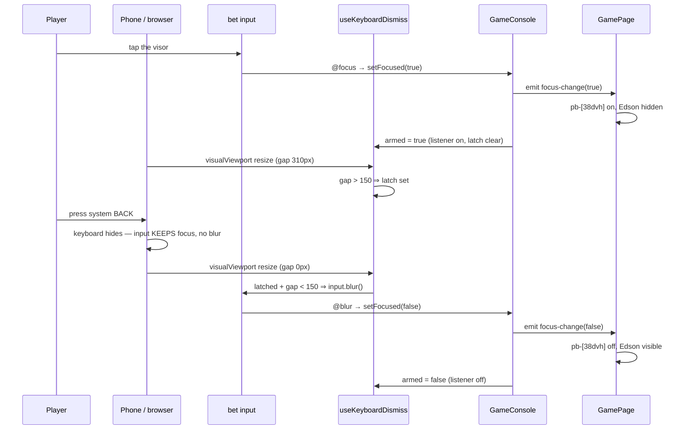

# SpaceStroker — "Mobile keyboard dismiss" Bug Fix — Implementation Spec

> **Status: Shipped 2026-08-13** — `feature/mobile-keyboard-dismiss` merged to `main` in
> `monkify-front` and `monkify-meta`. Refined via Trello card
> [On mobile, fix issue with the keyboard thing on typing](https://trello.com/c/MtqcFQEm) (2026-08-13).
>
> ⚠️ **What shipped is broader than the card was refined for, and decision 13 supersedes 12.** The
> card covered the system BACK button; the owner found a **second route** (the app switcher) while
> testing and it was folded in. The two routes need **different signals** — `visualViewport` for a
> dismissal, `window` `blur` for leaving the app — and the app-switch half took two wrong attempts,
> both of which passed in desktop Chrome. §7.2b holds the measured device trace that settled it; read
> it before changing anything here.
> Repos affected: `monkify-front`, and this doc in `monkify-meta`. **`monkify-backend` is NOT
> affected** — no endpoint, entity, handler, consumer, EF mapping or migration is touched.
>
> **Purpose:** on a phone, the game console lifts above the native keyboard while the bet input is
> focused. That lift is unwound **only** by the input's `blur` event, so when the player closes the
> keyboard with the phone's system **BACK** button — which hides the keyboard *without* blurring the
> input — the cabinet stays floating over empty space until the player taps somewhere else. This fix
> teaches the app to notice the keyboard closing, on both the game and practice consoles.

---

## 1. Summary

**Bug fix, frontend-only.** One new composable plus three wiring points.

| | Today | After |
| --- | --- | --- |
| Keyboard closed by tapping elsewhere / the lever | `blur` fires → `focus-change(false)` → `pb-[38dvh]` drops, Edson returns | unchanged |
| Keyboard closed by **system BACK** (Android) | keyboard hides, input **keeps focus**, `blur` never fires → cabinet stays lifted over dead space | the app sees the visual viewport grow back, force-blurs the input, and the **existing** `blur` path unwinds the lift |
| Keyboard closed by swipe-down / OS hide / iOS "Done" | same defect | same fix — detection keys on the **keyboard**, not on which button was pressed |
| Player leaves the app entirely (system app switcher, screen lock) | same defect, by a **second route** — see decision 12 | the input is blurred as the page goes hidden, so there is no focus to restore on return and no lift to come back to |
| URL bar collapsing/expanding while typing | no effect (nothing watches the viewport) | still no effect — the 150px threshold is chosen to sit above it |
| Desktop (`≥ lg`) | no lift at all | unchanged; the composable never arms |

The mechanism is deliberately **one-directional**: the composable's only output is `input.blur()`. It
never touches `betInputFocused`, `pb-[38dvh]` or Edson directly — those stay driven by the single
`@blur → setFocused(false) → emit('focus-change', false)` path that already exists, so there is exactly
one teardown route, not two.

---

## 2. Constraints (MANDATORY)

From `monkify-meta/constraints.md` (full list there):

- **Worktree-per-repo:** work in `.worktrees/mobile-keyboard-dismiss/<repo>`; the shared checkout of
  each repo stays a permanent `main` hub and is never switched to the feature branch. Branch
  `feature/mobile-keyboard-dismiss` is pushed to `origin` in `monkify-front` and `monkify-meta`.
- **No backend unit tests to update** — `monkify-backend` is untouched, so `SpaceStroker.Tests` is not
  run or changed by this card.
- **No integration test** — `AGENTS.md` rule 8 scopes the mandatory happy-path integration test to
  **new features**. This is a bug fix with zero backend surface, so there is no happy path in
  `SpaceStroker.Tests.Integration` to drive. See §11 for what replaces it.
- **Frontend conventions** — `conventions/frontend.md`: composables live in `src/hooks/`, and the
  comment density on this screen is high and deliberate (the lift code is heavily annotated). The new
  composable explains **why**, matching `useClickOutside.ts`, which is also the lifecycle pattern it
  copies.
- **No secrets/config touched.** No env var is added — see §5.
- **No user-facing copy** is added or changed, so `constraints.md` §6 (vague messaging) is not engaged.

---

## 3. Resolved product decisions

| # | Decision |
| --- | --- |
| 1 | **Root cause:** `blur` is the only signal that unwinds the lift. There is no `visualViewport` listener anywhere in `monkify-front` (verified: zero matches under `src/`) and `public/index.html:6` ships `width=device-width,initial-scale=1.0` with **no `interactive-widget`**, so the layout has no way to learn the keyboard closed. |
| 2 | **End state on keyboard-close = fully idle:** the layout resets **and** the input is force-blurred (caret gone, placeholder/blink back). Chosen over "reset the layout but keep focus" because it keeps **one** flag instead of splitting "keyboard open" from "input focused" — and it costs nothing: the typed word lives in `useGame()`'s `userWord` (the input is `v-model`-bound), so a blur loses the caret, never the text. |
| 3 | **Detection = `window.visualViewport`, never button-specific handling.** When the visual viewport grows back while the input is still focused, call `input.blur()` and let the **existing** `@blur` path do the teardown. Keying on the keyboard rather than on a key press also covers swipe-down dismissal, an OS-level hide and the iOS accessory "Done". |
| 4 | **Threshold is absolute, not a ratio:** the keyboard counts as **open** while `window.innerHeight − visualViewport.height > 150`. 150px sits comfortably below any real soft keyboard (~250–350px) and above URL-bar chrome shifts (~50–110px). A ratio rule (e.g. `< 0.75 × innerHeight`) was **rejected**: 25% of a tall phone is ~250px, so a numeric pad or a floating/split keyboard could trip a **false close** and collapse the layout under a player who is still typing. Avoiding the false-close is the priority. |
| 5 | **⚠️ The detector LATCHES on "keyboard seen open" before it will fire a close** (added by this spec — see §7.3). Without it the fix is worse than the bug: the keyboard *animates* open over ~200–300ms and Chrome Android emits `resize` events with intermediate heights, so a naive "gap below 150 ⇒ blur" fires on the first partial frame and blurs the input the instant the player taps it — the keyboard would never open at all. The listener therefore only arms the close after it has observed a gap **above** 150px at least once. |
| 6 | **Listener lifecycle:** the `visualViewport` `resize` listener is attached **only while the input is focused** and detached on blur and on unmount. Nothing runs during normal play. |
| 7 | **One shared composable, both consoles.** `src/hooks/useKeyboardDismiss.ts`, used by **both** `GameConsole.vue` and `PracticeConsole.vue`. The bug shipped twice because the lift logic was copy-pasted; the fix must not become a third copy. |
| 8 | **⚠️ Three input elements are wired, not two** (added by this spec — see §7.4). `GameConsole`'s **desktop** input branch (`GameConsole.vue:513`) is **also a mobile surface**: `GamePage.vue:237` renders `<game-console wide>` for viewports 600–1023px wide **and** ≥600px tall, and binds `@focus-change` to it, so tablets and big phones get the same lift through the *other* input. Wiring only the compact-cabinet input would leave that whole band broken. |
| 9 | **Rejected: `interactive-widget=resizes-content`** in the viewport meta (which would make `dvh` shrink with the keyboard and remove the manual lift mechanism entirely). It is a site-wide viewport change touching every `dvh`-sized screen (game, practice, Orbit modal, home) and needs a full re-verify pass — too large a blast radius for a bug card. Recorded so it is not re-proposed as a surprise. |
| 10 | **No `visualViewport` support** (very old browsers) → behaviour is unchanged, i.e. `blur`-only exactly as today. Fail-safe, no polyfill. |
| 11 | **Verification is two-part:** a deterministic synthetic proof in desktop Chrome **plus** a real-Android confirmation by the card owner. `monkify-front` has no test runner, and DevTools can emulate neither a soft keyboard nor the system BACK button, so neither half alone is sufficient. See §13. |
| 13 | **⚠️ The app-switch fix is `window`'s `blur`, armed on the SURFACE — and decision 12's `visibilitychange` version was wrong. Measured on the device** (Trello #170, 2026-08-13, with a temporary on-page event log; the trace is in §7.6). Pressing the app-switcher produces: `t+0` the input's **`blur` event fires by itself** (the lift correctly unwinds) · `t+1ms` window `blur` — **but `document.activeElement` is still the input** · `t+967ms` `visibilitychange`. On return, window `focus` then the input's **`focus` event fires again**, the lift comes back, and no keyboard comes with it. Two corrections fall out: **(a) the teardown was never the broken part** — Android hands us the blur event on the way out and keeps DOM focus, so Chrome silently **restores** it on the way back; the cure is to give up DOM focus *while we still hold it*. **(b) the listener cannot be armed on `isFocused`** — that flag goes false at `t+0`, one millisecond before the window blur we need to hear. It is armed on the **surface** (`mobile \|\| wide`) for the component's lifetime and guards on `document.activeElement === input`, which costs nothing during play and is the condition that actually matters. `visibilitychange` is kept as a second trigger for the same handler (a screen lock, or an OS that skips the window blur), by which point the handler is a no-op anyway. |
| 12 | ~~**The app switcher is a SECOND route to the same stuck state, and the viewport listener does not cover it**~~ — **superseded by decision 13.** The observation was right and the mechanism was wrong: the fix shipped as a `visibilitychange` blur armed on focus, which the device proved can never fire (the composable has already disarmed by then). Kept, struck through, because "blur on `visibilitychange`" is the obvious-looking fix and the next agent should be able to see it was tried and why it failed. Original text follows.<br><br>**⚠️ The app switcher is a SECOND route to the same stuck state, and the viewport listener does not cover it** (added 2026-08-13 after the owner reproduced it on a real phone **against this fix** — decision 11's device pass earning its keep; see §15). Leaving the app hides the keyboard; on return **Chrome restores focus to the input** but the keyboard does not come back with it, so `@focus` re-engages the lift, the composable re-arms, and — because no keyboard ever opens again — **the latch never sets and nothing will ever blur it**. The cabinet stays floating until the player taps elsewhere: the original bug, reached a different way. Fix: a `visibilitychange` listener, armed alongside the resize listener, that blurs **as the page goes hidden**. Blurring on the way *out* is what makes the return clean. It costs nothing for the same reason decision 2 does — the word lives in the store, so only the caret is lost — and it covers screen-lock and the wallet-deeplink hop for free. **Deliberately one-sided: the gap is NOT re-measured when the page becomes visible again.** The viewport has not settled at that point, so a keyboard on its way back in reads as "closed" and would be blurred away mid-animation — the same failure the latch exists to prevent. This listener is **not** gated on `visualViewport` support: an app switch strands the layout with or without it, so decision 10's fallback now means "blur-only teardown **plus** the app-switch blur". |

---

## 4. Data model

**Not applicable.** No entity, column, EF mapping or migration — this is a client-side layout defect.

---

## 5. Configuration

**Not applicable — no env var.** The 150px threshold is a module constant
(`KEYBOARD_OPEN_GAP_PX`) in the composable, not a `VUE_APP_*` value: it is a property of soft
keyboards, not of a deployment, and an env knob would create a value that can be set wrong in prod and
never verified. It is documented at its declaration with the reasoning from decision 4.

---

## 6. Backend behaviour

**Not applicable.** `monkify-backend` is not touched: no endpoint, DTO, entity, handler, consumer, EF
mapping, migration, event or SignalR contract changes. No branch is created there.

---

## 7. Frontend behaviour (`monkify-front`)

### 7.1 What exists today (the code being fixed)

| Where | What it does |
| --- | --- |
| `GameConsole.vue:39` | `defineEmits<{ (e: 'focus-change', focused: boolean): void }>()` |
| `GameConsole.vue:42,45-48` | `isFocused` + `setFocused(v)` → sets `isFocused` and emits `focus-change` |
| `GameConsole.vue:366-380` | **compact cabinet** input `#word-type-input` (`v-if="mobile"` branch), `@focus="setFocused(true)"` / `@blur="setFocused(false)"` |
| `GameConsole.vue:513-524` | **three-plate** input `#word-type-input` (`v-else` branch), same two handlers |
| `GamePage.vue:46` | `betInputFocused` ref |
| `GamePage.vue:154` | `betInputFocused ? 'pb-[38dvh]' : ''` on the scrolling game column |
| `GamePage.vue:168` | `<game-monkey v-show="!betInputFocused">` — Edson hides while lifted |
| `GamePage.vue:188-193` | compact cabinet (`v-if="!isWideConsole"`), `@focus-change="betInputFocused = $event"` |
| `GamePage.vue:233-238` | **wide band** (`v-else`) wrapping `<game-console wide @focus-change="betInputFocused = $event" />` |
| `GameTerminal.vue:542` | desktop: `<GameConsole v-if="!mobile" :mobile="mobile" />` — **binds no `@focus-change`**, so the emit goes nowhere and desktop has no lift today |
| `PracticeConsole.vue:29,38,40-43` | the same emit + `isFocused` + `setFocused` shape |
| `PracticeConsole.vue:193-207` | mobile input `#practice-word-input` (`v-if="mobile"` branch), `@focus`/`@blur` → `setFocused` |
| `PracticeConsole.vue:272-283` | desktop input (`v-else` branch) — ⚠️ sets `isFocused` **directly** and does **not** emit |
| `PracticePage.vue:42,192,205,213-217` | the practice twin of `GamePage`'s lift; only one console usage, always `mobile` (practice has no wide band) |

The defect: nothing in that list observes the keyboard. `blur` is the sole teardown trigger.

### 7.2 New composable — `src/hooks/useKeyboardDismiss.ts`

```ts
import { computed, onBeforeUnmount, watch, type Ref } from 'vue';

// Force-blurs a text input when the on-screen keyboard goes away WITHOUT the input reporting it —
// either DISMISSED (system BACK, swipe-down, iOS "Done") or because the player LEFT THE APP (the
// system app switcher, a screen lock). The two need different signals; see §7.2b.
//
// The mobile game/practice columns lift the console above the keyboard while the bet input is
// focused (GamePage.vue:154 `pb-[38dvh]` + Edson hidden), and they unwind that lift on the input's
// `blur`. Android's system BACK button hides the keyboard but leaves the input focused, so `blur`
// never fires and the cabinet stays floating over empty space until the player taps elsewhere.
// Nothing else in the app can see this: there is no `interactive-widget` in the viewport meta
// (public/index.html), so `dvh` does not move when the keyboard opens or closes.
//
// So we watch the keyboard itself, not the button that dismissed it — which covers swipe-down, an
// OS-level hide and the iOS accessory "Done" for free. The only action taken is `input.blur()`: the
// existing `@blur` handler then runs the SAME teardown as every other dismissal, so there is one
// teardown path in the app rather than two that can drift.

// The keyboard is "open" while the layout viewport exceeds the visual viewport by more than this.
// ABSOLUTE, not a ratio, on purpose: a real soft keyboard is ~250-350px and URL-bar chrome shifts are
// ~50-110px, so 150 separates them with room on both sides. A ratio (e.g. 25% of innerHeight) is
// ~250px on a tall phone, which a numeric pad or a floating/split keyboard need not clear — and a
// false CLOSE collapses the layout under a player who is still typing, the one failure to avoid.
const KEYBOARD_OPEN_GAP_PX = 150;

export function useKeyboardDismiss(
  input: Ref<HTMLInputElement | null>,
  isFocused: Ref<boolean>,
  onLiftSurface: Ref<boolean>
) {
  const viewport = typeof window !== 'undefined' ? window.visualViewport : undefined;

  // ⚠️ LATCH — do not remove. The keyboard ANIMATES open, and Chrome Android fires `resize` through
  // that animation with intermediate heights. Firing a close on any gap below the threshold would
  // therefore blur the input on the first partial frame after the player taps it, and the keyboard
  // would never finish opening. We only accept a close after having seen the keyboard actually open.
  let sawKeyboardOpen = false;

  const onViewportResize = () => {
    if (!viewport) return;
    const gap = window.innerHeight - viewport.height;

    if (gap > KEYBOARD_OPEN_GAP_PX) {
      sawKeyboardOpen = true;
      return;
    }

    // The keyboard was open and is not any more, while the input still holds focus: unwind through
    // the input's own blur handler. Everything else (the lift, Edson) follows from that.
    if (sawKeyboardOpen) input.value?.blur();
  };

  // ROUTE 2 — the player left the app. See the measured trace in §7.2b: Android fires the input's
  // blur EVENT on the way out (so the lift already unwinds) but keeps DOM focus on the element, and
  // Chrome RESTORES that focus on the way back without restoring the keyboard. Giving up DOM focus
  // while we still hold it is what leaves nothing to restore.
  const blurIfStillHoldingFocus = () => {
    const el = input.value;
    if (el && document.activeElement === el) el.blur();
  };

  const armed = computed(() => isFocused.value && onLiftSurface.value);

  const stopViewport = () => viewport?.removeEventListener('resize', onViewportResize);
  const stopWindow = () => {
    window.removeEventListener('blur', blurIfStillHoldingFocus);
    document.removeEventListener('visibilitychange', blurIfStillHoldingFocus);
  };

  watch(
    armed,
    (isArmed) => {
      stopViewport(); // never stack listeners
      sawKeyboardOpen = false; // every focus starts from "no keyboard seen yet"
      if (isArmed) viewport?.addEventListener('resize', onViewportResize);
    },
    { immediate: true }
  );

  // ⚠️ Deliberately a DIFFERENT lifetime from the viewport listener: bound to the SURFACE, not to
  // focus. `isFocused` goes false one millisecond BEFORE the window blur we need to hear (§7.2b), so
  // a focus-armed listener is already detached when it arrives. Costs nothing during normal play —
  // the handler returns immediately unless the bet input actually holds DOM focus — and is not gated
  // on `visualViewport`, since leaving the app strands the layout either way.
  watch(
    onLiftSurface,
    (onSurface) => {
      stopWindow();
      if (onSurface) {
        window.addEventListener('blur', blurIfStillHoldingFocus);
        document.addEventListener('visibilitychange', blurIfStillHoldingFocus);
      }
    },
    { immediate: true }
  );

  onBeforeUnmount(() => {
    stopViewport();
    stopWindow();
  });
}
```

Notes for the implementer:

- **The lifecycle shape is `useClickOutside.ts`'s**, deliberately: a `watch(active)` that stops before
  it starts (so listeners never stack) plus `onBeforeUnmount(stop)`. Follow it rather than inventing a
  new one.
- **No `immediate` evaluation of the gap.** The composable reacts to `resize` events only; it must not
  measure on arm. On arm the keyboard has not opened yet, so a measurement there reads "closed" and,
  without the latch, would blur instantly.
- **`viewport` is captured once and every use is optional-chained** — that is the whole of decision 10.
  On a browser with no `visualViewport`, the resize listener is never attached and nothing throws.
  ⚠️ **The `visibilitychange` listener is deliberately outside that guard** (decision 12), so such a
  browser gets today's blur-only teardown **plus** the app-switch blur — not byte-identical to today
  any more, and better for it.
- **Blur on `hidden`, never on `visible`.** `visibilitychange` fires before the page is frozen, which
  is what makes the outbound blur reliable; the inbound side is where the viewport is still settling
  and a measurement lies.
- **After `blur()` fires**, the input's `@blur` sets `armed` false, the watcher runs `stop()`, and the
  latch resets on the next focus. No manual teardown inside the handler.

### 7.2b The measured app-switch trace (decision 13)

Captured on a real Android phone with a temporary on-page event log, pressing the app-switcher button
while the practice bet input was focused. `f` = `document.activeElement`, `l` = is the lift class on.

```
15382 focusin:input   f=input  l=1          player focuses; lift ON
15454 vv:resize       f=input  l=1  g=295   keyboard animating open
15469 vv:resize       f=input  l=1  g=359   keyboard open  → latch set
16567 focusout:input   f=input  l=0  g=359  ⚠️ the browser fires blur ITSELF; lift correctly unwinds
16568 window blur     f=input  l=0  g=359   ⚠️ 1ms later — and DOM focus is STILL the input
16632 vv:resize       f=input  l=0  g=-1    keyboard gone
17534 vis:hidden      f=input  l=0  g=-1    ⚠️ 967ms after the blur — far too late to arm on
20130 vis:visible     f=input  l=0
20171 window focus    f=input  l=0
20172 focusin:input   f=input  l=1          ⚠️ CHROME RESTORES FOCUS → lift back on, no keyboard
```

Three things this killed:

1. **"The teardown is missing."** It is not — line 16567 is the browser tearing down correctly on its
   own. The bug is the *restore* at 20172.
2. **"Blur on `visibilitychange`."** It arrives at 17534, 967 ms after `isFocused` went false at
   16567, so a focus-armed listener is already detached. It literally cannot fire.
3. **"`focusout` means the element lost focus."** `f=input` on every line: Android fires the input's
   focus/blur **events** from *window* focus changes while the element keeps DOM focus. That retained
   DOM focus is exactly what Chrome restores.

⚠️ **`g` can be negative** (`-1` above): Android reports `visualViewport.height` about a pixel taller
than `innerHeight` with the keyboard closed. Any future instrumentation must not use `-1` as a
"no `visualViewport`" sentinel, and the `> 150` threshold is unaffected.

### 7.3 Why the latch is load-bearing (decision 5)

```
focus  ─┬─► armed = true, listener on, sawKeyboardOpen = false
        │
        ├─ resize (gap 40px, keyboard sliding up) ──► below threshold, latch not set ⇒ IGNORED
        ├─ resize (gap 190px, still sliding)      ──► above threshold ⇒ sawKeyboardOpen = true
        ├─ resize (gap 310px, keyboard open)      ──► above threshold ⇒ stays latched
        │
        ├─ resize (gap 305px, URL bar collapses)  ──► above threshold ⇒ nothing happens  (AC 3)
        │
        └─ resize (gap 0px, system BACK pressed)  ──► latched + below threshold ⇒ input.blur()  (AC 1)
```

Without the latch, the second line of that trace ends the session: the input blurs mid-animation and
the player can never type. This is the single highest-risk detail in the card.

### 7.4 Wiring — three inputs across two components

**`GameConsole.vue`** — both input branches, because both render under the lift:

1. Capture the props: `const props = defineProps<{ mobile?: boolean; wide?: boolean }>();` (line 35 —
   currently the return value is discarded). The template keeps using the bare names; nothing else
   changes.
2. Add a template ref `const wordInput = ref<HTMLInputElement | null>(null);` and put `ref="wordInput"`
   on **both** inputs — `GameConsole.vue:366` (compact) and `GameConsole.vue:513` (three-plate). They
   are `v-if`/`v-else` branches, so exactly one is mounted and the ref is never ambiguous (this is the
   same reason they can share the `word-type-input` id, per the comment at line 348).
3. Arm only where the lift exists:
   ```ts
   // `mobile` = the phone's compact cabinet; `wide` = the three-plate console mounted in the MOBILE
   // page's console band (600-1023px, GamePage.vue:237). BOTH are lifted by GamePage, and `wide`
   // renders the desktop input branch — so the guard is the pair, not the branch. On desktop the
   // console is rendered by GameTerminal with neither prop and GameTerminal binds no `focus-change`,
   // so nothing arms and nothing lifts.
   const onLiftSurface = computed(() => props.mobile === true || props.wide === true);
   useKeyboardDismiss(wordInput, isFocused, onLiftSurface);
   ```
   `computed` is already imported at line 16.
   ⚠️ **Pass `isFocused` and the surface SEPARATELY — do not pre-`&&` them into one `armed` ref.** The
   composable needs the two lifetimes apart: the viewport listener is focus-scoped, the window-blur
   listener is surface-scoped, and collapsing them is precisely the bug decision 13 fixed.

**`PracticeConsole.vue`** — the mobile input only:

1. Capture the props: `const props = defineProps<{ mobile?: boolean }>();` (line 25).
2. `ref="wordInput"` on the mobile input at `PracticeConsole.vue:193` **only**. The desktop branch
   (line 272) is deliberately left alone: it is desktop-only (practice has no `wide` band), and it
   does not even emit `focus-change` — wiring it would imply a lift that cannot happen there.
3. `const onLiftSurface = computed(() => props.mobile === true);` then
   `useKeyboardDismiss(wordInput, isFocused, onLiftSurface);`. Check `computed` is imported.

**Unchanged, deliberately:** `GamePage.vue`, `PracticePage.vue`, `GameTerminal.vue`,
`PracticeTerminal.vue`, `public/index.html`, and every `pb-[38dvh]` / `v-show="!betInputFocused"`
expression. They already do the right thing the moment `focus-change` reports `false`.

### 7.5 Behaviour matrix

| Situation | Armed? | Result |
| --- | --- | --- |
| Phone, compact cabinet, input focused, BACK pressed | yes | latched, gap collapses → `blur()` → lift unwinds, Edson returns |
| 600–1023px wide **and** ≥600px tall (three-plate `wide` console), BACK pressed | yes | identical — decision 8 |
| Practice page, phone, BACK pressed | yes | identical |
| Desktop `≥ lg` (console via `GameTerminal`) | **no** (`mobile`/`wide` both false) | no listener; desktop has no lift anyway |
| Practice desktop input | **no** | no listener |
| Input not focused (watching the typer) | **no** | no listener at all — decision 6 |
| URL bar collapses/expands while typing (~50–110px) | yes | gap stays above 150 ⇒ ignored |
| Rotation while focused | yes | `innerHeight` and `visualViewport.height` both change on the same event; the gap is recomputed and self-corrects |
| Numeric keypad / floating / split keyboard | yes | still clears 150px ⇒ no false close |
| Orbit-locked round | never focuses | the input is `:disabled` when `myBetThisRoundIsOrbit` ⇒ never arms |
| Player switches to the CHAT tab while focused | yes → no | the column goes `invisible`; the input's normal `blur` still governs, exactly as today. **In-page tab, not an OS one — `visibilitychange` does not fire** |
| **Player leaves the app** (system app switcher, screen lock) while focused | yes (surface-scoped) | window `blur` ⇒ real `blur()` while DOM focus is still ours, so Chrome has nothing to restore on return — decision 13 |
| Wallet deeplink hop (signing a bet) while the input happens to be focused | yes | same outbound blur. Harmless: the word lives in the store and the hop's own pending-bet state is untouched |
| Desktop user alt-tabs away with the input focused | **no** | `onLiftSurface` is false above `lg`, so the window listener is never attached and the caret is **not** stolen. Verified explicitly — a desktop player who tabs away mid-word comes back to their caret |
| Window blur while the input is NOT focused (any surface) | listener attached, guard fails | `document.activeElement !== input` ⇒ immediate return, nothing happens |
| Pinch-zoom while focused | yes | `visualViewport.height` shrinks with zoom, so zooming in latches and zooming back out blurs. **Accepted:** the text is preserved and only the caret is lost, and the 16px input floor already prevents iOS *auto*-zoom, so this needs a deliberate two-finger gesture mid-bet. If it is ever reported, the one-line hardening is to ignore events while `visualViewport.scale > 1`. |
| Browser with no `visualViewport` | partial | the resize listener is never attached (today's blur-only behaviour), but the app-switch blur still applies — decision 12 |
| Component unmounted while focused (route change mid-typing) | — | `onBeforeUnmount(stop)` detaches |

---

## 8. Flow diagram



---

## 9. Out of scope

- **Card #95** — "weird behavior with mobile scroll in game page" (*"when you scroll the display
  grows"*). That is the mobile URL-bar collapse changing `dvh` on the scrollable game column, **not**
  the keyboard. Deliberately not folded in.
- Changing the viewport meta (`interactive-widget`) or removing the manual lift mechanism (decision 9).
- Retuning the lift itself — the `38dvh` value, the Edson hide, the band priorities. The lift is
  correct while the keyboard **is** open; only its teardown is broken.
- The Orbit modal's inputs and any other focusable field outside the two game consoles.
- Any backend work, any copy change, any new UI, toast or setting.

---

## 10. File checklist

### 10.1 Backend (`monkify-backend`)

**None.** No branch is created in this repo.

### 10.2 Frontend (`monkify-front`)

| # | File | Change |
| --- | --- | --- |
| 1 | `src/hooks/useKeyboardDismiss.ts` | **New.** The `visualViewport` subscription, the 150px constant, the open-latch, the focused-only lifecycle and the no-`visualViewport` fallback (§7.2). |
| 2 | `src/components/game/GameConsole.vue` | Capture `props` (line 35); add `wordInput` template ref to **both** inputs (lines 366 and 513); pass `isFocused` and `onLiftSurface = mobile \|\| wide` **separately** (§7.4 — the two listener lifetimes must stay apart, decision 13). |
| 3 | `src/components/practice/PracticeConsole.vue` | Capture `props` (line 25); add `wordInput` ref to the **mobile** input (line 193); pass `isFocused` and `onLiftSurface = mobile` **separately** (§7.4). |

### 10.3 Meta (`monkify-meta`)

| # | File | Change |
| --- | --- | --- |
| 1 | `specs/mobile-keyboard-dismiss.md` | **New** — this spec. |
| 2 | `INDEX.md` | Spec row in the knowledge-base map + "Feature currently in flight". |

---

## 11. Unit tests

**Not applicable — and this is a deliberate, recorded gap, not an oversight.**

- `monkify-backend` is untouched, so `SpaceStroker.Tests` is neither changed nor run for this card.
- `AGENTS.md` rule 8's mandatory integration test scopes to **new features**; this is a bug fix with
  zero backend surface, so `SpaceStroker.Tests.Integration` has no happy path to drive.
- `monkify-front` **has no test runner** (no `.spec`/`.test` files, no jest/vitest config). The same
  bar `specs/mobile-console-edge-cases.md` shipped under applies here.

**Done therefore means:** `yarn lint` clean, `yarn build` clean, **plus both halves of §13** — the
synthetic proof and the real-device confirmation. Neither substitutes for the other: the stub proves
the composable's logic deterministically, the phone proves a real keyboard actually trips it.

---

## 12. Acceptance criteria

Mapped 1:1 from the Trello **Acceptance Criteria** checklist.

1. Given a mobile viewport on the game page with the bet input focused and the native keyboard open,
   when the player dismisses the keyboard with the phone's system BACK button, then the input is
   blurred, `pb-[38dvh]` is removed from the game column and Edson is visible again — **without the
   player tapping anywhere**.
2. Given the player had typed a word before dismissing the keyboard, when the keyboard-close blur
   fires, then the typed word is still shown in the visor and is still the value that gets bet — only
   the caret/focus is lost.
3. Given the bet input is focused with the keyboard open, when the visual viewport changes by **less
   than 150px** (e.g. the mobile URL bar collapsing or expanding while the player types), then the
   input stays focused and the console stays lifted — no false keyboard-close.
4. Given a mobile viewport on the practice page with its bet input focused and the keyboard open, when
   the keyboard is dismissed by the system BACK button, then the practice console resets exactly as the
   game console does — **both consoles share one composable, with no duplicated detection logic**.
5. Given the bet input is **not** focused (normal play, watching the typer), when the visual viewport
   resizes for any reason, then no keyboard-close handling runs — the listener is attached only while
   the input is focused and is detached on blur and on unmount.
6. Given a browser without `window.visualViewport`, when the player focuses and leaves the bet input,
   then the blur-only teardown behaves exactly as today and **nothing throws in the console** — while
   the app-switch teardown of AC 9 still applies, since that listener is not gated on
   `visualViewport` (decision 12).
7. Given the desktop console (viewport ≥ `lg`), when the player focuses the bet input, then no viewport
   listener is armed and no lift/teardown behaviour occurs — desktop is unchanged.
8. Given the implementation is complete, when it is verified, then **both** proofs exist: (1) a
   synthetic desktop-Chrome run where a stubbed `visualViewport` height + dispatched `resize`
   demonstrably blurs the input and drops `pb-[38dvh]`, and (2) the card owner's confirmation on a real
   Android phone against the local stack.

9. Given a mobile viewport with the bet input focused and the keyboard open, when the player leaves
   the app entirely (the system app-switcher button, or a screen lock) and then returns, then the
   console is back to its normal position with Edson visible and the input **not** focused — the
   player is never returned to a lifted cabinet with no keyboard under it. The typed word is still in
   the visor. Correspondingly, on **desktop** (≥ `lg`) switching away and back must **not** blur the
   input — nothing is armed there. *(Added 2026-08-13 — decision 12.)*

⚠️ **AC 8 gates the card**, and half of it is the owner's. Do not move the card to **Implemented**
claiming AC 8 on the synthetic proof alone.

**Additional check implied by decision 8** (fold into the AC 1 pass, do not skip): repeat AC 1 at a
**600–1023px wide, ≥600px tall** viewport, where `GamePage` renders the three-plate `wide` console and
therefore the *other* input element.

---

## 13. Manual QA

### 13.1 Synthetic proof (desktop Chrome, deterministic — AC 1, 3, 5, 7 and half of 8)

Run the front dev server from the worktree (copy the hub's `.env.local` **and** `yarn.lock` in first,
and serve on a **verified-free** port — another worktree's server is often already on 8081).

1. Open `/game/play`, DevTools → device toolbar → **390 × 844** (compact cabinet).
2. Focus the visor and confirm the lift is on: the game column carries `pb-[38dvh]` and Edson is gone.
3. In the console, fake the keyboard opening and then closing:
   ```js
   const vv = window.visualViewport;
   const input = document.getElementById('word-type-input');
   const column = document.querySelector('.overflow-y-auto');
   const gap = (px) =>
     Object.defineProperty(vv, 'height', { configurable: true, get: () => window.innerHeight - px });
   const state = (label) =>
     console.log(label, 'focused:', document.activeElement === input,
                 'lifted:', column.className.includes('pb-[38dvh]'));

   input.focus();

   gap(300); vv.dispatchEvent(new Event('resize'));   // keyboard opens — latches
   state('open  →');                                   // expect: focused true,  lifted true

   gap(240); vv.dispatchEvent(new Event('resize'));   // URL bar collapses, 60px of drift (AC 3)
   state('drift →');                                   // expect: focused true,  lifted true
   gap(300); vv.dispatchEvent(new Event('resize'));   // ...and expands again (AC 3)
   state('back  →');                                   // expect: focused true,  lifted true

   gap(0);   vv.dispatchEvent(new Event('resize'));   // system BACK — keyboard gone (AC 1)
   state('close →');                                   // expect: focused FALSE, lifted FALSE
   ```
   ⚠️ **AC 3 is a shift *while the keyboard is open*** — 300 → 240 → 300, both endpoints above the
   150px threshold — which is exactly what a URL-bar collapse does. Do **not** test it as a drop to a
   90px gap: 90 is below the threshold and *is* a close by definition, so that would be testing the
   threshold's value, not the false-positive it exists to prevent.
4. Repeat steps 1–3 at **800 × 700** (the three-plate `wide` console — decision 8), against the same
   `#word-type-input` id.
5. Repeat at 390 × 844 on `/game/practice` against `#practice-word-input` (AC 4).
6. **AC 5:** with the input *not* focused, dispatch the same `resize` events and confirm nothing
   changes and no handler runs (breakpoint inside `onViewportResize`, or temporary `console.log`).
7. **AC 7:** at ≥ 1024px wide, focus the desktop console's input and confirm no listener is armed
   (breakpoint never hit) and no lift class appears.
8. **AC 6:** in a fresh tab run `delete window.visualViewport` **before** loading the page (or stub it
   `undefined` via an early snippet), then focus/blur the input — behaviour identical to today, zero
   console errors.
9. **AC 2:** type a word, latch, then close — the visor still shows the word and the lever still bets
   it.
10. **AC 9 (app switch):** focus, latch the keyboard open, then stub `document.hidden` to `true` and
    dispatch `visibilitychange`. Expect `focused false, lifted false` **immediately**, before any
    return. Then flip `hidden` back to `false`, dispatch again with the gap at 0, and confirm nothing
    re-lifts. Repeat at ≥ 1024px and confirm the desktop input is **still focused** after the same
    flip — the caret must not be stolen where there is no lift.

### 13.2 Real Android confirmation (owner — the other half of AC 8)

1. Local Docker stack up; front dev server reachable from the phone on the LAN.
2. Open `/game/play`, focus the visor, type a partial word.
3. Press the phone's **system BACK** button once (the press that dismisses the keyboard).
4. Expect: the keyboard disappears **and** the cabinet drops back to its normal position with Edson
   visible, in the same motion — no second tap needed, and the typed word still in the visor.
5. Repeat on `/game/practice`.
6. Also worth a pass: swipe-down keyboard dismissal, and rotating the phone while the input is focused.
7. **AC 9 — the app-switch pass (this is the one that found decision 12).** Focus the visor, type a
   partial word, then press the phone's **app-switcher** button to leave the browser, and come back.
   Expect the cabinet already back to normal with Edson visible and the input not focused, with the
   word still in the visor. Worth repeating with a screen lock/unlock instead of the switcher.

---

## 14. Trello / pipeline

- **Source card:** [#170 — On mobile, fix issue with the keyboard thing on typing](https://trello.com/c/MtqcFQEm)
  — list **Specs created**; the **Implementation** section on the card carries branch, spec, repos and
  worktree.
- **Branch:** `feature/mobile-keyboard-dismiss` in `monkify-front` and `monkify-meta` (no backend branch).
- **Next:** `/monkify-implement-feature 170`, then `/monkify-ship-feature 170`.

---

## 15. Revision log

| Date | Change |
| --- | --- |
| 2026-08-13 | Initial spec from refined card #170. Adds two findings from code exploration that the card did not carry: the **open-latch** requirement (§7.3, decision 5) and the **`wide` console's desktop input branch** being a mobile surface that must also be wired (§7.4, decision 8). |
| 2026-08-13 | **Decision 12 + AC 9 — the app-switch route**, found by the owner on a real Android phone testing this fix on `/game/practice`: leaving the app via the system switcher and returning still stranded the lifted cabinet. Fixed with a `visibilitychange` blur armed on focus. Scope was folded into this card rather than split off, since it is the same composable and the same defect. The owner confirmed the **system BACK** case (AC 1/4) working on the device in the same pass. |
| 2026-08-13 | **Decision 13 supersedes 12 — the `visibilitychange` fix did not work, and the device said why.** The owner reported the bug unchanged; a temporary on-page event log (§7.2b) showed `visibilitychange` arriving **967 ms after** `isFocused` had already gone false, so the focus-armed listener was detached before it could fire — and, more importantly, that the input **never loses DOM focus at all**, which is what lets Chrome restore it on return. Replaced with a **window `blur`** listener armed on the **surface** and guarded on `document.activeElement`. The composable's signature changed to `(input, isFocused, onLiftSurface)` so the two listener lifetimes stay separate. **Process note:** the first two attempts were verified only against synthetic events that encoded the same wrong model of the device, which is why both passed in Chrome and failed on the phone. The device log is now the primary evidence and §7.2b exists so it is never re-derived. |
