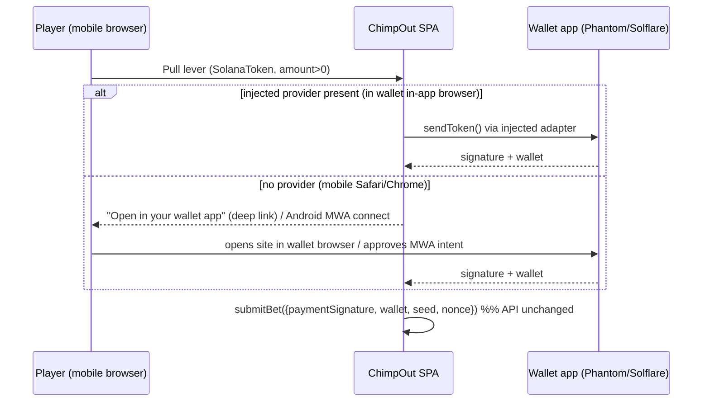

# ChimpOut — "Mobile layout for the game screen" Feature — Implementation Spec

> **Status: Shipped** — merged via `feature/mobile-layout` on 2026-07-15. Refined via Trello card
> [(DESIGN) Mobile layout for the game screen](https://trello.com/c/TOTAUpmq).
> Repos affected: `monkify-front`, and this doc in `monkify-meta`. **No backend.**
> Distilled summary: `../features/mobile-layout.md`. Shipped deviations from this spec: the mobile
> wallet path shipped as **layer 1 only** (the "open in wallet app" deep link); Android Mobile Wallet
> Adapter (§7.6 layer 2) was **deferred**. A follow-up fix stacks the mobile GAME/CHAT·STATS views
> absolutely so a hidden view can't intercept taps.
>
> **Purpose:** Make ChimpOut's two main player screens — the **games lobby**
> (`/chimpout/game/games`) and the **main game** (`/chimpout/game/play`) — usable on phones, in
> portrait and landscape, standalone **and** inside a regulated casino's mobile `<iframe>`. Today the
> app is effectively desktop-fixed (the game page is a single non-wrapping flex row with
> JS/`vh`-driven widths). Reflow both pages for narrow viewports while preserving the pixel / arcade /
> space identity, and add a working mobile crypto wallet-connect path so `SolanaToken` bets can be
> placed from a phone.

---

## 1. Summary

Two pages, one responsive breakpoint, one net-new capability.

| Area | Desktop today | Mobile target (this spec) |
| --- | --- | --- |
| **Lobby** (`GameSelectPage` → `GameTypes` → `GameTypeCard`) | Grid `grid-cols-1 md:grid-cols-2 xl:grid-cols-3`; already 1-col on phones | Keep 1-col; **condense the card** — lead with art + name + price + lottery badge + `PRESS TO START`, description truncated to ~1 line |
| **Game** (`GamePage` → `GameTerminal`(+`GameConsole`), `GameMonkey`, `GameSidePanel`) | Single non-wrapping flex **row**: terminal (JS-computed px width) + monkey (`flex-1`, `hidden lg:block`) + side-panel (absolute overlay `w-64`/`w-[40vw]`) | Below `lg`: a **column** with a top **`GAME | CHAT·STATS` segmented toggle**. `GAME` = terminal + bet input, full-width, fluid (not height-driven). `CHAT·STATS` = the chat + stats panels full-width. Monkey stays hidden. |
| **Bet input** (`GameConsole`) | Fixed % columns (`w-[30%]` input / lever / `w-[37%]` keypad), `h-[36%]` | One compact themed panel: choice input (native keyboard for masked word entry, themed preset keypad for preset games) + the lever = `PLACE BET`. **No amount field** (price is fixed at `requiredAmount`). |
| **Header** (`GameHeader`) | `h-[64px]`, logo + mute + wallet cluster + gear + dev-admin | Stays inline, slightly smaller; no hamburger |
| **Modals** | Customization modal (`w-[90%] max-w-md`); `public/verify.html` (already fluid) | Tighten the customization modal's client-seed row for narrow widths; verify.html already responsive |
| **Crypto wallet** | `sendToken` via injected desktop extension; embedded via `window.open` popup | **Net-new:** a mobile connect/sign path (see §7.6) that works on iOS + Android, standalone and embedded |

**Breakpoint decision:** the mobile layout engages **below `lg` (max-width 1023px)**. This reuses the
existing `GameMonkey` `hidden lg:block` boundary (the monkey already disappears there), and — unlike a
`md` (768px) boundary — it correctly captures **landscape phones** (~740–932px wide), satisfying the
"landscape reuses the portrait layout" decision. Portrait tablets (768–1023px) also get the mobile
layout (acceptable graceful degradation; tablets are not separately designed). At `≥ lg` the desktop
layout is **unchanged**.

---

## 2. Constraints (MANDATORY)

From `monkify-meta/constraints.md` (full list there):

- **Worktree-per-repo:** work in `.worktrees/mobile-layout/monkify-front` and
  `.worktrees/mobile-layout/monkify-meta` on `feature/mobile-layout` (created off `origin/main`); the
  shared hubs stay on `main`. Push the branch for the PR.
- **Frontend-only:** no backend behaviour, DB, EF, migration, SignalR, or game-flow change ⇒ **no
  new backend integration test required** and no `ChimpOut.Tests` changes. Keep the frontend build/lint
  green.
- **Front worktree build gotcha:** `monkify-front` builds from a worktree can boot a **stale image**
  because `yarn.lock` is gitignored — copy the hub's `yarn.lock` into the worktree before building and
  verify the served bundle actually changed (see the implement/ship steps).
- **Secrets/config:** mock-only values in any committed config; never commit real RPC URLs/keys.
- **Operator messaging:** vague errors only; an embedded 401 / expired / inactive operator uses the
  existing `token-expired` + "Relaunching…" path — never `/error`, never contract status.
- **Env vars:** frontend uses **`VUE_APP_*`** (e.g. `VUE_APP_SOLANA_NETWORK`), not `VITE_*`.

---

## 3. Resolved product decisions

Sourced from the card **Decisions** + this game's refinement, **corrected against the live code**
(see §3.1).

| # | Decision |
| --- | --- |
| 1 | This card **designs and implements** the mobile layouts (Claude Design mockups → user approval → responsive Vue). Frontend-only. |
| 2 | Targets: **portrait + landscape phones**; landscape **reuses the portrait layout** (one responsive layout, engaged `< lg`/1024px). Graceful up to tablet; tablets not separately designed. |
| 3 | Preserve the pixel / arcade / space identity — reflow, don't redesign. |
| 4 | **Header** stays inline (logo left; mute / gear / dev-admin right), no hamburger. |
| 5 | **Lobby**: single-column condensed cards — art + name + price + lottery badge + `PRESS TO START`; long description truncated to ~1 line. |
| 6 | **Game**: top **`GAME | CHAT·STATS` segmented toggle** below `lg`; `GAME` = terminal + bet input; `CHAT·STATS` = chat + stats full-width; an unread hint (badge) on the toggle when a chat message arrives while on `GAME`. |
| 7 | **Monkey/UFO** hidden on phones (already `hidden lg:block`); the terminal carries all game feedback. |
| 8 | **Bet input** collapses the three arcade modules into one compact themed panel: choice input (native keyboard for word/number typing; themed preset keypad for preset-digit games) + the lever = `PLACE BET`. **No amount stepper** — price is fixed per ticket. |
| 9 | **Customization modal** (gear) made mobile-friendly. **Provably-fair verify** is `public/verify.html` (already responsive) + the client-seed block inside the customization modal + the in-terminal reveal — no new header control. |
| 10 | **Crypto wallet on mobile — solve it:** a mobile-browser player can connect a wallet and place a `SolanaToken` bet, standalone and embedded. Recommended mechanism in §7.6 (highest-risk item; confirm before building). |
| 11 | **Embedded:** the responsive layout is width-driven, so it applies identically in a mobile iframe (verify, no separate design). |
| 12 | All game **states** work at phone widths: waiting/betting (countdown, place bet), running (typer output, climbing POT, near-miss), ended (win/lose). |

### 3.1 Corrections from code exploration (card text vs. reality)

These refine two card decisions/AC items that were written before reading the code:

- **No amount stepper.** `GameConsole.vue` has **no amount field**; the bet amount is fixed at
  `selectedGame.requiredAmount` and the **lever** is the place-bet action
  (`GameConsole.vue:216-225`). The mobile bet panel therefore has **choice input + `PLACE BET`**, no
  amount control. (Card AC referencing an "amount stepper" is corrected here.)
- **The header "shield" is the dev-admin button, not provably-fair.** `GameHeader.vue` contains mute,
  the wallet cluster (`v-if="showWallet"`, SolanaToken only), the gear (customization modal), and
  `DevAdminButton` (`:196`, dev-only). Provably-fair verification lives in `public/verify.html`
  (standalone, `max-width:900px`, already mobile-safe) and the client-seed block in
  `PlayerCustomizationModal.vue:185-213`. No header shield opens a verifier. Mobile work for "verify"
  is therefore limited to the customization modal's seed row; `verify.html` needs no change.

---

## 4. Data model

**None.** No entities, columns, EF mapping, or migrations. Frontend/presentation + client wallet flow
only.

---

## 5. Configuration

- **No new required config.** The existing `VUE_APP_SOLANA_NETWORK` (used by
  `useConnection.startConnection`) is reused for the mobile wallet path.
- If a mobile-wallet library needs an app identity/URL (e.g. Mobile Wallet Adapter's app identity), add
  it as a **`VUE_APP_*`** var with a **mock/placeholder** committed value and document it in
  `.env.example`.

---

## 6. Backend behaviour

**None.** The bet POST is unchanged (`applyBet` in `services/mainService.ts:66`); `SolanaToken`
settlement (on-chain signature validation) already runs API-side and is untouched. No consumer,
handler, or SignalR change.

---

## 7. Frontend behaviour

All work is in `monkify-front`. Unless stated, desktop (`≥ lg`) rendering is unchanged; mobile styles
are added as `max-lg:` overrides (or a mobile-first restructure per component) so the existing desktop
classes keep winning at `≥ lg`.

### 7.1 Global / breakpoint

- Confirm `public/index.html:6` viewport meta is present (`width=device-width, initial-scale=1.0`) — it
  is; keep it.
- Establish the **mobile boundary at `lg` (1024px)**. Prefer Tailwind `max-lg:` utilities and
  `lg:` guards over new custom breakpoints. Do **not** add a new Tailwind breakpoint unless a
  component needs a phone-only step finer than `lg` (the lobby already uses `max-md:` — leave it).
- `App.vue:103` root already has `overflow-x-hidden` — keep; ensure no mobile child forces horizontal
  scroll.

### 7.2 Lobby (`GameSelectPage.vue` → `GameTypes.vue` → `GameTypeCard.vue`)

- **Grid** (`GameTypes.vue:97-100`) is already `grid-cols-1 md:grid-cols-2 xl:grid-cols-3` → phones get
  1 column. Keep. Verify `gap`/padding read well on ~360px (existing `max-md:gap-4`).
- **Card condensation** (`GameTypeCard.vue`):
  - Name (`:78-84`) already `whitespace-nowrap text-ellipsis` — keep (truncates long names).
  - **Description** (`:90-92`, `min-h-[40px]`) → clamp to **~1 line** on mobile (`max-lg:` line-clamp /
    reduced `min-h`) so art + name + price + button stay above the fold. Keep full description at
    `≥ lg`.
  - Ensure the **image** (`:61-72`, `h-40`/`character-img h-[150px]`) and **lottery badge**
    (`:53-58`) scale sensibly on a phone card; art must remain the visual anchor.
  - Price (`:86-88`) and `PRESS TO START` (`:95-99`) stay prominent and tappable (min ~44px touch
    target).

### 7.3 Game page structure (`GamePage.vue`)

- Today (`:42-48`): `<div class="flex h-full"><div class="… flex w-full …"><game-terminal/><game-monkey/><game-side-panel/></div></div>` — one non-wrapping row.
- **Below `lg`:** restructure to a **column**:
  1. a **segmented control** `GAME | CHAT·STATS` (new small component, e.g.
     `components/game/GameMobileTabs.vue`), sticky under the header;
  2. the active segment body fills the remaining height.
- `GAME` segment = `GameTerminal` (which already contains `GameConsole`). `CHAT·STATS` segment = the
  chat + stats bodies (see §7.5). `GameMonkey` stays **hidden** below `lg` (already `hidden lg:block`)
  — also drop its `pr-64 md:pr-72` space reservation impact by not rendering it in the mobile column.
- At `≥ lg` the existing three-sibling row is unchanged.

### 7.4 Terminal + console (`GameTerminal.vue`, `GameConsole.vue`)

- **Terminal width is JS-computed** from height (`GameTerminal.vue:84-153`,
  `terminalWidth = clientHeight * 0.984`) and the container is `h-[calc(100vh-64px)]` with a fixed
  aspect **arcade cabinet background image**. This is the core desktop assumption to override.
  - **Below `lg`:** make the terminal **width-driven and fluid** — `width:100%`, height `auto`/content
    or a mobile-appropriate `min-h`, and **bypass the `terminalWidth` JS binding** (guard the resize
    computation with a `≥ lg` / `matchMedia('(min-width:1024px)')` check so it doesn't fight the CSS).
  - The fixed-aspect cabinet frame does not fit a tall narrow phone — the **Claude Design mockup
    defines the mobile terminal framing** (e.g. a simplified CRT panel / lighter bezel). Implement to
    the approved mockup; keep the green-on-dark CRT text, POT line (`:375-378,456-459`), bets list,
    countdown, free-bet toggle, near-miss dock (`:425-434`), and provably-fair reveal
    (`:399-406,463-465`) all present and legible.
  - Header/terminal height coupling: the segmented toggle adds a bar, so the terminal's available
    height on mobile = `100dvh − header − tabs`. Use `dvh` where possible to avoid mobile URL-bar jump.
- **Console** (`GameConsole.vue`): replace the fixed `w-[30%] / flex / w-[37%]`, `h-[36%]` columns with
  a **compact themed bet panel** below `lg`:
  - **Word/number games:** the masked `#word-type-input` (`:186-201`, `v-maska` `@@@@`/`****`/`####`)
    stays but sizes for touch; the device **native keyboard** provides entry (ensure correct
    `inputmode`/`type` so numeric games raise a numeric keypad). `@keyup.enter="placeBet()"` kept.
  - **Preset games** (`isPresetGame`, `:162-176,227-247`): the `button{n}.png` choices become a
    touch-friendly **themed keypad** grid (keep `grid grid-cols-4` or reflow to fit width); the text
    input stays `:disabled` for preset games.
  - **`PLACE BET`:** keep the **lever** as the action (`:216-225`), sized/positioned for thumb reach in
    the mobile panel (or a clearly-labelled themed button if the mockup prefers). **No amount field.**
  - Preserve the popup-blocked "Connect wallet" affordance (`:206-213`).

### 7.5 Side panel → CHAT·STATS segment (`GameSidePanel.vue`, `GameChatPanel.vue`, `GameStatsPanel.vue`)

- Desktop `GameSidePanel` is an **absolute overlay** with collapsed/docked/maximized states and fixed
  widths (`:30-34`, `w-64`/`w-[40vw] min-w-[380px]`) — these overflow phones.
- **Below `lg`:** do **not** render the absolute cabinet/rail. Instead render the **`GameChatPanel`**
  and **`GameStatsPanel`** bodies **full-width** inside the `CHAT·STATS` segment, switched by the
  segmented tabs (reuse `activeTab` semantics). Keep both mounted (`v-show`) so chat keeps its live
  SignalR subscription and stats lazy-fetches on first activation — same as today (`:132-136`).
  - `GameChatPanel` timestamps are `v-if="maximized"` (`:64`) — treat the mobile CHAT segment as
    "roomy" (show timestamps + larger font, like maximized) since it has full width.
  - `GameStatsPanel` keeps its lazy fetch (`active`) — pass `active` = "CHAT·STATS segment shown AND
    stats tab selected".
- **Unread hint:** when a chat message arrives while the **GAME** segment is active, show a small badge
  on the `CHAT·STATS` tab; clear it when the user opens that segment. (Chat message arrival is already
  observed in `GameChatPanel`/`useGame`; surface a count/flag to the tabs component.)
- At `≥ lg`, the existing side-panel cabinet (collapsed/docked/maximized) is unchanged.

### 7.6 Mobile crypto wallet-connect (`SolanaToken`) — the net-new, highest-risk piece

**Problem:** `useConnection.sendToken` (`:127-189`) signs via `useWallet().sendTransaction` — an
**injected desktop extension** (Phantom/Solflare). The embedded flow opens a **`window.open` popup**
(`useEmbeddedWallet.openWalletPopup`, `:27-33`). Neither is reliable on mobile browsers, and no
WalletConnect / Mobile Wallet Adapter / deep-link path exists. Standard (USD) games are unaffected
(no wallet).

**Recommended approach (layered, cross-platform; confirm before building):**

1. **In-app wallet browser (works today, zero-protocol):** when the site is opened **inside a wallet
   app's built-in browser** (Phantom/Solflare in-app browser), the provider injects just like the
   desktop extension, so `inFrameWalletAvailable()`/`sendToken` work unchanged. Detect mobile + no
   injected provider and show a clear **"Open in your wallet app"** affordance (deep link to the
   Phantom/Solflare in-app browser for the current URL) as the **primary, universal** mobile path
   (covers iOS + Android).
2. **Solana Mobile Wallet Adapter (MWA)** for Android native browsers: register the MWA adapter in the
   `solana-wallets-vue` wallet list so an Android Chrome user gets a native connect/sign intent without
   the in-app browser. (MWA is Android-only — hence layer 1 as the universal fallback for iOS.)
3. **Embedded (iframe) on mobile:** the desktop synchronous-`window.open` popup does not translate. In
   an embedded **mobile** context, prefer the **"open in wallet app" deep-link** handoff (or a
   full-window bridge) over `window.open`; if a popup is attempted and blocked, keep the existing
   visible **"Connect wallet"** affordance (`GameConsole.vue:206-213`, `retryWalletConnect`) — **never
   a silent failure**. Free (amount 0) SolanaToken games still bypass wallet entirely.

**Touchpoints:** `hooks/useConnection.ts` (adapter registration / provider detection),
`hooks/useEmbeddedWallet.ts` (mobile branch of `openWalletPopup`/availability),
`hooks/useGame.ts:373-439` (the SolanaToken bet branch that chooses in-frame vs popup — add the
mobile path), `components/game/GameConsole.vue` (affordance), `pages/WalletBridgePage.vue` (copy
mentions "Connect Phantom or Solflare" — keep working when reachable). The bet POST body
(`{ paymentSignature, wallet, seed, nonce }`) is unchanged, so **the API needs nothing**.

> ⚠️ This is the highest-risk, highest-effort item and the one most likely to expand scope. The exact
> library set (which MWA package, deep-link scheme, whether to gate MWA behind Android detection) must
> be confirmed against the installed `solana-wallets-vue` version at implementation start. If the user
> prefers to keep this card layout-only after all, layers 2–3 can be split into a follow-up and the
> card reduced to layer 1 ("open in wallet app") — flagged for confirmation.

### 7.7 Header + modals

- `GameHeader.vue:93` (`h-[64px]`, `flex-wrap items-center justify-between`) — keep inline on mobile;
  scale icon paddings/sizes down so logo + mute + wallet cluster (SolanaToken only) + gear + dev-admin
  fit ~360px without wrapping to a second line (the `flex-wrap` already prevents overflow but a second
  row would eat the `h-[64px]`; ensure single-row at phone widths).
- **Customization modal** (`PlayerCustomizationModal.vue`): panel is `w-[90%] max-w-md` (`:142-144`),
  mostly fine. Tighten the **client-seed row** (`:190-199,201-211`) — side-by-side copy/set/rotate
  buttons are the tightest spot; allow them to wrap / stack on narrow widths. Display-name input
  (`:159-168`) and currency select (`:172-182`, Standard only) reflow to full-width.
- **Verify view** (`public/verify.html`): `max-width:900px` fluid, own viewport — **no change needed**;
  confirm it renders on a phone.

### 7.8 States & embedded

- Verify all game states at `< lg`: **waiting/betting** (countdown + place bet), **running** (typer
  stream, climbing POT, near-miss `N AWAY!` dock), **ended** (win/lose reveal + provably-fair reveal).
- **Embedded:** the responsive layout is width-driven, so an iframe on a mobile casino site gets the
  same mobile layout (App.vue fill chain `main.css:57-61` unchanged). Confirm no horizontal scroll and
  that the embedded 401/expired path still shows the vague "Relaunching…" state (never `/error`).

---

## 8. Flow diagrams

### 8.1 Mobile game-screen layout (below `lg`)

```mermaid
flowchart TD
  H[GameHeader — inline: logo · mute · wallet? · gear · dev-admin] --> T[Segmented tabs: GAME | CHAT·STATS]
  T -->|GAME default| G[Terminal full-width fluid<br/>status · POT · bets · countdown · near-miss<br/>+ compact bet panel: choice input + PLACE BET lever]
  T -->|CHAT·STATS| C[GameChatPanel / GameStatsPanel full-width<br/>reuse activeTab; both v-show mounted]
  T -.->|chat msg while on GAME| B[unread badge on CHAT·STATS]
```

### 8.2 Mobile SolanaToken bet (recommended path)



---

## 9. Out of scope

- Tablet-specific layouts (graceful degradation only; tablets get the mobile layout below `lg`).
- Landing page (`monkify-lp`) and the operator admin page (`/chimpout/admin`, `AdminPage.vue`).
- Any backend / gameplay / game-flow change; any change to `ChimpOut.Tests`.
- Redesigning the desktop (`≥ lg`) layout — desktop rendering stays as-is.
- (Conditional) MWA + embedded-mobile deep-link layers, **if** the user later chooses to keep this card
  to layer-1 wallet only (see §7.6 flag).

---

## 10. File checklist

### 10.1 Backend (`monkify-backend`)

**None** — frontend-only feature.

### 10.2 Frontend (`monkify-front`)

| # | File | Change |
| --- | --- | --- |
| 1 | `src/components/game-selection/GameTypeCard.vue` | Mobile card condensation: clamp description ~1 line (`max-lg:`), keep art/name/price/badge/`PRESS TO START` prominent + tappable |
| 2 | `src/components/game-selection/GameTypes.vue` | Verify 1-col grid + gaps/padding on ~360px (mostly already responsive) |
| 3 | `src/pages/GamePage.vue` | Below `lg`: restructure the flex row into a column with the segmented `GAME | CHAT·STATS` tabs; don't render monkey/side-panel overlay on mobile |
| 4 | `src/components/game/GameMobileTabs.vue` | **New.** Segmented `GAME | CHAT·STATS` control (mobile only), drives the active segment + unread badge |
| 5 | `src/components/game/GameTerminal.vue` | Below `lg`: full-width fluid terminal; guard the JS `terminalWidth` computation to `≥ lg`; mobile CRT framing per approved mockup; keep POT/bets/countdown/near-miss/free-bet toggle/PF reveal |
| 6 | `src/components/game/GameConsole.vue` | Below `lg`: compact bet panel — choice input (correct `inputmode`), themed preset keypad, lever = `PLACE BET`, no amount field; keep popup-blocked affordance |
| 7 | `src/components/game/GameSidePanel.vue` | Below `lg`: render chat/stats bodies full-width in the `CHAT·STATS` segment instead of the absolute cabinet/rail; keep both `v-show`-mounted |
| 8 | `src/components/game/GameChatPanel.vue` | Mobile CHAT segment shows timestamps + larger font (treat as roomy); full-width input row |
| 9 | `src/components/game/GameStatsPanel.vue` | Full-width mobile layout; keep lazy `active` fetch |
| 10 | `src/components/game/GameMonkey.vue` | Confirm `hidden lg:block`; drop `pr-64 md:pr-72` reliance in the mobile column (not rendered on mobile) |
| 11 | `src/components/GameHeader.vue` | Inline controls at phone sizes; ensure single-row within `h-[64px]` |
| 12 | `src/components/header/PlayerCustomizationModal.vue` | Wrap/stack the client-seed button row + full-width inputs on narrow widths |
| 13 | `src/hooks/useConnection.ts` | Mobile wallet: provider detection + (optional) MWA adapter registration |
| 14 | `src/hooks/useEmbeddedWallet.ts` | Mobile branch for `openWalletPopup`/availability (deep-link / full-window vs `window.open`) |
| 15 | `src/hooks/useGame.ts` | SolanaToken bet branch (`:373-439`): add the mobile connect/sign path; bet POST unchanged |
| 16 | `src/pages/WalletBridgePage.vue` | Ensure it works when reachable on mobile (or is bypassed by the deep-link path) |
| 17 | `src/main.css` / component styles | `dvh` for mobile height where the header/tabs subtract; avoid horizontal overflow |
| 18 | `.env.example` | Document any new `VUE_APP_*` (mock value) if a wallet lib needs app identity |

### 10.3 Meta (`monkify-meta`)

| # | File | Change |
| --- | --- | --- |
| 1 | `specs/mobile-layout.md` | This spec |
| 2 | `INDEX.md` | Add spec row (Ready) + set "Feature currently in flight" |
| 3 | `features/mobile-layout.md` | **At ship time** — distilled feature doc (not in this spec step) |

---

## 11. Tests

- **Backend:** none (frontend-only; no `ChimpOut.Tests` / `ChimpOut.Tests.Integration` changes; no
  game-flow change).
- **Frontend:** the repo has no established unit-test runner for these components; **do not** invent
  one for this card. Verification is **manual QA (§13) against real device widths** plus keeping the
  build/lint green. If a component test harness exists at implementation time, add a light render test
  for `GameMobileTabs` (segment switching + unread badge); otherwise rely on §13.

---

## 12. Acceptance criteria

Mapped from the Trello **Acceptance Criteria** checklist, corrected per §3.1 (no amount field; header
"shield" is dev-admin; verify.html already responsive):

1. Given the mockup step, when the Claude Design mobile mockups for both pages are presented, then the
   user approves them before any Vue implementation begins.
2. Given a portrait phone (~360–430px), when the player opens the lobby, then game cards render one per
   row leading with art + name + price + lottery badge (when present) + `PRESS TO START`, with the
   description truncated to ~1 line and no horizontal scroll.
3. Given any mobile page, when the player views the header, then the logo sits left and the mute /
   gear / dev-admin (and the wallet cluster for SolanaToken) stay inline on the right on a single row,
   all tappable without overlap.
4. Given a phone (`< lg`), when the player opens the game screen, then a `GAME | CHAT·STATS` segmented
   toggle appears with `GAME` selected by default; `GAME` shows the terminal + bet input full-width and
   the monkey scene is hidden.
5. Given the game screen on a phone, when the player taps `CHAT·STATS`, then the chat log and stats fill
   the width; and when a new chat message arrives while `GAME` is active, then an unread badge shows on
   the toggle and clears on opening the segment.
6. Given the `GAME` segment on a phone, when the player places a bet, then a compact themed panel
   provides the choice input (native keyboard for word/number entry; themed preset keypad for
   preset-digit games) and the lever = `PLACE BET` (no amount field), and the bet succeeds — with the
   terminal still showing status, POT, `N AWAY!` near-miss, bets, and countdown.
7. Given a phone across all game states, when the game moves waiting/betting → running → ended
   (win/lose), then each state renders correctly at phone widths with no clipped/overflowing content.
8. Given a phone in landscape, when the player uses either page, then the same mobile layout is used
   (just wider) and remains usable; and when the device rotates mid-game, then game state is
   preserved and the layout reflows without breaking.
9. Given a phone, when the player taps the settings-gear, then the customization modal renders
   mobile-friendly (fits the viewport, no horizontal scroll, seed-row controls reachable); and
   `public/verify.html` renders correctly on a phone.
10. Given a `SolanaToken` game on a mobile browser, when the player connects a wallet and places a
    bet, then the mobile wallet-connect path completes and the on-chain bet is accepted — standalone
    and inside a mobile iframe (free amount-0 SolanaToken games need no wallet).
11. Given the game embedded in a mobile-width iframe, when it loads, then the mobile layout fills the
    frame identically to standalone; and when an embedded 401 / expired / inactive-operator occurs,
    then the vague "Relaunching…" state shows (never `/error`, never contract status).

---

## 13. Manual QA

Run the local stack; open the front on real device widths (Chrome DevTools device toolbar + a real
phone if possible), standalone and via `public/embed-example.html` (mobile iframe):

1. **Lobby** at 360×800 and 390×844: 1-col cards; art/name/price/badge/CTA visible; description
   truncated; no horizontal scroll. Rotate to landscape (844×390): still usable.
2. **Game** at 360×800: `GAME | CHAT·STATS` tabs; `GAME` shows terminal + bet panel full-width; monkey
   hidden. Place a **Standard** free/paid bet through the countdown; watch **running** (typer, POT
   climbing, near-miss) and **ended** (win/lose + PF reveal).
3. **Chat/stats**: switch to `CHAT·STATS`; send a chat message; switch back to `GAME`, have another
   client post → unread badge; open `CHAT·STATS` → badge clears; STATS tab lazy-loads.
4. **Header**: mute toggles + volume; gear opens the customization modal (seed row usable; name/currency
   reflow). Confirm the third icon is the dev-admin button.
5. **Crypto**: on a `SolanaToken` game, exercise the mobile wallet path (in-app wallet browser +
   the "open in wallet app" affordance; Android MWA if implemented). Confirm a real on-chain bet
   settles. Repeat **embedded** in the example page.
6. **Embedded auth**: force a 401 in the frame → "Relaunching…", never `/error`.

---

## 14. Trello / pipeline

- **Source card:** [(DESIGN) Mobile layout for the game screen](https://trello.com/c/TOTAUpmq) — moved
  to **Specs created**; the **Implementation** section on the card holds the branch, worktree, and spec
  path.
- **Next:** `/monkify-implement-feature (DESIGN) Mobile layout for the game screen` (mock in Claude
  Design → approve → build), then `/monkify-ship-feature …` to sync the KB and merge `feature/mobile-layout`.

---

## 15. Revision log

| Date | Change |
| --- | --- |
| 2026-07-15 | Initial spec from refined card TOTAUpmq (#5), grounded in a full `monkify-front` code map; corrected two card items (no amount field; header shield = dev-admin, verify.html already responsive); breakpoint set at `lg`. |
