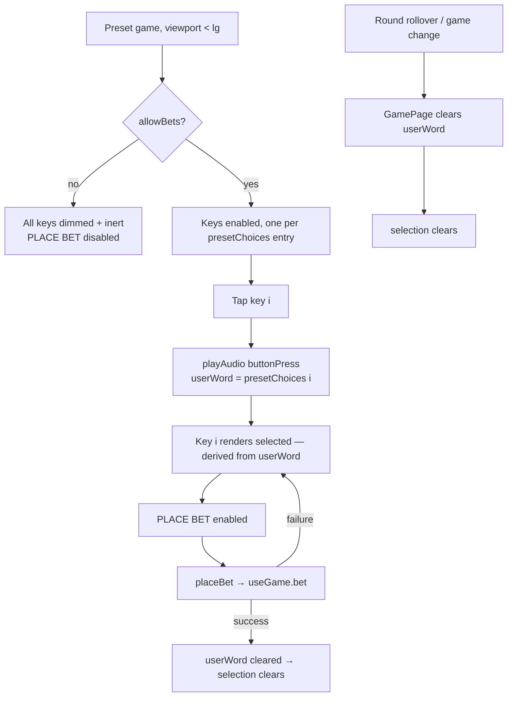

# Space Stroker — "Mobile preset keypad" — Implementation Spec

> **Status: Ready for implementation** — refined via Trello card
> [horse race mobile UI is ugly](https://trello.com/c/uJdWRk7g/94-horse-race-mobile-ui-is-ugly) (#94, 2026-07-27).
> Repos affected: **`monkify-front`** and this doc in **`monkify-meta`**. **`monkify-backend` is not touched.**
> Branch / worktree: `feature/mobile-preset-keypad` → `.worktrees/mobile-preset-keypad/<repo>`.
> Change level: **Minor change / QOL** (bug-adjacent UI fix, no new capability, no schema).
>
> **Purpose:** On a phone, a **preset-choice game** (Main's `6X Main Derby` / "Beast Mode") renders
> its picker as eight numbered pixel-art PNGs whose baked-in grey plate was drawn for the *desktop
> cabinet*. On the mobile panel they read as floating grey squares, they never show which choice is
> selected, and they hard-cap the game at 8 choices. This spec replaces that keypad with named keys
> built from the app's own arcade design system.

---

## 1. Summary

The mobile bet panel (`GameConsole.vue`, the `v-if="mobile"` branch) has two input modes:

| Game type | Today (mobile) | After this spec |
| --- | --- | --- |
| **Free-text** (`presetChoices` empty) | Masked `<input>` + native keyboard | **Unchanged** |
| **Preset choice** (`presetChoices` non-empty) | `grid-cols-4` of 8 `button<N>.png` images, label `> PICK YOUR NUMBER`, no selected state, capped at 8 | 2-column grid of **named** arcade keys built from `arcade.css`, label `> PICK YOUR CHOICE`, explicit selected state, **all N choices** |

Desktop (`≥ lg`) is untouched — it keeps the cabinet art, the lever, and the 8 PNG keys.

### 1.1 Why the current keypad looks broken

Measured, not assumed:

| Fact | Evidence |
| --- | --- |
| Each `button<N>.png` is **70×91 with an opaque light-grey plate** baked into the art | `src/assets/game/buttons/button1..8.png`; the plate colour matches the desktop cabinet (`terminal.png`), which is where it was designed to sit |
| The plate has nothing to blend into on mobile | The mobile panel is `bg-gradient-to-b from-[#20293e] to-[#161c2c]` (`GameConsole.vue:232`) — the plates read as eight grey squares floating on dark blue |
| The keys are visually **separated** | `grid-cols-4 gap-1.5` (`GameConsole.vue:252`) puts panel background between every plate |
| The two rows **don't align** | `button1.png` is 91px tall, `button3.png` is 90px; images render at natural aspect inside the grid cells |

### 1.2 Three functional defects fixed with it

1. **Nothing shows what you picked.** `selectPresetButton` sets `userWord` (`GameConsole.vue:200-203`),
   but the mobile `<input>` renders only when `!isPresetGame` (`GameConsole.vue:238-250`) and no key
   carries a selected state — `hover:brightness-125` (`:257`) never fires on touch. The player taps,
   hears `buttonPress`, and the UI is byte-identical.
2. **Hard 8-key cap.** `presetButtons` is `[...Array(8).keys()]` (`GameConsole.vue:193-198`).
   `GameParametersValidation.ValidatePresetChoices`
   (`monkify-backend/src/SpaceStroker.Domain/Games/Services/GameParametersValidation.cs:66-80`) rejects
   only empty / wrong-length / duplicate choices — there is **no maximum**, and the admin portal takes a
   free-form one-per-line textarea (`GameTypeForm.vue:83-84`, `:187-192`). An operator can create a
   12-choice game whose last four choices are unreachable. Fewer than 8 renders `opacity-50` ghost keys.
3. **Silent dead taps.** `placeBet()` with no selection (or with betting closed) calls `leverError()`
   (`GameConsole.vue:166-172`), which plays a sound at a **lever that does not exist on mobile**.

---

## 2. Constraints (MANDATORY)

From `monkify-meta/constraints.md` (full list there):

- **§2 Git — worktree per repo.** `feature/mobile-preset-keypad` lives in
  `.worktrees/mobile-preset-keypad/<repo>`; the shared checkouts stay on `main`. Push to `origin`
  right after branch work (`AGENTS.md` rule 5). Already done for `monkify-front` + `monkify-meta`.
- **§3 Tests.** No backend change ⇒ **no `SpaceStroker.Tests` change and no integration test**
  (Minor change / QOL, and there is no backend surface to exercise). `monkify-front` has **no test
  framework** — `package.json` exposes `serve` / `build` / `lint` / `lint:fix` only. Definition of done
  is `yarn lint` + `yarn build` green plus the manual QA in §13.
- **§8 Scope.** Prefer editing `GameConsole.vue` over adding a new component unless the keypad
  genuinely earns its own file (see §7.4).

Feature-specific, from the codebase:

- **Light graphics mode is always on here.** `usePerfMode` short-circuits **any viewport below `lg` to
  light mode unconditionally** (`features/light-graphics-mode.md` → resolution order, step 1). This
  keypad is therefore **always** rendered under `html.light-graphics`. It must not depend on
  `backdrop-filter`, `filter: blur()`, `mix-blend-mode`, multi-layer glows, or infinite animations —
  `arcade.css:269-337` strips all of them.
- **`arcade.css` is plain CSS, deliberately NOT in `@layer components`** (`arcade.css:9-15`) — Vue CLI's
  css-loader runs Tailwind's PostCSS plugin on each `@import`ed file standalone, where a bare
  `@layer components` has no matching `@tailwind components` directive and **fails the build**. Any new
  rule added there follows the same pattern.
- **Scoped-style trap.** If a light-mode override is ever needed for these keys, it goes in the
  `arcade.css` `html.light-graphics` block, not in a component `<style scoped>` — a
  `html.light-graphics .x {}` rule written inside a scoped block will not match
  (`features/light-graphics-mode.md` → Gotchas).
- **CRLF / prettier.** `monkify-front` lints with prettier against CRLF line endings; editing files
  with tools that rewrite endings to LF produces `Insert ␍` lint failures. Verify with `yarn lint`
  before committing.

---

## 3. Resolved product decisions

| # | Decision |
| --- | --- |
| 1 | **Scope is the mobile preset keypad only** — the `v-if="mobile"` + `isPresetGame` branch of `GameConsole.vue`. Not the terminal, not the `GAME \| CHAT` structure, not the header, not the desktop console. |
| 2 | **Drop the PNGs on the mobile path.** Keys are built from the `arcade.css` material system so they are made of the same material as the panel around them. **The PNG assets are NOT deleted** — the desktop branch still uses them. |
| 3 | **Each key shows the choice NAME**, prefixed with its 1-based index (`1 RABBIT`, `2 JAGUAR`, …). The index ties the key back to the terminal's `> CHOICES:` ordering. |
| 4 | **Render all N choices from `presetChoices`** — no cap, grid wraps. |
| 5 | **Explicit selected state.** `userWord` remains the single source of truth; the selected key is the one whose choice equals `userWord`. Exactly one key can be selected; tapping another moves the selection. |
| 6 | **Keys dim and go non-interactive when `allowBets` is false.** |
| 7 | **PLACE BET is disabled until a choice is selected** (preset games only). |
| 8 | **2 columns in portrait**; landscape phones (still `< lg`, ~740–932px) may use more columns. |
| 9 | **Label copy `> PICK YOUR NUMBER` → `> PICK YOUR CHOICE`.** Operators can create preset games with arbitrary words, so both "NUMBER" and "RUNNER" are wrong in the general case. |
| 10 | **The terminal's `> CHOICES:` list stays** on mobile and desktop, unchanged. Accepted duplication — it reads as part of the round log. |
| 11 | **`buttonPress` audio on select stays.** |
| 12 | **Long choice words clamp to one line**; the index prefix stays visible. |
| 13 | **Desktop's own 8-key cap is deliberately left in place** — lifting it means redesigning the PC console against fixed cabinet art. Separate card. |

---

## 4. Data model

**None.** No entity, column, EF mapping, or migration. `presetChoices: string[]` already ships on
`GameParametersDto` and is already consumed by `selectedGame` in `useGame.ts`.

---

## 5. Configuration

**None.** No `GeneralSettings`, no env var, no seed data, no feature flag. (`VUE_APP_*` naming applies
to this repo, but nothing new is introduced.)

---

## 6. Backend behaviour

**None.** No endpoint, DTO, handler, consumer, SignalR contract, or validation change.
`useGame.bet()` is untouched and the `POST /games/{id}/bets` body is byte-identical.

---

## 7. Frontend behaviour (`monkify-front`)

Everything below is in `src/components/game/GameConsole.vue` unless stated.

### 7.1 `presetButtons` → `presetKeys`

Replace the fixed 8-PNG computed (`:193-198`) with one derived from the data:

```ts
// Mobile keypad keys: one per configured preset choice, no cap. The desktop branch keeps its own
// 8-slot PNG keypad (`presetButtons`) because the cabinet art has exactly 8 physical button wells.
const presetKeys = computed(() =>
  (selectedGame.value?.presetChoices ?? []).map((choice, index) => ({
    choice,
    label: choice.toUpperCase(),
    index: index + 1,
  }))
);
```

`presetButtons` **stays** — the desktop template still renders it. Do not fold the two together; the
desktop path needs `require()`d image URLs and a `disabled` flag driven by the 8-slot cap, and the
mobile path needs neither.

> **Note:** `presetChoices` on the DTO is a `string[]` of the already-normalized lowercase choices —
> the same values `selectPresetButton` assigns to `userWord` and `useGame.bet()` sends. Uppercase only
> for display; never mutate the value used for comparison or submission.

### 7.2 Selection state

Selection is derived, never stored locally:

```ts
const isKeySelected = (choice: string) => userWord.value === choice;
```

This matters: `placeBet()` clears `userWord` on success (`:126`) and `GamePage.vue:61-63` clears it on
game/round change. A local `selectedIndex` ref would go stale in both cases and leave a key lit after
the bet was placed or the round rolled over.

`selectPresetButton` keeps its current body (play `buttonPress`, assign `userWord`) but must be
guarded so a disabled key is inert:

```ts
const selectPresetButton = (choiceOrIndex) => {
  if (!allowBets.value) return;   // NEW — no audio, no assignment
  playAudio(buttonPress);
  userWord.value = <choice>;
};
```

The desktop call site passes an index into `selectedGame.presetChoices[index]`; keep that signature
working, or give the mobile path its own thin caller. Either is fine — do not change desktop behaviour.

### 7.3 The keypad markup

Replace the `` grid (`:252-262`) with buttons. Shape:

```html
<div v-else class="grid grid-cols-2 gap-2 sm:grid-cols-3">
  <button
    v-for="key in presetKeys"
    :key="key.choice"
    type="button"
    :disabled="!allowBets"
    class="btn-arcade btn-arcade--sm w-full justify-start gap-2 !h-auto py-2.5"
    :class="
      isKeySelected(key.choice)
        ? 'bg-primary text-[#241400] shadow-[0_0_12px_rgba(255,162,20,0.35)]'
        : 'border-2 border-terminal-border/40 bg-terminal-darker text-terminal-light'
    "
    @click="selectPresetButton(key)"
  >
    <span class="opacity-60">{{ key.index }}</span>
    <span class="truncate">{{ key.label }}</span>
  </button>
</div>
```

This is the **shape, not the final styling** — the implementer owns the visual pass. What is
**required**:

- Real `<button type="button">` elements with `:disabled`, not ``. The current images are
  not focusable, not keyboard-operable, and expose no disabled semantics.
- **Selected vs unselected uses the app's existing mobile idiom**: `GameMobileTabs.vue:17-21` already
  establishes it — active is `bg-primary text-[#241400]` with an amber glow, inactive is muted
  (`text-[#9aa4bb]` / `text-terminal-light`) on `bg-terminal-darker`. Reuse it so the keypad and the
  segmented control above it read as one system.
- **Disabled** = reduced opacity + `cursor-not-allowed` + no hover/active transform. Reuse the existing
  `opacity-50 !cursor-not-allowed` convention already in the file (`:257`).
- The label truncates to one line (`truncate` / `overflow-hidden text-ellipsis whitespace-nowrap`) and
  the index never truncates.
- Grid is **2 columns** at phone widths. A wider mobile viewport (landscape, `sm:` = 640px and up, still
  below `lg`) may go to 3 columns — verify against the longest configured choice, not against `rabbit`.
- `key` on the `v-for` is the **choice string**, not the image URL (`:255` currently keys on `btn.img`).

**Light-mode compatibility.** `.btn-arcade` is already handled by `arcade.css:311-317` (its
multi-layer shadow collapses to a flat edge in light mode) and `.btn-arcade`'s only animation is a
press transition, frozen under reduced motion (`arcade.css:241-245`). Reusing that class is therefore
the safe default. If a custom key surface is built instead, it must add no `backdrop-filter`, `blur()`,
`mix-blend-mode`, or infinite animation — see §2.

### 7.4 New component or not?

Keep it in `GameConsole.vue` if the markup stays roughly the block above. Extract
`components/game/GamePresetKeypad.vue` **only** if the visual pass grows past ~40 lines of template +
class logic; `GameConsole.vue` is already 390 lines and carries both layouts. If extracted, it takes
`presetChoices`, `modelValue` (the selected choice) and `disabled` as props and emits
`update:modelValue` — it must not import `useGame` itself, so the desktop path stays unaffected.

### 7.5 Label copy

`:234-236` — `isPresetGame ? '&gt; PICK YOUR CHOICE' : '&gt; YOUR CHOICE'`. The free-text branch is
unchanged.

### 7.6 PLACE BET gating

`:276-287`. The mobile action button currently always renders enabled. Add, for preset games only:

```ts
const canPlaceBet = computed(() => {
  if (gameInstance.value?.status === GameStatus.RewardForWinnersCompleted) return true; // NEXT ROUND
  if (!allowBets.value) return false;
  if (isPresetGame.value) return !!userWord.value;
  return true;   // free-text: unchanged — the existing placeBet() guards still apply
});
```

Bind `:disabled="!canPlaceBet"` plus a dimmed class. **Do not** change `placeBet()`'s internal guards —
they remain the authority (and the desktop lever still relies on them). This is an affordance, not a
new validation.

> Deliberate asymmetry: free-text games keep today's behaviour (button always enabled, `placeBet()`
> rejects a short/duplicate word). Gating those on input validity is a different change and is out of
> scope.

### 7.7 What must not change

- The desktop branch (`:302-371`) — cabinet, input, keyboard image, lever, 8-PNG keypad.
- `src/assets/game/buttons/button1..8.png` — kept, still `require()`d by the desktop path.
- `GameTerminal.vue` — the `> CHOICES:` list (`:497-503`) stays exactly as-is.
- The wallet affordances: `showMobileConnect` / CONNECT WALLET (`:266-275`) and the embedded
  popup-blocked retry (`:290-297`) keep their behaviour and position.
- `useGame.ts`, `mainService.ts`, `types/index.ts` — no change.

---

## 8. Flow diagram



---

## 9. Out of scope

- **Desktop's 8-key cap.** The PC console's 8 PNG slots are positioned against the fixed
  `terminal.png` cabinet art; lifting the cap there is a desktop console redesign. **Own card.**
- Trello **#95** "weird behavior with mobile scroll in game page" — separate defect on the same screen.
- The terminal panel, `> POT:`, the `FREE BET MODE (DEV)` row, the header, and the `GAME | CHAT`
  segmented control.
- Per-choice creature artwork (rejected at refinement: preset choices are operator-configurable free
  text, so arbitrary words would have no art).
- The free-text `<input>` / native-keyboard path, including any input-validity gating of PLACE BET.
- Deleting or re-cutting the `button1..8.png` assets.
- Any backend change, including adding a maximum to `PresetChoices`.

---

## 10. File checklist

### 10.1 Backend (`monkify-backend`)

**None** — the repo is not touched and no branch was created there.

### 10.2 Frontend (`monkify-front`)

| # | File | Change |
| --- | --- | --- |
| 1 | `src/components/game/GameConsole.vue` | `presetKeys` computed from `presetChoices` (all N); mobile keypad markup → named `<button>` keys with selected/disabled states; `selectPresetButton` guarded on `allowBets`; label → `> PICK YOUR CHOICE`; `canPlaceBet` gating on the mobile action button. Desktop branch untouched. |
| 2 | `src/components/game/GamePresetKeypad.vue` | *(optional, §7.4)* extracted keypad — props `presetChoices` / `modelValue` / `disabled`, emits `update:modelValue`; no `useGame` import. |
| 3 | `src/assets/styles/arcade.css` | *(only if needed)* a light-mode override for a bespoke key surface — plain CSS, not `@layer components`. Not required if `.btn-arcade` is reused. |

### 10.3 Meta (`monkify-meta`)

| # | File | Change |
| --- | --- | --- |
| 1 | `specs/mobile-preset-keypad.md` | This spec. |
| 2 | `INDEX.md` | Spec row + "Feature currently in flight". |
| 3 | `features/mobile-layout.md` | *(at ship time)* update the "GAME view = full-width fluid terminal + compact bet panel" bullet — the "themed preset keypad" is now named, uncapped keys, and add a `GamePresetKeypad.vue` touchpoint if extracted. |

---

## 11. Unit tests

**None.** `monkify-front` has no test framework (`package.json` exposes `serve` / `build` / `lint` /
`lint:fix` only) and `monkify-backend` is not touched, so there is nothing to add to
`SpaceStroker.Tests`. Adopting a frontend test framework is its own decision and is not a rider on this
card.

**Definition of done:** `yarn lint` and `yarn build` green, plus §13.

---

## 12. Acceptance criteria

Copied 1:1 from the Trello **Acceptance Criteria** checklist (#94).

1. Given a preset-choice game on a viewport below `lg` (1024px), when the bet panel renders, then the picker is built from `arcade.css` elements and no `button1..8.png` image is present in the mobile branch.
2. Given a preset game on mobile, when the keypad renders, then every key shows its 1-based index and its choice name from `presetChoices` (e.g. "3 FALCON"), matching the order of the terminal's `> CHOICES:` list.
3. Given a preset game with 12 choices on mobile, when the keypad renders, then 12 keys are rendered and every one is selectable (the `[...Array(8)]` cap is gone).
4. Given a preset game with 5 choices on mobile, when the keypad renders, then exactly 5 keys are rendered and no dimmed `opacity-50` placeholder keys appear.
5. Given no choice is selected, when the player taps a key, then that key takes a visually distinct selected state, `userWord` equals that choice, and no other key appears selected.
6. Given a choice is already selected, when the player taps a different key, then the selected state moves to the new key and `userWord` equals the new choice.
7. Given a bet is placed successfully (or the round rolls over and `GamePage` clears `userWord`), when the keypad re-renders, then no key shows the selected state.
8. Given the game status is neither `WaitingBets` nor `GameStarting`, when the keypad renders on mobile, then all keys are visibly dimmed and tapping one neither changes `userWord` nor plays the button audio.
9. Given a preset game on mobile with no choice selected, when the panel renders, then PLACE BET is visibly disabled and tapping it does not call `bet()` (no silent dead tap).
10. Given a phone in portrait, when the keypad renders, then keys are laid out 2 per row, evenly sized and flush to a single keypad surface — no light-grey plates floating on the panel gradient.
11. Given a phone in landscape (still below `lg`, ~740-932px wide), when the keypad renders, then the keys fill the row width without stretching to disproportionate widths.
12. Given light graphics mode is active (`html.light-graphics` — always true on mobile), when the keypad renders, then no key uses `backdrop-filter`, `blur()`, or an infinite animation, and the keypad looks identical to normal mode.
13. Given a preset choice word longer than the key width, when the key renders, then the label clamps to one line and the index prefix stays visible (no wrap that breaks the grid, no overflow).
14. Given a preset game on mobile, when the picker label renders, then it reads `> PICK YOUR CHOICE` (not `> PICK YOUR NUMBER`), and free-text games still read `> YOUR CHOICE`.
15. Given a free-text (non-preset) game on mobile, when the bet panel renders, then the masked choice input and native-keyboard path are unchanged and no keypad appears.
16. Given a viewport at or above `lg`, when the desktop console renders, then the preset keypad, cabinet art, lever, and input are pixel-identical to before this card (the `button1..8.png` assets remain in the repo and in use).
17. Given a preset game where another player already bet on a choice, when the keypad renders, then that key stays fully selectable (choice exclusivity applies to free-text games only).
18. Given a preset `SolanaToken` game on mobile with no wallet, when the panel renders, then the CONNECT WALLET affordance and the embedded popup-blocked retry button keep their current behavior and position, and a selected choice survives the wallet flow.
19. Given a preset game, when the terminal renders on mobile or desktop, then the `> CHOICES:` list is still printed unchanged (`GameTerminal.vue` untouched by this card).

---

## 13. Manual QA

Verification is manual — there is no frontend test suite.

1. Bring up the local stack (`monkify-backend`: `docker compose up -d --build`; API on `:6001`).
2. **Copy the hub's gitignored files into the worktree before serving** — a fresh worktree has neither:
   `cp monkify-front/.env.local monkify-front/yarn.lock .worktrees/mobile-preset-keypad/monkify-front/`.
   Without `.env.local`, `VUE_APP_API_BASE_URL` is undefined, every API call 404s against the dev
   server's own origin, and the game reads as "unavailable". Serve on a spare port
   (`yarn serve --port 8081`) so it doesn't fight the hub.
3. Open the game in a phone viewport (DevTools device emulation is enough for layout; confirm the
   **selected state on a real touch device** — `hover:` styles lie in emulation).
4. Pick the preset "horse race" type (`6X Main Derby` / Beast Mode). Verify AC 1, 2, 5, 6, 10, 14.
5. Tap a key, place a free bet, confirm the selection clears (AC 7) and the bet lands on the chosen
   animal in `> BETS PLACED:`.
6. Wait for the round to start; confirm keys dim and PLACE BET is disabled (AC 8, 9).
7. Rotate to landscape; confirm the grid still reads well (AC 11).
8. In the admin portal (`/space-stroker/admin`), create a preset type with **12** choices and one with
   **5**; confirm AC 3 and 4, and that a long choice word truncates (AC 13).
9. Load a free-text type (e.g. `6X Main Sprint`) on the same viewport; confirm the input path is
   unchanged (AC 15).
10. Resize past `lg`; confirm the desktop console is unchanged (AC 16).
11. `yarn lint` + `yarn build` green.

---

## 14. Trello / pipeline

- **Source card:** [#94 horse race mobile UI is ugly](https://trello.com/c/uJdWRk7g/94-horse-race-mobile-ui-is-ugly)
  — list **Specs created**; the **Implementation** section on the card carries branch, worktree, spec path.
- **Next:** `/monkify-implement-feature horse race mobile UI is ugly`
- **Then:** `/monkify-ship-feature horse race mobile UI is ugly` (syncs the KB, merges to `main`).

---

## 15. Revision log

| Date | Change |
| --- | --- |
| 2026-07-27 | Initial spec from refined card #94 (refinement + spec written in the same session). |
