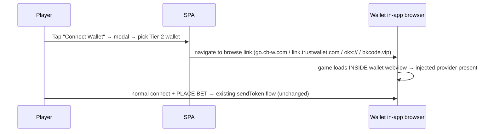

# SpaceStroker — "In-place mobile wallet connect (single-modal, multi-wallet deeplink)" Feature — Implementation Spec

> **Status: SHIPPED** — merged via `feature/mobile-wallet-connect` on 2026-07-25 (distilled in
> `../features/mobile-wallet-connect.md`). Refined via Trello card
> [\[FRONT\] Connect wallet doesn't work on mobile](https://trello.com/c/Csb9U6bn) (2026-07-24);
> **redesigned 2026-07-24**, then adjusted during **device QA (2026-07-25)** — see §15. Repos affected:
> `monkify-front` (all code) and this doc in `monkify-meta`. **No `monkify-backend` change.**
>
> **As-shipped note (read this before §3 decisions 13/14):** two spec-time ideas were **not** shipped —
> the `intent://` Android redirect (decision 13; it breaks Phantom's response-param append) and the
> automatic blockhash **re-sign** hop (decision 14). What shipped instead: the Android new tab is
> **accepted as unavoidable** and made harmless, the modal offers a **connect-method toggle** (in-place
> deeplink *vs* open-in-wallet-browser) with an **Android new-tab disclaimer**, an **in-app-browser
> auto-connect**, a **blockhash-expiry clean-retry message**, the **balance/identity read the effective
> wallet**, and the sign-resume **waits for the live `/Bets` stream** before submitting. See the §15
> device-QA entry for the full list; the `features/` doc describes current behaviour.
>
> **Purpose:** Let a player on **standalone mobile web** connect a Solana wallet **in place** and fund a
> `SolanaToken` bet without being dumped out of the game into the wallet app's in-app browser. The player
> stays in their normal mobile browser (Safari/Chrome); a wallet action only ever causes a **brief hop** to
> the wallet app to approve, after which the browser returns to the **same game and session** and the bet
> resumes automatically.

---

## 1. Summary

Today the **only** way to fund a `SolanaToken` bet on standalone mobile web is the shipped
[`mobile-layout`] affordance: an "OPEN IN WALLET APP" button that fires a Phantom **universal link**
(`https://phantom.app/ul/browse/<page>`) which **relaunches the whole page inside Phantom's in-app
browser** (`utils/walletDeepLink.ts` → `openInWalletApp`). It works, but it yanks the player out of the
game, Solflare is never wired, and there is no in-place connect. There is **no** Mobile Wallet Adapter and
**no** WalletConnect anywhere in the repo.

This feature adds each wallet's **official mobile deeplink protocol** with the required encrypted `x25519`
handshake, implemented with **`tweetnacl`** (already a dependency). The player stays in their browser; the
wallet app opens only to approve **connect** and **sign**, then redirects back. It ships as a **single
"Connect Wallet" button → one wallet-picker modal** with two honest tiers:

- **Tier 1 — stay in your browser (native deeplink):** **Phantom, Solflare, Backpack**. All three publish the
  *same* `x25519`/session encrypted-deeplink protocol, so **one adapter covers all three** (swap base host +
  response param prefix). This is the premium path: brief hop to approve, land back on the same page.
- **Tier 2 — open in the wallet's app (one-tap browse link):** **Coinbase Wallet, Trust Wallet, OKX Wallet,
  Bitget Wallet**. These wallets have **no** stay-in-browser signing protocol, but each exposes a
  constructable "open this URL in my dApp browser" deeplink, so the game opens *inside* the wallet's webview
  where the existing injected-provider flow (`sendToken`) runs unchanged. This is exactly what the big Solana
  apps (pump.fun / Jupiter / Magic Eden) actually rely on.

| | Today (shipped `mobile-layout`) | This feature |
| --- | --- | --- |
| Connect on mobile | none — page is relaunched inside Phantom's in-app browser | **in-place** (Tier 1): `connect` deeplink → approve → return to same page |
| Entry UI | single hardcoded "OPEN IN WALLET APP" | **single "Connect Wallet" button → one modal** (2 tiers) |
| Wallets | Phantom only (hardcoded) | **Tier 1:** Phantom, Solflare, **Backpack**. **Tier 2:** Coinbase, Trust, OKX, Bitget |
| Signing | happens inside the in-app browser via `sendToken` | **`signAllTransactions` deeplink → we self-broadcast** (Tier 1); in-app-browser `sendToken` unchanged (Tier 2) |
| Stays in the player's browser? | **no** | **yes** for Tier 1 (brief hop only); Tier 2 explicitly labeled "opens in the app" |
| Session | n/a | persists in `localStorage` until Disconnect; repeat bets = **one** sign hop |
| Fallback | — | Tier-1 wallet not installed / protocol fails → its own **browse link + store link**, clearly labeled |
| Backend | unchanged | **unchanged** |

The deeplink **return is a full page navigation** (and on Android Chrome frequently a **brand-new tab**), so
the crux of the work is a **reload-surviving** pending-hop record (persisted in `localStorage` before every
hop) plus **auto-resume** on boot, and surfacing the deeplink session as the app's **effective
`publicKey` / `connected`** so the existing bet gate and identity UI work unchanged. This mirrors the
existing **embedded popup** branch (`useGame.bet()` + `useEmbeddedWallet`) — a parallel "acquire signature
out-of-band" path — so the change fits the established shape rather than rebuilding the bet flow.

[`mobile-layout`]: ../features/mobile-layout.md

---

## 2. Constraints (MANDATORY)

From `monkify-meta/constraints.md` (full list there):

- **Worktree-per-repo:** work lives in `.worktrees/mobile-wallet-connect/<repo>`; the shared checkout of
  each repo stays on `main` (hub). Branch `feature/mobile-wallet-connect` in `monkify-front` **and**
  `monkify-meta` (both already created + pushed).
- **Frontend-only feature → no backend integration test applies.** There is **no backend surface** (bet
  POST, `/rpc` proxy, on-chain settlement all unchanged), and the happy path needs a real device + wallet
  app, so — as with the shipped `mobile-layout` and `iframe-crypto-games` frontend-only features — **no
  `SpaceStroker.Tests.Integration` test is added**. Verify via frontend/device QA (§13). A dedicated
  `features/mobile-wallet-connect.md` KB doc is still created at ship.
- **Unit tests (frontend):** pure protocol/util logic (deeplink URL building for both tiers, x25519
  encrypt/decrypt round-trip, pending-hop (de)serialization, mobile-context detection, blockhash-expiry
  check) is unit-testable and **must** be covered *if a runner exists*; UI/redirect flows are covered by
  manual device QA (§11, §13). **Note:** `monkify-front` has **no test runner** today — see §11 for the
  decision.
- **No new npm dependency.** The Docker local-stack build runs `yarn install --frozen-lockfile`; adding a
  dep breaks it. base58 is **inlined** in the protocol util; `tweetnacl` (already present) does x25519. Do
  **not** add `bs58`.
- **Secrets/config:** any `.env`/`.env.example` values are **mock/placeholder** only. No real keys. The
  dapp `x25519` keypair is **ephemeral and generated at runtime** — it is **not** a secret to commit and is
  **not** the user's wallet key.
- **Operator messaging:** all new copy (connecting, cancel/error, round-changed, disconnect, not-installed)
  stays **vague** — never reveal operator/contract status.
- **Frontend conventions:** composables in `src/hooks`, utils in `src/utils`, types in `src/types`; env
  vars are **`VUE_APP_*`** (this repo has **not** migrated to `VITE_*`).

---

## 3. Resolved product decisions

| # | Decision |
| --- | --- |
| 1 | **Target UX = brief round-trip.** A momentary switch to the wallet app to approve, then auto-return to the **same** game + session, is the desired behavior. The pain to remove is being dumped into the wallet's in-app browser. |
| 2 | **Approach = native wallet deeplink protocols** with an encrypted `x25519` handshake via **`tweetnacl`**. **WalletConnect rejected** (needs a cloud project ID + relay; documented Solana mobile wallet-detection bugs; weaker Phantom-Solana support than native deeplinks). **Mobile Wallet Adapter rejected** (Android-only; requirement is iOS **and** Android). Mechanism kept **fully self-contained** (no third-party relay/service). |
| 3 | **Platforms = iOS + Android** (both tiers, both OSes). |
| 4 | **Wallets — two tiers.** **Tier 1 (native deeplink, stay in browser): Phantom, Solflare, Backpack** — the only three Solana wallets that publish the encrypted signing-deeplink protocol; one adapter, per-wallet base host + response param prefix. **Tier 2 (one-tap "open in app" browse link): Coinbase Wallet, Trust Wallet, OKX Wallet, Bitget Wallet** — no stay-in-browser protocol, but each has a constructable dApp-browser deeplink; the game opens inside the wallet's webview and the existing injected-provider `sendToken` flow runs unchanged. **Dropped: Glow, Ultimate, Exodus** (reachable only via WalletConnect, which is rejected — not shown, to avoid dead buttons). |
| 5 | **Single entry UI = one "Connect Wallet" button → one wallet-picker modal**, replacing per-wallet buttons. The modal groups Tier 1 (labeled "approve & come right back") above Tier 2 (labeled "opens inside the app"). Phantom is the default/first. |
| 6 | **Scope = standalone mobile web only.** Mobile **inside an iframe** (embedded) is **out of scope** and keeps the existing same-origin popup bridge. |
| 7 | **Session persists until disconnect** (`localStorage`): shared secret + wallet pubkey + wallet session token + ephemeral dapp keypair. Repeat bets need only **one** sign hop. Sessions from Phantom/Solflare/Backpack **do not expire**, so a returning player is already connected. A mobile **Disconnect** clears it. A stale/invalid session self-heals (prompt reconnect) rather than dead-ending. |
| 8 | **All mobile connect entry points route to the same modal + one shared session** — the header wallet button, the bet-panel connect, and the customization modal's "Connect wallet to customize" gate. |
| 9 | **Reload-surviving resume:** persist a pending-**hop** record in `localStorage` (not `sessionStorage` — a new Android tab can't read `sessionStorage`) before each hop and auto-resume on boot; the player lands back exactly where they were. |
| 10 | **Round-changed guard runs BEFORE broadcast.** Because Tier 1 uses `signAllTransactions` and **we self-broadcast**, on return we hold the *signed but unsent* tx. If the intended round ended/rolled over during the hop, we **do not broadcast** and never move the player's funds for a dead round — abort + clear + plain message. (This is strictly better than the deprecated `signAndSendTransaction`, where the wallet broadcasts before we can check.) |
| 11 | **Unified effective wallet state:** the deeplink session surfaces through the same `publicKey` / `connected` the app reads today (from `solana-wallets-vue`), so the bet gate (`walletGateBlocks`), `YOU`/recent-bets/winner identity, and the wallet-keyed customization name work identically to a desktop extension connection. |
| 12 | **Sign method = `signAllTransactions` (single-element) + self-broadcast.** The wallet **signs only**; we broadcast via a new `useConnection.broadcastSignedTransaction` (keeps the 429-failover) and confirm on the public connection. **`signAndSendTransaction` is rejected** — it is **officially deprecated** and **fails on devnet** (`-32601`/internal error; mainnet-only), and our dev env is devnet. The SPL transfer tx is still **built in-page** by reusing `sendToken`'s idempotent-ATA + transfer + optional priority-fee + integer amount math. |
| 13 | **Android stray-tab mitigation:** use an **`intent://` redirect** for the `redirect_link` on Android (Chrome/Samsung Internet resolve it in place instead of opening a stray tab), and make the return route **self-healing** so even a duplicate/new tab lands on the correct game (connected via the persisted session) rather than a dead connect screen. iOS returns to the same Safari tab natively. |
| 14 | **Blockhash staleness:** fetch the blockhash **as late as possible** (right before the sign hop); on return, check block height vs `lastValidBlockHeight` and if expired, **rebuild + re-sign (one more hop)** rather than broadcasting a dead tx. Durable nonces are noted as a future hardening option, **not** built now (extra rent-funded nonce account). |

---

## 4. Data model

**No backend data model change.** No entity, EF mapping, migration, DTO, or SignalR contract is added or
altered. The bet POST body is unchanged (`{ amount, choice, paymentSignature, wallet, seed, nonce }`, per
`useGame.submitBet`), carrying the same `X-Launch-Token` header.

### 4.1 Client-side persisted shapes (new — `localStorage`, not server state)

Two new client-only records (proposed `src/types/mobileWallet.ts`):

```ts
export type Tier1Wallet = 'phantom' | 'solflare' | 'backpack';   // native deeplink signing
export type Tier2Wallet = 'coinbase' | 'trust' | 'okx' | 'bitget'; // in-app-browser browse link

// Persisted for the life of a mobile wallet session (localStorage key e.g. "swMobileWalletSession").
export interface MobileWalletSession {
  walletApp: Tier1Wallet;         // only Tier-1 wallets create a persisted deeplink session
  walletPublicKey: string;        // base58 — the connected wallet address
  session: string;                // opaque session token returned by the wallet on connect
  sharedSecretB58: string;        // base58 x25519 shared secret (nacl.box.before)
  dappSecretKeyB58: string;       // base58 ephemeral dapp x25519 secret key (NOT a wallet key)
  dappPublicKeyB58: string;       // base58 ephemeral dapp x25519 public key
  connectedAt: number;            // epoch ms
}

// Persisted immediately BEFORE each deeplink hop so the bet survives the redirect/reload/new-tab
// (localStorage key e.g. "swMobileWalletPendingHop").
export interface MobilePendingHop {
  phase: 'connect' | 'sign';      // what we hopped out to do
  walletApp: Tier1Wallet;
  dappSecretKeyB58: string;       // ephemeral dapp secret — REQUIRED to decrypt the return; must survive a new tab
  returnTo: {                     // where to land after the hop (self-healing route target)
    parametersId: string;         // game-type id (to re-resolve the active round on return)
    gameId: string;               // the specific round the player intended to bet on
    path: string;                 // the exact game route to restore
  };
  // present only for phase 'sign':
  bet?: {
    choice: string;
    amount: number;               // token-native units
    seed: string;                 // provably-fair seed derived BEFORE the hop (do NOT re-derive on resume)
    nonce: number;                // provably-fair nonce (already advanced — persist so it isn't advanced twice)
    receiver: string;             // tokenReceiverPublicKey
    mint: string;                 // tokenMintAddress
    network: string;              // VUE_APP_SOLANA_NETWORK
  };
  createdAt: number;              // epoch ms — a hop older than STALE_HOP_MS is discarded on boot (silent-abandon safety)
}
```

> **Provably-fair note:** the seed/nonce come from `useClientSeed().nextBetSeed()`, which **advances the
> nonce**. Derive them **once** before the sign hop and persist them in `MobilePendingHop.bet` so the
> resume path reuses the same `{ seed, nonce }` and never double-advances. (See [`provably-fair-final`].)

> **Self-heal / silent-abandon:** `handleDeeplinkReturn` is **idempotent** and clears the pending hop on
> success, error, or staleness. A pending hop with `createdAt` older than `STALE_HOP_MS` (a few minutes) is
> discarded on boot instead of resumed.

[`provably-fair-final`]: ../features/provably-fair-final.md

---

## 5. Configuration

No **required** new env var. Optional, add to `monkify-front/.env.example` (mock values only) **only if**
the implementer needs an explicit dapp identity / redirect base rather than deriving them from
`window.location`:

- `VUE_APP_WALLET_DEEPLINK_APP_URL` — the `app_url` metadata shown by the wallet on connect (default
  `window.location.origin`).
- `VUE_APP_WALLET_DEEPLINK_REDIRECT_BASE` — base for `redirect_link` (default `window.location.origin` +
  the return route).

Reuses existing vars unchanged: `VUE_APP_SOLANA_NETWORK` (cluster passed to the deeplinks),
`VUE_APP_SOLANA_RPC_URL` / `VUE_APP_SOLANA_PROXY_URL` (blockhash + broadcast + confirmation via the existing
`useConnection` failover), `VUE_APP_SOLANA_PRIORITY_FEE_MICROLAMPORTS`.

---

## 6. Backend behaviour

**None.** This feature adds no controller, handler, consumer, endpoint, header, migration, or settlement
change. The bet POST and the `/rpc` proxy behave exactly as today; on-chain signature validation and the
existing refund/settlement path are unchanged (relevant to §6.5).

### 6.5 Money-path note

Tier 1 self-broadcasts, and the **round-changed guard runs before broadcast** (decision 10), so a bet that
loses its round during the hop **never spends** — nothing is broadcast, no refund needed. The only residual
money-in-flight case is a round that ends in the sub-second window *after* we broadcast but *before* the bet
POST confirms; that is identical to today's desktop/embedded risk and the existing backend refund path
(unchanged) handles it. Tier 2 (in-app browser) is byte-for-byte today's `sendToken` path.

---

## 7. Frontend behaviour

### 7.1 New: the wallet deeplink protocol util (`src/utils/mobileWalletProtocol.ts`)

Pure, framework-free functions (unit-testable). Covers **both tiers**.

**Tier 1 — encrypted signing deeplinks (Phantom / Solflare / Backpack).** All three share the same shape;
keep one module keyed by a per-wallet base host + response param prefix:

| Wallet | Base | Connect-return pubkey param |
| --- | --- | --- |
| Phantom | `https://phantom.app/ul/v1` | `phantom_encryption_public_key` |
| Solflare | `https://solflare.com/ul/v1` | `solflare_encryption_public_key` |
| Backpack | `https://backpack.app/ul/v1` | `backpack_encryption_public_key` |

**Encryption (via `tweetnacl` + inlined base58):**
- `nacl.box.keyPair()` → the **ephemeral dapp** `x25519` keypair (public key sent to the wallet).
- On the wallet's response, derive the shared secret: `nacl.box.before(walletEncryptionPubKey, dappSecretKey)`.
- Decrypt response payloads: `nacl.box.open.after(ciphertext, nonce, sharedSecret)` → JSON.
- Encrypt request payloads (for `signAllTransactions`): `nacl.box.after(message, nonce, sharedSecret)`.
- Base58 encode/decode is **inlined** in this module (no `bs58` dependency).

**Connect deeplink (no payload):**
```
<base>/connect?app_url=<app>&dapp_encryption_public_key=<b58>&redirect_link=<enc>&cluster=<network>
```
Response params appended to `redirect_link`: `<wallet>_encryption_public_key`, `nonce`, `data` →
decrypt `data` → `{ public_key, session }`.

**Sign deeplink (encrypted payload) — `signAllTransactions`:**
```
<base>/signAllTransactions?dapp_encryption_public_key=<b58>&nonce=<b58>&redirect_link=<enc>&payload=<enc>
payload (before encryption) = { session, transactions: [ <base58 serialized UNSIGNED tx> ] }
```
Response params: `nonce`, `data` → decrypt → `{ transactions: [ <base58 SIGNED tx> ] }` (one element). The
wallet does **not** broadcast; we do (§7.3). On user reject/error the wallet appends `errorCode` /
`errorMessage` instead — treat as a generic failure (never surface raw wallet text).

**Tier 2 — one-tap "open in wallet browser" links (no protocol, no session):**

| Wallet | Browse-link format |
| --- | --- |
| Coinbase Wallet | `https://go.cb-w.com/dapp?cb_url=<enc-url>` |
| Trust Wallet | `https://link.trustwallet.com/open_url?url=<enc-url>` |
| OKX Wallet | `okx://wallet/dapp/details?dappUrl=<enc-url>` |
| Bitget Wallet | `https://bkcode.vip?action=dapp&url=<enc-url>` |

Opening one navigates the user into that wallet's in-app browser on the current game URL, where the
injected provider exists and `sendToken` works unchanged (same as today's `openInWalletApp`, generalized).

⚠️ **The in-app browser is a different browsing context with its own `localStorage`** — anything the
SPA stashed in the player's normal browser does **not** travel with them. Whatever the fresh context
needs has to ride on the **URL**. Today that is the referral code: `openInWalletBrowser` passes the
target through `walletDeepLink.withReferral()`, which re-appends `?ref=<code>` (see
[`referral-program.md`](referral-program.md) §7.2a) because referral capture has already stripped it
from the address bar. Anything future that is stashed pre-connect and needed post-connect has the
same problem and needs the same treatment.

**`redirect_link` builder (Tier 1):** builds the return URL to the self-healing return route; on Android,
emits the **`intent://`** form (decision 13).

Exported helpers (names indicative):
`buildConnectDeeplink(walletApp, { dappPublicKeyB58, redirectLink, appUrl, cluster })`,
`parseConnectReturn(walletApp, params, dappSecretKeyB58)` → `{ walletPublicKey, session, sharedSecretB58 }`,
`buildSignAllDeeplink(walletApp, { dappPublicKeyB58, sharedSecretB58, session, txBase58, redirectLink })`,
`parseSignReturn(params, sharedSecretB58)` → `{ signedTxBase58 }`,
`buildBrowseLink(tier2Wallet, url)`,
`detectDeeplinkReturn(params)` → `'connect' | 'sign' | 'error' | null`.

### 7.2 New: `src/hooks/useMobileWallet.ts` (module-scope singleton, mirrors `useConnection`/`useEmbeddedWallet`)

Owns the mobile deeplink session and the reload-surviving flow.

- **State:** `mobilePublicKey` (ref<string|null>), `mobileConnected` (computed), hydrated from
  `MobileWalletSession` in `localStorage` on first use.
- **`isMobileDeeplinkContext()`** — synchronous: `isMobileBrowser() && !isEmbedded && wallet.readyState !==
  Installed` (a real mobile browser with no injected provider, not in an iframe). Drives whether the mobile
  flow (vs desktop adapter / embedded popup) is used.
- **`connect(tier1Wallet)`** — generate the ephemeral dapp keypair, persist the `MobilePendingHop`
  (phase `connect`, incl. `dappSecretKeyB58` + `returnTo`), build the connect deeplink with
  `redirect_link` = the self-healing return route, and `window.location.href = link` (the hop).
- **`openInWallet(tier2Wallet)`** — Tier 2: build the browse link for the current game URL and navigate
  (the in-app-browser path). No session is created; the wallet's webview handles connect + sign via the
  normal injected-provider flow.
- **`signViaDeeplink({ txBase58, bet })`** — persist the `MobilePendingHop` (phase `sign`, incl. the bet),
  build the `signAllTransactions` deeplink, hop.
- **`disconnect()`** — clear the session + pending record from storage; reset refs.
- **`handleDeeplinkReturn()`** — called at app boot (§7.6): read the stashed return params (captured in
  `main.ts` before the router, §7.6); if a **connect** return → finalize + persist `MobileWalletSession`,
  strip params, **resume** the pending flow; if a **sign** return → decrypt the signed tx, run the
  **round-changed guard**, **broadcast** (§7.3), confirm, resume `submitBet`; if an **error** return → clear
  pending + show the generic message; if a **stale/duplicate** load with no valid pending hop → route to the
  saved game (self-heal) and no-op.
- **Blockhash re-check (sign return):** before broadcasting, check block height vs the signed tx's
  `lastValidBlockHeight`; if expired, discard the signed tx, rebuild a fresh unsigned tx, and re-fire the
  sign hop once (decision 14).
- **Effective wallet exposure:** export `effectivePublicKey` / `effectiveConnected` that OR the adapter's
  `publicKey`/`connected` with the mobile session, so consumers can read one source (§7.5).

### 7.3 `src/hooks/useConnection.ts` — tx builder seam + self-broadcast

- New `buildTransferTransaction(toPubkey, tokenAddress, value, feePayer)` → `{ tx: Transaction,
  latestBlockHash }` containing the current body of `sendToken` up to and including setting
  `recentBlockhash` + `feePayer` (idempotent ATA creation for sender+receiver, optional priority fee,
  transfer, integer `toBaseUnits`, blockhash via `withFailover`). **`feePayer` = the connected wallet
  pubkey** (adapter `publicKey` on desktop, `mobilePublicKey` on mobile).
- New `broadcastSignedTransaction(signedTx)` → `signature` — `sendRawTransaction` via the existing failover
  (keeps 429 handling), then `confirmTransaction` on the primary/public connection. This is the self-broadcast
  used by the Tier-1 sign path.
- `sendToken` keeps its current behaviour by calling `buildTransferTransaction` then signing/sending as it
  does today (desktop/embedded and the Tier-2 in-app-browser path byte-for-byte unchanged).
- The Tier-1 path calls `buildTransferTransaction`, serializes the unsigned tx
  (`tx.serialize({ requireAllSignatures: false })` → base58), hands it to the `signAllTransactions` deeplink,
  and on return **broadcasts + confirms** via `broadcastSignedTransaction`.

### 7.4 `src/hooks/useGame.ts` — mobile branch in `bet()` + resume

Add mobile branches alongside the existing standalone (`sendToken`) and embedded (popup) branches in the
`PaymentMethod.SolanaToken` block (around `useGame.ts:413-478`):

```
if (isMobileDeeplinkContext() && !mobileConnected) → persist pending(phase 'connect'); connect(tier1Wallet); return  // hop
if (isMobileDeeplinkContext() &&  mobileConnected) → build unsigned tx; persist pending(phase 'sign'); signViaDeeplink(...); return  // hop
```
(Tier-2 "open in app" is fired from the modal, not `bet()` — it reloads into the wallet's browser where the
normal `bet()`→`sendToken` path runs.)

The function **returns** after firing a hop (the page navigates away). The **resume** logic — invoked by
`handleDeeplinkReturn()` on boot — reconstructs `submitBet(gameId, choice, { amount, choice,
paymentSignature: signature, wallet: mobilePublicKey, seed, nonce })` from the persisted `MobilePendingHop`,
**after the round-changed guard and broadcast**. Back the stash with `localStorage` (survives reload/new tab)
rather than an in-memory ref.

**Round-changed guard (on sign resume, BEFORE broadcast):** re-resolve the active round for `parametersId`;
if the active `gameId` differs or the round no longer accepts bets, **do not broadcast** — clear the pending
record and set a plain message ("That round ended before your bet went through — nothing was charged"). No
money moves. For a **connect** resume, no money is involved — clean re-entry only.

### 7.5 Effective wallet identity — one read for gate + identity

Today `GameConsole.walletGateBlocks` (`GameConsole.vue:67-68`) blocks `placeBet` when
`requiresWallet && !connected && !isFreeBetActive && !isEmbedded`, and identity UI keys off adapter
`publicKey`. Relax/extend both to the **effective** wallet so the mobile session counts as connected:

- `walletGateBlocks` → also false when `mobileConnected` (parallels the existing `!isEmbedded` relaxation).
- `YOU` / recent-bets / winners / customization identity read `effectivePublicKey` (adapter OR mobile).
  Because SolanaToken identity is already the **wallet** everywhere (see [`wallet-display-name`]), feeding
  the mobile wallet into `effectivePublicKey` makes the name/`YOU` resolution work with no other change.

[`wallet-display-name`]: ../features/wallet-display-name.md

### 7.6 Entry points & UI

- **New: `src/components/wallet/MobileWalletModal.vue`** — the single wallet-picker modal (bottom sheet).
  Two labeled groups: **Tier 1** ("Recommended · approve & come right back") = Phantom, Solflare, Backpack,
  each calling `connect(walletApp)`; **Tier 2** ("Other wallets · opens inside the app") = Coinbase, Trust,
  OKX, Bitget, each calling `openInWallet(walletApp)`. Footer: "New to Solana? Get Phantom →" (store link).
  Tier-1 rows show a "stay in browser" (`›`) cue; Tier-2 rows an "opens in app" (`↗`) cue. Reused from all
  entry points.
- **Not-installed fallback (Tier 1):** after firing a Tier-1 deeplink, if the page is still visible ~1.5–2s
  later (it never backgrounded → app not installed), surface a labeled fallback: the wallet's **store link**
  and its **Tier-2-style browse link** ("Open in the [wallet] app instead"). This is the card's "labeled
  last resort."
- **`src/components/game/GameConsole.vue`** — replace the single hardcoded "OPEN IN WALLET APP" primary
  action (`canDeepLinkWallet` block, `GameConsole.vue:204-263`) with a **"Connect Wallet"** button that opens
  `MobileWalletModal`; once `mobileConnected`, PLACE BET routes through the mobile sign path. Generalize the
  gate from `canDeepLinkWallet` to the mobile-context check; relax `walletGateBlocks` for `mobileConnected`.
- **`src/components/header/WalletButtons.vue`** — on mobile (`isMobileDeeplinkContext()`), the header button
  is a single **"Connect Wallet"** that opens `MobileWalletModal`; when connected it shows a wallet glyph +
  short address and opens a small sheet with the full address + **Disconnect** (via `useMobileWallet`). The
  `solana-wallets-vue` `WalletMultiButton` path is desktop-only and unchanged.
- **`src/components/header/PlayerCustomizationModal.vue`** — the "Connect wallet to customize" gate (from
  [`wallet-display-name`]) opens `MobileWalletModal` on mobile; the modal's identity reads
  `effectivePublicKey`. (Already scrolls on mobile per `mobile-layout`.)
- **`src/main.ts`** — **before `createRouter`**, detect wallet-return params in the URL (encrypted
  `data`/`nonce`/`<wallet>_encryption_public_key`, or `errorCode`) and stash them into `localStorage`
  immediately, then clean the URL. This is the fix for the router redirecting a `type`-less `/game/play` to
  the lobby and stripping the reply (the connect-loop root cause). `sessionStorage` is **not** used (a new
  Android tab can't read it).
- **`src/App.vue` / app boot** — call `useMobileWallet().handleDeeplinkReturn()` **early**, after the
  launch-token bootstrap, so the launch-token re-mint (per [`main-production-operator`]) still runs on the
  post-hop reload and the resumed `submitBet` carries a valid `X-Launch-Token`.
- **`src/pages/GamePage.vue`** — a deeplink-return load (wallet params present but no `?type=`) must route to
  the pending `returnTo` game, **not** bounce to the lobby (the `onMounted` type-less→lobby redirect must
  yield to a pending hop). Self-healing: no pending hop + no `type` → lobby as today.
- **`src/utils/walletDeepLink.ts`** — kept and **generalized** into the Tier-2 browse-link + Tier-1 "open in
  app instead" fallback source (add Solflare/Backpack browse links alongside the four Tier-2 hosts); existing
  `openInWalletApp` default unchanged.

### 7.7 User-facing copy (all vague)

Connecting… · "Approve in your wallet app" · "Opens inside the [wallet] app" · generic cancel/error
("There was an error processing your bet") · round-changed ("That round ended before your bet went
through — nothing was charged") · not-installed ("[Wallet] isn't installed — get it, or open in the app") ·
Disconnect. No operator/contract status in any string.

[`main-production-operator`]: ../features/main-production-operator.md

---

## 8. Flow diagrams

### 8.1 First bet on mobile — Tier 1 (connect hop, then sign hop)

```mermaid
sequenceDiagram
  participant U as Player (mobile Safari/Chrome)
  participant App as SpaceStroker SPA
  participant W as Phantom/Solflare/Backpack app
  participant Chain as Solana

  U->>App: Tap "Connect Wallet" → modal → pick Tier-1 wallet
  App->>App: persist MobilePendingHop(phase=connect, dappSecret, returnTo)
  App->>W: connect deeplink (dapp x25519 pubkey, redirect_link=intent:// on Android)
  W-->>U: approve connect
  W->>App: return route ?...&data (encrypted)  [page reload / maybe new tab]
  App->>App: main.ts (pre-router) stash params → boot handleDeeplinkReturn(): decrypt → session
  U->>App: Tap PLACE BET (now mobileConnected)
  App->>App: build UNSIGNED transfer tx (reuse buildTransferTransaction); fetch blockhash LATE
  App->>App: persist MobilePendingHop(phase=sign, bet, seed/nonce)
  App->>W: signAllTransactions deeplink (encrypted [unsigned tx])
  W-->>U: approve sign (wallet signs, does NOT broadcast)
  W->>App: return route ?...&data([signed tx])  [reload]
  App->>App: boot → decrypt signed tx → ROUND-CHANGED GUARD → blockhash-expiry check
  App->>Chain: broadcastSignedTransaction (self-broadcast + confirm, public connection)
  App->>App: submitBet({ paymentSignature, wallet, seed, nonce })
```

### 8.2 Repeat bet — Tier 1 (session persisted → one hop)

```mermaid
sequenceDiagram
  participant U as Player
  participant App as SPA
  participant W as Wallet app
  participant Chain as Solana
  U->>App: Tap PLACE BET (mobileConnected from localStorage)
  App->>App: build unsigned tx (late blockhash); persist pending(phase=sign)
  App->>W: signAllTransactions deeplink
  W->>App: return with signed tx  [reload]
  App->>App: round guard → blockhash check
  App->>Chain: broadcast + confirm
  App->>App: submitBet
```

### 8.3 Tier 2 (open in the wallet's in-app browser)



---

## 9. Out of scope

- **Embedded / iframe** mobile crypto bets (stays on the existing same-origin popup bridge —
  `useEmbeddedWallet` / `WalletBridgePage`; separate card if needed).
- **WalletConnect** and **Mobile Wallet Adapter** (evaluated and rejected — decision 2). Wallets reachable
  only via WalletConnect (**Glow, Ultimate, Exodus**) are therefore not shown.
- Any **backend** change (bet POST, `/rpc` proxy, on-chain settlement, refunds, entities, migrations).
- **Desktop** wallet-connect (the `solana-wallets-vue` extension adapter flow is unchanged).
- **Standard/USD** games and **free** (amount 0) bets (no wallet involved).
- **Durable-nonce** transactions (noted as future hardening for slow approvals — decision 14 — not built now).
- Fully suppressing the Android new-tab (inherent to Android Chrome + deeplinks); we make it **harmless** via
  `intent://` + self-healing route, not eliminated.

---

## 10. File checklist

### 10.1 Backend (`monkify-backend`)

**None** — frontend-only feature.

### 10.2 Frontend (`monkify-front`)

| # | File | Change |
| --- | --- | --- |
| 1 | `src/utils/mobileWalletProtocol.ts` | **New.** Tier-1 connect + `signAllTransactions` deeplink builders (Phantom/Solflare/Backpack) + response decrypt (x25519 via `tweetnacl` + **inlined** base58); Tier-2 `buildBrowseLink`; `intent://` redirect builder; `detectDeeplinkReturn`. |
| 2 | `src/hooks/useMobileWallet.ts` | **New.** Module-scope session singleton: `mobileConnected`/`mobilePublicKey`, `isMobileDeeplinkContext`, `connect`/`openInWallet`/`signViaDeeplink`/`disconnect`, `handleDeeplinkReturn` (resume + round guard + blockhash re-check + self-heal), `localStorage` persistence, `effectivePublicKey`/`effectiveConnected`. |
| 3 | `src/types/mobileWallet.ts` | **New.** `Tier1Wallet`, `Tier2Wallet`, `MobileWalletSession`, `MobilePendingHop`. |
| 4 | `src/hooks/useConnection.ts` | Extract `buildTransferTransaction(...)` (unsigned tx + blockhash, `feePayer` param) from `sendToken`; add `broadcastSignedTransaction(...)` (self-broadcast + confirm via failover); `sendToken` reuses the builder (desktop/Tier-2 unchanged). |
| 5 | `src/hooks/useGame.ts` | `bet()` SolanaToken block: add the mobile connect/sign branches; `localStorage`-backed resume; round-changed guard **before broadcast**; use `mobilePublicKey` as `wallet`. |
| 6 | `src/components/wallet/MobileWalletModal.vue` | **New.** Single wallet-picker modal (2 tiers, 7 wallets) + not-installed fallback UI. |
| 7 | `src/components/game/GameConsole.vue` | Replace hardcoded `openWalletApp('phantom')` with a **"Connect Wallet"** button → `MobileWalletModal`; generalize `canDeepLinkWallet` to the mobile-context check; relax `walletGateBlocks` for `mobileConnected`; route PLACE BET through the mobile sign path. |
| 8 | `src/components/header/WalletButtons.vue` | Mobile branch: single "Connect Wallet" → modal; connected → glyph+address + Disconnect via `useMobileWallet`; desktop `WalletMultiButton` path unchanged. |
| 9 | `src/components/header/PlayerCustomizationModal.vue` | "Connect wallet to customize" gate opens `MobileWalletModal`; identity reads `effectivePublicKey`. |
| 10 | `src/main.ts` | **Before `createRouter`**, capture wallet-return params → `localStorage` + clean URL (connect-loop fix). |
| 11 | `src/App.vue` | Call `handleDeeplinkReturn()` early at boot (after launch-token bootstrap). |
| 12 | `src/pages/GamePage.vue` | Route a deeplink-return load (wallet params, no `?type=`) to the pending `returnTo` game instead of bouncing to the lobby; self-heal otherwise. |
| 13 | `src/utils/walletDeepLink.ts` | Generalize into the Tier-2/browse-link + Tier-1 "open in app instead" fallback source (add Solflare/Backpack + the 4 Tier-2 hosts); existing `openInWalletApp` default unchanged. |
| 14 | `.env.example` | Optional mock-only `VUE_APP_WALLET_DEEPLINK_*` vars if explicit app-url/redirect base is used. |

> **No `package.json` change** — no new dependency (base58 inlined; `tweetnacl` already present).

### 10.3 Meta (`monkify-meta`)

| # | File | Change |
| --- | --- | --- |
| 1 | `specs/mobile-wallet-connect.md` | **This spec** (redesigned). |
| 2 | `INDEX.md` | Spec row (status Ready) + "Feature currently in flight". |
| 3 | `features/mobile-wallet-connect.md` | **Created at ship** by `/monkify-ship-feature` (not now). |

---

## 11. Unit tests

**No `SpaceStroker.Tests` (backend) change** — frontend-only feature. `monkify-front` has **no test runner
configured today**; per the prior device-verified implementation and user decision, pure logic is verified
via `yarn build` + `yarn lint` + device QA (§13). **If** a test runner is stood up, cover the pure logic
below (all framework-free). Otherwise this table is the manual reasoning checklist the implementer walks.

| Area | Test cases | Expected |
| --- | --- | --- |
| Tier-1 connect URL | build Phantom/Solflare/Backpack connect deeplinks | correct base host, `dapp_encryption_public_key`, encoded `redirect_link`, `cluster` from network |
| Tier-1 sign URL | build `signAllTransactions` deeplink | correct host, `nonce`, encrypted `payload` (`{session, transactions:[tx]}`), encoded `redirect_link` |
| Tier-2 browse URL | build Coinbase/Trust/OKX/Bitget browse links | correct host + `encodeURIComponent`'d current URL |
| `intent://` redirect | Android UA → redirect builder | emits `intent://…#Intent;…end` form; iOS → plain https |
| x25519 round-trip | encrypt payload with shared secret, decrypt | decrypted JSON equals input (two `nacl.box` keypairs) |
| `parseConnectReturn` | wallet pubkey + nonce + encrypted `data` (per prefix) | `{ walletPublicKey, session, sharedSecretB58 }`; tampered `data` → throws |
| `parseSignReturn` | encrypted `{transactions:[signed]}` / error params | `{ signedTxBase58 }`; error params → flagged as generic failure |
| `detectDeeplinkReturn` | connect / sign / error / none params | `'connect' \| 'sign' \| 'error' \| null` |
| `MobilePendingHop` (de)serialize | round-trip through `localStorage` string | equal object; seed/nonce + dappSecret preserved; stale `createdAt` flagged |
| blockhash-expiry check | signed tx `lastValidBlockHeight` vs current height | expired → re-sign path; valid → broadcast |
| `isMobileDeeplinkContext` | mobile UA + not embedded + no injected wallet vs desktop/embedded | true only in the mobile standalone no-extension case |

---

## 12. Acceptance criteria

> Updated for the redesign (single modal; Tier 1 = Phantom/Solflare/Backpack; Tier 2 = Coinbase/Trust/OKX/
> Bitget; `signAllTransactions` self-broadcast; round guard before broadcast). **The Trello card's
> Acceptance Criteria checklist must be re-synced to match** (see §14).

1. Given a standalone mobile browser on a SolanaToken game with no wallet connected, when the player opens any connect entry point (header wallet button, bet-panel connect, or the customization modal's "Connect wallet to customize" gate), then a **single wallet-picker modal** appears listing **Tier 1** (Phantom, Solflare, Backpack — "stay in your browser") and **Tier 2** (Coinbase, Trust, OKX, Bitget — "opens in the app"); selecting a **Tier-1** wallet opens it via its native deeplink (not a relaunch into an in-app browser), and selecting a **Tier-2** wallet opens the game inside that wallet's in-app browser.
2. Given the player approves the connect request in a Tier-1 wallet app, when the browser returns to the game (even in a new Android tab), then the app shows the wallet as connected (its address surfaced as the effective publicKey) and the player lands on the **same game screen and session** — no connect loop.
3. Given a connected Tier-1 mobile wallet session, when the player places a paid SolanaToken bet, then the app builds the SPL transfer, opens the wallet once to **sign** (`signAllTransactions`), returns to the game, **self-broadcasts + confirms**, and submits the bet with the resulting signature — placing exactly the intended bet on the intended round.
4. Given the round the player intended to bet on has ended or rolled over during the sign hop, when the browser returns with the signed transaction, then the app **does not broadcast** it, does not place a bet on a different round, clears the pending bet, and shows a clear non-technical message ("nothing was charged").
5. Given a persisted Tier-1 mobile wallet session, when the player places a second bet (same visit or a later page load), then no reconnect is required — only a single sign hop occurs.
6. Given a connected mobile wallet, when the player taps Disconnect, then the stored session is cleared and all connect entry points return to the disconnected state.
7. Given the player cancels or rejects the request in the wallet app, or the browser returns with an error, when control returns to the game, then a generic error is shown, the bet lever resets, no stuck/pending state remains, a retry starts cleanly, and operator/contract status is never revealed.
8. Given a Tier-1 wallet that is not installed or whose deeplink protocol fails, when the player attempts to connect, then a **clearly-labeled fallback** is offered — the wallet's store link and an "open in the app instead" browse link — and no dead/broken button is shown.
9. Given a free SolanaToken bet (amount 0) or a Standard/USD game on mobile, when the player bets, then no wallet connection is required and the flow is unchanged from today.
10. Given desktop (browser-extension) play or the embedded/iframe context, when a player connects or bets, then behavior is unchanged from today — the new flow is scoped to standalone mobile web only.
11. Given a mobile wallet connected via the Tier-1 deeplink flow, when identity-dependent UI renders (the YOU label, recent-bets rows, the winners list, and the customization display name keyed on the wallet), then it reflects the connected wallet identically to a desktop extension connection.

---

## 13. Manual QA (device)

Real devices required (deeplinks can't run in a desktop emulator or Testcontainers). Point the mobile
browser at the local/dev stack over LAN or a tunnel (**https required** for deeplinks); use a devnet wallet
holding the game's token (see the "Local paid SolanaToken bet" runbook for funding a devnet token account).

1. **iOS Safari + Phantom (Tier 1)** — "Connect Wallet" → modal → Phantom → approve connect → land back on
   the same game (AC 1, 2). PLACE BET → Phantom sign → back → self-broadcast → bet lands on the intended
   round (AC 3). Second bet = one hop only (AC 5).
2. **Android Chrome + Solflare (Tier 1)** — repeat connect + bet; verify the **new-tab case lands connected**
   on the right game (intent:// + self-heal) — no connect loop (AC 2, 3).
3. **Android + Backpack (Tier 1)** — connect + bet once to confirm the third protocol wallet (AC 1, 3).
4. **Tier 2 (Coinbase or Trust)** — "Connect Wallet" → modal → Tier-2 wallet → game opens inside the wallet's
   browser → normal connect + bet works (AC 1).
5. **Cancel** in the wallet app on both connect and sign → generic error, clean retry, no stuck state (AC 7).
6. **Round-changed** — start a sign near round end so the round rolls during the hop → **nothing broadcast**,
   plain message, no bet on the new round (AC 4).
7. **Blockhash staleness** — approve very slowly (~90s+) → return triggers a re-sign rather than a failed
   broadcast (decision 14).
8. **Not installed** — pick a Tier-1 wallet not installed → labeled store + "open in app" fallback (AC 8).
9. **Disconnect** from the header → connect points reset (AC 6).
10. **Identity** — set a display name, confirm `YOU` + name render on your mobile-placed bet like desktop
    (AC 11).
11. **Unaffected** — a free SolanaToken bet and a Standard game place with no wallet (AC 9); desktop +
    embedded iframe unchanged (AC 10).

---

## 14. Trello / pipeline

- **Source card:** [\[FRONT\] Connect wallet doesn't work on mobile](https://trello.com/c/Csb9U6bn) — list
  **Specs created**; the **Implementation** section on the card carries branch + spec + worktree + Level.
- **Level:** `Feature` (frontend-only; no backend integration test applies — §2).
- **Card sync required:** the card **Description** (wallet list, sign method, fallback) and the **Acceptance
  Criteria checklist** predate this redesign and must be updated to match §12 (Backpack + Tier 2 + single
  modal + `signAllTransactions` + round-guard-before-broadcast) before/at implementation.
- **Next:** `/monkify-implement-feature [FRONT] Connect wallet doesn't work on mobile` to build it (reworking
  on top of the existing `feature/mobile-wallet-connect` branch), then `/monkify-ship-feature ...` to create
  `features/mobile-wallet-connect.md`, sync the KB, and merge `feature/mobile-wallet-connect` → `main`.

---

## 15. Revision log

| Date | Change |
| --- | --- |
| 2026-07-24 | Initial spec from refined card #92 (Approach A — Phantom + Solflare native deeplink protocols; `signAndSendTransaction`; per-wallet chooser; frontend-only). |
| 2026-07-24 | **Redesign** (brainstorm + research pass, card #92). Root cause of the reported "connect loop" identified (return params stripped by the router / lost across the Android new tab). Changes: (a) **single "Connect Wallet" button → one wallet-picker modal**; (b) **Tier 1 adds Backpack** (Phantom/Solflare/Backpack share one encrypted-deeplink adapter); (c) **Tier 2** one-tap "open in app" browse links for **Coinbase/Trust/OKX/Bitget** (Glow/Ultimate/Exodus dropped — WalletConnect-only); (d) sign method → **`signAllTransactions` + self-broadcast** (`signAndSendTransaction` is deprecated & dead on devnet); (e) **round-changed guard runs before broadcast** (never spends for a dead round); (f) **`intent://` redirect on Android + self-healing return route** + `main.ts` pre-router param capture to kill the connect loop; (g) **blockhash-staleness re-sign** on slow approvals; (h) **no new npm dep** (base58 inlined). Grounded in a full read of the prior spec + `useConnection`, `useGame.bet`, `GameConsole`, `WalletButtons`, `useEmbeddedWallet`, `walletDeepLink`, and a two-pass wallet-capability research report. |
| 2026-07-25 | **Device QA + ship** (real Android/Phantom + Solflare, deployed to `app.dev.spacestroker.com`). Implemented the redesign, then adjusted from on-device behaviour — this is the **as-shipped** truth: (1) **connect-loop fix landed differently** — the `main.ts` return stash moved from `sessionStorage` to **`localStorage`** (the missing piece: Android reopens the return in a NEW tab whose `sessionStorage` is empty), and the deeplink `redirect_link` keeps **`?type=`** so the returned tab loads the exact game (replaces the "self-healing route" idea as the primary mechanism). (2) **`intent://` dropped** (decision 13 reversed) — it corrupts Phantom's response-param append and wallets expect `https`; the **Android new tab is accepted as unavoidable** (Phantom's return intent isn't stamped for tab reuse; `window.close()` is blocked on the return tab) and made harmless. (3) **Connect-method toggle added** — *Stay in browser* (deeplink, default) vs *Open in wallet app* (in-app browser) for Tier-1 wallets, plus an **Android new-tab disclaimer**. (4) **In-app-browser auto-connect** — inside a wallet webview (mobile + injected provider) the app auto-selects + connects, so the in-app path spawns connected. (5) **Blockhash staleness → clean-retry message** (not the auto re-sign of decision 14). (6) **Balance + identity read the effective wallet** — `TokenBalance` and `useConnection.getTokenBalance(owner?)` were gating on the desktop adapter only, so a mobile-connected wallet showed no balance. (7) **No-refresh bet** — the sign-resume **waits for the reloaded game view's live `/Bets` stream** before submitting (`waitForRoundLoaded`). (8) **Disconnect** is a deliberate menu (address + explicit Disconnect), not a single tap. (9) `location.replace` for the hop (history hygiene). Merged `feature/mobile-wallet-connect` → `main` (monkify-front + monkify-meta). |
