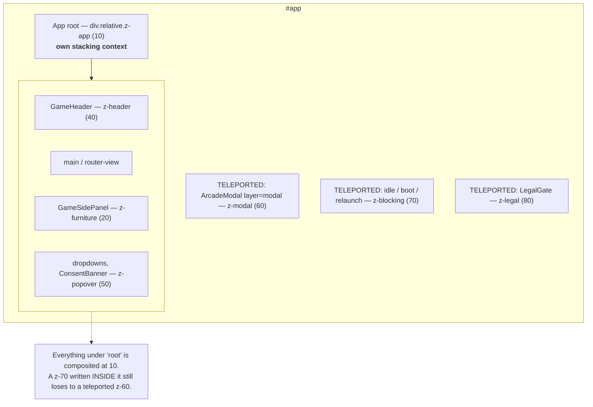
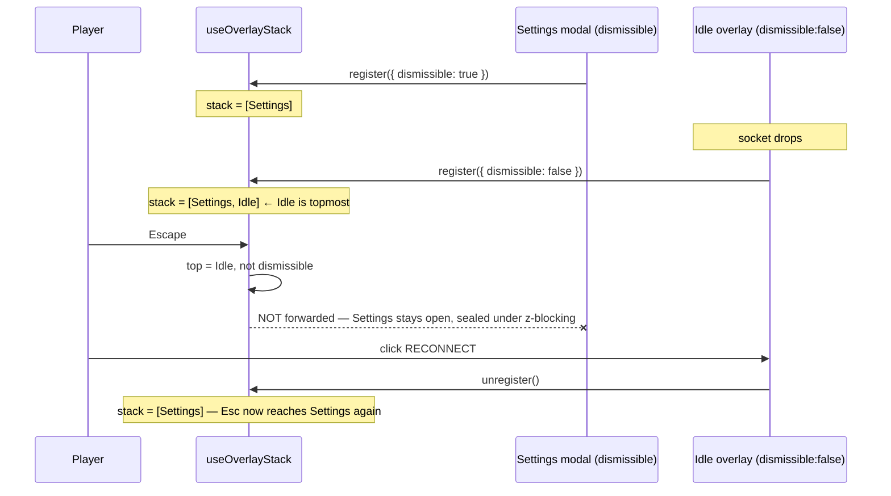

# Space Stroker — "Consolidated modal + panel design system" — Implementation Spec

> **Status: SHIPPED 2026-08-02** — merged to `main` in `monkify-front` + `monkify-meta` from
> `feature/modal-panel-design-system`. Trello card
> [Apply the consolidated modal + panel design system #124](https://trello.com/c/NIMydn5I/124-apply-the-consolidated-modal-panel-design-system)
> (refined 2026-08-01, shipped 2026-08-02).
>
> ⚠️ **Shipped with two acceptance criteria verified in emulation only.** AC #10 (body scroll lock on
> **iOS Safari**) and AC #20 (manual QA on **a phone**) were checked with an emulated iPhone 390×844
> in desktop Chrome with `html.light-graphics` forced on — no real iOS device was available. The
> scroll-lock-vs-bottom-sheet fight this spec predicts (§7.4) cannot be reproduced in emulation, so
> **check that first on a real iPhone.** If it misbehaves, the fix is to drop `useBodyScrollLock`'s
> wiring in `ArcadeModal.vue` — it is a small edit, **not** a revert: the lock did not land as its
> own commit (decision 12 wanted that; it ended up woven into the shell).
>
> ⚠️ **This spec was rewritten mid-implementation.** The first pass was built from the card's prose
> without reading the design reference and was wrong on nine counts — see §3.1. Decision 1 is
> superseded by decision 13. Read §3.1 before trusting any pre-2026-08-02 statement here.
> Repos affected: **`monkify-front`** (the only app repo touched) and this doc + `conventions/frontend.md`
> in `monkify-meta`. **`monkify-backend` is NOT touched** — frontend-only.
>
> **Purpose:** Overlay and panel chrome has drifted — every modal, panel, card and full page invented
> its own frame, width, z-index, max height and dismissal contract, so the app reads as several design
> systems stacked on each other. This card extracts **one shared modal shell + two documented
> materials + one named z-index scale** and migrates every surface onto them, so that Trello #130
> (How to play) builds on a settled system instead of inventing a fourth look.

> ⚠️ **Sequencing: #124 ships first; #130 depends on it.** Two cards, two specs, two ship runs.
> At the moment #124 lands, `QuickTourModal` and `ResponsibleGamingModal` **still exist** — #130
> deletes them afterwards. See §3 decision 12 and §7.9.

---

## 1. Summary

Three artifacts, then a migration.

| # | Artifact | Where |
| --- | --- | --- |
| 1 | **The shell** — one component owning size, titlebar, padding, backdrop, dismissal contract, the a11y package, the mobile bottom sheet, and a `dismissible: false` mode | `src/components/ui/ArcadeModal.vue` + 3 composables |
| 2 | **Two materials** — grey `.arcade-frame` (default) and its cyan accent variant, **at most one cyan element per surface** | already in `arcade.css`; the rule is new and written into `conventions/frontend.md` |
| 3 | **One named z-index scale** — CSS custom properties consumed by Tailwind, replacing every literal `z-*` on a root-level overlay | `colors.css` + `tailwind.config.js` |

### Where it stands today (verified in code, 2026-08-01)

| Surface | File | Frame | Width | z-index | Max height | Teleport | Esc | a11y |
| --- | --- | --- | --- | --- | --- | --- | --- | --- |
| Fair modal | `game/GameFairModal.vue` | `.arcade-panel` | `max-w-2xl` (672) | `z-[60]` | `90vh` | `#app` | no | none |
| Settings | `header/PlayerCustomizationModal.vue` | `.arcade-panel--accent` | `max-w-md` (448) | `z-50` | `90dvh` | `#app` | no | none |
| Name prompt | `header/DisplayNamePrompt.vue` | `.arcade-panel--accent` | `max-w-md` (448) | `z-50` | `90dvh` | `#app` | no | none |
| Mobile wallet | `wallet/MobileWalletModal.vue` | bespoke gradient | `max-w-md` (448) | `z-[100]` | — | **`body`** | no | `role`+`aria-label` |
| Legal gate | `LegalGate.vue` | bespoke | `max-w-lg` (512) | `z-[70]` | `90dvh` | `#app` | no (correct) | `role`+`aria-modal`+`aria-labelledby` |
| Idle overlay | `game/GameIdleOverlay.vue` | `.arcade-panel` | `max-w-md` (448) | `z-40`, `top-16` | — | **none** | no | none |
| Boot recovery | `BootRecovering.vue` | **none — replaces `<main>`** | — | — | — | none | no | none |
| Embed relaunch | `EmbedRelaunching.vue` | **none — replaces `<main>`** | — | — | — | none | no | none |

Backdrop treatment, padding, header layout and close-button styling all differ too. Backdrops are
`bg-black/70`, `bg-black/80`, `bg-black/90`, and three of them stack `backdrop-blur-sm` — which is
**stripped under `html.light-graphics`** (every phone), so those degrade to a flat wash today.

### Card inventory corrections found during code exploration

The refined card was accurate on six of eight overlays. Four corrections, all folded into this spec:

1. **`MobileWalletModal` teleports to `body`, not `#app`, and sits at `z-[100]` — above `LegalGate`'s
   `z-[70]`.** The 18+/Terms gate is coverable by the wallet picker today. The named scale
   (`modal 60` < `legal gate 80`) closes this. It also already carries `role="dialog"` +
   `aria-modal="true"` + `aria-label` — the card's claim that only `LegalGate` sets them is stale.
2. **`BootRecovering` and `EmbedRelaunching` are not overlays.** `App.vue` renders them **instead of**
   `<main>` in a `v-if` / `v-else-if` / `v-else` chain, as plain `min-h-screen` centred lines with the
   header still painted above them. See §3 decision 9.
3. **`GameSidePanel`'s "bespoke frame" is the game cabinet** — metal bezel, four `side-rivet`s and a
   recessed CRT screen — and `GameChatPanel` / `GameStatsPanel` / `GameFairPanel` carry **no frame of
   their own**; they are bare content bodies rendered inside it. See §3 decision 8.
4. **`ComingSoonPage` (`/soon`) is a fourth page on `.arcade-panel`,** omitted from the card's page
   list, and it is linked from the shipped dashboard (`Read the wiki` → `/soon?feature=wiki`).
   See §3 decision 11.

### The mechanism behind the layering bugs (read this before touching z-index)

`App.vue`'s root is `<div class="min-h-screen flex flex-col relative z-10">` — **its own stacking
context**, and the only child of `#app`. Modals `<Teleport to="#app">` out of it, so they are
**siblings** of that root and their z is compared against **10**, not against the header's `40`.

The consequence, and it is the whole of AC #7: **anything rendered inside the app root can never
paint above a teleported modal, whatever z-index you give it.** `GameIdleOverlay` at `z-40` is not
losing to `z-[60]` — its entire subtree is composited at `10`. Raising its number does nothing.
**It must be teleported.** Same for boot recovery and embed relaunch.

So the scale spans two stacking contexts and the spec is explicit about which values live where:

```
INSIDE the app root (composited at 10):   base 0 · app 10 · furniture 20 · header 40 · popover 50
TELEPORTED siblings of the app root:      modal 60 · blocking status 70 · legal gate 80
                                          toast 9999 (vue3-toastify, library-owned)
```

**Every value ≥ 60 must be `<Teleport to="#app">`.** Not `body` — `#app` keeps the app's style
inheritance chain (`conventions/frontend.md` → Overlays).

---

## 2. Constraints (MANDATORY)

From `monkify-meta/constraints.md` (full list there):

- **Worktree-per-repo:** `.worktrees/modal-panel-design-system/monkify-front` and
  `.worktrees/modal-panel-design-system/monkify-meta`; branch `feature/modal-panel-design-system`
  in both. The shared checkouts stay on `main` — never switch a hub's branch.
- **No backend work.** No entity, migration, EF mapping, handler, consumer, endpoint or SignalR change.
- **No backend integration test and no new `features/` doc.** This is a **Minor change** (a refactor +
  visual consolidation of existing surfaces, no new capability), so `constraints.md` §3 → "Integration
  tests are mandatory for every new feature" does **not** apply. `conventions/frontend.md` **is**
  updated (AC #19).
- **No unit tests:** `monkify-front` has no test runner. Verification is `yarn lint` + `yarn build`
  **plus manual QA on a GPU-rasterizing desktop, a phone, and with `html.light-graphics` forced on**
  (AC #20). The containing-block class of bug is invisible on the last two.
- **`/error` keeps its unconditional RETRY** through the `ErrorPage` migration — its presence must not
  become a tell about *why* the game is unavailable (`constraints.md` §6).
- **Blocking overlays must not gain Esc or backdrop dismissal.** `LegalGate` is the 18+/Terms gate;
  dismissing it by Esc is a compliance bug, not a UX improvement.
- **`arcade.css` beats Tailwind utilities** (imported after `@tailwind utilities`, equal specificity,
  later in the cascade). Build the shell with plain Tailwind or with arcade **tokens** — do not
  half-adopt `.arcade-panel` / `.btn-arcade` and try to override their box.

---

## 3. Resolved product decisions

Decisions 1–7 and 10 come from the card's refinement (2026-08-01). Decisions 8, 9, 11 and 12 were
raised during this spec's code exploration and answered by the user (Short mode) on 2026-08-01.

| # | Decision |
| --- | --- |
| 1 | ⚠️ **SUPERSEDED 2026-08-02 — see decision 13. Two panels, grey and black.** The original wording ("two materials, not two overlay tiers"; the tutorial tier "dies with the Quick Tour") was written without reading the design doc and is the opposite of what the doc specifies. |
| 2 | **Cyan = at most one accent element per surface, reserved for the no-risk / try-it path.** Matches what already shipped (`TRY IT FREE` on the dashboard). One documented future exception: #130's guide page may use cyan on its tip/callout blocks. |
| 3 | **Everything content-shaped takes grey-or-cyan** — modals, panels, cards, pages. This closes the shipped `/` (on `.arcade-frame`) vs `/game/stats` (on `.arcade-panel`) split. |
| 4 | **Named exceptions — do not migrate:** the game page's own content and furniture (`GameTerminal`, `GameConsole`, `GameTyper`, `GameMonkey`, the lever, Edson) **and `GameTypeCard`** (rebuilt on the owner's mock, merged 2026-08-01, with clipped `.pixel-border-outer/-inner` art frames and a deliberate three-way archetype accent — race → primary, preset → cyan, lottery → magenta — that knowingly contradicts decision 2). |
| 5 | **Overlay inventory.** Full shell + dismissal contract: `GameFairModal`, `PlayerCustomizationModal`, `MobileWalletModal`, `DisplayNamePrompt`. Material + named z + `dismissible: false`: `LegalGate`, `GameIdleOverlay`, `BootRecovering`, `EmbedRelaunching`. `dismissible: false` is a **first-class shell mode**, not a per-component escape hatch. |
| 6 | **Named semantic z-index scale, blockers above modals:** `base 0 · app 10 · furniture 20 · header 40 · popover 50 · modal 60 · blocking status 70 · legal gate 80 · toast 9999`. Fixes `GameIdleOverlay` hiding behind an open modal. |
| 7 | **Full a11y package in the shell:** `role="dialog"`, `aria-modal="true"`, `aria-labelledby` wired to the titlebar heading, focus trap, focus restore to the triggering element, body scroll lock, Esc. Scroll lock is **its own AC and its own commit** so it can be dropped independently if iOS Safari fights the bottom sheet. |
| 8 | **The desktop docked side-panel cabinet is a named exception (game furniture), not a bespoke frame to delete.** Its metal bezel + rivets + recessed CRT are the same cabinet language as the terminal and lever that decision 4 protects, on the most-viewed screen; `specs/app-design-refinement.md` already froze the in-play screen's layout for this reason. `GameChatPanel` / `GameStatsPanel` / `GameFairPanel` carry no frame of their own, so they satisfy the rule by construction. **This amends AC #15** — see §12. What *does* change: `GameSidePanel`'s `z-30` → `z-furniture`, and its **mobile** full-width chat container (a genuinely bespoke `border-[#04040a] bg-[#0b0d18]` box, not cabinet chrome) adopts `.arcade-frame`. |
| 9 | **`BootRecovering` and `EmbedRelaunching` render through the shell in `dismissible: false` mode, Teleported to `#app` at `z-blocking`.** `App.vue`'s `v-if` / `v-else-if` / `v-else` chain is **left untouched**, so the load-bearing "`<main>` does not mount during recovery" behaviour survives (mounting it would re-fire the boot requests the recovery exists to space out) — the component simply teleports its DOM out of the flow position it already occupies. Rejected: force-closing open modals when `recovering` flips (a second mechanism, and it discards unsaved Settings input). |
| 10 | **Mobile: bottom sheet below `lg` (1023px), no drag-to-dismiss.** Reuses the existing `useIsMobile()` / `max-lg:` boundary rather than inventing a breakpoint. Closes by X, backdrop or Esc only. |
| 11 | **Scope edges.** `QuickTourModal` and `ResponsibleGamingModal` get the **z-token swap only** (no material or shell change) so AC #6 stays literally true while #130 is still pending — nothing is thrown away, it is two lines. `ComingSoonPage` (`/soon`) **joins the page-migration commit**: it is linked from the shipped dashboard, so leaving it on the cabinet material recreates exactly the split decision 3 exists to close. |
| 12 | **The page migrations land as their own commit,** separable from the shell work, so they can be dropped if QA gets expensive (AC #21). Scroll lock is a second such commit (decision 7). |
| 13 | **TWO PANELS — grey and black (2026-08-02, supersedes decision 1).** The reference is the Claude Design project's `Space Stroker Modals.dc.html` (turn 1 → chrome direction **1b hairline** adopted; turn 2 → the full dialog set in it; turn 3 → the second panel). Its own spec card is headed **"SHARED BY BOTH TIERS" / "WHAT DIFFERS"** — the two panels **coexist**; they are not a materials rule and the second one does not die with the Quick Tour. What differs is `FRAME` (1px hairline vs 2px cyan), `FILL` (surface vs near-black), `TITLE` (left+amber vs centred cyan + sparkles), `FOOTER` (right-aligned pair vs one centred ghost), `ATTENTION` (recedes vs earns it) and `FREQUENCY` (every session vs once). What is shared is the whole geometry. **Naming:** the panels are called **`grey`** and **`black`** — prop value, CSS modifier and review vocabulary alike. The doc's own "tier 1 / tier 2" labels are deliberately not used: a tier name encodes a ranking that goes stale (it is how the KB ended up describing a "tutorial tier" with no consumer), a colour name cannot. |
| 14 | **How to choose a panel (owner's rule, 2026-08-02).** Two axes: **interaction** (is the player *doing* something, or only reading something short?) and **tone** (serious — money, identity, compliance, failure — or light: teaching, welcoming, celebrating). **Grey is the default; a surface goes black only when it is BOTH informative-only-and-brief AND light in tone.** Requiring both keeps the set small and legible: a dropped-connection notice is brief and informative but serious → grey; the provably-fair explainer is informative but long → grey; the quick tours clear both → black, and are the only black surface in the app. ⚠️ The "needs BOTH" tiebreak is the spec's reading of the owner's two axes, not their literal words — change it here, not at a call site. This **replaces** the earlier "did the player ask for it?" heuristic, which was inferred from the design doc's frequency column and produced the same answers for the wrong reason. |
| 15 | **Grey page fill is scoped to two pages (owner's call, 2026-08-02).** `/game/history` and `/game/stats` take `.arcade-frame--grey` (the grey panel's `--color-surface` on a 1px hairline) so they read as part of the dialog family. `/error`, `/soon`, the dashboard's `HomeSection` and the side panel's mobile chat box **stay on the near-black `.arcade-frame`**. The owner was shown that this recreates the `/` vs `/game/stats` mismatch decision 3 exists to close, and chose this scope anyway — so it is a recorded exception, not drift. Do not unify without asking. |

### 3.1 Where the reference overrode the original spec (2026-08-02)

The first implementation pass was built from the card's prose, not from the design doc. Re-reading the
doc changed these, and each is now in the code:

| # | Original spec said | The design doc says | Resolution |
| --- | --- | --- | --- |
| 1 | One material rule, `tone: 'grey' \| 'cyan'` swapping a border colour | Two whole panels — fill, frame, titlebar layout, title colour, footer layout all differ | `variant: 'grey' \| 'black'`, two skin classes |
| 2 | Frame fill = near-black (`.arcade-frame`) | Grey panel fill is `--color-surface` — **lifted above** the page, not below it | `.dialog--grey` on `--color-surface`; `--color-void-deep` is the black panel |
| 3 | Titlebar = an 11px heading + an SVG ✕ | 9px title behind a **6px amber square**, on a sunken bar, with a **bordered VT323 `X`** box (20px desktop / 28px mobile) | Rebuilt |
| 4 | Titlebar and footer inherit the body fill | Both sink to `--color-surface-bar` (0.175 vs the body's 0.215) | New token + `.dialog--grey >` rules |
| 5 | No status strip | A full-bleed `ERR` (25°) / `OK` (205°) strip under the titlebar — it is in the doc's own spec list | `#strip` slot + `.dialog__strip*` |
| 6 | Footer = `px-[18px] py-3`, no button spec | `12px 14px`, and a full primary/ghost × default/hover/focus/disabled matrix | `.dialog__footer` + `.btn-dialog*` |
| 7 | Everything is a bottom sheet below `lg` | **Two** treatments: sheet for compact/standard (M1), **full screen** for wide (M2) | `.dialog--sheet` / `.dialog--fullscreen` |
| 8 | Quick Tour gets a z-token swap only | Turn 3 draws it as the second panel, at wide 720 / standard 520 | Rebuilt on `variant="black"` |
| 9 | `ResponsibleGamingModal` stays bespoke (#130 deletes it) | — | **Migrated anyway.** Leaving one hand-rolled overlay in place means the app still ships a third look, which is the whole thing #124 exists to stop; #130 converts it to a page and reuses the content either way. |

**One place the code deliberately does NOT follow the doc:** the tour's stacked art thumbnail stays at
`w-24`, not the doc's 52px. The doc draws a dashed placeholder there; these are real sprites drawn for
a wider box, and at 52px `TourStepArt`'s `overflow-hidden` clips them to an unreadable fragment
(confirmed in the browser). Noted at the call site.

---

## 4. Data model

**N/A — no backend, no database, no migration.** Frontend-only card.

---

## 5. Design tokens & configuration

### 5.1 The z-index scale (`src/assets/styles/colors.css`)

One source of truth. Added to the existing `:root` block, after the radii/easing group:

```css
  /* — Overlay layering: ONE named scale (Trello #124) —
     Values ≤ 50 live INSIDE App.vue's `relative z-10` root and are composited at 10 against
     anything teleported. Values ≥ 60 MUST be <Teleport to="#app"> siblings of that root, or their
     number is meaningless. Never write a literal z-* on a root-level fixed overlay again. */
  --z-base: 0;
  --z-app: 10;         /* App.vue root */
  --z-furniture: 20;   /* in-page docked chrome (the side-panel cabinet) */
  --z-header: 40;      /* sticky GameHeader */
  --z-popover: 50;     /* dropdowns, tooltips, the consent banner */
  --z-modal: 60;       /* dismissible overlays (teleported) */
  --z-blocking: 70;    /* idle / boot-recovery / relaunching (teleported) */
  --z-legal: 80;       /* the 18+/Terms gate — nothing may sit in front of it (teleported) */
  /* toasts: 9999, owned by vue3-toastify — not ours to name */
```

### 5.2 Tailwind wiring (`tailwind.config.js`)

```js
  theme: {
    extend: {
      zIndex: {
        base: 'var(--z-base)',
        app: 'var(--z-app)',
        furniture: 'var(--z-furniture)',
        header: 'var(--z-header)',
        popover: 'var(--z-popover)',
        modal: 'var(--z-modal)',
        blocking: 'var(--z-blocking)',
        legal: 'var(--z-legal)',
      },
    },
  },
```

Yields `z-app`, `z-modal`, `z-blocking`, `z-legal`, … as utilities. These are **not** declared in
`arcade.css`, so the "arcade.css beats Tailwind utilities" hazard does not apply to them.

### 5.3 The dithered backdrop (`src/assets/styles/arcade.css`)

**Dither, not blur.** `backdrop-filter` is stripped under `html.light-graphics` (every phone, and
hardware-acceleration-off desktops), so a blurred backdrop silently degrades to a flat wash. A static
repeating gradient costs nothing on a software rasterizer — the same reasoning that keeps
`.star-strip` and `.section-vignette` alive in light-graphics mode. Add next to `.arcade-frame`:

```css
  /* Overlay backdrop — void at 55% with a 9px diagonal dither. NEVER backdrop-filter: it is stripped
     under html.light-graphics, which every phone runs, so a blurred backdrop degrades invisibly.
     Static gradient only, so light-graphics has nothing to strip and nothing to repaint. */
  .overlay-backdrop {
    background-color: color-mix(in oklab, var(--color-void) 55%, transparent);
    background-image: repeating-linear-gradient(
      45deg,
      color-mix(in oklab, black 42%, transparent) 0 1px,
      transparent 1px 9px
    );
  }
```

No `html.light-graphics .overlay-backdrop` override is needed — there is nothing expensive in it.

### 5.4 Dialog fills (`colors.css`) — added 2026-08-02

The design doc's oklch values are literally this app's void ramp, which is how we know it was drawn
against this codebase. Four steps were missing and are now tokens:

| Token | Value | Used by |
| --- | --- | --- |
| `--color-surface-bar` | `oklch(0.175 0.024 280)` | the grey panel's titlebar + footer bar (sunken **below** the body's `--color-surface` 0.215 — do not substitute `--color-bg` 0.158, it kills the separation) |
| `--color-surface-row` | `oklch(0.19 0.024 280)` | list rows, stat cells |
| `--color-surface-inset` | `oklch(0.17 0.02 280)` | inset readouts, text inputs |
| `--color-void-deep` | `oklch(0.09 0.014 280)` | the **black** panel's fill — deeper than `--color-void` |

Already present and reused verbatim: `--color-surface` (0.215 0.026 280), `--color-line`
(0.4 0.035 282), `--color-void` (0.115 0.018 280), `--color-cyan` (0.83 0.125 205),
`--color-primary` (#ffa214). All exposed as Tailwind utilities (`bg-surface-bar`, `bg-void-deep`, …).

### 5.5 Geometry — declared in `arcade.css`, not as utilities

| Token | Desktop | Below `lg` (1023px) |
| --- | --- | --- |
| `compact` | `lg:max-w-[380px]` | full-width **sheet** |
| `standard` | `lg:max-w-[520px]` | full-width **sheet** |
| `wide` | `lg:max-w-[720px]` | **full screen** (`.dialog--fullscreen`) |
| `xwide` | `lg:max-w-[1024px]` | **full screen** |
| Titlebar height | 36px | 44px |
| Close box | 20px (22px black) | 28px |
| Body padding | 18px (20/18 black) | same |
| Footer padding | `12px 14px` | `12px 16px 20px` (safe area) |
| Buttons | 8px type, `10px 13px` | 9px type, `15px 13px` |
| Border / radius | 1px `--color-line` (2px cyan on black) / 4px | sheet squares the bottom; full screen squares all four |
| Max height | 90dvh | 90dvh (sheet) · none (full screen) |

⚠️ **The cap, the radius and the mobile treatments live in `arcade.css`, not as Tailwind utilities on
the component.** `arcade.css` is imported after `@tailwind utilities` at equal specificity, so a
`max-h-[90dvh]` / `max-lg:rounded-none` utility would win over `.dialog--fullscreen`'s override — and
a media query changes neither specificity nor order. This was caught in the browser: the full-screen
tour was clamped to 761px of an 846px viewport by exactly that utility.

**No env var, no config file, no secret** is introduced by this card.

---

## 6. Backend behaviour

**N/A — nothing in `monkify-backend` changes.**

---

## 7. Frontend behaviour

### 7.1 `ArcadeModal.vue` — the shell

`src/components/ui/ArcadeModal.vue`. Built with **plain Tailwind + arcade tokens**, not by adopting
`.arcade-panel`/`.btn-arcade` (see §2).

```ts
interface Props {
  open?: boolean;                           // default true
  /** Rendered in the titlebar AND wired to aria-labelledby. Omit only with chrome="none". */
  title?: string;
  size?: 'compact' | 'standard' | 'wide' | 'xwide';   // default 'standard'
  /** WHICH PANEL. Grey unless the surface interrupts the player (decision 13). */
  variant?: 'grey' | 'black';               // default 'grey'
  /** false ⇒ no Esc, no backdrop click, no X. A first-class mode, not an escape hatch. */
  dismissible?: boolean;                    // default true
  /** Which named layer this overlay sits on, and whether it clears the 64px header. */
  layer?: 'modal' | 'blocking' | 'legal';   // default 'modal'
  /** 'none' ⇒ no titlebar; the consumer renders its own <h2 :id="titleId"> in the body. */
  chrome?: 'titlebar' | 'none';             // default 'titlebar'
  /** 'split' when the footer carries a hint / RESET / step dots left of the actions. */
  footerLayout?: 'end' | 'split';           // default 'end'
}
/** The reason travels with the event — the quick tour reports which route dismissed it. */
defineEmits<{ (e: 'close', reason: 'x' | 'esc' | 'backdrop'): void }>();
```

Slots: `default` (body, receives `{ titleId }`), `strip` (optional, full-bleed under the titlebar and
**outside the body's scroll**), `footer` (optional), `titlebar-actions` (optional, left of the X).

The **anatomy** — frame, both skins, titlebar, sparkles, close box, body, footer, strip, buttons and
the content helpers (`.dialog-copy`, `.dialog-eyebrow`, `.dialog-field`, `.dialog-input`,
`.dialog-label`, `.dialog-row`, `.dialog-cells`) — lives in `arcade.css` under **"THE DIALOG SHELL"**.
`ArcadeModal.vue` is the only component that writes `.dialog*` **structure** classes; consumers use
the content helpers and `.btn-dialog`.

Structure:

```html
<Teleport to="#app">
  <Transition name="overlay">
    <div v-if="open" :class="[rootLayerClass, positionClass]" role="dialog" aria-modal="true"
         :aria-labelledby="titleId">
      <div class="overlay-backdrop absolute inset-0" @click="onBackdrop"></div>
      <div ref="dialogRef" :class="[frameClass, sizeClass, sheetClass]">
        <header v-if="chrome === 'titlebar'" class="… h-9 max-lg:h-11 …">
          <h2 :id="titleId">{{ title }}</h2>
          <slot name="titlebar-actions" />
          <button v-if="dismissible" aria-label="Close" @click="emit('close')">…</button>
        </header>
        <div class="min-h-0 flex-1 overflow-y-auto p-[18px]"><slot :title-id="titleId" /></div>
        <footer v-if="$slots.footer" class="px-[18px] py-3"><slot name="footer" /></footer>
      </div>
    </div>
  </Transition>
</Teleport>
```

Behaviour rules:

- **Always `<Teleport to="#app">`** — never `body`, and never conditionally. See §1's mechanism note
  and `conventions/frontend.md` → Overlays.
- `titleId` is generated once per instance (`modal-${useId()}`-style counter) and is the **only**
  thing `aria-labelledby` points at, whether the heading lives in the titlebar or the body. This is
  what lets `chrome="none"` consumers (boot recovery, embed relaunch) still satisfy AC #9.
- `layer` → root class: `modal` → `z-modal`, `blocking` → `z-blocking`, `legal` → `z-legal`.
- **Header carve-out (decision, §3/#3 answer):** `layer="blocking"` positions the root as
  `fixed inset-x-0 bottom-0 top-16` — the 64px header (`GameHeader` is `h-[64px]`) stays reachable, as
  `GameIdleOverlay` does today, because the wallet cluster must be reachable at any moment.
  `layer="modal"` and `layer="legal"` are `fixed inset-0`. Known, accepted consequence: with a modal
  open underneath a blocker, the modal's own backdrop is still clickable in that 64px strip — a click
  there closes the player's own modal, which is harmless.
- **Mobile sheet (below `lg`):** `items-end` + `w-full` + `rounded-t-arcade` + `max-h-[90dvh]` with the
  body as the internal scroll container. **No drag gesture.** Above `lg`: centred, `items-center`,
  `rounded-arcade`, the same `90dvh` cap.
- `tone="cyan"` swaps the border to `.arcade-frame--cyan`. **Nothing in this card passes it** — it
  exists for #130's callouts and future try-it-free surfaces (decision 2).
- **Reduced motion:** the enter/leave transition is a one-shot opacity+translate (never a loop, so
  light-graphics has nothing to strip) and is disabled under `prefers-reduced-motion: reduce` —
  the pattern already proven in `QuickTourModal`'s `<style scoped>`.

### 7.2 `useOverlayStack.ts` — Esc routing and topmost resolution

`src/hooks/useOverlayStack.ts`. A **module-level** stack (the `useIsMobile` / `useMobileWallet`
singleton pattern already used in this repo), plus **one** document `keydown` listener registered
while the stack is non-empty.

```
register({ id, dismissible, close })  → push on open
unregister(id)                        → pop on close/unmount
Escape → look at the TOP of the stack only:
           dismissible → call its close()
           not dismissible → do nothing (swallow it)
```

This is what makes the edge case work: with a modal open when the socket drops, the blocker is pushed
on top, so **Esc goes to the blocker (i.e. nowhere), not to the modal underneath it**. A per-component
`window.addEventListener('keydown')` — the `QuickTourModal` approach — cannot express that, because
every mounted listener fires.

The topmost entry is also the only one that traps focus (§7.3).

### 7.3 `useFocusTrap.ts` — trap + restore

`src/hooks/useFocusTrap.ts`.

- **On open:** stash `document.activeElement`, then move focus to the first focusable element inside
  the dialog (falling back to the dialog itself with `tabindex="-1"`).
- **Trap:** `keydown` on the dialog; `Tab` / `Shift+Tab` at the last / first focusable element wraps to
  the other end. Focusables are re-queried on each `Tab` (the Settings modal swaps its whole body
  between the "connect a wallet" and the form branch).
- **On close — restore safely.** The stashed element may be **gone**: the wallet modal's trigger lives
  in a popover that closed, and the Settings trigger lives in the ☰ menu. Restore only if
  `el instanceof HTMLElement && el.isConnected && el.offsetParent !== null`; otherwise focus
  `document.getElementById('app')` (given `tabindex="-1"` on demand) and **never throw**.

### 7.4 `useBodyScrollLock.ts` — its own commit, droppable

`src/hooks/useBodyScrollLock.ts`. **Count-based** (two overlays can be open at once — a blocker over a
modal), so the lock releases only when the count hits zero.

- Lock = `overflow: hidden` on `document.documentElement`, plus scrollbar-width padding compensation so
  the page does not jump on desktop.
- **Do not use the `position: fixed` on `<body>` trick.** It loses scroll position, and it is the
  classic iOS Safari fight with the bottom sheet's internal scroll.
- `main.css` puts the horizontal-overflow guard on `<html>` and deliberately keeps `<html>` as the
  scrollport so the sticky header is not stranded — locking `overflow` on it is compatible; adding
  `overflow` to `App.vue`'s root is **not** (see the comment at `App.vue:232`).
- This lands as a **separate commit** so AC #10 can be reverted alone if iOS QA goes badly.

### 7.5 Migrated — full dismissal contract

| Component | Size | Layer | Notes |
| --- | --- | --- | --- |
| `game/GameFairModal.vue` | `wide` | `modal` | Title `FAIR PLAY`. Was `max-w-2xl` (672) → 720. **The only `90vh` in the codebase** → `90dvh` (AC #14). Keeps `<game-fair-panel :active="open" />` in the body slot unchanged. |
| `header/PlayerCustomizationModal.vue` | `standard` | `modal` | Title `PLAYER SETTINGS`. Loses `.arcade-panel--accent`'s amber bevel + glow → grey. Was 448 → 520. |
| `header/DisplayNamePrompt.vue` | `compact` | `modal` | Title `PICK YOUR NAME`. Was 448 → 380. Backdrop click currently calls `skip()` (not `close()`) — **preserve that**: skipping is the recorded "asked and declined" outcome, and AC #4 requires backdrop, X and Esc to produce the *same* outcome, so all three route to `skip`. |
| `wallet/MobileWalletModal.vue` | `standard` | `modal` | Title `CONNECT WALLET`. **`Teleport to="body"` → `#app`** and **`z-[100]` → `z-modal`**, which puts it back *under* the legal gate. Already a bottom sheet below `sm`; the shell moves that boundary to `lg`. Drops its hand-rolled `role`/`aria-modal`/`aria-label` in favour of the shell's. |

### 7.6 Migrated — blocking (`dismissible: false`)

| Component | Size | Layer | Chrome | Notes |
| --- | --- | --- | --- | --- |
| `LegalGate.vue` | `standard` | `legal` | `titlebar` — but **no X** (`dismissible: false` suppresses it) | Title `BEFORE YOU PLAY`. Full-bleed `inset-0`. Keeps its existing `#legal-gate-title` semantics via the shell's `titleId`. The `declined` branch stays inside the body slot. Was `z-[70]` → `z-legal` (80). |
| `game/GameIdleOverlay.vue` | `compact` | `blocking` | `titlebar` | Title `> DISCONNECTED — INACTIVE`. **Now teleported** (it was not) — this, not the number, is what fixes AC #7. Keeps the `top-16` carve-out via `layer="blocking"`. RECONNECT button + failure line stay in the body. |
| `BootRecovering.vue` | `compact` | `blocking` | **`none`** | Renders `<h2 :id="titleId" class="blink press-start-2p-regular">&gt; RECONNECTING…</h2>` in the body. `open` is hard-`true` (`App.vue` already gates it with `v-else-if`). |
| `EmbedRelaunching.vue` | `compact` | `blocking` | **`none`** | Same shape; `Relaunching…`. |

**`App.vue` is not restructured.** The `<embed-relaunching v-if>` / `<boot-recovering v-else-if>` /
`<main v-else>` chain stays exactly as it is (decision 9) — the two components simply teleport their
own DOM out of that flow position, so `<main>` still never mounts during recovery.

⚠️ `useQuickTour.ts:120–129` explains the old ordering ("the idle overlay is `z-40` against our
`z-[60]`") and refuses to auto-open under a blocker. **The guard stays correct and stays in place** —
it is now belt-and-braces rather than the only defence. Update the two comments to name the new tokens.

### 7.7 Panels (amended — see decision 8)

| Component | Change |
| --- | --- |
| `game/GameSidePanel.vue` | `z-30` → `z-furniture`. The **mobile** full-width chat container (`border border-[#04040a] bg-[#0b0d18] shadow-[inset…]`) → `.arcade-frame`. **The desktop docked cabinet — metal bezel, `side-rivet`s, recessed `side-screen` — is a named exception and is NOT migrated.** |
| `game/GameChatPanel.vue` | **No change.** Carries no frame — it is a bare content body inside the cabinet. |
| `game/GameStatsPanel.vue` | **No change.** Same. (Its amber trust badge is `--color-primary`, not cyan, so decision 2 is unaffected.) |
| `game/GameFairPanel.vue` | **No change.** Same. |

### 7.8 Pages — **separate commit** (AC #21)

`.arcade-panel` → `.arcade-frame`, so they agree with the dashboard's `HomeSection`:

| Page | File | Note |
| --- | --- | --- |
| `/error` | `pages/ErrorPage.vue` | **RETRY stays unconditional** — `constraints.md` §6. |
| `/game/history` | `pages/GameHistoryPage.vue` | — |
| `/game/stats` | `pages/GameStatsPage.vue` | Closes the `/` vs `/game/stats` split. |
| `/soon` | `pages/ComingSoonPage.vue` | Added by decision 11 (not on the card's list). |

### 7.9 z-token sweep — every remaining root-level overlay

"Overlay" here means a **root-level `position: fixed` layer**, which is what AC #6 governs. Intra-component
`absolute` popovers are covered too, at their existing values, so no literal `z-*` is left near this system.

| File | Today | After |
| --- | --- | --- |
| `App.vue:234` | `relative z-10` | `relative z-app` |
| `App.vue:264` | `sticky top-0 z-40` | `sticky top-0 z-header` |
| `game/GameSidePanel.vue:48` | `z-30` | `z-furniture` |
| `ConsentBanner.vue:12` | `fixed … z-50` | `z-popover` (same value; it is inside the app root and only shows after the gate is accepted) |
| `LoaderSpinner.vue:7` | `fixed … z-50` | `z-popover` |
| `GameHeader.vue:305,326` | `z-50` ×2 | `z-popover` |
| `header/WalletButtons.vue:100` | `z-50` | `z-popover` |
| `TokenBalance.vue:229` | `z-[60]` | `z-popover` — it is an `absolute` tooltip **inside** the header's stacking context, so it never competed with modals. At equal z it now resolves by DOM order against the ☰ dropdown; they are never open together. |
| `game/QuickTourModal.vue:111` | `z-[60]` | `z-modal` — **token swap only**, no material or shell change (decision 11; #130 deletes this file). |
| `header/ResponsibleGamingModal.vue:68` | `z-[60]` | `z-modal` — same, token only (#130 converts it to a page). |

Untouched, correctly: `arcade.css:107` (`.scanlines::after`, `z-index: 2` — inside a panel),
`GameTypeCard.vue:430,463,499` (art layers, named exception), `GamePage.vue:86,94,100` (mobile tab
stacking, local), `GameConsole.vue`, `GameMonkey.vue`, `GameTerminal.vue`, `HomePage.vue:63`,
`GameTypes.vue`, `AdminPage.vue`, `WalletBridgePage.vue`, `ComingSoonPage.vue:57`, `background/*`.

### 7.10 `90vh` → `90dvh`

One occurrence: `game/GameFairModal.vue:22`. Every other overlay already uses `90dvh`. After the
migration the cap lives in the shell, so no consumer declares it (AC #14).

---

## 8. Flow diagrams

### 8.1 Stacking — why teleporting is the fix, not the z number



### 8.2 Esc routing with a blocker over a modal



---

## 9. Out of scope

- **New artwork.**
- **`GameTypeCard` and the game page's own furniture** — terminal, console, typer, lever, Edson —
  plus, per decision 8, **the desktop docked side-panel cabinet**.
- **`ResponsibleGamingModal`'s conversion to a page** and **deleting `QuickTourModal`** — both belong to
  #130. This card only swaps their z literals for tokens.
- **Anything else on Trello #130** — the How to play page, the RG page.
- **Backend, database, API, SignalR.**
- **Drag-to-dismiss** on the mobile sheet (decision 10).
- **A toast restyle** — `vue3-toastify` owns `z-9999` and is not ours to name.

---

## 10. File checklist

### 10.1 Backend (`monkify-backend`)

**None.** No file in `monkify-backend` is touched.

### 10.2 Frontend (`monkify-front`)

**Commit 1 — the shell, tokens and overlay migrations**

| # | File | Change |
| --- | --- | --- |
| 1 | `src/assets/styles/colors.css` | **New:** the eight `--z-*` custom properties (§5.1). |
| 2 | `tailwind.config.js` | **New:** `theme.extend.zIndex` mapping the tokens to utilities (§5.2). |
| 3 | `src/assets/styles/arcade.css` | **New:** `.overlay-backdrop` — void 55% + 9px 45° dither, no `backdrop-filter` (§5.3). |
| 4 | `src/components/ui/ArcadeModal.vue` | **New.** The shell: size/tone/layer/dismissible/chrome, titlebar, padding, `90dvh`, backdrop, mobile sheet, teleport, a11y wiring (§7.1). |
| 5 | `src/hooks/useOverlayStack.ts` | **New.** Module-level stack + single Esc listener; topmost-only routing (§7.2). |
| 6 | `src/hooks/useFocusTrap.ts` | **New.** Trap + safe restore (§7.3). |
| 7 | `src/components/game/GameFairModal.vue` | Migrate to shell (`wide`). Drop `.arcade-panel`, own backdrop, own X, `z-[60]`, `max-h-[90vh]`, `max-w-2xl`. |
| 8 | `src/components/header/PlayerCustomizationModal.vue` | Migrate to shell (`standard`). Drop `.arcade-panel--accent`, own backdrop, `z-50`, `max-h-[90dvh]`, `max-w-md`, own `<h2>`. |
| 9 | `src/components/header/DisplayNamePrompt.vue` | Migrate to shell (`compact`). Same drops; **all three dismissal routes call `skip()`**. |
| 10 | `src/components/wallet/MobileWalletModal.vue` | Migrate to shell (`standard`). **`body` → `#app`**, `z-[100]` → `z-modal`, drop the bespoke gradient frame, hand-rolled a11y and `sm:` sheet boundary. |
| 11 | `src/components/LegalGate.vue` | Migrate to shell (`standard`, `layer="legal"`, `dismissible: false`). Drop bespoke box, `bg-black/90`, `z-[70]`, own `role`/`aria-*`. |
| 12 | `src/components/game/GameIdleOverlay.vue` | Migrate to shell (`compact`, `layer="blocking"`, `dismissible: false`). **Now teleported** — was not. Drop `.arcade-panel`, `z-40`, own backdrop; `top-16` comes from the layer. |
| 13 | `src/components/BootRecovering.vue` | Migrate to shell (`compact`, `layer="blocking"`, `chrome="none"`, `dismissible: false`). Message becomes `<h2 :id="titleId">`. |
| 14 | `src/components/EmbedRelaunching.vue` | Same as #13. |
| 15 | `src/components/game/GameSidePanel.vue` | `z-30` → `z-furniture`; **mobile** chat container → `.arcade-frame`. Desktop cabinet untouched (decision 8). |
| 16 | `src/App.vue` | `relative z-10` → `relative z-app`; `sticky top-0 z-40` → `z-header`. **The `v-if`/`v-else-if`/`v-else` chain is NOT changed.** |
| 17 | `src/components/ConsentBanner.vue` | `z-50` → `z-popover`. |
| 18 | `src/components/LoaderSpinner.vue` | `z-50` → `z-popover`. |
| 19 | `src/components/GameHeader.vue` | Two `z-50` → `z-popover`. |
| 20 | `src/components/header/WalletButtons.vue` | `z-50` → `z-popover`. |
| 21 | `src/components/TokenBalance.vue` | `z-[60]` → `z-popover`. |
| 22 | `src/components/game/QuickTourModal.vue` | `z-[60]` → `z-modal` — **token only** (decision 11). |
| 23 | `src/components/header/ResponsibleGamingModal.vue` | `z-[60]` → `z-modal` — **token only** (decision 11). |
| 24 | `src/hooks/useQuickTour.ts` | Comments at ~120–129: name the new tokens; the auto-open guard itself is unchanged. |

**Commit 2 — body scroll lock** (droppable on its own, AC #10)

| # | File | Change |
| --- | --- | --- |
| 25 | `src/hooks/useBodyScrollLock.ts` | **New.** Count-based `overflow:hidden` on `<html>` + scrollbar compensation (§7.4). |
| 26 | `src/components/ui/ArcadeModal.vue` | Wire the lock on open / release on close. |

**Commit 3 — page materials** (droppable on its own, AC #21)

| # | File | Change |
| --- | --- | --- |
| 27 | `src/pages/ErrorPage.vue` | `.arcade-panel` → `.arcade-frame`. RETRY stays unconditional. |
| 28 | `src/pages/GameHistoryPage.vue` | `.arcade-panel` → `.arcade-frame`. |
| 29 | `src/pages/GameStatsPage.vue` | `.arcade-panel` → `.arcade-frame`. |
| 30 | `src/pages/ComingSoonPage.vue` | `.arcade-panel` → `.arcade-frame` (decision 11). |

### 10.3 Meta (`monkify-meta`)

| # | File | Change |
| --- | --- | --- |
| 1 | `specs/modal-panel-design-system.md` | **New** — this spec. |
| 2 | `INDEX.md` | Spec row (status Ready) + "Feature currently in flight". |
| 3 | `conventions/frontend.md` | **Rewrite the "Two overlay tiers" bullet** into "Two materials" (grey default / cyan accent, one accent per surface); add the named z-index scale **and the teleport-above-60 rule**, the shell's dismissal + a11y contract, the mobile bottom-sheet rule, and the named exceptions (game furniture + `GameTypeCard` + the side-panel cabinet). Done at **implement** time, verified at **ship** (AC #19). |

---

## 11. Unit tests

**N/A — `monkify-front` has no test runner** (no `.spec` / `.test` files, no jest/vitest config).
Nothing changes in `monkify-backend`, so `SpaceStroker.Tests` and `SpaceStroker.Tests.Integration`
are untouched and `constraints.md` §3 does not engage.

Verification is instead:

| Gate | Command / method |
| --- | --- |
| Lint | `yarn lint` — must pass. ⚠️ The repo needs **uniform CRLF** (`core.autocrlf=true`); a `sed -i` rewrite produces LF and prettier fails with `Insert ␍`. |
| Build | `yarn build` — must pass. |
| Manual QA | §13, on **three** rendering paths (AC #20). |

---

## 12. Acceptance criteria

Copied from the Trello **Acceptance Criteria** checklist (21 items). Two carry an amendment from this
spec's code exploration, marked **⚠️ amended** and answered by the user on 2026-08-01.

1. Given the shared modal shell exists, when any migrated modal renders, then its width comes from one
   of the four size tokens (compact 380 / standard 520 / wide 720 / mobile sheet) and no modal declares
   its own max-width.
2. Given a migrated modal is open on desktop, when it renders, then its titlebar is 36px (44px below
   `lg`), body padding 18px and footer padding 12–14px, framed by a 1px `--color-line` border at 4px
   radius on the grey material.
3. Given `GameFairModal`, `PlayerCustomizationModal`, `DisplayNamePrompt` or `MobileWalletModal` is
   open, when the player presses Esc, then the modal closes.
4. Given a dismissible modal is open, when the player clicks the backdrop or the X, then it closes with
   the same outcome as Esc and the same close event fires. *(For `DisplayNamePrompt` that shared outcome
   is `skip()` — see §7.5.)*
5. Given `LegalGate`, `GameIdleOverlay`, `BootRecovering` or `EmbedRelaunching` is shown, when the
   player presses Esc or clicks the backdrop, then nothing happens and the overlay stays up
   (`dismissible: false`).
6. Given the codebase after the change, when overlay z-indexes are inspected, then every one resolves
   from the named scale (base 0 / app 10 / furniture 20 / header 40 / popover 50 / modal 60 / blocking
   status 70 / legal gate 80) and no literal `z-*` remains on an overlay. *(Includes `QuickTourModal`
   and `ResponsibleGamingModal`, token-swapped only — §7.9.)*
7. Given a modal is open and the websocket connection drops, when the idle / boot-recovery /
   relaunching overlay appears, then it paints above the open modal and the modal is not interactive
   underneath it. *(Requires teleporting all three — §1, §7.6.)*
8. Given a modal opens, when focus is inspected, then focus has moved into the dialog, Tab and
   Shift+Tab stay inside it, and on close focus returns to the element that opened it (falling back
   safely if that element is gone).
9. Given any shell-based overlay is open, when its DOM is inspected, then it carries `role="dialog"`,
   `aria-modal="true"` and `aria-labelledby` pointing at its titlebar heading. *(For `chrome="none"`
   consumers, at the body heading carrying the shell's `titleId` — §7.1.)*
10. Given a modal is open, when the player scrolls the page, then the content behind the backdrop does
    not scroll — verified on desktop and iOS Safari. **Its own commit; droppable independently.**
11. **⚠️ amended.** Given a viewport below `lg` (1023px), when a **compact or standard** modal opens,
    then it renders as a bottom sheet capped at `90dvh` with internal scroll and no drag-to-dismiss
    gesture; when a **wide** modal opens, then it renders **full screen** with both bars pinned and
    the body scrolling. The design doc draws both (M1 sheet, M2 full screen) — a 720 dialog is
    Provably Fair or the tour, and squeezing its readouts into a 90dvh sheet makes a scroll tube.
12. Given `html.light-graphics` is active (every phone, and hardware-acceleration-off desktops), when a
    modal opens, then the backdrop renders as a diagonal dither over void at ~55% and never depends on
    `backdrop-filter`.
13. Given a modal opens from anywhere in the app, when it renders, then it is Teleported to `#app` (not
    `body`) and paints above the header and the app root on a GPU-rasterizing desktop. *(Fixes
    `MobileWalletModal`, which teleports to `body` today.)*
14. Given the codebase after the change, when overlay heights are searched, then no overlay uses
    `90vh` — all use `90dvh`. *(One occurrence: `GameFairModal.vue:22`.)*
15. **⚠️ amended.** Given `GameChatPanel`, `GameStatsPanel` and `GameFairPanel` render, then they carry
    no bespoke frame (they are bare content bodies — true by construction), and `GameSidePanel`'s
    **mobile** container uses the grey material. **The desktop docked cabinet — metal bezel, rivets,
    recessed CRT — is a named exception and stays unchanged**, because it is the same cabinet language
    as the terminal and lever that the card's own exception protects (decision 8).
16. Given `ErrorPage`, `GameHistoryPage`, `GameStatsPage` **and `ComingSoonPage`** render, then they use
    `.arcade-frame` rather than `.arcade-panel` and agree visually with the dashboard's sections;
    `ErrorPage` still shows an unconditional RETRY. *(`ComingSoonPage` added by decision 11.)*
17. Given `GameTypeCard` and the game page's own furniture (terminal, console, typer, lever, Edson) —
    **and the docked side-panel cabinet** — when the change ships, then they are visually unchanged:
    clipped pixel-border art frames and the race/preset/lottery archetype accents intact.
18. **⚠️ amended.** Given a **grey** panel, when it renders, then at most one element on it carries
    cyan (in practice: the keyboard focus ring, or a verified/revealed value in a readout). Given a
    **black** panel, then cyan is the frame itself and the rule does not apply — its interior accent
    is amber (badges, step labels, the single action). Decision 13.

22. **Added 2026-08-02.** Given the quick tours, when one opens, then it renders on the **black
    panel** — near-black fill, 2px cyan frame, centred cyan title between pixel sparkles, filled
    amber step badges on a dashed amber rail with every step visible and no pagination, and one
    centred amber ghost `GOT IT!` — and its dismissal analytics still distinguish
    `got_it` / `x` / `esc` / `backdrop`.

23. **Added 2026-08-02.** Given `ResponsibleGamingModal`, when it opens, then it renders through the
    shell on the grey panel rather than its own hand-rolled teleport, backdrop, frame and close
    glyph, so no bespoke overlay remains in the app.
19. Given `monkify-meta/conventions/frontend.md` after the change, then it documents the two materials
    (grey default / cyan accent), the one-accent-per-surface rule, the named z-index scale **and the
    teleport-above-60 rule**, the shell's dismissal + a11y contract, the mobile bottom-sheet rule, and
    the named exceptions (game furniture + `GameTypeCard` + the side-panel cabinet) — and the old "two
    overlay tiers" wording no longer describes deleted behaviour.
20. Given the finished branch, when `yarn lint` and `yarn build` run, then both pass, and manual QA has
    been done on a GPU-rasterizing desktop, a phone, and with `html.light-graphics` forced on.
21. Given the page-material migrations (`ErrorPage`, `GameHistoryPage`, `GameStatsPage`,
    `ComingSoonPage`), when the branch is reviewed, then they are in their own commit, separable from
    the shell work.

---

## 13. Manual QA

Run the local stack (`monkify-backend` docker compose → `:6001`; `yarn serve` from the front worktree
with the hub's `.env.local` + `yarn.lock` copied in, on `--port 8081`).

**Desktop, GPU rasterizing (hardware acceleration ON — the only path where the containing-block bug is visible):**

1. `/game` → ☰ → **Settings**. Confirm: grey frame (no amber bevel), 520px, 36px titlebar, dither
   backdrop with **no blur**, focus lands inside, Tab cycles without escaping, Esc closes, focus
   returns to the ☰ item. Repeat for backdrop click and X.
2. ☰ → **Fair play**. 720px wide, `90dvh` cap, internal scroll, paints above the header.
3. Connect a wallet with no display name → **PICK YOUR NAME** at 380px. Esc, backdrop and X must all
   take the *skip* path (re-open the app: the prompt must not immediately return).
4. **Layering:** open Settings, then trigger the idle disconnect (leave the tab idle until
   `useIdleDisconnect` fires, or force `isIdleDisconnected`). The idle overlay must paint **over**
   Settings; the 64px header stays reachable; **Esc must do nothing** (it hits the blocker, not
   Settings). Click RECONNECT, then Esc → Settings closes.
5. Clear the `ss_terms` cookie → reload. The **legal gate** must be on top of everything; Esc and
   backdrop do nothing. Open the mobile wallet picker from a narrow window first — it must **not** be
   able to cover the gate any more (it did, at `z-[100]`).
6. `/error`, `/game/history`, `/game/stats`, `/soon` → all four on the flat grey `.arcade-frame`,
   visually agreeing with `/`'s sections. `/error` still shows RETRY.
7. `/game` desktop: the docked side-panel cabinet (bezel, rivets, CRT) is **pixel-identical** to `main`.
   `GameTypeCard`s on `/game` unchanged, archetype accents intact.

**Phone (or DevTools device mode + `html.light-graphics` forced on):**

8. Every migrated modal renders as a **bottom sheet**, full width, `90dvh`, internal scroll, no drag.
9. Backdrop is the **diagonal dither**, not a flat wash — this is the check that catches a
   `backdrop-filter` regression.
10. Mobile CHAT segment: the chat container is on `.arcade-frame`; the segmented tabs still work and a
    hidden view cannot intercept taps.
11. **iOS Safari specifically:** open a tall modal, scroll inside it, confirm the page behind does not
    move and the sheet's own scroll still works. If these fight, revert **commit 2 only** and mark
    AC #10 as dropped in the ship report.

**Forced light-graphics on desktop:** run `document.documentElement.classList.add('light-graphics')` in
the console and re-check steps 1–3 — nothing may lose its backdrop or its frame.

---

## 14. Trello / pipeline

- **Source card:** [#124 Apply the consolidated modal + panel design system](https://trello.com/c/NIMydn5I/124-apply-the-consolidated-modal-panel-design-system)
  — list **Specs created**; the **Implementation** section on the card carries branch, worktree and spec path.
- **Worktrees:** `.worktrees/modal-panel-design-system/monkify-front` and
  `.worktrees/modal-panel-design-system/monkify-meta`, branch `feature/modal-panel-design-system`
  (pushed to `origin` in both).
- **Next:** `/monkify-implement-feature Apply the consolidated modal + panel design system`, then
  `/monkify-ship-feature …`.
- **After this ships:** Trello #130 (How to play) — it builds its guide page on this shell and these
  materials, deletes `QuickTourModal`, and converts `ResponsibleGamingModal` into a page.

---

## 15. Revision log

| Date | Change |
| --- | --- |
| 2026-08-01 | Initial spec from refined card #124, plus four card-inventory corrections found in code (`MobileWalletModal` teleport/z, boot overlays are page-replacements, the side-panel cabinet, `ComingSoonPage`) and the four resolving decisions (8, 9, 11 + the header carve-out) taken with the user in Short mode. |
| 2026-08-02 | Owner review: the quick tour came back **squished**. The doc's 720/520 sizing is drawn around 78px dashed placeholders and 8px labels; the real tour is five illustrated steps and shipped at 1024. Added a fourth size token **`xwide` 1024** to the shell ("big modals on PC") and restored the tour's own scale — 4–5 steps → `xwide`, 3 steps → `wide`, 40px badges, 12px labels, the original gaps. `xwide` is ours, not the doc's, and is documented as deliberately rare. |
| 2026-08-02 | Owner review: **decision 14** (the two-axis rule for choosing a panel — interaction + tone, black needs both) replaces the inferred "did the player ask for it?" heuristic, and the panel **names** are fixed as `grey` / `black` rather than the doc's tier labels. **Decision 15**: `/game/history` and `/game/stats` move to a grey page fill (`.arcade-frame--grey`); the other four `.arcade-frame` consumers deliberately stay near-black. Both written into `conventions/frontend.md`. |
| 2026-08-02 | **Rewritten against the actual design reference.** The first pass was built from the card's prose; the user supplied the Claude Design project export (`Space Stroker Modals.dc.html` + `support.js`) and the spec was wrong on nine counts — see §3.1. Decision 1 is superseded by **decision 13 (two panels: grey and black)**. Adds §5.4 dialog fills, rewrites §5.5 geometry (including the arcade.css-vs-utilities cap hazard, caught in the browser), §7.1 shell props (`variant`, `footerLayout`, `strip` slot, close reason). Scope additions: the Quick Tour is rebuilt on the black panel and `ResponsibleGamingModal` is migrated rather than left bespoke. Verified in the browser at desktop, 502px and emulated iPhone 390×844 with `html.light-graphics` on. |
