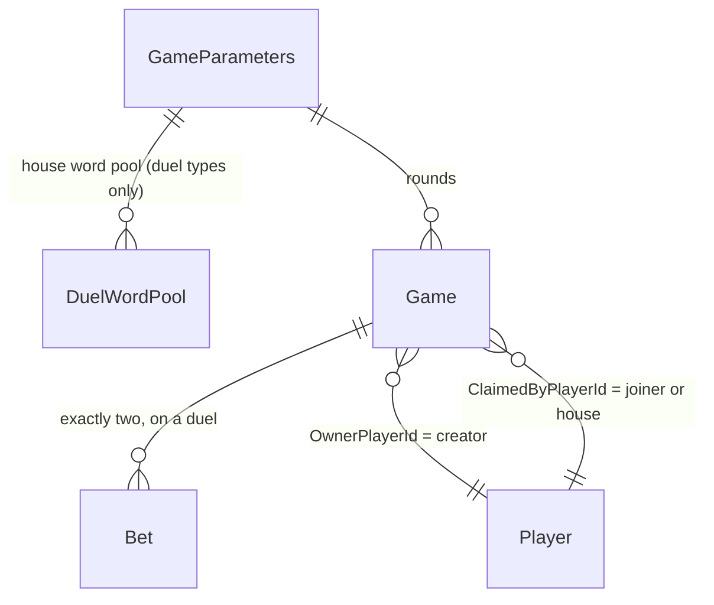
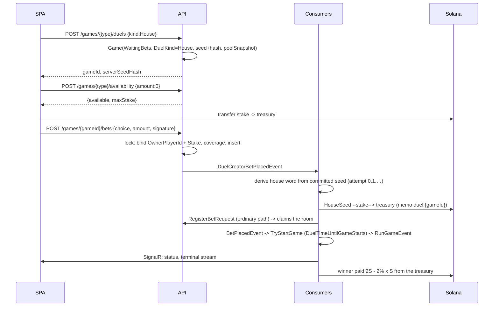

# SpaceStroker — "Monkey Duel" — Implementation Spec

> **Status: Shipped (2026-09-25)** — `feature/monkey-duel` merged to `main` in `monkify-backend`,
> `monkify-front` and `monkify-meta`. Distilled into [`../features/monkey-duel.md`](../features/monkey-duel.md),
> which records where the shipped code departs from this spec: the type went **live** with an 8-word
> pool (not the §5.2 gated/empty seed), empty shells now carry the board TTL and are swept (§4.3 said
> `BoardExpiresAt` stays null), a player may hold several rooms, the house word is resolved from
> `ClaimedByPlayerId`, and every house give-up path terminates + refunds (§6.4, corrected in place).
> This spec stays the deep design record.
>
> **Original status: Ready for implementation** — refined via Trello card
> [Coinflip like game (#184)](https://trello.com/c/O7OXxNM0/184-coinflip-like-game) (refined 2026-09-23,
> spec 2026-09-23).
> Repos affected: `monkify-backend`, `monkify-front`, and this doc in `monkify-meta`.
> Branch / worktree: `feature/monkey-duel` → `.worktrees/monkey-duel/<repo>`.
> Design: settled clickable flow — <https://claude.ai/artifact/JufhzgZu8FYtm1qfdqSRCU>.
> Change level: **Feature** — mandatory happy-path integration test, **plus** dedicated integration
> tests for the **join race** and the **cancel refund** (`constraints.md` §3).
>
> **Purpose:** every paid game today is a shared, rolling, fixed-price round. Monkey Duel is a **1v1
> race**: two 6-letter words, one typer stream, the first word typed takes both stakes. It ships as a
> single machine with two tabs — **VS HOUSE** (the default you land on, playable immediately against
> the house) and **OPEN DUELS** (a public board of player-created rooms you can browse, take or post
> to).

---

## 1. Summary

| | **VS HOUSE** (`DuelKind.House`) | **OPEN DUELS** (`DuelKind.OpenRoom`) |
| --- | --- | --- |
| Counterparty | the house, from the **HouseSeed** wallet | another player |
| Who picks first | the player; the house word is **drawn from the committed seed** | the creator; the joiner picks **second, seeing the word** |
| Stake | player chooses, within the type's floor/ceiling, clamped by HouseSeed coverage | creator chooses; joiner must match **exactly** |
| Wait | none — starts as soon as the house bet lands | until someone joins, or forever |
| Cancel | n/a (the house bet lands within seconds) | creator may cancel while unmatched, full refund |
| Payout | pari-mutuel: 2 stakes less the commission on profit above own stake | identical |

It is **one `GameParameters` row** ("Monkey Duel"). The duel **kind** is chosen **per round**. One
lobby card, one catalogue entry, one set of stats — matching what is on screen.

It is a **second** player-vs-house shape alongside Hyper Roll, deliberately: Hyper Roll is a weighted
draw against a board, the duel is a genuine race. **Hyper Roll is not touched.**

### 1.1 What is reused unchanged

| Machinery | Why it already fits |
| --- | --- |
| `BetDomainService.CalculateRewardForBet` (pari-mutuel branch) | pot ÷ 1 winner, less the commission on profit above the winner's own stake. No new rate, no second commission path. |
| `RefundInvalidBetConsumer` / `RefundInvalidBetEvent` | every duel refusal and the room cancel ride the shipped refund route. |
| `TransactionLog` ledger, `BetStatusLog`, `GameStatusLog` | untouched. |
| `ProvablyFair` (`Keystream`, `NextIndex`, `FallbackIndex`) | the house word draw mirrors `OrbitChoiceGenerator` exactly. |
| Free-text choice exclusivity + the unique `(GameId, ExclusiveChoice)` index | is what stops the two sides of a duel holding the same word. |
| `Game.OwnerPlayerId` + index `(ParametersId, OwnerPlayerId, Status)` | already means "this round belongs to one player"; here it is the **creator**. |
| Many concurrent live rounds per type | `GetActiveGameForParameterHandler.HouseEdgeRoundForWallet` already returns the caller's own newest round instead of the type's single newest. |
| Stats, history, the provably-fair verification page | a duel round is an ordinary `Game`. |

### 1.2 The house's edge, stated honestly

`TokenSettings.CommissionPercentage` is **2.0** (`spacestrokersettings.json`, pinned by
`CommissionRateTests.CommissionPercentage_IsTwoPercent`). A heads-up race therefore yields **~1.00%
of the pot** to the house, and on a house duel we carry **full 50/50 variance** against it.

⚠️ **The artifact's copy is wrong twice over and must be corrected when the UI is built:**

1. It hard-codes `const CUT = 0.05` and prints "LESS 5%" / "HOUSE CUT … (5%)". The live rate is **2%**,
   read from `GameParametersDto.commissionPercentage`.
2. It computes the payout as `2 × stake × (1 − CUT)`. The live rule taxes **only the profit above the
   winner's own stake**: `payout = 2S − rate × (2S − S) = S × (2 − rate)`. At 2% that is **1.98 × S**,
   not `2S × 0.98 = 1.96S`.

See §7.6 for every line to change.

---

## 2. Constraints (MANDATORY)

From `monkify-meta/constraints.md` (full list there):

- **Worktree per repo** (§2): `feature/monkey-duel` in `monkify-backend`, `monkify-front` and
  `monkify-meta`, created off `origin/main` at `.worktrees/monkey-duel/<repo>`; the hubs stay on
  `main`. Push each branch right after its first commit.
- **Unit tests** (§3): update the affected tests in `SpaceStroker.Tests`, add tests for new behaviour,
  run via `scripts/run_tests.bat` (**not** a bare `dotnet test` — the script excludes the
  `ProductionGames` Monte Carlo suite by design), and **report which tests changed** at the end.
- **Integration tests are mandatory for a new feature** (§3): a happy-path duel end to end in
  `SpaceStroker.Tests.Integration`, **plus** the **join race** and the **cancel refund** as their own
  tests (both are complex flows).
- **EF configuration is inline** in `SpaceStrokerDbContext.OnModelCreating` (§4) — no
  `IEntityTypeConfiguration`. **Migrations are applied only by `SpaceStroker.Consumers`**. Never
  hand-edit `SpaceStrokerDbContextModelSnapshot.cs`.
- **Mock-only secrets** (§1): the HouseSeed keypair stays `MOCK_…` in every committed file.
- **Vague user-facing messaging** (§6): the house tab being unavailable, a room already taken, a
  refused stake and a refused word all reuse the **existing** messages. No new error code tells a
  caller why.
- **Host split** (§8): the API stays stateless (bet submission, room open/list/cancel, availability).
  The round lifecycle, the typer, the **house counterparty bet** and every payout stay in
  `SpaceStroker.Consumers`.
- **Feature-specific:** **do not ship the house word pool before the Monte Carlo run** (§9.3).

---

## 3. Resolved product decisions

Numbering follows the card's **Decisions** block so the two can be read side by side.

| # | Decision |
| --- | --- |
| 1 | Ships the artifact as-is: **house duel is the default landing**, the PVP board is the second tab. |
| 2 | **One `GameParameters` row** ("Monkey Duel"). The duel **kind** is per-round (`Game.DuelKind`). |
| 3 | **Word length fixed at 6** by the type (`ChoiceRequiredLength = 6`), like Cosmic Sprint. Both words are always the same length, so neither side gets the shorter-word advantage. |
| 4 | **Pari-mutuel; the house bets as an ordinary player.** Winner takes the 2-stake pot less the standard commission on profit above own stake. `BetDomainService` payout maths is reused **unchanged**. |
| 5 | **The cut is 2%, not 5%.** The artifact's copy is wrong (§1.2) and is corrected in the UI. Our edge is ~1.00% of the pot; we carry full 50/50 variance. |
| 6 | **Stake bounds reuse `RequiredAmount` (floor) + `MaximumStake` (ceiling)** — the two columns Hyper Roll already has. Applies to both kinds. The floor must clear Solana's rent-exempt minimum. |
| 7 | **The house side is funded by the existing `HouseSeed` wallet**, deliberately **not** the treasury — so a duel-maths bug cannot drain the account that pays every other game's winners. |
| 8 | **Coverage clamps the ceiling; it does not close the tab.** The max stake the SPA quotes drops to what the HouseSeed wallet can cover. Only when it cannot cover even the **minimum** does the house tab go unavailable and the machine land on the PVP board. **Fail closed on a null balance read.** |
| 9 | **The house word is drawn uniformly from a curated readable-word pool**, from the **committed `ServerSeed` at pull time** — never chosen, so it is verifiable and cannot be ground. |
| 10 | ⚠️ **Gated on a Monte Carlo run.** Pool size is an **output** of that run, not a guess: it must show our edge survives the best player counter-word. **Do not ship the pool before the run.** |
| 11 | ⚠️ **PVP joiner advantage is ACCEPTED, not mitigated** — owner's decision. Words stay visible on the board; the same Monte Carlo **measures** the advantage so it is priced rather than unknown. |
| 12 | **A room IS a `Game`** — `WaitingBets`, min 2 players, the creator's bet already on it. |
| 13 | **Many concurrent live rounds per type is not new work**; the new part is the public board. |
| 14 | **The stake moves from the type to the round** (`Game.Stake`), within the type's floor/ceiling. |
| 15 | **Cancel anytime while unmatched, full refund. NO auto-expiry.** Accepted: dead rooms accumulate, and a player who closes the tab leaves SOL locked until they return and cancel. |
| 16 | **Join race: first write wins**, via a concurrency-safe conditional update. The loser takes the existing `RefundInvalidBet` path and sees a generic "already taken" plus a refund notice. |
| 17 | **The house seed bet excludes duel types entirely** — on a duel a seeded house bet *is* the second player, so every PVP room would be taken by the house the instant it opened. |
| 18 | **Orbit is excluded** (`AllowOrbit = false`): no rollover to stand a word on, a per-room stake, and an `OrbitChoiceClaim` would reserve a word across every duel room. |
| 19 | **Board realtime: a new per-type rooms channel on the existing `ActiveGamesHub`**, joined by **game type** rather than by `gameId`. One connection per tab, no polling. |

### 3.1 Spec-time decisions (resolved here — flag at implementation start)

These were not on the card. Each was decided from the live code; the reasoning is recorded so the
implementer does not re-litigate it, and so the owner can overrule any of them cheaply.

| # | Decision | Why |
| --- | --- | --- |
| S1 | **The house word pool lives in a NEW `DuelWordPool` table**, not in `PresetChoices`. The duel type keeps `PresetChoices` **empty**. | Confirmed with the owner (2026-09-23). Throughout the codebase, "this type has `PresetChoices` rows" **is** the discriminator for "this is a preset race". Attaching pool rows to the duel type would break **six** shipped paths at once: `BetDomainService.cs:92` (rejects any word not in the list), `RegisterBetHandler.cs:181` (`ExclusiveChoice = null` → drops the unique index), `:352` (skips free-text exclusivity → breaks AC 11), `:331` (one-bet-per-preset-round), `SpaceStrokerTyper.SetBets`/`SetCharactersOnTyper` (races every pool word, builds the pool from all of them), and `GameParametersDto.PresetChoices` → front `utils/gameArchetype.ts` (reads the type as `'preset'`). A separate table is the only option where a duel bug cannot leak into Cosmic Sprint, Space Jackpot or Hyper Roll. |
| S2 | **`IsDuel` is a new flag; `IsHouseEdge` stays `false`.** | `IsHouseEdge` selects the *treasury × multiplier* payout with **no commission** (`CalculateHouseEdgeReward`). A duel is pari-mutuel with commission. Reusing `IsHouseEdge` would silently pay `stake × multiplier` from the treasury. |
| S3 | **Duel coverage is its own rule (`DuelHouseCoverage`) reading the HouseSeed wallet — NOT `HouseEdgeCoverage`.** | The card says "reuse `HouseEdgeCoverage`", but that rule prices **treasury** exposure at `stake × multiplier`. In a duel the treasury receives **two** stakes and pays out at most `1.98 × stake`, so it carries **no** exposure — `RewardGameConsumer` already runs its treasury check for `IsHouseEdge` only, correctly. The only real constraint is the **HouseSeed** wallet being able to fund the second stake plus its fee floor. The *behaviour* decision 8 asks for (clamp the quoted ceiling; fail closed on a null read; one function behind both the pre-check and the backstop) is preserved exactly — only the formula and the wallet differ. |
| S4 | **A duel round is opened by an explicit call (`POST /games/{gameTypeId}/duels`), never at startup and never by rollover.** | Mirrors Hyper Roll solo rounds (`OpenSoloBoard`, `POST /games/{id}/boards`). The seed is committed in the same `SaveChanges` as the round, so the commitment always predates every bet and the house word cannot be ground. |
| S5 | **The house counterparty bet is placed AFTER the player's bet lands**, by `SpaceStroker.Consumers`, and the round starts only once it has. | The house must match `Game.Stake`, which the player's bet sets; and the derived word must avoid the word the player took (free-text exclusivity would otherwise refuse it **after** the transfer). The player therefore sees a short "placing…" beat, exactly as an Orbit bet does. Optimistically starting the round before the house transfer confirms would run a round with one stake in it. |
| S6 | **Cancelling a room requires a wallet proof** — a new `WalletNoncePurpose.DuelCancel = "duel-cancel"` through the shipped `WalletProof.TryConsume`. | A cancel triggers a refund, and "money never moves on an unproven request" is the rule every other refund path follows (`orbit-cashout`, `referral-cashout`). The refund can only ever reach the owner's own wallet, so the exposure is **griefing**, not theft. **Alternative if the owner prefers no wallet popup:** accept `?wallet=` unauthenticated and accept that anyone can cancel anyone's room. Recommended: keep the proof — it is one line of shipped primitive. |
| S7 | **In non-production, a free (0-amount) player bet gets a free house counterparty bet** — no transfer, no money, no HouseSeed requirement. | `AllowFreeBet` self-heals to `!IsProduction()`, and this is how the team QAs gameplay locally without a funded wallet. Production rejects free bets outright, so the branch cannot reach real money. Without it, the house tab is untestable on the local stack. |
| S8 | **The pool snapshot is persisted per round (`Game.DuelPoolSnapshot`)**, written with the round. | `DuelWordPool.Active` is mutable. AC 13 requires the published inputs to reproduce the house word draw; a later pool edit must never change what a settled round can prove. Same discipline as `Game.CharacterPool` / `GameBoardChoice.Weight`. |
| S9 | **The Monte Carlo goes in a NEW test class inside the existing `ProductionGames` namespace.** | `run_production_session_tests.bat` filters on `FullyQualifiedName~ProductionGames`, so a class in `SpaceStroker.Tests.UnitTests.Domain.ProductionGames` is picked up for free. ⚠️ The existing suite measures typer **pacing** (duration, p95, fallback share) — it does **not** measure win rates. The duel run is a new kind of simulation, not a new `[InlineData]` on `ShouldSelectWinnerInTime`. |

---

## 4. Data model

### 4.1 `GameParameters` (`SpaceStroker.Domain/Games/Entities/GameParameters.cs`)

```csharp
// #184 Monkey Duel: a 1v1 race type. Two bets, one typer stream, the first word typed takes the
// 2-stake pot less the ordinary commission on profit above own stake.
//
// ⚠️ NOT IsHouseEdge. That flag selects the treasury × multiplier payout with NO commission
// (BetDomainService.CalculateHouseEdgeReward). A duel is pari-mutuel: IsHouseEdge stays false so
// CalculateRewardForBet's shipped path is reused unchanged.
//
// ⚠️ A duel type's PresetChoices is ALWAYS EMPTY. The curated house word pool lives in
// DuelWordPool, because "has PresetChoices" is what the whole codebase reads as "is a preset race"
// (see specs/monkey-duel.md §3.1 S1).
//
// RequiredAmount is the MINIMUM stake and MaximumStake the maximum, exactly as for a house-edge
// type. Create-only, like every other bet bound.
public bool IsDuel { get; set; }

public ICollection<DuelWordPool> DuelWordPool { get; set; }
```

`MaximumStake` is **required** when `IsDuel` is true (it is the ceiling). `BoardLadder`, `RtpPercent`
and `LotteryParameters` stay null. `AllowOrbit` is **false** (decision 18).

### 4.2 `DuelWordPool` — new entity (`SpaceStroker.Domain/Games/Entities/DuelWordPool.cs`)

```csharp
/// <summary>
/// The curated readable-word pool a HOUSE duel draws its word from (#184). One row per word, per
/// duel game type.
///
/// ⚠️ A separate table from PresetChoice ON PURPOSE (specs/monkey-duel.md §3.1 S1): a duel type must
/// look like a FREE-TEXT type to every shipped path — bet validation, choice exclusivity, the unique
/// (GameId, ExclusiveChoice) index, the typer's competing-choice set and character pool, and the
/// SPA's archetype resolver all branch on GameParameters.PresetChoices being empty.
///
/// ⚠️ Active is how a word is retired. Because it is mutable, the pool a round actually drew from is
/// snapshotted onto Game.DuelPoolSnapshot when the round opens — a later edit can never change what a
/// settled round can prove.
///
/// ⚠️ POOL SIZE IS AN OUTPUT OF THE MONTE CARLO (decision 10), not a guess. Do not seed a pool before
/// DuelEdgeTests has run and shown the edge survives the best player counter-word.
/// </summary>
public class DuelWordPool : TableEntity
{
    public DuelWordPool() { }
    public DuelWordPool(string word) { Word = word; }

    public GameParameters Parameters { get; set; }
    public Guid ParametersId { get; set; }
    public string Word { get; set; }
    public bool Active { get; set; } = true;
}
```

### 4.3 `Game` (`SpaceStroker.Domain/Games/Entities/Game.cs`)

```csharp
/// <summary>
/// #184 Monkey Duel: which kind of duel this round is. Null for every non-duel round.
/// Chosen when the round is opened and never changed — the type is one row, the kind is per round.
/// </summary>
public DuelKind? DuelKind { get; set; }

/// <summary>
/// #184: this round's OWN stake, in SOL. Null until the creator's (first) bet binds it, inside the
/// same transaction that claims the round — then never changed. The joiner, or the house, must match
/// it exactly. Null for every non-duel round, which reads its stake from
/// GameParameters.RequiredAmount as before.
/// </summary>
public decimal? Stake { get; set; }

/// <summary>
/// #184: the second player (a joiner, or the house player on a house duel). Claimed by a
/// concurrency-safe conditional update — first write wins — which is what makes the join race safe
/// (AC 8). Null while the room is unmatched; a room with this set can no longer be cancelled.
/// ⚠️ OwnerPlayerId is the CREATOR. Both columns are reused/added on the same entity.
/// </summary>
public Guid? ClaimedByPlayerId { get; set; }
public Player? ClaimedBy { get; set; }

/// <summary>
/// #184: the ACTIVE DuelWordPool words this round could have drawn its house word from, ordinal
/// ascending, comma-separated — snapshotted when the round opens, in the same SaveChanges as the
/// seed. Published by the verification endpoint so the house word draw is reproducible offline even
/// after the pool is edited. Null for a PVP room and for every non-duel round.
/// </summary>
public string? DuelPoolSnapshot { get; set; }
```

`OwnerPlayerId` / `Owner` are **reused** as the room's creator. `BoardExpiresAt` stays null for duels
(decision 15: no auto-expiry, so `HouseEdgeBoardCleanupJob` never sees a duel room — its query is
already filtered to `IsHouseEdge`; confirm at implementation).

### 4.4 `DuelKind` (`SpaceStroker.Domain/Games/ValueObjects/DuelKind.cs`)

```csharp
public enum DuelKind
{
    [Description("The player duels the house, which bets from the HouseSeed wallet.")]
    House = 1,
    [Description("An open room another player may take.")]
    OpenRoom
}
```

### 4.5 EF configuration (inline, `SpaceStrokerDbContext.OnModelCreating`)

```csharp
// GameParameters
builder.Property(x => x.IsDuel).IsRequired().HasDefaultValue(false);
// (no index — GameParameters holds a handful of rows; same reasoning as ComingSoon)

// Game
builder.Property(x => x.DuelKind).IsRequired(false);
builder.Property(x => x.Stake).HasPrecision(18, 9).IsRequired(false);
builder.Property(x => x.ClaimedByPlayerId).IsRequired(false);
builder.Property(x => x.DuelPoolSnapshot).HasMaxLength(8000).IsRequired(false);
builder.HasOne(x => x.ClaimedBy).WithMany().HasForeignKey(x => x.ClaimedByPlayerId)
       .OnDelete(DeleteBehavior.Restrict);

// The open-rooms board query: unmatched rooms of one type, newest first.
builder.HasIndex(x => new { x.ParametersId, x.DuelKind, x.Status, x.ClaimedByPlayerId })
       .HasFilter("\"DuelKind\" IS NOT NULL");

// DuelWordPool
modelBuilder.Entity<DuelWordPool>(builder =>
{
    builder.HasKey(x => x.Id);
    builder.Property(x => x.ParametersId).IsRequired();
    builder.Property(x => x.Word).IsRequired().HasMaxLength(20);
    builder.Property(x => x.Active).IsRequired().HasDefaultValue(true);
    builder.HasOne(x => x.Parameters).WithMany(x => x.DuelWordPool).HasForeignKey(x => x.ParametersId);
    // Uniqueness is safe here (unlike PresetChoice): the table is new, so no existing row can
    // duplicate and fail the migration.
    builder.HasIndex(x => new { x.ParametersId, x.Word }).IsUnique();
});
```

Add `public DbSet<DuelWordPool> DuelWordPool { get; set; }`.

### 4.6 Migration

```bash
cd src/SpaceStroker.Infrastructure
dotnet ef migrations add MonkeyDuel --startup-project ../SpaceStroker.Consumers
```

Applied **only** by `SpaceStroker.Consumers` at startup. Additive throughout: one `bool` with a
default on `GameParameters`, four nullable columns plus one filtered index on `Games`, one new table.
No backfill, no data migration, no existing row touched.

### 4.7 ER



---

## 5. Configuration

### 5.1 `spacestrokersettings.json` → `GeneralSettings:Games`

```jsonc
"DuelTimeUntilGameStarts": 3,   // the VS-splash beat before the stream starts
```

```csharp
/// <summary>
/// Start delay, in seconds, for a duel round (#184) — the VS splash beat after both bets are in.
/// Null (missing from config) falls back to TimeUntilGameStarts, so an older config keeps working.
/// </summary>
public int? DuelTimeUntilGameStarts { get; set; }
```

`GameSettings.SecondsUntilGameStarts(bool isHouseEdge)` becomes
`SecondsUntilGameStarts(bool isHouseEdge, bool isDuel)`; the duel value wins whenever it is `>= 0`,
with the same "only a missing value falls back" semantics the house-edge branch documents. Update the
one caller, `GameService.SecondsUntilGameStarts(Game)` — which must now also read `IsDuel` from the
DB row when `game.Parameters` is null, exactly as it already does for `IsHouseEdge`.

### 5.2 `GeneralSettings:Operator:DefaultGames` — the seeded type

```jsonc
{
  "Name": "Monkey Duel",
  "Description": "MOCK — 1v1: two words, one stream, winner takes both stakes.",
  "AllowedCharacters": 2,            // Letters
  "ChoiceRequiredLength": 6,
  "RequiredAmount": 0.002,           // floor — must clear the rent-exempt minimum
  "MinimumNumberOfPlayers": 2,
  "AcceptDuplicatedCharacters": true,
  "AllowOrbit": false,
  "ComingSoon": true,                // ⚠️ see below
  "Duel": {
    "MaximumStake": 0.5,
    "Words": []                      // ⚠️ EMPTY until the Monte Carlo has run
  }
}
```

⚠️ **Seeded `ComingSoon: true`, and the `Words` list ships empty.** Decision 10 forbids shipping the
pool before the Monte Carlo. A duel type with an empty pool must never take a house bet, so the type
is published **gated** and flipped by a config change + Consumers redeploy once §9.3 has run and the
pool is chosen. `ComingSoon` already means exactly this (listed, not bettable, opens no round) and is
reconciled at startup by `ComingSoonReconciler`.

`DefaultGameSettings` gains a `Duel` block (`MaximumStake`, `Words`), mirroring the existing
`HouseEdge` block. `Program.ToGameParameters` gains:

```csharp
// #184 Monkey Duel: the type is free-text (no PresetChoices); its house word pool is its own table.
if (config.Duel != null)
{
    parameters.IsDuel = true;
    parameters.MaximumStake = config.Duel.MaximumStake;
    parameters.DuelWordPool = config.Duel.Words.Select(x => new DuelWordPool(x)).ToList();
}
```

### 5.3 Pool reconcile at startup

Seeding is **create-only by name**, so the pool chosen after the Monte Carlo would never reach an
environment that already has the row. Add a `DuelWordPoolReconciler`, modelled on the shipped
`HouseEdgeReconciler`: for each configured duel type, insert missing words and deactivate
(`Active = false`, never delete) words no longer in config. Runs in `Consumers` at startup, **before**
`OpenNewGames`. Never touches a round's `DuelPoolSnapshot`.

### 5.4 Rate limits

`spacestrokersettings.json` → the `EndpointWhitelist` / rule list already carries per-route entries
for `*:/games/*/availability`, `post:/games/*/boards`, `post:/games/rounds/*/reroll` and
`get:/games/rounds/*`. Add rules for the three new routes in the same shape:

- `post:/games/*/duels`
- `get:/games/*/duels`
- `post:/games/rounds/*/duel-cancel`

⚠️ **None of them may contain `/bets`** — the API's rate-limit guard refuses any rule that does (the
reason `availability` is not under `/bets`). Extend `RateLimitSettingsTests` accordingly.

### 5.5 HouseSeed wallet

No new config. `GeneralSettings:Operator:Token:HouseSeed` already carries `PublicKey`, `PrivateKey`,
`DisplayName` and `MinimumSolBalance` (0.02), and `HouseSeedAccountResolver.IsConfigured` already
refuses the two fatal collisions (== treasury, == Orbit custody). **Mock values only in committed
files.** When the wallet is not configured the house tab is simply unavailable (§6.5).

---

## 6. Backend behaviour

### 6.1 Opening a room — `POST /games/{gameTypeId:guid}/duels`

Body: `{ "kind": "House" | "OpenRoom" }`. Returns `GameInstance` (`ActiveGameDto`).

`OpenDuelRoomHandler` (API, MediatR), modelled on `OpenHouseEdgeBoardHandler`:

1. `GetGameParametersById`; a missing, inactive, non-duel or **`ComingSoon`** type → the vague
   `ParameterNotFound` / `GameNotValidForBets` (`constraints.md` §6).
2. For `kind = House`: the HouseSeed wallet must be configured **and** cover the type's **minimum**
   stake (§6.5). If not → the vague `GameNotValidForBets`; the SPA lands on the PVP board instead.
3. `GameService.OpenDuelRoom(parameters, kind)`:
   - a new `Game(parameters.Id)` with `DuelKind = kind`, `Stake = null`, `OwnerPlayerId = null`,
     `BoardExpiresAt = null`;
   - `DuelPoolSnapshot` = the **active** pool, ordinal ascending, comma-joined — for
     `kind = House` only;
   - `ServerSeed` + `ServerSeedHash` generated and set **in the same `SaveChanges`** as the row, so
     the commitment always predates every bet (copied verbatim from `OpenSoloBoard`);
   - ⚠️ **no `GameCreatedEvent` broadcast and no `GameOpenedEvent`.** `GameOpenedEvent` is what drives
     the house seed bet and the Orbit planner, and a duel wants neither. The board is told about the
     room by the rooms channel (§6.8) once the creator's bet lands, not when the empty round opens.
   - ⚠️ A `House` round with an empty pool is refused here, not later: `OpenDuelRoom` returns null and
     the handler answers vaguely. That is the last guard behind decision 10.

### 6.2 Listing the board — `GET /games/{gameTypeId:guid}/duels?pageNumber&pageSize`

`GetDuelRoomsHandler` → `PaginatedList<DuelRoomDto>`, `pageSize` ≤ 30 (matching
`GET /games/{id}/history`). Rooms of this type where:

```
DuelKind = OpenRoom  AND  Status = WaitingBets  AND  ClaimedByPlayerId IS NULL  AND  OwnerPlayerId IS NOT NULL
```

ordered by `CreatedDate` descending. `OwnerPlayerId IS NOT NULL` is load-bearing: a round that was
opened but never bet is not a room, it is an abandoned shell.

```csharp
public class DuelRoomDto
{
    public Guid GameId { get; set; }
    public string Word { get; set; }          // the creator's bet choice — visible by decision 11
    public decimal Stake { get; set; }
    public string? DisplayName { get; set; }  // the creator's, as the board shows it
    public string? Wallet { get; set; }
    public DateTime CreatedDate { get; set; }
}
```

### 6.3 Bet registration (`RegisterBetHandler`)

`ValidateBetParameters` is where the duel work lands. Today the paid-amount rule is
`bet.Amount != game.Parameters.RequiredAmount → InvalidAmount` (`BetDomainService.cs:86`), which is
exactly wrong for a per-round stake.

**`BetDomainService.ChoiceIsValidForGame`** gains a duel branch, placed **before** the pari-mutuel
amount check and **after** the length/duplicate checks (so the vague results keep the shipped order:
length → amount → choice → characters):

```csharp
// #184 Monkey Duel: the stake is per ROUND, not per type.
//  - the round already has a stake (a joiner, or the house): the amount must match it EXACTLY;
//  - the round has none yet (the creator): the amount must sit within the type's floor/ceiling,
//    at SOL precision.
// Free bets keep the shipped rule: amount must be 0.
if (parameters.IsDuel && !isFreeBet)
{
    if (game.Stake is decimal roundStake)
    {
        if (bet.Amount != roundStake)
            return BetValidationResult.InvalidAmount;
    }
    else if (bet.Amount < parameters.RequiredAmount
          || parameters.MaximumStake is null
          || bet.Amount > parameters.MaximumStake.Value
          || decimal.Round(bet.Amount, NativeSol.Decimals) != bet.Amount)
    {
        return BetValidationResult.InvalidAmount;
    }
}
else if (!isFreeBet && bet.Amount != game.Parameters.RequiredAmount)
{
    return BetValidationResult.InvalidAmount;
}
```

Everything else in that method already does the right thing for a duel, **because the type is
free-text**: `ChoiceRequiredLength = 6` is enforced, `PresetChoices` is empty so the preset-list check
is skipped, and the alphabet check applies.

`RegisterBetHandler` then routes duels to a new `RegisterDuelBet`, parallel to
`RegisterHouseEdgeBet` and holding the same discipline (fail closed, refunded; one transaction; a
validation refusal passes through untouched):

```
under the duel advisory lock, in this order:
  1. replay re-check (paid bets)
  2. the round is still WaitingBets, is a duel, and is not already full
       (ClaimedByPlayerId IS NULL, and fewer than 2 bets)
  3. is this the CREATOR or the JOINER?
       - creator  (OwnerPlayerId IS NULL): bind the round
           UPDATE Games SET OwnerPlayerId = @p, Stake = @amount
            WHERE Id = @id AND Status = 1 AND OwnerPlayerId IS NULL
       - joiner   (OwnerPlayerId IS NOT NULL, ClaimedByPlayerId IS NULL): claim the room
           UPDATE Games SET ClaimedByPlayerId = @p
            WHERE Id = @id AND Status = 1 AND ClaimedByPlayerId IS NULL AND OwnerPlayerId <> @p
         0 rows affected  ->  RefundInvalidBet(ErrorMessages.ChoiceAlreadyTaken)   [AC 8]
  4. coverage — HOUSE rounds only, on the CREATOR's paid bet (§6.5)
  5. insert the bet
  6. commit, then publish the deferred bet notification
```

⚠️ `0 rows affected` on the claim is the **whole** join race: whoever writes first plays, the loser is
refunded on the shipped `RefundInvalidBet` path and sees the **existing, vague**
`ChoiceAlreadyTaken` — which already carries the refund notice the SPA renders (AC 8). No new message.

⚠️ `OwnerPlayerId <> @p` stops a creator joining their own room, which would otherwise be a
self-duel that always pays them back minus the cut.

**Unchanged and load-bearing:**

- `_bet.ExclusiveChoice = _bet.Choice` (the type is free-text), so the unique
  `(GameId, ExclusiveChoice)` index refuses a joiner copying the creator's word, with
  `ChoiceAlreadyTaken` + refund — **AC 11 needs no new rule** (the `ChoiceAlreadyTakenException`
  backstop in `RegisterBet` covers the racing case).
- The `OrbitChoiceClaim` cross-round reservation check: duels are `AllowOrbit = false`, so no claim
  can exist for this type. Left in place; it costs one query and never fires.
- "One bet per preset round" — skipped, because the type is free-text.
- "No second bet while only bettor" (`SecondBetNeedsAnotherPlayer`) — harmless: the creator's second
  bet in their own room is already refused at step 3 by `OwnerPlayerId <> @p`.

### 6.4 The house counterparty bet — `DuelHouseBetService` (Consumers)

A new service **modelled line-for-line on `HouseSeedBetService`**, which is the shipped answer to
"the house places an ordinary paid bet". Triggered by a new `DuelCreatorBetPlacedEvent(gameId)`,
published by `RegisterBetHandler` after a **creator** bet commits on a `DuelKind.House` round.

⚠️ Its own MassTransit receive endpoint (not shared with `BetPlacedConsumer`), for the reason
`HouseSeedBetConsumer` documents: sharing one serialises them.

```
1. the HouseSeed wallet is configured                     -> else give up, log, leave the round unmatched
2. load the round; it must be a House duel, WaitingBets,
   ClaimedByPlayerId IS NULL, with exactly one bet, Stake set
3. resolve the house Player row (ResolveHousePlayer, verbatim)
4. idempotency: no bet from that player on this round yet  [redelivery guard, BEFORE signing]
5. FREE PATH (§3.1 S7): the creator's bet is free (amount 0)
      -> register a 0-amount house bet, no transfer, no balance read; skip to 9
6. balance: GetSolBalance(HouseSeed) - stake >= MinimumSolBalance   [stake subtracted FIRST -
   see sol-settlement §6.6; a null read is UNKNOWN and gives up without spending]
7. derive the word: DuelHouseWordGenerator.DeriveWord(serverSeed, gameId, attempt, poolSnapshot),
   attempts 0..9, skipping any word already bet in this round
8. TransferTokensWithMemo(treasury, stake, houseDescriptor, memo: $"duel:{gameId:N}")
      ⚠️ the memo is load-bearing, not annotation: without it two rounds' identical transfers can
        share one deterministic signature and the second is refused as a replay (Orbit lost a bet
        to exactly this)
9. Mediator.Send(RegisterBetRequest(gameId, body))  — the ORDINARY path
      ⚠️ NO FundedByOrbit. The house wallet is both the transfer's sender and the bet's Wallet, so
        ValidateBetPayment passes untouched; setting the flag would discard a real control and route
        the win into player custody.
      Seed = OrbitChoiceGenerator.DeriveSeed(serverSeed, housePlayerId), Nonce = 0.
   On throw: log HOUSE DUEL ORPHAN PAYMENT with signature/wallet/game/amount for
   POST /admin/bets/refund. The transfer is NEVER re-sent.
```

Placing this bet is what claims the round (step 3 of §6.3 runs for it too, as the joiner), and its
`BetPlacedEvent` is what starts the round.

**Every give-up path above TERMINATES the round and refunds the creator**, by taking the same two
steps the creator's own cancel takes (§6.6): the conditional UPDATE to `NotEnoughPlayersToStart` with
an `EndDate`, then a `RefundInvalidBetEvent` for the creator's bet. A free round is terminated with
no refund (it moved no money).

⚠️ **Nothing else would return that stake.** `PendingRefundSweepJob` selects only
`BetStatus.NeedsRefunding`, and the sole production writer of that status is
`POST /admin/bets/refund` — unreachable in production; no automatic transition moves a `Made` bet to
`NeedsRefunding`, and `GameService.CloseOngoingGames` filters `GameInProgressStatus` and never touches
a `WaitingBets` round. There is no redelivery either: `BaseConsumer.Consume` catches every exception,
so a throw is acked exactly like a silent return. A round left `WaitingBets` here would ALSO stay in
`PendingHouseStakes` forever, subtracting its stake from HouseSeed headroom until `maxStake` clamps to
0 for every player — and the creator often cannot self-rescue, because
`GetActiveGameForParameter` returns only their **newest** duel round and a `House` round never appears
on the public board. The SPA still shows the vague "could not be started".

The ONE give-up that does not terminate is "the round has no bound `Stake` yet": the stake and the
creator's bet row are written by the same transaction, so there is nothing staked and nothing to
refund, and terminating could kill a round whose creator bet is still landing.

### 6.5 Coverage — `DuelHouseCoverage` + `IDuelHouseCoverageService`

A new **pure domain rule** (`SpaceStroker.Domain/Games/Services/DuelHouseCoverage.cs`), shaped like
`HouseEdgeCoverage` and called by **both** the availability pre-check and the `RegisterDuelBet`
backstop — so the app can never say "go ahead" on a rule the server then refuses.

```
spendable = houseSeedBalance − MinimumSolBalance − TreasuryFeeReservePerTransfer × (pending + 1)
coverable(stake)  ⇔  houseSeedBalance is not null  AND  spendable ≥ stake + Σ(pending stakes)
maxStake          =  clamp(spendable − Σ(pending stakes), 0, parameters.MaximumStake)
```

where **pending** = House duel rounds that are `WaitingBets`, have a `Stake`, and have **no** house bet
yet — the stakes the house has committed to matching but not yet transferred. A null balance read is
**not** coverable: fail closed.

- ⚠️ The incoming player stake is deliberately **not** added to the balance: it goes to the treasury,
  not to HouseSeed, so it can never fund the house's own side.
- ⚠️ `MinimumSolBalance` is subtracted, not compared against: the stake **is** lamports out of the
  same balance that pays the fee (`sol-settlement.md` §6.6).
- The treasury is **not** part of this rule (§3.1 S3): it receives two stakes and pays out at most
  `1.98 × stake`.
- Serialisation: the exposure query, the balance read and the decision run inside **one transaction
  holding a duel advisory lock**, exactly as `IHouseEdgeCoverageService` does, so two simultaneous
  creator bets cannot both pass on the same headroom. Use a **distinct** lock key from the house-edge
  one — Hyper Roll bets must not queue behind duel bets.

### 6.6 Cancelling a room — `POST /games/rounds/{roundId:guid}/duel-cancel`

Body: `{ wallet, nonce, signature }`, verified by `WalletProof.TryConsume` with the new
`WalletNoncePurpose.DuelCancel` (§3.1 S6). Every failure — bad proof, unknown round, not the owner,
already claimed — returns the **same** vague `GameNotValidForBets` (`constraints.md` §6).

```
1. WalletProof.TryConsume(cache, "duel-cancel", wallet, nonce, signature, BuildMessage)
2. under the duel lock:
     UPDATE Games SET "Status" = @notEnoughPlayers, "EndDate" = @now
      WHERE "Id" = @id AND "Status" = 1 AND "DuelKind" IS NOT NULL
        AND "ClaimedByPlayerId" IS NULL AND "OwnerPlayerId" = @owner
   0 rows affected -> vague refusal. This is the SAME conditional update shape as the join claim, so
   "creator cancels while a join is in flight" is resolved by whoever writes first (AC 9).
3. GameStatusLog(WaitingBets -> NotEnoughPlayersToStart)
4. publish RefundInvalidBetEvent(creatorBetId, wallet, amount, "Duel cancelled by its creator.")
     -> the shipped consumer writes the Refund TransactionLog row and sends the SOL back
5. broadcast `cancelled` on the rooms channel (§6.8)
```

`NotEnoughPlayersToStart` is the right terminal status: it already means "the round never ran and the
stakes went back", it is **not** in `HouseEdgeCoverage.UnsettledStatuses`, and the 12h refund sweep
does not re-select a bet that has already been refunded.

⚠️ **No auto-expiry** (decision 15). Dead rooms accumulate; a player who closes the tab leaves SOL
locked until they come back and cancel. If the board gets noisy, expiry is a follow-up card.

### 6.7 The house word draw — `DuelHouseWordGenerator`

New pure domain service, mirroring `OrbitChoiceGenerator` (same `Keystream` + `NextIndex` rejection
sampling, so there is no modulo bias for a verifier to notice):

```csharp
/// prefix  = $"duel|{gameId:D}|{attempt}"
/// word    = pool.OrderBy(x => x, StringComparer.Ordinal)[NextIndex(Keystream(serverSeed, prefix), pool.Count)]
public static string DeriveWord(string serverSeed, Guid gameId, int attempt, IReadOnlyList<string> pool)
```

- **Ordinal sort, not the collection's order** — EF yields rows in whatever order it likes, and an
  offline verifier cannot reproduce that. Same discipline as
  `OrbitChoiceGenerator.DerivePresetChoice` and `SpaceStrokerTyper.DecideFallbackWinner`.
- The keyed prefix is distinct from the typer's (`gameId + bet seeds`) and from Orbit's
  (`orbit|playerId|attempt`), so the draws can never line up.
- **Offline reproduction (what AC 13 asserts):** given the revealed `serverSeed`, the `gameId`, the
  published `duelPoolSnapshot` and the **creator's word**, take attempt 0, 1, 2 … and return the first
  derived word that differs from the creator's word. Nothing else can make an attempt fail — Orbit
  claims cannot exist on a duel type (decision 18), which is precisely why the draw stays
  reproducible with no extra persisted state.
- KEEP-IN-SYNC with `monkify-front/src/utils/provablyFair.ts` and `public/verify.html`.

### 6.8 Realtime — the per-type rooms channel (`ActiveGamesHub`)

```csharp
public const string DuelBoardGroupPrefix = "duels:";
public static string DuelBoardGroupFor(Guid gameTypeId) => $"{DuelBoardGroupPrefix}{gameTypeId}";

public async Task JoinDuelBoard(string gameTypeId)   // validates via ResolveActiveGameType
public Task LeaveDuelBoard(string gameTypeId)        // not validated: leaving is harmless
```

Unknown or inactive type → joins nothing and says nothing (`constraints.md` §6, exactly as `JoinChat`).
Keyed on the **game type**, not the round, so the board survives every room opening and closing and
the client joins once — keeping the one-connection-per-tab model from
`specs/unified-websocket-connection.md`. No polling.

New `GameSettings.DuelBoardEndpoint = "{0}/DuelBoard"` (the `{0}` is the game type id, same shape as
`GameChatEndpoint`).

```csharp
public record DuelRoomEvent(string Change, DuelRoomDto? Room, Guid GameId);
// Change: "opened" | "taken" | "cancelled"
```

Broadcast from `GameService` alongside the writes that cause them: `opened` when a **creator** bet
binds an `OpenRoom` round, `taken` when `ClaimedByPlayerId` is set, `cancelled` from §6.6. A `House`
round never appears on the board and never broadcasts.

### 6.9 Start, run, reward

| Step | Change |
| --- | --- |
| `BetPlacedConsumer` — required players | **none.** `MinimumNumberOfPlayers = 2` is correct for both kinds: a house duel has the player's bet plus the house player's, and `playerCount` distinguishes them by `PlayerId`. |
| `BetPlacedConsumer` — under-subscribed | **none.** A non-lottery round past `MinimumWaitPeriodForBets` with one bet simply `return`s, which is exactly "the room stays open" (decision 15). |
| `BetPlacedConsumer` — the wait-out-the-window hold | **change:** `if (!game.Parameters.IsHouseEdge && !game.Parameters.IsDuel)`. A duel starts as soon as both bets are in; the countdown is `DuelTimeUntilGameStarts`, stamped by `TryStartGame`. |
| `BetPlacedConsumer` — Orbit gate | **none.** `ExpectedOrbitBets` is never armed on a type with `AllowOrbit = false`. |
| `GameService.SecondsUntilGameStarts` | reads `IsDuel` as well as `IsHouseEdge` (§5.1). |
| `GameService.TryStartGame` | **none** — already a conditional update on `Status = WaitingBets`. |
| `SpaceStrokerTyper` | **none.** A duel is a free-text race with two bets: `SetBets` races the two words, `SetCharactersOnTyper` narrows the pool to the union of their characters (plus the diversity top-up), and `DecideFallbackWinner` uses the unweighted `FallbackIndex` over the two ordinal-sorted words. Expect a high fallback share — `typer-refactoring.md` measures ~43% for 2-bet free-text rounds. |
| `RunGameConsumer` — rollover | **change:** a duel creates no successor, same as house-edge: `game.Parameters?.IsHouseEdge == true \|\| game.Parameters?.IsDuel == true ? null : GetActiveParametersForRollover(...)`. |
| `RewardGameConsumer` | **none.** `isHouseEdge` is false, so no treasury pre-check runs and the ordinary pari-mutuel payout applies: the winner takes `PotAmount` (2 stakes) less `CommissionForWinner` — one `Credit` `TransactionLog` row (AC 3). |
| `BetDomainService` payout maths | **none** (decision 4). |
| `Program.OpenNewGames` | **change:** skip `IsDuel` types, exactly as it skips `IsHouseEdge` — duel rounds are opened by players (§6.1). |
| `Program` startup re-plan | **change:** the `openRounds` query excludes `IsHouseEdge`; exclude `IsDuel` too. Republishing `GameOpenedEvent` for a duel would reach the house seeder and the Orbit planner, neither of which should ever see one. |
| `HouseSeedBetService.SeedRound` | **change:** give up on `game.Parameters.IsDuel` with the same `Log.Information` the `IsHouseEdge` guard uses. **Necessary, not cosmetic** (decision 17): on a duel a seeded house bet *is* the second player, so every PVP room would be taken by the house the instant it opened. |
| Lottery scheduling | **none** — a duel type has no `LotteryParameters`. |
| `HouseEdgeBoardCleanupJob` | **none** — its query is `IsHouseEdge`-filtered and duels set no `BoardExpiresAt`. Confirm at implementation. |
| `Consumers` restart mid-duel | **none.** Existing `CloseOngoingGames` → `GameEndedAbruptely`, bets → `NeedsManualAnalysis`. |

### 6.10 Contracts

| DTO | Change |
| --- | --- |
| `GameParametersDto` | `+ IsDuel` (from `parameters.IsDuel`). ⚠️ `CommissionPercentage` must stay the **real** `token.CommissionPercentage` for a duel — the `IsHouseEdge ? 0m` branch must not be widened, or the UI would print a 0% cut on a game that takes one. `PresetChoices` stays the empty list a free-text type already returns. |
| `ActiveGameDto` | `+ DuelKind`, `+ Stake`, `+ OwnerWallet`, `+ IsFull` (`ClaimedByPlayerId != null`). `BoardChoices` stays null for duels. |
| `BetAvailabilityDto` | `+ MaxStake decimal?` — null means "no clamp" (every non-duel type). |
| `CheckBetAvailabilityRequestBody` | `GameId` becomes **optional**: for a duel the SPA asks for the ceiling on mount, before a round exists. |
| `GameVerificationDto` | `+ IsDuel`, `+ DuelKind`, `+ DuelPoolSnapshot` (the ordinal-sorted pool this round could have drawn from), `+ HouseWord`. `OrderedBetSeeds` / `OrderedChoices` already publish everything the typer used. |
| `DuelRoomDto`, `DuelRoomEvent` | new (§6.2, §6.8). |

### 6.11 Availability pre-check — `POST /games/{gameTypeId}/availability`

Reused, not replaced — it already has its own (looser) rate-limit rule and is deliberately not under
`/bets`. `CheckBetAvailabilityHandler` gains a duel branch **before** the house-edge one:

```
parameters.IsDuel:
   ComingSoon                      -> { available: false }           [vague]
   kind is not House (no gameId,
     or the round is an OpenRoom)   -> { available: true, maxStake: parameters.MaximumStake }
   HouseSeed not configured         -> { available: false }
   free bet (amount 0)              -> { available: true }           [moves no money]
   else DuelHouseCoverage:
       { available: coverable(amount), maxStake: clamped ceiling }
```

⚠️ Read-only — no lock, no reservation. The answer can go stale, which is exactly why the
`RegisterDuelBet` backstop re-checks under the lock and refunds (AC 4).

### 6.12 Flow — a house duel



### 6.13 Flow — the join race

```mermaid
sequenceDiagram
  participant A as Player A
  participant B as Player B
  participant API
  A->>API: POST /games/{roomId}/bets (stake matches, word differs)
  B->>API: POST /games/{roomId}/bets (stake matches, word differs)
  API->>API: A: UPDATE ... WHERE ClaimedByPlayerId IS NULL  -> 1 row
  API->>API: B: same UPDATE                                 -> 0 rows
  API-->>A: 201 BetDto; round starts
  API-->>B: vague "already taken" + RefundInvalidBetEvent -> SOL returned
```

---

## 7. Frontend behaviour (`monkify-front`)

Built to the artifact: <https://claude.ai/artifact/JufhzgZu8FYtm1qfdqSRCU>. Its markup, tokens and key
sprites are lifted from this repo already (`colors.css`, the `button{n}.png` ramps, the plate art), so
the page is a port, not a redesign.

### 7.1 Archetype and routing

`src/utils/gameArchetype.ts` — add `'duel'`, checked **first**, for the reason the `houseEdge` check is
first:

```ts
export type GameArchetype = 'preset' | 'race' | 'lottery' | 'houseEdge' | 'duel';
if (game.isDuel) return 'duel';
if (game.isHouseEdge) return 'houseEdge';
```

`src/utils/gameArt.ts` + `GameTypeCard.vue`: the duel poster (two Edsons across a stepped red/blue
split, the duel coin between them; red = you, blue = your rival). ⚠️ The coin is
`monk-coin-spin.gif` / `monk-coin-main.png` — never `monk-coin.png`, which is retired art.

### 7.2 Types (`src/types/index.ts`)

```ts
// ActiveGame (the game TYPE)
isDuel?: boolean;

// GameInstance (the ROUND)
// ⚠️ An INTEGER, not a string. There is no JsonStringEnumConverter anywhere in the backend, so
// DuelKind serialises as its numeric value: House = 1, OpenRoom = 2. An earlier draft of this
// section typed it as `'House' | 'OpenRoom'`; that compare never matches, and because it fails
// silently (lint and build stay green while every house round reports "not verified") it misled
// two separate implementation plans before it was caught. Declare the enum and compare against it.
export enum DuelKind { House = 1, OpenRoom }
duelKind?: DuelKind | null;
stake?: number | null;
ownerWallet?: string | null;
isFull?: boolean;

// new
export interface DuelRoom { gameId: string; word: string; stake: number;
                            displayName?: string | null; wallet?: string | null; createdDate: string }
export interface DuelRoomEvent { change: 'opened' | 'taken' | 'cancelled'; room?: DuelRoom | null; gameId: string }

// GameAvailability
maxStake?: number | null;
```

All optional, so an older build reading a newer payload — or a mock — simply sees a non-duel type.

### 7.3 Services (`src/services/mainService.ts`)

```ts
openDuelRoom(gameTypeId, kind)            // POST /games/{gameTypeId}/duels
getDuelRooms(gameTypeId, { pageNumber, pageSize })  // GET  /games/{gameTypeId}/duels
cancelDuelRoom(roundId, proof)            // POST /games/rounds/{roundId}/duel-cancel
```

Betting, availability and verification reuse the shipped `applyBet` / `checkGameAvailability` /
`getGameVerification` — including `applyBet`'s central referral stamping, which must not be bypassed.

### 7.4 Composables

- **`src/hooks/useDuel.ts`** (new) — tab state (`house` | `board`), the open-rooms list, cursor
  position, sort order, the rooms SignalR subscription, open/join/cancel. Owns the clamped ceiling
  from the availability read.
- **`src/hooks/useGameHub.ts`** — `joinDuelBoard(gameTypeId)` / `leaveDuelBoard(gameTypeId)` and the
  `{gameTypeId}/DuelBoard` handler, on the **same single connection** the tab already holds
  (`specs/unified-websocket-connection.md`). No second hub, no polling.
- **`src/hooks/useGame.ts`** — a duel branch in the round-loading path (mirroring the house-edge
  branch of `getBets`: the round id is held by the browser and read back with
  `GET /games/{type}?wallet=`), plus the "placing…" state that persists until the house bet arrives
  over SignalR.

### 7.5 The machine (`src/components/game/`)

| Piece | Notes |
| --- | --- |
| **CRT tabs** inside the tube: `VS HOUSE` / `OPEN DUELS N` | the whole navigation. `VS HOUSE` is selected on load. |
| **Duel card** (house tab) | two corners either side of `VS`: who · word · stake. Red = you, blue = the rival. Your word is blank until typed; the house word stays blank until the pull. |
| **Open-rooms grid** | one card per room — **who · word · stake** only. `+ OPEN YOUR OWN DUEL` tile pinned first. Scrolls inside the CRT with a drawn scrollbar. Your own rooms render in red. |
| **Two-row console, left plate** | row 1: the word LCD (6 chars, lowercase) + the `?` random-word key. row 2: `−` / stake LCD / `+`. |
| **Two-row console, right plate** | row 1: the two-position slide switch (house ↔ board) + `UP` / `DOWN`. row 2: `SORT` / wide `OK` / `CLEAR`. |
| **Lever** | centre plate. Tag reads `READY` → `PULL` → `PLACING…` → `LIVE`. |
| **VS splash** | the `DuelTimeUntilGameStarts` beat: both words, both stakes, the coin, a countdown. |
| **Near-miss dock + tug bar** | reuse `useNearMiss` unchanged — two rows, one per word, in the corner colours. |
| **Win/lose banner** | reuse `HyperRollWinFx`, re-coloured per corner. |
| **`HOW TO PLAY ?` key** | reuse the shipped `#183` key. |

Keyboard: arrows browse the board, Enter takes, Escape lets go — as the artifact's `aria-label` states.

### 7.6 Copy corrections (mandatory — AC 15)

Every line below is hard-coded in the artifact and **must** read the live
`commissionPercentage` from `GameParametersDto` instead:

| Artifact | Must become |
| --- | --- |
| `const CUT = 0.05` | the type's `commissionPercentage / 100` |
| `winOf = (stake) => 2 * stake * (1 - CUT)` | `stake * (2 - rate)` — the cut applies **only to profit above own stake** (§1.2) |
| `> WINNER TAKES THE POT, LESS 5%` | `… LESS {rate}%` |
| `> POT {pot} · HOUSE CUT {pot * CUT} (5%) · SEED …` | `HOUSE CUT {rate × (pot − stake)} ({rate}%)` |
| `WINNER TAKES {winOf} SOL` | recompute with the corrected formula |

`> HOUSE WORD DRAWN FROM THE SEED AT THE PULL.` and
`> INSTANT DUEL · NOBODY TO WAIT FOR` are accurate and stay.

### 7.7 States

| State | Behaviour |
| --- | --- |
| House tab below the coverage floor, or HouseSeed unconfigured | the tab renders unavailable with the **existing vague** maintenance copy and the machine **lands on OPEN DUELS** (AC 5). |
| Coverage clamps the ceiling | `+` and the LCD refuse above `min(maximumStake, availability.maxStake)`; the server backstop still refunds an over-stake that gets through (AC 4). |
| Empty board | the `+ OPEN YOUR OWN DUEL` tile alone, with a line inviting the player to post one. |
| Room taken while you were looking at it | the `taken` event dims and removes the card; a bet that raced loses with the vague "already taken" **plus the refund notice**. |
| Cancel | confirmation, then one wallet signature (§3.1 S6), then the room leaves the board and the refund notice appears. |
| House bet failed to place | the round shows the vague "could not be started" and offers **cancel** — the same path a PVP room uses. |
| `comingSoon` | the lobby card renders gated and the game page bounces a deep link, exactly as `#168` already does. |

### 7.8 `public/verify.html` + `src/utils/provablyFair.ts`

Add the duel house-word derivation (§6.7) so an offline verifier can reproduce it from the published
seed, game id, pool snapshot and creator word. KEEP-IN-SYNC comments both ways.

---

## 8. Out of scope

- **Twin typers** (two monkeys, one stream each) — a later idea on the original card.
- **Auto-expiry of open rooms** — decision 15; a follow-up card if the board gets noisy.
- **Any change to Hyper Roll** — it keeps its weighted-draw model untouched.
- **Blind words / overlap rules / draw-only** — decision 11 accepted the joiner edge instead.
- **Rematch** beyond re-posting the same word and stake.
- **Orbit on duels**, in any form (decision 18).
- **Quick-stake chips** (`.10 / .20 / .50 / MAX`) — cut with the two-row plate; the artifact's open
  question 3 flags this as the one cut that could cost volume. Not re-added here.

---

## 9. Tests

### 9.1 Unit — `SpaceStroker.Tests` (run via `scripts/run_tests.bat`)

| Test file | Cases | Expected |
| --- | --- | --- |
| `UnitTests/Domain/Bets/BetDomainServiceTests.cs` (extend) | duel creator bet inside floor/ceiling | `Valid` |
| | duel creator bet below floor / above ceiling / above SOL precision | `InvalidAmount` |
| | duel joiner bet ≠ `Game.Stake` | `InvalidAmount` (AC 7) |
| | duel joiner bet = `Game.Stake` | `Valid` |
| | duel free bet, amount 0 / amount > 0 | `Valid` / `InvalidAmount` |
| | duel word of the wrong length, or off-alphabet | `WrongChoiceLength` / `InvalidCharacters` |
| | duel payout: 2 stakes, one winner | `stake × (2 − rate)`; **not** `2 × stake × (1 − rate)` (§1.2) |
| | `MaximumStake` null on a duel type | `InvalidAmount` (fail closed) |
| `UnitTests/Domain/Games/DuelHouseWordGeneratorTests.cs` (new) | same inputs twice | identical word (deterministic) |
| | different `gameId` / `attempt` | different keystream |
| | pool order shuffled | same word (ordinal sort) |
| | uniformity over a large sample | within tolerance (no modulo bias) |
| `UnitTests/Domain/Games/DuelHouseCoverageTests.cs` (new) | balance covers stake + pending + fees | coverable |
| | balance covers the minimum but not the requested stake | not coverable; `maxStake` clamped |
| | balance below the minimum | not coverable; `maxStake` 0 |
| | **null balance** | **not coverable** (fail closed) |
| | pending house stakes subtracted | ceiling drops accordingly |
| `UnitTests/Handlers/RegisterBetHandlerTests.cs` (extend) | creator bet binds `OwnerPlayerId` + `Stake` | both set, one bet |
| | joiner claims an unmatched room | `ClaimedByPlayerId` set |
| | second joiner (0 rows on the claim) | `RefundInvalidBet(ChoiceAlreadyTaken)` (AC 8) |
| | creator bets in their own room | refused, refunded |
| | joiner copies the creator's word | `ChoiceAlreadyTaken` + refund (AC 11) |
| | creator's stake above the clamped ceiling | refused + refunded (AC 4) |
| `UnitTests/Consumers/DuelHouseBetServiceTests.cs` (new) | ordinary path | one house bet, no `FundedByOrbit`, memo `duel:{id}` |
| | word collides with the creator's on attempt 0 | attempt 1 used |
| | balance below floor, or a null read | no transfer, round left unmatched |
| | redelivered event | no second bet, no second transfer |
| | free creator bet (non-production) | 0-amount house bet, **no** transfer (§3.1 S7) |
| `UnitTests/Consumers/BetPlacedConsumerTests.cs` (extend) | duel round with 2 bets | starts without waiting out `MinimumWaitPeriodForBets` (AC 2) |
| | duel room with 1 bet past the window | stays `WaitingBets`, no refund (decision 15) |
| `UnitTests/Handlers/CheckBetAvailabilityHandlerTests.cs` (extend) | duel house tab | `{available, maxStake}` |
| | duel `ComingSoon` | `{available: false}` |
| `UnitTests/Handlers/CancelDuelRoomHandlerTests.cs` (new) | valid proof, unmatched room | `NotEnoughPlayersToStart` + `RefundInvalidBetEvent` (AC 9) |
| | already claimed / not the owner / bad proof | same vague refusal, no refund |
| `UnitTests/Services/HouseSeedBetServiceTests.cs` (extend) | duel type | never seeded (AC 12, decision 17) |
| `UnitTests/Consumers/RunGameConsumerTests.cs` (extend) | duel round ends | no successor round created |
| `UnitTests/Shared/RateLimitSettingsTests.cs` (extend) | the three new routes | rules present; none contains `/bets` |

### 9.2 Integration — `SpaceStroker.Tests.Integration` (Testcontainers, `run_integration_tests.bat`)

Following the `GameFlowTests` / `HyperRollSoloRoundsTests` pattern: real API + Consumers hosts against
real Postgres/RabbitMQ/Redis.

| File | Test | Asserts |
| --- | --- | --- |
| `MonkeyDuelFlowTests.cs` (new) | **happy path, mandatory** — open a house room → bet → house counterparty bet → round runs → winner paid | seed committed before both bets; house word reproducible from `(seed, gameId, poolSnapshot, creatorWord)`; round starts without the `MinimumWaitPeriodForBets` hold; winner credited `stake × (2 − rate)`; exactly **one** `Credit` `TransactionLog` row; no successor round (AC 1–3, 13) |
| | PVP happy path — open a room → it appears on `GET /games/{type}/duels` → a second player joins → round runs | room listed with word + stake; `ClaimedByPlayerId` set; no rollover (AC 6) |
| `MonkeyDuelJoinRaceTests.cs` (new) | **complex flow** — two joiners submit concurrently | exactly one claims; the loser's bet is refunded with a `Refund` ledger row and the vague message (AC 8) |
| | joiner's amount ≠ the room's stake | `InvalidAmount` + refund (AC 7) |
| | joiner copies the creator's word | `ChoiceAlreadyTaken` + refund (AC 11) |
| `MonkeyDuelCancelTests.cs` (new) | **complex flow** — creator cancels an unmatched room | room leaves the board, full refund, `Refund` ledger row, status `NotEnoughPlayersToStart` (AC 9) |
| | cancel a room that was already claimed | refused; no refund; the duel still runs |
| `MonkeyDuelCoverageTests.cs` (new) | HouseSeed covers some of the range | quoted `maxStake` clamped; a bet above it refused by the backstop and refunded (AC 4) |
| | HouseSeed below the minimum | house tab unavailable, no house bet accepted (AC 5) |
| `HouseSeedBetFlowTests.cs` (extend) | a duel round opens | never seeded (AC 12) |
| `HubBetNotificationTests.cs` (extend) | room opened / taken / cancelled | each arrives on `{gameTypeId}/DuelBoard`, on one connection, with no refetch (AC 10) |
| `DefaultGameSeedingTests.cs` (extend) | the seeded duel type | `IsDuel`, `IsHouseEdge = false`, `AllowOrbit = false`, `PresetChoices` **empty**, pool reconciled into `DuelWordPool` |

### 9.3 Monte Carlo — the launch gate (AC 14, decisions 10 + 11)

`UnitTests/Domain/ProductionGames/DuelEdgeTests.cs` (new; the namespace is what
`run_production_session_tests.bat --filter FullyQualifiedName~ProductionGames` picks up).

⚠️ This is a **new kind of simulation**. The existing `ProductionGameTests` measures typer **pacing**
(mean/p95 duration, fallback share) — it does not measure win rates, so this is not a new
`[InlineData]` on `ShouldSelectWinnerInTime`.

It must report, over a large sample of real typer runs at the type's real settings:

1. **House duel, uniform pool draw vs. a naive player word** — the house's share of the pot. Expected
   ≈ the commission on profit, ~1.00% of the pot.
2. **House duel vs. the BEST player counter-word**, searched against the candidate pool's
   distribution: the player picks first knowing the pool, so on the ~57% of rounds that finish
   **naturally** they can optimise word order (Penney's game). **Report the best counter-word's win
   rate and the house's resulting edge.**
3. **PVP joiner advantage** — the joiner's win rate when they answer a known creator word with the
   best reply (the artifact estimates ~53% overall; ~6 in 11 natural finishes). Measured so decision
   11's accepted asymmetry is **priced, not unknown**.
4. **Pool size sweep** — the above at several candidate pool sizes. **The chosen size is the OUTPUT.**

**Launch gate: the pool ships only if the house duel edge stays positive against the best player
counter-word.** Until then the type stays `ComingSoon: true` with an empty `Words` list (§5.2).

---

## 10. File checklist

### 10.1 Backend (`monkify-backend`)

| # | File | Change |
| --- | --- | --- |
| 1 | `SpaceStroker.Domain/Games/Entities/GameParameters.cs` | `+ IsDuel`, `+ DuelWordPool` navigation |
| 2 | `SpaceStroker.Domain/Games/Entities/DuelWordPool.cs` | **new** entity |
| 3 | `SpaceStroker.Domain/Games/Entities/Game.cs` | `+ DuelKind`, `+ Stake`, `+ ClaimedByPlayerId`/`ClaimedBy`, `+ DuelPoolSnapshot` |
| 4 | `SpaceStroker.Domain/Games/ValueObjects/DuelKind.cs` | **new** enum |
| 5 | `SpaceStroker.Domain/Games/Services/DuelHouseWordGenerator.cs` | **new** — seed-derived word draw (§6.7) |
| 6 | `SpaceStroker.Domain/Games/Services/DuelHouseCoverage.cs` | **new** — the HouseSeed coverage rule (§6.5) |
| 7 | `SpaceStroker.Domain/Bets/Services/BetDomainService.cs` | duel amount branch in `ChoiceIsValidForGame`; payout maths **unchanged** |
| 8 | `SpaceStroker.Domain/Configs/Entities/GameSettings.cs` | `+ DuelTimeUntilGameStarts`; `SecondsUntilGameStarts(isHouseEdge, isDuel)` |
| 9 | `SpaceStroker.Domain/Configs/Entities/OperatorSettings.cs` (`DefaultGameSettings`) | `+ Duel` block (`MaximumStake`, `Words`) |
| 10 | `SpaceStroker.Infrastructure/Data/Context/SpaceStrokerDbContext.cs` | inline mapping + `DbSet<DuelWordPool>` (§4.5) |
| 11 | `SpaceStroker.Infrastructure/Migrations/*_MonkeyDuel.cs` | **new** migration (§4.6) |
| 12 | `SpaceStroker.Infrastructure/Handlers/Games/OpenDuelRoom/*` | **new** handler + request (§6.1) |
| 13 | `SpaceStroker.Infrastructure/Handlers/Games/GetDuelRooms/*` | **new** paged board listing (§6.2) |
| 14 | `SpaceStroker.Infrastructure/Handlers/Games/CancelDuelRoom/*` | **new** — wallet proof + conditional update + refund (§6.6) |
| 15 | `SpaceStroker.Infrastructure/Handlers/Games/RegisterBet/RegisterBetHandler.cs` | `RegisterDuelBet` under the duel lock (§6.3) |
| 16 | `SpaceStroker.Infrastructure/Handlers/Games/CheckBetAvailability/CheckBetAvailabilityHandler.cs` | duel branch; `MaxStake` (§6.11) |
| 17 | `SpaceStroker.Infrastructure/Handlers/Players/GetWalletNonce/GetWalletNonceRequest.cs` | `+ WalletNoncePurpose.DuelCancel` + `IsKnown` |
| 18 | `SpaceStroker.Infrastructure/Services/Games/GameService.cs` (+`IGameService`) | `+ OpenDuelRoom`, duel-aware `SecondsUntilGameStarts`, rooms-channel broadcasts |
| 19 | `SpaceStroker.Infrastructure/Services/Games/DuelHouseCoverageService.cs` (+ interface) | **new** — the advisory-locked wrapper (distinct lock key) |
| 20 | `SpaceStroker.Infrastructure/Services/Games/DuelWordPoolReconciler.cs` | **new** startup reconcile (§5.3) |
| 21 | `SpaceStroker.Infrastructure/Services/Duel/DuelHouseBetService.cs` (+ interface) | **new** — the house counterparty bet (§6.4) |
| 22 | `SpaceStroker.Infrastructure/Consumers/DuelHouseBet/DuelHouseBetConsumer.cs` + `DuelCreatorBetPlacedEvent.cs` | **new** — own receive endpoint |
| 23 | `SpaceStroker.Infrastructure/Consumers/BetPlaced/BetPlacedConsumer.cs` | skip the wait-out hold for duels (§6.9) |
| 24 | `SpaceStroker.Infrastructure/Consumers/RunGame/RunGameConsumer.cs` | no rollover for duels |
| 25 | `SpaceStroker.Infrastructure/Services/HouseSeed/HouseSeedBetService.cs` | never seed a duel (decision 17) |
| 26 | `SpaceStroker.Infrastructure/Hubs/ActiveGamesHub.cs` | `JoinDuelBoard` / `LeaveDuelBoard` + group helper (§6.8) |
| 27 | `SpaceStroker.Infrastructure/Contracts/Games/*` | `GameParametersDto`, `ActiveGameDto`, `BetAvailabilityDto`, `GameVerificationDto`; **new** `DuelRoomDto`, `DuelRoomEvent` |
| 28 | `SpaceStroker.Api/Controllers/GamesController.cs` | `POST {id}/duels`, `GET {id}/duels`, `POST rounds/{id}/duel-cancel` |
| 29 | `SpaceStroker.Consumers/Program.cs` | `ToGameParameters` duel block; `OpenNewGames` + startup re-plan skip duels; register the reconciler |
| 30 | `SpaceStroker.Common/spacestrokersettings.json` | `DuelTimeUntilGameStarts`, `DuelBoardEndpoint`, the seeded (gated) type, the three rate-limit rules |
| 31 | `SpaceStroker.Common/Resources/ErrorMessages.resx` (+ Designer) | **only if** a new message proves unavoidable — the intent is that none is (§2) |

### 10.2 Front (`monkify-front`)

| # | File | Change |
| --- | --- | --- |
| 1 | `src/types/index.ts` | duel fields + `DuelRoom`, `DuelRoomEvent`, `maxStake` (§7.2) |
| 2 | `src/services/mainService.ts` | `openDuelRoom`, `getDuelRooms`, `cancelDuelRoom` |
| 3 | `src/hooks/useDuel.ts` | **new** — tabs, board, cursor, sort, open/join/cancel, clamped ceiling |
| 4 | `src/hooks/useGameHub.ts` | `joinDuelBoard` / `leaveDuelBoard` + the `DuelBoard` handler |
| 5 | `src/hooks/useGame.ts` | duel round-loading branch; the "placing…" state |
| 6 | `src/utils/gameArchetype.ts` | `'duel'`, checked first |
| 7 | `src/utils/gameArt.ts`, `src/components/game-selection/GameTypeCard.vue` | the duel poster |
| 8 | `src/components/game/DuelTabs.vue` | **new** — the CRT tabs |
| 9 | `src/components/game/DuelBoard.vue` | **new** — the rooms grid + `+ OPEN YOUR OWN DUEL` tile |
| 10 | `src/components/game/DuelCard.vue` | **new** — the two corners either side of `VS` |
| 11 | `src/components/game/DuelConsole.vue` | **new** — the two-row plates + lever tag states |
| 12 | `src/components/game/DuelVsSplash.vue` | **new** — the `DuelTimeUntilGameStarts` beat |
| 13 | `src/components/game/GameTerminal.vue` | duel screens + the **2%** copy corrections (§7.6) |
| 14 | `src/components/game/GameConsole.vue` | route the duel archetype to `DuelConsole` |
| 15 | `src/pages/GamePage.vue` | mount the duel machine for the duel archetype |
| 16 | `src/utils/provablyFair.ts`, `public/verify.html` | the house-word derivation (§7.8) |
| 17 | `src/assets/` | the duel poster art + the re-cut console plate / key sprites from the artifact |

### 10.3 Meta (`monkify-meta`)

| # | File | Change |
| --- | --- | --- |
| 1 | `specs/monkey-duel.md` | this spec |
| 2 | `INDEX.md` | spec row + "feature currently in flight" |
| 3 | `features/games.md`, `features/money.md`, `features/provably-fair.md` | **at ship time**, by `/monkify-ship-feature` — not now |

---

## 11. Acceptance criteria

Copied 1:1 from the card's **Acceptance Criteria** checklist.

1. Given the Monkey Duel type is active and the HouseSeed wallet is funded, when a player opens the
   game page, then the **VS HOUSE** tab is selected by default and is playable immediately without any
   other player.
2. Given a player submits a valid 6-letter word and a stake within the type's bounds on the VS HOUSE
   tab, when the bet is accepted, then the `ServerSeed` is committed, the house word is derived from
   that committed seed, a house counterparty bet is placed from the HouseSeed wallet, and the round
   starts **without waiting out `MinimumWaitPeriodForBets`**.
3. Given a house duel ends with the player's word typed first, when rewards are processed, then the
   player is paid the two-stake pot less the configured commission on profit above their own stake
   (2% today), computed by the **unchanged** `BetDomainService`, and **exactly one** `Credit`
   `TransactionLog` row is written.
4. Given the HouseSeed wallet can cover some but not all of the stake range, when the player loads the
   VS HOUSE tab, then the quoted maximum stake is **clamped** to what the wallet can cover, and a bet
   above that clamp is refused by the `RegisterBetHandler` backstop rather than accepted.
5. Given the HouseSeed wallet cannot cover even the minimum stake, **or its balance cannot be read**,
   when the player opens the game page, then the VS HOUSE tab is unavailable with vague copy, the
   machine lands on the OPEN DUELS board instead, and no house duel bet is accepted.
6. Given a player posts an open room with a word and a stake within the type's floor and ceiling, when
   the bet is accepted, then a `Game` in `WaitingBets` is created carrying **that round's own stake**,
   it appears on the open-rooms board for other players, and it does **not** roll over or auto-start.
7. Given an open room exists at stake S, when a second player joins with a bet whose amount is not
   exactly S, then the bet is refused as `InvalidAmount` and any SOL that already moved on-chain is
   refunded via the `RefundInvalidBet` path.
8. Given two players submit a join for the same open room concurrently, when both are processed, then
   **exactly one** claims the room via the conditional update and the duel starts with that player,
   and the loser's bet is auto-refunded and surfaces a generic "already taken" message with a refund
   notice.
9. Given a player owns an open room that nobody has joined, when they cancel it, then the room leaves
   the board, their **full** stake is refunded via the existing refund path, and a `Refund`
   `TransactionLog` row is written; a room that has already been claimed **cannot** be cancelled.
10. Given a player is watching the OPEN DUELS board, when any room on that game type is opened,
    claimed or cancelled by anyone, then the board updates over the per-type rooms channel on
    `ActiveGamesHub` **without a refetch or a poll**, on the same single connection the tab already
    holds.
11. Given an open room whose creator chose word W, when a joiner submits the same word W, then the bet
    is refused by the **existing** free-text choice exclusivity rule as `ChoiceAlreadyTaken` and
    refunded, so the two sides of a duel always hold different words.
12. Given the duel game type exists, when the house seed bet seeder and Orbit eligibility are
    evaluated, then duel rounds are **never** seeded with a house bet and the type **never** appears in
    Orbit's `eligibleGameTypes`.
13. Given a settled duel, when the player opens history, stats or the provably-fair verification page,
    then the round appears with its seed, character pool and winning word, and the published inputs
    reproduce the same stream and the same winner — **including the house word draw** for a house duel.
14. Given the house word pool is proposed, when the `ProductionGames` Monte Carlo is run before launch,
    then it reports the best player counter-word's win rate against that pool **and** the measured PVP
    joiner advantage, and the pool **only ships if the house duel edge stays positive**.
15. Given the duel UI is built, when any screen or terminal line quotes the house cut, then it reads
    the live `commissionPercentage` from the backend (2% today) and **never** the artifact's
    hard-coded 5%.
16. Given the feature is complete, when the test suites are run, then `SpaceStroker.Tests` covers the
    new validation and payout paths and `SpaceStroker.Tests.Integration` contains a happy-path duel
    test plus dedicated tests for the **join race** and the **cancel refund**, and the changed tests
    are reported.

---

## 12. Manual QA (local stack)

Docker stack up (`docker compose up -d --build`; API on `:6001`), front via `yarn serve` on `:8080`
(⚠️ **never** the `:6003` container — it builds in production mode and would point at `mainnet-beta`).

1. Seed a duel type locally with a **small** pool (5–10 words) purely to exercise the flow — the real
   pool still waits on §9.3 — and flip `ComingSoon` to false in local config only.
2. `/game-select` → the duel card renders with the red/blue poster.
3. Open the game page → **VS HOUSE** is selected; the stake LCD's ceiling is the clamped one.
4. Free bets are on outside production: type a word, pull the lever, and confirm the house places a
   **0-amount** counterparty bet with no transfer (§3.1 S7), the VS splash plays, the stream runs and
   a winner is decided.
5. With a funded mock HouseSeed wallet on devnet, repeat paid: check the memo `duel:{gameId}`, the
   payout `stake × 1.98`, and one `Credit` ledger row.
6. Switch to **OPEN DUELS** → post a room → open a second browser profile with a different wallet →
   the room appears **without a refresh** → take it → both browsers see the duel start.
7. Post a room, then cancel it → one wallet signature → the room disappears in the other browser and
   the SOL returns.
8. Kill the HouseSeed wallet's balance → reload → the VS HOUSE tab is unavailable and the machine
   lands on the board.
9. Open the verification page for a settled house duel → recompute the house word offline from the
   revealed seed, the game id, the pool snapshot and the creator's word.

---

## 13. Trello / pipeline

- **Source card:** [Coinflip like game (#184)](https://trello.com/c/O7OXxNM0/184-coinflip-like-game) —
  moved to **Specs created**; the `## Implementation` block on the card carries the branch, worktree
  and this spec's path.
- **Next:** `/monkify-implement-feature` on this card, then `/monkify-ship-feature` to sync the KB and
  merge to `main`.
- ⚠️ **Launch is gated on §9.3.** The feature can be implemented, tested and merged with the type
  `ComingSoon`; flipping it on is a separate config change once the Monte Carlo has chosen the pool.

---

## 14. Revision log

| Date | Change |
| --- | --- |
| 2026-09-23 | Initial spec from the refined card (#184) + the round-6 design artifact. Nine spec-time decisions recorded in §3.1; the owner confirmed S1 (a separate `DuelWordPool` table rather than `PresetChoices`) and the `monkey-duel` slug. |
