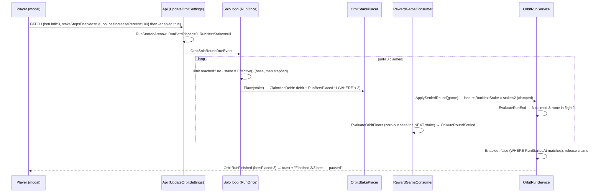

# SpaceStroker — "Orbit bet count & stake steps" — Implementation Spec

> **Status: Ready for implementation** — refined via Trello card
> [#208 New options for orbit](https://trello.com/c/CvQ6kWlQ) (2026-10-14).
> Repos affected: `monkify-backend`, `monkify-front`, and this doc in `monkify-meta`.
> Branch / worktree: `feature/new-options-for-orbit` → `.worktrees/new-options-for-orbit/<repo>`.
> Level: **`Feature`**. Modal design: mockup **C4c · tabs + plain words + read-back**
> (<https://claude.ai/artifact/NVprNoqbTC8x2GX3y92rCr>, round 2; owner's private artifact).
>
> **Purpose:** Orbit auto-bet today runs until a cash-out rule fires (take-profit **threshold**,
> stop-loss **floor**), the balance runs out, or the player pauses, and it always stakes the same amount.
> Players coming from Stake-style casinos expect an autobet with a **number of bets** and **on win / on
> loss stake steps** (back to base, or raise by X%: martingale-style progressions). This card adds both:
> a per-run **bet limit** on all three auto-bet games, and **stake steps** on the two solo games (Monkey
> Duel VS HOUSE, Hyper Roll). Both are shown in the modal's LET ORBIT PLAY section as a second tab next to
> the cash-out rules.

---

## 1. Summary

| Aspect | Today | **After this card** |
| --- | --- | --- |
| When auto-bet stops by itself | Threshold / floor cash-out, out of funds (NEEDS MONEY), self-exclusion | Same, **plus** "N bets placed in this run" ⇒ **pause** (`Enabled = false`, money stays). Whichever fires first wins. |
| What a "run" is | — | One START (paused → enabled). Each START resets the counter to 0 and the stake to base. |
| Bet limit on | — | **Cosmic Sprint, Monkey Duel, Hyper Roll** (every `AllowOrbit` type). Empty / 0 = no limit. |
| Stake per auto round | Cosmic Sprint `RequiredAmount`; solo `Stake ?? RequiredAmount` (fixed) | Cosmic Sprint unchanged. Solo: **base** = `Stake ?? RequiredAmount`; with **CHANGE STAKE** on, the next stake after a win/loss is either the base or the previous stake × (1 + X/100), rounded down to lamports, **clamped at `MaximumStake`**. |
| Refunded auto bet | Money back to custody | Same, and the bet **does not count** toward the limit and **does not move** the stake. |
| Manual Orbit bets | Never touch the stop rules | Never touch the count or the stake steps either. |
| Notice | — | In-app toast on the private Orbit channel + the section's status line "Finished N/N bets — paused". **No Telegram.** |
| Modal | AUTO CASHOUT block (OVER / LESS THAN) | Two tabs: **WHEN TO CASH OUT** (BALANCE OVER / BALANCE UNDER) and **BETS & STAKE** (named **HOW MANY BETS** on Cosmic Sprint), plus a read-back sentence. |

The money path (`OrbitStakePlacer`, custody → treasury, `FundedByOrbit` + `OrbitAutoPlaced`) is unchanged.
What changes is **whether** a stake is placed (the limit) and **how much** (the step), and that a run can
**end by itself**.

---

## 2. Constraints (MANDATORY)

From `monkify-meta/constraints.md` (full list there):

- **Worktree-per-repo:** work only in `.worktrees/new-options-for-orbit/<repo>` on
  `feature/new-options-for-orbit`; the hubs stay on `main`.
- **Unit tests:** update/add in `SpaceStroker.Tests`; run via `scripts/run_tests.bat` (never the full
  `dotnet test` — `ProductionSessions` is a slow Monte-Carlo suite); **report changed tests** at the end.
- **Integration test (Feature):** mandatory happy-path test in `SpaceStroker.Tests.Integration` (§11.2),
  plus the Cosmic Sprint "never more than N" flow (it is the complex flow, rule 8).
- **EF mapping:** inline in `SpaceStrokerDbContext.OnModelCreating`; no `IEntityTypeConfiguration`.
- **Migrations:** under `SpaceStroker.Infrastructure/Migrations/`; applied only by
  `SpaceStroker.Consumers` at startup. **Additive only.**
- **NoTracking DbContext:** every write from a consumer/service is `ExecuteUpdateAsync` (conditional where
  noted). A load-mutate-`SaveChanges` silently persists nothing; a tracked `SaveChanges` near the ledger
  can flush a stale `OrbitBalance` (`OrbitBetSettlementService.cs:328-345`).
- **Money moves only in `SpaceStroker.Consumers`.** The API validates and publishes; it never signs.
- **Orbit is LIVE with real money.** The ledger invariant `OrbitBalance.Amount == SUM(OrbitTransaction.Amount)`
  is untouched: this card writes **no** ledger rows of its own.
- **Vague refusals:** every new settings refusal is the existing `ErrorMessages.OrbitRequestInvalid`.
- **Secrets/config:** mock-only values in committed files (this card adds one non-secret endpoint name).
- **Deploy together:** new PATCH/DTO fields + a new realtime event ⇒ Consumers → API → front in one window.
- **Frontend:** no test framework exists in `monkify-front` (only `yarn lint` / `yarn build`), so the front
  is verified by lint + build + the manual QA in §13. Everything stays behind `orbitEnabled`.

---

## 3. Resolved product decisions

| # | Decision |
| --- | --- |
| 1 | **The bet count does not switch the cash-out rules off; whichever fires first wins.** Threshold/floor keep cashing out as today. Reaching the count only **pauses** Orbit (`Enabled = false`), and the money stays in Orbit. This is how the card's "number of bets overrides the cashout thresholds" is read: the count stops play without needing a cash-out. Rejected: "count disables threshold/floor" (no floor under a martingale). |
| 2 | **Empty / 0 = no limit** (today's behaviour). Upper bound **10,000** (sanity cap, refused above). |
| 3 | **Scope:** the bet limit on **all three** auto-bet types. Stake steps on **Monkey Duel + Hyper Roll only** (`OrbitSoloTypes.IsSolo`); Cosmic Sprint has a fixed price. |
| 4 | **A run = one START.** The paused → enabled transition resets the counter to 0 and the next stake to base, and stamps `RunStartedAt`. A manual pause ends the run. No "remaining" survives a pause. |
| 5 | **What counts:** an auto bet counts once its stake is **claimed** (`OrbitStakePlacer.ClaimAndDebit`). A refunded auto bet, a compensated `TransferFailed` and a `RegistrationRefused` **give the slot back**. "Waiting for the house" claims nothing. Manual Orbit bets never count. |
| 6 | **Never more than N.** The claim refuses once `RunBetsPlaced >= BetLimit` (conditional increment in the claim transaction), so Cosmic Sprint's planner, which signs round N+1 before round N settles (`specs/orbit-stop-loss-trigger.md` §3.2), can never place an (N+1)th bet. Orbit **pauses when the Nth bet settles** (no run bet left unsettled). |
| 7 | **Stake steps:** base = `Stake ?? RequiredAmount` (the stored `Stake` is never overwritten). **Back to base** ⇒ next = base. **Raise by X%** ⇒ next = previous × (1 + X/100), **truncated to 9 dp** (lamports). "Previous" is the **stake of the bet that just settled**. **Win** = `BetStatus.Rewarded`; **loss** = settled while still `BetStatus.Made`; **refund** (`Refunded`) leaves the next stake unchanged. Steps apply only while `StakeStepsEnabled`. |
| 8 | **X bounds:** 0–1000, at most 2 decimals. 0 behaves as back to base. Out of range ⇒ `OrbitRequestInvalid`. No negative %. |
| 9 | **Limits:** the next stake is **clamped to `[RequiredAmount, MaximumStake]`** and play continues at the cap. Balance short of the next stake ⇒ the existing NEEDS MONEY path (no bet, no reschedule; a deposit wakes the loop with the run intact). |
| 10 | **Run-finished notice:** a new private realtime event `OrbitRunFinished` ⇒ in-app toast, plus the section status line "Finished N/N bets — paused". **No Telegram.** |
| 11 | **Locked while `Enabled`:** bet limit, CHANGE STAKE, both step percentages (added to the existing solo-setup lock). Cash-out rules and the word stay editable while running. |
| 12 | **UI = mockup C4c:** the AUTO CASHOUT block becomes two tabs, **WHEN TO CASH OUT** (BALANCE OVER / BALANCE UNDER) and **BETS & STAKE** (**HOW MANY BETS** on Cosmic Sprint): PLAY [n] BETS (empty shows "no limit"); on solo types a CHANGE STAKE switch and, when on, rows **AFTER A WIN** / **AFTER A LOSS**, each a segmented **BACK TO BASE \| RAISE BY** + a % field; a read-back sentence; a progress line while running. The pinned modal must still not scroll. |
| 13 | Default tab **WHEN TO CASH OUT**, last tab remembered in localStorage; the **hidden tab's label carries a dot** when it holds an active rule. *(Refinement default, not separately asked.)* |
| 14 | *(Spec.)* Type change keeps the bet limit and the step settings (the limit is game-agnostic; steps are ignored on Cosmic Sprint). Only a PATCH that **sets** a step field while the target type is Cosmic Sprint is refused. |
| 15 | *(Spec.)* "Back to base" is stored as a **null percentage**, so there is no separate mode enum. The UI keeps the last typed % client-side while BACK TO BASE is selected, so toggling back does not lose it within the session. |

---

## 4. Data model

### 4.1 `OrbitEnrollment` — new columns

`monkify-backend/src/SpaceStroker.Domain/Orbit/Entities/OrbitEnrollment.cs`, after the solo setup block
(`:111-117`):

```csharp
// ---- Run limits & stake steps (specs/new-options-for-orbit.md §4) ----
/// <summary>Auto bets per run (one START). Null = no limit. Any auto-bet type.</summary>
public int? BetLimit { get; set; }
/// <summary>Apply the on-win / on-loss steps. Solo types only; ignored on Cosmic Sprint.</summary>
public bool StakeStepsEnabled { get; set; }
/// <summary>After a WIN: null = back to base, else raise the previous stake by this % (0–1000, 2 dp).</summary>
public decimal? OnWinIncreasePercent { get; set; }
/// <summary>After a LOSS: null = back to base, else raise the previous stake by this % (0–1000, 2 dp).</summary>
public decimal? OnLossIncreasePercent { get; set; }

// ---- Run state. WARNING: written with ExecuteUpdate outside UpdateOrbitSettingsHandler. ----
/// <summary>When the current run began (the last paused → enabled). Stale-run guard for decrements/steps.</summary>
public DateTime? RunStartedAt { get; set; }
/// <summary>Auto bets claimed in the current run, net of refunds / failed placements.</summary>
public int RunBetsPlaced { get; set; }
/// <summary>The stake the next solo auto round uses. Null = base. Never read on Cosmic Sprint.</summary>
public decimal? RunNextStake { get; set; }
```

### 4.2 EF configuration (inline)

In the existing `modelBuilder.Entity<OrbitEnrollment>` block (`SpaceStrokerDbContext.cs:412-442`):

```csharp
builder.Property(x => x.StakeStepsEnabled).IsRequired().HasDefaultValue(false);
builder.Property(x => x.OnWinIncreasePercent).HasPrecision(6, 2);
builder.Property(x => x.OnLossIncreasePercent).HasPrecision(6, 2);
builder.Property(x => x.RunBetsPlaced).IsRequired().HasDefaultValue(0);
builder.Property(x => x.RunNextStake).HasPrecision(18, 9);
```

`BetLimit` (int?) and `RunStartedAt` need no explicit mapping.

### 4.3 Migration

`AddOrbitRunLimits`: additive only (7 columns, defaults for the two non-null ones, no index). From
`monkify-backend/src`:

```bash
dotnet ef migrations add AddOrbitRunLimits -p SpaceStroker.Infrastructure -s SpaceStroker.Consumers
```

The latest existing migration is `20261007033746_AddStreamerWallets`; pattern after
`20261005210302_OrbitSoloAutoBet.cs`. Existing rows get `BetLimit = null`, `StakeStepsEnabled = false`,
`RunBetsPlaced = 0`, so **every live enrolment behaves exactly as today**. An old API/Consumers revision ignores the
columns.

---

## 5. Configuration

`SpaceStroker.Domain/Configs/Entities/GameSettings.cs`: new `OrbitRunFinishedEndpoint` next to
`OrbitAutoRoundEndpoint` (`:97`). `SpaceStroker.Common/spacestrokersettings.json` (`:165-166` block):
`"OrbitRunFinishedEndpoint": "OrbitRunFinished"`. Not a secret; no deploy-secrets binding needed.

Constants (code, not config): `OrbitRunRules.MaxBetLimit = 10_000`, `MaxIncreasePercent = 1000m`,
`IncreasePercentDecimals = 2`.

---

## 6. Backend behaviour

### 6.1 Pure helpers (Domain)

New `SpaceStroker.Domain/Orbit/Services/OrbitRunStake.cs` (static, unit-tested in isolation):

```csharp
// The stake the next auto round uses. Cosmic Sprint (non-solo): always RequiredAmount.
public static decimal Effective(OrbitEnrollment e, GameParameters p)
    => !OrbitSoloTypes.IsSolo(p) ? p.RequiredAmount
     : Clamp(e.RunNextStake ?? e.Stake ?? p.RequiredAmount, p);

// After a settled solo auto bet: back to base (null %) or raise the bet's own stake.
public static decimal Next(decimal settledStake, bool won, OrbitEnrollment e, GameParameters p)
{
    var basis = e.Stake ?? p.RequiredAmount;
    var pct = won ? e.OnWinIncreasePercent : e.OnLossIncreasePercent;
    if (pct is null or 0m) return Clamp(basis, p);
    var raised = settledStake * (1m + pct.Value / 100m);
    return Clamp(decimal.Round(raised, NativeSol.Decimals, MidpointRounding.ToZero), p);
}

static decimal Clamp(decimal s, GameParameters p)
    => p.MaximumStake is { } max ? Math.Min(Math.Max(s, p.RequiredAmount), max) : Math.Max(s, p.RequiredAmount);
```

`OrbitRunRules.ReachedLimit(OrbitEnrollment e) => e.BetLimit is > 0 && e.RunBetsPlaced >= e.BetLimit`.

### 6.2 Settings: `PATCH /orbit/settings`

`UpdateOrbitSettingsRequest.cs`: new fields (null = leave alone, as every existing field):

| Field | Clear flag | Validation (refusal ⇒ `OrbitRequestInvalid`) |
| --- | --- | --- |
| `BetLimit int?` | `ClearBetLimit` (also: `BetLimit == 0` ⇒ treated as clear) | `1..10_000` |
| `StakeStepsEnabled bool?` | — | Setting `true` refused when the **target** type is not solo |
| `OnWinIncreasePercent decimal?` | `ClearOnWinIncrease` (⇒ back to base) | `0..1000`, `decimal.Round(x, 2) == x`; refused when the target type is not solo |
| `OnLossIncreasePercent decimal?` | `ClearOnLossIncrease` | same |

`UpdateOrbitSettingsHandler.cs`:

1. **Lock** (`:93-100`): extend `ChangesSoloSetup` (`:356-361`) to a `ChangesRunSetup` that also returns
   true when the patch would **change** `BetLimit`, `StakeStepsEnabled`, `OnWinIncreasePercent` or
   `OnLossIncreasePercent` (re-sending the stored value or a no-op clear is not a change; the same
   "`enabled: false` in the same patch counts first" rule applies). Rename it, or add a sibling and OR them.
2. **Apply** next to `ApplySoloSetup` (`:161`): clear flags win over a value sent alongside, as at `:166-174`.
3. **Type change** (`:142-148`) does **not** reset the new fields (decision 14).
4. **Enable** (`:176-213`): on the paused → enabled transition (`!wasEnabled && willBeEnabled`) for **any**
   type, set `RunStartedAt = now`, `RunBetsPlaced = 0`, `RunNextStake = null` on the tracked row (this handler
   already writes the tracked row and calls `SaveChangesAsync` at `:336`). A repeat `enabled: true` while
   running resets nothing.

### 6.3 Counting: the claim is the only place a slot is taken

`SpaceStroker.Infrastructure/Services/Orbit/OrbitStakePlacer.cs`, `ClaimAndDebit` (`:182-221`), inside
the existing transaction and **only when `placement.OrbitAutoPlaced`**, before the commit at `:219`:

```csharp
var claimed = await _context.OrbitEnrollments
    .Where(e => e.PlayerId == placement.Player.Id
             && e.Enabled
             && (e.BetLimit == null || e.RunBetsPlaced < e.BetLimit))
    .ExecuteUpdateAsync(s => s.SetProperty(e => e.RunBetsPlaced, e => e.RunBetsPlaced + 1));
if (claimed == 0) { await transaction.RollbackAsync(); return StakeOutcome.RunLimitReached; }
```

- Add `RunLimitReached` to the outcome enum (`IOrbitStakePlacer.cs`). Like `InsufficientFunds` it means **no
  debit, no transfer, no bet**.
- Order inside the transaction: the debit-row insert and `TryDebit` first (their refusals are unchanged), the
  counter last, so every rollback leaves the counter untouched.
- The `e.Enabled` predicate also closes the gap that `PlaceOrbitBetConsumer` never re-checks `Enabled`: a
  placement racing a pause (manual or run-end) is refused here.

**Giving the slot back.** A new `IOrbitRunService.ReleaseSlot(playerId, DateTime claimedAt)` does a
conditional `ExecuteUpdate`: `RunBetsPlaced = RunBetsPlaced - 1 WHERE PlayerId = … AND RunBetsPlaced > 0
AND RunStartedAt <= claimedAt`. `claimedAt` is the `BetDebit` row's `CreatedDate` (or the bet's, which is
created after it), so a refund arriving after a fresh START **never** decrements the new run. Callers:

| Path | Where | `claimedAt` |
| --- | --- | --- |
| Refund of an `OrbitAutoPlaced` bet | `RefundInvalidBetConsumer.cs:111-121` (next to the existing `OnAutoRoundSettled` hook) | the bet's `CreatedDate` |
| `TransferFailed` compensated by the placer | `OrbitStakePlacer` after it appends the compensating row | the debit row's `CreatedDate` |
| `RegistrationRefused` (case B; money returns via `OrbitStakeReconciliationJob`) | `OrbitStakePlacer`, same point it returns `RegistrationRefused` | the debit row's `CreatedDate` |

`InDoubt` / `AlreadyClaimed` keep their slot (the stake may be live).

### 6.4 Shared planner (Cosmic Sprint)

- `OrbitBetPlacementService.ResolveCandidates` (`:41-104`): add the filter
  `x.BetLimit == null || x.RunBetsPlaced < x.BetLimit` next to the floor filter (`:99`), and project the two
  columns (`:73/:85`). This keeps the gate (`ArmGate`) from waiting on a player whose claim would be refused.
- `PlaceOrbitBetConsumer.cs`: the stake stays `game.Parameters.RequiredAmount` (`:169`). Map the new
  `RunLimitReached` outcome exactly like a pre-claim skip (`SkipPlacement`, no re-plan; see
  `features/orbit.md` §2 on why a failed placement must not be re-planned into).

### 6.5 Solo loop

`SpaceStroker.Infrastructure/Services/Orbit/OrbitSoloAutoBetService.cs`, `RunOnce` (`:70-336`):

1. **Effective stake** (`:131`): keep the shipped static refusal on the **base** stake
   (`enrollment.Stake ?? parameters.RequiredAmount` through `StakeIsWithinBounds`, `:132-137`): a base out of the
   type's current bounds (a config change) or a null ceiling still logs and idles the loop. The #200 rule "never
   clamped or resized silently" stands. Only **after** the base passes, stake
   `OrbitRunStake.Effective(enrollment, parameters)`, which clamps the **stepped** `RunNextStake` (decision 9).
   ⚠️ Without the clamp a compounded stake above `MaximumStake` would trip `StakeIsWithinBounds` and silently idle
   the loop. *(Implementation review: the first cut clamped the base too and was reverted.)*
2. **Limit** (new static refusal, before the lease next to `:132`): `OrbitRunRules.ReachedLimit(enrollment)`
   ⇒ call `IOrbitRunService.EvaluateRunEnd(playerId)` (§6.6) and return. **This must run before a round is
   opened**: refusing only at the claim would leave an opened, unbet board/duel shell (step 8 `:233-235`).
   The claim's conditional increment (§6.3) remains the hard guarantee.
3. The funds check (`:170-178`), the house pre-check (`:211-230`) and the placer call (`:287-289`) already use
   the local `stake`, so they pick up the effective stake with no further change. Funds short ⇒ the existing
   NEEDS MONEY return: **run state is kept**, and a deposit's `OrbitSoloRoundDueEvent` resumes the run.
4. **Outcome** switch (`:293-327`): `RunLimitReached` ⇒ hand the round back (`ClearRound`, the placer never
   touched it), release the lease, call `EvaluateRunEnd`, no reschedule.

### 6.6 Settlement: steps, then run end, then the shipped rules

New `IOrbitRunService` / `OrbitRunService` (`SpaceStroker.Infrastructure/Services/Orbit/`), registered in
Consumers:

```csharp
Task ApplySettledRound(Guid gameId);            // steps + run-end, per OrbitAutoPlaced player in the round
Task EvaluateRunEnd(Guid playerId, Guid? settlingGameId = null); // pause + push if the run is finished
Task ReleaseSlot(Guid playerId, DateTime claimedAt);
```

**`ApplySettledRound(gameId)`**: load the game (`AsNoTracking`, `Include(Parameters)`, `Include(Bets)`).
For each distinct player with an `OrbitAutoPlaced` bet in it:
1. If the type is solo, the enrolment has `StakeStepsEnabled`, and the bet is `Rewarded` (win) or `Made`
   (loss; there is no Lost status, `BetStatus.cs:9-20`): compute `OrbitRunStake.Next(bet.Amount, won, e, p)`
   and write it with `ExecuteUpdate … SET RunNextStake = @next WHERE PlayerId = … AND RunStartedAt <=
   @betCreatedDate`. A `Refunded` bet changes nothing.
2. `EvaluateRunEnd(playerId, settlingGameId: gameId)`.

**`EvaluateRunEnd(playerId, settlingGameId)`**: read the enrolment. If `Enabled` **and** `ReachedLimit` **and** the
player has **no** `OrbitAutoPlaced`, non-`Refunded` bet in a round whose status is in
`HouseEdgeCoverage.UnsettledStatuses` **other than `settlingGameId`** (the `OrbitDto.AutoStakeInFlight`
predicate, `GetOrbitHandler.cs:186-188`, minus that round), then:

⚠️ **The exclusion is load-bearing.** `UnsettledStatuses` covers everything before rewards complete, and the
normal reward path calls this while the round is still `RewardForWinnersInProgress`, so without it the round
being settled would count as in flight and the run would **never** pause on its Nth bet. The refunded-bet
exclusion covers a refund whose round is still open.

⚠️ **An open stake claim counts as in flight (added in implementation review).** The slot is taken when
`ClaimAndDebit` commits, but the bet row only appears after the on-chain transfer and `RegisterBet` (seconds
later; the Finalized preflight alone is ~13 s). Without this, a run end evaluated in that window (the previous
round's settlement, or the planner self-heal) would pause the run while its Nth stake is live. The check also
looks for this player's `BetDebit` claim that is neither linked to a bet nor compensated.
- `ExecuteUpdate … SET Enabled = false, WaitingForHouseSince = null, UpdatedDate = now WHERE PlayerId = …
  AND Enabled AND RunStartedAt = @runStartedAt`. The `RunStartedAt` predicate stops a stale evaluation from
  pausing a run the player just restarted.
- If that updated a row: `IOrbitChoiceClaimService.Release(playerId)` (a Cosmic Sprint free-text word claim
  follows a pause, as in `UpdateOrbitSettingsHandler.cs:333-334`; precedent for calling it from settlement:
  `OrbitBetSettlementService.cs:272`), then push `OrbitRunFinished` (§6.7). `SoloRoundId` is left alone.
- Any exception is logged at Error and **never fails settlement or a refund** (same rule as
  `OnAutoRoundSettled`); the solo loop's limit check (§6.5 step 2) is the retry path.

**Call sites and order.** ⚠️ **Blocker fixed:** `EvaluateOrbitFloors` → `EvaluateZeroOut` runs **before**
`ReleaseOrbitSoloLoop` (`RewardGameConsumer.cs:77/78` and `:267/:268`), and zero-out compares against the
stake (`OrbitBetSettlementService.cs:240-246`). The step must therefore land first:

| Path | New call | Position |
| --- | --- | --- |
| `RewardGameConsumer` no-winners exit (`:68-80`) | `ApplySettledRound(game.Id)` | **before** `EvaluateOrbitFloors` (`:77`) |
| `RewardGameConsumer` normal path | `ApplySettledRound(game.Id)` | after bet statuses are written (`:218`), **before** `EvaluateOrbitFloors` (`:267`) |
| `RefundInvalidBetConsumer` (`:111-121`) | `ReleaseSlot(...)` then `EvaluateRunEnd(playerId)` (the refunded bet is excluded by status) | before the existing `OnAutoRoundSettled` call |
| `OrbitPlacementPlannerConsumer` (after `PlanPlacements`) | `EvaluateRunEnd(playerId)` for every `Enabled` enrolment of the opened type at its `BetLimit` | **self-heal (added in implementation):** Cosmic Sprint has no other retry for a missed run end; idempotent, isolated, uses the `(GameParametersId, Enabled)` index |

Both are no-ops for a round with no `OrbitAutoPlaced` bet. Guard with the same "any `OrbitAutoPlaced`"
check `EvaluateOrbitFloors` uses, so ordinary rounds pay nothing extra.

**Zero-out and the floor.**
- `EvaluateZeroOut` (`OrbitBetSettlementService.cs:240-242`): replace the inline effective-stake
  expression with `OrbitRunStake.Effective(enrollment, typeRow)`.
- It must also **not announce "out of funds"** for an enrolment that run-end just paused. If it does not
  already return early for `!Enabled`, add that guard. Then the toast and Telegram zero-out message never
  fire for a finished run.
- `EvaluateFloor` / threshold are unchanged. A cash-out they trigger leaves `Enabled` as it is today, so the
  run continues until the money runs out or the count is reached (decision 1).

### 6.7 Realtime: `OrbitRunFinished`

From `OrbitRunService`, via `IHubContext<ActiveGamesHub>` exactly like `OrbitSoloAutoBetService.Push`
(`:494-513`): `Clients.Group(OrbitNotificationChannel.GroupFor(playerId)).SendAsync(gameSettings.OrbitRunFinishedEndpoint, payload.AsJson())`,
payload record `OrbitRunFinishedPush(Guid GameTypeId, string GameTypeName, int BetsPlaced)` (camelCase JSON,
like `OrbitAutoRound`). Not sent to Telegram.

### 6.8 Read side: `GET /orbit`

`GetOrbitRequest.cs` → `OrbitDto` (`:11-135`) adds:

| Field | Value |
| --- | --- |
| `betLimit` | `enrollment.BetLimit` |
| `stakeStepsEnabled` | `enrollment.StakeStepsEnabled` |
| `onWinIncreasePercent` / `onLossIncreasePercent` | stored values (null = back to base) |
| `runBetsPlaced` | `enrollment.RunBetsPlaced` |
| `runFinished` | `!Enabled && ReachedLimit(enrollment)`. Lets the front say "Finished N/N" after a reload. |
| `nextStake` | solo enrolled type: `OrbitRunStake.Effective(enrollment, params)`; otherwise null |

`GetOrbitHandler.cs:131-189` fills them. The **streamer view** (`:197-229`) sets them to their defaults
(null / false / 0), as it does every solo field.

### 6.9 What does **not** change

- The placer's money path, memos, `FundedByOrbit` / `OrbitAutoPlaced`, the ledger types.
- Threshold / floor semantics and comparisons (`features/orbit.md` §3), and the zero-out flag lifecycle.
- Manual Orbit wagers (`POST /orbit/wagers`): `OrbitAutoPlaced = false` ⇒ no counter, no steps.
- The solo gap, lease, in-flight rule, sweep and startup kick (`features/auto-bet-duel-hyper-roll.md`).
- `OrbitDto.OrbitBetsPlaced` (all-time count) keeps its meaning; the run count is the new `runBetsPlaced`.

---

## 7. Frontend behaviour

### 7.1 Types, service, realtime

- `types/orbit.ts`:
  - `OrbitState` (`:64-169`) adds `betLimit: number | null`, `stakeStepsEnabled: boolean`,
    `onWinIncreasePercent: number | null`, `onLossIncreasePercent: number | null`, `runBetsPlaced: number`,
    `runFinished: boolean` and `nextStake: number | null`.
  - `OrbitSettingsPatch` (`:176-219`) adds `betLimit?` + `clearBetLimit?`, `stakeStepsEnabled?`,
    `onWinIncreasePercent?` + `clearOnWinIncrease?`, and `onLossIncreasePercent?` + `clearOnLossIncrease?`.
  - New `OrbitRunFinishedEvent { gameTypeId: string; gameTypeName: string; betsPlaced: number }`.
- `services/orbitService.ts`: no change (`patchOrbitSettings` passes the patch through).
- `hooks/useGameHub.ts`: `ORBIT_RUN_FINISHED_EVENT = 'OrbitRunFinished'` beside `:46-48`, a third handler
  slot on `joinOrbitChannel` (`:315-341`), `off` in `leaveOrbitChannel` (`:345-360`), reset at `:395-397`,
  rejoin unchanged.
- `hooks/useOrbitNotifications.ts`: `onRunFinished` parses the payload, then
  `toast.info(\`Orbit finished ${n} bets on ${gameTypeName} and paused. Your money stays in Orbit.\`)`
  (`vue3-toastify`, as `:65`), then `refreshQuietly(wallet, 'run-finished')`. The once-per-episode
  "Orbit is paused" funds toast (`:112-150`) cannot also fire, because `isPausedForFunds` requires `enabled`.
- `hooks/useOrbit.ts`: `effectiveStakeFor` (`:900`) returns `orbit.nextStake` when Orbit is enabled on that
  solo type and `nextStake != null`, else today's expression. Then `isPausedForFunds` (`:913-934`),
  `needsFirstDeposit` (`:961-967`) and `hasFundsForRound` judge the **next** stake, as the backend does.
  ⚠️ **The client auto-park must not end a stake-steps run** (implementation review, owner decision 2026-10-14):
  judging the next stake makes `isPausedForFunds` true at the normal end of a double-on-loss run, and the old
  auto-park would send a real pause, so the next START would reset the run, breaking AC 10. On a solo type with
  stake steps on, auto-park is skipped: Orbit stays Enabled in NEEDS MONEY and a deposit resumes the same run.

### 7.2 The LET ORBIT PLAY section (mockup C4c)

`components/orbit/sections/OrbitAutoBetSection.vue`: the AUTO CASHOUT block (`:189-268`) becomes:

```
[ WHEN TO CASH OUT • ][ BETS & STAKE • ]      ← tab strip; "•" = the hidden tab holds an active rule
-- WHEN TO CASH OUT --------------------------
BALANCE OVER [ 1.00 SOL ]   BALANCE UNDER [ off ]          (today's two fields, relabelled)
-- BETS & STAKE (solo) -----------------------
PLAY [ 20  BETS ]                     CHANGE STAKE [▮▯]
AFTER A WIN   [BACK TO BASE | RAISE BY] [  —  %]           (rows only while CHANGE STAKE is on)
AFTER A LOSS  [BACK TO BASE | RAISE BY] [ 100 %]
Orbit plays 20 bets, then pauses. After a loss it doubles the stake; after a win it goes back to 0.010.
-- HOW MANY BETS (Cosmic Sprint) --------------
PLAY [ no limit ]
Orbit keeps playing until a cash-out rule fires or you pause.
```

- **New components** (none exist to reuse; `components/ui` has no tabs/switch/segmented control):
  - `components/orbit/OrbitRulesTabs.vue`: a two-tab `role="tablist"` strip modelled on
    `components/game/RaceTabs.vue`. Props: tabs `{ id, label, active: boolean }[]` and `modelValue`; it
    renders the dot for an inactive tab whose `active` is true.
  - `components/orbit/OrbitStakeStepRow.vue`: label + a `role="radiogroup"` segmented control **BACK TO BASE
    | RAISE BY** (pattern of `OrbitMultiplierPicker.vue:78,98`) + a % input (shown greyed with "—" when BACK
    TO BASE is selected). v-model `{ percent: number | null }`.
  - **CHANGE STAKE switch**: a styled native checkbox with `role="switch"` (the auto-pick checkbox pattern,
    `OrbitAutoBetSection.vue:158`, CSS `:337-353`). It goes inline, not as a component.
- **Labels (exact copy):**
  - Tabs: `WHEN TO CASH OUT`, `BETS & STAKE` (Cosmic Sprint: `HOW MANY BETS`).
  - Cash-out captions: `BALANCE OVER`, `BALANCE UNDER`.
  - Bet-count caption `PLAY`, unit `BETS`, placeholder `no limit`.
  - Switch `CHANGE STAKE`; rows `AFTER A WIN` / `AFTER A LOSS`; segments `BACK TO BASE` / `RAISE BY`.
  - The `AUTO-BETS ONLY` note moves into the cash-out tab's `ArcadeInfoTip` text. The existing tip texts
    (`thresholdHelp`, `floorHelp`) stay.
- **Read-back sentence** (always rendered under the BETS & STAKE / HOW MANY BETS tab content, `dialog-copy`
  muted), built by `useOrbitAutoBet`:
  - The count part: no limit ⇒ *"Orbit keeps playing until a cash-out rule fires or you pause."*; N ⇒
    *"Orbit plays N bets, then pauses."*
  - Then, solo only:
    - CHANGE STAKE off ⇒ *"Same stake every bet."*
    - On ⇒ *"After a loss it {doubles the stake | raises the stake by X% | goes back to {base}}; after a win
      it {…}."* Wording: 100% ⇒ "doubles the stake"; back to base ⇒ "goes back to {base, formatted}".
- **Progress line** while `orbitStatus === 'running'` and a limit is set, above START:
  - *"Bet {runBetsPlaced} / {betLimit}"*, plus *" · next stake {nextStake}"* when CHANGE STAKE is on.
  - With no limit and steps on: only *"Next stake {nextStake}"*.
- **Finished line** when `orbit.runFinished`: *"Finished {betLimit}/{betLimit} bets — paused"* in the same
  slot. The status tag already reads PAUSED (`OrbitStatusTag.vue`, `isParkedPause`). The START button label
  reads `START AUTO-BET`, not `RESUME AUTO-BET`, when `runFinished`, because it starts a fresh run
  (`toggleState`, `useOrbitAutoBet.ts:820-842`).
- **Locks:** the bet field, the switch and both rows use `setupLocked` (`useOrbitAutoBet.ts:72`) with the
  existing tooltip *"Pause auto-bet to switch games or change its setup."*. The cash-out fields keep their
  `wordLocked` gate only.
- **Tab memory:** `localStorage` key `space-stroker.orbit.rules-tab` (`cash` | `bets`), default `cash`. Every
  access goes through try/catch, like `useOrbitSections.ts:26-43`. Only the player's clicks write it.
- **Fit:** the pinned modal (`ArcadeModal pinned`, `min(720px, 84dvh)` desktop / `90dvh` sheet) must not
  scroll on the BETS & STAKE tab with CHANGE STAKE on, on Hyper Roll (the tallest game), desktop **and**
  mobile. If it does, shorten copy before anything else; never add a scroll.

### 7.3 State & auto-save (`hooks/useOrbitAutoBet.ts`)

- New refs: `betLimitInput`, `stakeStepsInput`, `onWinInput` / `onLossInput` (`{ percent: number | null }`,
  plus a client-only `lastTypedPercent` each). Synced from `orbit` on load, like `syncRuleFields`
  (`:143-149`).
- **Save with the setup cadence**, not the rules cadence: debounced 600 ms like the stake
  (`STAKE_AUTOSAVE_DELAY_MS`, `:599`). Arm from DOM `@input` only, never a `watch` (the PATCH-loop trap
  explained at `:248-253`).
  - An empty bet field sends `clearBetLimit: true`.
  - BACK TO BASE sends `clearOnWinIncrease` / `clearOnLossIncrease`.
  - The switch saves immediately.
- `flushPendingSetup` (`:728-731`) also flushes these fields on modal close (`OrbitModal.vue:215-225`).
- `onToggle` (`:791-813`) folds dirty run fields into the START PATCH, like the dirty stake.
- Client validation mirrors the server: bet 1–10,000 integer (0 ⇒ clear), % 0–1000 with ≤ 2 dp. An invalid
  value shows an inline red line under the tab content and is not sent.

---

## 8. Flow — a Hyper Roll run with PLAY 3 BETS, AFTER A LOSS raise 100%



---

## 9. Out of scope

- A variable stake on Cosmic Sprint; negative % (decrease steps); stop-on-profit / stop-on-loss *amounts*
  beyond the existing threshold/floor.
- A Telegram message for run-finished; an autobet for manual play; how-to-play / LP updates (not a new game
  mode; `GuideOrbit.vue` is game-agnostic).
- Changing the solo loop's pace (`features/auto-bet-duel-hyper-roll.md` "Pace").

---

## 10. File checklist

### 10.1 Backend (`monkify-backend/src`)

| # | File | Change |
| --- | --- | --- |
| 1 | `SpaceStroker.Domain/Orbit/Entities/OrbitEnrollment.cs` | 7 new properties (§4.1) |
| 2 | `SpaceStroker.Domain/Orbit/Services/OrbitRunStake.cs` *(new)* | `Effective`, `Next`, clamp (§6.1) |
| 3 | `SpaceStroker.Domain/Orbit/Services/OrbitRunRules.cs` *(new)* | `ReachedLimit` + bounds constants |
| 4 | `SpaceStroker.Domain/Configs/Entities/GameSettings.cs` | `OrbitRunFinishedEndpoint` |
| 5 | `SpaceStroker.Common/spacestrokersettings.json` | `"OrbitRunFinishedEndpoint": "OrbitRunFinished"` |
| 6 | `SpaceStroker.Infrastructure/Data/Context/SpaceStrokerDbContext.cs` | inline mapping (§4.2) |
| 7 | `SpaceStroker.Infrastructure/Migrations/<ts>_AddOrbitRunLimits.cs` *(new)* | additive migration + designer + snapshot |
| 8 | `.../Handlers/Orbit/UpdateOrbitSettings/UpdateOrbitSettingsRequest.cs` | new fields + clear flags |
| 9 | `.../Handlers/Orbit/UpdateOrbitSettings/UpdateOrbitSettingsHandler.cs` | validation, lock (`ChangesRunSetup`), apply, run reset on enable (§6.2) |
| 10 | `.../Handlers/Orbit/GetOrbit/GetOrbitRequest.cs` | `OrbitDto` new fields (§6.8) |
| 11 | `.../Handlers/Orbit/GetOrbit/GetOrbitHandler.cs` | fill them; streamer defaults |
| 12 | `.../Services/Orbit/IOrbitStakePlacer.cs` | `StakeOutcome.RunLimitReached` |
| 13 | `.../Services/Orbit/OrbitStakePlacer.cs` | conditional counter increment in `ClaimAndDebit`; `ReleaseSlot` on `TransferFailed` / `RegistrationRefused` (§6.3) |
| 14 | `.../Services/Orbit/IOrbitRunService.cs` + `OrbitRunService.cs` *(new)* | `ApplySettledRound`, `EvaluateRunEnd`, `ReleaseSlot`, push (§6.6–6.7) |
| 15 | `.../Services/Orbit/OrbitBetPlacementService.cs` | limit filter in `ResolveCandidates` |
| 16 | `.../Consumers/OrbitBetPlacement/PlaceOrbitBetConsumer.cs` | map `RunLimitReached` → skip |
| 17 | `.../Services/Orbit/OrbitSoloAutoBetService.cs` | effective stake at `:131`, limit static refusal, `RunLimitReached` outcome (§6.5) |
| 18 | `.../Services/Orbit/OrbitBetSettlementService.cs` | `EvaluateZeroOut` uses `OrbitRunStake.Effective`; `!Enabled` guard if missing |
| 19 | `.../Consumers/RewardGame/RewardGameConsumer.cs` | `ApplySettledRound` before `EvaluateOrbitFloors` on both exits |
| 20 | `.../Consumers/RefundInvalidBet/RefundInvalidBetConsumer.cs` | `ReleaseSlot` + `EvaluateRunEnd` for `OrbitAutoPlaced` refunds |
| 21 | DI registration (Consumers `Program.cs` / the Orbit service registration extension) | `IOrbitRunService` |

### 10.2 Frontend (`monkify-front/src`)

| # | File | Change |
| --- | --- | --- |
| 1 | `types/orbit.ts` | `OrbitState` + `OrbitSettingsPatch` fields, `OrbitRunFinishedEvent` |
| 2 | `hooks/useGameHub.ts` | `OrbitRunFinished` event wiring |
| 3 | `hooks/useOrbitNotifications.ts` | run-finished toast + quiet refresh |
| 4 | `hooks/useOrbit.ts` | `effectiveStakeFor` uses `nextStake` while enabled |
| 5 | `hooks/useOrbitAutoBet.ts` | run inputs, debounce/flush, validation, read-back, progress/finished lines, START label |
| 6 | `components/orbit/sections/OrbitAutoBetSection.vue` | tabs + C4c layout + labels (§7.2) |
| 7 | `components/orbit/OrbitRulesTabs.vue` *(new)* | tab strip with active-rule dot |
| 8 | `components/orbit/OrbitStakeStepRow.vue` *(new)* | BACK TO BASE \| RAISE BY + % row |

### 10.3 Meta (`monkify-meta`)

| # | File | Change |
| --- | --- | --- |
| 1 | `specs/new-options-for-orbit.md` | this spec |
| 2 | `INDEX.md` | map row + feature in flight |
| 3 | At ship: `features/new-options-for-orbit.md` *(new)*, `features/orbit.md` §3 (a fourth stop condition), `features/auto-bet-duel-hyper-roll.md` (effective stake) | KB sync (`/monkify-ship-feature`) |

---

## 11. Tests

### 11.1 Unit tests (`SpaceStroker.Tests/UnitTests`)

| Test file | Cases | AC |
| --- | --- | --- |
| `Domain/Orbit/OrbitRunStakeTests.cs` *(new)* | Effective: Sprint ⇒ RequiredAmount; solo ⇒ RunNextStake ?? Stake ?? RequiredAmount; clamp to max/min; null max ⇒ no upper clamp. Next: loss +100% from 0.010 ⇒ 0.020 ⇒ 0.040; win back to base; 0% ⇒ base; truncation to 9 dp (e.g. 0.000000001 × 1.5); raise past max ⇒ max | 7, 8, 9 |
| `Domain/Orbit/OrbitRunRulesTests.cs` *(new)* | ReachedLimit: null/0 limit never; N reached | 1, 4 |
| `Handlers/Orbit/UpdateOrbitSettingsTests.cs` | betLimit 1/10000 ok, 0 ⇒ clear, 10001 refused; % bounds and 3 dp refused; step fields on Sprint refused; each new field locked while enabled (and re-send allowed, pause+change allowed); enable resets run (RunStartedAt set, counter 0, RunNextStake null); repeat enable resets nothing; type change keeps fields | 5, 11, 12 |
| `Handlers/Orbit/GetOrbitSoloSetupTests.cs` | new DTO fields incl. `nextStake` (clamped) and `runFinished`; streamer defaults | 17, 20 |
| `Services/OrbitStakePlacerTests.cs` | auto claim increments; at limit ⇒ `RunLimitReached`, no debit row, balance untouched; manual wager never increments; disabled enrolment ⇒ `RunLimitReached`; `TransferFailed` / `RegistrationRefused` release the slot | 2, 6, 13 |
| `Services/OrbitBetPlacementServiceTests.cs` | `ResolveCandidates` excludes a player at the limit | 2 |
| `Consumers/PlaceOrbitBetConsumerTests.cs` | `RunLimitReached` ⇒ skip, no re-plan | 2 |
| `Services/OrbitSoloAutoBetServiceTests.cs` | uses the effective (stepped, clamped) stake for funds, coverage and placement; limit reached ⇒ no lease, no round opened, run-end evaluated; `RunLimitReached` ⇒ round handed back; NEEDS MONEY keeps run state | 1, 9, 10 |
| `Services/OrbitRunServiceTests.cs` *(new)* | ApplySettledRound: win/loss/refund/steps-off/Sprint; stale RunStartedAt guard; EvaluateRunEnd pauses only with nothing in flight **excluding the settling round** (regression: pausing on the Nth bet while that round is `RewardForWinnersInProgress`), ignores refunded bets, only the matching run, releases claims, pushes `OrbitRunFinished`; exception swallowed + logged; ReleaseSlot never below 0, never across runs | 1, 2, 5, 6, 14 |
| `Services/OrbitBetSettlementServiceTests.cs` | zero-out compares with the stepped next stake; no "out of funds" for a just-finished run | 10, 14 |
| `Consumers/RewardGameConsumerTests.cs` | `ApplySettledRound` called before floors on both exits; not called for rounds without auto bets | 7 |
| `Background/RefundInvalidBetConsumerTests.cs` | auto refund ⇒ ReleaseSlot + EvaluateRunEnd | 6 |
| `Api/OrbitSettingsBindingTests.cs` | `OrbitRunFinishedEndpoint` binds | 14 |

### 11.2 Integration tests (`SpaceStroker.Tests.Integration`) — mandatory

Extend `OrbitSoloAutoBetFlowTests.cs` (helpers `SeedPausedAsync` `:405-413`, `PatchOkAsync`,
`WaitForAutoBetAsync` `:457-476`, `AssertLedgerForAsync` `:480`, `GetOrbitAsync` `:421-433`):

1. **`HyperRoll_AutoBet_BetLimitWithLossSteps_PausesAfterN`** *(happy path)*:
   - Seed a paused, funded enrolment (balance comfortably above `base × (1+2+4)` and below anything a
     threshold would trip).
   - PATCH `{ stake: base, boardMode: "AVERAGE", multiplier: 3, betLimit: 3, stakeStepsEnabled: true,
     onLossIncreasePercent: 100 }` (win = back to base), then `{ enabled: true }`.
   - Wait for 3 settled `OrbitAutoPlaced` bets.
   - Assert:
     - exactly **3** auto bets were placed in the run, and no 4th appears after the gap + one sweep window;
     - each bet's `Amount` equals `OrbitRunStake.Next` applied to the previous bet's outcome (the first is
       `base`), computed from the **actual** outcomes;
     - `GET /orbit` → `enabled: false`, `runFinished: true`, `runBetsPlaced: 3`;
     - the balance equals deposit − Σ stakes + Σ credits, with **no cash-out row**;
     - `AssertLedgerForAsync` holds.
2. **`CosmicSprint_AutoBet_BetLimit_NeverPlacesMoreThanN`** *(complex flow)*, in `OrbitAutoBetFlowTests.cs`:
   - An enabled enrolment with `betLimit: 2` (seed it, then PATCH pause → limit → enable, so the run resets).
   - Let ≥ 3 rounds roll over, with successor rounds opening before the previous settles.
   - Assert exactly **2** `OrbitAutoPlaced` bets, then `enabled: false` after the 2nd settles, and the ledger
     invariant holds.

---

## 12. Acceptance criteria

1. Given Hyper Roll auto-bet with PLAY 3 BETS and no stake steps, when the player presses START, then Orbit places exactly 3 auto-bets at the base stake and then pauses (Enabled = false) with the remaining balance still in Orbit.
2. Given Cosmic Sprint auto-bet with PLAY 2 BETS, when successor rounds open before earlier rounds settle, then Orbit never places a 3rd bet in that run and pauses once the 2nd bet settles.
3. Given a bet limit is set together with a cash-out floor, when the balance falls below the floor before the count is reached, then the floor cashes out as today (whichever rule fires first wins).
4. Given an empty or 0 bet limit, when Orbit runs, then it behaves exactly as today (no count, no pause from a count).
5. Given a run in progress, when the player pauses and presses START again, then a fresh run begins: the counter is back to 0 and the next stake is the base stake.
6. Given a solo auto-bet whose bet is refunded (duel give-up or refused placement), when the refund lands, then the bet does not count toward the limit and the next stake is unchanged.
7. Given Monkey Duel auto-bet with CHANGE STAKE on and AFTER A LOSS raise 100%, when two bets lose in a row from a base of 0.010, then the next stakes are 0.020 and 0.040.
8. Given AFTER A WIN set to BACK TO BASE, when an auto-bet wins, then the next stake is the base stake.
9. Given a raise that would take the next stake above the game's MaximumStake, when the next round opens, then the stake is clamped to MaximumStake and play continues.
10. Given the next stake exceeds the Orbit balance, when the loop tries to place, then the existing NEEDS MONEY behaviour applies (no bet, money stays), and after a deposit the run resumes with its counter and next stake intact.
11. Given a raise percentage outside 0–1000 or with more than 2 decimals, or stake-step fields on Cosmic Sprint, when PATCH /orbit/settings is called, then it is refused with the vague OrbitRequestInvalid.
12. Given Orbit is enabled, when a PATCH would change the bet limit, the CHANGE STAKE switch or a stake-step row, then it is refused, while the cash-out rules and the word stay editable.
13. Given a manual Orbit-paid bet on the same game, when it settles, then it does not count toward the limit and does not move the stake progression.
14. Given the run reaches its limit, when Orbit pauses, then the player gets an in-app toast and the modal status reads "Finished N/N bets — paused", and no Telegram message is sent.
15. Given the Orbit modal on Hyper Roll or Monkey Duel, when the player opens LET ORBIT PLAY, then the rules area shows the tabs WHEN TO CASH OUT and BETS & STAKE with the C4c labels (PLAY n BETS, CHANGE STAKE, AFTER A WIN / AFTER A LOSS, BACK TO BASE | RAISE BY) and a read-back sentence describing the setup.
16. Given Cosmic Sprint is selected, when the player opens the second tab, then it is named HOW MANY BETS and shows only the bet count (no CHANGE STAKE switch).
17. Given Orbit is running with a limit, when the player opens the modal, then a progress line shows "bet X / N" and, with stake steps on, the next stake.
18. Given the hidden tab holds an active rule, when the other tab is open, then the hidden tab's label shows an indicator.
19. Given desktop and the mobile bottom sheet, when the BETS & STAKE tab is open with CHANGE STAKE on, then the pinned Orbit modal does not scroll.
20. Given an old frontend against the new backend, when it reads GET /orbit and PATCHes settings without the new fields, then Orbit behaves as today.

---

## 13. Manual QA (local stack)

1. Fund Orbit locally (devnet; see the memory notes on local paid bets). Open the modal → LET ORBIT PLAY.
2. Hyper Roll, stake 0.010, BETS & STAKE: PLAY 3, CHANGE STAKE on, AFTER A LOSS raise 100. Check the read-back
   sentence. START. Watch the progress line ("Bet 1 / 3 · next stake …") and the stakes on the game screen.
   After the 3rd round: toast, "Finished 3/3 bets — paused", tag PAUSED, button START AUTO-BET.
3. START again → counter back to 0, stake back to 0.010.
4. Cosmic Sprint, PLAY 2 → exactly 2 rounds bet, then paused. The second tab reads HOW MANY BETS with no
   switch.
5. While running, try the bet field / switch / rows → locked with the tooltip; the cash-out fields still edit.
6. Set a value on the hidden tab → the dot appears. Reload → the last tab comes back.
7. Desktop at 1366×768 and a phone-width sheet: Hyper Roll + BETS & STAKE + CHANGE STAKE on ⇒ no scroll.

---

## 14. Trello / pipeline

- **Source card:** [#208](https://trello.com/c/CvQ6kWlQ) — list **Specs created**; the **Implementation**
  section on the card lists branch, worktree, spec and level.
- **Next:** `/monkify-implement-feature New options for orbit`, then `/monkify-ship-feature New options for orbit`.
- **Deploy note:** additive migration; deploy Consumers → API → **front in the same window**. An old front is
  safe against the new backend (AC 20), but a new front against an old API would PATCH unknown fields.
  Prove it in prod by `GET /orbit` returning `runBetsPlaced` / `nextStake`. Rollback of Consumers is safe:
  the new columns are ignored and nothing is scheduled.

---

## 15. Revision log

| Date | Change |
| --- | --- |
| 2026-10-14 | Initial spec from refined card #208 (short-mode refinement in the same chat, mockup C4c) + code exploration. Code findings folded in: `StakeIsWithinBounds` would silently idle a compounded stake above `MaximumStake` (fixed by clamping in `OrbitRunStake.Effective`); zero-out runs **before** the solo settlement hook, so steps are applied in a new `ApplySettledRound` **before** `EvaluateOrbitFloors`; there is no Lost bet status (loss = `Made` on a settled round); `PlaceOrbitBetConsumer` never re-checks `Enabled` (the claim's conditional increment carries `Enabled`); a solo limit must be refused **before** a round is opened; there is no shared pause method (run-end pause is a conditional `ExecuteUpdate` + claim release); `monkify-front` has no test framework. Spec-level additions: bet-limit cap 10,000, back-to-base stored as a null %, type change keeps the run settings, `runFinished` / `nextStake` DTO fields. |
| 2026-10-14 | Implementation review: (1) a self-heal in `OrbitPlacementPlannerConsumer` re-evaluates full runs on every `GameOpenedEvent`, because Cosmic Sprint had no retry for a missed run end; (2) `EvaluateRunEnd` treats an open (unlinked, uncompensated) `BetDebit` claim as in flight, which closes the claim-to-bet window that could pause a run before its Nth stake landed. |
| 2026-10-14 | Final review (owner chose option B): the frontend auto-park skips a solo stake-steps run so AC 10 holds end to end; `ApplySettledRound` steps only from the player's latest auto bet of the run, so a redelivered older settlement can't overwrite `RunNextStake`; §6.5.1 keeps the base-stake static refusal. |
