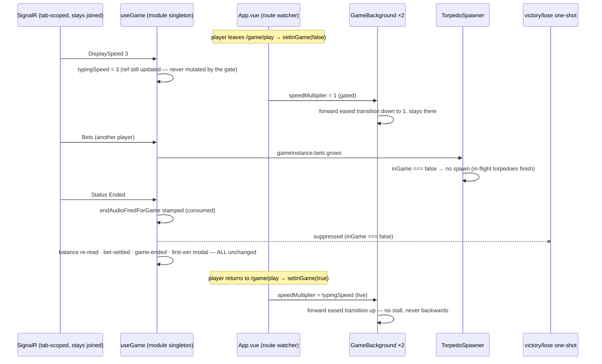

# SpaceStroker — "Off-page game presentation gate" — Implementation Spec

> **Status: SHIPPED 2026-08-10** — merged to `main` via `feature/off-page-game-presentation` in
> `monkify-front` + `monkify-meta`. Distilled in
> [`features/off-page-game-presentation.md`](../features/frontend-ux.md).
> Implementation landed **exactly as specified** — all three files in §8.1, no deviations.
> ⚠️ **The §11 browser QA pass was waived by the owner**, so acceptance criteria 1–10 shipped verified
> only by `yarn lint` + `yarn build` and code review, never driven against a running app. AC 7 (the
> balance re-read and the embedded `bet-settled` / `game-ended` signals) is the one worth exercising
> first — the change does not touch that code, but nobody watched it settle a round.
>
> **Status: Ready for implementation** — refined via Trello card
> [When the user quits the game, the background/music still take effect as if he was still in the game.](https://trello.com/c/FwzvH8fm)
> (#162, refined 2026-08-10).
> Repos affected: `monkify-front`, and this doc in `monkify-meta`.
> **`monkify-backend` is NOT affected** — no entity, enum, handler, consumer, endpoint, header, EF
> mapping, migration or SignalR contract change, and no backend branch exists for this card.
>
> **Purpose:** stop a round the player has walked away from driving the app's global animation and
> audio layer. On `/game/play` the starfield, torpedoes and the end-of-round sting mirror the live
> round exactly as they do today; on every other route the sky is calm and the sting is silent —
> while the socket, the settlement feedback and the money paths stay untouched.

---

## 1. Summary

`GameBackground` (×2) and `TorpedoSpawner` are mounted in `App.vue`, so they render on **every**
page, and they read `useGame` — a module singleton whose SignalR subscription is tab-scoped and
**deliberately** outlives `GamePage` (`specs/unified-websocket-connection.md`). Leaving `/game/play`
mid-round therefore leaves that round's `DisplaySpeed` / `Bets` / `Status` events driving the global
layer.

| Leak | Source | Rendered by | After this change |
| --- | --- | --- | --- |
| Starfield ramps to speed 2/3, backdrop drift follows | `typingSpeed` (`useGame.ts:54`) | `GameBackground` ×2 (`App.vue:257-272`) | Speed prop is `1` off `/game/play`; eases down once and stays |
| A torpedo flourish per new bet | `gameInstance.bets` | `TorpedoSpawner` (`App.vue:275`) | No new spawns off `/game/play`; in-flight ones finish |
| `victory` / `lose` one-shot on round end | `useGame.ts:491` (module singleton scope) | any page | Suppressed off `/game/play`, and **consumed** so it never fires late |

**The fix is a presentation gate at the consumer, not a socket change.** One boolean — "is the player
on the game page right now" — is read by the three consumers above. Nothing else changes.

### 1.1 What deliberately does NOT change

| Behaviour | Why it stays |
| --- | --- |
| `useGame` keeps its subscription, its state and its group membership | The same `Status → Ended` drives the balance re-read with win/refund attribution, the embedded `bet-settled` / `game-ended` signals and `useOrbitRedirect`. `detachFromGame()` on leaving the page would silently break settlement feedback for the common case (bet → walk to the lobby → round settles while away). |
| `typingSpeed` itself is never mutated by this change | The typer (`GameTyper.vue:42,46`) and Edson (`GameMonkey.vue:201`) read the same ref. Zeroing it would leave a returning player looking at a stalled round until the next `DisplaySpeed` event. |
| The Orbit first-win modal fires off-page (`useGame.ts:504-505`) | Owner's call. It only opens on a **paid** win and is how a player who walked away learns about Orbit — the one off-page effect that is useful rather than decorative. |
| `gradualSpeedReset()` / `evaluateSpeedReset()` and their module-scope `visibilitychange` listener | Unchanged. `typingSpeed` must still land at 1 for a returning player, whatever route they were on. |
| Already-spawned sprites and a torpedo mid-blast | Nothing is purged. The only visible change at the moment of leaving is the speed easing back to 1. |

### 1.2 Findings from code exploration the card did not have

These are the parts an implementer would otherwise discover the hard way. **F1 changes the
implementation the card describes.**

- **F1 — ⚠️ A `v-if` on `<torpedo-spawner>` would PURGE, breaking AC 3.** The card's frontend-impact
  section suggests joining the existing `!lightMode && density > 0` gate on `App.vue:275`. That is
  wrong here: `TorpedoSpawner.onUnmounted` (`TorpedoSpawner.vue:58-68`) calls `removeNode` on **every
  tracked id**, and the `#torpedo-container` div is the component's own template root — unmounting it
  takes the whole container, and every torpedo inside it, out of the DOM instantly. `onMounted`
  (`:51-56`) then removes every `.torpedo-animation` again on return. AC 3 says explicitly that
  *nothing is purged* and that a torpedo mid-blast *completes its animation*. **The gate therefore
  goes on the spawn watcher inside the component; the `v-if` on `App.vue:275` is left exactly as it
  is.**
- **F2 — the sting is already stamped before it plays.** `endAudioFiredForGame = endedGameId` is
  `useGame.ts:488`, the `playAudio` is `:491`. Gating only the `playAudio` call satisfies "consumed,
  not deferred" (AC 5) with no reordering — the one-shot is spent either way.
- **F3 — `/background` is covered on both axes for free.** Its route name is `Background`, so the
  speed prop is 1 (AC 10). It also currently **spawns torpedoes for a live round** — the spawner is
  mounted there (`canonicalGraphics` gives it the default density 0.45, and desktop is not light
  mode), which the card did not note. The watcher gate fixes that too.
- **F4 — the only global consumers of `typingSpeed` are the two `GameBackground` instances.**
  `GameTyper` (via `GameTerminal`) and `GameMonkey` are mounted only by `GamePage.vue` and unmount
  with it. That is precisely why gating at the consumer costs nothing and mutating the ref would cost
  a stalled return.
- **F5 — practice needs no gate, and the code says so.** `PracticeMonkey.vue:19` records that
  `GameMonkey` is not reused "because it reads `gameInstance`/`typingSpeed` straight" — practice
  drives neither, so `/game/practice` is already quiet. Confirms the card's out-of-scope line.
- **F6 — ⚠️ guard ordering inside the torpedo watcher matters.** `ignoreInitialBet` is a one-shot
  consumed at the top of the watcher (`TorpedoSpawner.vue:101-104`). If the new `inGame` guard returns
  *before* it, a bet arriving off-page leaves the one-shot armed and it swallows the first torpedo
  after the player returns. The guard goes **after** the `ignoreInitialBet` block (see §5.3).
- **F7 — no new arithmetic is needed for the return.** `GameBackground`'s `speedMultiplier` watcher
  (`:320-331`) starts a normal forward eased transition from the current speed, and
  `handleVisibilityChange` (`:397-424`) re-derives from `props.speedMultiplier`. 3 → 1 on leaving and
  1 → 3 on returning are both ordinary forward transitions, and the hidden-tab path reads the gated
  prop. AC 8 and AC 9 fall out of the existing machinery — **do not add a repair path**; that
  arithmetic is what caused the ~27× speed error in #149
  (`features/background-lifecycle-hardening.md`).

---

## 2. Constraints (MANDATORY)

From `monkify-meta/constraints.md` (full list there):

- **Worktree-per-repo** (§2, `AGENTS.md` rule 6): work happens in
  `.worktrees/off-page-game-presentation/<repo>`; both hubs stay on `main`. Branch
  `feature/off-page-game-presentation`, same name in `monkify-front` and `monkify-meta`.
- **No backend surface ⇒ no unit tests, no integration test.** §3 / `AGENTS.md` rule 8 mandate a
  happy-path integration test for every **new feature**; this is a **bug fix** with zero backend
  surface, so neither applies and no `SpaceStroker.Tests*` file is touched.
- **`monkify-front` has no test runner** (no `.spec` / `.test` files anywhere in `src/`). The
  automated bar is `yarn lint` + `yarn build`; correctness is verified by the manual QA pass in §9
  against the acceptance criteria in §8.
- **Display-only, always.** Per `features/audio-overhaul.md`, audio and the starfield have zero effect
  on bets, payouts, winners or game state. **Nothing in this card may touch a money or settlement
  path** — see §1.1 and AC 7.
- **Timestamps, not timers** (`useIdleDisconnect.ts:26-29`,
  `specs/background-lifecycle-hardening.md`) if any deadline were introduced. This change introduces
  **none** — no `setTimeout`, no new interval, no new deadline.
- §8 — prefer editing existing files over creating new ones. This change adds **no new file** to
  `monkify-front`.

---

## 3. Resolved product decisions

| # | Decision |
| --- | --- |
| 1 | **Mute the presentation; do NOT detach from the hub.** `useGame` keeps its subscription, state and group membership. `detachFromGame()` on leaving the page was rejected — it would break the balance re-read, the embedded `bet-settled` / `game-ended` signals and `useOrbitRedirect`. |
| 2 | **The gate is the page, not the socket.** On `/game/play` (route name `Game`) the global layer mirrors the live round; on every other route it renders the calm default sky. |
| 3 | **Background speed:** `App.vue` passes `inGame ? typingSpeed : 1` to **both** `GameBackground` instances. |
| 4 | **`typingSpeed` itself is never mutated.** Gate at the consumer so the return is instant and free. |
| 5 | **Torpedoes: no new spawns off the game page** — implemented as a guard in the component's bet watcher, **not** as a `v-if` (finding F1). |
| 6 | **No purge on leaving.** Sprites on screen and a torpedo mid-blast finish normally via the existing `animationend` + `BLAST_MS` backstop. |
| 7 | **Victory / lose sting: suppressed off-page AND consumed** — `endAudioFiredForGame` is still stamped, so it can never fire late. |
| 8 | **The Orbit first-win modal is deliberately KEPT** firing off-page (`useGame.ts:504-505`), unchanged. |
| 9 | **Returning mid-round adopts the live speed immediately** via the existing forward transition. Never repair a paused transition (#149). |
| 10 | **`/background` stops inheriting a live round's ramp.** An intended behaviour change — exactly what the route's `canonicalGraphics` flag already asks for. |
| 11 | **"In game" is a module-level flag in `useGame.ts`, written by `App.vue`'s route watcher** (see §4). The card left the form open; §4 records the choice and why the alternative was rejected. |

---

## 4. How "in game" is derived

The card leaves this open ("a route-derived computed or a flag owned by `GamePage`'s mount/unmount are
both acceptable"). **Neither pure form works for all three consumers**, so the spec fixes one shape:

**A module-level `inGame` ref in `useGame.ts`, written from `App.vue`'s route watcher.**

Why:

- The **audio** consumer (`useGame.ts:491`) sits in `onStatus`, a handler bound onto the tab's
  connection by `hub.attachToGame`. Its closure outlives the component that created it, and
  `useGame`'s module scope (lines 44-181) has no router. A computed living in `App.vue` is not
  reachable from there.
- A flag owned by **`GamePage`'s mount/unmount** was rejected: `GamePage` also mounts on
  `/game/play` for the reward view, and tying a global presentation rule to one component's lifecycle
  hooks puts the invariant somewhere no other consumer can see it. The route **is** the rule.
- Reading `useRoute()` inside `onStatus` would happen to work (vue-router's route object stays live
  after the creating component unmounts) but is fragile and non-obvious — rejected.

**This mirrors a shipped precedent exactly:** `useDisplaySettings.ts:80,104` owns `canonicalGraphics`
+ `setCanonicalGraphics`, and `App.vue:68-72` writes it from a `route.meta` watcher. Follow that
shape.

⚠️ **First-paint trap, and why it is benign here.** `App.vue:64-72` documents that `route.meta` is not
necessarily resolved at first paint, which is why `canonicalGraphics` is *also* seeded synchronously
from `window.location.pathname`. **Do not add a pathname seed for `inGame`.** The failure mode is the
opposite of harmful: an unresolved route yields `false`, the speed prop is 1 — which is the correct
value on a cold load anyway, since `typingSpeed` starts at 1 (`useGame.ts:54`) and no round has
loaded. The watcher flips it the moment the route resolves.

---

## 5. Frontend behaviour (`monkify-front`)

### 5.1 `src/hooks/useGame.ts`

**Module scope** (alongside the other singleton state, lines 44-181) — add the flag and its setter:

```ts
// "The player is on the game page right now." A PRESENTATION gate, nothing else: the socket, the
// group membership and every settlement path are deliberately untouched (#162), because the same
// Status → Ended drives the balance re-read, the embedded bet-settled / game-ended signals and
// useOrbitRedirect.
// Module scope, like `hub` and the speed-reset deadline above: onStatus is bound onto the tab's
// connection and outlives the component that bound it, so a computed in App.vue is unreachable from
// here. App.vue's route watcher is the single writer — same shape as
// useDisplaySettings.setCanonicalGraphics.
const inGame = ref(false);
```

Expose both on the composable's return object (near `typingSpeed`):

```ts
    inGame,
    setInGame: (on: boolean) => {
      inGame.value = on;
    },
```

**The one behaviour change** — `useGame.ts:491`, inside the `GameStatus.Ended` branch. `:488`
(`endAudioFiredForGame = endedGameId`) stays exactly where it is, so the one-shot is **consumed**
whether or not it is heard:

```ts
// Off the game page the sting is SUPPRESSED but still CONSUMED (the stamp above already ran): a
// victory fanfare for a round that ended minutes ago, on the lobby or over another page's music,
// reads as a bug rather than as feedback (#162).
if (inGame.value && audioTabActive()) playAudio(won ? victoryAudio : loseAudio);
```

Everything else in that branch is untouched — `nearMiss.finish`, the `postToParent('bet-settled')`,
`postToParent('game-ended')`, `useFirstWinUpsell().maybeOpen()` and both `gradualSpeedReset()` calls.

### 5.2 `src/App.vue`

Destructure the two new members (`:46`) and add the writer next to the existing `canonicalGraphics`
watcher (`:64-72`):

```js
  const { typingSpeed, inGame, setInGame, selectedGame, gameTypes, handleMobileDeeplinkReturn } =
    useGame();
```

```js
  // The global animation layer lives here, but useGame's socket is tab-scoped and deliberately
  // outlives GamePage — so a round the player walked away from used to keep ramping the starfield and
  // firing torpedoes on every other route (#162). The gate is the PAGE, not the socket. Unlike
  // canonicalGraphics above this needs no synchronous pathname seed: an unresolved route yields
  // false, i.e. the default speed, which is the right value on a cold load anyway.
  watch(() => route.name === 'Game', (onGamePage) => setInGame(onGamePage), { immediate: true });
```

Template — **both** `GameBackground` instances (`:262` and `:270`):

```html
:speed-multiplier="inGame ? typingSpeed : 1"
```

⚠️ The `v-if` on `<torpedo-spawner>` (`:275`) is **left exactly as it is**
(`!lightMode && density > 0`). See F1.

### 5.3 `src/components/background/TorpedoSpawner.vue`

Read the flag and guard the **spawn path**, after the `ignoreInitialBet` one-shot is consumed
(finding F6) and before `sweep()`/the cap check:

```ts
  const { gameInstance, ignoreInitialBet, inGame } = useGame();
```

```ts
      if (ignoreInitialBet.value) {
        ignoreInitialBet.value = false;
        return;
      }
      // No new flourishes for a round the player has left (#162). Placed AFTER the one-shot above so
      // an off-page bet still consumes it — guarding first would leave it armed and swallow the first
      // torpedo after the player comes back. Deliberately a guard here rather than a v-if in App.vue:
      // unmounting this component takes #torpedo-container, and every torpedo in it, out of the DOM —
      // a torpedo mid-blast must be allowed to finish (AC 3).
      if (!inGame.value) return;
```

The component stays mounted, so `#torpedo-container`, the `animationend` listeners, the `BLAST_MS`
deadlines and the `visibilitychange` sweep keep working for whatever is already in flight.

---

## 6. Flow diagram



---

## 7. Out of scope

- Changing the tab-scoped socket, the group lifecycle, or when a round rolls over. The round staying
  joined after the player leaves is the deliberate `unified-websocket-connection` design, and the idle
  disconnect already bounds it.
- The Orbit first-win modal — explicitly kept as-is.
- Chat (`useChatUnread` accumulating a boolean off-page is correct today), near-miss rows, the header
  mute/volume control, and the balance/settlement paths.
- `/game/practice` — it never drove the global starfield (confirmed by F5).
- Freezing the backdrop drift entirely off-page. Speed returns to the default of 1; the sky is calm,
  not frozen.
- Any purge or early removal of sprites/torpedoes already on screen.
- Any backend, DB, SignalR-contract or settlement change.

---

## 8. File checklist

### 8.1 Frontend (`monkify-front`)

| # | File | Change |
| --- | --- | --- |
| 1 | `src/hooks/useGame.ts` | Module scope (44-181): add `const inGame = ref(false)`. Return object (~1084): expose `inGame` + `setInGame`. Line 491: `if (inGame.value && audioTabActive()) playAudio(...)` — line 488's stamp untouched. |
| 2 | `src/App.vue` | Destructure `inGame` + `setInGame` (`:46`); add the `route.name === 'Game'` watcher beside the `canonicalGraphics` one (`:64-72`); both `:speed-multiplier` bindings (`:262`, `:270`) become `inGame ? typingSpeed : 1`. **`<torpedo-spawner>`'s `v-if` (`:275`) is NOT touched.** |
| 3 | `src/components/background/TorpedoSpawner.vue` | Destructure `inGame` (`:7`); `if (!inGame.value) return;` in the bets watcher, **after** the `ignoreInitialBet` block (`:101-104`). |

No new file, no service/type/endpoint/env change, no user-facing copy change.

### 8.2 Backend (`monkify-backend`)

**None.** No branch, no files.

### 8.3 Meta (`monkify-meta`)

| # | File | Change |
| --- | --- | --- |
| 1 | `specs/off-page-game-presentation.md` | This spec (new). |
| 2 | `INDEX.md` | Spec row in the KB map; "Feature currently in flight" updated. |
| 3 | `features/off-page-game-presentation.md` | **At ship time only** (`/monkify-ship-feature`), not in this card's implementation. Also update `features/background-lifecycle-hardening.md`, whose "Same density everywhere / both layers live globally in `App.vue`" note now has a companion rule: the global layer is **gated by route**. |

---

## 9. Tests

**No test files change.**

- **Backend:** nothing to test — zero backend surface. `constraints.md` §3 / `AGENTS.md` rule 8's
  mandatory integration test does **not** apply (bug fix, and no backend happy path exists to drive).
- **Frontend:** `monkify-front` has no test runner. The automated bar is:

  ```bash
  cd .worktrees/off-page-game-presentation/monkify-front
  yarn lint
  yarn build
  ```

  Both must pass with no new errors or warnings (AC 11).

---

## 10. Acceptance criteria

Copied 1:1 from the Trello checklist.

1. Given a round is `InProgress` at typing speed 2 or 3, when the player navigates from `/game/play`
   to any other route (`/`, `/game`, `/orbit`, `/how-to-play`, `/game/history`, `/game/stats`), then
   the starfield eases back to its default speed and stays there for the rest of that round,
   regardless of further `DisplaySpeed` events.
2. Given the player is on a route other than `/game/play`, when another player places a bet in the
   round they left, then no torpedo is spawned anywhere in the app.
3. Given sprites are on screen and a torpedo is mid-blast, when the player leaves `/game/play`, then
   nothing is purged: the sprites keep drifting at the default speed and the torpedo completes its
   animation and is removed normally.
4. Given the player placed a bet and then left `/game/play`, when that round reaches `Ended`, then
   neither the victory nor the lose one-shot is played on the page they are on.
5. Given a round ended while the player was off `/game/play` and its sting was suppressed, when they
   navigate back into that same round's reward view, then no victory or lose sting plays at any point
   (the one-shot was consumed, not deferred).
6. Given the player placed a **paid** bet, left `/game/play`, and won, when the round ends, then the
   Orbit first-win modal still opens on whatever page they are on — unchanged from today.
7. Given the player bet and then left `/game/play`, when the round settles while they are away, then
   the wallet balance still re-reads with win/refund attribution and the embedded `bet-settled` /
   `game-ended` messages are still posted to the parent frame — no settlement or money path changes.
8. Given a round the player left is still `InProgress` at speed 3, when they navigate back to
   `/game/play`, then the starfield adopts the live speed immediately — it never stalls at the default
   waiting for the next `DisplaySpeed` event, and the transition never runs backwards.
9. Given the player left `/game/play` mid-round, when they switch to another browser tab and back,
   then the starfield is still at its default speed — the `visibilitychange` resync re-derives from
   the gated prop and cannot resurrect the ramp.
10. Given a live round is running in the tab, when `/background` is opened, then it renders the
    canonical calm sky and never inherits that round's speed ramp.
11. Given the change is complete, when `yarn lint` and `yarn build` are run in `monkify-front`, then
    both pass with no new errors or warnings.

---

## 11. Manual QA

Local stack up (`monkify-backend` docker compose), front served from the feature worktree. Two
browser profiles/tabs are needed for a real second player (games need 2 players to start).

1. Open `/game/play` on a game type, bet from both players, let the round reach `InProgress` and the
   speed ramp to 2/3. Confirm the sky is visibly fast. → baseline.
2. Navigate to `/` mid-round. The starfield eases down to the calm default within a couple of seconds
   and **stays** there while the round keeps running. (AC 1)
3. From the second profile, place a bet in that round while you sit on `/`. No torpedo appears. (AC 2)
4. Repeat step 2 while a torpedo is visibly crossing the screen: it must finish its travel and vanish
   normally, and the sprites already on screen must keep drifting rather than disappear. (AC 3)
5. Stay off-page until the round ends. No victory/lose sting plays. Confirm the balance still updates
   with the win/refund and, if testing embedded, that `bet-settled` / `game-ended` still reach the
   parent frame. (AC 4, AC 7)
6. On a **paid** winning bet placed before leaving: the Orbit first-win modal still opens on `/`.
   (AC 6)
7. Navigate back to `/game/play` and into that ended round's reward view — still silent, no late
   sting. (AC 5)
8. New round: leave at speed 3, come back while still `InProgress`. The sky picks the live speed
   straight back up — no stall at the default, no backwards transition. (AC 8)
9. Leave `/game/play` mid-round, switch to another browser tab for ~30s, come back. Still calm.
   (AC 9)
10. With a live round running in the tab, open `/background`. Canonical calm sky, and no torpedoes
    even as bets land. (AC 10)
11. `yarn lint` + `yarn build` clean; browser console shows **0 errors** across the pass. (AC 11)

---

## 12. Trello / pipeline

- **Source card:** [#162 · FwzvH8fm](https://trello.com/c/FwzvH8fm) — list **Specs created**; the
  **Implementation** section on the card carries branch, worktree and spec path.
- **Branch / worktree:** `feature/off-page-game-presentation` in `monkify-front` + `monkify-meta`;
  worktrees at `.worktrees/off-page-game-presentation/<repo>`.
- **Next:** `/monkify-implement-feature 162`, then `/monkify-ship-feature 162`.

---

## 13. Revision log

| Date | Change |
| --- | --- |
| 2026-08-10 | Initial spec from refined card #162 (+ findings F1-F7 from code exploration; F1 changes the torpedo gate from a `v-if` to a watcher guard). |
