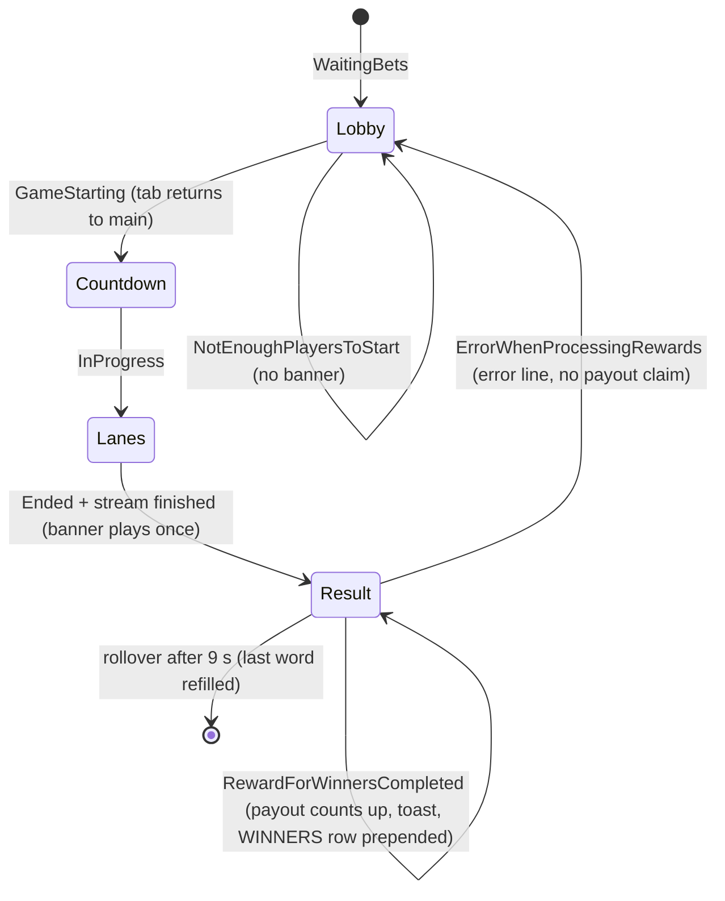
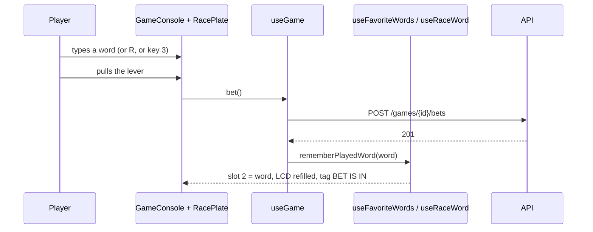

# SpaceStroker — "Better UX/UI in old game modes" — Implementation Spec

> **Status: Shipped (2026-10-05)** — merged to `main` from `feature/old-game-modes-ux` in `monkify-backend`,
> `monkify-front` and `monkify-meta`. Distilled in [`../features/old-game-modes-ux.md`](../features/old-game-modes-ux.md);
> where this spec and the code disagree (owner review rounds, AC 12's save-on-empty-key amendment), the code wins.
>
> **Originally: Ready for implementation** — refined via Trello card
> [#197 Better UX/UI in old game modes](https://trello.com/c/QtLMPhjU/197-better-ux-ui-in-old-game-modes)
> (2026-10-01). Level **`Feature`**. Repos affected: `monkify-front` (almost all of it),
> `monkify-backend` (one field on the history row), and this doc in `monkify-meta`. Branch
> `feature/old-game-modes-ux` in every repo. Worktrees at `.worktrees/old-game-modes-ux/<repo>`.
>
> **Design reference (agreed with the owner, built from the real sprites):**
> <https://claude.ai/artifact/QiuF5iL6D7B52rLCHvwsaC> — 18 artboards (Cosmic Sprint ×7, Space Jackpot
> ×6, phone ×2, the RANDOM key variants, two "today" screenshots). Private to the owner until shared
> from the page. **Order of authority: this spec → the card text → the canvas.** §3.2 lists every place
> the canvas is deliberately not followed.
>
> **Purpose:** Cosmic Sprint and Space Jackpot still run on the first-generation game screen: a text
> transcript, a decorative keyboard image, eight dead keys under glass, and no win/loss moment beyond a
> text line. Hyper Roll and Monkey Duel have real consoles, structured screens and result effects. This
> card lifts the two older modes to that standard — one shared console where every key works, a tabbed
> screen (round / favourites / winners), a countdown, race lanes, and win / loss / voided / spectator
> banners — for every player of those modes, practice included.

---

## 1. Summary

| | Today | After this change |
| --- | --- | --- |
| Console, left plate | Word input in a grey bezel over a decorative `keyboard.png` | Word LCD (full width); `?` = **HELP**, `R` = **RANDOM**; three round **tab keys** over a tab-name strip |
| Console, middle plate | Lever. A tag only on Space Jackpot (`ENTER FREE`) | Lever + a tag that says what it does next, in both modes |
| Console, right plate | Keys 1-8 dimmed under `glass.png`, dead | Keys 1-8 = **favourite words** (blue saved, gold loaded, grey empty, red on the FAVORITES tab), engraved `FAVORITES` |
| Word field | Cleared after every bet | Refilled with the player's **last bet word** (per wallet, this browser) |
| Screen | One scrolling transcript (`> GAME:` / `> BET:` / `> POT:` / `> BETS PLACED:`) | Three view-only **tabs**: `RACE` or `DRAW` · `FAVORITES` · `WINNERS`. Nothing scrolls. |
| Waiting for bets | A list of `> word (player)` lines | POT plate (`sol.svg`), timer / players plate, Space Jackpot's `YOUR $STROKE` plate, and **player cards** |
| Round starting | One line: `> RACE STARTS IN 7 SECONDS...` | A large **countdown** with the players' words |
| Round running | The stream plus the player's own near-miss rows | **Race lanes**: one per word, own pinned on top, the rest the closest words, re-sorted live |
| Result | Text lines; a toast for paid winners only | The same lines **plus a banner**: win (coin shower), loss, voided ticket, spectator. A Space Jackpot winner gets the toast too. |
| History on the game screen | None (menu → Games History) | `WINNERS` tab: the latest rounds with **who won** (new backend field) |
| Practice (`/game/practice`, race) | Mirrors the old screen | Mirrors the new console, main tab, countdown, lanes and win banner |

**Untouched:** Hyper Roll, Monkey Duel, preset-word game types (the old Beast Mode shape) — their
consoles and screens stay byte-for-byte what they are today (AC2). No money rule, bet rule, entry rule,
server message, status flow, SignalR contract, entity or migration changes.

**Scope gate — one line.** The new console and screen apply when
`resolveGameArchetype(selectedGame)` (`utils/gameArchetype.ts`) returns **`'race'` or `'lottery'`**.
Never gate on the type's name or id. `'preset'`, `'houseEdge'`, `'duel'` and `null` (a preset lottery)
keep today's branches. This spec calls the two modes **classic** and the new components `Race*`.

---

## 2. Constraints (MANDATORY)

From `monkify-meta/constraints.md` (see that file for the full list):

- **Worktree per repo.** `feature/old-game-modes-ux` in `monkify-backend`, `monkify-front` and
  `monkify-meta`, each checked out at `.worktrees/old-game-modes-ux/<repo>`. Every hub stays on `main`.
- **Unit tests (backend).** Run `scripts/run_tests.bat` — not a bare `dotnet test`, which also runs the
  `ProductionGames` Monte Carlo suite. Add the tests in §11.1 and **report which tests changed**.
- **Integration test is mandatory** (`Feature`): `SpaceStroker.Tests.Integration`, run with
  `scripts/run_integration_tests.bat` (Docker required). §11.2.
- **No entity, no EF mapping, no migration.** The backend change is one nullable DTO field. The API
  stays stateless; nothing moves to or from Consumers.
- **Mock-only secrets.** No new config key, secret or env var in any repo.
- **User-facing messaging (§6).** No server message changes. Space Jackpot's sanctioned sentences
  (`HolderBelowMinimum`, `JackpotEntryInvalid`, `HolderBalanceUnavailable`, `GameNotValidForBets`,
  `OneBetPerPresetRound`) are shown exactly as today.
- **Money on screen.** Pot and price use `formatGameAmount` / `formatSol` (2 dp); a paid figure uses
  `formatPayout` (max 4 dp). All truncate, never round (`features/game-mode-ux.md` → "Money display
  precision"). The pot mark is `assets/sol.svg` — **not** the Space Stroker coin.
- **Front has no test runner.** Definition of done is `yarn lint` + `yarn build` + the local-stack
  checks in §13. Phone layouts are verified at a **true 360px with CDP device emulation**
  (`resize_page` stops at ~500px).
- **Every key is a working action.** No read-only value sits in an LCD, and no key is decorative
  (owner's rule from the refinement). Do not add LAST / SAVE / CLEAR / arrow / OK keys or a price LCD.
- **Hyper Roll is untouched.** Do not edit `HyperRollWinFx.vue`, `HyperRollModeDial.vue`,
  `DuelConsole.vue`, `DuelPlate.vue` or any `Duel*` file. Where this spec reuses their behaviour it
  copies it into new files (§7.11, §7.4).

---

## 3. Resolved product decisions

### 3.1 From the card

| # | Decision |
| --- | --- |
| 1 | **Both modes in one card, practice included.** Practice must keep mirroring the live screen. |
| 2 | Cosmic Sprint and Space Jackpot share **one console and one main-tab layout** — they are the same game at different speeds. The main tab must **not** look like the duel: no red/blue corners, no VS. |
| 3 | Preset test types, Hyper Roll and Monkey Duel are untouched. |
| 4 | Plate = `terminal.png`, Hyper Roll's geometry. **Left, row 1:** the word LCD alone, full width. **No price LCD anywhere** — the price is on the screen header and the lever tag. |
| 5 | **Left, row 2:** `?` = HELP, `R` = RANDOM, a divider, three small round tab keys over a flat strip that names the active tab (the piece that reads `HYPER 10X` on Hyper Roll). |
| 6 | **RANDOM** fills the LCD with random characters exactly like the duel's key — not a word list. New 7×9 key sprite with a letter R. |
| 7 | **HELP** opens the same destination as the on-screen HOW TO PLAY chip, which stays. The key is lit only when that chip is shown; otherwise dimmed and inert. |
| 8 | **Middle:** the lever plus a tag — `PLAY <price>`, `BET IS IN`, `LIVE`, `NEXT RACE`; Space Jackpot: `ENTER FREE`, `ENTERED`, `NEXT DRAW`. |
| 9 | **Right:** keys 1-8 are favourite words, engraved `FAVORITES`. Blue = saved, gold = the one on the LCD, grey = empty, red = saved while the FAVORITES tab is open. |
| 10 | **Favourites auto-store.** Each new word the player bets goes to the lowest free key and stops at 8. Stored when the server accepts the bet. A word already on a key is not stored twice. Words Orbit bets on its own are not stored. |
| 11 | **One favourites list for both modes, per wallet, in `localStorage`.** No backend. |
| 12 | A saved key **applies** its word on the main and WINNERS tabs and **clears** its slot on the FAVORITES tab. An empty key does nothing — **amended 2026-10-02**: while the LCD holds a whole word that fits the table, is not already on a key and a key is free, every empty key goes from **disabled to neutral** (the grey key from 55% to full strength; static — no pulse, no movement, not green) and pressing one **saves that word on it** without betting (any tab, any round state; never for an Orbit-owned round). Auto-store on a bet (row 10) is unchanged. No wallet → every key is inert. |
| 13 | The FAVORITES tab lists all 8 slots; saved rows read `PRESS KEY n TO CLEAR`; a notice states that on this tab a saved key clears its word. |
| 14 | After a bet and after a round the LCD is **pre-filled with the last bet word** (per wallet, `localStorage`). It fills only an empty field or one it filled itself, never over the player's typing. |
| 15 | **Tabs are view-only and never scroll.** Cosmic Sprint: `RACE · FAVORITES · WINNERS`. Space Jackpot: `DRAW · FAVORITES · WINNERS`. Switched by the tab keys or by clicking the on-screen tabs. |
| 16 | Countdown, lanes and banners play on the main tab. A player on another tab when the round starts is returned to the main tab. |
| 17 | **Main tab:** header line; POT plate (gold frame, `sol.svg`); a timer plate with boxed digits; Space Jackpot adds `YOUR $STROKE` with `ELIGIBLE` / `NOT ENOUGH`. Then **player cards** in two columns: avatar tile (first character on a colour derived from the wallet), name (display name, else short wallet), word. Own card amber with a `YOU` tag, shown first, then newest. Overflow → last cell `+N MORE`. Built to take profile info later. A voided ticket shows as voided on its card. |
| 18 | **Countdown splash** while the round is starting, driven by the server `startDate`. |
| 19 | **Race lanes** during the round: one lane per word showing characters away; own lane(s) pinned on top, the rest are the closest words, re-sorted live, about six lanes, `+N MORE RACING` beyond that. |
| 20 | **Banners.** Bettor won → `YOU WON!` (Sprint) / `JACKPOT!` (Jackpot) with a coin shower and the payout. Bettor lost → `NOT THIS TIME` with `-stake` (Sprint) / `NO LUCK TODAY` with no stake figure (Jackpot). Voided ticket → `TICKET VOIDED`. Spectator → a smaller neutral banner with word, winner and pot, no coins. |
| 21 | The payout appears on the win banner **only when the paid figure arrives**. A rewards error keeps today's error line and claims no payout. A round that never starts gets no banner. |
| 22 | A Space Jackpot winner also gets the win toast (today it fires for paid bets only). |
| 23 | **No new audio.** The existing victory / lose cues stay bettors-only. |
| 24 | **WINNERS tab:** the latest rounds that fit (about six): when, winning word, pot, winner; own wins highlighted. The winner's name comes from a **new backend field**. |
| 25 | Phone (< `lg`): the same three-plate console scaled to the width, as the duel does. The keyboard lift keeps working. |
| 26 | Guide: the how-to-play text for both modes mentions tabs and favourites. |

### 3.2 Resolved while writing the spec (code findings — read these)

| # | Finding | Resolution |
| --- | --- | --- |
| F1 | **Cosmic Sprint has no start time while it waits for bets.** The canvas ("waiting for players") shows `RACE STARTS IN 00M 12S`, but the backend stamps `Game.StartDate` only when it moves the round to `GameStarting` (`GameService.cs:386` / `:434`); in `WaitingBets` a race's `startDate` is null. There is nothing to count down to. | The second plate is **mode-aware**: Space Jackpot always shows the boxed `DRAW IN` timer (its `startDate` is the draw time). Cosmic Sprint shows the boxed `RACE STARTS IN` timer **whenever a future `startDate` is known**, and otherwise the **`PLAYERS n / m`** plate the phone artboard already uses. The countdown the player actually sees for a Sprint is the splash (decision 18). No backend change. ⚠️ This bends AC12's "a boxed-digit timer" for a Sprint that is still waiting — flagged to the owner in the hand-off. |
| F2 | **`finishedTyping` is written only by `GameTyper.vue`** (`:64`), and the result block, the banner and the rollover all read it. | The stream stays on screen as a one-line strip under the lanes, and the main tab is kept **mounted** (`v-show`, not `v-if`) while another tab is open. Unmounting the typer would leave the round without a result. |
| F3 | **The history page is cached 5 minutes per `(type, pageNumber, pageSize)`** with no invalidation (`CacheHelper.GenerateGamesHistoryCacheSettings`). A Sprint round takes ~30 s, so a refetch at round end would return a page up to ten rounds stale and AC24's "refreshes when a round ends" would not hold. | The WINNERS tab **prepends the round that just settled from live state** and de-duplicates by `gameId` when the server page catches up (§7.9). The cache TTL is not changed. |
| F4 | **The history DTO is cached by reference and served through `ClonePublic()`** — a field missing from that copy vanishes from every served row while the cached original looks right (`GameHistoryDtoTests` documents the trap). | `WinnerName` is added to `ClonePublic()` and pinned by a unit test (§11.1). |
| F5 | **Both cached blobs that hold `GameHistoryDto` change shape** — the per-type page and the cross-mode recent feed share `BuildRow`. An older API revision still running mid-deploy would write blobs without the field. | Bump both keys: `GamesHistory:v2:…` and `RecentRounds:v2:…` (the same move `ActiveParameters:v3` made for #193). The front renders a missing name as a dash (AC24). |
| F6 | **The win toast is gated on `amount > 0`** (`useGame.myWinningWalletBet`), which a free holder ticket never satisfies. The backend already publishes `netRewardPerWinner` for a holder round (`RewardGameConsumer.cs:194` — a holder credit goes through the paid path, not the free-bet skip). | Front-only: widen the gate to accept the player's own holder ticket (§7.12). No backend change. |
| F7 | **A manual bet does not say which balance paid it.** `viaOrbit` means "Orbit placed it"; a manual bet paid from the Orbit balance looks identical to a wallet-paid one (the duel's result copy says `PAID` for this reason). | The Sprint win banner's sub-line is `PAID`, not the canvas's `SENT TO YOUR WALLET`. Space Jackpot keeps `SENT TO YOUR WALLET` — a holder prize is always paid to the wallet. |
| F8 | **A Sprint still takes bets during its start countdown** (`GameConsole.allowBets` includes `GameStarting` for non-holder types); a Space Jackpot does not. | The countdown header is `> ALL BETS IN. STAND BY...` on Space Jackpot only; a Sprint reads `> RACE STARTING. BETS STILL OPEN.` and keeps showing the bet reply under the splash. |
| F9 | **`HyperRollWinFx` is driven by a multiplier and a five-tier ladder**, and Hyper Roll is out of bounds. The duel hit the same wall and built its own banner. | A new `RaceResultFx.vue` with its own copy of the coin-shower canvas (§7.11). Nothing in `HyperRollWinFx.vue` is edited or extracted. |
| F10 | **Near-miss state is a singleton tracking the player's own words only** (`hooks/useNearMiss.ts`), and the duel filters it by own choice. | The matcher gains a second, separate list for lanes; `nearMissEntries` keeps returning own words only, so the duel and practice are unaffected (§7.10). |
| F11 | **The canvas's Sprint winners table has `BETS` and `YOU` columns**; the card text says "when, winning word, pot, winner; own wins highlighted". | The text wins: four columns in both modes. Own wins are highlighted and read `YOU` in the winner column. |
| F12 | **The canvas's Space Jackpot winners table has a `NOT ENOUGH TICKETS` row.** The history endpoint lists `RewardForWinnersCompleted` rounds only, so an under-subscribed draw is not in it. | Not shown. Listing rounds that never ran is a contract change to a shipped endpoint and is out of scope. |
| F13 | **The canvas's loss banner says `NEXT DRAW IN 23H 59M`.** The next round's draw time is unknown until the rollover loads it. | The line reads `NEXT DRAW: <formatLotteryFrequency(...)>` — the copy the result screen already prints. |
| F14 | **The red digit keys exist already.** `assets/game/buttons/button{n}.png` are the original red keys; `-blue`, `-gold` and `-gray` variants ship for Hyper Roll's tiers. The round tab keys are `assets/game/mode/key-green.png` / `key-off.png`; the `?` key is `assets/game/duel/key-rnd.png`; the word LCD bezel is `assets/game/duel/lcd-word.png`. | Only **four new sprites** are needed (R key + three engravings). They are committed with this spec in `specs/assets/old-game-modes-ux/` (§7.2). |
| F15 | **`GameConsole.vue` can be mounted more than once** (`GameTerminal` on desktop, `GamePage` on mobile in two breakpoint-gated places — a shipped gotcha). | Tab, favourites, last-word and winners state live in **module-scope composables**, never in the console or the screen component (§7.3). |
| F16 | **After this change the free-text halves of `GameConsole`'s legacy branches are unreachable** (`keyboard.png`, `glass.png`, the free-text input): only preset types still land there. | Leave them byte-identical in this card (AC2 is cheaper to prove with no diff). Removing the dead paths is a follow-up, not this feature. |

---

## 4. Data model

**No entity, column, index or migration.** One contract field:

`src/SpaceStroker.Infrastructure/Contracts/Games/GameHistoryDto.cs`

```csharp
/// <summary>
/// #197 - the public name of the round's winner: their display name, else their wallet shortened to
/// four-and-four. Null when nobody was paid for the round (no bet on the winning choice, or free bets
/// only). With several winners (a preset type) it is the EARLIEST winning bet's player; WinnerCount
/// says how many there were.
/// </summary>
public string? WinnerName { get; set; }
```

…and the same property copied in `ClonePublic()` (finding F4).

Front mirror — `src/types/index.ts`, `GameHistoryRow`:

```ts
/** #197 — display name, else short wallet; null/absent when nobody won or the API predates it. */
winnerName?: string | null;
```

---

## 5. Configuration

None. No `GeneralSettings` key, no `VUE_APP_*` variable, no deploy `frontBuild` entry, no Terraform.

Browser storage added by the front (device-local by design, like `utils/duelWord.ts`):

| Key | Value | Written by |
| --- | --- | --- |
| `space-stroker.favorite-words.<wallet>` | JSON array of exactly 8 entries, each a lowercase word or `null` | `utils/favoriteWords.ts` |
| `space-stroker.race-word.<wallet>` | The last word this wallet bet in a classic mode | `utils/raceWord.ts` |

Every read and write is wrapped in `try/catch`; unavailable or corrupt storage means "no favourites, no
last word" and nothing else breaks.

---

## 6. Backend behaviour (`monkify-backend`)

Host: **`SpaceStroker.Api`** only. No handler, controller, consumer, hub or event changes —
`GetGamesHistoryHandler` and `GetRecentRoundsHandler` pass the DTO through untouched.

### 6.1 `GameHistoryService`

`src/SpaceStroker.Infrastructure/Services/Games/GameHistoryService.cs`

1. **`LoadBetsAsync`** — project three more columns onto `BetRow`: `CreatedDate`, `Status`,
   `DisplayName = b.Player.DisplayName`, `Wallet = b.Player.ExternalPlayerId`. `Bet.Player` is nullable
   (an anonymous dev free bet), so the projection must tolerate a null player — both come back null. Write the guard explicitly
   (`b.Player != null ? b.Player.DisplayName : null`): Postgres null-propagates the join by itself,
   the in-memory provider the unit suite runs on does not.
   This stays one query per page; do not add a second round-trip.
2. **`BuildRow`** — after the existing `payable` set is built, pick the winner and name them:

   ```csharp
   var winner = payable
       .Where(b => b.Status != BetStatus.Voided
                && string.Equals(b.Choice, game.WinningChoice, StringComparison.OrdinalIgnoreCase))
       .OrderBy(b => b.CreatedDate)
       .FirstOrDefault();
   // …
   WinnerName = winner == null ? null : PublicName(winner.DisplayName, winner.Wallet),
   ```

   `payable` is the set `WinnerCount` already counts (paid bets, plus Space Jackpot holder tickets), so
   the name and the count can never disagree about who counts as a winner.
3. **`PublicName`** — a `public static` helper on the service (it is unit-tested directly):

   ```csharp
   public static string? PublicName(string? displayName, string? wallet)
   {
       if (!string.IsNullOrWhiteSpace(displayName)) return displayName.Trim();
       if (string.IsNullOrWhiteSpace(wallet)) return null;
       return wallet.Length <= 10 ? wallet : $"{wallet[..4]}…{wallet[^4..]}";
   }
   ```

   Same four-and-four shape as `GetReferralPlayersHandler.Truncate` and the front's own short wallet.
   The full wallet never enters this DTO.
4. `ApplyOwnColumnsAsync` is unchanged. `WinnerName` is a **public** fact and is cached with the page;
   the caller's `My*` columns are still joined live onto a clone.
5. `BuildRow` is shared with `GetRecentRounds`, so the home page's recent feed carries the field too.
   That is intentional (one place a round becomes a row) and harmless: the front's home feed ignores it.

### 6.2 Cache keys

`src/SpaceStroker.Infrastructure/Services/Cache/CacheHelper.cs`

```csharp
=> new($"GamesHistory:v2:{parametersId}:{pageNumber}:{pageSize}", TimeSpan.FromMinutes(5));
=> new($"RecentRounds:v2:{take}", TimeSpan.FromSeconds(30));
```

TTLs unchanged. Add the one-line reason next to each (finding F5), in the style of the
`ActiveParameters:v3` comment at the top of the file. The out-of-range-page rule and the page-1-always
rule in `GetHistory` are untouched.

### 6.3 What does not change

`GET /games/{parametersId}/history` keeps its route, query, paging clamp, vague `ParameterNotFound`,
ordering and empty-page behaviour. The response gains one nullable property; a client built before
this change ignores it.

---

## 7. Frontend behaviour (`monkify-front`)

### 7.1 Architecture

The pattern is the duel's: a **pure view** shared with practice, and live logic behind it.

| New file (`src/`) | Kind | Role |
| --- | --- | --- |
| `components/game/RacePlate.vue` | view | The three-plate console. Props in, events out. No store import. |
| `components/game/RaceScreen.vue` | live | The tabbed screen for a classic game: reads `useGame` and the composables below, renders the views. |
| `components/game/RaceTabs.vue` | view | The on-screen tab strip. |
| `components/game/RaceMainTab.vue` | view | Header line, plates, player cards, status lines. |
| `components/game/RaceCountdown.vue` | view | The start splash. |
| `components/game/RaceLanes.vue` | view | The lanes. |
| `components/game/RaceFavoritesTab.vue` | view | The 8-slot list. |
| `components/game/RaceWinnersTab.vue` | view | The latest-rounds table. |
| `components/game/RaceResultFx.vue` | view | The four banners + the coin shower. |
| `hooks/useRaceTabs.ts` | module state | Active tab; return-to-main rule. |
| `hooks/useFavoriteWords.ts` | module state | The 8 slots for the current wallet. |
| `hooks/useRaceWord.ts` | module state | Last-word refill (the duel's `autoFilledWord` rule). |
| `hooks/useRaceWinners.ts` | module state | The WINNERS rows + the local prepend. |
| `hooks/useHowToPlay.ts` | module state | `showHowToPlay` + `openPractice`, moved out of `GameTerminal`. |
| `utils/favoriteWords.ts`, `utils/raceWord.ts` | storage | Wrapped `localStorage` access, per wallet. |
| `utils/randomWord.ts` | pure | `randomWord(length, alphabet, unique)`. |
| `utils/playerCard.ts` | pure | `shortWallet`, `publicName`, `avatarColor`, `avatarInitial`. |

Views take plain props so `PracticeTerminal` / `PracticeConsole` can mount them without `useGame` —
the rule `HyperRollModeDial` and `DuelPlate` already follow (`specs/practice-mode.md` §7.2). If a view
ever needs a store, the practice import has to go.

**`GameConsole.vue` keeps the logic.** Its script already owns everything a classic console needs —
`allowBets`, `inputsLocked`, `placeBet` and its guards, `pullLever`, the lever frames, the holder
draw timer. Add one template branch, after `<DuelConsole v-if="isDuelGame">`:

```vue
<race-plate v-else-if="isClassicGame" ref="racePlate" :mobile="props.mobile" :wide="props.wide" … />
```

`isClassicGame` = `resolveGameArchetype(selectedGame.value)` is `'race'` or `'lottery'`. The two legacy
branches below it are not edited (finding F16).

**`GameTerminal.vue`** gets the matching branch inside `#terminal-form`, after the duel block:
`<race-screen v-else-if="isClassicGame" :mobile="mobile" />`, plus `<race-result-fx>` beside
`<HyperRollWinFx>` at the container level so it covers the whole terminal. The form takes
`flex flex-col overflow-hidden` for a classic game (the duel's `isDuel ? 'flex flex-col'` idiom), and
`.race-screen` is `flex: 1; min-height: 0; display: flex; flex-direction: column; overflow: hidden`.
The existing race/lottery template blocks stay for preset and Hyper Roll.

### 7.2 Sprites

Committed with this spec — copy them into `monkify-front/src/assets/game/race/`:

| Spec asset (`monkify-meta/specs/assets/old-game-modes-ux/`) | Size | Use |
| --- | --- | --- |
| `key-random.png` | 7×9 | The `R` RANDOM key (canvas variant 8, "Letter R") |
| `label-help.png` | 15×5 | Engraving under the `?` key |
| `label-random.png` | 23×5 | Engraving under the `R` key |
| `label-favorites.png` | 35×5 | Engraving under keys 1-8 |

Reused, not copied:

| Sprite (`src/assets/game/`) | Use |
| --- | --- |
| `terminal.png` (970×420) | The plate |
| `duel/lcd-word.png` | Word LCD bezel |
| `duel/key-rnd.png` | The `?` HELP key (it is the duel's random key art — here it is HELP) |
| `mode/key-green.png`, `mode/key-off.png` | Tab key lit / unlit |
| `buttons/button{n}-blue.png` | Favourite saved |
| `buttons/button{n}-gold.png` | Favourite loaded (its word is on the LCD) |
| `buttons/button{n}-gray.png` | Empty slot (drawn at 55% opacity) |
| `buttons/button{n}.png` | Saved, FAVORITES tab open (the original red key) |
| `leverup.png`, `leverdown.png`, `lever_to_up.gif`, `lever_to_down.gif` | The lever |
| `../sol.svg` | The pot mark |

All sprites render with `image-rendering: pixelated` and `draggable="false"`.

### 7.3 Shared state (module scope)

`GameConsole` is mounted by `GameTerminal` on desktop and by `GamePage` on mobile, and the screen is
a different component from the console, so everything they share is module-scope (finding F15).

**`useRaceTabs()`** — `tab: Ref<'main' | 'favorites' | 'winners'>`, `setTab(t)`,
`mainLabel: ComputedRef<'RACE' | 'DRAW'>` (lottery archetype → `DRAW`), `activeLabel`. Rules:

- Reset to `main` when `selectedGame.gameTypeId` changes.
- **Return to main once per round** on the first status past `WaitingBets` that starts a round
  (`GameStarting` or `InProgress`), keyed by `gameId` so a player who then walks back to WINNERS
  mid-race is left there (AC11).
- Switching tabs plays `button_press.mp3`, like every other console key.

**`useFavoriteWords()`** — `slots: Ref<(string | null)[]>` (always length 8), `count`, `store(word)`,
`clear(index)`. Keyed on `useGame().currentPlayerId`; the slots are re-read from storage whenever the
wallet changes and are eight nulls with no wallet. `store` normalises to lowercase, is a no-op when the
word is already on a key or all eight are taken, and otherwise writes the lowest free index.

**`useRaceWord()`** — the duel's rule, lifted verbatim from `DuelConsole.vue:132-195`:

- `fill()` puts the remembered word in `userWord` only when the field is empty or still holds what
  this composable last put there (`autoFilledWord`).
- `handToPlayer()` sets `autoFilledWord = null`; the word input, RANDOM and a favourite key all call it
  before writing, so a field the player clears stays clear.
- `afterBet(word)` remembers the word, clears the field, then `fill()`.
- A watcher refills when something **other** than the player empties a word we filled (GamePage's
  mount, a rollover): `now === '' && previous === autoFilledWord`.
- It also runs on `currentPlayerId`, `selectedGame.gameTypeId` and `gameInstance.gameId` changes — the
  last one is what refills the LCD when the next round opens (AC9).
- A word that does not fit the current type is skipped, never truncated: length ≠
  `choiceRequiredLength`, a character outside the type's alphabet, or repeated characters when
  `acceptDuplicatedCharacters` is false. `fitsType(word, game)` lives in `utils/randomWord.ts` beside
  the alphabet table and is reused by the favourite keys.
- **No Orbit precedence.** The duel prefers the Orbit word; here an Orbit-owned round already covers
  the LCD with `OrbitBetLock`, and a classic type Orbit auto-plays locks the inputs entirely.

**`useRaceWinners()`** — §7.9.

**`useHowToPlay()`** — move `practiceMode`, `showHowToPlay` and `openPractice` out of
`GameTerminal.vue` (`:338-364`) unchanged; `GameTerminal` keeps rendering the chip from it and
`GameConsole` reads the same computed for the HELP key. One source, so the key and the chip can never
disagree (AC4).

### 7.4 The console — `RacePlate.vue`

> **Superseded on 2026-10-02 (owner: standardize every console's sizes and positions).** `RacePlate` now
> mounts on the shared `ConsolePlate` — the plate, wells, lever and tag are the shell's, and the controls
> sit on its standard row grid (row 2 takes `HyperRollModeDial`'s shape). The px table below is the
> shipped first cut and no longer matches the code; see `features/frontend-ux.md` → "The game console".

Sizing follows `DuelPlate.vue`'s contract exactly: one composition at every width, `aspect-ratio:
970 / 420`, wells positioned as percentages of the plate, text sized in container-query units;
`mobile` → sized off the width, `wide` and desktop → sized off the height, plus the `fitHeight` prop
for the practice band. Geometry, in px of the canvas's **696×301** plate box (convert each to a
percentage of that box):

| Element | left | top | width | height |
| --- | --- | --- | --- | --- |
| Word LCD bezel (`lcd-word.png`) | 16 | 30 | 178 | 49 |
| LCD text area | 32 | 40 | 146 | 29 |
| `?` HELP key | 16 | 96 | 38 | 49 |
| `HELP` engraving | 20 | 150 | 30 | 10 |
| `R` RANDOM key | 62 | 96 | 38 | 49 |
| `RANDOM` engraving | 58 | 150 | 46 | 10 |
| Divider (`#92a1b9`) | 107 | 98 | 2 | 62 |
| Tab keys 1 / 2 / 3 | 120 / 146 / 172 | 97 | 22 | 28 |
| Tab-name strip | 118 | 131 | 78 | 22 |
| Lever | 278 | 20 | 95 | 150 |
| Lever tag (centred on x) | 326 | 182 | min 80 | — |
| Keys 1-4 | 451 / 511 / 571 / 631 | 28 | 52 | 68 |
| Keys 5-8 | 451 / 511 / 571 / 631 | 104 | 52 | 68 |
| `FAVORITES` engraving | 532 | 183 | 70 | 10 |

(Canvas key 1 sits 5px lower in some artboards — that is the pressed state, §"Keys" below.)

Props (all plain values): `mobile`, `wide`, `fitHeight`, `word`, `wordLength`, `mask`, `inputMode`,
`placeholder`, `wordDisabled`, `orbitLockChoice` (string | null — renders `OrbitBetLock` over the LCD
screen), `helpEnabled`, `randomDisabled`, `tabs: { id, label }[]`, `activeTab`, `tabsDisabled`,
`leverSrc`, `leverTag`, `leverTagClass`, `favorites: { word: string | null; state: 'empty' | 'saved' |
'loaded' | 'clear' }[]`, `favoritesDisabled`, `walletPopupBlocked`.

Events: `update:word`, `focus-change`, `enter`, `lever`, `help`, `random`, `tab`, `favorite`,
`retry-wallet`. Exposes `inputEl` so `GameConsole` can hand it to `useKeyboardDismiss`.

**Word LCD.** A real `<input>` with the same `v-maska` mask, `inputmode`, `autocapitalize="off"`,
`autocomplete="off"`, `spellcheck="false"` and `@keyup.enter` the console has today. Font VT323,
`#6af594`, lowercase. ⚠️ On `mobile` the input's computed font size is **floored at 16px** — below that
iOS Safari zooms the page on focus and fights the keyboard lift (`GameConsole.vue:638-643`).
Placeholder: `'_'.repeat(choiceRequiredLength)`.

**HELP.** Lit when `helpEnabled`; otherwise 45% opacity, `disabled`, no pointer. Click → `help`.
`aria-label="How to play"`.

**RANDOM.** Click → `random`. `aria-label="Pick a random word"`. Disabled with the word input.

**Tab keys.** Three `mode/key-*.png` buttons; the active one is `key-green`, the others `key-off`.
`aria-label="Show the <NAME> tab"`. The strip under them shows the active tab's name (Silkscreen,
green on `#0d1014`, 2px `#232843` border).

**Lever + tag.** The tag is the existing `.lever-tag` idiom. `LIVE` blinks (the duel's
`lever-tag--blink`).

**Keys 1-8.** One `<button>` per slot. Art by state: `empty` → `button{n}-gray.png` at 55% opacity;
`saved` → `-blue`; `loaded` → `-gold`, drawn one art-pixel down (the pressed look Hyper Roll uses for a
selected key); `clear` → `button{n}.png`. `aria-label`: `Use favorite n: <word>` / `Clear favorite n:
<word>` / `Empty slot n`.

**Popup-blocked affordance.** The existing `Connect wallet` button (embedded builds) is kept, under
the left plate's controls.

### 7.5 The console — wiring in `GameConsole.vue`

| Prop / event | Source |
| --- | --- |
| `word` / `update:word` | `userWord`; the handler calls `useRaceWord().handToPlayer()` first |
| `wordDisabled` | `myBetThisRoundIsOrbit \|\| orbitAutoPlaysThisGame` (today's rule; preset is not a classic type) |
| `orbitLockChoice` | `myBetThisRoundIsOrbit ? myOrbitBetChoice : null` |
| `helpEnabled` / `help` | `useHowToPlay().showHowToPlay` / `openPractice()` |
| `randomDisabled` | `inputsLocked \|\| myBetThisRoundIsOrbit` |
| `random` | `handToPlayer()`, then `userWord = randomWord(length, alphabetFor(type), !acceptDuplicatedCharacters)`, with `button_press.mp3` |
| `tabs`, `activeTab`, `tab` | `useRaceTabs()` |
| `lever` | `pullLever()` — unchanged |
| `leverTag` | §7.6 |
| `favorites` | `useFavoriteWords().slots` mapped to states: no wallet or null → `empty`; FAVORITES tab open → `clear`; `slot === userWord` → `loaded`; else `saved` |
| `favorite` | see below |

**Favourite key press.** No wallet → nothing. An empty slot → saves the LCD's word if it is storable (amended 2026-10-02, see AC 12), otherwise nothing. FAVORITES tab open →
`useFavoriteWords().clear(index)` (allowed whatever the round's state — it is not a bet). Any other
tab → if `inputsLocked`, `myBetThisRoundIsOrbit`, or the word does not `fitsType` → the error twitch
sound (`error1.wav`) and nothing else; otherwise `handToPlayer()` and `userWord = slot`, with
`button_press.mp3` (AC6, AC27).

**After a bet.** `placeBet()` ends with `userWord.value = ''` today (`GameConsole.vue:353`). For a
classic game replace that with `useRaceWord().afterBet(betWord)` when the bet was accepted, and leave
the word as typed when it was refused. `betWord` is captured before `await bet(...)`, and the bet
counts as accepted when the `cbBetFail` callback `placeBet` already passes to `bet()` was never called
(set a local flag inside it). The other archetypes keep the plain clear.

**Lever rest frame.** While the tag is `LIVE` the lever rests on `leverdown`; otherwise `leverup`.
The pull, error and rollover animations are unchanged.

**Keyboard lift.** `useKeyboardDismiss(wordInput, isFocused, onLiftSurface)` must receive the plate's
input: make `wordInput` a computed over `racePlate.value?.inputEl` for a classic game and the existing
template ref otherwise. `focus-change` is re-emitted exactly as today, so `GamePage`'s `pb-[38dvh]`
lift and Edson's `v-show` keep working in every branch (AC25).

### 7.6 Lever tag

`leverTag` in `GameConsole.vue` gains a classic branch **before** the existing `isHolderLottery`
line; Hyper Roll's branch is untouched.

| Order | Condition | Cosmic Sprint | Space Jackpot |
| --- | --- | --- | --- |
| 1 | `processing` | `· · ·` | `· · ·` |
| 2 | `canRollOver` (either terminal payout state) | `NEXT RACE` | `NEXT DRAW` |
| 3 | status is `GameStarting`, `InProgress`, `Ended` or `RewardForWinnersInProgress` | `LIVE` | `LIVE` |
| 4 | the player has a bet and the LCD is empty or shows one of their own words | `BET IS IN` | `ENTERED` |
| 5 | otherwise | `PLAY <formatPayout(requiredAmount)>` | `ENTER FREE` |

With dev free-bet mode on, row 5 reads `PLAY FREE`.

### 7.7 The screen — tabs and the main tab

**Tab strip (`RaceTabs.vue`).** `role="tablist"`, three real `<button role="tab">`. Active: `#16a34a`
fill, `#02150a` text. Inactive: `rgba(34,197,94,.07)` fill, inset 1px `rgba(34,197,94,.3)`, `#86efac`
text. FAVORITES shows its saved count in amber (`FAVORITES 4`) when above zero. A click is the same
`setTab` the keys call (AC10).

**The main tab body** depends on the round:

| Round state | Body |
| --- | --- |
| No instance, `WaitingBets`, `NotEnoughPlayersToStart`, `ErrorWhenProcessingRewards`, `GameEndedAbruptely` | **Lobby**: header, plates, player cards, status lines |
| `GameStarting` | **Countdown** (§7.8) |
| `InProgress` … `RewardForWinnersCompleted` | **Race**: header, lanes, stream strip; then the result lines (§7.10, §7.11) |

This is the same status split `GameTerminal` uses today (`> GameStarting && < ErrorWhenProcessingRewards`),
so an errored payout still falls back to the lobby body and prints
`> ERROR SENDING REWARDS. CONTACT SUPPORT.` — "no payout claim on an errored round" stays structural.

**Header line.** Left / right:

- Cosmic Sprint: `> {NAME} · {L} CHARS · {ALPHABET}` / `BET {price} {symbol}`. `ALPHABET` is `0-9`,
  `A-Z` or `A-Z 0-9` from `gameCharacterType`. On `mobile` the left side is `> {NAME}` only.
- Space Jackpot: `> {NAME} · FREE DAILY DRAW` / the draw slot from `formatDrawTime(drawTimeUtc)`
  (e.g. `22:00 UTC`). On `mobile`: `> {NAME}` / `FREE DAILY DRAW · 22:00 UTC`.

**Plates.** A flex row, 12px gap:

1. **POT** — 2px `#fbbf24` frame, `sol.svg` at 36px, label `POT` (`TODAY'S POT` on Space Jackpot),
   value `formatGameAmount(selectedGame, currentPot).text` in `#fde68a`. A paused holder round reads
   `PAUSED` in the muted style instead of an amount.
2. **Timer / players** — 2px `rgba(34,197,94,.55)` frame.
   - Space Jackpot: `DRAW IN` + boxed two-digit groups `HH` `MM` `SS` (each box 2px `#22c55e`, the unit
     letter after it), from the existing `lotteryDrawAt` and the 1 s `nowTick`. Past due or unknown →
     the boxes read `--`.
   - Cosmic Sprint: when `startDate` is known and in the future → `RACE STARTS IN` + boxed `MM` `SS`.
     Otherwise (finding F1) → label `PLAYERS`, value `{current} / {required}`, sub-label `TO START`
     while players are still needed, and value `{current}`, sub-label `IN THIS RACE` once enough have
     joined. Counts come from the existing `playerCountInfo`.
3. **YOUR $STROKE** (Space Jackpot only) — the value and a badge, from the existing
   `holderEligibilityForWallet` / `holderMinimum`:

   | State | Value | Badge |
   | --- | --- | --- |
   | No wallet | `—` | `CONNECT WALLET` |
   | No wallet-matching answer yet | `…` | none |
   | Balance `null` | `—` | `UNAVAILABLE` |
   | Balance ≥ minimum | `formatHolderMinimum(balance)` | `ELIGIBLE` (green fill) |
   | Balance < minimum | `formatHolderMinimum(balance)` | `NOT ENOUGH` (muted amber) |

   On `mobile` the plates stack their label over the value and the timer is unboxed text
   (`01H 27M 53S`), as the phone artboards show.

**Player cards.** Label row: `BETS THIS RACE` / `{n} PLAYERS` (Sprint), `TICKETS IN THIS DRAW` /
`{n} TICKETS` (Jackpot). Then a two-column grid (`repeat(2, minmax(0, 1fr))`, gap 6px 10px). One card
per bet in `gameInstance.bets`:

- Avatar tile 28×28: `avatarInitial(name)` on `avatarColor(wallet)`.
- Name: `publicName(bet)` = display name, else `shortWallet(externalPlayerId)`, else `ANON`.
  `white-space: nowrap`, ellipsis.
- Word: the bet's choice, white, letter-spaced.
- Own card (`externalPlayerId === currentPlayerId`): 2px `#fde047` frame, amber name, a `YOU` tag —
  `YOU · ORBIT` when `orbitEnabled && bet.viaOrbit`, today's rule.
- A voided ticket: the card at 50% opacity with a `VOID` tag in place of `YOU`.
- **Order:** own cards first, then the rest newest first.
- **Overflow (AC13).** The grid measures its own height (a `ResizeObserver` on the grid's flex slot)
  and derives `capacity = rows × 2`, `rows = floor((height + gap) / (cardHeight + gap))`, minimum one
  row. With more bets than `capacity`, it renders `capacity − 1` cards and a last cell reading
  `+N MORE` (`+N MORE TICKETS` on Jackpot), where `N = bets − (capacity − 1)`. Nothing is clipped and
  nothing scrolls. Before the first measurement use 6 (desktop) / 4 (phone).
- On `mobile` each card is one compact row (name left, word right, no avatar tile) in a single column;
  the same measured-capacity rule applies.

`utils/playerCard.ts`: `shortWallet` is the app's existing four-and-four (`slice(0, 4)…slice(-4)`, whole
when ≤ 10 chars). `avatarColor(wallet)` hashes the wallet's characters into a fixed 8-colour palette
(`#4ade80 #60a5fa #f472b6 #fb923c #a78bfa #2dd4bf #facc15 #f87171`), so a player keeps a colour across
rounds; no wallet → the first colour. The own card always uses `#fde047`. `avatarInitial` is the first
character of the name, uppercased. Keep this the single place a bet becomes a card — it is where
profile info lands later.

**Status lines** (under the cards, pinned to the bottom of the body, at most three lines; the bottom
right corner stays clear for the HOW TO PLAY chip). The base is the existing `gameStatusLabel[status]`
map, passed down as a prop; four cases override it:

| Case | Line |
| --- | --- |
| Sprint, the player has a bet, no more players needed | `> YOUR BET IS IN! GOOD LUCK.` (amber) |
| Jackpot, `WaitingBets`, the player has a live ticket | `> YOU ARE IN. ONE TICKET PER WALLET.` (amber) |
| Jackpot, `WaitingBets`, balance known and below the minimum (or the server just refused for it) | `> HOLD {N} $STROKE TO ENTER.` + the `GET $STROKE →` link when `tokenLive` |
| Jackpot, `WaitingBets`, none of the above, wallet connected | `> TYPE A WORD, PULL THE LEVER.` |

Also kept, each as its own line when it applies: `> TICKET VOIDED — BALANCE WAS BELOW {N} $STROKE AT
THE DRAW.`, `> JACKPOT PAUSED — ENTRIES REOPEN WITH THE NEXT DRAW.`, `> {betOutput}`,
`> PLACING BET …`, `> LOADING …`, and the dev-only `FREE BET MODE (DEV)` checkbox. The
`> EDSON WILL START TYPING IN …` sentence is not shown on the new screen — the `DRAW IN` plate says
it. The server's own refusal text for a holder entry is shown as-is, as today.

### 7.8 Countdown — `RaceCountdown.vue`

Shown for `GameStarting`. Centred column:

- Header (the screen's top line): finding F8's copy on the left, `POT {amount}` on the right.
- `RACE STARTS IN` / `DRAW STARTS IN` in amber.
- The seconds remaining, very large (about 110px desktop, 64px phone), from `startDate` — reuse the
  existing `contador` (it already reads the server start time). Unknown → `…`.
- One row of word chips: the player's own words first (amber frame), then the others in bet order, as
  many as fit one row (6 desktop, 3 phone), then `+N`. Voided tickets are left out.
- Footer: `{n} RACERS · FIRST WORD TYPED TAKES THE POT` / `{n} TICKETS · …`.
- Sprint only: the bet reply and `PLACING BET` lines stay visible under the footer (F8).

Under `prefers-reduced-motion` the digit does not pulse.

### 7.8.1 FAVORITES — `RaceFavoritesTab.vue`

- Header: `> FAVORITE WORDS` on the left, `SAVED ON THIS DEVICE` on the right.
- Eight rows, always all eight, in key order. Each row: the key number in a small box, the word, a
  hint.
  - Saved: the number box and the hint in red (`#f87171`), the word in white, hint
    `PRESS KEY n TO CLEAR`.
  - Empty: muted green, the word reads `empty`, hint `FILLS WITH THE NEXT NEW WORD YOU PLAY`.
- Notice, bottom left, clear of the HOW TO PLAY chip: `ON THIS TAB A SAVED KEY CLEARS ITS WORD.` in
  red, then `WORDS YOU PLAY ARE SAVED TO THE NEXT FREE KEY.` in green.
- With no wallet connected the eight rows are all empty and the notice reads
  `CONNECT A WALLET TO SAVE YOUR WORDS.`
- The rows are not buttons. Clearing is done with the console keys, which is what the notice says; on
  a phone the eight rows fit one column with the hints dropped to a second, smaller line.

### 7.9 WINNERS — `useRaceWinners.ts` + `RaceWinnersTab.vue`

- **Load.** `mainService.getGamesHistory(gameTypeId, { pageNumber: 1, pageSize: 6, wallet })`, with
  the connected wallet when there is one so `myWon` comes back. Fetched when the tab is first opened
  for a type, again each time it is opened, and once when a round of this type reaches
  `RewardForWinnersCompleted`. A request-sequence guard drops a stale answer (the pattern
  `GameHistoryPage` uses). A failure marks the error handled and leaves the rows as they are — no
  toast for a background read.
- **Local prepend (finding F3).** On `RewardForWinnersCompleted`, with a `winnerChoice`, push a row
  built from live state: `gameId`, `endedAt = now`, `winningChoice`, `pot = currentPot`,
  `winnerCount = winners.length`, `winnerName = publicName` of `winners[0]` (display name from the
  loaded bets, else short wallet), `myWon = userWon`. Rows are merged by `gameId`; a server row
  replaces a local one. Local rows are dropped when the game type changes.
- **Table.** Title `> LAST RACES` / `> RECENT DRAWS`. Columns `WHEN · WORD · POT · WINNER`:
  - `WHEN`: Sprint → relative, `NOW`, `2M AGO`, `3H AGO`, `2D AGO` (re-rendered off the 1 s tick);
    Jackpot → the UTC date, `SEP 30`.
  - `WORD`: `winningChoice`, or `—`.
  - `POT`: `formatGameAmount`.
  - `WINNER`: `winnerName`, or `—` when null/absent (old API, AC24). `YOU` when `myWon`. A round with
    several winners appends `+{winnerCount − 1}`.
  - A row with `myWon` is amber.
- As many rows as fit, measured like the cards (six by default). No paging, no scroll.
- Footer, bottom left: `FULL HISTORY IN THE MENU` (Sprint) / `NEXT DRAW IN {lotteryCountdown}`
  (Jackpot).
- Empty: `> NO ROUNDS YET.` Loading with nothing to show: `> LOADING …`.

### 7.10 Lanes — `useNearMiss.ts`, `useGame.ts`, `RaceLanes.vue`

**Matcher.** `hooks/useNearMiss.ts` gets a second map beside `attempts`:

- `trackLane(choice, L, meta: { own: boolean; order: number })` — idempotent per choice.
- `feed`, the stall loop, `finish` and `reset` run over both maps. `finish(winningChoice)` types the
  winning lane out to the full word whoever owns it.
- `laneEntries` — a computed over the lane map: `{ choice, away, matched, L, own, order, bestAway }`.
  `bestAway` is the lane's closest approach in the round (it never resets with the stall loop) and
  feeds the loss banner.
- `nearMissEntries` keeps returning the own-word list only. The duel's dock, the legacy dock and
  practice read exactly what they read today (finding F10).
- Rebuilds of `laneEntries` are coalesced to **one per animation frame**. Feeding is O(lanes × chars);
  a Space Jackpot can hold hundreds of tickets, and one array rebuild per streamed character would
  not survive that.

**Feed.** In `hooks/useGame.ts`, for a classic game only:

- `reseedOwnBetsFromInstance` gains a sibling that tracks **every** non-voided bet of the loaded
  instance as a lane (`own` = the bet is the player's; `order` = its index in `bets`). Called from the
  same two places, and again after `refreshHolderRoundBets` so a voided ticket drops out.
- `onBets` tracks the incoming bet's word as a lane.
- `nearMiss.reset()` on rollover already clears both maps.

**View.** Header `> RACING...` / `> DRAWING WINNER...` on the left, `POT {amount}` on the right. Then:

- One lane per row: a label (`YOU` for own, otherwise `P{order + 1}`), the word in letter boxes — the
  matched prefix lit, the rest dim — and `{away} AWAY` (`1 AWAY!` in amber).
- Own lanes first, pinned, amber frame. The rest sorted by `away` ascending, ties by `order`.
- As many lanes as fit (six by default desktop, four phone, measured); beyond that one line
  `+N MORE RACING`. Own lanes are never the ones dropped.
- The lane order changes with a short transform transition; none under reduced motion.
- Under the lanes, the **stream strip**: `<game-typer />` clipped to one line (finding F2).
- A voided ticket's `TICKET VOIDED` line stays above the lanes for its owner.

When `finishedTyping` and the status is past `InProgress`, the lanes give way to today's result lines,
unchanged: `> COMPLETE!` (`> DRAW COMPLETE!` on Jackpot), `> WINNER:`, `> PAID TO:`, `> PAID:` (only
when a figure exists), `> YOU WON! CONGRATS!`, the server seed, and the `ROUND OVER` line. The mobile
seed-first ordering rule (`features/game-mode-ux.md`) is kept.

### 7.11 Banners — `RaceResultFx.vue`

Mounted in `GameTerminal`'s container beside `HyperRollWinFx`, so it is clipped to the terminal and
sits over whichever tab is open. Props: `mobile`, `trigger` (the round id, or null), `kind`
(`'win' | 'loss' | 'voided' | 'spectator'`), `mode` (`'race' | 'lottery'`), `word`, `payout`
(number | null), `stake`, `winnerName`, `pot`, `away` (number | null), `minimum`, `nextDraw`,
`tokenSymbol`.

**Trigger** (in `GameTerminal`, one computed, the duel's guard): the round id when
`isClassicGame && finishedTyping && status > InProgress && !!winnerChoice`, else null. A new value
plays once; the same value never replays. `finishedTyping` alone is not "this round is over" — it is
still true from the previous round until the rollover clears it.

**Kind**, first match:

1. The player's holder ticket in this round is `voided` → `voided`.
2. `userWon` → `win`.
3. The player has a bet in the round (`iHaveBetThisRound`, or the anonymous dev free bet `userWon`
   already recognises) → `loss`.
4. Otherwise → `spectator`.

`NotEnoughPlayersToStart` never has a `winnerChoice`, so a round that never started plays nothing
(AC20).

| Kind | Cosmic Sprint | Space Jackpot |
| --- | --- | --- |
| win | `YOU WON!` · `{word}` · `+{formatPayout(payout)} {symbol}` · `PAID` | `JACKPOT!` · `{word}` · `+{formatPayout(payout)} {symbol}` · `SENT TO YOUR WALLET` |
| loss | `NOT THIS TIME` · `{word} TOOK IT` · `-{formatPayout(stake)} {symbol}` · `YOUR WORD WAS {away} AWAY` | `NO LUCK TODAY` · `{word} TOOK THE POT` · `YOUR TICKET WAS FREE` · `NEXT DRAW: {nextDraw}` |
| voided | — | `TICKET VOIDED` · `YOUR $STROKE WAS BELOW {minimum} AT THE DRAW` · `HOLD THE MINIMUM TO ENTER TOMORROW` |
| spectator | `{word}` · `WON BY {winnerName}` · `POT {pot}` | the same |

Rules:

- **The payout line and its sub-line exist only while `payout` is truthy** — `netRewardPerWinner`
  from the reward-completed frame. The banner opens at `Ended` without it and the figure counts up
  when it arrives (AC17). An errored payout never sends one, so the banner makes no claim (AC20). A
  dev free-bet win shows no figure.
- `-stake` is omitted when the player's stake was 0. The stake is the sum of the player's own bets in
  the round.
- `YOUR WORD WAS {away} AWAY` uses the smallest `bestAway` across the player's lanes and is omitted
  when it equals the word length (the stream never got a character in).
- `WON BY` uses `publicName` of `winners[0]`; omitted when there is no name.
- **Timing.** Win: visible 5 000 ms, so the figure has time to land. The other three: 3 000 ms. Each
  starts leaving 350 ms before it hides — `HyperRollWinFx`'s rhythm.
- **Look.** Press Start 2P; win in amber with the gold triple-ring frame, loss in the terminal's dim
  green, voided in muted amber, spectator a smaller neutral green box. No red/blue duel colours.
- **Coins and shake — win only.** A copy of `HyperRollWinFx`'s canvas shower (the same pixel coin, the
  same half-rain half-burst split), with a fixed count: 60 for Sprint, 95 for Jackpot, divided by 3
  under `html.light-graphics`. A short screen shake on a win.
- **Reduced motion:** no coins, no shake, no count-up — the figure is set at once (AC22).
- `role="status"`. **No audio** — `useGame`'s victory / lose one-shot is untouched and still
  bettors-only, so a spectator banner is silent (AC19).

### 7.12 Storing words and the win toast — `useGame.ts`

**Store on an accepted bet.** One helper, `rememberPlayedWord(choice)`: returns unless the game is
classic and a wallet is connected; otherwise `useFavoriteWords().store(choice)` and
`rememberRaceWord(wallet, choice)`. Called at the two places a **manual** bet is confirmed:

- `submitBet`, right after `await mainService.applyBet(...)` resolves (next to
  `recordOwnChoice(choice)`, `:1202`) — every wallet path funnels through here: paid, dev free, the
  embedded popup hand-off, the resumed mobile deeplink bet and the holder entry.
- `placeFromOrbit`, on its success path (next to `recordOwnChoice(body.choice)`, `:1333`) — a manual
  bet paid from the Orbit balance is still the player's own word.

**Not** in `onBets` and **not** in `reseedOwnBetsFromInstance`: those also see bets Orbit placed on
its own and bets from another tab, and "words Orbit bets are not stored" (decision 10).

**Win toast for a holder winner (finding F6).** `myWinningWalletBet` accepts a bet when
`b.amount > 0 || isHolderLottery(selectedGame.value) || gameInstance.value?.holderOnly === true`,
keeping `!b.viaOrbit`, and additionally requires `!b.voided`. `maybeFireWinToast` is otherwise
unchanged: it still needs a truthy `netRewardPerWinner` and still fires once per round (AC21).

### 7.13 Phone and tablet (< `lg`)

- **Console.** `RacePlate` renders the same three plates at every width. On a phone
  (`GameConsole mobile`) it is sized off the width like `DuelPlate`; in the 600–1023px band
  (`GameConsole wide`) off the band's height. Check `GamePage.vue`'s two mount points: the phone band
  is `h-[clamp(140px,22dvh,195px)]` and the wide band is aspect-locked for the legacy three-well crop.
  If the plate letterboxes or overflows either band at 360px / 768px, give classic games the sizing the
  duel gets there — measured with `getBoundingClientRect`, not judged from a screenshot. Keys come out
  at about 24px on a 360px phone; the tab keys and HELP / RANDOM keep a 44px tap target through padding
  on the button, not by growing the art.
- **Screen.** `GameTerminal mobile` already gives the form `flex-1 min-h-0`. The main tab uses the
  compact rows of §7.7; the tab strip and every row fit 360px with no horizontal scroll (AC25).
- **Keyboard.** Focusing the word field must still lift the console (`pb-[38dvh]`, Edson hidden) and
  blurring or dismissing the keyboard must still unwind it (`useKeyboardDismiss`). Verify on a real
  device or true emulation — a desktop resize does not open a keyboard.

### 7.14 Practice

`/game/practice` in **race** mode (the Hyper Roll and duel practice faces are untouched):

- `components/practice/PracticeConsole.vue` — the race face becomes `<race-plate fit-height …>`
  (phone band) / height-driven (desktop), fed from the practice store. RANDOM works
  (`randomWord` over `PRACTICE_ALPHABET`). HELP is dimmed (the player is already in practice). The
  eight favourite keys are drawn `empty` and disabled. The tab keys are disabled, with the main tab
  lit. The tutorial's step-1 cue must still point at the word field — check the cue's target after
  the swap.
- `components/practice/PracticeTerminal.vue` — the race branch renders `RaceTabs` (FAVORITES and
  WINNERS dimmed and inert), `RaceMainTab`, `RaceCountdown`, `RaceLanes` and `RaceResultFx` from the
  practice store. Practice always ends in a win, so only the `win` banner is reachable (AC26); the
  figure is the practice pot.
- `hooks/usePracticeGame.ts` — expose what the views need: bets as card data (the player and
  `EDSON-BOT`), lane entries for **both** words (today only the player's word has a matcher), and a
  per-round trigger for the banner.
- `constants/practiceGame.ts` — `practiceStatusLabel` stays word-for-word in step with the live
  status copy (its own comment requires it); add the two new lines the live screen uses.
- No wallet, no API: practice must still run with the backend down. None of the new views may import
  `useGame`, `mainService` or a wallet hook.

### 7.15 Guide

`components/guide/sections/GuideHowTheGameWorks.vue` (section `how-the-game-works`, "HOW A RACE ROUND
WORKS"): add copy covering — the three tabs and that they are view-only; that the words you play are
saved to keys 1-8 on this device, shared by both modes; that a saved key loads its word and, on the
FAVORITES tab, clears it; the `R` key; and that your last word comes back each round. Text only, in
the section's existing rail/fact primitives; no new guide section, no new art. Section ids do not
change.

### 7.16 Edge cases

- **Mid-round.** Favourites and RANDOM follow `inputsLocked`. An Orbit-owned bet keeps `OrbitBetLock`
  over the LCD; neither key changes the word, and Orbit's word is never stored (AC27).
- **Space Jackpot.** Paused, entries closed at the draw time, below the minimum: today's rules and
  server messages, unchanged. `GET $STROKE` only when `tokenLive`.
- **Storage unavailable / another device.** Favourites are simply empty and no word is refilled.
- **Embedded build.** HELP dimmed, the on-screen chip hidden, as today.
- **Old API during a deploy.** A missing `winnerName` renders as a dash.
- **Wallet switch.** Favourites and the remembered word reload for the new wallet; a word the old
  wallet's fill left in the LCD is replaced or cleared by the same "only what we filled" rule.
- **Late join.** A player who opens the page mid-race sees lanes start from zero, as the near-miss
  rows do today.
- **Idle resume.** `resumeFromIdle` runs the same rollover path; the tab returns to `main` with the
  new round id.

---

## 8. Flow





---

## 9. Out of scope

- Hyper Roll, Monkey Duel and preset test types.
- Player profiles (the cards only leave room for them).
- New audio.
- Scrolling or paging inside a tab.
- Saving favourites on the server, or syncing them across devices or tabs.
- A pixel-art SOL icon (`sol.svg` is used as it is).
- The landing page.
- Under-subscribed draws in the WINNERS tab (finding F12); changing the history cache TTL (F3).
- Removing the now-unreachable keyboard/glass paths in `GameConsole` (finding F16).

---

## 10. File checklist

### 10.1 Backend (`monkify-backend`)

| # | File | Change |
| --- | --- | --- |
| 1 | `src/SpaceStroker.Infrastructure/Contracts/Games/GameHistoryDto.cs` | Add `WinnerName`; copy it in `ClonePublic()` |
| 2 | `src/SpaceStroker.Infrastructure/Services/Games/GameHistoryService.cs` | `BetRow` + `LoadBetsAsync` carry `CreatedDate`, `Status`, `DisplayName`, `Wallet`; `BuildRow` sets `WinnerName`; `PublicName` helper |
| 3 | `src/SpaceStroker.Infrastructure/Services/Cache/CacheHelper.cs` | `GamesHistory:v2:…`, `RecentRounds:v2:…` |
| 4 | `src/SpaceStroker.Tests/UnitTests/Contracts/GameHistoryDtoTests.cs` | §11.1 |
| 5 | `src/SpaceStroker.Tests/UnitTests/Services/GameHistoryServiceTests.cs` | §11.1 |
| 6 | `src/SpaceStroker.Tests.Integration/GamesHistoryFlowTests.cs` | §11.2 |

### 10.2 Frontend (`monkify-front`)

| # | File | Change |
| --- | --- | --- |
| 1 | `src/assets/game/race/{key-random,label-help,label-random,label-favorites}.png` | New — copied from `monkify-meta/specs/assets/old-game-modes-ux/` |
| 2 | `src/components/game/RacePlate.vue` | New — the console view (§7.4) |
| 3 | `src/components/game/RaceScreen.vue` | New — the live screen (§7.7–§7.10) |
| 4 | `src/components/game/RaceTabs.vue` | New |
| 5 | `src/components/game/RaceMainTab.vue` | New |
| 6 | `src/components/game/RaceCountdown.vue` | New |
| 7 | `src/components/game/RaceLanes.vue` | New |
| 8 | `src/components/game/RaceFavoritesTab.vue` | New |
| 9 | `src/components/game/RaceWinnersTab.vue` | New |
| 10 | `src/components/game/RaceResultFx.vue` | New — banners + coin shower (§7.11) |
| 11 | `src/hooks/useRaceTabs.ts` | New |
| 12 | `src/hooks/useFavoriteWords.ts` | New |
| 13 | `src/hooks/useRaceWord.ts` | New |
| 14 | `src/hooks/useRaceWinners.ts` | New |
| 15 | `src/hooks/useHowToPlay.ts` | New — moved out of `GameTerminal.vue` |
| 16 | `src/utils/favoriteWords.ts`, `src/utils/raceWord.ts` | New — per-wallet storage |
| 17 | `src/utils/randomWord.ts` | New — `randomWord`, `alphabetFor`, `fitsType` |
| 18 | `src/utils/playerCard.ts` | New — `shortWallet`, `publicName`, `avatarColor`, `avatarInitial` |
| 19 | `src/components/game/GameConsole.vue` | `isClassicGame`; the `<race-plate>` branch and its wiring; classic lever tag; `afterBet` in `placeBet`; `wordInput` from the plate; lever rest frame |
| 20 | `src/components/game/GameTerminal.vue` | The `<race-screen>` branch; form classes for a classic game; `<race-result-fx>` + its trigger/kind computeds; `useHowToPlay` |
| 21 | `src/hooks/useNearMiss.ts` | Lane map, `trackLane`, `laneEntries`, `bestAway`, frame-coalesced rebuild |
| 22 | `src/hooks/useGame.ts` | `rememberPlayedWord` at the two manual success points; lane tracking in the reseed and `onBets`; `myWinningWalletBet` accepts a holder ticket |
| 23 | `src/types/index.ts` | `GameHistoryRow.winnerName` |
| 24 | `src/pages/GamePage.vue` | Only if §7.13's measurement requires a band change for classic games |
| 25 | `src/components/practice/PracticeConsole.vue` | Race face → `RacePlate` |
| 26 | `src/components/practice/PracticeTerminal.vue` | Race branch → the `Race*` views |
| 27 | `src/hooks/usePracticeGame.ts` | Card data, lane entries for both words, banner trigger |
| 28 | `src/constants/practiceGame.ts` | Status copy kept in step |
| 29 | `src/components/guide/sections/GuideHowTheGameWorks.vue` | Tabs, favourites, RANDOM, last word |

`src/services/mainService.ts` needs no change — `getGamesHistory` already takes `pageSize` and
`wallet`.

### 10.3 Meta (`monkify-meta`)

| # | File | Change |
| --- | --- | --- |
| 1 | `specs/old-game-modes-ux.md` | This spec |
| 2 | `specs/assets/old-game-modes-ux/*.png` | The four new sprites |
| 3 | `INDEX.md` | Map row + "Feature currently in flight" |
| 4 | `features/old-game-modes-ux.md` | **At ship** — the dedicated feature doc (`Feature` level) |
| 5 | `features/stats-and-history.md`, `features/games.md`, `features/space-jackpot-refactor.md`, `features/frontend-ux.md` | **At ship** — the history field, the new screens, the holder win toast |

---

## 11. Tests

### 11.1 Unit tests — `monkify-backend/src/SpaceStroker.Tests`

| Test file | Test case | Expected |
| --- | --- | --- |
| `UnitTests/Contracts/GameHistoryDtoTests.cs` | `ClonePublic_CarriesTheWinnerName` | A row with `WinnerName = "pixelape"` clones with the same value |
| `UnitTests/Services/GameHistoryServiceTests.cs` | `GetHistory_WinnerName_IsTheDisplayName_WhenTheWinnerHasOne` | `"pixelape"` |
| | `GetHistory_WinnerName_IsTheShortWallet_WhenTheWinnerHasNoDisplayName` | First four + `…` + last four of the wallet; the full wallet appears nowhere in the row |
| | `GetHistory_WinnerName_IsNull_WhenNobodyBetTheWinningChoice` | `null`, `WinnerCount == 0` |
| | `GetHistory_WinnerName_IsNull_OnAFreeBetOnlyRound` | `null` — a free bet is not a paid winner, same rule as `WinnerCount` |
| | `GetHistory_WinnerName_HolderRound_NamesTheTicketHolder` | The holder ticket's player is named although its amount is 0 |
| | `GetHistory_WinnerName_SeveralWinners_NamesTheEarliestBet` | Preset round, two winning bets → the earlier one's player; `WinnerCount == 2` |
| | `GetHistory_WinnerName_IsServedFromThePublicCache_ToAnotherCaller` | Second call (cache hit, different `callerPlayerId`) still carries the name |
| | `GetRecentRounds_CarriesTheWinnerName` | The shared `BuildRow` names the winner on the recent feed too |
| | `PublicName_TrimsTheDisplayName_AndFallsBackToTheShortWallet` | `[Theory]`: blank / whitespace name → short wallet; wallet ≤ 10 chars → whole; both null → `null` |

If a cache-key test class exists for `CacheHelper`, pin `GamesHistory:v2` and `RecentRounds:v2` there;
otherwise the cache-hit tests above cover the keys through `CacheHelper` itself. Update any existing
test that builds those keys by hand. **Report every changed and added test at the end.**

### 11.2 Integration test — `monkify-backend/src/SpaceStroker.Tests.Integration`

`GamesHistoryFlowTests.cs`, following the file's existing happy-path test:

| Test | Flow | Asserts |
| --- | --- | --- |
| `HappyPath_SettledRound_HistoryRowCarriesTheWinnersName` | Two players bet a race round, one of them with a display name; the round runs and settles (`RewardForWinnersCompleted`); `GET /games/{parametersId}/history` | The row's `winnerName` is the winner's display name when they have one, and their four-and-four wallet when they do not (drive both by making each player the winner in turn, or assert on whichever won); a second `GET` as a different wallet returns the same `winnerName` (the cached page); `myWon` differs per caller as before |

No complex flow beyond the happy path is introduced, so one test satisfies the mandate.

### 11.3 Frontend

No test runner. `yarn lint` and `yarn build` must pass in the front worktree (install with
`--frozen-lockfile`; the worktree needs the hub's `yarn.lock` and `.env.local`). Then §13.

---

## 12. Acceptance criteria

Copied from the card's checklist.

1. **AC1** — Given Cosmic Sprint or Space Jackpot on desktop, when the game page loads, then the
   console shows a full-width word LCD, a `?` HELP key, an `R` RANDOM key, three tab keys over a
   tab-name strip, the lever with its tag, and keys 1-8 engraved FAVORITES — with no keyboard image,
   no glass cover and no price LCD.
2. **AC2** — Given Hyper Roll, Monkey Duel or a preset-word game type, when its game page loads, then
   its console and screen are unchanged from before this card.
3. **AC3** — Given inputs are unlocked, when the player presses RANDOM, then the word LCD is filled
   with random characters valid for the mode (same behaviour as the duel's random key).
4. **AC4** — Given the on-screen HOW TO PLAY chip is visible, when the player presses the `?` HELP
   key, then the same how-to-play destination opens; and given the chip is hidden (player has bet,
   round running, or embedded build), then the HELP key is dimmed and does nothing.
5. **AC5** — Given a connected wallet with free favourite keys, when the server accepts a bet with a
   word not already on a key, then that word is stored on the lowest-numbered free key and persists
   after a reload; and given all 8 keys are full, then nothing is stored.
6. **AC6** — Given a saved favourite key and unlocked inputs, when the player presses it on the main
   tab or the WINNERS tab, then its word is placed on the word LCD and the key shows as the loaded one.
7. **AC7** — Given the FAVORITES tab is open, when the player presses a saved key, then that slot is
   cleared; and the tab lists all 8 slots, marks saved keys in red on the console, and states on
   screen that a saved key clears its word on this tab.
8. **AC8** — Given favourites saved while playing Cosmic Sprint, when the same wallet opens Space
   Jackpot in the same browser, then the same eight keys hold the same words; and given no wallet is
   connected, then the favourite keys do nothing.
9. **AC9** — Given the player bet a word in the previous round, when the next round opens and the
   word LCD is empty, then the LCD is pre-filled with that word; and given the player has typed
   something else, then it is not overwritten.
10. **AC10** — Given either mode, when the player presses a tab key or clicks an on-screen tab, then
    the screen switches between the main tab (RACE / DRAW), FAVORITES and WINNERS, the active key is
    lit and the name strip shows the active tab; no tab scrolls.
11. **AC11** — Given the player is on FAVORITES or WINNERS, when the round starts, then the screen
    returns to the main tab so the countdown, lanes and banner are seen.
12. **AC12** — Given a round waiting for bets, when the main tab renders, then it shows the pot with
    the `sol.svg` mark (not the Space Stroker coin), a boxed-digit timer, and one card per bet with the
    player's name (display name, else short wallet) and word in a two-column grid, the viewer's own
    card first in amber with a YOU tag — and no red/blue corners or VS. *(See finding F1: a Cosmic
    Sprint with no server start time shows the `PLAYERS n / m` plate in the timer's place.)*
13. **AC13** — Given more bets than the card grid fits, when the main tab renders, then the last cell
    reads `+N MORE` with the correct count and nothing is clipped.
14. **AC14** — Given Space Jackpot with a connected wallet, when the DRAW tab renders, then a third
    plate shows the wallet's $STROKE balance with ELIGIBLE or NOT ENOUGH against the round's minimum,
    and the existing paused / closed-entry / below-minimum rules and server messages are unchanged.
15. **AC15** — Given a round in its starting countdown, when the main tab renders, then a large
    countdown driven by the server start time is shown with the players' words.
16. **AC16** — Given a running round with more words than lanes fit, when the race lanes render, then
    the viewer's own lane(s) are pinned on top, the other lanes are the words currently closest to
    being typed, and a `+N MORE RACING` line shows the remainder.
17. **AC17** — Given the viewer bet the winning word, when the round ends, then a win banner plays
    once (`YOU WON!` on Cosmic Sprint, `JACKPOT!` on Space Jackpot) with the coin shower, and the
    payout figure appears only once the paid amount arrives from the server.
18. **AC18** — Given the viewer bet and did not win, when the round ends, then a loss banner names the
    winning word: with `-stake` on Cosmic Sprint, and with no stake figure on Space Jackpot; and given
    the viewer's jackpot ticket was voided at the draw, then a TICKET VOIDED banner is shown instead.
19. **AC19** — Given a viewer who did not bet, when the round ends with a winner, then a smaller
    neutral banner shows the winning word, the winner's name and the pot, with no coin shower and no
    victory/lose sound.
20. **AC20** — Given a round that ends in `ErrorWhenProcessingRewards` or never starts
    (`NotEnoughPlayersToStart`), when the result renders, then no payout figure is claimed, today's
    error copy is shown for the reward error, and no banner plays for a round that never started.
21. **AC21** — Given a wallet that wins a Space Jackpot draw, when the reward completes, then the win
    toast with the paid amount fires once, as it does for a paid winner.
22. **AC22** — Given `prefers-reduced-motion`, when a win banner plays, then there is no coin shower,
    shake or count-up; and given light-graphics mode, then the coin count is reduced as for Hyper
    Roll's win effect.
23. **AC23** — Given a settled round with a winner, when `GET /games/{parametersId}/history` is
    called, then the row carries the winner's display name, or their short wallet when they have none;
    and given a round nobody won, then the field is null. The value is present on cached pages served
    to other callers.
24. **AC24** — Given the WINNERS tab is opened, when history loads, then it lists the latest rounds
    that fit with when, winning word, pot and winner, highlights the viewer's own wins, and refreshes
    when a round ends; a row with no winner name shows a dash.
25. **AC25** — Given a phone-width viewport (below 1024px, checked at a true 360px), when either mode
    loads, then the same three-plate console is shown scaled to the width, the tabs and player rows
    are readable without horizontal scroll, and focusing the word field still lifts the console above
    the native keyboard and unwinds when the keyboard is dismissed.
26. **AC26** — Given `/game/practice` in race mode with no wallet and the API down, when a practice
    round is played, then it runs on the new console and main tab and ends with the win banner; RANDOM
    works and the favourite keys are shown but inactive.
27. **AC27** — Given Orbit owns the player's bet for the round, when the console renders, then the
    Orbit lock still covers the word LCD, favourites and RANDOM do not change the word, and Orbit's
    word is not stored as a favourite.
28. **AC28** — Given the backend change, when the suites run, then `run_tests.bat` passes with the
    new/updated unit tests reported, and an integration test proves a settled round's history row
    carries the winner's name; and given the front change, then `yarn lint` and `yarn build` pass.

---

## 13. Manual QA (local stack)

Front on `yarn serve` at a verified-free port (never the `:6003` container — it builds for mainnet);
backend rebuilt from the worktree with
`docker compose --project-name monkify-backend up -d --build --no-deps api consumers`.

1. **Cosmic Sprint, desktop.** Console matches AC1. `R` fills six valid characters. Bet two different
   words with two wallets (dev free bets are enough): keys 1 and 2 turn blue, the loaded one gold,
   `BET IS IN` on the tag, your card first in amber.
2. Reload: the favourites are still there; the LCD holds your last word.
3. Open FAVORITES with the tab key: saved keys go red; press one — its row reads `empty`.
4. Sit on WINNERS while the round starts: the screen jumps to RACE, the countdown runs, then lanes
   with yours pinned.
5. Win and lose a round each: the right banner plays once; the win figure appears with the `> PAID:`
   line; the WINNERS tab shows the round at the top at once, with the winner's name.
6. Watch a round with no bet: the small neutral banner, no sound.
7. **Space Jackpot.** Set `GeneralSettings:Games:HolderJackpot:DevAssumedBalance` above and below the
   minimum in a compose override: `ELIGIBLE` / `NOT ENOUGH`, `ENTER FREE` → `ENTERED`. Bring the draw
   close with a compose override of the Space Jackpot default's `DrawTimeUtc`
   (`DefaultGames__<index>__DrawTimeUtc`); confirm `JACKPOT!` plus the toast for the
   winner, `NO LUCK TODAY` for the loser, and `TICKET VOIDED` for a ticket voided at the draw.
8. Open the same wallet on the other mode: the same eight favourites.
9. **Hyper Roll, Monkey Duel:** compare against `main` — nothing moved.
10. **Phone, true 360px (CDP emulation):** three-plate console, tabs, rows, no horizontal scroll;
    focus the word field — the console lifts; dismiss the keyboard — it unwinds. Repeat at 768px.
11. **Practice** (`/game/practice`, wallet disconnected, API stopped): the round runs on the new
    console and ends with the win banner.
12. `prefers-reduced-motion` and light graphics: AC22.
13. **Backend:** `scripts/run_tests.bat`, `scripts/run_integration_tests.bat`.

---

## 14. Trello / pipeline

- **Source card:** [#197 Better UX/UI in old game modes](https://trello.com/c/QtLMPhjU/197-better-ux-ui-in-old-game-modes)
  — list **Specs created**; the card's **Implementation** section holds the branch, spec and worktree.
- **Next:** `/monkify-implement-feature Better UX/UI in old game modes`, then
  `/monkify-ship-feature Better UX/UI in old game modes` (syncs the KB — including the new
  `features/old-game-modes-ux.md` — and merges to `main`).

---

## 15. Revision log

| Date | Change |
| --- | --- |
| 2026-10-01 | Initial spec from the refined card #197, its 28 acceptance criteria and the design canvas. Sixteen code findings recorded in §3.2; F1 (no start time on a waiting Cosmic Sprint) bends AC12 and is flagged for the owner. |
