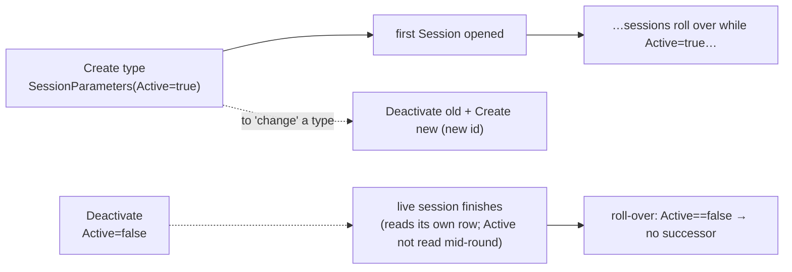

# Monkify — "Operator page (Operator admin portal)" Feature — Implementation Spec

> **Status: Ready for implementation** — refined via Trello card
> [Operator page](https://trello.com/c/JZcMz3ma) (2026-07-03).
> Repos affected: `monkify-backend`, `monkify-front`, and this doc in `monkify-meta`.
>
> **Purpose:** Give operators (casinos) a self-service admin portal at `/monkify/admin` where they
> authenticate with an **operator-signed admin token** and manage **their own** session types (game
> configurations). Today session types are only seeded by `Monkify.Consumers`; operators have no way
> to create or retire them. A dev-only header shortcut mints an admin token locally.

---

## 1. Summary

A new **admin surface** reusing the existing launch-token cryptography (RS256 against
`Operator.LaunchPublicKey`) but with a distinct **admin scope** so admin and player tokens are never
interchangeable. The operator manages **`SessionParameters`** rows scoped to their own operator id.

| Aspect | Player (launch) flow — existing | Admin flow — this feature |
| --- | --- | --- |
| Token header | `X-Launch-Token` | **`X-Admin-Token`** |
| Token claims | `iss`, `sub` (player), `exp`, `iat`, `jti` | `iss`, **`scope: "admin"`**, `exp`, `iat`, `jti`; **no `sub`** |
| Entry URL | `…/monkify/game/sessions#launch_token=<jwt>` | **`…/monkify/admin#admin_token=<jwt>`** |
| Guarded prefixes | `/sessions`, `/operators`, `/players`, `/fx` | **`/admin`** |
| Contract gate | required (contract-active) | **not required** (operators prep/fix types anytime) |
| Identity carried | `ILaunchContext { OperatorId, ExternalPlayerId }` | **`IAdminContext { OperatorId }`** |

**Operations (scoped to the operator's own types):** **Create**, **List**, soft-**Deactivate**. There
is deliberately **no Edit** and **no hard delete** (see §1.1). `AllowFreeBet` is **never** exposed
(dev-only workaround; stays `false`). `OperatorId` is always the token `iss`, never client-settable.
All three session-type **modes** are supported: free-type race, preset-choice race, and lottery.

### 1.1 No edit — deactivate-or-create (the core design decision)

Earlier iterations supported **editing** a session type in place, which forced a **versioning**
scheme (a new `SessionParameters` row per edit, a `NextVersionId` forward-linked list, and
lineage-resolution on entry / roll-over / startup). That added a self-referencing column, three
graph-walking code paths, and extra DB round-trips on the hot paths — too much overhead for the value.

**This feature drops editing entirely.** A `SessionParameters` row is **created once and never
mutated** (config-wise); the only state the operator can change is `Active`:

- **Create** inserts a new `Active = true` row and opens its first session.
- **Deactivate** flips `Active = false`. The **currently-live session keeps running to completion**
  (game/typer/reward logic never reads `Active` mid-round). Once it ends, roll-over sees
  `Active == false` and creates **no** successor. The type also drops out of `active-types` and the
  admin list immediately.
- To **change** a type, the operator **deactivates the old one and creates a new one** (a new row,
  new id). The old sessions/bets stay FK-valid against the old row forever.

Because a row is never edited, the id a client/session holds **never changes**, and *"which type is
this / what's the current config"* is a single `ParametersId` lookup — **no versioning, no chains, no
walking anywhere.**

---

## 2. Constraints (MANDATORY)

From `monkify-meta/constraints.md` (full list there):

- **Branch-per-repo:** `feature/operator-admin-page` in `monkify-backend`, `monkify-front`,
  `monkify-meta`.
- **Unit tests:** update/add in `Monkify.Tests`; keep the session-flow integration suite
  `Monkify.Tests.Integration` green (roll-over is back to a plain same-row reload). Report changed
  tests at the end of implementation.
- **EF mapping:** inline in `MonkifyDbContext.OnModelCreating`; no `IEntityTypeConfiguration`.
- **Migrations:** under `Monkify.Infrastructure/Migrations/`; applied **only** by `Monkify.Consumers`
  at startup (`Database.Migrate()`). The API does not migrate.
- **Secrets/config:** **mock-only** values in committed files. Admin tokens sign/validate with the
  **existing** launch keypair (`GeneralSettings.LaunchTokens.DevSigningPrivateKeyPem` /
  `Operator.LaunchPublicKey`) — do **not** add real keys; do **not** touch the real
  `GeneralSettings.Token.*` Solana key.
- **Operator messaging:** every admin-token failure returns a single generic **HTTP 401**; the real
  reason + a correlationId are logged **server-side only**. The SPA routes any 401 to `/error`. Never
  reveal contract status on the auth path.
- **API stays stateless:** admin CRUD + token validation live in `Monkify.Api`; session creation /
  roll-over runs in `Monkify.Consumers`. No migration work in the API host.

---

## 3. Resolved product decisions

| # | Decision |
| --- | --- |
| 1 | **Production operator self-service portal** at `/monkify/admin` (not just a dev tool), plus a dev header shortcut. |
| 2 | **Auth = operator-signed RS256 admin JWT**, validated against the operator's existing `Operator.LaunchPublicKey`. No new credential store. "Generate a token" = the operator signing one on their own site. |
| 3 | **Admin scope claim** `scope = "admin"` distinguishes admin tokens. **No `sub`** claim (admin acts as the operator, not a player). |
| 4 | **Transport = URL fragment:** `…/monkify/admin#admin_token=<jwt>`; SPA reads it, strips it from the URL, persists per-tab in `sessionStorage`, and sends **`X-Admin-Token`** on admin calls. |
| 5 | **Strict token separation:** an admin token is **rejected** on player endpoints (`/sessions`, `/operators`, `/players`, `/fx` → 401 when `scope == "admin"`); a launch/player token is **rejected** on `/admin` endpoints (missing/`!= "admin"` scope → 401). |
| 6 | **Operations = Create, List, soft-Deactivate only.** **No Edit** (deactivate-or-create replaces it — §1.1) and **no hard delete** (historical `Session`/`Bet` rows FK to the type). |
| 7 | **`AllowFreeBet` is not operator-editable** (dev-only); stays `false` on operator-created types. **`OperatorId` fixed from token `iss`**, never client-settable. |
| 8 | **All three modes** creatable: free-type race, preset-choice race (operator defines the preset list), lottery (operator sets pot + draw frequency → future sessions schedule Hangfire draws). |
| 9 | **No versioning.** `SessionParameters` is a flat, one-row-per-type entity created once and never mutated. The only mutable field is `Active`. |
| 10 | **Deactivate = `Active = false`.** The current live session finishes on its config; roll-over then finds `Active == false` and creates no successor; the type leaves `active-types` and the admin list at once. |
| 11 | **Dev entry:** dev-only admin icon in `GameHeader` → Crypto/Regulated options → mint via new **`POST /dev/admin-token?paymentModel=Crypto|Regulated`** (404 in prod, returns `{ token }`) → `/monkify/admin`. Gated by the existing **`VUE_APP_DEV_LAUNCH`** flag. |
| 12 | **Admin access is NOT contract-gated** (valid signature + operator exists is enough), so operators can prep types before contract start and retire them after expiry. The contract window still gates **player** sessions (unchanged: `GetAllActiveSessionParameters` / `OpenNewSessions` skip inactive operators). |
| 13 | **Identity via new `IAdminContext { OperatorId }`** (scoped), set by admin middleware — kept separate from `ILaunchContext`. |
| 14 | **Cache:** every admin write invalidates `ActiveParameters:{operatorId}` (`CacheHelper.GenerateActiveParametersCacheSettings`). |
| 15 | **No new seeding / keys.** Admin tokens reuse the seeded dev operators (`DEV Cassino`, `DEV Regulated Cassino`) and their mock `LaunchPublicKey`; the dev mint signs with the existing `DevSigningPrivateKeyPem`. |

---

## 4. Data model

### 4.1 Entity / column changes

**`SessionParameters`** — `monkify-backend/src/Monkify.Domain/Sessions/Entities/SessionParameters.cs`
— **flat, no versioning.** There are **no** entity changes for this feature beyond removing the
versioning members that an earlier iteration added:

- **Remove** `NextVersionId` and the `NextVersion` navigation (and their EF mapping — §4.2).
- `Active` (existing, line 29) is the single mutable flag: `true` = shows in the lobby/admin list and
  spawns new sessions; `false` = deactivated.

No other entity is touched. `Session.ParametersId` points at its type and **never changes** (rows are
never superseded).

### 4.2 EF configuration (inline)

File: `monkify-backend/src/Monkify.Infrastructure/Data/Context/MonkifyDbContext.cs`, inside the
existing `modelBuilder.Entity<SessionParameters>` block — **remove** the versioning mapping added
earlier (the `NextVersionId` property, the `NextVersion` self-FK, and the `HasIndex(x => x.NextVersionId)`).
The block returns to: key, `Name`/`Description` constraints, `RequiredAmount` precision, the
Lottery/Preset/Operator relationships, and the `Active` / `OperatorId` indexes.

> `Description` is `IsRequired()` and `Name` `HasMaxLength(100).IsRequired()` — the admin create form
> must send both. `RequiredAmount` precision `(18,9)`; `LotteryPot` `(18,2)`; `PresetChoice.Choice`
> max length **20**; `Session.WinningChoice` max length 20.

### 4.3 Migration — revert the versioning migration

The versioning column shipped only in the (unmerged, dev-only) `20260703195629_AddSessionParametersVersioning`
migration, which is the **last** migration on the branch. Because nothing downstream depends on it,
**revert it cleanly** rather than adding an add-then-drop pair:

1. **Delete** `Monkify.Infrastructure/Migrations/20260703195629_AddSessionParametersVersioning.cs`
   and its `.Designer.cs`.
2. **Revert** `Monkify.Infrastructure/Migrations/MonkifyDbContextModelSnapshot.cs` to its
   pre-versioning state (drop the `NextVersionId` property, self-FK, and index from the
   `SessionParameters` entity). Regenerate the snapshot with the EF tooling rather than hand-editing
   where possible.
3. **Reset the docker dev DB** so migrations re-apply from a clean slate (the column is already
   applied to the running volume): `docker compose down`, remove the postgres volume
   (`monkify-backend_postgres-data`), then `docker compose up -d --build`. `Monkify.Consumers`
   re-runs migrations and re-seeds the DEV operators + default session parameters. Hand-made dev rows
   (e.g. "Gold run") are lost — expected and acceptable for a dev-only branch.

Net effect: the schema **never had** `NextVersionId`. No new migration is introduced.

### 4.4 Type lifecycle (diagram)



---

## 5. Configuration

**No new config or keys.** Admin token signing/validation reuses:

- `GeneralSettings.LaunchTokens.DevSigningPrivateKeyPem` (mock; dev mint only),
- `GeneralSettings.LaunchTokens.ClockSkewSeconds`,
- each operator's `Operator.LaunchPublicKey` (validation).

Frontend: reuse `VUE_APP_DEV_LAUNCH` / `devLaunchEnabled` (`src/constants/featureFlags.ts:9`) to gate
the dev admin icon. No new env var.

---

## 6. Backend behaviour

### 6.1 Admin token issue/validate — extend `ILaunchTokenService`

File: `monkify-backend/src/Monkify.Api/Launch/LaunchTokenService.cs`

The service today issues/validates only player tokens (claims `sub` + `jti`; no `scope`). Add admin
support **without breaking the player path**:

1. Add a **`scope`** constant (e.g. `AdminScope = "admin"`).
2. **Issue:** add `string IssueAdmin(string privateKeyPem, Guid operatorId, int ttlSeconds)` (or extend
   `Issue` with an optional `scope` param). It sets `iss = operatorId`, a `scope = "admin"` claim,
   `iat`/`exp`/`jti`, and **no `sub`**. Reuse `CreateRsaKey` (caching off — see the existing
   disposed-RSA note).
3. **Validate:** the existing `Validate(token, expectedOperatorId, publicKeyPem, clockSkew)` returns a
   `LaunchTokenValidationResult`. Add a **`Scope`** field to that record (read the `scope` claim; null
   when absent). Keep `ValidateAudience = false`. The **caller** (middleware) enforces scope — the
   service just surfaces it. (Signature/`exp`/`iat`/`iss` validation is identical for both token types
   because they share the operator keypair.)

### 6.2 Admin identity context (new) — `IAdminContext`

`monkify-backend/src/Monkify.Infrastructure/Services/Admin/IAdminContext.cs` (new), mirroring
`ILaunchContext` but carrying only the operator:

```csharp
public interface IAdminContext
{
    bool IsSet { get; }
    Guid OperatorId { get; }
    void Set(Guid operatorId);
}
```

Register **scoped** in `Monkify.Infrastructure/DependencyInjection.cs` (next to the existing
`ILaunchContext` / `IOperatorService` registrations).

### 6.3 Operator lookup without contract filter (admin is not contract-gated)

File: `monkify-backend/src/Monkify.Infrastructure/Services/Operators/{IOperatorService,OperatorService}.cs`

`GetActiveOperatorById` filters to contract-active operators — unsuitable for admin (decision 12).
Add:

```csharp
Task<Operator?> GetOperatorById(Guid operatorId);   // no contract filter; returns LaunchPublicKey
```

Implementation mirrors `GetActiveOperatorById` **without** the `ContractStartDate`/`ContractEndDate`
predicate, cached under a distinct key `CacheHelper.GenerateAdminOperatorCacheSettings(operatorId)`
(new: `"Operator:Admin:{operatorId}"`, ~3h) so it doesn't collide with the contract-active cache
entry. Operators aren't edited here, so no invalidation is needed for it.

### 6.4 Admin token validation middleware (new, `Monkify.Api`)

`monkify-backend/src/Monkify.Api/Middleware/AdminTokenValidationMiddleware.cs` (new). Registered in
`Monkify.Api/Program.cs` right after the launch middleware, before `MapControllers`.

- `HeaderName = "X-Admin-Token"`.
- **Guards** paths under **`/admin`** only (opt-in prefix, mirroring `LaunchTokenValidationMiddleware`'s
  `ProtectedPrefixes`). Skips `OPTIONS`. Ignores everything else (so `/dev/admin-token`, `/sessions`,
  Swagger, `/Hubs/*` are untouched by it).
- Algorithm:
  1. Read `X-Admin-Token`. Missing/empty → generic **401**.
  2. `tokenService.TryReadIssuer(token, out operatorId)`. Unparseable → 401.
  3. `op = await operatorService.GetOperatorById(operatorId)` (§6.3, **no** contract filter). Null or no
     `LaunchPublicKey` → 401.
  4. `result = tokenService.Validate(token, operatorId, op.LaunchPublicKey!, clockSkew)`. Failure → 401.
  5. **`result.Scope != "admin"` → 401** (a player token is rejected here).
  6. `adminContext.Set(operatorId)`; continue.
- Generic 401 body identical to the launch middleware's `Reject` (single
  `Message(MessageType.ValidationFailure, "The request could not be processed.")`, status 401, real
  reason + correlationId to `Log.Warning`).

### 6.5 Reject admin tokens on player endpoints

File: `monkify-backend/src/Monkify.Api/Middleware/LaunchTokenValidationMiddleware.cs`

After a successful `Validate`, add: **if `result.Scope == "admin"` → `Reject(... "admin token on player endpoint")`** (401). This closes the reverse direction (decision 5).

### 6.6 Admin controller + handlers (new)

New controller `monkify-backend/src/Monkify.Api/Controllers/AdminController.cs` (`[Route("admin")]`),
guarded by the admin middleware, using the `BaseController.ProcessRequest<T>` pattern and injecting
`IAdminContext` (mirroring how `SessionsController` injects `ILaunchContext`):

| Verb + route | Action | MediatR request |
| --- | --- | --- |
| `GET /admin/session-types` | List the operator's active types | `GetOperatorSessionTypesRequest(adminContext.OperatorId)` |
| `POST /admin/session-types` | Create a new type | `CreateSessionTypeRequest(adminContext.OperatorId, body)` |
| `POST /admin/session-types/{id:guid}/deactivate` | Soft-deactivate | `DeactivateSessionTypeRequest(adminContext.OperatorId, id)` |

> **No `PUT` route** — editing is not supported (§1.1). To change a type, the operator deactivates and
> creates a new one.

New handlers under `monkify-backend/src/Monkify.Infrastructure/Handlers/Admin/` (each folder: request +
`RequestBody` where applicable + handler), following the existing handler style
(`BaseRequestHandler<TRequest, TResult>`):

**6.6a `GetOperatorSessionTypes`** — returns the operator's active types:

```csharp
_context.SessionParameters
    .Include(x => x.LotteryParameters).Include(x => x.PresetChoices)
    .Where(x => x.OperatorId == operatorId && x.Active)
    .AsNoTracking().ToListAsync();
```

Project to `SessionTypeAdminDto` (§6.7).

**6.6b `CreateSessionType`** — validate (§6.8), then insert a new `SessionParameters`:

- `OperatorId = operatorId` (from context — **ignore any body operator id**), `Active = true`,
  `AllowFreeBet = false` (**forced**; not read from the body).
- Map `Name`, `Description`, `AllowedCharacters`, `ChoiceRequiredLength`,
  `AcceptDuplicatedCharacters`, `MinimumNumberOfPlayers`, `RequiredAmount`.
- If preset choices provided → add `PresetChoice` children.
- If lottery provided → add `LotteryParameters { LotteryPot, Frequency }`.
- `SaveChanges`, then invalidate `ActiveParameters:{operatorId}` (§6.9), then publish
  `SessionParametersCreatedEvent(parameters.Id)` (§6.10b). Return the new id.

**6.6c `DeactivateSessionType`** — load the active row (`Id == id && OperatorId == operatorId &&
Active`, `AsTracking`), set `Active = false`, save, invalidate cache. Null → 404. The current live
session (if any) finishes normally; roll-over then creates no successor (§6.10).

### 6.7 Admin DTOs

New `monkify-backend/src/Monkify.Infrastructure/Contracts/Admin/SessionTypeAdminDto.cs` — like
`SessionParametersDto` (`Contracts/Sessions/SessionParametersDto.cs`) but for the admin list
(includes the row `Id` as `SessionTypeId`, all fields, preset list, lottery pot/frequency; **omits**
`AllowFreeBet` — always false for operator-created rows).

New request body (in the create handler folder): `SessionTypeRequestBody` with:
`Name`, `Description`, `AllowedCharacters` (`SessionCharacterType`), `ChoiceRequiredLength`,
`AcceptDuplicatedCharacters`, `MinimumNumberOfPlayers`, `RequiredAmount`,
`PresetChoices` (`List<string>?`), `Lottery` (`{ decimal LotteryPot; TimeSpan Frequency }?`). **No
`AllowFreeBet`, no `OperatorId`, no `Active`.**

### 6.8 Parameter validation (new domain validation)

Bet-time choice validation lives in `BetDomainService.ChoiceIsValidForSession`; there is **no**
parameter-level validation today (seed data is trusted). Add a static `SessionParametersValidation`
helper in `Monkify.Domain/Sessions` enforcing:

- `Name`: required, trimmed, 1–100 chars. `Description`: required, trimmed, 1–200 chars.
- `AllowedCharacters`: a defined `SessionCharacterType` enum value.
- `ChoiceRequiredLength`: required, **1–20** (bounded by `WinningChoice`/`PresetChoice` max 20).
- `MinimumNumberOfPlayers`: **>= 2**.
- `RequiredAmount`: **> 0** (fits `decimal(18,9)`).
- `AcceptDuplicatedCharacters`: bool (no constraint).
- **Preset choices** (when provided): non-empty list; each choice trimmed lowercase (mirror
  `Bet.Choice` normalization), length `== ChoiceRequiredLength`, only characters within
  `AllowedCharacters`' pool, respects `AcceptDuplicatedCharacters`, ≤ 20 chars, and the list is
  distinct.
- **Lottery** (when provided): `Frequency` **> TimeSpan.Zero** (propose bounds: ≥ 1 minute,
  ≤ 7 days), `LotteryPot` **>= 0** (fits `decimal(18,2)`).

On failure return validation messages via the existing `IMessaging` pattern (this is
operator-authenticated, so specific field errors are acceptable and helpful — **not** the vague
operator-error case, which applies only to the token/contract path).

### 6.9 Cache invalidation

Create and Deactivate call
`_cache.Remove(CacheHelper.GenerateActiveParametersCacheSettings(operatorId))`
(`ICacheService` + `CacheHelper`). Inject `ICacheService` into the handlers. No change to the
`Operator:*` caches.

### 6.10 Roll-over reloads the same row (`Monkify.Consumers` + `SessionService`)

With no versioning, roll-over just reloads the **same** `SessionParameters` row the ended session ran
on and creates a successor **only if it is still `Active`**. Add a small helper to
`ISessionService` / `SessionService` (`Monkify.Infrastructure/Services/Sessions/`):

```csharp
// Reloads the parameters row (with Lottery + PresetChoices + Operator) for roll-over.
// Returns it only when Active; null when the type has been deactivated.
Task<SessionParameters?> GetActiveParametersForRollover(Guid parametersId);
```

Implementation: single query by `Id` with `.Include(LotteryParameters).Include(PresetChoices)
.Include(Operator).AsNoTracking()`; return it when `Active`, else null. **No `ResolveCurrentVersion`,
no chain walk** — that method is removed.

**`RunSessionConsumer`** — the roll-over block becomes:

```csharp
var parameters = await sessionService.GetActiveParametersForRollover(session.ParametersId);
if (parameters != null)
    await sessionService.CreateSession(parameters);
// else: the type was deactivated → no successor session.
```

(`CreateSession` is unchanged — it already skips creation for a contract-inactive operator.)

### 6.10b Open the first session for a newly created type (event → Consumers)

A brand-new `SessionParameters` has **no `Session`**, and sessions are only created at Consumers
startup (`OpenNewSessions`) or on roll-over (`RunSessionConsumer`) — so entering a just-created type
would `GET /sessions/{id}` and hit `ParameterHasNoActiveSessions` (**400**). Session/typer work
belongs to `Monkify.Consumers` (SignalR fan-out + Hangfire lottery scheduling), not the stateless API,
so **`CreateSessionType` publishes a `SessionParametersCreatedEvent(parametersId)`** after the write,
and a **`SessionParametersCreatedConsumer`** (Consumers) opens the first session:

- Loads the parameters (`Include` Lottery/Preset/Operator). **Idempotent:** skips if the type is
  gone/inactive or already has a live session (`ActiveSessionsStatus`), so a redelivered event is safe.
- Calls `SessionService.CreateSession(parameters)` — which already skips inactive operators, so a type
  created before contract start simply gets its first session once the operator is active.

Register the consumer in `Monkify.Consumers/Program.cs` (`AddConsumer` + `ReceiveEndpoint`, next to
the others). `CreateSessionTypeHandler` takes `IRabbitMQService` (already registered in the API host,
as `RegisterBetHandler` publishes events too).

### 6.11 Startup roll-over — `OpenNewSessions` (plain dedup)

File: `monkify-backend/src/Monkify.Consumers/Program.cs` (`OpenNewSessions`)

`GetAllActiveSessionParametersForAllOperators()` returns only `Active` rows. The "already has a live
session?" guard is a **plain `ParametersId` equality** (no lineage resolution): build the set of
`ParametersId`s that already have a session in `Session.ActiveSessionsStatus`, and skip creating a
session for any active parameter already in that set. Because ids never change, this cannot create a
duplicate.

```csharp
var liveParameterIds = dbContext.Sessions
    .Where(x => Session.ActiveSessionsStatus.Contains(x.Status))
    .Select(x => x.ParametersId)
    .Distinct()
    .ToHashSet();

foreach (var parameter in activeParameters)
{
    if (!parameter.Value.Operator.ContractIsActive(now)) continue;
    if (liveParameterIds.Contains(parameter.Key)) continue;
    sessionService.CreateSession(parameter.Value).GetAwaiter().GetResult();
}
```

### 6.12 Entering a type (`GetActiveSessionForParameter`) — plain match

`GET /sessions/{id}` → `GetActiveSessionForParameter` matches the live session by **exact
`ParametersId`** (no lineage walk):

```csharp
Context.Sessions
    .Include(x => x.Bets).ThenInclude(b => b.OperatorPlayer)
    .Include(x => x.Parameters).ThenInclude(p => p.LotteryParameters)
    .AsNoTracking()
    .Where(x => x.ParametersId == request.ParameterId
             && Session.ActiveSessionsStatus.Contains(x.Status)
             && x.Parameters.OperatorId == request.OperatorId)
    .OrderByDescending(x => x.CreatedDate)
    .FirstOrDefaultAsync();
```

**Delete `GetVersionLineageIds`** and its call. A first-run guard still applies: a just-created type's
first session is opened asynchronously by `SessionParametersCreatedConsumer` (§6.10b), so a brief
window may still return `ParameterHasNoActiveSessions` until the consumer runs — the FE handles that
as "starting up".

### 6.13 Dev mint endpoint (new, non-production only)

File: `monkify-backend/src/Monkify.Api/Controllers/DevController.cs` — add alongside
`MintLaunchToken`:

```csharp
[HttpPost("admin-token")]
public async Task<IActionResult> MintAdminToken([FromQuery] OperatorPaymentModel paymentModel = OperatorPaymentModel.Crypto)
{
    if (env.IsProduction()) return NotFound();
    var name = paymentModel == OperatorPaymentModel.Regulated ? RegulatedOperatorName : CryptoOperatorName;
    var op = await context.Operators.AsNoTracking().FirstOrDefaultAsync(x => x.Name == name);
    if (op == null) return NotFound();
    var token = tokenService.IssueAdmin(settings.LaunchTokens.DevSigningPrivateKeyPem, op.Id, ttlSeconds: int.MaxValue);
    return Ok(new { token });
}
```

Reuses the existing `DEV Cassino` / `DEV Regulated Cassino` names and mock signing key already present
on `DevController` — **no new seeding** (both dev operators already carry the mock `LaunchPublicKey`).

### 6.14 Hidden blockers (documented)

| Blocker | Fix |
| --- | --- |
| `ILaunchTokenService.Validate` has no `scope` in its result; token has no `scope` claim | Add `Scope` to `LaunchTokenValidationResult`; add `IssueAdmin` that sets `scope = "admin"` (§6.1) |
| `LaunchTokenValidationMiddleware` guards by opt-in `ProtectedPrefixes` (not a skip-list) | `/admin` is simply **not** in that list, so the launch MW ignores it; add a **separate** admin MW for `/admin` (§6.4) |
| Launch MW would accept an admin-scoped token on `/sessions` etc. | Reject when `result.Scope == "admin"` (§6.5) |
| `GetActiveOperatorById` filters contract-active — admin must work for inactive operators | Add `GetOperatorById` (no contract filter) + distinct cache key (§6.3) |
| A brand-new type has no session → entering it 400s | `CreateSessionType` publishes `SessionParametersCreatedEvent`; consumer opens the first session (§6.10b) |
| `Description` is `IsRequired` in EF | Admin form + validation require `Description` (§6.8) |
| `IAdminContext` must not leak into player handlers and vice versa | Separate scoped context; separate middleware; separate header (§6.2, §6.4) |
| Deactivated type still deep-linked `?type=<id>` | `GetSessionParametersById` returns null for inactive, handled as "not accepting bets". Document, no code change. |

---

## 7. Frontend behaviour

### 7.1 Admin token capture — new `useAdmin` + `adminToken` util

New `monkify-front/src/utils/adminToken.ts` (mirror `utils/launchToken.ts`):

- `STORAGE_KEY = 'monkify.adminToken'`, in-memory + `sessionStorage`; `getAdminToken` / `setAdminToken`.
- `ADMIN_TOKEN_HEADER = 'X-Admin-Token'`, `ADMIN_TOKEN_FRAGMENT_KEY = 'admin_token'`.
- `getOperatorIdFromAdminToken(token?)` — decode JWT `iss` (reuse the decode logic; `iss` is the
  operator id). No `sub`.

New `monkify-front/src/hooks/useAdmin.ts` (mirror `useLaunch.ts`):

- `ensureAdminToken()` — read `#admin_token=` from the fragment (fragment wins over stored),
  `setAdminToken` + strip the fragment via `history.replaceState`, else return the stored token.
- Optionally expose the operator id (from the admin token `iss`) for display.

### 7.2 Admin service (new axios instance) — `src/services/adminService.ts`

A dedicated instance so admin calls carry **`X-Admin-Token`** (not the launch token). Mirror
`mainService.ts` structure:

- Request interceptor: `baseURL = VUE_APP_API_BASE_URL`; attach `X-Admin-Token` from `getAdminToken()`.
- Response interceptor: on `401` (and not already on `/error`) → `window.location.assign('/error')`.
- Methods (all under `/admin`): `getSessionTypes()` → `GET /admin/session-types`;
  `createSessionType(body)` → `POST /admin/session-types`;
  `deactivateSessionType(id)` → `POST /admin/session-types/{id}/deactivate`.
  **No `updateSessionType` / `PUT`** — editing is not supported.
- Export via `src/services/index.ts` (add `export { default as adminService } from './adminService'`).

### 7.3 Route — `/monkify/admin`

File: `monkify-front/src/routes.ts` — add a **non-dev-gated** record (operators use it in production):

```ts
{ name: 'Admin', path: '/monkify/admin', component: require('@/pages/AdminPage.vue').default }
```

(Use the existing eager `require(...).default` idiom. The route must exist in prod so the operator's
`#admin_token=` redirect resolves; access control is the admin token itself — no token / invalid →
the service 401s → `/error`.)

### 7.4 Admin pages/components

- `monkify-front/src/pages/AdminPage.vue` — thin shell (mirror `SessionSelectPage.vue`) hosting the
  admin components; `onMounted` calls `useAdmin().ensureAdminToken()` and, if no token, redirects to
  `/error`; otherwise loads the list.
- `monkify-front/src/components/admin/SessionTypeManager.vue` — orchestrates the list and a
  **create-only** view (`View = 'list' | 'create'`; no `edit` view, no `editing` state). Writes
  re-fetch the list.
- `monkify-front/src/components/admin/SessionTypeList.vue` — table of the operator's active types
  (name, mode, charset, length, amount, min players, lottery pot/frequency); row action
  **Deactivate** (with confirm). **No Edit action.** Empty/loading/error states.
- `monkify-front/src/components/admin/SessionTypeForm.vue` — **create** form covering all three modes:
  name, description, charset (`SessionCharacterType` select), choice length, accept duplicates, min
  players, required amount; an optional **preset choices** editor (list of strings); an optional
  **lottery** section (pot + frequency). **No `AllowFreeBet` field.** Client-side validation mirrors
  §6.8; the backend re-validates.

### 7.5 Dev header icon — `GameHeader.vue`

File: `monkify-front/src/components/GameHeader.vue` — inside the right-cluster `div` (after the gear
button), add a **dev-only** admin entry gated by `devLaunchEnabled`
(new import from `@/constants/featureFlags`). Mirror `DevLandingPage.launchAs`:

- Renders only when `devLaunchEnabled` (never ships to prod — `.env.production` sets
  `VUE_APP_DEV_LAUNCH=false`).
- Clicking offers **Crypto** / **Regulated** (a small menu or a new
  `src/components/header/AdminLauncher.vue`); each calls
  `POST /dev/admin-token?paymentModel=<mode>` → `setAdminToken(data.token)` →
  `router.push({ name: 'Admin' })`.

### 7.6 Types

File: `monkify-front/src/types/index.ts` — admin types:

- `SessionTypeAdmin` — the list shape: `sessionTypeId`, `name`, `description`,
  `allowedCharacters` (enum), `choiceRequiredLength`, `acceptDuplicatedCharacters`,
  `minimumNumberOfPlayers`, `requiredAmount`, `presetChoices: string[]`,
  `lottery?: { lotteryPot: number; frequency: string }`.
- `SessionTypeBody` — same fields **without** `sessionTypeId` and **without** any
  `allowFreeBet`/operator id. (One body type — create only.)

### 7.7 User-facing copy

- Admin token / `401` failures show the existing generic `/error` page (no admin-specific copy).
- Validation errors from the CRUD endpoints are shown inline on the form (operator is authenticated —
  specific field messages are fine; this is not the vague operator-error case).

---

## 8. Flow diagrams

### 8.1 Admin launch + validation

```mermaid
sequenceDiagram
    participant Op as Operator site
    participant FE as Monkify SPA (/monkify/admin)
    participant MW as Admin middleware (Monkify.Api)
    participant H as Admin handlers

    Op->>Op: sign admin JWT (RS256, scope=admin, no sub)
    Op->>FE: redirect /monkify/admin#admin_token=<jwt>
    FE->>FE: read fragment, store (sessionStorage), strip URL
    FE->>MW: GET /admin/session-types (X-Admin-Token)
    MW->>MW: TryReadIssuer → GetOperatorById(iss) (no contract filter)
    MW->>MW: Validate signature/exp; require scope=="admin"
    alt valid admin token
        MW->>H: IAdminContext.Set(operatorId)
        H-->>FE: operator's active session types
    else any failure / wrong scope
        MW-->>FE: 401 generic (real reason logged only)
        FE->>FE: → /error
    end
```

### 8.2 Create / deactivate lifecycle

```mermaid
sequenceDiagram
    participant Admin
    participant API as AdminController
    participant MQ as RabbitMQ
    participant C as Consumers
    participant RC as RunSessionConsumer (roll-over)

    Admin->>API: POST /admin/session-types (config)
    API->>API: insert SessionParameters(Active=true); invalidate cache
    API->>MQ: SessionParametersCreatedEvent(id)
    MQ->>C: SessionParametersCreatedConsumer opens first session
    Note over C: sessions roll over while Active=true
    Admin->>API: POST /admin/session-types/{id}/deactivate
    API->>API: Active=false; invalidate cache
    Note over RC: live session finishes on its row
    RC->>RC: GetActiveParametersForRollover(id) → null (Active=false)
    RC-->>RC: no successor session created
```

---

## 9. Out of scope

- **Editing a session type in place** (replaced by deactivate-or-create — §1.1) and any versioning
  scheme.
- Email/password or SSO login; operator onboarding/provisioning (creating operators, key management,
  uploading `LaunchPublicKey`).
- Editing `AllowFreeBet` (dev-only workaround) from the portal.
- Managing branding / contract window / payment model from the portal (**session types only**).
- Analytics / reporting dashboards.
- **Hard delete** of session types.
- **Reactivating** a deactivated type (create a new one instead).
- `monkify-meta/features/` KB update (done at ship via `/monkify-ship-feature`).

---

## 10. File checklist

### 10.1 Backend (`monkify-backend`)

| # | File | Change |
| --- | --- | --- |
| 1 | `Monkify.Domain/Sessions/Entities/SessionParameters.cs` | **Remove** `NextVersionId`, `NextVersion` (flat entity) |
| 2 | `Monkify.Infrastructure/Data/Context/MonkifyDbContext.cs` | **Remove** `NextVersionId` self-FK + index from the SessionParameters block |
| 3 | `Monkify.Infrastructure/Migrations/*AddSessionParametersVersioning*` | **Delete** the migration + Designer; revert `MonkifyDbContextModelSnapshot` (§4.3). Reset dev DB volume |
| 4 | `Monkify.Api/Launch/LaunchTokenService.cs` | Add `IssueAdmin` (scope=admin, no sub); add `Scope` to `LaunchTokenValidationResult` |
| 5 | `Monkify.Infrastructure/Services/Admin/IAdminContext.cs` (+ impl) | **New** scoped admin identity (OperatorId) |
| 6 | `Monkify.Infrastructure/Services/Operators/{I,}OperatorService.cs` | Add `GetOperatorById` (no contract filter) |
| 7 | `Monkify.Infrastructure/Services/Cache/CacheHelper.cs` | Add `GenerateAdminOperatorCacheSettings` |
| 8 | `Monkify.Infrastructure/DependencyInjection.cs` | Register `IAdminContext` (scoped) |
| 9 | `Monkify.Api/Middleware/AdminTokenValidationMiddleware.cs` | **New** — guard `/admin`; validate; require scope=admin; set `IAdminContext` |
| 10 | `Monkify.Api/Middleware/LaunchTokenValidationMiddleware.cs` | Reject when `result.Scope == "admin"` |
| 11 | `Monkify.Api/Program.cs` | Register admin middleware after launch MW, before `MapControllers` |
| 12 | `Monkify.Api/Controllers/AdminController.cs` | **New** — GET/POST session-types + deactivate (**no PUT**) |
| 13 | `Monkify.Infrastructure/Handlers/Admin/GetOperatorSessionTypes/*` | **New** — list active types for operator |
| 14 | `Monkify.Infrastructure/Handlers/Admin/CreateSessionType/*` | **New** — validate + insert (AllowFreeBet forced false) + publish created event |
| 15 | `Monkify.Infrastructure/Handlers/Admin/DeactivateSessionType/*` | **New** — set `Active=false` |
| 16 | `Monkify.Infrastructure/Contracts/Admin/{SessionTypeAdminDto,SessionTypeRequestBody}.cs` | **New** admin DTO + create body |
| 17 | `Monkify.Domain/Sessions/Services/SessionParametersValidation.cs` | **New** parameter-level validation (§6.8) |
| 18 | `Monkify.Infrastructure/Services/Sessions/{I,}SessionService.cs` | Add `GetActiveParametersForRollover`; **remove `ResolveCurrentVersion`** |
| 19 | `Monkify.Infrastructure/Consumers/RunSession/RunSessionConsumer.cs` | Roll over via `GetActiveParametersForRollover` (skip if inactive) |
| 20 | `Monkify.Consumers/Program.cs` | `OpenNewSessions` plain `ParametersId` dedup (§6.11); register `SessionParametersCreatedConsumer` |
| 21 | `Monkify.Infrastructure/Handlers/Sessions/GetActiveSessionForParameter/*` | Plain `ParametersId` match; **delete `GetVersionLineageIds`** |
| 22 | `Monkify.Api/Controllers/DevController.cs` | **New** `POST /dev/admin-token` (404 in prod) |
| 23 | `Monkify.Infrastructure/Consumers/SessionParametersCreated/*` | **New** `SessionParametersCreatedEvent` + consumer (open first session for a new type) |
| 24 | `Monkify.Tests/**` | New: admin-token/middleware, admin CRUD handlers, validation, roll-over, OpenNewSessions dedup; **remove** versioning/lineage tests |
| 25 | `Monkify.Tests.Integration/**` | Roll-over reloads the same row; deactivate → no successor |

### 10.2 Frontend (`monkify-front`)

| # | File | Change |
| --- | --- | --- |
| 1 | `src/utils/adminToken.ts` | **New** — store/get/set admin token; header + fragment keys; decode `iss` |
| 2 | `src/hooks/useAdmin.ts` | **New** — capture/strip/store fragment admin token |
| 3 | `src/services/adminService.ts` | **New** axios instance sending `X-Admin-Token`; create/list/deactivate; **no update**; 401→`/error` |
| 4 | `src/services/index.ts` | Export `adminService` |
| 5 | `src/routes.ts` | Add `/monkify/admin` route (not dev-gated) |
| 6 | `src/pages/AdminPage.vue` | **New** shell — ensure admin token, else `/error` |
| 7 | `src/components/admin/SessionTypeManager.vue` | **New** — list + create only (no edit view) |
| 8 | `src/components/admin/SessionTypeList.vue` | **New** — list + deactivate (**no edit**) |
| 9 | `src/components/admin/SessionTypeForm.vue` | **New** — create form (3 modes, no AllowFreeBet) |
| 10 | `src/components/GameHeader.vue` | Add dev-only admin icon (gated by `devLaunchEnabled`) |
| 11 | `src/components/header/AdminLauncher.vue` | **New** (optional) — Crypto/Regulated dev mint menu |
| 12 | `src/types/index.ts` | Add `SessionTypeAdmin`, `SessionTypeBody` |

### 10.3 Meta (`monkify-meta`)

| # | File | Change |
| --- | --- | --- |
| 1 | `specs/operator-admin-page.md` | This spec |
| 2 | `INDEX.md` | KB map row + feature-in-flight |

---

## 11. Unit tests

Project: `monkify-backend/src/Monkify.Tests`.

| Test file | Test cases | Expected |
| --- | --- | --- |
| `AdminTokenValidationTests.cs` (new) | No `X-Admin-Token` | 401 generic; no handler reached |
| `AdminTokenValidationTests.cs` | Valid admin token (scope=admin) | `IAdminContext` set to `iss`; pipeline continues |
| `AdminTokenValidationTests.cs` | Player/launch token (no/`!=admin` scope) on `/admin` | 401 |
| `AdminTokenValidationTests.cs` | Bad signature / unknown operator / no public key | 401 (indistinguishable) |
| `AdminTokenValidationTests.cs` | Operator with **inactive** contract, valid signature | **allowed** (admin not contract-gated) |
| `LaunchTokenValidationTests.cs` (extend) | Admin-scoped token on `/sessions` | 401 (rejected) |
| `LaunchTokenServiceTests.cs` (extend) | `IssueAdmin` then `Validate` | `Scope == "admin"`, `sub` empty, signature valid |
| `CreateSessionTypeHandlerTests.cs` (new) | Valid free-type / preset / lottery bodies | row inserted; `OperatorId` from context; `AllowFreeBet == false`; `Active == true`; created event published |
| `CreateSessionTypeHandlerTests.cs` | Invalid (amount ≤ 0, min players < 2, preset wrong length/charset, bad length) | validation failure; nothing inserted |
| `CreateSessionTypeHandlerTests.cs` | Body attempts to set `AllowFreeBet=true` / a different operator id | ignored — `AllowFreeBet == false`, `OperatorId == context` |
| `DeactivateSessionTypeHandlerTests.cs` (new) | Deactivate active row | `Active==false`; excluded from `GetOperatorSessionTypes` and active-types |
| `DeactivateSessionTypeHandlerTests.cs` | Deactivate non-existent / other operator's id | 404, no change |
| `GetOperatorSessionTypesHandlerTests.cs` (new) | Operator with active + deactivated types | only active returned |
| `AdminCacheInvalidationTests.cs` (new) | Any admin write | `ActiveParameters:{operatorId}` removed |
| `SessionParametersCreatedConsumerTests.cs` (new) | New type event | first session opened; idempotent on redelivery / existing live session |
| `RunSessionConsumerTests.cs` (extend) | Ended session, still-active type | next session created; **deactivated type → none** |
| `OpenNewSessionsTests` (new or in `SessionServiceParametersTests`) | Restart with a live session | no duplicate session (plain `ParametersId` dedup) |
| `GetActiveSessionForParameterHandlerTests.cs` (adjust) | Active session for a type | returned by exact `ParametersId`; **remove** lineage cases |
| `DevMintAdminTokenTests.cs` (new) | Non-prod | returns a token validatable by the admin middleware; Production → 404 |

> Use `scripts/run_tests.bat` (fast `~UnitTests` scope) for the unit suite; do **not** run the full
> `dotnet test` (the ProductionSessions Monte-Carlo suite is slow). Integration suite via
> `scripts/run_integration_tests.bat`.

---

## 12. Acceptance criteria

Mirrors the Trello **Acceptance Criteria** checklist — implement until all pass:

1. Given a valid admin-scoped token for operator X, when they list session types, then only operator X's session types are returned (never another operator's).
2. Given a player launch token (or no admin-scope claim), when it is sent to an admin endpoint, then the request is rejected with a vague HTTP 401.
3. Given an admin-scoped token, when it is sent to a player (operator-scoped) endpoint, then it is rejected (admin and player tokens are not interchangeable).
4. Given an invalid / expired / bad-signature / unknown-operator admin token, when any admin request is made, then a single generic 401 is returned (reason logged server-side only) and the SPA routes to /error.
5. Given an operator whose contract is inactive (future start or expired) but whose token signature is valid, when they open the admin portal, then they can still manage their session types (admin is not contract-gated).
6. Given an operator creates a session type, when it is saved, then OperatorId is forced to the token's iss (not client-controllable) and AllowFreeBet stays false (no field exposes it).
7. Given the create form, when the operator submits any of the three modes (free-type, preset-choice with a defined list, or lottery with pot + frequency), then a valid configuration is persisted and an invalid one (e.g. amount ≤ 0, min players < 2, preset choice not valid for the charset/length) is rejected with a validation error.
8. Given a newly created session type, when the operator (or a player) opens it shortly after, then its first session has been opened (via `SessionParametersCreatedConsumer`) so it is enterable — no 400 once the consumer has run.
9. Given the admin portal, when the operator wants to change a type, then there is **no edit action** — they deactivate the existing type and create a new one (a new row with a new id); the old type's past sessions/bets remain intact.
10. Given an operator deactivates a session type with a session currently accepting bets, when that live session ends, then no new session is created from that type (roll-over sees `Active=false`) and it no longer appears in active-types or the admin list.
11. Given any create/deactivate write, when it succeeds, then the ActiveParameters:{operatorId} cache entry is invalidated so subsequent reads reflect the change.
12. Given VUE_APP_DEV_LAUNCH=false (production), when the app header renders, then the dev admin icon is absent and POST /dev/admin-token returns 404; given it is enabled (dev), then the icon offers Crypto/Regulated, mints an admin token, and lands on /monkify/admin.
13. Given existing SessionParameters rows, when the system runs, then they behave as flat one-row-per-type configurations (no versioning column, no chains).

---

## 13. Manual QA

1. Reset the dev DB volume (§4.3), then start `Monkify.Consumers` (applies migrations **without** the
   reverted versioning migration, seeds dev operators + default types) and `Monkify.Api`.
2. In dev, open the game with a launch token; confirm the **dev admin icon** appears in the header
   (gated by `VUE_APP_DEV_LAUNCH`). Click it → choose **Crypto** (or **Regulated**) → lands on
   `/monkify/admin` with a minted admin token.
3. **Create** a free-type session type → appears in the admin list and in the player lobby
   (`/sessions/active-types`), and is enterable (first session opened). Repeat for a **preset** and a
   **lottery** type.
4. Confirm there is **no Edit action** in the list. To change a type, **deactivate** it and **create**
   a replacement.
5. **Deactivate** a type that has a live session accepting bets → the live session finishes normally;
   when it would roll over, no new session is created; it disappears from the lobby and the admin list.
6. Tamper the admin token (edit a char) → next admin call 401 → redirected to `/error`; server log
   shows the real reason + correlationId. Try a **player** token on `/admin` → 401. Try the **admin**
   token on `/sessions/active-types` → 401.
7. Set `VUE_APP_DEV_LAUNCH=false` (prod build) → the dev admin icon is gone and `POST /dev/admin-token`
   returns 404.
8. Run `scripts/run_tests.bat`; then `scripts/run_integration_tests.bat`. Report changed tests.

---

## 14. Trello / pipeline

- **Source card:** https://trello.com/c/JZcMz3ma — list **Specs created**; the **Implementation**
  section on the card lists the branch + spec path.
- **After merge:** `/monkify-ship-feature Operator page` (reads the branch from the card).

---

## 15. Revision log

| Date | Change |
| --- | --- |
| 2026-07-03 | Initial spec from the refined card + same-session refinement decisions (1–15). Grounded in code exploration (launch-token infra, `SessionService`/`RunSessionConsumer` roll-over, `OpenNewSessions`, `MonkifyDbContext`). |
| 2026-07-03 | Implementation fix: creating a type now publishes `SessionParametersCreatedEvent` so a `SessionParametersCreatedConsumer` opens the first session (was 400 `ParameterHasNoActiveSessions` on entering a just-created type). See §6.10b. |
| 2026-07-06 | **Dropped editing + versioning entirely** (too much overhead — self-FK column, three graph-walking paths, extra hot-path DB calls). Replaced with **deactivate-or-create**: `SessionParameters` is flat/immutable; the only mutable field is `Active`; roll-over reloads the same row and stops when `Active=false`; entry/startup use plain `ParametersId`. Reverted the `AddSessionParametersVersioning` migration (dev DB reset). Removed the `PUT` endpoint and the FE edit UI. Rewrote §1.1, §3, §4, §6.6/6.10/6.11/6.12, §7, §8.2, §9–§13. |
