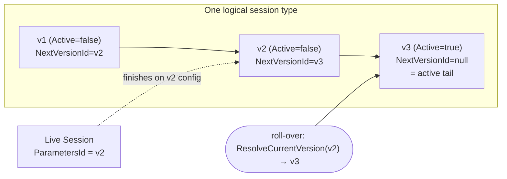

# Monkify — "Operator page (Operator admin portal)" Feature — Implementation Spec

> **Status: Ready for implementation** — refined via Trello card
> [Operator page](https://trello.com/c/JZcMz3ma) (2026-07-03).
> Repos affected: `monkify-backend`, `monkify-front`, and this doc in `monkify-meta`.
>
> **Purpose:** Give operators (casinos) a self-service admin portal at `/monkify/admin` where they
> authenticate with an **operator-signed admin token** and perform full CRUD on **their own** session
> types (game configurations). Today session types are only seeded by `Monkify.Consumers`; operators
> have no way to create or adjust them. A dev-only header shortcut mints an admin token locally.

---

## 1. Summary

A new **admin surface** reusing the existing launch-token cryptography (RS256 against
`Operator.LaunchPublicKey`) but with a distinct **admin scope** so admin and player tokens are never
interchangeable. The operator manages **`SessionParameters`** rows scoped to their own operator id.

| Aspect | Player (launch) flow — existing | Admin flow — this feature |
| --- | --- | --- |
| Token header | `X-Launch-Token` | **`X-Admin-Token`** |
| Token claims | `iss`, `sub` (player), `exp`, `iat`, `jti` | `iss`, **`scope: "admin"`**, `exp`, `iat`, `jti`; **no `sub`** |
| Entry URL | `…/monkify/game/sessions#launch_token=<jwt>` | **`…/monkify/admin#admin_token=<jwt>`** |
| Guarded prefixes | `/sessions`, `/operators`, `/players`, `/fx` | **`/admin`** |
| Contract gate | required (contract-active) | **not required** (operators prep/fix types anytime) |
| Identity carried | `ILaunchContext { OperatorId, ExternalPlayerId }` | **`IAdminContext { OperatorId }`** |

**Operations (scoped to the operator's own types):** Create, Edit, List, soft-Deactivate. No hard
delete. `AllowFreeBet` is **never** exposed (dev-only workaround; stays `false`). `OperatorId` is
always the token `iss`, never client-settable. All three session-type **modes** are supported:
free-type race, preset-choice race, and lottery.

**Live-session isolation via versioning (the non-obvious core).** A live session reads its config
**live** from its `SessionParameters` row (bet validation in `RegisterBetHandler`, the typer in
`RunSession`). To make edits "apply to future sessions only", an **edit creates a new
`SessionParameters` row (a new version)**:

- the **old** row is set `Active = false` and `NextVersionId → new.Id` (a forward-linked list);
- the **new** row is `Active = true`, `NextVersionId = null` (the "active tail");
- the currently-live session keeps pointing at the old row and **finishes on the old config**;
- when that session **rolls over** (`RunSessionConsumer`), the next session is created from the
  **active tail** of the chain (`ResolveCurrentVersion`), not the row the ended session used;
- `GET /sessions/active-types` already filters `Active == true`, so it returns only the tail → no
  duplicate versions in the lobby;
- **Deactivate** sets the current tail `Active = false` (tail stays, `NextVersionId` null) → the chain
  ends and no new session rolls.

---

## 2. Constraints (MANDATORY)

From `monkify-meta/constraints.md` (full list there):

- **Branch-per-repo:** `feature/operator-admin-page` in `monkify-backend`, `monkify-front`,
  `monkify-meta`.
- **Unit tests:** update/add in `Monkify.Tests`; **also update the session-flow integration suite**
  `Monkify.Tests.Integration` (roll-over now resolves the active version). Report changed tests at the
  end of implementation.
- **EF mapping:** inline in `MonkifyDbContext.OnModelCreating`; no `IEntityTypeConfiguration`.
- **Migrations:** under `Monkify.Infrastructure/Migrations/`; applied **only** by `Monkify.Consumers`
  at startup (`Database.Migrate()`). The API does not migrate.
- **Secrets/config:** **mock-only** values in committed files. Admin tokens sign/validate with the
  **existing** launch keypair (`GeneralSettings.LaunchTokens.DevSigningPrivateKeyPem` /
  `Operator.LaunchPublicKey`) — do **not** add real keys; do **not** touch the real
  `GeneralSettings.Token.*` Solana key.
- **Operator messaging:** every admin-token failure returns a single generic **HTTP 401**; the real
  reason + a correlationId are logged **server-side only**. The SPA routes any 401 to `/error`. Never
  reveal contract status on the auth path.
- **API stays stateless:** admin CRUD + token validation live in `Monkify.Api`; roll-over/versioning
  resolution runs in `Monkify.Consumers`. No migration work in the API host.

---

## 3. Resolved product decisions

| # | Decision |
| --- | --- |
| 1 | **Production operator self-service portal** at `/monkify/admin` (not just a dev tool), plus a dev header shortcut. |
| 2 | **Auth = operator-signed RS256 admin JWT**, validated against the operator's existing `Operator.LaunchPublicKey`. No new credential store. "Generate a token" = the operator signing one on their own site. |
| 3 | **Admin scope claim** `scope = "admin"` distinguishes admin tokens. **No `sub`** claim (admin acts as the operator, not a player). |
| 4 | **Transport = URL fragment:** `…/monkify/admin#admin_token=<jwt>`; SPA reads it, strips it from the URL, persists per-tab in `sessionStorage`, and sends **`X-Admin-Token`** on admin calls. |
| 5 | **Strict token separation:** an admin token is **rejected** on player endpoints (`/sessions`, `/operators`, `/players`, `/fx` → 401 when `scope == "admin"`); a launch/player token is **rejected** on `/admin` endpoints (missing/`!= "admin"` scope → 401). |
| 6 | **Operations:** Create, Edit, List, **soft-Deactivate** (`Active = false`). **No hard delete** — historical `Session`/`Bet` rows FK to the type. |
| 7 | **`AllowFreeBet` is not operator-editable** (dev-only); stays `false` on operator-created types. **`OperatorId` fixed from token `iss`**, never client-settable. |
| 8 | **All three modes** creatable/editable: free-type race, preset-choice race (operator defines the preset list), lottery (operator sets pot + draw frequency → future sessions schedule Hangfire draws). |
| 9 | **Live-session isolation via versioning.** Edit → new `SessionParameters` version; `old.Active=false`, `old.NextVersionId → new.Id`; live session finishes on the old version; roll-over creates the next session from the **active tail**; `active-types` returns active tails only. |
| 10 | **Roll-over resolves the active tail** (`ResolveCurrentVersion`). If the tail is inactive (deactivated) → no new session is created (chain ends). |
| 11 | **Dev entry:** dev-only admin icon in `GameHeader` → Crypto/Regulated options → mint via new **`POST /dev/admin-token?paymentModel=Crypto|Regulated`** (404 in prod, returns `{ token }`) → `/monkify/admin`. Gated by the existing **`VUE_APP_DEV_LAUNCH`** flag. |
| 12 | **Admin access is NOT contract-gated** (valid signature + operator exists is enough), so operators can prep types before contract start and fix them after expiry. The contract window still gates **player** sessions (unchanged: `GetAllActiveSessionParameters` / `OpenNewSessions` skip inactive operators). |
| 13 | **Identity via new `IAdminContext { OperatorId }`** (scoped), set by admin middleware — kept separate from `ILaunchContext`. |
| 14 | **Cache:** every admin write invalidates `ActiveParameters:{operatorId}` (`CacheHelper.GenerateActiveParametersCacheSettings`). |
| 15 | **No new seeding / keys.** Admin tokens reuse the seeded dev operators (`DEV Cassino`, `DEV Regulated Cassino`) and their mock `LaunchPublicKey`; the dev mint signs with the existing `DevSigningPrivateKeyPem`. |

---

## 4. Data model

### 4.1 Entity / column changes

**`SessionParameters`** — `monkify-backend/src/Monkify.Domain/Sessions/Entities/SessionParameters.cs`
— add a self-referencing forward pointer to the successor version:

```csharp
public Guid? NextVersionId { get; set; }        // null on the active tail (current version)
public SessionParameters? NextVersion { get; set; }
```

No other entity changes. `Active` already exists (line 29) and is reused as the "is this the current
tail" flag (old versions and deactivated tails are `Active = false`).

### 4.2 EF configuration (inline)

File: `monkify-backend/src/Monkify.Infrastructure/Data/Context/MonkifyDbContext.cs`, inside the
existing `modelBuilder.Entity<SessionParameters>` block (lines 35–57), add:

```csharp
builder.Property(x => x.NextVersionId);
builder.HasOne(x => x.NextVersion)
       .WithMany()
       .HasForeignKey(x => x.NextVersionId)
       .OnDelete(DeleteBehavior.Restrict);
builder.HasIndex(x => x.NextVersionId);
```

> `Description` is `IsRequired()` (line 39) and `Name` `HasMaxLength(100).IsRequired()` (line 38) —
> the admin create/edit form must send both. `RequiredAmount` precision `(18,9)`; `LotteryPot`
> `(18,2)`; `PresetChoice.Choice` max length **20**; `Session.WinningChoice` max length 20.

### 4.3 Migration

Name: **`AddSessionParametersVersioning`**

`Up()` adds `SessionParameters.NextVersionId` (`uuid`, nullable), a self-FK to
`SessionParameters(Id)` with `ON DELETE RESTRICT`, and an index on `NextVersionId`. No backfill
(existing rows are their own active tails with `NextVersionId = null`).

```bash
# from monkify-backend/src/Monkify.Infrastructure
dotnet ef migrations add AddSessionParametersVersioning \
  --startup-project ../Monkify.Consumers/Monkify.Consumers.csproj \
  --context MonkifyDbContext
```

Do not hand-edit the snapshot. Applies automatically via `Monkify.Consumers` startup.

### 4.4 Version chain (diagram)



---

## 5. Configuration

**No new config or keys.** Admin token signing/validation reuses:

- `GeneralSettings.LaunchTokens.DevSigningPrivateKeyPem` (mock; dev mint only),
- `GeneralSettings.LaunchTokens.ClockSkewSeconds`,
- each operator's `Operator.LaunchPublicKey` (validation).

Frontend: reuse `VUE_APP_DEV_LAUNCH` / `devLaunchEnabled` (`src/constants/featureFlags.ts:9`) to gate
the dev admin icon. No new env var.

---

## 6. Backend behaviour

### 6.1 Admin token issue/validate — extend `ILaunchTokenService`

File: `monkify-backend/src/Monkify.Api/Launch/LaunchTokenService.cs`

The service today issues/validates only player tokens (claims `sub` + `jti`; no `scope`). Add admin
support **without breaking the player path**:

1. Add a **`scope`** constant (e.g. `AdminScope = "admin"`).
2. **Issue:** add `string IssueAdmin(string privateKeyPem, Guid operatorId, int ttlSeconds)` (or extend
   `Issue` with an optional `scope` param). It sets `iss = operatorId`, a `scope = "admin"` claim,
   `iat`/`exp`/`jti`, and **no `sub`**. Reuse `CreateRsaKey` (caching off — see the existing
   disposed-RSA note at lines 101–113).
3. **Validate:** the existing `Validate(token, expectedOperatorId, publicKeyPem, clockSkew)` returns a
   `LaunchTokenValidationResult`. Add a **`Scope`** field to that record (read the `scope` claim; null
   when absent). Keep `ValidateAudience = false`. The **caller** (middleware) enforces scope — the
   service just surfaces it. (Signature/`exp`/`iat`/`iss` validation is identical for both token types
   because they share the operator keypair.)

### 6.2 Admin identity context (new) — `IAdminContext`

`monkify-backend/src/Monkify.Infrastructure/Services/Admin/IAdminContext.cs` (new), mirroring
`ILaunchContext` but carrying only the operator:

```csharp
public interface IAdminContext
{
    bool IsSet { get; }
    Guid OperatorId { get; }
    void Set(Guid operatorId);
}
```

Register **scoped** in `Monkify.Infrastructure/DependencyInjection.cs` (next to the existing
`ILaunchContext` / `IOperatorService` registrations, lines 48–49).

### 6.3 Operator lookup without contract filter (admin is not contract-gated)

File: `monkify-backend/src/Monkify.Infrastructure/Services/Operators/{IOperatorService,OperatorService}.cs`

`GetActiveOperatorById` filters to contract-active operators (lines 21–40) — unsuitable for admin
(decision 12). Add:

```csharp
Task<Operator?> GetOperatorById(Guid operatorId);   // no contract filter; returns LaunchPublicKey
```

Implementation mirrors `GetActiveOperatorById` **without** the `ContractStartDate`/`ContractEndDate`
predicate, cached under a distinct key `CacheHelper.GenerateAdminOperatorCacheSettings(operatorId)`
(new: `"Operator:Admin:{operatorId}"`, ~3h) so it doesn't collide with the contract-active cache
entry. Operators aren't edited here, so no invalidation is needed for it.

### 6.4 Admin token validation middleware (new, `Monkify.Api`)

`monkify-backend/src/Monkify.Api/Middleware/AdminTokenValidationMiddleware.cs` (new). Registered in
`Monkify.Api/Program.cs` right after the launch middleware (line 136), before `MapControllers`.

- `HeaderName = "X-Admin-Token"`.
- **Guards** paths under **`/admin`** only (opt-in prefix, mirroring `LaunchTokenValidationMiddleware`'s
  `ProtectedPrefixes`). Skips `OPTIONS`. Ignores everything else (so `/dev/admin-token`, `/sessions`,
  Swagger, `/Hubs/*` are untouched by it).
- Algorithm:
  1. Read `X-Admin-Token`. Missing/empty → generic **401**.
  2. `tokenService.TryReadIssuer(token, out operatorId)`. Unparseable → 401.
  3. `op = await operatorService.GetOperatorById(operatorId)` (§6.3, **no** contract filter). Null or no
     `LaunchPublicKey` → 401.
  4. `result = tokenService.Validate(token, operatorId, op.LaunchPublicKey!, clockSkew)`. Failure → 401.
  5. **`result.Scope != "admin"` → 401** (a player token is rejected here).
  6. `adminContext.Set(operatorId)`; continue.
- Generic 401 body identical to the launch middleware's `Reject` (single
  `Message(MessageType.ValidationFailure, "The request could not be processed.")`, status 401, real
  reason + correlationId to `Log.Warning`).

### 6.5 Reject admin tokens on player endpoints

File: `monkify-backend/src/Monkify.Api/Middleware/LaunchTokenValidationMiddleware.cs`

After a successful `Validate` (line 71), add: **if `result.Scope == "admin"` → `Reject(... "admin token on player endpoint")`** (401). This closes the reverse direction (decision 5).

### 6.6 Admin controller + handlers (new)

New controller `monkify-backend/src/Monkify.Api/Controllers/AdminController.cs` (`[Route("admin")]`),
guarded by the admin middleware, using the `BaseController.ProcessRequest<T>` pattern and injecting
`IAdminContext` (mirroring how `SessionsController` injects `ILaunchContext`, line 19–22):

| Verb + route | Action | MediatR request |
| --- | --- | --- |
| `GET /admin/session-types` | List the operator's current (active-tail) types | `GetOperatorSessionTypesRequest(adminContext.OperatorId)` |
| `POST /admin/session-types` | Create a new type | `CreateSessionTypeRequest(adminContext.OperatorId, body)` |
| `PUT /admin/session-types/{id:guid}` | Edit → new version | `UpdateSessionTypeRequest(adminContext.OperatorId, id, body)` |
| `POST /admin/session-types/{id:guid}/deactivate` | Soft-deactivate | `DeactivateSessionTypeRequest(adminContext.OperatorId, id)` |

New handlers under `monkify-backend/src/Monkify.Infrastructure/Handlers/Admin/` (each folder: request +
`RequestBody` where applicable + handler), following the existing handler style
(`BaseRequestHandler<TRequest, TResult>`):

**6.6a `GetOperatorSessionTypes`** — returns the operator's manageable types:

```csharp
_context.SessionParameters
    .Include(x => x.LotteryParameters).Include(x => x.PresetChoices)
    .Where(x => x.OperatorId == operatorId && x.Active)   // Active tails only
    .AsNoTracking().ToListAsync();
```

Project to a new `SessionTypeAdminDto` (§6.7). (Old versions are `Active = false`, so this naturally
excludes them.)

**6.6b `CreateSessionType`** — validate (§6.8), then insert a new `SessionParameters`:

- `OperatorId = operatorId` (from context — **ignore any body operator id**), `Active = true`,
  `AllowFreeBet = false` (**forced**; not read from the body), `NextVersionId = null`.
- Map `Name`, `Description`, `AllowedCharacters`, `ChoiceRequiredLength`,
  `AcceptDuplicatedCharacters`, `MinimumNumberOfPlayers`, `RequiredAmount`.
- If preset choices provided → add `PresetChoice` children.
- If lottery provided → add `LotteryParameters { LotteryPot, Frequency }`.
- `SaveChanges`, then invalidate `ActiveParameters:{operatorId}` (§6.9). Return the new id.

**6.6c `UpdateSessionType` (versioning)** — load the current version by id, scoped and active:

```csharp
var current = await _context.SessionParameters
    .Include(x => x.LotteryParameters).Include(x => x.PresetChoices)
    .FirstOrDefaultAsync(x => x.Id == id && x.OperatorId == operatorId && x.Active);
if (current == null) return null;   // → 404 (not found / not yours / not the current version)
```

Validate the incoming body (§6.8). Then, in a **transaction**:

1. Build a **new** `SessionParameters` (new `Id`) from the validated body: `OperatorId = operatorId`,
   `Active = true`, `AllowFreeBet = false`, `NextVersionId = null`, plus fresh `PresetChoice` /
   `LotteryParameters` children reflecting the edit.
2. `current.Active = false; current.NextVersionId = newRow.Id;` (mark `Active`, `NextVersionId`
   modified).
3. `AddAsync(newRow)`, `SaveChanges`.
4. Invalidate `ActiveParameters:{operatorId}`. Return the **new** id.

> Concurrency: two concurrent edits of the same tail would both read `current.Active == true`. The
> transaction + the fact that the second edit re-reads within its own scope makes the last writer win;
> both new rows would be `Active = true` and point-of-truth ambiguity is avoided because the lobby /
> roll-over pick **any** active tail for the lineage — acceptable for MVP. (If stricter linearization
> is wanted later, add an optimistic-concurrency token; out of scope here.)

**6.6d `DeactivateSessionType`** — load the current tail (`Id == id && OperatorId == operatorId &&
Active`), set `Active = false` (leave `NextVersionId = null`), save, invalidate cache. Null → 404.

### 6.7 Admin DTOs

New `monkify-backend/src/Monkify.Infrastructure/Contracts/Admin/SessionTypeAdminDto.cs` — like
`SessionParametersDto` (`Contracts/Sessions/SessionParametersDto.cs`) but for the admin list
(includes the tail `Id`, all editable fields, preset list, lottery pot/frequency; **omits**
`AllowFreeBet` from the editable surface — may include it read-only if useful, but it's always false
for operator-created rows).

New request bodies (in the handler folders): `CreateSessionTypeRequestBody` /
`UpdateSessionTypeRequestBody` with:
`Name`, `Description`, `AllowedCharacters` (`SessionCharacterType`), `ChoiceRequiredLength`,
`AcceptDuplicatedCharacters`, `MinimumNumberOfPlayers`, `RequiredAmount`,
`PresetChoices` (`List<string>?`), `Lottery` (`{ decimal LotteryPot; TimeSpan Frequency }?`). **No
`AllowFreeBet`, no `OperatorId`, no `Active`.**

### 6.8 Parameter validation (new domain validation)

Bet-time choice validation lives in `BetDomainService.ChoiceIsValidForSession`; there is **no**
parameter-level validation today (seed data is trusted). Add a validator (a static
`SessionParametersValidation` helper in `Monkify.Domain/Sessions`, or validation inside the handlers)
enforcing:

- `Name`: required, trimmed, 1–100 chars. `Description`: required, trimmed, 1–200 chars.
- `AllowedCharacters`: a defined `SessionCharacterType` enum value.
- `ChoiceRequiredLength`: required, **1–20** (bounded by `WinningChoice`/`PresetChoice` max 20).
- `MinimumNumberOfPlayers`: **>= 2**.
- `RequiredAmount`: **> 0** (fits `decimal(18,9)`).
- `AcceptDuplicatedCharacters`: bool (no constraint).
- **Preset choices** (when provided): non-empty list; each choice trimmed lowercase (mirror
  `Bet.Choice` normalization), length `== ChoiceRequiredLength`, only characters within
  `AllowedCharacters`' pool, respects `AcceptDuplicatedCharacters`, ≤ 20 chars, and the list is
  distinct. Reuse the pool/`AllowedCharacters` description used by `MonkifyTyper`.
- **Lottery** (when provided): `Frequency` **> TimeSpan.Zero** (propose bounds: ≥ 1 minute,
  ≤ 7 days), `LotteryPot` **>= 0** (fits `decimal(18,2)`).

On failure return a validation message via the existing `IMessaging` pattern (generic to the client is
fine; this is operator-authenticated so specific field errors are acceptable and helpful — **not** the
vague operator-error case, which applies only to the token/contract path).

### 6.9 Cache invalidation

Each of Create/Update/Deactivate calls
`_cache.Remove(CacheHelper.GenerateActiveParametersCacheSettings(operatorId))`
(`ICacheService` + `CacheHelper.cs:13`). Inject `ICacheService` into the handlers (or route writes
through `ISessionService`). No change to the `Operator:*` caches.

### 6.10 Roll-over resolves the active version (`Monkify.Consumers` + `SessionService`)

**New method** on `ISessionService` / `SessionService`
(`Monkify.Infrastructure/Services/Sessions/`):

```csharp
// Walks NextVersionId forward from the ended session's parameters to the tail.
// Returns the tail WITH Lottery + PresetChoices + Operator loaded, or null if the tail is inactive.
Task<SessionParameters?> ResolveCurrentVersion(Guid parametersId);
```

Implementation: loop from `parametersId`, load the row (`Id`, `NextVersionId`, `Active`), follow
`NextVersionId` until null; then load the tail with `.Include(LotteryParameters).Include(PresetChoices)
.Include(Operator)`. Return it only when `tail.Active` (deactivated tail → null). Guard against cycles
with a bounded loop.

**`RunSessionConsumer.cs:40`** — replace:

```csharp
await sessionService.CreateSession(session.Parameters);
```

with:

```csharp
var currentVersion = await sessionService.ResolveCurrentVersion(session.ParametersId);
if (currentVersion != null)
    await sessionService.CreateSession(currentVersion);
// else: type was edited to a deactivated tail, or deactivated → chain ends, no next session.
```

(`CreateSession` itself is unchanged — it already skips creation for a contract-inactive operator,
lines 386–418.)

### 6.10b Open the first session for a newly created type (event → Consumers)

A brand-new `SessionParameters` has **no `Session`**, and sessions are only created at Consumers
startup (`OpenNewSessions`) or on roll-over (`RunSessionConsumer`) — so entering a just-created type
would `GET /sessions/{id}` and hit `ParameterHasNoActiveSessions` (**400**). Session/typer work
belongs to `Monkify.Consumers` (SignalR fan-out + Hangfire lottery scheduling), not the stateless API,
so **`CreateSessionType` publishes a `SessionParametersCreatedEvent(parametersId)`** after the write,
and a new **`SessionParametersCreatedConsumer`** (Consumers) opens the first session:

- Loads the parameters (`Include` Lottery/Preset/Operator). **Idempotent:** skips if the type is
  gone/inactive or already has a live session (`ActiveSessionsStatus`), so a redelivered event is safe.
- Calls `SessionService.CreateSession(parameters)` — which already skips inactive operators, so a type
  created before contract start simply gets its first session once the operator is active.
- **Edits do not publish this** — the current live session rolls over to the new version (§6.10).

Register the consumer in `Monkify.Consumers/Program.cs` (`AddConsumer` + `ReceiveEndpoint`, next to
the others). `CreateSessionTypeHandler` takes `IRabbitMQService` (already registered in the API host,
as `RegisterBetHandler` publishes events too).

### 6.10c Entering a type resolves the live session across the lineage

After an edit, the in-progress round keeps running on the **old** version and only rolls over to the
new tail when it ends (§6.10). But `active-types` lists the type under the **new tail id**, so
`GET /sessions/{tailId}` → `GetActiveSessionForParameter` matching `ParametersId == tailId` exactly
would find nothing → **400 `ParameterHasNoActiveSessions`** until the round ends. Fix: the handler
walks the **version lineage** (the tail plus every predecessor whose `NextVersionId` chain leads to
it) and returns the live session wherever it sits, using **that session's own version parameters**
(the live round was created/validated against them). No extra session is created — isolation holds.

### 6.11 Startup roll-over is lineage-aware — `OpenNewSessions` (hidden blocker)

File: `monkify-backend/src/Monkify.Consumers/Program.cs` (`OpenNewSessions`, lines 287–309)

`GetAllActiveSessionParametersForAllOperators()` returns only `Active` tails (correct). But the
"already has a live session?" guard at line 304 keys on
`x.ParametersId == parameter.Key` — after an edit, a live session created from the **old** version has
`ParametersId = oldId`, while `parameter.Key = newTailId`, so the guard misses it and a **duplicate**
session would be created on a Consumers restart. Fix the guard to be **lineage-aware**:

- Load all sessions in `Session.ActiveSessionsStatus`, and for each resolve its `ParametersId` to its
  tail (`ResolveCurrentVersion`-style forward walk); build a set of "tails that already have a live
  session". Skip creating for any `parameter.Key` in that set.
- (Equivalent: skip if any active session's parameters chain resolves to `parameter.Key`.)

Document this in the file checklist and tests.

### 6.12 Dev mint endpoint (new, non-production only)

File: `monkify-backend/src/Monkify.Api/Controllers/DevController.cs` — add alongside
`MintLaunchToken`:

```csharp
[HttpPost("admin-token")]
public async Task<IActionResult> MintAdminToken([FromQuery] OperatorPaymentModel paymentModel = OperatorPaymentModel.Crypto)
{
    if (env.IsProduction()) return NotFound();
    var name = paymentModel == OperatorPaymentModel.Regulated ? RegulatedOperatorName : CryptoOperatorName;
    var op = await context.Operators.AsNoTracking().FirstOrDefaultAsync(x => x.Name == name);
    if (op == null) return NotFound();
    var token = tokenService.IssueAdmin(settings.LaunchTokens.DevSigningPrivateKeyPem, op.Id, ttlSeconds: int.MaxValue);
    return Ok(new { token });
}
```

Reuses the existing `DEV Cassino` / `DEV Regulated Cassino` names and mock signing key already present
on `DevController` — **no new seeding** (both dev operators already carry the mock `LaunchPublicKey`).

### 6.13 Hidden blockers (documented)

| Blocker | Fix |
| --- | --- |
| `ILaunchTokenService.Validate` has no `scope` in its result; token has no `scope` claim | Add `Scope` to `LaunchTokenValidationResult`; add `IssueAdmin` that sets `scope = "admin"` (§6.1) |
| `LaunchTokenValidationMiddleware` guards by opt-in `ProtectedPrefixes` (not a skip-list) | `/admin` is simply **not** in that list, so the launch MW ignores it; add a **separate** admin MW for `/admin` (§6.4) |
| Launch MW would accept an admin-scoped token on `/sessions` etc. | Reject when `result.Scope == "admin"` (§6.5) |
| `GetActiveOperatorById` filters contract-active — admin must work for inactive operators | Add `GetOperatorById` (no contract filter) + distinct cache key (§6.3) |
| `RunSessionConsumer:40` rolls over on the **ended** row, not the current version | `ResolveCurrentVersion` before `CreateSession` (§6.10) |
| `OpenNewSessions:304` dedup keys on `ParametersId` → duplicate session after an edit on restart | Lineage-aware dedup (§6.11) |
| `Description` is `IsRequired` in EF | Admin form + validation require `Description` (§6.8) |
| `IAdminContext` must not leak into player handlers and vice versa | Separate scoped context; separate middleware; separate header (§6.2, §6.4) |
| Player deep-link `?type=<oldId>` after an edit resolves to an inactive row | Acceptable — the FE reloads `active-types` (new tail id); `GetSessionParametersById` returns null for inactive, handled as "not accepting bets". Document, no code change. |

---

## 7. Frontend behaviour

### 7.1 Admin token capture — new `useAdmin` + `adminToken` util

New `monkify-front/src/utils/adminToken.ts` (mirror `utils/launchToken.ts`):

- `STORAGE_KEY = 'monkify.adminToken'`, in-memory + `sessionStorage`; `getAdminToken` / `setAdminToken`.
- `ADMIN_TOKEN_HEADER = 'X-Admin-Token'`, `ADMIN_TOKEN_FRAGMENT_KEY = 'admin_token'`.
- `getOperatorIdFromAdminToken(token?)` — decode JWT `iss` (reuse the decode logic; `iss` is the
  operator id). No `sub`.

New `monkify-front/src/hooks/useAdmin.ts` (mirror `useLaunch.ts`):

- `ensureAdminToken()` — read `#admin_token=` from the fragment (fragment wins over stored),
  `setAdminToken` + strip the fragment via `history.replaceState`, else return the stored token.
- Optionally expose the operator id (from the admin token `iss`) for display.

### 7.2 Admin service (new axios instance) — `src/services/adminService.ts`

A dedicated instance so admin calls carry **`X-Admin-Token`** (not the launch token). Mirror
`mainService.ts` structure:

- Request interceptor: `baseURL = VUE_APP_API_BASE_URL`; attach `X-Admin-Token` from `getAdminToken()`.
- Response interceptor: on `401` (and not already on `/error`) → `window.location.assign('/error')`.
- Methods (all under `/admin`): `getSessionTypes()` → `GET /admin/session-types`;
  `createSessionType(body)` → `POST /admin/session-types`;
  `updateSessionType(id, body)` → `PUT /admin/session-types/{id}`;
  `deactivateSessionType(id)` → `POST /admin/session-types/{id}/deactivate`.
- Export via `src/services/index.ts` (add `export { default as adminService } from './adminService'`).

### 7.3 Route — `/monkify/admin`

File: `monkify-front/src/routes.ts` — add a **non-dev-gated** record (operators use it in production):

```ts
{ name: 'Admin', path: '/monkify/admin', component: require('@/pages/AdminPage.vue').default }
```

(Use the existing eager `require(...).default` idiom. The route must exist in prod so the operator's
`#admin_token=` redirect resolves; access control is the admin token itself — no token / invalid →
the service 401s → `/error`.)

### 7.4 Admin pages/components

- `monkify-front/src/pages/AdminPage.vue` — thin shell (mirror `SessionSelectPage.vue`) hosting the
  admin components; `onMounted` calls `useAdmin().ensureAdminToken()` and, if no token, redirects to
  `/error`; otherwise loads the list.
- `monkify-front/src/components/admin/SessionTypeList.vue` — table of the operator's active types
  (name, mode, charset, length, amount, min players, lottery pot/frequency); row actions **Edit** and
  **Deactivate** (with confirm). Empty/loading/error states.
- `monkify-front/src/components/admin/SessionTypeForm.vue` — create/edit form covering all three modes:
  name, description, charset (`SessionCharacterType` select), choice length, accept duplicates, min
  players, required amount; an optional **preset choices** editor (list of strings); an optional
  **lottery** section (pot + frequency). **No `AllowFreeBet` field.** Client-side validation mirrors
  §6.8; the backend re-validates.

### 7.5 Dev header icon — `GameHeader.vue`

File: `monkify-front/src/components/GameHeader.vue` — inside the right-cluster `div` (after the gear
button, ~line 69), add a **dev-only** admin entry gated by `devLaunchEnabled`
(new import from `@/constants/featureFlags`). Mirror `DevLandingPage.launchAs`:

- Renders only when `devLaunchEnabled` (never ships to prod — `.env.production` sets
  `VUE_APP_DEV_LAUNCH=false`).
- Clicking offers **Crypto** / **Regulated** (a small menu or a new
  `src/components/header/AdminLauncher.vue`); each calls
  `POST /dev/admin-token?paymentModel=<mode>` → `setAdminToken(data.token)` →
  `router.push({ name: 'Admin' })`.

### 7.6 Types

File: `monkify-front/src/types/index.ts` — add admin types (no `SessionParametersDto` equivalent
exists today):

- `SessionTypeAdmin` — the list/edit shape: `sessionTypeId`, `name`, `description`,
  `sessionCharacterType` (enum), `choiceRequiredLength`, `acceptDuplicatedCharacters`,
  `minimumNumberOfPlayers`, `requiredAmount`, `presetChoices: string[]`,
  `lotteryParameters?: { lotteryPot: number; lotteryFrequency: string }`.
- `CreateSessionTypeBody` / `UpdateSessionTypeBody` — same fields **without** `sessionTypeId` and
  **without** any `allowFreeBet`/operator id.

### 7.7 User-facing copy

- Admin token / `401` failures show the existing generic `/error` page (no admin-specific copy).
- Validation errors from the CRUD endpoints are shown inline on the form (operator is authenticated —
  specific field messages are fine; this is not the vague operator-error case).

---

## 8. Flow diagrams

### 8.1 Admin launch + validation

```mermaid
sequenceDiagram
    participant Op as Operator site
    participant FE as Monkify SPA (/monkify/admin)
    participant MW as Admin middleware (Monkify.Api)
    participant H as Admin handlers

    Op->>Op: sign admin JWT (RS256, scope=admin, no sub)
    Op->>FE: redirect /monkify/admin#admin_token=<jwt>
    FE->>FE: read fragment, store (sessionStorage), strip URL
    FE->>MW: GET /admin/session-types (X-Admin-Token)
    MW->>MW: TryReadIssuer → GetOperatorById(iss) (no contract filter)
    MW->>MW: Validate signature/exp; require scope=="admin"
    alt valid admin token
        MW->>H: IAdminContext.Set(operatorId)
        H-->>FE: operator's active session types
    else any failure / wrong scope
        MW-->>FE: 401 generic (real reason logged only)
        FE->>FE: → /error
    end
```

### 8.2 Edit → versioning → roll-over

```mermaid
sequenceDiagram
    participant Admin
    participant API as AdminController/UpdateSessionType
    participant DB
    participant RC as RunSessionConsumer (roll-over)

    Admin->>API: PUT /admin/session-types/{oldId} (edited config)
    API->>DB: insert newRow(Active=true); oldRow.Active=false, oldRow.NextVersionId=newId
    API->>API: invalidate ActiveParameters:{operatorId}
    Note over DB: live session still points at oldId, finishes on old config
    RC->>DB: session(oldId) ends → ResolveCurrentVersion(oldId)=newId (Active)
    RC->>DB: CreateSession(newRow)  %% next session uses the new version
```

---

## 9. Out of scope

- Email/password or SSO login; operator onboarding/provisioning (creating operators, key management,
  uploading `LaunchPublicKey`).
- Editing `AllowFreeBet` (dev-only workaround) from the portal.
- Managing branding / contract window / payment model from the portal (**session types only**).
- Analytics / reporting dashboards.
- **Hard delete** of session types.
- Optimistic-concurrency linearization of simultaneous edits (last-writer-wins is accepted).
- `monkify-meta/features/` KB update (done at ship via `/monkify-ship-feature`).

---

## 10. File checklist

### 10.1 Backend (`monkify-backend`)

| # | File | Change |
| --- | --- | --- |
| 1 | `Monkify.Domain/Sessions/Entities/SessionParameters.cs` | Add `NextVersionId`, `NextVersion` |
| 2 | `Monkify.Infrastructure/Data/Context/MonkifyDbContext.cs` | Map `NextVersionId` self-FK + index (SessionParameters block) |
| 3 | `Monkify.Infrastructure/Migrations/*AddSessionParametersVersioning*` | Add nullable `NextVersionId` FK + index |
| 4 | `Monkify.Api/Launch/LaunchTokenService.cs` | Add `IssueAdmin` (scope=admin, no sub); add `Scope` to `LaunchTokenValidationResult` |
| 5 | `Monkify.Infrastructure/Services/Admin/IAdminContext.cs` (+ impl) | **New** scoped admin identity (OperatorId) |
| 6 | `Monkify.Infrastructure/Services/Operators/{I,}OperatorService.cs` | Add `GetOperatorById` (no contract filter) |
| 7 | `Monkify.Infrastructure/Services/Cache/CacheHelper.cs` | Add `GenerateAdminOperatorCacheSettings` |
| 8 | `Monkify.Infrastructure/DependencyInjection.cs` | Register `IAdminContext` (scoped) |
| 9 | `Monkify.Api/Middleware/AdminTokenValidationMiddleware.cs` | **New** — guard `/admin`; validate; require scope=admin; set `IAdminContext` |
| 10 | `Monkify.Api/Middleware/LaunchTokenValidationMiddleware.cs` | Reject when `result.Scope == "admin"` |
| 11 | `Monkify.Api/Program.cs` | Register admin middleware after launch MW, before `MapControllers` |
| 12 | `Monkify.Api/Controllers/AdminController.cs` | **New** — GET/POST/PUT/deactivate session-types |
| 13 | `Monkify.Infrastructure/Handlers/Admin/GetOperatorSessionTypes/*` | **New** — list active tails for operator |
| 14 | `Monkify.Infrastructure/Handlers/Admin/CreateSessionType/*` | **New** — validate + insert (AllowFreeBet forced false) |
| 15 | `Monkify.Infrastructure/Handlers/Admin/UpdateSessionType/*` | **New** — versioning (new row; old Active=false + NextVersionId) |
| 16 | `Monkify.Infrastructure/Handlers/Admin/DeactivateSessionType/*` | **New** — set tail Active=false |
| 17 | `Monkify.Infrastructure/Contracts/Admin/SessionTypeAdminDto.cs` | **New** admin DTO |
| 18 | `Monkify.Domain/Sessions/SessionParametersValidation.cs` (or in handlers) | **New** parameter-level validation (§6.8) |
| 19 | `Monkify.Infrastructure/Services/Sessions/{I,}SessionService.cs` | Add `ResolveCurrentVersion`; invalidate ActiveParameters on admin writes |
| 20 | `Monkify.Infrastructure/Consumers/RunSession/RunSessionConsumer.cs` | Roll over via `ResolveCurrentVersion` (skip if inactive tail) |
| 21 | `Monkify.Consumers/Program.cs` | `OpenNewSessions` lineage-aware dedup (§6.11) |
| 22 | `Monkify.Api/Controllers/DevController.cs` | **New** `POST /dev/admin-token` (404 in prod) |
| 22b | `Monkify.Infrastructure/Consumers/SessionParametersCreated/*` | **New** `SessionParametersCreatedEvent` + consumer (open first session for a new type) |
| 22c | `Monkify.Consumers/Program.cs` | Register `SessionParametersCreatedConsumer` (AddConsumer + ReceiveEndpoint) |
| 22d | `Monkify.Infrastructure/Handlers/Admin/CreateSessionType/CreateSessionTypeHandler.cs` | Publish `SessionParametersCreatedEvent` after create (inject `IRabbitMQService`) |
| 23 | `Monkify.Tests/**` | New: admin-token/middleware, admin CRUD handlers, versioning + roll-over, validation, OpenNewSessions dedup; update existing session tests as needed |
| 24 | `Monkify.Tests.Integration/**` | Roll-over resolves active version; add an edit-mid-flight → next session uses new version case |

### 10.2 Frontend (`monkify-front`)

| # | File | Change |
| --- | --- | --- |
| 1 | `src/utils/adminToken.ts` | **New** — store/get/set admin token; header + fragment keys; decode `iss` |
| 2 | `src/hooks/useAdmin.ts` | **New** — capture/strip/store fragment admin token |
| 3 | `src/services/adminService.ts` | **New** axios instance sending `X-Admin-Token`; CRUD methods; 401→`/error` |
| 4 | `src/services/index.ts` | Export `adminService` |
| 5 | `src/routes.ts` | Add `/monkify/admin` route (not dev-gated) |
| 6 | `src/pages/AdminPage.vue` | **New** shell — ensure admin token, else `/error` |
| 7 | `src/components/admin/SessionTypeList.vue` | **New** — list + edit/deactivate |
| 8 | `src/components/admin/SessionTypeForm.vue` | **New** — create/edit form (3 modes, no AllowFreeBet) |
| 9 | `src/components/GameHeader.vue` | Add dev-only admin icon (gated by `devLaunchEnabled`) |
| 10 | `src/components/header/AdminLauncher.vue` | **New** (optional) — Crypto/Regulated dev mint menu |
| 11 | `src/types/index.ts` | Add `SessionTypeAdmin`, `Create/UpdateSessionTypeBody` |

### 10.3 Meta (`monkify-meta`)

| # | File | Change |
| --- | --- | --- |
| 1 | `specs/operator-admin-page.md` | This spec |
| 2 | `INDEX.md` | KB map row + feature-in-flight |

---

## 11. Unit tests

Project: `monkify-backend/src/Monkify.Tests`.

| Test file | Test cases | Expected |
| --- | --- | --- |
| `AdminTokenValidationTests.cs` (new) | No `X-Admin-Token` | 401 generic; no handler reached |
| `AdminTokenValidationTests.cs` | Valid admin token (scope=admin) | `IAdminContext` set to `iss`; pipeline continues |
| `AdminTokenValidationTests.cs` | Player/launch token (no/`!=admin` scope) on `/admin` | 401 |
| `AdminTokenValidationTests.cs` | Bad signature / unknown operator / no public key | 401 (indistinguishable) |
| `AdminTokenValidationTests.cs` | Operator with **inactive** contract, valid signature | **allowed** (admin not contract-gated) |
| `LaunchTokenValidationTests.cs` (extend) | Admin-scoped token on `/sessions` | 401 (rejected) |
| `LaunchTokenServiceTests.cs` (extend) | `IssueAdmin` then `Validate` | `Scope == "admin"`, `sub` empty, signature valid |
| `CreateSessionTypeHandlerTests.cs` (new) | Valid free-type / preset / lottery bodies | row inserted; `OperatorId` from context; `AllowFreeBet == false`; `Active == true` |
| `CreateSessionTypeHandlerTests.cs` | Invalid (amount ≤ 0, min players < 2, preset wrong length/charset, bad length) | validation failure; nothing inserted |
| `CreateSessionTypeHandlerTests.cs` | Body attempts to set `AllowFreeBet=true` / a different operator id | ignored — `AllowFreeBet == false`, `OperatorId == context` |
| `UpdateSessionTypeHandlerTests.cs` (new) | Edit existing tail | new row `Active`; old row `Active==false` + `NextVersionId==new.Id`; returns new id |
| `UpdateSessionTypeHandlerTests.cs` | Edit non-existent / other operator's / non-tail id | 404, no change |
| `DeactivateSessionTypeHandlerTests.cs` (new) | Deactivate tail | `Active==false`; excluded from `GetOperatorSessionTypes` and active-types |
| `GetOperatorSessionTypesHandlerTests.cs` (new) | Operator with multiple versions | only active tails returned (no duplicates) |
| `AdminCacheInvalidationTests.cs` (new) | Any admin write | `ActiveParameters:{operatorId}` removed |
| `ResolveCurrentVersionTests.cs` (new) | Chain v1→v2→v3(active) | returns v3 (with children/operator loaded) |
| `ResolveCurrentVersionTests.cs` | Tail deactivated | returns null |
| `RunSessionConsumerTests.cs` (extend/`CreateSessionTests`) | Ended session on old version | next session created from active tail; none when tail inactive |
| `OpenNewSessionsTests` (new or in `SessionServiceParametersTests`) | Restart with old-version live session | no duplicate session for the lineage |
| `DevMintAdminTokenTests.cs` (new) | Non-prod | returns a token validatable by the admin middleware; Production → 404 |

> Use `scripts/run_tests.bat` (fast `~UnitTests` scope) for the unit suite; do **not** run the full
> `dotnet test` (the ProductionSessions Monte-Carlo suite is slow). Integration suite via
> `scripts/run_integration_tests.bat`.

---

## 12. Acceptance criteria

Mirrors the Trello **Acceptance Criteria** checklist — implement until all pass:

1. Given a valid admin-scoped token for operator X, when they list session types, then only operator X's session types are returned (never another operator's).
2. Given a player launch token (or no admin-scope claim), when it is sent to an admin endpoint, then the request is rejected with a vague HTTP 401.
3. Given an admin-scoped token, when it is sent to a player (operator-scoped) endpoint, then it is rejected (admin and player tokens are not interchangeable).
4. Given an invalid / expired / bad-signature / unknown-operator admin token, when any admin request is made, then a single generic 401 is returned (reason logged server-side only) and the SPA routes to /error.
5. Given an operator whose contract is inactive (future start or expired) but whose token signature is valid, when they open the admin portal, then they can still manage their session types (admin is not contract-gated).
6. Given an operator creates a session type, when it is saved, then OperatorId is forced to the token's iss (not client-controllable) and AllowFreeBet stays false (no field exposes it).
7. Given the create/edit form, when the operator submits any of the three modes (free-type, preset-choice with a defined list, or lottery with pot + frequency), then a valid configuration is persisted and an invalid one (e.g. amount ≤ 0, min players < 2, preset choice not valid for the charset/length) is rejected with a validation error.
8. Given a session type with a session currently accepting bets, when the operator edits the type, then a new SessionParameters version is created, the old row is set Active=false with NextVersionId pointing to the new row, and bets placed on the still-open session continue to validate against the old version's config.
9. Given an edited session type, when the current live session ends and rolls over, then the next session is created from the new (active tail) version.
10. Given a session type with multiple versions in its NextVersionId chain, when a player calls GET /sessions/active-types, then only the active tail appears once (no duplicate versions in the lobby).
11. Given an operator deactivates a session type, when its current live session ends, then no new session is created from that type (the chain ends) and it no longer appears in active-types.
12. Given any create/edit/deactivate write, when it succeeds, then the ActiveParameters:{operatorId} cache entry is invalidated so subsequent reads reflect the change.
13. Given VUE_APP_DEV_LAUNCH=false (production), when the app header renders, then the dev admin icon is absent and POST /dev/admin-token returns 404; given it is enabled (dev), then the icon offers Crypto/Regulated, mints an admin token, and lands on /monkify/admin.
14. Given existing SessionParameters rows created before this feature (NextVersionId = null), when the system runs, then they behave unchanged as their own active tails.

---

## 13. Manual QA

1. Start `Monkify.Consumers` (applies the `AddSessionParametersVersioning` migration, seeds dev
   operators) and `Monkify.Api`.
2. In dev, open the game with a launch token; confirm the **dev admin icon** appears in the header
   (gated by `VUE_APP_DEV_LAUNCH`). Click it → choose **Crypto** (or **Regulated**) → lands on
   `/monkify/admin` with a minted admin token.
3. **Create** a free-type session type → appears in the list and in the player lobby
   (`/sessions/active-types`). Repeat for a **preset** and a **lottery** type.
4. **Edit** a type that has a live session accepting bets → the live session finishes on the old
   config; when it rolls over, the next session reflects the edit; the lobby shows the type **once**.
5. **Deactivate** a type → after its current session ends, no new session rolls; it disappears from the
   lobby.
6. Tamper the admin token (edit a char) → next admin call 401 → redirected to `/error`; server log
   shows the real reason + correlationId. Try a **player** token on `/admin` → 401. Try the **admin**
   token on `/sessions/active-types` → 401.
7. Set `VUE_APP_DEV_LAUNCH=false` (prod build) → the dev admin icon is gone and `POST /dev/admin-token`
   returns 404.
8. Run `scripts/run_tests.bat`; then `scripts/run_integration_tests.bat`. Report changed tests.

---

## 14. Trello / pipeline

- **Source card:** https://trello.com/c/JZcMz3ma — list **Specs created**; the **Implementation**
  section on the card lists the branch + spec path.
- **After merge:** `/monkify-ship-feature Operator page` (reads the branch from the card).

---

## 15. Revision log

| Date | Change |
| --- | --- |
| 2026-07-03 | Initial spec from the refined card + same-session refinement decisions (1–15). Grounded in code exploration (launch-token infra, `SessionService`/`RunSessionConsumer` roll-over, `OpenNewSessions`, `MonkifyDbContext`). |
| 2026-07-03 | Implementation fix: creating a type now publishes `SessionParametersCreatedEvent` so a `SessionParametersCreatedConsumer` opens the first session (was 400 `ParameterHasNoActiveSessions` on entering a just-created type). See §6.10b. |
