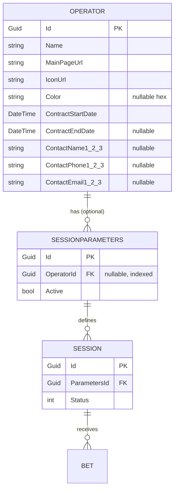
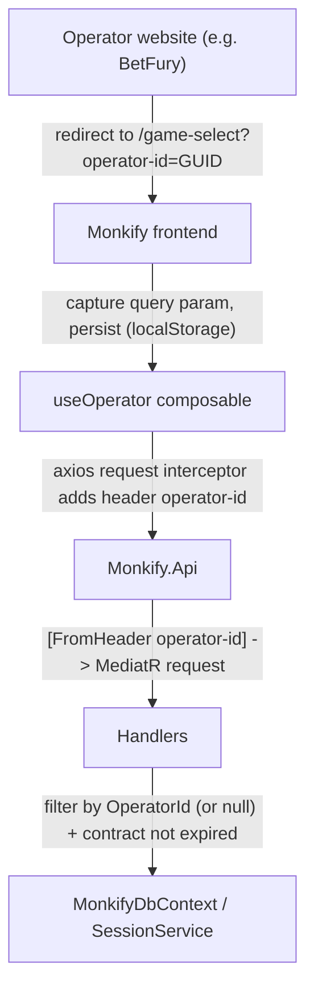

# Monkify — "Operators" Feature — Implementation Spec

> Status: Design / Implementation spec. This document describes **what to build**. It is not the implementation.
> Repos affected: `monkify-backend` (.NET) and `monkify-front` (Vue 3).

---

## 1. Summary

Introduce a concept of **Operators** (casino / betting platforms such as BetMGM, BetFury, etc.). A new
`Operator` table is added to the backend. `SessionParameters` gains an **optional** reference to an `Operator`.

Players reach Monkify from an operator's website, carrying an `operator-id`. The frontend captures that id,
persists it, and sends it as the `operator-id` **request header** on every API call. The backend partitions all
read/write traffic by operator:

- Header present → only data belonging to that operator is visible/usable.
- Header absent → only data with `OperatorId == null` (the "house"/default operator-less data) is visible/usable.

Operators have a contract window (`ContractStartDate` … `ContractEndDate`). When a contract has **expired**, the
operator effectively goes dark: no new sessions, no sessions/bets shown, no new bets — and the user only ever
sees a **vague** "not found / unavailable" message (never "the contract expired").

Operator branding (icon, main page URL, optional color) is exposed via a new `GET /operators` endpoint and used by
the frontend for theming (operator color becomes the **secondary** color when provided).

---

## 2. Constraints (MANDATORY — verbatim)

- "When changing existing code, fix the unit tests so they still pass and test the intended behavior; at the end, report which unit tests were changed."
- "For this feature, a NEW git branch must be created and pushed in EACH affected repository (`monkify-backend` and `monkify-front`). Suggested branch name: `feature/operators`."
- "Never read or edit secrets/config files (appsettings.json, secrets.json, web.config, monkifysettings.json); assume valid config."

Additional working constraints:

- EF configuration in this codebase is **inline** in `OnModelCreating` — there are **no** `IEntityTypeConfiguration` classes. All new mapping goes inline in `MonkifyDbContext` (`monkify-backend/src/Monkify.Infrastructure/Data/Context/MonkifyDbContext.cs:31-129`).
- Migrations are applied **only** at startup of `Monkify.Consumers` via `ApplyMigrations(app)` (`monkify-backend/src/Monkify.Consumers/Program.cs:135` and `:142-156`). The API does not migrate.
- Environment detection uses standard ASP.NET Core `IHostEnvironment` / `builder.Environment` (`!IsProduction()`), as already used in `Monkify.Infrastructure/DependencyInjection.cs:75` and the CORS blocks in both `Program.cs` files.

---

## 3. Product clarification — required vs optional fields

The original ask mentioned "first 5 required". Per the product owner, **color is OPTIONAL**. The authoritative
required/optional split for the `Operator` entity is:


| Field                             | Required?                                               |
| --------------------------------- | ------------------------------------------------------- |
| `Name`                            | **Required**                                            |
| `MainPageUrl`                     | **Required**                                            |
| `IconUrl`                         | **Required**                                            |
| `Color` (hex)                     | Optional / nullable                                     |
| `ContractStartDate`               | **Required**                                            |
| `ContractEndDate`                 | Optional / nullable (null = open-ended / never expires) |
| `ContactName1/2/3`                | Optional                                                |
| `ContactPhone1/2/3` (digits only) | Optional                                                |
| `ContactEmail1/2/3`               | Optional                                                |


So the required set is **Name, MainPageUrl, IconUrl, ContractStartDate**. Everything else is nullable.

---

## 4. Data model

### 4.1 New `Operator` entity

New file: `monkify-backend/src/Monkify.Domain/Sessions/Entities/Operator.cs`
(placed alongside `SessionParameters.cs` in the `Monkify.Domain.Sessions.Entities` namespace; it conceptually
belongs to the Sessions aggregate area since `SessionParameters` references it.)

It extends `TableEntity` (`monkify-backend/src/Monkify.Common/Models/TableEntity.cs:9-20`), which already provides
`Id` (Guid), `CreatedDate`, `UpdatedDate`.

```csharp
namespace Monkify.Domain.Sessions.Entities
{
    public class Operator : TableEntity
    {
        public string Name { get; set; }              // required
        public string MainPageUrl { get; set; }       // required
        public string IconUrl { get; set; }           // required (small icon)
        public string? Color { get; set; }            // optional, hex e.g. "#1A2B3C"

        public DateTime ContractStartDate { get; set; } // required
        public DateTime? ContractEndDate { get; set; }  // nullable; null => never expires

        public string? ContactName1 { get; set; }
        public string? ContactPhone1 { get; set; }    // digits only
        public string? ContactEmail1 { get; set; }

        public string? ContactName2 { get; set; }
        public string? ContactPhone2 { get; set; }
        public string? ContactEmail2 { get; set; }

        public string? ContactName3 { get; set; }
        public string? ContactPhone3 { get; set; }
        public string? ContactEmail3 { get; set; }

        public ICollection<SessionParameters> SessionParameters { get; set; }

        // Expiry helper. UTC, consistent with the rest of the codebase (DateTime.UtcNow everywhere).
        // DECISION (§13.1): expiry is timestamp-precise, NOT date-inclusive.
        public bool ContractHasExpired(DateTime utcNow)
            => ContractEndDate.HasValue && ContractEndDate.Value < utcNow;

        // DECISION (§13.2): a future ContractStartDate means the operator is not yet active.
        public bool ContractIsActive(DateTime utcNow)
            => ContractStartDate <= utcNow && !ContractHasExpired(utcNow);
    }
}
```

> Expiry is **timestamp-precise**: the contract is expired the moment `DateTime.UtcNow > ContractEndDate`
> (decision §13.1). An operator with a future `ContractStartDate` is treated as not-yet-active and is excluded from
> play and from `GET /operators` until it starts (decision §13.2).

### 4.2 `SessionParameters` change

File: `monkify-backend/src/Monkify.Domain/Sessions/Entities/SessionParameters.cs:11-32`

Add a nullable FK + nav property:

```csharp
public Guid? OperatorId { get; set; }   // nullable: a SessionParameters need not have an operator
public Operator Operator { get; set; }
```

### 4.3 EF Fluent configuration (inline, in `OnModelCreating`)

File: `monkify-backend/src/Monkify.Infrastructure/Data/Context/MonkifyDbContext.cs`

1. Add a `DbSet`:

```csharp
public DbSet<Operator> Operators { get; set; }
```

1. Add a new entity block (mirroring the existing inline style at `:33-47`):

```csharp
modelBuilder.Entity<Operator>(builder =>
{
    builder.HasKey(x => x.Id);
    builder.Property(x => x.Name).HasMaxLength(100).IsRequired();
    builder.Property(x => x.MainPageUrl).HasMaxLength(500).IsRequired();
    builder.Property(x => x.IconUrl).HasMaxLength(500).IsRequired();
    builder.Property(x => x.Color).HasMaxLength(9);          // "#RRGGBBAA" worst case; nullable
    builder.Property(x => x.ContractStartDate).IsRequired();
    // ContractEndDate nullable -> no IsRequired

    builder.Property(x => x.ContactName1).HasMaxLength(150);
    builder.Property(x => x.ContactPhone1).HasMaxLength(20);
    builder.Property(x => x.ContactEmail1).HasMaxLength(200);
    builder.Property(x => x.ContactName2).HasMaxLength(150);
    builder.Property(x => x.ContactPhone2).HasMaxLength(20);
    builder.Property(x => x.ContactEmail2).HasMaxLength(200);
    builder.Property(x => x.ContactName3).HasMaxLength(150);
    builder.Property(x => x.ContactPhone3).HasMaxLength(20);
    builder.Property(x => x.ContactEmail3).HasMaxLength(200);

    builder.HasIndex(x => x.ContractEndDate); // supports "exclude expired" filtering
});
```

1. Extend the existing `SessionParameters` block (`:33-47`) with the relationship + the required index on `OperatorId`:

```csharp
builder.HasOne(x => x.Operator)
       .WithMany(x => x.SessionParameters)
       .HasForeignKey(x => x.OperatorId)
       .IsRequired(false)
       .OnDelete(DeleteBehavior.Restrict);

builder.HasIndex(x => x.OperatorId);   // NEW DB index required by the feature
```

### 4.4 ER diagram




### 4.5 Migration plan

- Add a new EF migration in `monkify-backend/src/Monkify.Infrastructure/Migrations/` (the project that owns
migrations; existing ones: `20251024025501_FirstMigration`, `20251029170507_AdicionadoIndexes`).
- Suggested name: `AddOperators` → `dotnet ef migrations add AddOperators` run with the Infrastructure project as
the migrations assembly and `Monkify.Consumers` (or whichever is configured as startup) — match the command
already used by the team. The migration must:
  - Create table `Operators` with all columns above.
  - Add nullable column `OperatorId` to `SessionParameters` + FK to `Operators(Id)` with `ON DELETE RESTRICT`.
  - Create index `IX_SessionParameters_OperatorId`.
  - Create index `IX_Operators_ContractEndDate`.
- Update `MonkifyDbContextModelSnapshot.cs` (auto-generated by the `migrations add` command — do not hand-edit).
- **Application**: nothing else to wire — `ApplyMigrations(app)` in `Monkify.Consumers/Program.cs:135` runs
`dbContext.Database.Migrate()` on Consumers startup and will pick it up automatically.

---

## 5. Operator-aware request flow (header `operator-id`)

### 5.1 Concept




### 5.2 Header semantics (apply consistently)

A single rule, applied to **every** GET handler and to bet/session creation:

- `operator-id` header **present and parseable** as Guid `X` → scope = `OperatorId == X` **AND** operator `X` exists and contract not expired. If `X` does not exist or is expired → behave as "no data" (vague not-found).
- `operator-id` header **absent / empty / unparseable** → scope = `OperatorId == null` (house data only).

> Because the header is optional and may be absent, do **not** make the binding required. CORS already allows any
> header (`AllowAnyHeader` in both `Program.cs` CORS policies), so no CORS change is needed.

### 5.3 Controller binding

File: `monkify-backend/src/Monkify.Api/Controllers/SessionsController.cs`

Add `[FromHeader(Name = "operator-id")] Guid? operatorId` to each GET action and flow it into the MediatR request.
Example for the three GET endpoints:

```csharp
[HttpGet]
public async Task<IActionResult> Filter(
    [FromQuery] GetSessionHistoryRequest request,
    [FromHeader(Name = "operator-id")] Guid? operatorId)
{
    request.OperatorId = operatorId;
    return await ProcessRequest(request);
}

[HttpGet("active-types")]
public async Task<IActionResult> GetActiveParameters(
    [FromHeader(Name = "operator-id")] Guid? operatorId)
    => await ProcessRequest(new GetActiveParametersRequest(operatorId));

[HttpGet("{sessionTypeId}")]
public async Task<IActionResult> GetActiveSessionForParameter(
    Guid sessionTypeId,
    [FromHeader(Name = "operator-id")] Guid? operatorId)
    => await ProcessRequest(new GetActiveSessionForParameterRequest(sessionTypeId, operatorId));
```

> `POST /sessions/{id}/bets` (`RegisterBet`) — see §7.4. Bets are validated by looking up the session's
> parameters' operator, so the bet path does **not strictly need** the header; but for defense-in-depth the
> controller MAY also pass `operator-id` so a bet can be rejected early if it mismatches the session's operator.
> Decision §13.4: enforced via the session's parameters only.

### 5.4 MediatR request objects

- `GetActiveParametersRequest` (`.../GetActiveParameters/GetActiveParametersRequest.cs:6`) — currently a parameterless class. Change to carry the operator:
  ```csharp
  public class GetActiveParametersRequest : IRequest<IEnumerable<SessionParametersDto>>
  {
      public GetActiveParametersRequest(Guid? operatorId = null) { OperatorId = operatorId; }
      public Guid? OperatorId { get; }
  }
  ```
- `GetActiveSessionForParameterRequest` (`.../GetActiveSessionForParameter/GetActiveSessionForParameterRequest.cs:11`) — currently `record GetActiveSessionForParameterRequest(Guid ParameterId)`. Extend:
  ```csharp
  public record GetActiveSessionForParameterRequest(Guid ParameterId, Guid? OperatorId = null)
      : IRequest<ActiveSessionDto>;
  ```
- `GetSessionHistoryRequest` (`.../GetSessionHistory/GetSessionHistoryRequest.cs:13-21`) — add:
  ```csharp
  public Guid? OperatorId { get; set; }
  ```

---

## 6. Operator-aware caching

The active-parameters Redis cache lives in `SessionService.GetAllActiveSessionParameters`
(`monkify-backend/src/Monkify.Infrastructure/Services/Sessions/SessionService.cs:59-80`) and uses a **single fixed
cache key** `"ActiveParameters"` produced by `CacheHelper.GenerateActiveParametersCacheSettings()`
(`monkify-backend/src/Monkify.Infrastructure/Services/Cache/CacheHelper.cs:13-14`).

This must become **operator-aware**, otherwise data from one operator would leak to another via the shared cache.

### 6.1 Cache key change

File: `monkify-backend/src/Monkify.Infrastructure/Services/Cache/CacheHelper.cs`

```csharp
public static CacheSettings GenerateActiveParametersCacheSettings(Guid? operatorId = null)
{
    var suffix = operatorId.HasValue ? operatorId.Value.ToString() : "house";
    return new($"ActiveParameters:{suffix}", TimeSpan.FromHours(12));
}
```

### 6.2 Service signature change

File: `SessionService.cs` + `ISessionService.cs`

- `Task<IDictionary<Guid, SessionParameters>> GetAllActiveSessionParameters(Guid? operatorId = null);`
- `Task<SessionParameters?> GetSessionParametersById(Guid sessionParameterId, Guid? operatorId = null);`

Inside `GetAllActiveSessionParameters(operatorId)`:

- Build cache settings with the operator id.
- DB query becomes:
  ```csharp
  var query = _context.SessionParameters
      .Include(x => x.LotteryParameters)
      .Include(x => x.PresetChoices)
      .Include(x => x.Operator)
      .Where(x => x.Active);

  query = operatorId.HasValue
      ? query.Where(x => x.OperatorId == operatorId.Value)
      : query.Where(x => x.OperatorId == null);

  // exclude expired operators (only relevant when operatorId has a value, but harmless otherwise)
  var now = DateTime.UtcNow;
  query = query.Where(x => x.Operator == null
      || x.Operator.ContractEndDate == null
      || x.Operator.ContractEndDate.Value >= now.Date);

  var activeParameters = await query.AsNoTracking().ToListAsync();
  ```
- Cache per-operator key.

> Cache invalidation: the existing logic in `GetSessionParametersById` that removes the cache
> (`SessionService.cs:96-98`) and the seeding code in `Program.cs` must use the operator-aware key. Because keys
> are now namespaced, removing the house key won't touch operator keys and vice versa.

### 6.3 Callers to update

- `GetActiveParametersHandler.HandleRequest` (`.../GetActiveParameters/GetActiveParametersHandler.cs:24-32`): pass `request.OperatorId` into `GetAllActiveSessionParameters(request.OperatorId)`.
- `GetActiveSessionForParameterHandler.HandleRequest` (`.../GetActiveSessionForParameter/GetActiveSessionForParameterHandler.cs:26-44`): pass `request.OperatorId` into `GetSessionParametersById(request.ParameterId, request.OperatorId)` and add the operator filter to the `Context.Sessions` query (see §7.1).
- `Monkify.Consumers/Program.cs` `CreateDefaultSessionParametersAsync` (`:169-189`) and `OpenNewSessions` (`:191-206`): these run over **all** operators at startup — see §8 (they should iterate per operator, or call the no-arg/house variant plus per-operator variants). Minimum: keep them working for the house (null) operator and the seeded DEV operator.

---

## 7. Expired-contract & operator filtering — enforcement points

Generic, vague message reuse (do NOT add an "expired" message): reuse existing resources from
`monkify-backend/src/Monkify.Common/Resources/ErrorMessages` —

- For session/type lookups: `ErrorMessages.ParameterNotFound` / `ErrorMessages.ParameterHasNoActiveSessions` (Designer at `ErrorMessages.Designer.cs:156-169`).
- For bets: `ErrorMessages.SessionNotValidForBets` (`ErrorMessages.Designer.cs:192-196`).

These already say generic things like "The requested session type was not found…" and "…not found or is not
receiving bets…", which do not reveal contract status. **Reuse them as-is.**

### 7.1 GET — show no sessions/params/bets of an expired (or mismatched) operator


| Handler                               | File                                                                            | Change                                                                                                                                                                                                                                                                                                                                                                                                                                                                    |
| ------------------------------------- | ------------------------------------------------------------------------------- | ------------------------------------------------------------------------------------------------------------------------------------------------------------------------------------------------------------------------------------------------------------------------------------------------------------------------------------------------------------------------------------------------------------------------------------------------------------------------- |
| `GetActiveParametersHandler`          | `.../GetActiveParameters/GetActiveParametersHandler.cs:24-32`                   | Already filtered via operator-aware `GetAllActiveSessionParameters` (§6.2). Expired operators excluded by the query. Returns `[]` → controller maps to 404 (see `BaseController.ProcessRequest:49-50`).                                                                                                                                                                                                                                                                   |
| `GetActiveSessionForParameterHandler` | `.../GetActiveSessionForParameter/GetActiveSessionForParameterHandler.cs:26-44` | `GetSessionParametersById(ParameterId, OperatorId)` must return null when the param's `OperatorId` doesn't match the header **or** the operator is expired → existing code already calls `Messaging.ReturnValidationFailureMessage(ErrorMessages.ParameterNotFound)` (vague). Also add an operator guard to the `Context.Sessions` query so a session of an expired/mismatched operator is never returned: filter `x.Parameters.OperatorId == operatorId` (or `== null`). |
| `GetSessionHistoryHandler`            | `.../GetSessionHistory/GetSessionHistoryHandler.cs:19-44`                       | Add an operator predicate to the `query` (currently starts at `Context.Sessions.Where(...)` at `:28`): `.Where(s => operatorScope)` where `operatorScope` is `s.Parameters.OperatorId == request.OperatorId` when header present, else `s.Parameters.OperatorId == null`; AND exclude expired: `&& (s.Parameters.Operator == null                                                                                                                                         |


### 7.2 Session creation — `OpenNewSessions` (startup)

File: `monkify-backend/src/Monkify.Consumers/Program.cs:191-206`

`OpenNewSessions` iterates active parameters and calls `sessionService.CreateSession`. Because
`GetAllActiveSessionParameters` now excludes parameters of expired operators (§6.2), expired operators are skipped
automatically. Additionally, log a warning when skipping (per requirement "log a warning and move on"). Concretely,
gather parameters per operator; for any operator whose contract is expired, `Log.Warning(...)` once and continue.

### 7.3 Session creation — `SessionService.CreateSession` & `RunSessionConsumer`

- `SessionService.CreateSession(SessionParameters parameters)` (`SessionService.cs:342-368`): add a guard at the
top — load/inspect `parameters.Operator` (or fetch by `parameters.OperatorId`) and if the contract is expired,
`Log.Warning("Skipping session creation for parameter {0}: operator unavailable.", parameters.Id);` and
`return;` **without** creating a session. (No user is directly waiting on this path, so just log + return.)
- `RunSessionConsumer.ProcessMessage` (`.../Consumers/RunSession/RunSessionConsumer.cs:16-46`): after a session
finishes it calls `sessionService.CreateSession(session.Parameters)` at `:40` to roll the next session. Because
`CreateSession` now self-guards on operator expiry, an expired operator's loop naturally stops (no new session is
created). No additional change required beyond ensuring `session.Parameters.Operator`/`OperatorId` is loaded —
`GetSessionById` → `GetSessionParametersById` should `.Include(x => x.Operator)` so the guard has data.

### 7.4 Bet creation — `RegisterBetHandler`

File: `monkify-backend/src/Monkify.Infrastructure/Handlers/Sessions/RegisterBet/RegisterBetHandler.cs:83-107`

`ValidateBetParameters` calls `_sessionService.GetSessionById(request.SessionId)` (`:96`) then checks
`Session.SessionAcceptingBets`. Add an operator-expiry guard:

- Ensure `GetSessionById` → `GetSessionParametersById` includes `Operator`.
- After loading `betSession`, if `betSession?.Parameters?.Operator` exists and its contract is expired, treat it
exactly like an invalid/closed session: `await RefundInvalidBet(ErrorMessages.SessionNotValidForBets);` (vague,
and the existing path already appends a refund warning). Do **not** add an expiry-specific message.

```csharp
var betSession = await _sessionService.GetSessionById(request.SessionId);

var op = betSession?.Parameters?.Operator;
var operatorUnavailable = op != null && op.ContractHasExpired(DateTime.UtcNow);

if (betSession is null || operatorUnavailable || !Session.SessionAcceptingBets.Contains(betSession.Status))
    await RefundInvalidBet(ErrorMessages.SessionNotValidForBets);
```

### 7.5 Summary table


| Requirement (expired operator)                 | Enforced in                                                                                                                                  |
| ---------------------------------------------- | -------------------------------------------------------------------------------------------------------------------------------------------- |
| No new sessions created (log warning, move on) | `SessionService.CreateSession` (guard + log), `OpenNewSessions`, `RunSessionConsumer` (via CreateSession self-guard)                         |
| No sessions shown (active or not)              | `GetActiveParametersHandler`/`GetAllActiveSessionParameters`, `GetActiveSessionForParameterHandler`, `GetSessionHistoryHandler`              |
| No bets shown                                  | `GetSessionHistoryHandler` (bet counts derive from filtered sessions), `GetActiveSessionForParameterHandler` (no session returned ⇒ no bets) |
| No new bets accepted                           | `RegisterBetHandler.ValidateBetParameters`                                                                                                   |
| Vague message only                             | Reuse `ParameterNotFound` / `ParameterHasNoActiveSessions` / `SessionNotValidForBets`                                                        |


---

## 8. Default operator seeding (non-production only)

File: `monkify-backend/src/Monkify.Consumers/Program.cs`

Add a new startup step that runs **before** `CreateDefaultSessionParametersAsync(app)` (so default params can
attach to the dev operator if desired). It must only seed when **not** production.

```csharp
ApplyMigrations(app);
CloseOngoingSessions(app);
CreateDefaultOperatorAsync(app);          // NEW
CreateDefaultSessionParametersAsync(app);
OpenNewSessions(app);
```

```csharp
void CreateDefaultOperatorAsync(WebApplication app)
{
    using var scope = app.Services.CreateScope();
    var environment = scope.ServiceProvider.GetRequiredService<IHostEnvironment>();

    // Never seed the DEV operator in production.
    if (environment.IsProduction())
        return;

    var context = scope.ServiceProvider.GetRequiredService<MonkifyDbContext>();

    if (context.Operators.Any())   // only when NO operators exist
        return;

    context.Operators.Add(new Operator
    {
        Name = "DEV Cassino",
        MainPageUrl = "https://localhost",
        IconUrl = "https://localhost/icon.png",
        Color = null,
        ContractStartDate = DateTime.UtcNow.Date,
        ContractEndDate = null,    // open-ended
    });
    context.SaveChanges();
}
```

> `app.Environment` is also available directly in the top-level statements (as used for CORS at
> `Program.cs:86`), so `if (app.Environment.IsProduction()) return;` is equally valid and simpler.
> Either is fine — pick one.

DECISION (§13.7): the seeded **default `SessionParameters` belong to "DEV Cassino"** (not house). Wire this up:

- `CreateDefaultOperatorAsync` runs before `CreateDefaultSessionParametersAsync` and (non-prod only) inserts DEV Cassino.
- `CreateDefaultSessionParametersAsync` must then set each seeded parameter's `OperatorId` to the DEV Cassino operator's
`Id` (look it up after seeding the operator). The active-parameters cache must be warmed under the **DEV Cassino
operator key** (`CacheHelper.GenerateActiveParametersCacheSettings(devOperatorId)`), not the house key.
- `OpenNewSessions` then opens sessions for those DEV-Cassino-owned parameters as usual.

> Production implication (call out at implementation): because DEV Cassino is **non-prod only**, tying the default
> parameters to it means the default game types are **dev-only**. In production, operators and their session
> parameters are expected to be configured/seeded explicitly (no automatic default game types). Confirm this matches
> ops expectations; if production still needs baseline games, seed a production operator + parameters separately.

---

## 9. New endpoint: `GET /operators`

Returns only branding info for operators whose contract has **not** expired.

### 9.1 Response DTO

New file: `monkify-backend/src/Monkify.Infrastructure/Contracts/Sessions/OperatorDto.cs`
(same `Monkify.Infrastructure.Contracts.Sessions` namespace as the other DTOs; or a new
`Contracts/Operators` folder — either is acceptable.)

```csharp
public class OperatorDto
{
    public OperatorDto(Operator op)
    {
        Name = op.Name;
        IconUrl = op.IconUrl;
        MainPageUrl = op.MainPageUrl;
        Color = op.Color;
    }

    public string Name { get; set; }
    public string IconUrl { get; set; }
    public string MainPageUrl { get; set; }
    public string? Color { get; set; }
}
```

Response shape (wrapped by the standard `ApiResult<T>` via `BaseController`):

```json
{
  "data": [
    { "name": "BetFury", "iconUrl": "https://...", "mainPageUrl": "https://...", "color": "#7A2BE2" }
  ],
  "messages": []
}
```

### 9.2 Handler + request

New folder `monkify-backend/src/Monkify.Infrastructure/Handlers/Operators/GetOperators/`:

- `GetOperatorsRequest.cs`:
  ```csharp
  public class GetOperatorsRequest : IRequest<IEnumerable<OperatorDto>> { }
  ```
- `GetOperatorsHandler.cs` (extends `BaseRequestHandler<GetOperatorsRequest, IEnumerable<OperatorDto>>`):
  ```csharp
  public override async Task<IEnumerable<OperatorDto>> HandleRequest(GetOperatorsRequest request, CancellationToken ct)
  {
      // DECISION (§13.3): cache the operator branding list in Redis for up to 3 hours.
      var cacheSettings = CacheHelper.GenerateOperatorsCacheSettings(); // key "Operators", TTL 3h
      if (_cache.TryGet<List<OperatorDto>>(cacheSettings, out var cached) && !cached.IsNullOrEmpty())
          return cached;

      var now = DateTime.UtcNow; // DECISION (§13.1/§13.2): timestamp-precise; exclude not-yet-started + expired
      var result = await Context.Operators
          .Where(x => x.ContractStartDate <= now
                   && (x.ContractEndDate == null || x.ContractEndDate.Value > now))
          .OrderBy(x => x.Name)
          .Select(x => new OperatorDto(x))      // or project columns directly
          .AsNoTracking()
          .ToListAsync();

      if (!result.IsNullOrEmpty())
          _cache.Set(cacheSettings, result);

      return result;
  }
  ```
  Add `CacheHelper.GenerateOperatorsCacheSettings()` (key `"Operators"`, `TimeSpan.FromHours(3)`) next to the existing
  active-parameters cache helper. Invalidate this key whenever operators are created/updated/seeded.
- DECISION (§13.8): empty lists return **200 with `[]`**, not 404. `BaseController.ProcessRequest` must be changed so
an empty `IEnumerable` is returned as `200 OK` with an empty array (see §9.4). This applies to `GET /operators`,
`GET /sessions/active-types`, and `GET /sessions`.

### 9.3 Controller

Options:

- **A (recommended):** new `OperatorsController : BaseController` with `[Route("operators")]` and
`[HttpGet] GetOperators()` → `ProcessRequest(new GetOperatorsRequest())`. Mirrors `SessionsController`
(`SessionsController.cs:15-17`). Add an `[HttpOptions]` CORS preflight method like the existing one (`:24-29`).
- B: add to `SessionsController` — rejected, route is `/operators` not `/sessions/...`.

No DI registration needed for the handler — MediatR auto-registers from the Infrastructure assembly
(`DependencyInjection.cs:62`). The new controller is auto-discovered by `AddControllers()`/`MapControllers()`
(`Monkify.Api/Program.cs:23,111`).

### 9.4 Empty-result behavior — return 200 `[]` (decision §13.8)

Today `BaseController.ProcessRequest` (`BaseController.cs:49-50`) maps null/empty `IEnumerable` results to **404**.
Per decision §13.8, list endpoints must instead return **200 with an empty array**. Change `ProcessRequest` so an
empty enumerable result keeps the success status code (200) with `data: []`, rather than 404. Keep the `null` (single
object not found) handling as-is (still 404 for a missing single resource if desired), but collections return 200.

> Scope note: this is a shared change affecting `GET /operators`, `GET /sessions/active-types`, and `GET /sessions`.
> Update any existing tests/clients that asserted 404-on-empty for `active-types`/history.

---

## 10. Backend file-by-file checklist


| #   | File                                                                                         | Change                                                                                                                                                |
| --- | -------------------------------------------------------------------------------------------- | ----------------------------------------------------------------------------------------------------------------------------------------------------- |
| 1   | `Monkify.Domain/Sessions/Entities/Operator.cs`                                               | **NEW** entity (§4.1)                                                                                                                                 |
| 2   | `Monkify.Domain/Sessions/Entities/SessionParameters.cs`                                      | Add `OperatorId` + `Operator` nav (§4.2)                                                                                                              |
| 3   | `Monkify.Infrastructure/Data/Context/MonkifyDbContext.cs`                                    | `DbSet<Operator>`, Operator config, SP relationship + `OperatorId` index (§4.3)                                                                       |
| 4   | `Monkify.Infrastructure/Migrations/*`                                                        | **NEW** `AddOperators` migration + snapshot (§4.5)                                                                                                    |
| 5   | `Monkify.Infrastructure/Services/Cache/CacheHelper.cs`                                       | Operator-aware cache key (§6.1)                                                                                                                       |
| 6   | `Monkify.Infrastructure/Services/Sessions/ISessionService.cs`                                | New optional `operatorId` params (§6.2)                                                                                                               |
| 7   | `Monkify.Infrastructure/Services/Sessions/SessionService.cs`                                 | Operator filtering in `GetAllActiveSessionParameters`, `GetSessionParametersById`; `.Include(Operator)`; expiry guard in `CreateSession` (§6.2, §7.3) |
| 8   | `Monkify.Infrastructure/Handlers/Sessions/GetActiveParameters/GetActiveParametersRequest.cs` | Carry `OperatorId` (§5.4)                                                                                                                             |
| 9   | `.../GetActiveParameters/GetActiveParametersHandler.cs`                                      | Pass `OperatorId` through (§6.3)                                                                                                                      |
| 10  | `.../GetActiveSessionForParameter/GetActiveSessionForParameterRequest.cs`                    | Carry `OperatorId` (§5.4)                                                                                                                             |
| 11  | `.../GetActiveSessionForParameter/GetActiveSessionForParameterHandler.cs`                    | Operator scope + expiry guard on sessions query (§7.1)                                                                                                |
| 12  | `.../GetSessionHistory/GetSessionHistoryRequest.cs`                                          | Add `OperatorId` (§5.4)                                                                                                                               |
| 13  | `.../GetSessionHistory/GetSessionHistoryHandler.cs`                                          | Operator + expiry predicate (§7.1)                                                                                                                    |
| 14  | `.../RegisterBet/RegisterBetHandler.cs`                                                      | Expiry guard in `ValidateBetParameters` (§7.4)                                                                                                        |
| 15  | `Monkify.Infrastructure/Contracts/Sessions/OperatorDto.cs`                                   | **NEW** DTO (§9.1)                                                                                                                                    |
| 16  | `Monkify.Infrastructure/Handlers/Operators/GetOperators/GetOperatorsRequest.cs`              | **NEW** (§9.2)                                                                                                                                        |
| 17  | `Monkify.Infrastructure/Handlers/Operators/GetOperators/GetOperatorsHandler.cs`              | **NEW** (§9.2)                                                                                                                                        |
| 18  | `Monkify.Api/Controllers/OperatorsController.cs`                                             | **NEW** controller (§9.3)                                                                                                                             |
| 19  | `Monkify.Api/Controllers/SessionsController.cs`                                              | `[FromHeader("operator-id")]` on GET actions (§5.3)                                                                                                   |
| 20  | `Monkify.Consumers/Program.cs`                                                               | `CreateDefaultOperatorAsync` (non-prod), operator-aware seeding/open-sessions (§8, §6.3)                                                              |


---

## 11. Frontend

### 11.1 Capture & persist `operator-id`

The user lands on Monkify from the operator site with `operator-id` in the URL query (e.g.
`/game-select?operator-id=<guid>`). Persist it so it survives navigation and reloads within the session.

New composable: `monkify-front/src/hooks/useOperator.ts`

DECISION (§13.5): persist in `**sessionStorage`** (operator context resets when the tab closes).

```ts
import { ref, computed } from 'vue';

const STORAGE_KEY = 'monkify.operatorId';
const operatorId = ref<string | null>(sessionStorage.getItem(STORAGE_KEY));

export const useOperator = () => {
  const setOperatorId = (id: string | null) => {
    operatorId.value = id;
    if (id) sessionStorage.setItem(STORAGE_KEY, id);
    else sessionStorage.removeItem(STORAGE_KEY);
  };

  // Reads ?operator-id=... from the current URL and persists it (call once on app mount).
  const captureFromUrl = () => {
    const params = new URLSearchParams(window.location.search);
    const fromUrl = params.get('operator-id');
    if (fromUrl) setOperatorId(fromUrl);
  };

  return {
    operatorId: computed(() => operatorId.value),
    setOperatorId,
    captureFromUrl,
  };
};
```

Export it from `monkify-front/src/hooks/index.ts` (alongside the existing hook exports).

> Storage choice (decision §13.5): `**sessionStorage**` — the operator context resets when the tab closes.

Wire `captureFromUrl()` early — in `App.vue` `onMounted` (`monkify-front/src/App.vue:20-24`, where
`setupInterceptors()` already runs) **before** the first API call. Because `SessionSelectPage`'s
`GameTypes.vue onMounted` (`monkify-front/src/components/game-selection/GameTypes.vue:22-34`) issues the first
request, ensure capture happens first; safest is to capture inside the axios request interceptor too (read from
storage), so ordering never matters (see §11.2).

### 11.2 Attach `operator-id` header on all requests

File: `monkify-front/src/services/mainService.ts:6-11`

The request interceptor currently only sets `baseURL`. Extend it to attach the header from storage:

```ts
mainAPI.interceptors.request.use(async (config) => {
  config.baseURL = process.env.VUE_APP_API_BASE_URL as string;

  const operatorId = sessionStorage.getItem('monkify.operatorId');
  if (operatorId) {
    config.headers = config.headers ?? {};
    (config.headers as Record<string, string>)['operator-id'] = operatorId;
  }
  return config;
});
```

Reading directly from storage (rather than the ref) inside the interceptor guarantees the header is present
regardless of composable init order. The `useOperator` composable remains the source of truth for setting it.

### 11.3 New service call: `getOperators`

`monkify-front/src/services/mainService.ts` — add:

```ts
const getOperators = async () => {
  const { data } = await mainAPI.get<DefaultResponse<OperatorBranding[]>>('/operators');
  return data;
};
// add getOperators to the default export
```

New type in `monkify-front/src/types/index.ts`:

```ts
export interface OperatorBranding {
  name: string;
  iconUrl: string;
  mainPageUrl: string;
  color?: string | null;
}
```

> DECISION (§13.3): the frontend calls `GET /operators` (which returns branding for every active operator), finds the
> entry matching the current `operator-id`, and uses its color for theming. Store the resolved branding in
> `sessionStorage` (alongside the operator id) so it survives reloads within the tab. The backend caches the
> `GET /operators` response in Redis for up to 3 hours (§9.2), so repeated calls are cheap.

### 11.4 Theming — operator color → secondary color

Current theming sources:

- CSS variables in `monkify-front/src/assets/styles/colors.css:2-38` (`--color-primary`, blue accents, etc.).
- Tailwind tokens in `monkify-front/tailwind.config.js:13-28` (`primary.DEFAULT`, `secondary.DEFAULT` `#181b31`, `secondary.dark`).

Rule:

- If the operator has **no** color → keep current defaults (do nothing).
- If the operator **has** a color → apply it as the **secondary** color at runtime.

Implementation (runtime CSS variable override — no Tailwind rebuild needed):

1. Add a CSS variable indirection so Tailwind/secondary usages can be themed. Introduce `--color-secondary` in
  `colors.css`:
2. Point Tailwind's `secondary` at the variable so DaisyUI/Tailwind `secondary` classes follow it:
  ```js
   // tailwind.config.js
   secondary: {
     DEFAULT: 'var(--color-secondary)',
     dark: '#0e071b',
   },
  ```
3. In `useOperator` (or a small `applyOperatorTheme(color?: string)` helper), when an operator color is present,
  set the variable at runtime:
   Call it once the current operator's branding is known (after `getOperators` resolves and we match `operatorId`).

> Components currently reference blue accents (`--color-blue-vivid`, etc.) and `text-primary` directly. The
> secondary token is the agreed knob for operator branding; if the product wants operator color to affect the
> visible accents (the blues) would be a larger change and is explicitly out of scope — decision §13.6 is secondary-only.

### 11.5 Routing note

`monkify-front/src/routes.ts:5-22`: `/` redirects to `/game-select`; the `Game` route uses `query: { type }` only
(`SessionSelectPage`/`GameTypes.vue:38`). No route changes are required — `operator-id` is read from the raw URL
query by `useOperator` and is independent of the typed routes. Optionally keep `operator-id` in the query string
when navigating so reloads on `/game` still carry it; not required since it's persisted in storage.

### 11.6 Frontend file-by-file checklist


| #   | File                           | Change                                                                                |
| --- | ------------------------------ | ------------------------------------------------------------------------------------- |
| 1   | `src/hooks/useOperator.ts`     | **NEW** composable: capture/persist operator id + `applyOperatorTheme` (§11.1, §11.4) |
| 2   | `src/hooks/index.ts`           | Export `useOperator`                                                                  |
| 3   | `src/App.vue`                  | Call `captureFromUrl()` (and theme) on mount (§11.1)                                  |
| 4   | `src/services/mainService.ts`  | Add `operator-id` header in request interceptor; add `getOperators` (§11.2, §11.3)    |
| 5   | `src/types/index.ts`           | Add `OperatorBranding` (§11.3)                                                        |
| 6   | `src/assets/styles/colors.css` | Add `--color-secondary` default (§11.4)                                               |
| 7   | `tailwind.config.js`           | Point `secondary.DEFAULT` at `var(--color-secondary)` (§11.4)                         |


---

## 12. Unit tests

Test project: `monkify-backend/src/Monkify.Tests` (xUnit + Shouldly + Moq + Bogus; in-memory EF via
`UnitTestsClass` at `src/Monkify.Tests/UnitTests/Shared/UnitTestsClass.cs:15-46`).

> Reminder (Constraints §2): fix changed tests so they pass and test the intended behavior; **report which tests
> changed** at the end of implementation.

### 12.1 Existing tests likely affected (need updates)


| Test file                                                               | Why it breaks / needs change                                                                                                                                                                                                                                                                                                                                                                                                                                        |
| ----------------------------------------------------------------------- | ------------------------------------------------------------------------------------------------------------------------------------------------------------------------------------------------------------------------------------------------------------------------------------------------------------------------------------------------------------------------------------------------------------------------------------------------------------------- |
| `UnitTests/Handlers/GetActiveParametersHandlerTests.cs`                 | `new GetActiveParametersRequest()` is still valid (operatorId defaults to null), but all current tests assume **no operator filtering**. The handler now calls `GetAllActiveSessionParameters(request.OperatorId)`; mocks set up `GetAllActiveSessionParameters()` with **no args** — update mock setups to `It.IsAny<Guid?>()` (or `null`) so they still match. Add operator-scoped cases (§12.2).                                                                 |
| `UnitTests/Handlers/GetActiveSessionForParameterHandlerTests.cs`        | Constructor of request now `(ParameterId, OperatorId=null)` — existing usages compile (optional arg). Mock `GetSessionParametersById(parameters.Id)` must become `GetSessionParametersById(parameters.Id, It.IsAny<Guid?>())`. The new operator predicate on the `Context.Sessions` query must not exclude house (`OperatorId == null`) sessions used by these tests — verify the seeded `SessionParameters` have `OperatorId == null` so existing assertions hold. |
| `UnitTests/Services/SessionServiceTests.cs`                             | Any test exercising `GetAllActiveSessionParameters`/`GetSessionParametersById`/cache must account for the new `operatorId` param and the new per-operator cache key (`CacheHelper.GenerateActiveParametersCacheSettings(operatorId)`). Update calls and cache-key expectations.                                                                                                                                                                                     |
| `UnitTests/Handlers/RegisterBetHandlerTests.cs`                         | The added operator-expiry guard runs after `GetSessionById`. Existing tests build sessions whose parameters have `OperatorId == null` / no `Operator`, so the guard is a no-op and tests should still pass — but verify the mocked `GetSessionById` returns a session whose `Parameters.Operator` is null. Add a new expired-operator test (§12.2).                                                                                                                 |
| `UnitTests/Background/CreateSessionTests.cs`                            | `CreateSession` now guards on operator expiry; existing parameters have no operator, so behavior is unchanged. Verify still green; add expired-operator skip test (§12.2).                                                                                                                                                                                                                                                                                          |
| `UnitTests/Services/CacheServiceTests.cs` / `RedisCacheServiceTests.cs` | If they assert the literal key `"ActiveParameters"`, update to the new namespaced format (`ActiveParameters:house` / `ActiveParameters:<guid>`).                                                                                                                                                                                                                                                                                                                    |


(Other test files — `Domain/Sessions/`*, `Background/RewardWinnersHandlerTests`, `ProcessSessionHandlerTests`,
`BetPlacedHandlerTests`, `SolanaServiceTests`, `StringExtensionsTests`, `ProductionSessionTests` — are not expected
to change, but run the full suite to confirm.)

### 12.2 New tests to add

Operator entity / domain:

- `Operator_ContractHasExpired` — end date yesterday ⇒ expired; today ⇒ not expired; null ⇒ never expired; future ⇒ not expired.

`GetActiveParametersHandler`:

- Header operator with active contract returns only that operator's active params.
- No header (null) returns only house (`OperatorId == null`) params, excludes operator-owned params.
- Operator with **expired** contract returns empty list (404 at controller level).

`GetActiveSessionForParameterHandler`:

- Param belongs to operator A; request with operator B (or no header) ⇒ `ParameterNotFound` (vague).
- Param of expired operator ⇒ `ParameterNotFound` / `ParameterHasNoActiveSessions` (vague), no session/bets leaked.

`GetSessionHistoryHandler`:

- History filtered to header operator; house request excludes operator sessions; expired operator's finished
sessions/bets are hidden.

`RegisterBetHandler`:

- Bet on a session whose operator contract is expired ⇒ refund + `SessionNotValidForBets` (vague), bet not inserted.

`SessionService`:

- `GetAllActiveSessionParameters(operatorId)` caches under per-operator key and does not leak across operators.
- `CreateSession` for an expired operator's parameter ⇒ no session created + warning logged (assert no `Sessions` row added).

`GetOperatorsHandler`:

- Returns only non-expired operators; maps `Name/IconUrl/MainPageUrl/Color` only; expired excluded; not-yet-started
(future `ContractStartDate`) excluded.

Seeding (if covered by a startup/integration-style test):

- `CreateDefaultOperatorAsync` inserts "DEV Cassino" when non-prod and no operators exist; inserts nothing when
operators already exist; inserts nothing when production.

### 12.3 Frontend tests

No test framework is currently wired in `monkify-front` for these areas (the existing components are untested).
If/when tests exist, add:

- `useOperator.captureFromUrl` parses `?operator-id=` and persists it.
- Request interceptor attaches `operator-id` header when stored, omits it when not.
- `applyOperatorTheme` sets `--color-secondary` when color provided, clears it otherwise.

---

## 13. Resolved decisions

All previously-open questions have been answered by the product owner. These are now requirements.

1. **Expiry boundary → timestamp-precise.** A contract is expired the moment `DateTime.UtcNow > ContractEndDate`
  (not date-inclusive). Reflected in `Operator.ContractHasExpired` (§4.1) and every expiry filter/guard.
2. **Future contract start → unavailable.** An operator whose `ContractStartDate` is in the future is not yet active:
  excluded from play and from `GET /operators` until it starts (`ContractStartDate <= UtcNow`). See §4.1, §9.2.
3. **Current operator's color delivery → `GET /operators` + cache.** The frontend calls `GET /operators` (branding for
  all active operators), matches the current `operator-id`, and themes from its color; branding is held in
   `sessionStorage`. The backend caches `GET /operators` in Redis for up to **3 hours** (§9.2).
4. **Bet POST header → session-only enforcement.** Operator scope on bets is enforced via the session's parameters'
  operator; the `operator-id` header is NOT separately validated on `POST /sessions/{id}/bets`. (No extra check in
   `RegisterBetHandler` beyond the expiry guard of §7.4.)
5. **Frontend storage → `sessionStorage`.** Operator id (and resolved branding) reset when the tab closes. See §11.1/§11.2.
6. **Theming depth → secondary only.** Operator color drives only the `--color-secondary` token; the retro blue accents
  and primary are unchanged. See §11.4.
7. **Default params → owned by DEV Cassino.** Seeded default `SessionParameters` belong to the seeded DEV Cassino
  operator (non-prod only). See §8 (including the production implication that default game types are dev-only).
8. **Empty lists → `200 []`.** `BaseController.ProcessRequest` is changed so empty collections return 200 with an empty
  array instead of 404. Applies to `GET /operators`, `GET /sessions/active-types`, `GET /sessions`. See §9.4.

Remaining note (informational): `GetSessionHistoryRequest.SessionParametersId` (`GetSessionHistoryRequest.cs:19`) is an
existing unused field; left untouched. Operator filtering is added independently.

---

## 14. Suggested implementation order

1. Backend domain + DbContext + migration (`Operator`, `SessionParameters.OperatorId`, indexes).
2. Cache key + `SessionService`/`ISessionService` operator-awareness.
3. Handlers/requests/controller `[FromHeader]` wiring + expiry guards (GETs, RegisterBet, CreateSession).
4. `GET /operators` DTO/handler/controller.
5. Seeding (`CreateDefaultOperatorAsync`, non-prod).
6. Fix + add backend unit tests; run full suite; record changed tests.
7. Frontend `useOperator`, interceptor header, `getOperators`, theming.
8. Manual end-to-end: land with `?operator-id=`, confirm header sent, scoped data, secondary color applied,
  expired operator hidden with vague messaging.
