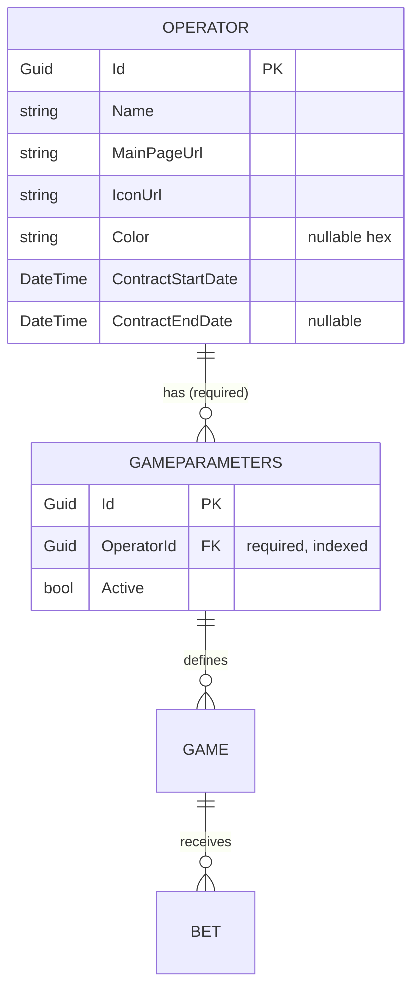
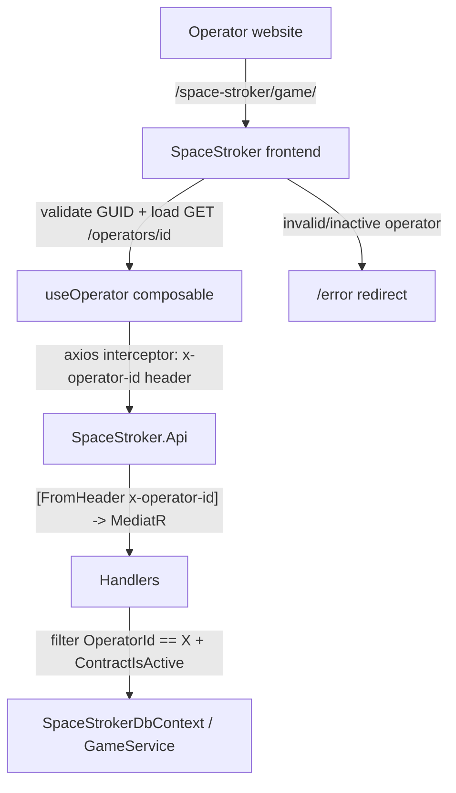

# SpaceStroker — "Operators" Feature — Implementation Spec

> **Status: Shipped** — merged to `main` via branch `feature/operators` on 2026-06-26.
> This document is the authoritative design archive; runtime behavior is summarized in `features/operators.md`.
>
> **Partially superseded (2026-06-30):** the `x-operator-id` header described below was **removed** by
> the launch-token feature. Operator/player identity now comes from a signed `X-Launch-Token`
> (see `specs/launch-token-validation.md` / `features/launch-token-validation.md`). Operators also
> gained `PaymentModel` and `LaunchPublicKey`. The tenancy/contract/branding design here still applies.

> Status: Design / Implementation spec. This document describes **what to build**. It is not the implementation.
> Repos affected: `monkify-backend` (.NET), `monkify-front` (Vue 3), and this doc in `monkify-meta`.
>
> **Revision (2026-06-25):** Refined via Trello card *Enhance operator feature*. Supersedes the earlier optional
> house-game model (`OperatorId == null`), `?operator-id=` query capture, `operator-id` header name, and
> `GET /operators` list endpoint. See §13 for the full decision log.

---

## 1. Summary

Introduce **Operators** (casino / betting platforms such as BetMGM, BetFury, etc.). A new `Operator` table is added
to the backend. Every `GameParameters` row **must** belong to exactly one operator (`OperatorId` is **required**).

Players reach SpaceStroker from an operator's website at **`/space-stroker/game/<operatorId>`**. The frontend reads the operator
id from the **URL path**, validates it, loads branding via **`GET /operators/{id}`**, and sends **`x-operator-id`**
as a **required** request header on every operator-scoped API call. The backend partitions all read/write traffic by
operator — there is **no house / operator-less mode**.

- **`x-operator-id` present, parseable, and operator contract active** → only that operator's data is visible/usable.
- **Missing, invalid, inactive, expired, or not-yet-started operator** → no game (frontend redirects to `/error`);
  API returns **HTTP 400** (missing/invalid header) or vague not-found/unavailable responses (never reveal contract status).

Operators have a contract window (`ContractStartDate` … `ContractEndDate`). When a contract is **not active**
(expired or future start), the operator goes dark: no new games, no games/bets shown, no new bets.

**Mid-game expiry:** an already-running game **finishes** (typer, payouts). New bets and new games for that
operator are blocked.

**Payments:** SOL only (payment-methods feature removed — operator scoping does not vary by payment type).

**SignalR:** game id in the hub URL is sufficient; **no** `x-operator-id` validation on websocket connections.
REST API scoping is the access gate.

Operator branding (icon, main page URL, optional color) is exposed via **`GET /operators/{id}`** and used by the
frontend for theming (operator color becomes the **secondary** color when provided).

---

## 2. Constraints (MANDATORY — verbatim)

- "When changing existing code, fix the unit tests so they still pass and test the intended behavior; at the end, report which unit tests were changed."
- "For this feature, a NEW git branch must be created and pushed in EACH affected repository (`monkify-backend` and `monkify-front`). Suggested branch name: `feature/operators`."
- "Never read or edit secrets/config files (appsettings.json, secrets.json, web.config, spacestrokersettings.json); assume valid config."

Additional working constraints:

- EF configuration in this codebase is **inline** in `OnModelCreating` — there are **no** `IEntityTypeConfiguration` classes. All new mapping goes inline in `SpaceStrokerDbContext` (`monkify-backend/src/SpaceStroker.Infrastructure/Data/Context/SpaceStrokerDbContext.cs`).
- Migrations are applied **only** at startup of `SpaceStroker.Consumers` via `ApplyMigrations(app)` (`monkify-backend/src/SpaceStroker.Consumers/Program.cs`). The API does not migrate.
- Environment detection uses standard ASP.NET Core `IHostEnvironment` / `builder.Environment` (`!IsProduction()`).
- Operator errors stay **vague** — never reveal contract status (expired, not-yet-started, etc.). See `monkify-meta/constraints.md` §6.

---

## 3. Product clarification — required vs optional fields

| Field                             | Required?                                               |
| --------------------------------- | ------------------------------------------------------- |
| `Name`                            | **Required**                                            |
| `MainPageUrl`                     | **Required**                                            |
| `IconUrl`                         | **Required**                                            |
| `Color` (hex)                     | Optional / nullable                                     |
| `ContractStartDate`               | **Required**                                            |
| `ContractEndDate`                 | Optional / nullable (null = open-ended / never expires) |
| `ContactName1/2/3`                | Optional                                                |
| `ContactPhone1/2/3` (digits only) | Optional                                                |
| `ContactEmail1/2/3`               | Optional                                                |

So the required set is **Name, MainPageUrl, IconUrl, ContractStartDate**. Everything else is nullable.

**GameParameters:** `OperatorId` is **required** (non-nullable). Each operator owns **multiple**
`GameParameters` rows (one operator → many game types). Parameters are **not** shared across operators.

---

## 4. Data model

### 4.1 New `Operator` entity

New file: `monkify-backend/src/SpaceStroker.Domain/Games/Entities/Operator.cs`

```csharp
namespace SpaceStroker.Domain.Games.Entities
{
    public class Operator : TableEntity
    {
        public string Name { get; set; }              // required
        public string MainPageUrl { get; set; }       // required
        public string IconUrl { get; set; }           // required (small icon)
        public string? Color { get; set; }            // optional, hex e.g. "#1A2B3C"

        public DateTime ContractStartDate { get; set; } // required
        public DateTime? ContractEndDate { get; set; }  // nullable; null => never expires

        public string? ContactName1 { get; set; }
        public string? ContactPhone1 { get; set; }    // digits only
        public string? ContactEmail1 { get; set; }

        public string? ContactName2 { get; set; }
        public string? ContactPhone2 { get; set; }
        public string? ContactEmail2 { get; set; }

        public string? ContactName3 { get; set; }
        public string? ContactPhone3 { get; set; }
        public string? ContactEmail3 { get; set; }

        public ICollection<GameParameters> GameParameters { get; set; }

        public bool ContractHasExpired(DateTime utcNow)
            => ContractEndDate.HasValue && ContractEndDate.Value < utcNow;

        public bool ContractIsActive(DateTime utcNow)
            => ContractStartDate <= utcNow && !ContractHasExpired(utcNow);
    }
}
```

### 4.2 `GameParameters` change

File: `monkify-backend/src/SpaceStroker.Domain/Games/Entities/GameParameters.cs`

```csharp
public Guid OperatorId { get; set; }   // REQUIRED — every game type belongs to an operator
public Operator Operator { get; set; }
```

### 4.3 EF Fluent configuration (inline, in `OnModelCreating`)

```csharp
public DbSet<Operator> Operators { get; set; }

modelBuilder.Entity<Operator>(builder =>
{
    builder.HasKey(x => x.Id);
    builder.Property(x => x.Name).HasMaxLength(100).IsRequired();
    builder.Property(x => x.MainPageUrl).HasMaxLength(500).IsRequired();
    builder.Property(x => x.IconUrl).HasMaxLength(500).IsRequired();
    builder.Property(x => x.Color).HasMaxLength(9);
    builder.Property(x => x.ContractStartDate).IsRequired();
    // Contact fields — same max lengths as before
    builder.HasIndex(x => x.ContractEndDate);
});

// Extend GameParameters block:
builder.HasOne(x => x.Operator)
       .WithMany(x => x.GameParameters)
       .HasForeignKey(x => x.OperatorId)
       .IsRequired()
       .OnDelete(DeleteBehavior.Restrict);

builder.HasIndex(x => x.OperatorId);
```

### 4.4 ER diagram



### 4.5 Migration plan

**Migration 1 — `AddOperators`** (may already exist on `feature/operators`):

- Create table `Operators`.
- Add nullable column `OperatorId` to `GameParameters` + FK + index.

**Migration 2 — `MakeOperatorIdRequired`** (this refinement):

- Delete or reassign any `GameParameters` rows where `OperatorId IS NULL` (there should be none after DEV seed
  wiring; if any exist, assign to a known operator or delete).
- Alter `GameParameters.OperatorId` to **non-nullable**.
- Regenerate snapshot via `dotnet ef migrations add MakeOperatorIdRequired` — do not hand-edit the snapshot.

Migrations apply automatically via `ApplyMigrations(app)` in `SpaceStroker.Consumers` at startup.

---

## 5. Operator-aware request flow

### 5.1 Concept



**No query-parameter capture.** There is no legacy `?operator-id=` support (not in production yet).

### 5.2 Header semantics (apply consistently)

Header name: **`x-operator-id`** (replaces the earlier `operator-id` name).

| Condition | Backend behaviour |
| --- | --- |
| Header **missing, empty, or unparseable** | **HTTP 400** with a generic message. No data returned. |
| Header parseable as Guid `X`, operator **exists** and **`ContractIsActive(UtcNow)`** | Scope = `OperatorId == X` only. |
| Header parseable, operator **not found** or **not active** (expired or future start) | Vague not-found / empty results (GETs); bets rejected with vague error + refund. |

There is **no** `OperatorId == null` / house scope anywhere in API handlers or queries.

CORS already allows any header (`AllowAnyHeader`); no CORS change needed for `x-operator-id`.

### 5.3 Controller binding

File: `monkify-backend/src/SpaceStroker.Api/Controllers/GamesController.cs`

Bind `[FromHeader(Name = "x-operator-id")] Guid? operatorId` on **all operator-scoped actions** (GETs **and**
`POST /games/{id}/bets`). Validate before `ProcessRequest`:

```csharp
private IActionResult? RequireOperatorId(Guid? operatorId)
{
    if (!operatorId.HasValue || operatorId.Value == Guid.Empty)
        return BadRequest(new ApiResult<object>(null, new[] { "The request could not be processed." }));
    return null;
}

[HttpGet("active-types")]
public async Task<IActionResult> GetActiveParameters(
    [FromHeader(Name = "x-operator-id")] Guid? operatorId)
{
    if (RequireOperatorId(operatorId) is { } bad) return bad;
    return await ProcessRequest(new GetActiveParametersRequest(operatorId!.Value));
}

[HttpPost("{gameId}/bets")]
public async Task<IActionResult> RegisterBet(
    Guid gameId,
    [FromBody] RegisterBetRequest request,
    [FromHeader(Name = "x-operator-id")] Guid? operatorId)
{
    if (RequireOperatorId(operatorId) is { } bad) return bad;
    request.GameId = gameId;
    request.OperatorId = operatorId!.Value;
    return await ProcessRequest(request);
}
```

Apply the same pattern to `GET /games`, `GET /games/{gameTypeId}`, and any other operator-scoped endpoint.

> Use a shared helper or action filter if preferred — behaviour must match the table in §5.2.

### 5.4 MediatR request objects

All operator-scoped requests carry a **required** `Guid OperatorId` (not nullable):

```csharp
public class GetActiveParametersRequest : IRequest<IEnumerable<GameParametersDto>>
{
    public GetActiveParametersRequest(Guid operatorId) { OperatorId = operatorId; }
    public Guid OperatorId { get; }
}

public record GetActiveGameForParameterRequest(Guid ParameterId, Guid OperatorId)
    : IRequest<ActiveGameDto>;

// GetGameHistoryRequest — add:
public Guid OperatorId { get; set; }

// RegisterBetRequest — add:
public Guid OperatorId { get; set; }
```

---

## 6. Operator-aware caching

Active-parameters Redis cache must be **operator-scoped** so data never leaks across operators.

### 6.1 Cache key

File: `monkify-backend/src/SpaceStroker.Infrastructure/Services/Cache/CacheHelper.cs`

```csharp
public static CacheSettings GenerateActiveParametersCacheSettings(Guid operatorId)
    => new($"ActiveParameters:{operatorId}", TimeSpan.FromHours(12));
```

There is **no** `ActiveParameters:house` key.

### 6.2 Service signatures

```csharp
Task<IDictionary<Guid, GameParameters>> GetAllActiveGameParameters(Guid operatorId);
Task<GameParameters?> GetGameParametersById(Guid gameParameterId, Guid operatorId);
```

**API path** — filter by the request's operator id:

```csharp
var now = DateTime.UtcNow;
var activeParameters = await _context.GameParameters
    .Include(x => x.LotteryParameters)
    .Include(x => x.PresetChoices)
    .Include(x => x.Operator)
    .Where(x => x.Active)
    .Where(x => x.OperatorId == operatorId)
    .Where(x => x.Operator.ContractStartDate <= now
             && (x.Operator.ContractEndDate == null || x.Operator.ContractEndDate.Value >= now))
    .AsNoTracking()
    .ToListAsync();
```

Use `Operator.ContractIsActive(now)` in code if preferred — filters must exclude expired **and** not-yet-started operators.

**Consumers / background path** — `OpenNewGames` and similar startup jobs are **not** HTTP-scoped. Add an
internal method (e.g. `GetAllActiveGameParametersForAllOperators()`) that returns parameters for **every**
operator whose contract is active, without an `x-operator-id` header. Use this only inside `SpaceStroker.Consumers`.

### 6.3 Callers to update

- All game GET handlers pass `request.OperatorId` into the service methods above.
- `SpaceStroker.Consumers/Program.cs` — seeding and `OpenNewGames` use the all-operators internal path (§8).
- Cache invalidation in seeding uses the specific operator id key(s) affected.

---

## 7. Expired-contract & operator filtering — enforcement points

Reuse existing vague messages from `ErrorMessages` — **do not** add expiry-specific copy:

- Game/type lookups: `ParameterNotFound`, `ParameterHasNoActiveGames`
- Bets: `GameNotValidForBets`

### 7.1 GET handlers

| Handler | Change |
| --- | --- |
| `GetActiveParametersHandler` | Filter via `GetAllActiveGameParameters(request.OperatorId)`. Inactive operator → empty list. |
| `GetActiveGameForParameterHandler` | `GetGameParametersById(id, operatorId)` returns null if param's `OperatorId != operatorId` or operator not active → `ParameterNotFound`. Games query: `x.Parameters.OperatorId == request.OperatorId`. |
| `GetGameHistoryHandler` | `.Where(s => s.Parameters.OperatorId == request.OperatorId)` and operator must be active. |

### 7.2 Game creation — `OpenNewGames` (startup)

Uses the all-operators internal query (§6.2). Skips parameters whose operator is not active; log a warning per
skipped operator and continue.

### 7.3 Game creation — `GameService.CreateGame` & `RunGameConsumer`

At the top of `CreateGame`, if `parameters.Operator` is not active (`!ContractIsActive(UtcNow)`), log a warning
and return without creating a game. `RunGameConsumer` rolls forward via `CreateGame` — expired operators
naturally stop getting new games.

**Mid-game expiry:** do **not** forcibly terminate a running game. The typer finishes; payouts proceed. The
expiry guard on `CreateGame` and `RegisterBetHandler` blocks **new** games and **new** bets.

### 7.4 Bet creation — `RegisterBetHandler`

```csharp
var betGame = await _gameService.GetGameById(request.GameId);

var op = betGame?.Parameters?.Operator;
var operatorUnavailable = op == null
    || !op.ContractIsActive(DateTime.UtcNow)
    || betGame.Parameters.OperatorId != request.OperatorId;

if (betGame is null || operatorUnavailable || !Game.GameAcceptingBets.Contains(betGame.Status))
    await RefundInvalidBet(ErrorMessages.GameNotValidForBets);
```

- **`x-operator-id` required** on the controller (§5.3).
- Header operator **must match** game's `OperatorId` — cross-operator bet attempts are refunded with vague error.
- Operator not active (expired or future start) → same refund path.

### 7.5 Summary table

| Requirement | Enforced in |
| --- | --- |
| No new games (inactive operator) | `CreateGame`, `OpenNewGames`, `RunGameConsumer` |
| No games/params/bets shown | GET handlers + `GetAllActiveGameParameters` |
| No new bets | `RegisterBetHandler` (expiry + header match) |
| Missing API header → 400 | Controller `RequireOperatorId` (§5.3) |
| Vague messaging only | Reuse existing `ErrorMessages` |

---

## 8. Default operator seeding (non-production only)

Startup order in `SpaceStroker.Consumers/Program.cs`:

```csharp
ApplyMigrations(app);
CloseOngoingGames(app);
CreateDefaultOperatorAsync(app);
CreateDefaultGameParametersAsync(app);
OpenNewGames(app);
```

`CreateDefaultOperatorAsync` — non-prod only, inserts **DEV Cassino** when no operators exist (same entity values as before).

`CreateDefaultGameParametersAsync`:

- Sets **`OperatorId`** on every seeded parameter to DEV Cassino's id (**required** FK).
- Warms cache under `GenerateActiveParametersCacheSettings(devOperatorId)`.

**Local dev URL:** `/space-stroker/game/<dev-operator-guid>`.

**Production:** no automatic default game types. Operators and their `GameParameters` must be configured explicitly.

---

## 9. Endpoint: `GET /operators/{id}`

Returns branding for a **single** active operator. There is **no** `GET /operators` list endpoint.

### 9.1 Response DTO

```csharp
public class OperatorDto
{
    public OperatorDto(Operator op)
    {
        Id = op.Id;
        Name = op.Name;
        IconUrl = op.IconUrl;
        MainPageUrl = op.MainPageUrl;
        Color = op.Color;
    }

    public Guid Id { get; set; }
    public string Name { get; set; }
    public string IconUrl { get; set; }
    public string MainPageUrl { get; set; }
    public string? Color { get; set; }
}
```

### 9.2 Handler

New folder `Handlers/Operators/GetOperatorById/`:

```csharp
public record GetOperatorByIdRequest(Guid OperatorId) : IRequest<OperatorDto?>;

public override async Task<OperatorDto?> HandleRequest(GetOperatorByIdRequest request, CancellationToken ct)
{
    var now = DateTime.UtcNow;
    var op = await Context.Operators
        .AsNoTracking()
        .FirstOrDefaultAsync(x => x.Id == request.OperatorId
                               && x.ContractStartDate <= now
                               && (x.ContractEndDate == null || x.ContractEndDate.Value > now), ct);

    return op == null ? null : new OperatorDto(op);
}
```

Optional: cache per operator id in Redis (TTL ~3 h). Invalidate on operator create/update.

### 9.3 Controller

`OperatorsController`:

```csharp
[HttpGet("{id:guid}")]
public async Task<IActionResult> GetOperator(Guid id)
    => await ProcessRequest(new GetOperatorByIdRequest(id));
```

- Operator not found or not active → **404** (frontend treats as redirect to `/error`).
- Do **not** expose a list endpoint.

### 9.4 Empty collections on game GETs

`GET /games/active-types` and `GET /games` (history) return **200 with `[]`** when empty (decision §13.8).
Update `BaseController.ProcessRequest` if it still maps empty enumerables to 404.

---

## 10. Backend file-by-file checklist

| # | File | Change |
| --- | --- | --- |
| 1 | `SpaceStroker.Domain/.../Operator.cs` | Entity (§4.1) |
| 2 | `SpaceStroker.Domain/.../GameParameters.cs` | Required `OperatorId` (§4.2) |
| 3 | `SpaceStrokerDbContext.cs` | Operator config, required FK (§4.3) |
| 4 | `Migrations/*` | `AddOperators` + `MakeOperatorIdRequired` (§4.5) |
| 5 | `CacheHelper.cs` | Per-operator cache key only (§6.1) |
| 6 | `IGameService` / `GameService.cs` | Required `operatorId`; all-operators internal method (§6.2) |
| 7 | Game GET handlers + requests | Required `OperatorId`; remove null/house branches (§5.4, §7.1) |
| 8 | `RegisterBetHandler` + request | Header operator match + active contract (§7.4) |
| 9 | `GamesController.cs` | `x-operator-id` on GETs + POST bets; 400 validation (§5.3) |
| 10 | `OperatorDto.cs` | Include `Id` (§9.1) |
| 11 | `GetOperatorById/` handler | **NEW** — replaces list handler (§9.2) |
| 12 | `OperatorsController.cs` | `GET /operators/{id}` only (§9.3) |
| 13 | `SpaceStroker.Consumers/Program.cs` | DEV seed + required OperatorId on params (§8) |
| 14 | Remove `GetOperators/` list handler | If present from earlier branch work |

---

## 11. Frontend

### 11.1 Routing — `/space-stroker/game/:operatorId`

File: `monkify-front/src/routes.ts`

- Game entry route: **`/space-stroker/game/:operatorId`**
- Validate `operatorId` is a GUID before any API call.
- **`/space-stroker/game`**, **`/space-stroker/game/`**, or **`/space-stroker/game/not-a-guid`** → redirect to **`/error`**
  (error page design is a separate card; use a minimal placeholder for now).

There is **no** `?operator-id=` query capture. No legacy redirect from query params.

### 11.2 `useOperator` composable

File: `monkify-front/src/hooks/useOperator.ts`

- Read `operatorId` from **`useRoute().params.operatorId`** (not from query string or sessionStorage).
- On mount: call `GET /operators/{id}`; if 404 or inactive → redirect `/error`.
- `applyOperatorTheme(color?)` sets `--color-secondary` when color present (§11.5).

### 11.3 Attach `x-operator-id` header

File: `monkify-front/src/services/mainService.ts`

```ts
mainAPI.interceptors.request.use(async (config) => {
  config.baseURL = process.env.VUE_APP_API_BASE_URL as string;

  const operatorId = getOperatorIdFromRoute(); // from current route param
  if (operatorId) {
    config.headers = config.headers ?? {};
    (config.headers as Record<string, string>)['x-operator-id'] = operatorId;
  }
  return config;
});
```

The interceptor must always send the header when on a valid game route. Never call operator-scoped APIs without it.

### 11.4 Service call: `getOperator`

```ts
const getOperator = async (operatorId: string) => {
  const { data } = await mainAPI.get<DefaultResponse<OperatorBranding>>(`/operators/${operatorId}`);
  return data;
};
```

Type `OperatorBranding` — same fields as `OperatorDto` (include `id`).

Remove `getOperators` list call if present from earlier branch work.

### 11.5 Theming — secondary color only

Unchanged from prior spec: operator `color` → `--color-secondary` at runtime via `applyOperatorTheme`.
Primary/blue accents unchanged.

### 11.6 `/error` placeholder

Minimal route + view at `/error` — copy and design refined later. Invalid operator redirects here.

### 11.7 Frontend file checklist

| # | File | Change |
| --- | --- | --- |
| 1 | `src/routes.ts` | `/space-stroker/game/:operatorId`, `/error` placeholder |
| 2 | `src/hooks/useOperator.ts` | Route param source; `getOperator`; theme; redirect logic |
| 3 | `src/App.vue` | Wire operator load on game routes |
| 4 | `src/services/mainService.ts` | `x-operator-id` interceptor; `getOperator(id)` |
| 5 | `src/types/index.ts` | `OperatorBranding` with `id` |
| 6 | `colors.css` / `tailwind.config.js` | Secondary token (unchanged) |
| 7 | Remove query-param capture | Delete `captureFromUrl` / sessionStorage operator-id if present |

---

## 12. Unit tests

Project: `monkify-backend/src/SpaceStroker.Tests`. Fix existing tests; **report which tests changed** at end of work.

### 12.1 Tests to update

| Test file | Change |
| --- | --- |
| `GetActiveParametersHandlerTests` | All cases use required `OperatorId`; remove house/null tests; mock `GetAllActiveGameParameters(Guid)`. |
| `GetActiveGameForParameterHandlerTests` | Required operator; mismatch → `ParameterNotFound`. |
| `GetGameHistoryHandlerTests` | Operator filter only; no null branch. |
| `RegisterBetHandlerTests` | Header operator mismatch → refund; expired operator → refund; add active-contract pass case. |
| `GameServiceParametersTests` / `GameServiceTests` | Required `operatorId`; per-operator cache keys; no `:house` key. |
| `CreateGameTests` | Inactive operator → no game created. |
| Cache tests | Keys are `ActiveParameters:{guid}` only. |

Remove or rewrite any test asserting `OperatorId == null` / house behaviour.

### 12.2 New tests to add

- Missing `x-operator-id` on controller → **400**.
- `GetOperatorById` — active operator returns branding; expired / future start / unknown id → null/404.
- `RegisterBet` — `request.OperatorId != game.Parameters.OperatorId` → refund.
- `GetAllActiveGameParameters` — operator A never returns operator B's params.
- `CreateGame` — operator becomes inactive → no new game; existing game can still complete (integration-style if feasible).
- Migration/data — no `GameParameters` with null `OperatorId` after migrate.
- DEV Cassino seed — non-prod only; params have required `OperatorId`.

### 12.3 Frontend tests

When/if wired: route param parsing, redirect to `/error` on invalid id, interceptor sends `x-operator-id`.

---

## 13. Resolved decisions

| # | Decision |
| --- | --- |
| 13.1 | Expiry is **timestamp-precise** (`ContractEndDate < UtcNow`). |
| 13.2 | Future `ContractStartDate` → operator **not active** (same as expired for UX/API). |
| 13.3 | Branding via **`GET /operators/{id}`** only; **no list endpoint**. |
| 13.4 | **`POST /games/{id}/bets` requires `x-operator-id`** and it **must match** the game's `OperatorId`. |
| 13.5 | Operator id source of truth is the **URL path** `/space-stroker/game/:operatorId` — not query param, not sessionStorage. |
| 13.6 | Theming: **secondary color only** via `--color-secondary`. |
| 13.7 | DEV seed: default `GameParameters` belong to **DEV Cassino** (non-prod); `OperatorId` **required**. |
| 13.8 | Empty game list GETs → **200 `[]`**. |
| 13.9 | **No house games** — `OperatorId` required everywhere; no `OperatorId == null` code paths. |
| 13.10 | Header name: **`x-operator-id`** (replaces `operator-id`). |
| 13.11 | Missing/invalid API header → **HTTP 400** generic message. |
| 13.12 | Invalid/inactive operator in URL → redirect **`/error`**. |
| 13.13 | Mid-game operator expiry → **finish game**; block new bets/games. |
| 13.14 | SignalR: **game id only** — no operator header on hubs. |
| 13.15 | Payments: **SOL only** — no per-operator payment-method matrix. |
| 13.16 | Each operator owns **multiple** `GameParameters` (not shared). |
| 13.17 | No legacy `?operator-id=` support (not in production). |

---

## 14. Out of scope

- `/error` page design and copy (separate card).
- Casino UI customization (Edson skin, keyboard colors — **Casino customization** card).
- SignalR operator header validation.
- B2B launch tokens / operator wallet API.
- Payment methods beyond SOL.

---

## 15. Suggested implementation order

1. Backend domain + DbContext + migrations (`AddOperators` if needed, then `MakeOperatorIdRequired`).
2. Remove all house/null operator branches; required `Guid OperatorId` on requests and services.
3. Cache key + `GameService` operator-awareness + consumers all-operators internal path.
4. Controllers: `x-operator-id` + 400 validation; game GET handlers; `RegisterBet` header match.
5. `GET /operators/{id}`; remove list endpoint if present.
6. Seeding (DEV Cassino, required FK on params).
7. Fix + add backend unit tests; run full suite; report changed tests.
8. Frontend: routes `/space-stroker/game/:operatorId`, `/error` placeholder, `useOperator`, interceptor, `getOperator`.
9. Manual E2E: open `/space-stroker/game/<dev-guid>`, confirm header sent, scoped data, theme applied; invalid id → `/error`; inactive operator → `/error`; bet with wrong header → rejected.

---

## 16. Acceptance criteria (from refinement)

These mirror the Trello card checklist — implement until all pass:

1. Given a valid active operator id in the URL path, when the player opens `/space-stroker/game/<operatorId>`, then the frontend sets `x-operator-id` on all API calls and loads only that operator's games.
2. Given a missing or malformed operator id in the URL, when navigating to `/space-stroker/game` or `/space-stroker/game/not-a-guid`, then redirect to `/error`.
3. Given an expired or future-start operator, when opening `/space-stroker/game/<operatorId>`, then redirect to `/error` with no contract-status detail.
4. Given an operator-scoped API request without valid `x-operator-id`, when the backend receives it, then HTTP 400 with a generic message.
5. Given `x-operator-id` that does not match the game's `OperatorId`, when POST `/games/{id}/bets` is called, then reject, refund, vague error.
6. Given `GameParameters` with null `OperatorId`, when migration runs, then rows migrated/removed and column is non-nullable.
7. Given an active operator id, when `GET /operators/{id}` is called, then branding is returned; list endpoint does not exist.
8. Given operator contract expires mid-game, when typer is running, then game finishes and payouts occur but new bets/games are blocked.
9. Given non-prod with no operators, when Consumers start, then DEV Cassino is seeded and default params belong to it.
10. Given operator A in `x-operator-id`, when listing game types or history, then only `OperatorId == A` data is returned.
