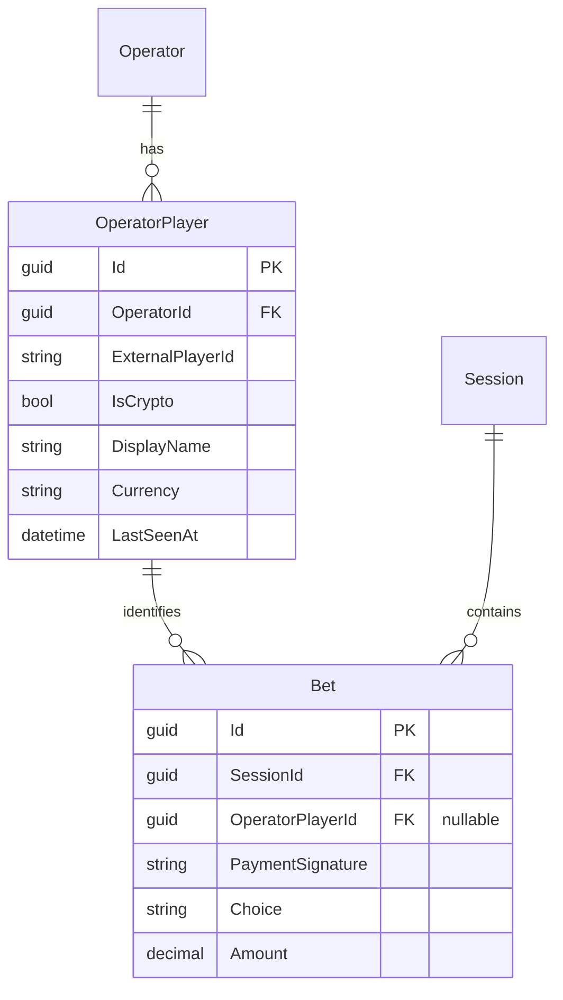
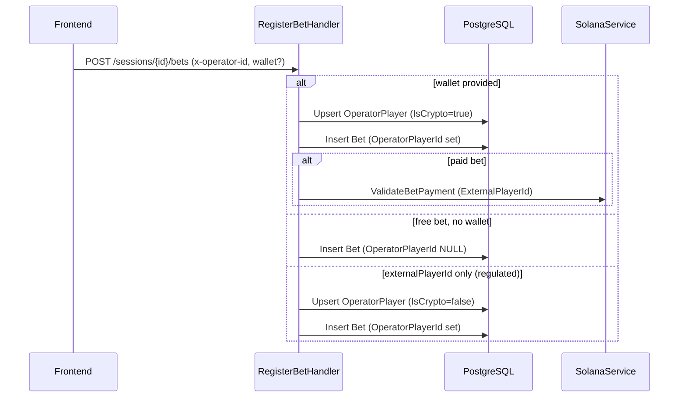

# Monkify — "OperatorPlayer identity (unified player model)" Feature — Implementation Spec

> **Status: Shipped** — merged to `main` via `feature/operator-player-identity` (2026-06-29).
> Trello: [Add OperatorPlayer identity (unified player model)](https://trello.com/c/CFDCy5DG).
> Design archive — runtime behavior is summarized in `features/operator-player-identity.md`.
>
> **Partially superseded (2026-06-30):** `OperatorPlayer.IsCrypto` (referenced throughout this spec)
> was **removed** by the launch-token feature; crypto-ness is now `Operator.PaymentModel`, and player
> identity arrives via the launch token. See `specs/launch-token-validation.md`.
> Conversation context in the same chat session is authoritative for the unified-model decisions.
> Repos affected: `monkify-backend`, `monkify-front`, and this doc in `monkify-meta`.
>
> **Purpose:** Introduce a single operator-scoped player identity for crypto-native and regulated
> B2B deployments. Crypto wallets and casino external player ids both live on
> `OperatorPlayer.ExternalPlayerId`, distinguished by `IsCrypto`. Remove `Bet.Wallet` so all
> identified players flow through `OperatorPlayer`; anonymous free bets (no wallet) keep
> `Bet.OperatorPlayerId` NULL.

---

## 1. Summary

Replace the wallet-only player identifier with **`OperatorPlayer`** + optional FK on **`Bet`**.

| Scenario | `OperatorPlayer` row | `Bet.OperatorPlayerId` | `ExternalPlayerId` | `IsCrypto` |
| --- | --- | --- | --- | --- |
| Crypto paid / free with wallet | Auto-created on first bet | Set | Solana wallet pubkey | `true` |
| Regulated B2B | Upserted on bet | Set | Casino player id | `false` |
| Anonymous free (no wallet) | None | **NULL** | — | — |

**Before:** `Bet.Wallet` is required; duplicate checks, rewards, refunds, history, SignalR, and
player counts all key off `Wallet`.

**After:** `Bet.Wallet` is **dropped**. Identified bets link to `OperatorPlayer`. Solana paths
resolve the payout/refund address from `OperatorPlayer.ExternalPlayerId`. Register-bet still
accepts `wallet` in the request body for crypto (mapped to `ExternalPlayerId` on upsert).

Parent epic: [B2B integration package](https://trello.com/c/w6ymVPgD). Launch tokens, operator
wallet API, and RG hooks are **out of scope** here.

---

## 2. Constraints (MANDATORY)

From `monkify-meta/constraints.md` (full list there):

- **Branch-per-repo:** `feature/operator-player-identity` in `monkify-backend`, `monkify-front`,
  `monkify-meta`.
- **Unit tests:** update/add in `Monkify.Tests`; report changed tests at end of implementation.
- **EF mapping:** inline in `MonkifyDbContext.OnModelCreating`; no `IEntityTypeConfiguration`.
- **Migrations:** under `Monkify.Infrastructure/Migrations/`; applied only by `Monkify.Consumers`.
- **Secrets/config:** mock-only values in committed files.
- **Operator messaging:** vague errors only; never reveal contract status.
- **No PII** on `OperatorPlayer` (no CPF, email, phone, full legal name, address).

---

## 3. Resolved product decisions

| # | Decision |
| --- | --- |
| 1 | **Unified model** — wallet and external casino player id are not separate tracks; both use `OperatorPlayer.ExternalPlayerId` |
| 2 | **`IsCrypto`** — `true` when `ExternalPlayerId` is a blockchain wallet (Solana today); `false` for regulated operator player ids |
| 3 | **Remove `Bet.Wallet`** — player identity for identified bets is only via `OperatorPlayerId` |
| 4 | **Crypto auto-register** — first bet with `wallet` upserts `OperatorPlayer(OperatorId, ExternalPlayerId=wallet, IsCrypto=true)` |
| 5 | **Anonymous free bets** — player may bet without connecting wallet; `OperatorPlayerId` stays NULL (no `OperatorPlayer` row) |
| 6 | **Paid bets without wallet** — reject (unchanged) |
| 7 | **Regulated path** — request body `externalPlayerId` required when no wallet; upsert with `IsCrypto=false` |
| 8 | **Duplicate bets** — with FK: `(SessionId, OperatorPlayerId, Choice)`; anonymous: `(SessionId, Choice)` only |
| 9 | **Min-player count** — distinct key = `OperatorPlayerId` when set; when NULL use `Bet.Id` (preserves free-bet behaviour in `BetPlacedConsumer`) |
| 10 | **Register-bet API** — keep sending `wallet` for crypto UX; add `externalPlayerId`, optional `displayName` for regulated; currency defaults to USD (not in request body) |
| 11 | **Response DTOs** — expose `externalPlayerId` (nullable) from joined `OperatorPlayer`; drop `wallet` on persisted bet DTOs |
| 12 | **`RefundLog.Wallet`** — unchanged (audit log of on-chain refund destination; populated from resolved wallet at refund time) |

---

## 4. Data model

### 4.1 New entity — `OperatorPlayer`

File: `monkify-backend/src/Monkify.Domain/Sessions/Entities/OperatorPlayer.cs` (new)

```csharp
public class OperatorPlayer : TableEntity
{
    public Guid OperatorId { get; set; }
    public Operator Operator { get; set; }
    public string ExternalPlayerId { get; set; }   // wallet pubkey OR casino player id
    public bool IsCrypto { get; set; }
    public string? DisplayName { get; set; }
    public string? Currency { get; set; }
    public DateTime LastSeenAt { get; set; }
    public ICollection<Bet> Bets { get; set; }
}
```

### 4.2 `Bet` entity changes

File: `monkify-backend/src/Monkify.Domain/Bets/Entities/Bet.cs`

- **Remove** property `Wallet` and constructor parameters that accept `wallet`.
- **Add** nullable FK:

```csharp
public Guid? OperatorPlayerId { get; set; }
public OperatorPlayer? OperatorPlayer { get; set; }
```

Update constructors:

- Primary create constructor: `(Guid sessionId, string seed, string paymentSignature, Guid? operatorPlayerId, string choice, decimal amount)`.
- Refund stub constructor: `(string paymentSignature, decimal amount)` — wallet resolved at publish time for events, not stored on bet.

### 4.3 EF configuration (inline)

File: `monkify-backend/src/Monkify.Infrastructure/Data/Context/MonkifyDbContext.cs`

Add `DbSet<OperatorPlayer> OperatorPlayers`.

**`OperatorPlayer` block:**

```csharp
modelBuilder.Entity<OperatorPlayer>(builder =>
{
    builder.HasKey(x => x.Id);
    builder.Property(x => x.ExternalPlayerId).IsRequired().HasMaxLength(50);
    builder.Property(x => x.IsCrypto).IsRequired();
    builder.Property(x => x.DisplayName).HasMaxLength(100);
    builder.Property(x => x.Currency).HasMaxLength(10);
    builder.Property(x => x.LastSeenAt).IsRequired();
    builder.HasOne(x => x.Operator).WithMany().HasForeignKey(x => x.OperatorId);
    builder.HasIndex(x => new { x.OperatorId, x.ExternalPlayerId }).IsUnique();
    builder.HasIndex(x => x.OperatorId);
});
```

**`Bet` block — replace wallet mapping:**

```csharp
builder.Property(x => x.OperatorPlayerId);  // nullable
builder.HasOne(x => x.OperatorPlayer).WithMany(x => x.Bets).HasForeignKey(x => x.OperatorPlayerId);
// REMOVE: builder.Property(x => x.Wallet)...
// REMOVE: wallet index if any on Bet
```

Add composite index for duplicate detection (optional but recommended):

```csharp
builder.HasIndex(x => new { x.SessionId, x.OperatorPlayerId, x.Choice });
```

### 4.4 Migration

Name: `AddOperatorPlayerIdentity`

Steps in migration `Up()`:

1. Create `OperatorPlayers` table.
2. Add nullable `OperatorPlayerId` to `Bets` with FK.
3. **Backfill** (SQL or EF raw):
   - For each bet with non-empty `Wallet`, join `Sessions` → `SessionParameters` for `OperatorId`.
   - Upsert `OperatorPlayer` per distinct `(OperatorId, Wallet)` with `IsCrypto = true`, `LastSeenAt = UtcNow`.
   - Set `Bets.OperatorPlayerId` on matching rows.
   - Bets with empty/null `Wallet` (free bets): leave `OperatorPlayerId` NULL.
4. Drop column `Bets.Wallet` and its index.

```bash
# from monkify-backend/src/Monkify.Infrastructure
dotnet ef migrations add AddOperatorPlayerIdentity \
  --startup-project ../Monkify.Consumers/Monkify.Consumers.csproj \
  --context MonkifyDbContext
```

Review generated migration; ensure backfill runs **before** dropping `Wallet`.

### 4.5 ER diagram



---

## 5. Configuration

No new settings or env vars. Existing `x-operator-id` header and free-bet flags unchanged.

---

## 6. Backend behaviour

### 6.1 Register-bet request body

File: `RegisterBetRequestBody.cs`

Keep `Wallet` for crypto input. Add:

```csharp
public string? ExternalPlayerId { get; set; }
public string? DisplayName { get; set; }
public string? Currency { get; set; }
```

**Resolution order in handler:**

1. If `Wallet` non-empty → crypto path → `externalId = Wallet`, `isCrypto = true`.
2. Else if `ExternalPlayerId` non-empty → regulated path → `externalId = ExternalPlayerId`, `isCrypto = false`.
3. Else if free bet → anonymous path → `operatorPlayerId = null`.
4. Else → reject (paid bet without identity).

**Mutual exclusion:** if both `Wallet` and `ExternalPlayerId` are provided, prefer `Wallet` (crypto)
and set `IsCrypto = true`. Document in code comment; regulated integrations should not send both.

### 6.2 `RegisterBetHandler` flow (revised order)

File: `RegisterBetHandler.cs`

1. Parse amount, detect free bet (`BetExtensions.IsFreeBetRequest`) — unchanged.
2. Validate malformed amount/signature — unchanged.
3. **Resolve operator player** (new step before constructing bet):
   - When identity present: upsert `OperatorPlayer` for `(request.OperatorId, externalId, isCrypto)`;
     set `LastSeenAt = UtcNow`; update `DisplayName`/`Currency` when provided on regulated path.
4. Construct `Bet` with `OperatorPlayerId` (nullable).
5. `ValidateBetSignature` — for paid bets, load wallet as
   `bet.OperatorPlayer!.ExternalPlayerId` (include `OperatorPlayer` in query or pass string).
6. `ValidateBetParameters` — duplicate check:
   - `OperatorPlayerId` set: `(SessionId, OperatorPlayerId, Choice)`.
   - NULL: `(SessionId, Choice)` only (free anonymous).
7. Operator/session validation — unchanged.
8. `RegisterBet` persist — unchanged insert path.
9. `RefundInvalidBet` — publish `RefundInvalidBetEvent(wallet, ...)` where `wallet` is
   `_bet.OperatorPlayer?.ExternalPlayerId ?? string.Empty`; skip publish for free bets (unchanged).

### 6.3 Upsert helper

Add a small private method on the handler or inject `IOperatorPlayerService` with one method:

```csharp
Task<OperatorPlayer> UpsertOperatorPlayerAsync(
    Guid operatorId, string externalPlayerId, bool isCrypto,
    string? displayName, string? currency, CancellationToken ct);
```

Use `FirstOrDefaultAsync` on `(OperatorId, ExternalPlayerId)`; insert if missing; update
`LastSeenAt` (+ optional fields) on existing row.

### 6.4 Solana service

File: `SolanaService.cs`

`ValidateBetPayment(Bet bet)` today reads `bet.Wallet`. Change to:

- Require `bet.OperatorPlayer` loaded (or add overload `ValidateBetPayment(Bet bet, string walletAddress)`).
- Use `walletAddress` for pre/post balance owner checks (lines ~235–236).

`TransferTokensForBet(Bet bet, ...)` — same: resolve wallet from `OperatorPlayer.ExternalPlayerId`.
Throw/log clear error if paid bet has no operator player.

### 6.5 Consumers & events

| Component | Change |
| --- | --- |
| `BetPlacedConsumer` | Player count: `.Select(b => b.OperatorPlayerId?.ToString() ?? b.Id.ToString())` |
| `BetPlacedConsumer` | Lottery refund event: wallet from `bet.OperatorPlayer?.ExternalPlayerId ?? ""` |
| `RefundInvalidBetConsumer` | Unchanged — still uses `message.Wallet` string |
| `RewardSessionConsumer` | Ensure bets loaded with `OperatorPlayer` before `TransferTokensForBet` |
| `BetNotificationEvent` | Rename payload field `Wallet` → `ExternalPlayerId` (nullable string) |
| `BetNotificationConsumer` | Forward `ExternalPlayerId` to SignalR hub |
| `SessionService.InsertBet` | Notification event uses joined external id |
| `SessionService.RunSession` | Winners list: `Select(b => b.OperatorPlayer!.ExternalPlayerId)` for paid winners |

**Breaking change note:** SignalR recent-bets payload field rename affects frontend — update together.

### 6.6 Session history

File: `GetSessionHistoryHandler.cs`

- Request query param remains `wallet` for now (filter by connected pubkey) OR rename to
  `externalPlayerId` — **prefer keep `wallet` query param** for backward-compatible frontend URL;
  filter becomes `b.OperatorPlayer.ExternalPlayerId == request.Wallet`.
- `PlayerHasWon`: same join condition.

File: `SessionsController.cs` — update XML doc only if param renamed.

### 6.7 `BetDto`

File: `BetDto.cs`

Replace `Wallet` with:

```csharp
public string? ExternalPlayerId { get; set; } = bet.OperatorPlayer?.ExternalPlayerId;
```

Ensure handlers that project `BetDto` `.Include(b => b.OperatorPlayer)` where needed.

### 6.8 Hidden blockers (documented)

| Blocker | Fix |
| --- | --- |
| `Bet` constructor requires wallet today | New constructor signature without wallet |
| `SolanaService` reads `bet.Wallet` | Join `OperatorPlayer` or pass resolved address |
| `BetPlacedConsumer` uses `b.Wallet` empty check | Use `OperatorPlayerId == null` for anonymous |
| Frontend `GameTerminal` uses `bet.wallet` for player count / "YOU" | Use `externalPlayerId`; anonymous free bets use `amount === 0 && !externalPlayerId` |
| `GameMonkey` bet animation dedupe uses `bet.wallet` | Compare `externalPlayerId` or `paymentSignature` |
| Many unit tests construct `Bet(..., wallet, ...)` | Update all test fixtures |
| Migration must not lose wallet-less free bets | Leave `OperatorPlayerId` NULL for empty historical wallet |

---

## 7. Frontend behaviour

**UX unchanged:** wallet connect for crypto; free bet mode may omit wallet.

### 7.1 Register bet (unchanged request shape)

File: `useSession.ts` — continue POST with `wallet: publicKey ?? ''` for crypto/free-with-wallet.
No `externalPlayerId` until regulated launch integration (backend ready).

### 7.2 Types & DTO consumption

File: `src/types/index.ts`

On bet/recent-bet types, replace `wallet: string` with `externalPlayerId: string | null`.

### 7.3 Components

| File | Change |
| --- | --- |
| `GameTerminal.vue` | Player count: `externalPlayerId ?? \`free:${index}\`` for anonymous; "YOU" compares `externalPlayerId === publicKey`; winner check uses `externalPlayerId` |
| `GameMonkey.vue` | `isMyBet`: compare `bet.externalPlayerId === publicKey` |
| `useSession.ts` | Map SignalR `externalPlayerId`; dedupe animations by `paymentSignature` (unchanged) or `externalPlayerId` |

**Display:** show truncated `externalPlayerId` in bet list when present; show `YOU` for connected wallet match; anonymous free bets show generic label (existing free-bet UX).

---

## 8. Flow diagram



---

## 9. Out of scope

- Launch token signing / validation
- Operator wallet debit/credit API
- RG pre-bet hooks
- Removing Solana wallet connect UI
- Operator-less / anonymous **paid** play
- Chain-specific metadata beyond `IsCrypto` (multi-chain registry — future story)
- `monkify-meta/features/` KB update (done at ship via `/monkify-ship-feature`)

---

## 10. File checklist

### 10.1 Backend (`monkify-backend`)

| # | File | Change |
| --- | --- | --- |
| 1 | `Monkify.Domain/Sessions/Entities/OperatorPlayer.cs` | New entity |
| 2 | `Monkify.Domain/Bets/Entities/Bet.cs` | Remove Wallet; add OperatorPlayerId FK; update constructors |
| 3 | `Monkify.Infrastructure/Data/Context/MonkifyDbContext.cs` | OperatorPlayer mapping; Bet FK; remove Wallet |
| 4 | `Monkify.Infrastructure/Migrations/*AddOperatorPlayerIdentity*` | Table + backfill + drop Wallet |
| 5 | `RegisterBetRequestBody.cs` | Add externalPlayerId, displayName, currency |
| 6 | `RegisterBetHandler.cs` | Upsert operator player; duplicate rules; refund wallet resolution |
| 7 | `SolanaService.cs` | Resolve wallet from OperatorPlayer |
| 8 | `BetPlacedConsumer.cs` | Player count + refund wallet resolution |
| 9 | `RewardSessionConsumer.cs` | Include OperatorPlayer on bet load |
| 10 | `RefundInvalidBetConsumer.cs` | No entity change; events still carry wallet string |
| 11 | `SessionService.cs` | Notifications + winner selection |
| 12 | `BetNotificationEvent.cs` | Wallet → ExternalPlayerId |
| 13 | `BetNotificationConsumer.cs` | Pass through renamed field |
| 14 | `BetDto.cs` | Wallet → ExternalPlayerId |
| 15 | `GetSessionHistoryHandler.cs` | Filter/join on OperatorPlayer |
| 16 | `Monkify.Tests/**` | Update all Bet constructions and assertions |

### 10.2 Frontend (`monkify-front`)

| # | File | Change |
| --- | --- | --- |
| 1 | `src/types/index.ts` | `wallet` → `externalPlayerId` on bet types |
| 2 | `src/hooks/useSession.ts` | Map SignalR field; register-bet still sends wallet |
| 3 | `src/components/game/GameTerminal.vue` | Player count, YOU, winners |
| 4 | `src/components/game/GameMonkey.vue` | isMyBet comparison |

### 10.3 Meta (`monkify-meta`)

| # | File | Change |
| --- | --- | --- |
| 1 | `specs/operator-player-identity.md` | This spec |
| 2 | `INDEX.md` | Feature in flight row |

---

## 11. Unit tests

Project: `monkify-backend/src/Monkify.Tests`.

| Test file | Test cases | Expected |
| --- | --- | --- |
| `RegisterBetHandlerTests.cs` | Paid crypto bet with wallet | Upserts OperatorPlayer IsCrypto=true; Bet.OperatorPlayerId set; Solana validated |
| `RegisterBetHandlerTests.cs` | Free bet with wallet | OperatorPlayer created; FK set |
| `RegisterBetHandlerTests.cs` | Free bet without wallet | OperatorPlayerId NULL; no OperatorPlayer row |
| `RegisterBetHandlerTests.cs` | Regulated bet with externalPlayerId | IsCrypto=false; FK set; no wallet required |
| `RegisterBetHandlerTests.cs` | Duplicate (SessionId, OperatorPlayerId, Choice) | Rejected |
| `RegisterBetHandlerTests.cs` | Anonymous duplicate (SessionId, Choice) | Rejected on second same choice |
| `RegisterBetHandlerTests.cs` | Paid bet without wallet or externalPlayerId | Validation failure |
| `RegisterBetHandlerTests.cs` | Missing operatorId | Rejected (existing tests) |
| `BetPlacedHandlerTests.cs` | Three free bets without identity | Three distinct players (Bet.Id keys) |
| `BetPlacedHandlerTests.cs` | Two bets same OperatorPlayerId | One player |
| `SolanaServiceTests.cs` | ValidateBetPayment | Uses OperatorPlayer.ExternalPlayerId |
| `RewardWinnersHandlerTests.cs` | Reward paid winner | Transfer uses external id from FK |

Add migration integration test only if project already has migration test pattern; otherwise manual QA suffices.

---

## 12. Acceptance criteria

1. Given the migration runs, when the schema is inspected, then `OperatorPlayers` exists with unique
   `(OperatorId, ExternalPlayerId)`, `IsCrypto` column, and no PII columns.
2. Given existing crypto bets, when migration completes, then each has `OperatorPlayerId` pointing
   to a backfilled row and `Wallet` column is gone.
3. Given wallet-less free bets in history, when migration completes, then `OperatorPlayerId` remains NULL.
4. Given a paid crypto register-bet with wallet, when processed, then `OperatorPlayer` is
   auto-created/updated with `IsCrypto=true` and the bet links to it.
5. Given a regulated register-bet with `externalPlayerId` and no wallet, when processed, then
   `OperatorPlayer` has `IsCrypto=false` and the bet links to it.
6. Given an anonymous free bet (no wallet, no externalPlayerId), when processed, then
   `OperatorPlayerId` is NULL and no `OperatorPlayer` row is created.
7. Given two bets with the same `(SessionId, OperatorPlayerId, Choice)`, when the second is placed,
   then duplicate-bet logic rejects it.
8. Given anonymous free bets on the same choice, when the second is placed, then duplicate logic
   rejects it (SessionId + Choice).
9. Given a paid bet requiring Solana validation, reward, or refund, when executed, then the wallet
   address is resolved from `OperatorPlayer.ExternalPlayerId`, not from a removed `Bet.Wallet` column.
10. Given every register-bet call, when `x-operator-id` is missing, then the request is rejected.

---

## 13. Manual QA

1. Local dev operator URL → connect wallet → paid bet → verify `OperatorPlayers` row created;
   bet has FK; recent bets SignalR shows `externalPlayerId`.
2. Free bet mode ON, wallet disconnected → bet succeeds; `OperatorPlayerId` NULL in DB.
3. Same wallet, second bet same choice → duplicate error.
4. Session history with `?wallet=<pubkey>` returns sessions where player participated.
5. Run full `Monkify.Tests` suite.

---

## 14. Trello / pipeline

- **Source card:** https://trello.com/c/CFDCy5DG — list **Specs created**; **Implementation** section on card
- **After merge:** `/monkify-ship-feature Add OperatorPlayer identity`

---

## 15. Revision log

| Date | Change |
| --- | --- |
| 2026-06-29 | Initial spec from refined card + chat (unified model, remove Bet.Wallet, anonymous NULL FK) |
