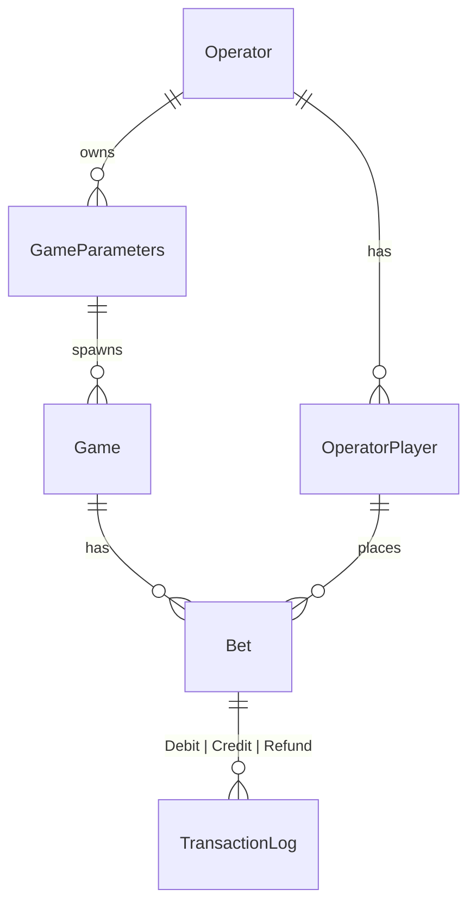
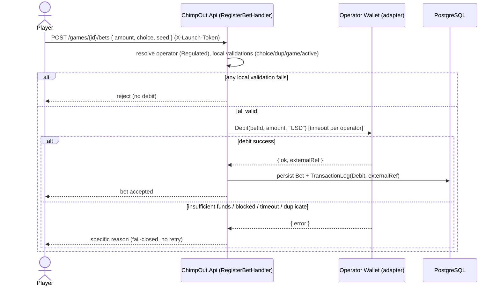

# ChimpOut — "Operator wallet API (debit / credit / refund for Model A)" Feature — Implementation Spec

> **Status: Shipped** — merged via `feature/operator-wallet-api` on 2026-06-30. Refined via Trello card
> [Operator wallet API (debit / credit / refund for Model A)](https://trello.com/c/pJUcsSHo).
> Repos affected: `monkify-backend` and this doc in `monkify-meta`. **Not** `monkify-front`.
> Distilled summary: `../features/operator-wallet-api.md`.
>
> **Purpose:** On **regulated (Model A / `Operator.PaymentModel = Regulated`)** operators, ChimpOut
> holds no player float. Bet **stakes are debited**, **winnings credited**, and **invalid/cancelled
> bets refunded** through the *operator's own* wallet API via a per-operator adapter. The crypto
> track (Model B / Solana) is unchanged except for two app-wide changes carried by this work: the
> transaction ledger is unified, and the ChimpOut commission is removed (winners get the full pot).

---

## 1. Summary

Today every operator settles on-chain: `RegisterBetHandler` validates a Solana payment signature the
**player** already paid client-side; `RewardGameConsumer` and `RefundInvalidBetConsumer` move
SPL tokens via `ISolanaService`. Regulated operators have no on-chain payment — ChimpOut must
**actively instruct** the operator's wallet to move money.

This feature introduces an `IOperatorWalletService` adapter abstraction (debit / credit / refund),
a provider **resolver** that picks the adapter for an operator from backend config, and **one mock
adapter** for dev + tests. It wires the three operations into the existing flows and routes by
`Operator.PaymentModel`.

| Operation | Trigger | Crypto (Model B) — unchanged | Regulated (Model A) — new |
| --- | --- | --- | --- |
| **Debit** stake | bet placement (`RegisterBetHandler`, API host) | player paid on-chain; backend only **validates** the signature | backend **calls** the operator wallet to debit the stake, as the **last** step before persisting |
| **Credit** winnings | `RewardGameConsumer` (Consumers host) | `ISolanaService.TransferTokensForBet` | `IOperatorWalletService.Credit` |
| **Refund** | `RefundInvalidBetConsumer` (Consumers host) | `ISolanaService.RefundTokens` | `IOperatorWalletService.Refund` |

**Two app-wide changes** (affect crypto too, by design):

1. **Unify the ledger** — `TransactionLog` gains a `TransactionType` (`Debit | Credit | Refund`),
   a nullable `Reason`, and a nullable `ExternalTransactionReference`; **`RefundLog` is dropped**
   (its `Reason` moves to `TransactionLog`). `BetDomainService` idempotency math filters by type.
2. **Remove commission** — `BetDomainService.SetPotAmount` no longer multiplies by
   `1 - CommisionPercentage`; winners receive the **full pot**. A follow-up card
   ([ChimpOut commission per bet](https://trello.com/c/BXgxJcwP)) reintroduces it later.

---

## 2. Constraints (MANDATORY)

From `monkify-meta/constraints.md` (full list there):

- **Branch-per-repo:** `feature/operator-wallet-api` in `monkify-backend` and `monkify-meta`
  (already created + pushed). No frontend branch — card marks `monkify-front` as not affected.
- **Unit tests:** update/add in `ChimpOut.Tests`; **report changed tests** at end of implementation.
- **EF mapping:** inline in `ChimpOutDbContext.OnModelCreating`; no `IEntityTypeConfiguration`.
- **Migrations:** under `ChimpOut.Infrastructure/Migrations/`; applied **only** by `ChimpOut.Consumers`
  at startup. Never hand-edit `ChimpOutDbContextModelSnapshot.cs` — regenerate via `dotnet ef`.
- **Secrets/config:** operator wallet base URLs/credentials are **mock/placeholder values only** in
  committed files (`chimpoutsettings.json`).
- **Operator messaging:** operator/contract-status errors stay **vague** ("not found / unavailable").
  This does **not** apply to the player's own wallet errors (insufficient funds, etc.) — those are
  **specific** (see §3 decision 7).
- **Host split:** the API stays stateless and does not migrate; the synchronous debit it performs is
  an outbound call only. All credit/refund money movement remains in `ChimpOut.Consumers`.

---

## 3. Resolved product decisions

| # | Decision |
| --- | --- |
| 1 | **Per-operator adapters.** Each operator exposes its own wallet API; ChimpOut integrates via a pluggable `IOperatorWalletService` (debit/credit/refund). Not a single ChimpOut-published standard. |
| 2 | **Adapter selection — named provider in config.** A per-operator config entry, keyed by `operatorId`, names the provider and its connection details (`provider`, `baseUrl`, `auth`, `timeout`). A resolver maps the provider name → a registered adapter. |
| 3 | **This card ships** the abstraction + canonical error mapping + **one in-repo mock adapter** (dev + tests). Real casino adapters are added per onboarding later (separate cards). Demo wiring is the separate "Demo environment" card. |
| 4 | **Config & secrets** live in `GeneralSettings` / `chimpoutsettings.json`, keyed by operator, **mock values only**. |
| 5 | **Currency/units — USD decimal + `currency: "USD"`.** FX/display-currency conversion is out of scope (separate card); conversion, if any, is the operator's responsibility. |
| 6 | **Immediate debit.** Full stake debited at bet time; refunded via the refund API if later invalid/cancelled. No authorize/capture hold. |
| 7 | **Debit ordering — validate locally first, debit last.** All cheap local validations run first; the debit is the last step before persisting. Invalid bets are rejected **without** a debit → no registration-time refund. |
| 8 | **Debit-failure UX — specific reason.** Insufficient funds / player blocked / timeout / duplicate surface a specific player-facing message via `ApiResult.messages` (these are the player's own wallet errors, not operator contract status). |
| 9 | **Debit timeout — fail-closed, no sync retry.** Reject with a specific "please try again"; do not auto-retry within the request. The bet-id idempotency key prevents a double-debit on a later retry. Timeout configurable per operator. |
| 10 | **Credit/refund failure — reuse existing pattern.** Failed credit → bet `NeedsManualAnalysis` + game `ErrorWhenProcessingRewards`; failed refund leaves an audit row for manual handling. Idempotency keys make retry safe. |
| 11 | **Idempotency keys** = bet id (+ operation type), since regulated bets have no `PaymentSignature`. Store the operator's returned external transaction reference for audit/reconciliation. |
| 12 | **Settlement — strictly debit/credit/refund.** Operator↔ChimpOut net settlement / revenue-share is out of scope (out-of-band B2B). |
| 13 | **Commission removed app-wide** (both models). Winners receive the full pot. Reintroduced later via [card #26](https://trello.com/c/BXgxJcwP). |
| 14 | **Free bets unchanged.** Amount-0 free bets make no wallet calls under any payment model. |

---

## 4. Data model

### 4.1 Entity / column changes

**`ChimpOut.Domain/Bets/Entities/TransactionLog.cs`** — unify into a single ledger of money movements
per bet. Add the transaction type, reason, and an external reference; the existing on-chain
`Signature` becomes **nullable** (regulated debit/credit/refund have no Solana signature).

```csharp
public class TransactionLog : TableEntity
{
    public TransactionLog() { }

    // existing crypto credit ctor — defaults to Credit type
    public TransactionLog(Guid betId, decimal amount, string signature)
        : this(betId, TransactionLogType.Credit, amount, signature, externalTransactionReference: null, reason: null) { }

    public TransactionLog(Guid betId, TransactionLogType type, decimal amount,
        string? signature, string? externalTransactionReference, string? reason)
    {
        BetId = betId;
        Type = type;
        Amount = amount;
        Signature = signature;
        ExternalTransactionReference = externalTransactionReference;
        Reason = reason;
    }

    public Bet Bet { get; set; }
    public Guid BetId { get; set; }
    public TransactionLogType Type { get; set; }                 // NEW: Debit | Credit | Refund
    public decimal Amount { get; set; }
    public string? Signature { get; set; }                       // CHANGED: now nullable (Solana only)
    public string? ExternalTransactionReference { get; set; }    // NEW: operator wallet txn ref
    public string? Reason { get; set; }                          // NEW: moved from RefundLog
}
```

**`ChimpOut.Domain/Bets/ValueObjects/TransactionLogType.cs`** — NEW enum.

```csharp
public enum TransactionLogType { Debit = 1, Credit = 2, Refund = 3 }
```

**`ChimpOut.Domain/Bets/Entities/RefundLog.cs`** — **DELETE** the entity and its `DbSet<RefundLog> Refunds`
(`ChimpOutDbContext`). Its only non-derivable field is `Reason`, now on `TransactionLog`. `Wallet`
was on-chain audit; the refund wallet remains derivable via `Bet.GetWalletAddress()`.

### 4.2 EF configuration (inline)

In `ChimpOut.Infrastructure/Data/Context/ChimpOutDbContext.cs`:

- **Remove** the `DbSet<RefundLog> Refunds` property (line 23) and the entire
  `modelBuilder.Entity<RefundLog>(…)` block (lines 167–176).
- **Update** the `TransactionLog` block (lines 158–165):

```csharp
modelBuilder.Entity<TransactionLog>(builder =>
{
    builder.HasKey(x => x.Id);
    builder.Property(x => x.Type).IsRequired();
    builder.Property(x => x.Amount).HasPrecision(18, 9).IsRequired();
    builder.Property(x => x.Signature).HasMaxLength(100);                       // no longer IsRequired
    builder.Property(x => x.ExternalTransactionReference).HasMaxLength(100);
    builder.Property(x => x.Reason).HasMaxLength(300);

    builder.HasIndex(x => x.Signature);
    builder.HasIndex(x => x.BetId);
    builder.HasIndex(x => new { x.BetId, x.Type });                             // idempotency lookups
});
```

> The `Bet → TransactionLogs` relationship mapping at `ChimpOutDbContext.cs:143` stays as-is.

### 4.3 Migration

`ChimpOut.Infrastructure/Migrations/<timestamp>_AddOperatorWalletLedger.cs` (generate with
`dotnet ef migrations add AddOperatorWalletLedger -p ChimpOut.Infrastructure -s ChimpOut.Consumers`):

1. Add `TransactionLogs.Type` (`integer`, NOT NULL, default `2`/`Credit` so existing rows backfill as
   Credit), `TransactionLogs.ExternalTransactionReference` (`varchar(100)`, null),
   `TransactionLogs.Reason` (`varchar(300)`, null).
2. Alter `TransactionLogs.Signature` to nullable.
3. **Migrate `RefundLog` data into `TransactionLog`** before dropping the table: for each `Refunds`
   row, insert a `TransactionLogs` row with `Type = 3` (Refund), `Amount`, `Signature`, `Reason`, and
   `BetId` resolved by `Signature` where possible (raw `migrationBuilder.Sql` INSERT…SELECT; rows
   whose bet can't be resolved are inserted with a null/zero `BetId` placeholder and logged — call
   this out in the migration comment). Then `DropTable("Refunds")`.
4. Provide a `Down` that recreates `Refunds` and drops the new columns (best-effort, matching the
   `AddOperatorLaunchAndPaymentModel` style).

> Follow the existing migration style (see `20260630133341_AddOperatorLaunchAndPaymentModel.cs`):
> explicit `AddColumn`/`DropColumn`, raw SQL for backfills, clear comments.

### 4.4 ER diagram



---

## 5. Configuration

**`ChimpOut.Domain/Configs/Entities/`** — new settings type for per-operator wallet config, hung off
`GeneralSettings`.

```csharp
// OperatorWalletSettings.cs
[ExcludeFromCodeCoverage]
public class OperatorWalletSettings
{
    // keyed by operatorId (Guid as string)
    public Dictionary<string, OperatorWalletConfig> Operators { get; set; } = new();
}

[ExcludeFromCodeCoverage]
public class OperatorWalletConfig
{
    public string Provider { get; set; }      // adapter key, e.g. "mock"
    public string BaseUrl { get; set; }       // mock placeholder in committed config
    public string ApiKey { get; set; }        // mock placeholder only
    public int TimeoutSeconds { get; set; }   // synchronous debit timeout
}
```

- Add `public OperatorWalletSettings OperatorWallets { get; set; }` to
  `ChimpOut.Domain/Configs/Entities/GeneralSettings.cs`.
- **Remove** `TokenSettings.CommisionPercentage` (`ChimpOut.Domain/Configs/Entities/TokenSettings.cs:19`)
  and the `"CommisionPercentage": 0.005` line in `ChimpOut.Common/chimpoutsettings.json` (Token block).
- Add an `"OperatorWallets"` block to `chimpoutsettings.json` with the seeded **DEV Regulated Cassino**
  operatorId mapped to `{ "Provider": "mock", "BaseUrl": "https://mock-operator-wallet.local",
  "ApiKey": "MOCK_VALUE", "TimeoutSeconds": 10 }`. **Mock values only.**

---

## 6. Backend behaviour

### 6.1 The adapter abstraction (`ChimpOut.Infrastructure/Services/OperatorWallets/`)

```csharp
public interface IOperatorWalletService
{
    Task<OperatorWalletResult> Debit(Bet bet, decimal amount, CancellationToken ct);
    Task<OperatorWalletResult> Credit(Bet bet, decimal amount, CancellationToken ct);
    Task<OperatorWalletResult> Refund(Bet bet, decimal amount, string reason, CancellationToken ct);
}
```

- **`OperatorWalletResult`** (value object): `bool IsSuccess`, `OperatorWalletError? Error`,
  `string? ExternalTransactionReference`. All amounts are USD decimals; the adapter sends
  `currency: "USD"`.
- **`OperatorWalletError`** enum → canonical codes mapped from operator responses:
  `InsufficientFunds`, `PlayerBlocked`, `Duplicate`, `Timeout`, `Unavailable` (generic/other).
  Each maps to a specific message resource (see §6.5).
- **Resolver** `IOperatorWalletResolver` / `OperatorWalletResolver` — given an `Operator` (or
  operatorId), reads `GeneralSettings.OperatorWallets.Operators[operatorId]`, finds the adapter
  registered under `config.Provider`, and returns a configured `IOperatorWalletService`. **No/unknown
  provider for a Regulated operator → throw/return a configuration error** (never silently skip the
  wallet call — see acceptance criterion 8).
- **`MockOperatorWalletService`** — the one shipped adapter: an `HttpClient`-style implementation
  pointed at the configured `BaseUrl`, honoring `TimeoutSeconds`, returning canonical results. For
  dev/tests it can short-circuit to deterministic success and to forced error states (used by the
  Demo environment card later).
- **DI:** register the resolver + mock adapter next to `ISolanaService` in
  `ChimpOut.Infrastructure/DependencyInjection.cs` (around line 42). A typed `HttpClient` registration
  (`AddHttpClient`) with the per-operator timeout.

### 6.2 Debit — `RegisterBetHandler` (API host)

`ChimpOut.Infrastructure/Handlers/Games/RegisterBet/RegisterBetHandler.cs`. Inject
`IOperatorWalletResolver`.

Current order: `ValidateBetSignature()` → `ValidateBetParameters()` → `RegisterBet()` (lines 111–113).
For **Regulated**, insert the debit **after** `ValidateBetParameters` (all local validations passed,
including the duplicate/choice/game/operator-active checks at lines 177–223) and **immediately
before** `RegisterBet()` persists the bet:

```text
if (!_isCrypto && !_isFreeBet)
{
    var wallet = resolver.For(betOperator);
    var debit = await wallet.Debit(_bet, _bet.Amount, ct);      // timeout from per-operator config
    if (!debit.IsSuccess)
        Messaging.ReturnValidationFailureMessage(MapWalletErrorToMessage(debit.Error)); // specific, fail-closed
    _bet.TransactionLogs ??= new List<TransactionLog>();
    _bet.TransactionLogs.Add(new TransactionLog(_bet.Id, TransactionLogType.Debit,
        _bet.Amount, signature: null, debit.ExternalTransactionReference, reason: null));
}
```

- Because the debit is **last**, any earlier validation failure rejects the bet with **no debit**
  (decision 7) — so the registration-time `RefundInvalidBet` path is **crypto-only** and unchanged.
- **Fail-closed timeout:** the mock/HTTP client surfaces a `Timeout` error; the handler rejects with
  the specific "please try again" message and does **not** retry. The bet-id idempotency key means a
  later identical attempt won't double-debit (decision 9).
- The Debit `TransactionLog` is persisted together with the bet by `_gameService.InsertBet(_bet)`
  in `RegisterBet()` (relationship at `ChimpOutDbContext.cs:143`). Confirm `InsertBet` saves the
  child `TransactionLogs` (extend it if it doesn't).
- **Crypto/free paths untouched:** `_isCrypto` true keeps the existing signature validation; free
  bets (`_isFreeBet`) skip the debit.

### 6.3 Credit — `RewardGameConsumer`

`ChimpOut.Infrastructure/Consumers/RewardGame/RewardGameConsumer.cs`. The game's bets already
include `OperatorPlayer` and `Parameters.Operator` is reachable; resolve `PaymentModel` per winner's
operator.

- Keep the free-bet skip (lines 95–100) and the `CalculateRewardForBet` math (line 102).
- The Solana blockhash pre-check (lines 79–89) must run only when at least one **crypto, paid**
  winner exists (today it is "paid"; tighten to exclude regulated winners).
- Branch the payout (lines 104–111):
  - **Crypto:** `solanaService.TransferTokensForBet(winner, rewardResult)` (unchanged), which writes
    a `Credit` `TransactionLog` (now via the unified ctor — `SolanaService.cs:105`).
  - **Regulated:** `walletResolver.For(operator).Credit(winner, rewardResult.Value, ct)`; on success
    write a `TransactionLog(winner.Id, Credit, rewardResult.Value, signature:null,
    result.ExternalTransactionReference, reason:null)` and mark `Rewarded`; on failure leave the bet
    un-`Rewarded` so the game resolves to `ErrorWhenProcessingRewards` (existing logic at
    lines 123–128). `BetHasAlreadyBeenRewarded` / `BetRewardBiggerThanThePot` handling (lines 116–120)
    is unchanged.

### 6.4 Refund — `RefundInvalidBetConsumer` (+ event change — HIDDEN BLOCKER)

`ChimpOut.Infrastructure/Consumers/RefundInvalidBet/RefundInvalidBetConsumer.cs`.

**Blocker:** `RefundInvalidBetEvent(string Wallet, string PaymentSignature, decimal Value, string Reason)`
carries no bet id, and the consumer builds a **throwaway** `new Bet(message.PaymentSignature,
message.Value)` (lines 41–44) with no `OperatorPlayer`/`Operator`. A regulated refund needs the real
bet to (a) resolve the operator's adapter and (b) compute idempotent remaining payout from prior
`Refund` logs.

**Change the event** to carry the bet id:

```csharp
public record RefundInvalidBetEvent(Guid BetId, string Wallet, string PaymentSignature, decimal Value, string Reason);
```

Update both publishers:
- `RegisterBetHandler.RefundInvalidBet` (line 247) — crypto-only path; pass `_bet.Id`.
- `BetPlacedConsumer` lottery under-subscription (line 68) — pass `bet.Id`.

Consumer logic:
- Keep the `message.Value == 0` free-bet skip (lines 30–34).
- Load the **real** bet with `OperatorPlayer`, `Game.Parameters.Operator`, and `TransactionLogs`.
- Compute the refund with the idempotent helper (now type-aware — §6.6).
- Route by `PaymentModel`:
  - **Crypto:** `solanaService.RefundTokens(message.Wallet, refundAmount, message.Reason)` (unchanged;
    `SolanaService.cs:116` now writes a `Refund`-typed `TransactionLog` instead of a `RefundLog`).
  - **Regulated:** `walletResolver.For(operator).Refund(bet, refundAmount.Value, message.Reason, ct)`;
    on success write a `TransactionLog(bet.Id, Refund, refundAmount.Value, signature:null,
    result.ExternalTransactionReference, message.Reason)`. On failure, log + leave for manual handling
    (decision 10).

### 6.5 Player-facing messages (specific debit errors)

Add resources to `ChimpOut.Common/Resources/ErrorMessages` (the existing `.resx`/resource the codebase
uses) — one per `OperatorWalletError`, e.g. `WalletInsufficientFunds`, `WalletPlayerBlocked`,
`WalletDuplicateBet`, `WalletTemporarilyUnavailable` ("please try again"). `MapWalletErrorToMessage`
in the handler returns the matching string; it flows through `Messaging.ReturnValidationFailureMessage`
→ `ApiResult.messages` → existing frontend toast. **No frontend code changes.** These are player
wallet errors, **not** operator/contract status, so they are specific (constraints §6 unaffected).

### 6.6 `BetDomainService` — commission removal + type-aware idempotency

`ChimpOut.Domain/Bets/Services/BetDomainService.cs`:

- **`SetPotAmount` (lines 112–120):** remove the `PotAmount *= 1 - _settings.CommisionPercentage;`
  line (119). Pot = `Σ(bet amounts)` (+ `LotteryPot` for lottery). Applies to **both** models.
- **`CalculateCreditsForBet` (lines 122–130):** make it type-aware. The reward subtraction
  (`CalculateRewardForBet`, line 74) must subtract only **`Credit`**-typed logs; the refund
  subtraction (`CalculateRemainingBetPayout`, line 99) must subtract only **`Refund`**-typed logs.
  Split into `SumCredits(bet)` (Type == Credit) and `SumRefunds(bet)` (Type == Refund); **Debit**
  logs are never subtracted. Update the two call sites accordingly so the
  `BetHasAlreadyBeenRewarded` / `BetHasAlreadyBeenRefunded` idempotency guards still hold.

### 6.7 Host ownership

| Operation | Host | Why |
| --- | --- | --- |
| Debit | `ChimpOut.Api` (`RegisterBetHandler`) | must be synchronous to gate bet acceptance; outbound call only — API stays stateless |
| Credit | `ChimpOut.Consumers` (`RewardGameConsumer`) | money movement stays in the worker host |
| Refund | `ChimpOut.Consumers` (`RefundInvalidBetConsumer`) | money movement stays in the worker host |

---

## 7. Frontend behaviour

**None.** Regulated bets already post `{ amount, choice, seed }` with no wallet/signature, and
debit-failure reasons ride the existing `ApiResult.messages` → toast path. No composables, services,
types, or env flags change.

---

## 8. Flow diagrams

### 8.1 Regulated debit at bet time



### 8.2 Regulated credit / refund

```mermaid
sequenceDiagram
    participant C as ChimpOut.Consumers
    participant W as Operator Wallet (adapter)
    participant DB as PostgreSQL

    note over C: RewardGameConsumer (winner) / RefundInvalidBetConsumer (invalid)
    C->>W: Credit(bet, reward, "USD")  /  Refund(bet, amount, reason, "USD")
    alt success
        W-->>C: { ok, externalRef }
        C->>DB: TransactionLog(Credit|Refund, externalRef[, reason]) ; mark bet status
    else failure (after call)
        W-->>C: { error }
        C->>DB: leave bet NeedsManualAnalysis / game ErrorWhenProcessingRewards (credit); audit (refund)
    end
```

---

## 9. Out of scope

- Building the operator's wallet system.
- Replacing the crypto/Solana payment stack (Model B unchanged apart from §1 items 1–2).
- FX / display-currency conversion (separate card).
- Operator↔ChimpOut settlement / revenue-share accounting.
- ChimpOut commission-per-bet (removed here; reintroduced via [card #26](https://trello.com/c/BXgxJcwP)).
- Real (non-mock) per-operator adapters and the demo environment wiring (separate cards).

---

## 10. File checklist

### 10.1 Backend (`monkify-backend`)

| # | File | Change |
| --- | --- | --- |
| 1 | `ChimpOut.Domain/Bets/ValueObjects/TransactionLogType.cs` | **NEW** enum `Debit \| Credit \| Refund`. |
| 2 | `ChimpOut.Domain/Bets/Entities/TransactionLog.cs` | Add `Type`, `ExternalTransactionReference`, `Reason`; make `Signature` nullable; keep back-compat Credit ctor. |
| 3 | `ChimpOut.Domain/Bets/Entities/RefundLog.cs` | **DELETE**. |
| 4 | `ChimpOut.Infrastructure/Data/Context/ChimpOutDbContext.cs` | Remove `Refunds` DbSet + `RefundLog` mapping; update `TransactionLog` mapping (nullable signature, new columns, `(BetId,Type)` index). |
| 5 | `ChimpOut.Infrastructure/Migrations/<ts>_AddOperatorWalletLedger.cs` | **NEW** migration (columns, backfill Credit, migrate RefundLog→TransactionLog, drop Refunds). Regenerate snapshot. |
| 6 | `ChimpOut.Domain/Configs/Entities/TokenSettings.cs` | Remove `CommisionPercentage`. |
| 7 | `ChimpOut.Domain/Configs/Entities/OperatorWalletSettings.cs` | **NEW** settings (`OperatorWalletSettings`, `OperatorWalletConfig`). |
| 8 | `ChimpOut.Domain/Configs/Entities/GeneralSettings.cs` | Add `OperatorWallets`. |
| 9 | `ChimpOut.Common/chimpoutsettings.json` | Remove `Token.CommisionPercentage`; add `OperatorWallets` block (mock values, DEV Regulated operatorId). |
| 10 | `ChimpOut.Infrastructure/Services/OperatorWallets/IOperatorWalletService.cs` | **NEW** abstraction. |
| 11 | `ChimpOut.Infrastructure/Services/OperatorWallets/OperatorWalletResult.cs` + `OperatorWalletError.cs` | **NEW** result/error types. |
| 12 | `ChimpOut.Infrastructure/Services/OperatorWallets/IOperatorWalletResolver.cs` + `OperatorWalletResolver.cs` | **NEW** provider resolver (config-driven; throws on unknown provider for Regulated). |
| 13 | `ChimpOut.Infrastructure/Services/OperatorWallets/MockOperatorWalletService.cs` | **NEW** mock/reference adapter (HttpClient + timeout). |
| 14 | `ChimpOut.Infrastructure/DependencyInjection.cs` | Register resolver + mock adapter + typed `HttpClient` (near line 42). |
| 15 | `ChimpOut.Domain/Bets/Services/BetDomainService.cs` | Remove commission in `SetPotAmount`; split credit/refund sums by `TransactionLogType`. |
| 16 | `ChimpOut.Infrastructure/Handlers/Games/RegisterBet/RegisterBetHandler.cs` | Inject resolver; debit (Regulated) after local validations, before persist; map wallet errors to specific messages; fail-closed timeout; add Debit log; pass `BetId` to refund event. |
| 17 | `ChimpOut.Infrastructure/Consumers/RewardGame/RewardGameConsumer.cs` | Branch credit by `PaymentModel`; restrict blockhash pre-check to crypto paid winners; write Credit log for regulated. |
| 18 | `ChimpOut.Infrastructure/Consumers/RefundInvalidBet/RefundInvalidBetEvent.cs` | Add `Guid BetId`. |
| 19 | `ChimpOut.Infrastructure/Consumers/RefundInvalidBet/RefundInvalidBetConsumer.cs` | Load real bet; branch refund by `PaymentModel`; write Refund log. |
| 20 | `ChimpOut.Infrastructure/Consumers/BetPlaced/BetPlacedConsumer.cs` | Pass `bet.Id` to `RefundInvalidBetEvent` (line ~68). |
| 21 | `ChimpOut.Infrastructure/Services/Solana/SolanaService.cs` | `TransferTokensForBet` writes `TransactionLog` via unified ctor (Credit); `RefundTokens` writes a `Refund`-typed `TransactionLog` instead of `RefundLog` (drop `_context.Refunds`). |
| 22 | `ChimpOut.Common/Resources/ErrorMessages.*` | Add specific wallet-error messages. |

### 10.2 Frontend (`monkify-front`)

None.

### 10.3 Meta (`monkify-meta`)

| # | File | Change |
| --- | --- | --- |
| 1 | `specs/operator-wallet-api.md` | This spec. |
| 2 | `INDEX.md` | Add spec row (Ready); update "Feature currently in flight". |
| 3 | `features/operator-wallet-api.md` | **Created during implementation** — distilled feature doc with the debit/credit/refund contract, error codes, idempotency, and sequence diagrams (per card emphasis). Add at ship time. |

---

## 11. Unit tests

Project: `monkify-backend/src/ChimpOut.Tests`.

| Test file | Test cases | Expected |
| --- | --- | --- |
| `UnitTests/Domain/Games/BetDomainServiceTests.cs` | **Update all `CommisionPercentage` cases** (lines ~57–500) — commission no longer applies | Pot = full Σ(stakes) (+ LotteryPot); rewards computed without commission. Remove/repurpose commission assertions. |
| `UnitTests/Domain/Games/BetDomainServiceTests.cs` | Reward idempotency: bet with prior `Credit` log | reward subtracts only Credit logs; `BetHasAlreadyBeenRewarded` when fully credited. |
| `UnitTests/Domain/Games/BetDomainServiceTests.cs` | Refund idempotency: bet with prior `Refund` log; bet with prior `Debit` log only | refund subtracts only Refund logs (Debit ignored); `BetHasAlreadyBeenRefunded` when fully refunded. |
| `UnitTests/Background/RewardWinnersHandlerTests.cs` | Update `CommisionPercentage = 0.1` setup (line 53); add Regulated winner → `Credit` adapter called, Credit log written, `Rewarded` | crypto path unchanged; regulated routed to wallet adapter; failure → `ErrorWhenProcessingRewards`. |
| `UnitTests/Handlers/RegisterBetHandlerTests.cs` | Regulated valid bet | debit called once, Debit log written, bet persisted. |
| `UnitTests/Handlers/RegisterBetHandlerTests.cs` | Regulated bet failing a local validation | bet rejected, **debit not called**. |
| `UnitTests/Handlers/RegisterBetHandlerTests.cs` | Debit returns InsufficientFunds / PlayerBlocked / Duplicate | specific message returned, no bet persisted. |
| `UnitTests/Handlers/RegisterBetHandlerTests.cs` | Debit Timeout | specific "try again" message, no sync retry (adapter called once). |
| `UnitTests/Handlers/RegisterBetHandlerTests.cs` | Crypto + free bet | no wallet adapter call (existing paths intact). |
| `UnitTests/Services/OperatorWallets/OperatorWalletResolverTests.cs` (**NEW**) | known provider / unknown provider / missing config for Regulated | resolves mock adapter; throws/config-errors on unknown — never silently skips. |
| `UnitTests/Services/OperatorWallets/MockOperatorWalletServiceTests.cs` (**NEW**) | debit/credit/refund success + each forced error | canonical `OperatorWalletResult` + external ref; timeout surfaces `Timeout`. |
| `UnitTests/Background/RefundInvalidBetConsumerTests.cs` (**NEW or existing**) | Regulated refund routes to adapter + writes Refund log; crypto refund unchanged; value 0 skipped | correct routing + idempotent. |

> Test stack: xUnit + Shouldly + Moq + Bogus, in-memory EF. Mock `IOperatorWalletService` /
> resolver. **Report every changed/added test file at the end of implementation.**

---

## 12. Acceptance criteria

From the Trello **Acceptance Criteria** checklist (1:1):

1. Given a Regulated operator and a valid bet that passes all local validations, when the player places the bet, then the configured wallet adapter's debit is called exactly once with the USD stake amount and currency "USD", the bet is persisted, and a `TransactionLog` row of type `Debit` is written with the operator's external transaction reference.
2. Given a Regulated operator, when a bet fails any local validation (wrong choice length, duplicate, game not accepting bets, operator inactive), then the bet is rejected and the wallet debit is **not** called (no debit, no refund).
3. Given the operator wallet debit returns insufficient funds / player blocked / duplicate, when the player places the bet, then the bet is rejected with a specific player-facing message matching that reason and no bet is persisted.
4. Given the operator wallet debit times out, when the player places the bet, then the bet is rejected with a specific "please try again" message, no synchronous retry is attempted, and a subsequent retry of the same bet does not double-debit (idempotency key = bet id).
5. Given a Regulated game ends with winners, when `RewardGameConsumer` rewards them, then each regulated winner is paid via the wallet adapter's credit (not Solana) for the full computed pot share, a `Credit` `TransactionLog` with external reference is written, and the bet is marked `Rewarded`.
6. Given a Regulated bet that was debited and must be refunded (lottery under-subscription, abrupt game end, or other post-acceptance cancellation), when `RefundInvalidBetConsumer` runs, then the wallet adapter's refund is called with the original amount and a reason, and a `Refund` `TransactionLog` with the reason and external reference is written.
7. Given a regulated credit or refund call fails after the wallet call, when the consumer handles it, then the existing failure pattern applies (credit failure → bet `NeedsManualAnalysis` + game `ErrorWhenProcessingRewards`; refund failure → audit row for manual handling) and a later retry is idempotent.
8. Given an operator configured with a named wallet provider, when ChimpOut needs to debit/credit/refund, then the resolver selects the adapter for that provider using the per-operator config (baseUrl, auth, timeout); an operator with no/unknown provider surfaces a configuration error rather than silently skipping the wallet call.
9. Given a Crypto (Model B) operator, when bets are placed, rewarded, or refunded, then the Solana flow is unchanged (no wallet-API calls) apart from the app-wide ledger and commission changes.
10. Given a free bet (amount 0), when it is placed, won, or invalidated under any payment model, then no wallet debit/credit/refund call is made.
11. Given the ledger refactor, when the migration runs, then `TransactionLog` has `TransactionType` (Debit|Credit|Refund), nullable `Reason`, and nullable `ExternalTransactionReference`; existing rows are backfilled as `Credit`; `RefundLog` rows' `Reason` is migrated into `TransactionLog`; and the `RefundLog` table is dropped.
12. Given commission is removed, when `BetDomainService` computes a reward for any payment model, then the pot equals the full sum of stakes (plus `LotteryPot` for lottery) with no commission deduction, and idempotency math reads `TransactionLog` filtered by type (Credit for reward/refund subtraction, Refund for the already-refunded guard).
13. Given the documentation deliverable, when the feature is implemented, then `monkify-meta` contains an operator wallet API feature/spec doc covering the debit/credit/refund contract, the canonical error codes, idempotency, and sequence diagrams for all three flows.

---

## 13. Manual QA (local, docker-compose)

1. Bring up the stack (`docker-compose up`); the Consumers host applies the new migration.
2. Mint a launch token for the seeded **DEV Regulated Cassino** (`POST /dev/launch-token?paymentModel=Regulated`).
3. Place a bet → confirm a `TransactionLogs` row with `Type = Debit` + external reference; force a
   mock "insufficient funds" → confirm the specific message and **no** bet row.
4. Drive a game to a win → confirm a `Type = Credit` row and `Rewarded` status.
5. Trigger a lottery under-subscription refund → confirm a `Type = Refund` row with the reason.
6. Confirm a **Crypto** (DEV Cassino) game still pays via Solana and writes a `Credit` row; verify
   `Refunds` table no longer exists.

---

## 14. Trello / pipeline

- **Source card:** [Operator wallet API (debit / credit / refund for Model A)](https://trello.com/c/pJUcsSHo)
  — list **Specs created**; the **Implementation** section on the card lists branch + spec.
- **Follow-up card created during refinement:** [ChimpOut commission per bet](https://trello.com/c/BXgxJcwP)
  (Backlog) — reintroduces commission after this work removes it.
- **After merge:** run `/monkify-ship-feature Operator wallet API (debit / credit / refund for Model A)`
  (reads branch + spec from the card), then update `features/operator-wallet-api.md`.

---

## 15. Revision log

| Date | Change |
| --- | --- |
| 2026-06-30 | Initial spec from refined card + in-thread refinement decisions and code exploration. |
