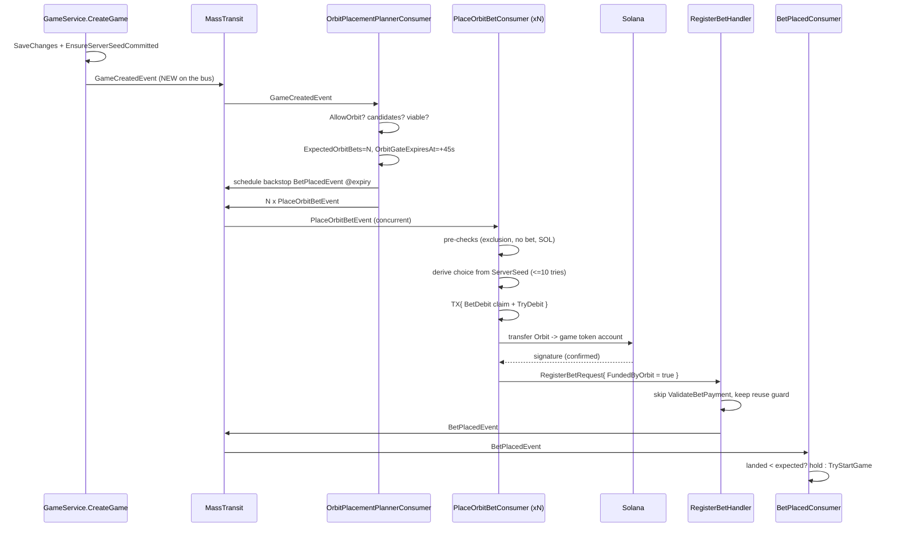
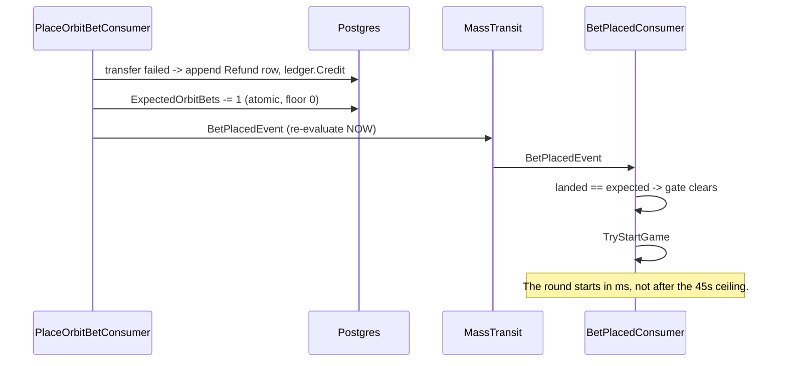

# Space Stroker — "Orbit (2/3) — Auto-Bet Engine" — Implementation Spec

> **Status: Ready for implementation** — refined via Trello card
> [Orbit (2/3) — auto-bet engine: round integration, choice generation, Orbit-funded bets](https://trello.com/c/h7MF4Oky)
> (2026-07-31). Product decisions for the whole epic live on the umbrella card
> [Orbit #118](https://trello.com/c/yxwdNTrb) — **read it and its five comments first**.
> Repos affected: `monkify-backend`, `monkify-front`, and this doc in `monkify-meta`.
>
> **Purpose:** Spend the custodial balance #121 built. For an enrolled, funded player, place one real
> bet per round on their chosen game type out of their Orbit balance — funded by a house-signed
> on-chain transfer, with a provably-fair derived choice — then credit winnings back into the balance
> and fire the "cash out at" threshold. To every other player the bet is indistinguishable from a
> human's.
>
> ⚠️ **This card branches from `release/orbit`, NOT `main`.** `main` contains **zero** Orbit code, so
> this spec cannot compile against it. See §2.

---

## 1. Summary

[#121](https://trello.com/c/R4Qe0jxX) shipped custody: `OrbitEnrollment`, `OrbitBalance`, the
append-only `OrbitTransaction` ledger, `IOrbitLedgerService`, `IOrbitAccountResolver`,
`GameParameters.AllowOrbit`, and three new `ISolanaService` members. Its enable toggle persists a
preference and **nothing acts on it**. This card is what acts on it.

| Concern | Today (on `release/orbit`) | After this card |
| --- | --- | --- |
| Who places a bet | a human, from their own wallet, one round at a time | **plus** the house, from the Orbit account, for every enrolled+funded player |
| Round-open signal | `GameCreatedEvent` over **SignalR to browsers only** | **also published on the message bus**, consumed by the Orbit planner |
| `ServerSeed` commit | on the **first bet** (`RegisterBetHandler` → `EnsureServerSeedCommitted`) | at **round creation**, for every round |
| Bet choice origin | typed by the player | for Orbit, **derived from the committed `ServerSeed`** and reproducible offline |
| `OrbitTransactionType` rows written | `Deposit`, `CashOut`, `CashOutReversal` | **plus `BetDebit`, `WinCredit`, `Refund`** (already defined, never written) |
| Round start | `MinimumNumberOfPlayers` met ⇒ `TryStartGame` | **plus** an Orbit gate, armed **only when Orbit's bets are load-bearing** |
| Winner payout destination | the player's personal wallet | the **Orbit account** for an Orbit-funded bet, + a ledger credit |

Three money paths ship here, all in `SpaceStroker.Consumers`:

| Path | Direction | Ledger rows |
| --- | --- | --- |
| **Stake** | Orbit account → the game's token account (house-signed) | `OrbitTransaction` `BetDebit` `−X` + the usual `TransactionLog` `Debit` |
| **Win** | game token account → Orbit account (house-signed) | `OrbitTransaction` `WinCredit` `+X` + `TransactionLog` `Credit` |
| **Refund** | game token account → Orbit account (house-signed) | `OrbitTransaction` `Refund` `+X` + `TransactionLog` `Refund` |

Every `OrbitTransaction` row above carries `BetId`; the `BetDebit` row additionally carries the new
`GameId`, which is what makes placement idempotent (§4.1).

---

## 2. Constraints (MANDATORY)

From `monkify-meta/constraints.md` (full list there):

- **⚠️ Base branch §2 — deliberate deviation.** The worktree is `.worktrees/orbit-auto-bet-engine/<repo>`
  and the branch `feature/orbit-auto-bet-engine` in all three repos, but it is cut from
  **`origin/release/orbit`**, not `origin/main`, and merges back to **`release/orbit`**. `main` has no
  Orbit entities, services or migration, so an off-`main` branch would not build. **Already created and
  pushed** (2026-07-31) — do not re-run the pre-flight/create step. The hubs stay on `main`.
- **Unit tests §3:** update/add in `SpaceStroker.Tests`; run via `scripts/run_tests.bat` — never a bare
  `dotnet test`, which drags in the `ProductionGames` Monte-Carlo suite. Report changed tests at the end.
- **Integration tests §3 (mandatory — this card is a `Feature`):** a happy-path test **plus a second for
  the refund-into-Orbit path** (a "particularly complex flow"), in `SpaceStroker.Tests.Integration`, run
  via `scripts/run_integration_tests.bat`. ⚠️ Not optional here for a second reason: every ledger write
  is `ExecuteUpdateAsync`, **which does not run on the EF in-memory provider**, so the integration suite
  is the *only* place the new debit/credit paths execute at all (`OrbitFlowTests.cs:19-29`). See §11.2.
- **Game-flow changes §3:** this card touches `BetPlacedConsumer`, `RewardGameConsumer`,
  `RefundInvalidBetConsumer`, `RegisterBetHandler` and `GameService` — `conventions/backend.md`
  requires the existing integration assertions be updated to match.
- **EF mapping §4:** inline in `SpaceStrokerDbContext.OnModelCreating`; no `IEntityTypeConfiguration`.
- **Migrations §4:** under `SpaceStroker.Infrastructure/Migrations/`, applied only by
  `SpaceStroker.Consumers`. ⚠️ **Never pass `--no-build` to `dotnet ef migrations add`** — it reads stale
  assemblies and emits an empty `Up`/`Down` with no error. Read the generated file before committing.
- **Secrets §1:** no new key material. The Orbit keypair and session secret are #121's.
- **Vague messaging §6:** an Orbit placement failure is **never surfaced to a player at all** — it is a
  server-side `Log.Error`. The one new player-visible string is the owner-only "Orbit has this round"
  copy (§7.3), which is not an auth path.
- **Host split §8:** every signature, transfer and ledger write is in **`SpaceStroker.Consumers`**. The
  API host gains **no new endpoint** — and therefore **no new `AspNetCoreRateLimit` rule**, so
  `RateLimitSettingsTests`' exact-set assertion is untouched (unlike #121, which had to change it).
- **⚠️ Ops (not code):** none. No new secret, no new public route, no Cloud Armor surface.

---

## 3. Resolved product decisions

Answer mode during refinement: **short**. Decisions 1-15 are this card's (Trello #122); 16-21 are
inherited from #118 and repeated because they are load-bearing here.

| # | Decision |
| --- | --- |
| 1 | **Every eligible enrolled player bets every round — no cap.** Chosen over "fill only the gap to `MinimumNumberOfPlayers`", which would silently skip rounds a player enrolled to play. Concurrency, not a cap, absorbs a busy type (decision 3). |
| 2 | **The trigger is a two-stage bus fan-out.** ⚠️ **There is no round-created bus event today** — `GameService.CreateGame` only pushes `GameCreatedEvent` to `_activeGamesHub.Clients.All` (`GameService.cs:439`); `Consumers` never sees it. `CreateGame` gains `_messageBus.PublishEventAsync(gameCreatedEvent)` beside the hub send, covering **all four** creation paths at once (`OpenNewGames`, `RunGameConsumer` rollover, `BetPlacedConsumer` lottery replacement, `GameParametersCreatedConsumer`). Chosen over inline calls at each site (4 copies; round creation would block on N Solana transfers) and over a Hangfire poll (latency inside an already-tight window). |
| 3 | **Stage 2 is one event per player** — `PlaceOrbitBetEvent(GameId, PlayerId)`. Chosen over a single per-round event because MassTransit then runs placements **concurrently** and retries each **independently**: one player's RPC 429 never re-drives the players who already succeeded. |
| 4 | **Viability is decided once, in stage 1, before fan-out.** Only if enrolled+funded players alone satisfy `MinimumNumberOfPlayers` does the planner arm the gate and fan out; otherwise it publishes **nothing** and `BetPlacedConsumer` re-runs the identical check when a human bet makes the round viable. ⚠️ #118 decision 7: an under-subscribed **race** never self-refunds (`BetPlacedConsumer.cs:69` handles lotteries only), so a lone stranded Orbit stake would need a manual `POST /admin/bets/refund`. |
| 5 | **`ValidateBetPayment` is skipped for Orbit-funded bets.** ⚠️ **This is not an optimisation — it is required.** `SolanaService.ValidateBetPayment` asserts the transfer's **sender equals `bet.GetWalletAddress()`**, i.e. the player's own wallet; an Orbit stake is sent by the **Orbit account**, so the shipped validator rejects every Orbit bet outright. Two compensating controls are **mandatory**: the placement consumer **confirms the transfer on-chain before calling MediatR**, and the **signature-reuse guard stays** — only `_settlement.ValidatePayment(_bet)` is bypassed. |
| 6 | **⚠️ The Orbit marker lives on the MediatR `RegisterBetRequest`, never on `RegisterBetRequestBody`.** The body is bound from a **public, unauthenticated** HTTP request; a `fundedByOrbit` field there would let any caller skip payment validation and mint free stakes into a real pot. `GamesController` constructs `new RegisterBetRequest(id, body)` and never sets the flag; only the in-process Consumers path does. See §6.4. |
| 7 | **`Bet.FundedByOrbit` (bool) marks the funding source** on the persisted row. Chosen over joining `OrbitTransaction.BetId` because `RewardGameConsumer` and `RefundInvalidBetConsumer` branch on it with no extra query, and it flows straight into the own-bet DTO. **Which pool** to credit back is still read from the bet's `BetDebit` ledger row. |
| 8 | **The start gate is two columns on `Game`** — `ExpectedOrbitBets` (`int?`) and `OrbitGateExpiresAt` (`DateTime?`) — both written by the planner **before** fan-out. Chosen over a Redis key, whose flush would silently disarm the gate and start a round without bets players were already debited for. A separate expiry timestamp is required because the human-makes-it-viable path arms the gate long after `Game.CreatedDate`, so it cannot be derived from `MinimumWaitPeriodForBets`. |
| 9 | **Gate behaviour.** `BetPlacedConsumer` adds one check before `TryStartGame`: armed **and** landed < expected **and** not past expiry ⇒ return without starting. Each Orbit bet publishes `BetPlacedEvent` as normal and re-runs it; when the last lands the gate clears and the ordinary path continues untouched (remainder of `MinimumWaitPeriodForBets` = 15s from `CreatedDate`, then `TimeUntilGameStarts` = 10s). **It holds only as long as the slowest transfer takes — seconds in practice — with `OrbitBetGateTimeoutSeconds` (45s) as a ceiling.** ⚠️ It arms **only when Orbit is load-bearing** (#118 decision 9): if humans already meet the minimum, `ExpectedOrbitBets` is never written and **a paying human never waits on a bot**. |
| 10 | **Gate wake-up: decrement on failure + a scheduled backstop.** A definitive failure atomically decrements `ExpectedOrbitBets` and republishes `BetPlacedEvent`, so the round starts within milliseconds of the survivors landing instead of burning the full 45s. A Hangfire one-shot at `OrbitGateExpiresAt` publishes a `BetPlacedEvent` as the hard-crash backstop — reusing the **shipped** `GameService.ScheduleLottery` pattern verbatim. Chosen over backstop-only (every failure costs every human in the round the full wait) and over `Task.Delay` in the consumer (parks a message slot for 45s, loses the gate on restart). |
| 11 | **The `BetDebit` ledger row IS the placement claim.** `OrbitTransaction` gains `GameId` and the existing pool index becomes a **unique** `(OrbitAccount, MintAddress, PlayerId, GameId)`. Only `BetDebit` rows set `GameId`, and Postgres treats NULLs as distinct, so deposits/cash-outs/wins/refunds never collide — the same trick as the shipped `(GameId, ExclusiveChoice)` index. The atomic debit and the claim are therefore the **same write, in one DB transaction, taken before the transfer is signed**: a redelivery or double fan-out hits `23505` and skips having moved nothing. |
| 12 | **The `ServerSeed` is committed at round creation, for every round.** ⚠️ Today it is committed on the **first bet** (`RegisterBetHandler.RegisterBet()` line 299), which the creation-time placement path does not satisfy. Chosen over committing early only for Orbit rounds so the commitment always predates every bet — better provably-fair hygiene than committing after a player has revealed a choice — and so one round is never committed at two different lifecycle points depending on who happened to be enrolled. `EnsureServerSeedCommitted` stays as the idempotent first-writer-wins backstop. No visible player change; the hash simply exists earlier. |
| 13 | **The Orbit bet's client seed derives from the `ServerSeed` too:** `Seed = HMAC(ServerSeed, "orbit-seed\|playerId")`, `Nonce = 0`. Chosen over a stored per-enrolment client seed (a column and a counter bought for appearance — grinding the `ServerSeed` determines the outcome either way) and over a random seed (unverifiable, holing the exact property choice derivation exists to guarantee). Accepted and documented: an Orbit-only round has **no non-house entropy** — already true of the choices, and #118 accepted the residual grinding risk. |
| 14 | **Refunds: pre-check before signing, plus an event backstop.** The placement consumer re-checks everything it controls (self-exclusion, round still accepting bets, choice free and valid, no existing bet this round) **immediately before signing**, so Orbit essentially never reaches the pre-insert refund path. **And** `RefundInvalidBetEvent` gains a funding-source field so a genuinely lost race still credits the Orbit balance. ⚠️ Needed because every `RefundInvalidBet` call site fires **before `InsertBet`** — there is no `Bet` row to read `FundedByOrbit` from, and the event today carries `Wallet = bet.Player.ExternalPlayerId`, the **personal** wallet. |
| 15 | **The owner-only "Orbit has this round" affordance ships here**, not #123 — #122 is what creates the collision. ⚠️ Cheaper than it looks: because an Orbit bet carries the player's **real wallet** as `externalPlayerId`, `useGame.iHaveBetThisRound` is **already true** and `GameConsole.betLimitBlocks` **already greys the panel**. Only the *copy* is wrong ("One bet per round in this game." about a bet they never placed). So this is a **flag + copy change**, needing no Orbit session and no wallet prompt. |
| 16 | **Rounds may run on Orbit bets alone** once ≥ `MinimumNumberOfPlayers` Orbit players are enrolled and funded. Accepted: continuous SOL fees + RPC credits with no humans present. |
| 17 | **One bet per player per round, full stop** — Orbit skips any round the player already bet in. The shipped `fix-bets-logic` rules grant Orbit **no exemption**. |
| 18 | **Orbit is paid-only**, never free bets; **one Orbit game type per player at a time**; the wallet need not be connected for auto-bets to run. |
| 19 | **Free-text collisions: derive and retry, ≤ 10 attempts, then skip the player for the round** — never spend an on-chain transfer on a bet `choice-exclusivity` will reject. |
| 20 | **Orbit bets reuse the existing `RegisterBetRequest` MediatR path from Consumers** (MediatR is registered in `Infrastructure/DependencyInjection.cs`, so both hosts have it) — same validation, exclusivity, seed commitment and `TransactionLog` as a human bet. |
| 21 | **Orbit must be invisible to other players** — no badge on the live bet list, no "waiting for auto-bets" state. Orbit bets already carry the real player's wallet and display name. |

---

## 4. Data model

### 4.1 Entity / column changes

**`src/SpaceStroker.Domain/Bets/Entities/Bet.cs`**

```csharp
/// <summary>
/// True when this stake came out of a player's Orbit balance rather than their own wallet.
///
/// Decides three things and nothing else: the payout destination (RewardGameConsumer), the refund
/// destination (RefundInvalidBetConsumer), and the owner-only ORBIT tag. It is deliberately NOT
/// exposed on any public DTO — an Orbit bet must be indistinguishable from a human's to other
/// players (#118 decision, AC23).
/// </summary>
public bool FundedByOrbit { get; set; }
```

**`src/SpaceStroker.Domain/Games/Entities/Game.cs`**

```csharp
/// <summary>
/// How many Orbit bets this round is WAITING FOR before it may start. Null = no gate.
///
/// ⚠️ Written by the planner BEFORE it fans out, or BetPlacedConsumer could start the round the
/// instant the first Orbit bet lands. Armed ONLY when Orbit's bets are load-bearing (#118 decision 9):
/// if humans already satisfy MinimumNumberOfPlayers this stays null and nobody waits on a bot.
/// Decremented atomically when a placement fails definitively.
/// </summary>
public int? ExpectedOrbitBets { get; set; }

/// <summary>
/// When the gate stops holding the round, regardless of how many Orbit bets landed.
///
/// A separate timestamp rather than CreatedDate + a constant, because the human-makes-it-viable path
/// arms the gate long after the round was created — MinimumWaitPeriodForBets is measured from
/// CreatedDate and would already be negative.
/// </summary>
public DateTime? OrbitGateExpiresAt { get; set; }
```

**`src/SpaceStroker.Domain/Orbit/Entities/OrbitTransaction.cs`**

```csharp
/// <summary>
/// The round a BetDebit row was placed into. NULL on every other row type.
///
/// ⚠️ This column is the PLACEMENT CLAIM. Together with the pool key it forms a UNIQUE index, so the
/// atomic debit and "this player already has an Orbit bet in this round" are the SAME write — taken
/// inside one transaction BEFORE the transfer is signed. A MassTransit redelivery or a double fan-out
/// loses on 23505 having moved no money. Postgres treats NULLs as distinct, so deposits, cash-outs,
/// wins and refunds are unaffected (the same trick as Bet.ExclusiveChoice).
/// </summary>
public Guid? GameId { get; set; }
```

> `BetId` already exists and is documented as "#122 only" — this card is what finally writes it, on
> the `BetDebit`, `WinCredit` and `Refund` rows.

### 4.2 EF configuration (inline, in `SpaceStrokerDbContext.OnModelCreating`)

In the existing `Bet` block (around line 124):

```csharp
builder.Property(x => x.FundedByOrbit).IsRequired().HasDefaultValue(false);
```

In the existing `Game` block (around line 87):

```csharp
builder.Property(x => x.ExpectedOrbitBets).IsRequired(false);
builder.Property(x => x.OrbitGateExpiresAt).IsRequired(false);
```

In the existing `OrbitTransaction` block (around line 213) — the pool index **changes shape**:

```csharp
builder.Property(x => x.GameId).IsRequired(false);

// WAS: builder.HasIndex(x => new { x.OrbitAccount, x.MintAddress, x.PlayerId });
// NOW: the same index, extended with GameId and made UNIQUE. It still serves the per-player pool
// lookups (leading columns), and additionally enforces one BetDebit per (player, round). Rows that
// are not BetDebit leave GameId NULL, and Postgres treats NULLs as distinct, so they never collide.
builder.HasIndex(x => new { x.OrbitAccount, x.MintAddress, x.PlayerId, x.GameId }).IsUnique();

builder.HasIndex(x => x.BetId);
```

> No `HasFilter` is needed and none should be added — the NULL-distinct semantics do the work, and a
> filtered index would not be usable for the pool lookups `ResolveBalance` and `PoolTotal` perform.

### 4.3 Migration

```bash
cd src/SpaceStroker.Infrastructure
dotnet ef migrations add AddOrbitAutoBetEngine --startup-project ../SpaceStroker.Consumers
```

Expected `Up()`, mirroring `20260730201233_AddOrbitCustodialWallet.cs`:

1. `AddColumn<bool>("FundedByOrbit", "GameBets", nullable: false, defaultValue: false)`
2. `AddColumn<int>("ExpectedOrbitBets", "Games", nullable: true)`
3. `AddColumn<DateTime>("OrbitGateExpiresAt", "Games", nullable: true)`
4. `AddColumn<Guid>("GameId", "OrbitTransactions", nullable: true)`
5. `DropIndex("IX_OrbitTransactions_OrbitAccount_MintAddress_PlayerId")`
6. `CreateIndex("IX_OrbitTransactions_OrbitAccount_MintAddress_PlayerId_GameId", unique: true)`
7. `CreateIndex("IX_OrbitTransactions_BetId")`

⚠️ Read the generated file. If steps 5-6 come out as anything other than a drop-then-create, fix the
model and regenerate rather than hand-editing.

### 4.4 The claim invariant

```
For any (OrbitAccount, MintAddress, PlayerId, GameId) with GameId NOT NULL,
at most ONE OrbitTransaction row exists, and it is the BetDebit for that player's
single Orbit bet in that round.

The row is written in the SAME transaction as the balance debit and BEFORE any
transfer is signed, so the database — not the application — decides who places.
```

This is the direct analogue of #121's balance invariant (`specs/orbit-custodial-wallet.md` §4.5) and
is what makes decision 11 true rather than aspirational.

---

## 5. Configuration

One new knob on the existing `OrbitSettings` block
(`src/SpaceStroker.Domain/Configs/Entities/OrbitSettings.cs`, bound at
`GeneralSettings:Operator:Token:Orbit`):

```csharp
/// <summary>
/// The ceiling on how long a round waits for its Orbit bets to land, from the moment the gate is
/// armed. Deliberately NOT MinimumWaitPeriodForBets (15s): that window is measured from game
/// creation, so a gate armed by a late human bet would already be expired, and 15s does not survive
/// a confirmed SPL transfer.
///
/// In practice the gate clears the instant the last bet lands or the last failure decrements, so
/// this is a backstop, not a normal wait.
/// </summary>
public int OrbitBetGateTimeoutSeconds { get; set; } = 45;
```

`src/SpaceStroker.Common/spacestrokersettings.json` → `GeneralSettings.Operator.Token.Orbit` gains
`"OrbitBetGateTimeoutSeconds": 45`.

⚠️ **Do not add another array to `OrbitSettings` without reading the `DepositOptions` comment** —
`ConfigurationBinder` **appends** to a pre-initialized array, which once shipped six deposit buttons.
`OrbitBetGateTimeoutSeconds` is a scalar and is safe with an initializer.

**No new secret. No new rate-limit rule. No seeding change** — `AllowOrbit` is already seeded and
self-healed by #121.

---

## 6. Backend behaviour

### 6.1 Publishing the round-open event (`GameService.CreateGame`)

`IMessageBus` is **already injected** into `GameService` (`GameService.cs:41`), so this is one line
beside the existing SignalR broadcast (`GameService.cs:436-440`):

```csharp
var gameCreatedEvent = new GameCreatedEvent(game.Id, parameters);
await _activeGamesHub.Clients.All.SendAsync(_settings.Games.ActiveGamesEndpoint, gameCreatedEvent.AsJson());
await _messageBus.PublishEventAsync(gameCreatedEvent);   // NEW — the Orbit planner's only trigger
```

`GameCreatedEvent` already lives in `Infrastructure/Contracts/Games/GameCreatedEvent.cs` as a record,
so **no new contract type is needed**.

⚠️ `CreateGame`'s whole body is wrapped in `try/catch → Log.Error` and returns silently on failure.
The publish must sit **after** `SaveChangesAsync` so a planner consumer can never read a round that
does not exist, and its failure must not prevent the round from opening — leave it inside the
existing catch.

Also in `CreateGame`, immediately after `SaveChangesAsync` (decision 12):

```csharp
await EnsureServerSeedCommitted(game.Id);   // commitment now predates every bet, always
```

`EnsureServerSeedCommitted` is already idempotent first-writer-wins raw SQL
(`WHERE "Id" = @id AND "ServerSeed" IS NULL`, `GameService.cs:188`), so the existing calls in
`RegisterBetHandler.RegisterBet()` and `RunGameConsumer` become harmless no-ops and stay as backstops.

### 6.2 Stage 1 — `OrbitPlacementPlannerConsumer` (consumes `GameCreatedEvent`)

New: `Infrastructure/Consumers/OrbitPlacementPlanning/OrbitPlacementPlannerConsumer.cs`, extending
`BaseConsumer<GameCreatedEvent>`. Orchestration only — each step is its own private method, per
`conventions/backend.md`.

1. **Bail cheaply.** `accounts.IsConfigured == false` ⇒ return. `parameters.AllowOrbit == false` or
   `parameters.LotteryParameters != null` ⇒ return (AC22).
2. **Resolve the candidate set** (§6.3). Empty ⇒ return.
3. **Viability (decision 4).** Count distinct players already bet in the round (`0` at creation) plus
   the candidate count. If `existing + candidates < MinimumNumberOfPlayers` ⇒ **publish nothing** and
   return — nothing is debited, nothing is stranded.
4. **Arm the gate, but only if load-bearing.** If `existing >= MinimumNumberOfPlayers` the round can
   already start on its own, so **leave `ExpectedOrbitBets` null** (decision 9 / AC10) and skip to 5.
   Otherwise, in one `ExecuteUpdateAsync`:
   `ExpectedOrbitBets = candidates.Count`, `OrbitGateExpiresAt = UtcNow.AddSeconds(OrbitBetGateTimeoutSeconds)`,
   then schedule the backstop (§6.7).
5. **Fan out.** `foreach (var playerId in candidates) await messageBus.PublishEventAsync(new PlaceOrbitBetEvent(game.Id, playerId));`

⚠️ Step 4 **must** complete before step 5. If a placement lands first, `BetPlacedConsumer` sees no gate
and may start the round.

### 6.3 The candidate query

One query, in a new `IOrbitBetPlacementService`:

```csharp
// Enrolled, enabled, on THIS game type, not self-excluded, and funded for the stake.
// Balance is read from the materialized column here on purpose: this is a planning read, not a money
// movement, and the authoritative check happens again inside the debit (which is conditional anyway).
var candidates = await _context.OrbitEnrollments
    .Where(e => e.Enabled && e.GameParametersId == parameters.Id)
    .Join(_context.Players, e => e.PlayerId, p => p.Id, (e, p) => new { e, p })
    .Where(x => x.p.SelfExcludedAt == null
             || (x.p.SelfExcludedUntil != null && x.p.SelfExcludedUntil <= DateTime.UtcNow))
    .Join(_context.OrbitBalances.Where(b => b.OrbitAccount == accounts.OrbitAccount
                                         && b.MintAddress == accounts.MintAddress),
          x => x.e.PlayerId, b => b.PlayerId, (x, b) => new { x.e.PlayerId, b.Amount })
    .Where(x => x.Amount >= parameters.RequiredAmount)
    .Select(x => x.PlayerId)
    .ToListAsync();
```

The self-exclusion predicate mirrors `Player.IsSelfExcluded` (`Domain/Games/Entities/Player.cs:32`):
a null `SelfExcludedUntil` with a set `SelfExcludedAt` is a **permanent** exclusion. The consumer
re-checks exclusion again before signing (§6.4 step 2), per #118 decision 11.

### 6.4 Stage 2 — `PlaceOrbitBetConsumer` (consumes `PlaceOrbitBetEvent`)

New: `Infrastructure/Consumers/OrbitBetPlacement/{PlaceOrbitBetEvent,PlaceOrbitBetConsumer}.cs`.

```csharp
public record PlaceOrbitBetEvent(Guid GameId, Guid PlayerId);
```

Steps, in order. **Any failure after step 1 and before step 4 calls `FailPlacement` (§6.6).**

1. **Re-read the round.** Not in `Game.GameAcceptingBets` ⇒ `FailPlacement` (the round moved on).
2. **Pre-checks before signing anything (decision 14).** In one pass: player still not self-excluded;
   player has no bet in this round (`GameBets.AnyAsync(b => b.GameId == id && b.PlayerId == playerId)`,
   AC6); low-SOL guard (`GetSolBalance` below `MinimumSolBalance` ⇒ `Log.Error` + `FailPlacement`,
   AC27). Any failure here costs nothing — no debit, no transfer.
3. **Derive the choice (§6.8).** Exhausting 10 attempts ⇒ `FailPlacement` (AC7/AC16).
4. **Claim + debit, in one transaction, before the transfer** — the `OrbitCashOutReserver.Reserve`
   template (`OrbitCashOutReserver.cs:52-84`):

```csharp
await using var transaction = await _context.Database.BeginTransactionAsync(ct);
var row = new OrbitTransaction
{
    OrbitAccount = accounts.OrbitAccount, MintAddress = accounts.MintAddress,
    PlayerId = playerId, GameId = game.Id,               // <-- the claim
    Type = OrbitTransactionType.BetDebit,
    Amount = -stake, Status = OrbitTransactionStatus.Completed,
};
try
{
    await _context.OrbitTransactions.AddAsync(row, ct);
    await _context.SaveChangesAsync(ct);                  // 23505 here = someone already claimed
}
catch (DbUpdateException ex) when (IsUniqueViolation(ex))
{
    _context.ChangeTracker.Clear();
    await transaction.RollbackAsync(ct);
    Log.Information("Orbit placement for player {PlayerId} in game {GameId} was already claimed.", playerId, game.Id);
    return;                                               // NOT a failure — do not decrement (AC7)
}

if (!await _ledger.TryDebit(playerId, stake, ct))
{
    await transaction.RollbackAsync(ct);
    await FailPlacement(game.Id, "insufficient funds");   // AC8 — nothing transferred
    return;
}
await transaction.CommitAsync(ct);
```

   ⚠️ A lost claim is **not** a failed placement: the winning claimant will place the bet, so
   decrementing `ExpectedOrbitBets` would let the round start one bet short.

5. **Transfer and confirm.** `solana.TransferTokensToWallet(settings.Operator.Token.TokenOwnerPublicKey,
   AmountFor(stake), accounts.ToDescriptor(includePrivateKey: true))` — Orbit account → the game's
   token account. A null/blank signature ⇒ **compensate**: append a `Refund` row for `+stake` with
   `BetId = null` and `Reason`, `ledger.Credit`, then `FailPlacement`. ⚠️ Never delete or edit the
   `BetDebit` row — the ledger is append-only (#121 §4.5).
6. **Register the bet through MediatR** (decision 20):

```csharp
var request = new RegisterBetRequest(game.Id, new RegisterBetRequestBody
{
    Amount = stake, Choice = choice, Seed = derivedSeed, Nonce = 0,
    Wallet = player.ExternalPlayerId, PaymentSignature = signature,
})
{
    FundedByOrbit = true,        // internal-only, see decision 6
};
var bet = await _mediator.Send(request, ct);
```

   A thrown validation failure ⇒ compensate exactly as in step 5 **and** rely on the
   `RefundInvalidBetEvent` backstop (§6.9) so the stake is never double-credited — the handler's
   idempotency is `TransactionLogs.AnyAsync(x => x.RelatedSignature == signature)`.
7. **Stamp the ledger row.** `ExecuteUpdateAsync` setting `BetId = bet.Id` and `Signature = signature`
   on the claim row. (`Signature` is uniquely indexed and this value is genuinely unique.)

### 6.5 `RegisterBetRequest` and `RegisterBetHandler`

**`RegisterBetRequest.cs`** — the flag lives here, **not** on the body (decision 6):

```csharp
public class RegisterBetRequest : IRequest<BetDto>
{
    public Guid GameId { get; set; }
    public RegisterBetRequestBody Body { get; set; }

    /// <summary>
    /// ⚠️ INTERNAL ONLY — deliberately NOT on RegisterBetRequestBody.
    ///
    /// The body is model-bound from a PUBLIC, unauthenticated request. A caller who could set this
    /// would skip payment validation entirely and mint unfunded stakes into a real pot. GamesController
    /// constructs this request from the body and never touches this property; only the in-process
    /// PlaceOrbitBetConsumer sets it.
    /// </summary>
    public bool FundedByOrbit { get; init; }
}
```

**`RegisterBetHandler`** — exactly three changes:

| Line | Change |
| --- | --- |
| 63 | capture `_fundedByOrbit = request.FundedByOrbit` alongside `_isFreeBet` |
| 171 (`ValidatePayment`) | keep the signature-reuse guard; **skip `_settlement.ValidatePayment(_bet)` when `_fundedByOrbit`** (decision 5) |
| 93 (`new Bet(...)`) | set `_bet.FundedByOrbit = _fundedByOrbit` |

Everything else is untouched: the malformed-shape gate at 66-70 **passes** (an Orbit bet has
`amount > 0` **and** a real payment signature), self-exclusion at 104 still runs, `ValidateBetParameters`
at 187 still enforces duplicates, per-round limits, exclusivity and choice validity, and
`WritePlacementLedgerRow` still writes the `TransactionLog` `Debit`.

⚠️ The per-round limit rules (`RegisterBetHandler.cs:219-243`) are **not** relaxed. `OneBetPerPresetRound`
and `SecondBetNeedsAnotherPlayer` only fire when the player *already* has a bet in the round, which
step 2 of §6.4 guarantees they do not.

### 6.6 `FailPlacement` — the gate decrement (decision 10)

```csharp
// Atomic and floor-guarded: two concurrent failures must not drive the gate below zero.
await _context.Games
    .Where(g => g.Id == gameId && g.ExpectedOrbitBets != null && g.ExpectedOrbitBets > 0)
    .ExecuteUpdateAsync(s => s.SetProperty(g => g.ExpectedOrbitBets, g => g.ExpectedOrbitBets - 1), ct);

Log.Error("Orbit placement failed for player {PlayerId} in game {GameId}: {Reason}", playerId, gameId, reason);
await _messageBus.PublishEventAsync(new BetPlacedEvent(gameId));   // re-evaluate the gate NOW
```

Nothing is surfaced to any player (§2, vague messaging). The player is simply retried next round.

### 6.7 The gate backstop (decision 10)

`GameService` gains a sibling of the shipped `ScheduleLottery` (`GameService.cs:523`), and — unlike
`ScheduleLottery` — it **is** added to `IGameService` so the planner can call it:

```csharp
public string ScheduleOrbitGateExpiry(Guid gameId, DateTime expiresAt)
{
    var delay = expiresAt - DateTime.UtcNow;
    if (delay < TimeSpan.Zero) delay = TimeSpan.Zero;
    return BackgroundJob.Schedule(() => _messageBus.PublishEventAsync(new BetPlacedEvent(gameId)), delay);
}
```

A stale job needs no cancelling — `BetPlacedConsumer` already returns early on a round that is no
longer in `GameAcceptingBets`, and `TryStartGame`'s conditional UPDATE is idempotent.

### 6.8 Choice generation — `OrbitChoiceGenerator` (decisions 13, 19)

New **pure** class in the domain, beside `ProvablyFair`:
`src/SpaceStroker.Domain/Orbit/Services/OrbitChoiceGenerator.cs`. No EF, no config, no I/O — so it is
fully unit-testable and the frontend/`verify.html` can mirror it later.

```csharp
public static string DeriveSeed(string serverSeed, Guid playerId);
    // HMAC-SHA256(key: serverSeed, msg: $"orbit-seed|{playerId:D}") -> lowercase hex (64 chars,
    // which is exactly Bet.Seed's HasMaxLength(64)).

public static string DeriveChoice(string serverSeed, Guid playerId, int attempt, GameParameters parameters);
    // Keystream = ProvablyFair.Keystream(serverSeed, $"orbit|{playerId:D}|{attempt}").
    // Preset types  : uniform over parameters.PresetChoices ordered by StringComparer.Ordinal,
    //                 index via ProvablyFair.NextIndex (rejection sampling).
    // Free-text     : draw ChoiceRequiredLength characters from
    //                 parameters.AllowedCharacters.StringValueOf(); when
    //                 !AcceptDuplicatedCharacters, draw without replacement from the remaining pool.
```

Reusing `ProvablyFair.NextIndex`'s rejection sampling matters: a naive `% poolSize` would bias the
distribution, and the whole point of deriving from the seed is that the result is *checkable*.

The consumer loops `attempt = 0..9`, and for a **free-text** type queries
`GameBets.AnyAsync(b => b.GameId == id && b.Choice == candidate)` before accepting — never spending a
transfer on a bet `choice-exclusivity` will reject. Preset types share choices and need no such check
(#118). ⚠️ Ordering the preset choices with `StringComparer.Ordinal` is required for offline
reproducibility — the same discipline `SpaceStrokerTyper.DecideFallbackWinner` already follows.

### 6.9 `BetPlacedConsumer` — the gate check (decision 9)

One insertion in `BetPlacedConsumer.cs`, between the player-count block and `TryStartGame` (line 98):

```csharp
if (game.ExpectedOrbitBets is > 0 && DateTime.UtcNow < game.OrbitGateExpiresAt)
{
    var landed = gameBets.Count(b => b.FundedByOrbit);
    if (landed < game.ExpectedOrbitBets)
    {
        Log.Information("Holding game {GameId}: {Landed}/{Expected} Orbit bets.", game.Id, landed, game.ExpectedOrbitBets);
        return;   // the next BetPlacedEvent — a landing bet, a decrement, or the backstop — re-evaluates
    }
}
```

⚠️ Placed **after** the under-subscription branch, so a round that will never reach its minimum still
follows today's behaviour, and **before** the `Task.Delay(remainingWait)`, so a held round does not
park a message-handling slot.

`BetPlacedConsumer` also gains the second placement trigger: when the round is **now** viable, has no
gate armed, and Orbit candidates exist, it runs §6.2 steps 2-5 through the same
`IOrbitBetPlacementService` (AC4). Guard it with `game.ExpectedOrbitBets == null` so it fires once.

### 6.10 `RewardGameConsumer` — paying an Orbit winner (AC18)

`GetBetsByGameId` and the consumer's include tree already load everything needed; `FundedByOrbit` is a
column on the loaded `Bet`. The single payout call at `RewardGameConsumer.cs:102` becomes a branch:

```csharp
var creditResult = winner.FundedByOrbit
    ? await orbitBets.CreditWin(winner, rewardResult.Value, CancellationToken.None)
    : await settlement.Credit(winner, rewardResult.Value, CancellationToken.None);
```

`IOrbitBetSettlementService.CreditWin` (new, `Infrastructure/Services/Orbit/`):

1. `settlement.Credit(bet, amount, ct, destinationWallet: accounts.OrbitAccount)` — an on-chain
   transfer from the game's token account to the **Orbit account**, writing the usual `TransactionLog`
   `Credit` row.
2. On success, in one transaction: append `OrbitTransaction { Type = WinCredit, Amount = +amount,
   BetId = bet.Id, Status = Completed, Signature = <the transfer signature> }`, then
   `ledger.Credit(playerId, amount, ct)`.
3. Then evaluate the threshold (§6.11).

⚠️ **The `TransactionLog` `Credit` row is not optional.** `BetDomainService.CalculateRewardForBet`
subtracts `SumTransactionsForBet(bet, TransactionLogType.Credit)` for idempotency — skip it and a
retried reward pays twice.

⚠️ The blockhash pre-check (`RewardGameConsumer.cs:71-83`) stays **unchanged**: an Orbit payout is
still a real on-chain transfer, just to a different destination.

**`TokenSettlementService` change.** `Credit` and `Refund` gain an optional
`string? destinationWallet = null`; when supplied they call `_solana.TransferTokensToWallet(destinationWallet, …)`
instead of `TransferTokensForBet` / the bet's wallet, and stamp the `TransactionLog`'s `Wallet` with
it. Default behaviour — and therefore every existing test — is unchanged.

### 6.11 Threshold cash-out (AC19)

Immediately after a successful `WinCredit`, reuse #121's shipped reserver — no new money code:

```csharp
var balance = await _ledger.ResolveBalance(playerId, ct);
if (enrollment.CashOutAtThreshold is { } threshold && balance >= threshold)
    await _cashOutReserver.Reserve(playerId, OrbitCashOutSource.Threshold, enforceLimits: false, ct);
```

`enforceLimits: false` is what exempts it from the one-per-UTC-day manual cap —
`OrbitCashOutReserver.HasManualCashOutToday` only counts `Source == Manual` rows, and
`OrbitCashOutSource.Threshold` was defined by #121 for exactly this call.

### 6.12 `RefundInvalidBetConsumer` — refunding into Orbit (AC20, decision 14)

**`RefundInvalidBetEvent` gains a funding-source flag** (a new optional positional member keeps every
existing construction site compiling):

```csharp
public record RefundInvalidBetEvent(
    Guid BetId, string Wallet, decimal Value, string Reason,
    Guid? GameId = null, string? PaymentSignature = null,
    bool FundedByOrbit = false);          // NEW
```

The consumer branches in two places:

- **Bet found** (the normal path): `bet.FundedByOrbit` ⇒ `orbitBets.RefundToOrbit(bet, amount, reason, ct)`
  instead of `settlement.Refund(...)`. Same shape as `CreditWin`: `settlement.Refund(..., destinationWallet:
  accounts.OrbitAccount)` for the on-chain move + `TransactionLog` `Refund` row, then an
  `OrbitTransaction { Type = Refund, Amount = +amount, BetId }` and `ledger.Credit`. `MarkRefunded`
  still flips `BetStatus.Refunded`.
- **Bet not found** (`RefundWithoutBet`, the pre-`InsertBet` race): the flag on the event is the only
  signal available, because there is no row to read. When set, refund to the Orbit account and credit
  the ledger; the `PlayerId` is resolved from `Wallet` via `Players.ExternalPlayerId`.

`PendingRefundSweepJob` needs one change: it currently constructs the event without the flag, so it
must pass `bet.FundedByOrbit` (it already `Include`s nothing extra — the column is on the row it
selects).

### 6.13 MassTransit + Hangfire registration

`SpaceStroker.Consumers/Program.cs`, following the shipped `nameof(TConsumer)` endpoint convention
(9 endpoints today → 11):

```csharp
x.AddConsumer<OrbitPlacementPlannerConsumer>();
x.AddConsumer<PlaceOrbitBetConsumer>();
// …
cfg.ReceiveEndpoint(nameof(OrbitPlacementPlannerConsumer), e => e.ConfigureConsumer<OrbitPlacementPlannerConsumer>(context));
cfg.ReceiveEndpoint(nameof(PlaceOrbitBetConsumer),        e => e.ConfigureConsumer<PlaceOrbitBetConsumer>(context));
```

`PlaceOrbitBetConsumer`'s endpoint carries the concurrency that decision 1 relies on; leave
MassTransit's default prefetch unless the local stack shows contention. No new recurring Hangfire job
— the gate backstop is a one-shot `BackgroundJob.Schedule`.

New services registered `AddScoped` in `Infrastructure/DependencyInjection.cs` beside the three Orbit
services #121 added (`DependencyInjection.cs:55`): `IOrbitBetPlacementService`,
`IOrbitBetSettlementService`.

### 6.14 Settings refinements — a clearable threshold and the re-enable cool-off

Two gaps that only became reachable once the engine made these settings *do* something. Both live in
`PATCH /orbit/settings` (#121 §6.6); neither changes what disabling does.

**a) The threshold could be set but never unset.** `UpdateOrbitSettingsHandler` applies
`CashOutAtThreshold` only `if (HasValue)`, and null already means "leave it alone" on a PATCH — so
there was no request a player could send that meant *off*. The body gains an explicit flag:

```csharp
public bool ClearCashOutAtThreshold { get; set; }   // wins over CashOutAtThreshold when both are sent
```

Clearing is **not** measured against `MinimumCashOut` — checking it there would make "off" unreachable
for every operator whose minimum is above zero, which is all of them.

**b) Disabling is a withdrawal, so the re-enable waits.** Turning Orbit off reserves a
`ForcedOnDisable` cash-out for the whole balance with `enforceLimits: false` (#121 decision 3), which
is correct — a rate limit must never trap funds — but it left off/on/off as an *uncapped* withdrawal
button sitting next to the one manual cash-out a player gets per UTC day. The withdrawal stays free
and the **enable** carries the cool-off:

- `OrbitSettings.ReEnableLockHours` (default **24**, `0` disables the rule entirely).
- `Services/Orbit/OrbitReEnableLock.ResolveLockedUntil` — the single resolver both sides share, so the
  greyed-out toggle and the refusal can never disagree. It returns the most recent `ForcedOnDisable`
  row's `CreatedDate + ReEnableLockHours`, or null.
- `GetOrbit` exposes it as `enableLockedUntil` (UTC, null when unlocked); `UpdateOrbitSettings`
  refuses `Enabled = true` while it is set, with `ErrorMessages.OrbitEnableLocked`.

Keyed on the **cash-out row**, not the enrolment flag: a disable with an empty balance writes no row
and therefore locks nothing — nothing was withdrawn. And the lock is on the way **in** only; a player
already auto-playing can always stop. A rolling window, deliberately, not the manual cap's UTC-day
window: "24 hours after you took the money out" is the promise the UI makes, and a calendar day would
make a 23:50 disable expire ten minutes later.

---

## 7. Frontend behaviour

Scope is **two owner-only surfaces**, both invisible to other players. There is **no new composable,
no new service call and no Orbit session** on this path.

### 7.1 Types

`src/types/index.ts`:

- `GameHistoryRow` (line 107-122) gains `myBetViaOrbit?: boolean | null` — inside the existing `my*`
  block, which is already documented as populated only for rounds the caller bet in.
- `AppliedBet` (line 135-142) gains `viaOrbit?: boolean` — **only ever true for the caller's own bets**;
  the backend must not set it on other players' rows (AC23).

### 7.2 The private ORBIT tag (AC24)

- **Games History, desktop** — `GameHistoryPage.vue:213-219`, inside the existing `YOU` cell:
  append `· ORBIT` (a `.chip` from `arcade.css:117`) when `row.myBetViaOrbit`.
- **Games History, mobile card** — `GameHistoryPage.vue:254-261`, the same addition.
- **In-game own-bet list** — `GameTerminal.vue:473-483`; `betPlayerLabel` (`:71-75`) already returns
  `'YOU'` for the caller, so it becomes `'YOU · ORBIT'` when the bet carries `viaOrbit`.

### 7.3 The owner-only "Orbit has this round" affordance (decision 15)

⚠️ **Do not reach for `useOrbit`.** `useOrbit.load()` is deliberately never called on mount
(`useOrbit.ts:123-127`) because a session costs a wallet prompt, so the game screen has no Orbit state
— and requiring one would break the affordance for exactly the players who need it.

The mechanism is already there. An Orbit bet carries the player's **real wallet** as
`externalPlayerId`, so `useGame.iHaveBetThisRound` (`useGame.ts:183-193`) is already true and
`GameConsole.betLimitBlocks` (`:95`) already greys the panel. Only the copy is wrong. So:

1. **`useGame.ts`** — a new computed beside `iHaveBetThisRound`:
   ```ts
   const myBetThisRoundIsOrbit = computed(() =>
     !!gameInstance.value?.bets.some(b => b.externalPlayerId === currentPlayerId.value && b.viaOrbit)
   );
   ```
   Add it to the return list (`:848-882`). The `{gameId}/Bets` handler (`:349-370`) must carry
   `viaOrbit: newBet.viaOrbit ?? false` onto the pushed row, or a bet placed while the player watches
   would lose the flag until reload.
2. **Copy** — `useGame.ts:473` currently sets `betOutput` to `'One bet per round in this game.'`. When
   `myBetThisRoundIsOrbit`, use `'Orbit placed your bet for this round.'` instead. Same at `:478`.
3. **`GameConsole.vue`** — a persistent note rather than only an on-click error, since the panel is
   already greyed before the player clicks: render it under the choice input when
   `myBetThisRoundIsOrbit`, styled like the existing disabled affordances
   (`vt323-regular text-[#7a8a9e]`). Both layouts: the mobile branch (`:278-361`) and the desktop lever
   area (`:400-411`).

No change to `canPlaceBet` (`:254-260`) or the `placeBet()` guard chain (`:101-151`) — they already
block correctly; this card only explains *why*.

### 7.4 What is deliberately NOT built

No Orbit badge on the live bet list, no "waiting for auto-bets" state, no per-round Orbit indicator
for anyone but the owner (AC23). Nothing new is gated on `isEmbedded` because nothing new is added to
the header — the ORBIT menu entry and balance cluster are #121's and already sit inside
`GameHeader.vue`'s `!isEmbedded` block.

### 7.5 Settings refinements — the control, the toast and the post-round redirect

Three gaps QA hit on the local stack once the engine was live. All three are about a player who cannot
see what Orbit is doing with their money.

**a) "Cash out at" had no control.** The threshold was in the DTO and acted on by §6.11, but the modal
never rendered a field for it — the one auto-play setting the engine reads most visibly was unreachable.
`OrbitModal.vue`'s AUTO-PLAY section gains a `CASH OUT AT` row: a text-bound number input, `SAVE`, and
an `OFF` button that sends `clearCashOutAtThreshold`. Bound as **text**, not `v-model.number`, because
empty and `0` mean opposite things here (off vs. a value that gets refused under the minimum).
Validated client-side against `minimumCashOut` purely to save a round-trip; §6.14 stays authoritative.

**b) Disabling looked like the money vanished.** The forced cash-out was silent, so the player came
back to a balance of 0, a dead CASH OUT button and no explanation. `onToggleEnabled` now reads the
balance **before** the patch (afterwards it is already 0) and toasts what was sent, and the toggle
carries a standing "Turning this off cashes your whole balance out" line plus, once §6.14's lock is
live, the instant it can be switched back on.

Same complaint, second half: after a reload the header sat on `SIGN IN` and the balance was unreadable
to someone whose money was right there. `useOrbit.loadIfSignedIn(wallet)` restores the state when — and
only when — a session is already in `localStorage`, so it costs **no** wallet prompt and issues no
request at all for anyone else. `GameHeader` runs it on every wallet connect. This is what #121's
composable header comment always promised ("a session … lasts about a week, so the header balance does
not prompt the wallet on every page load"); nothing was calling it.

**c) Orbit bet somewhere else and the player never knew.** A player who leaves Orbit on and keeps
watching one game type gets no signal when it bets for them on another — the bet lands in a different
round's SignalR group, on a page they are not on, so they sit on a finished round while their money
rides a live one. `src/hooks/useOrbitRedirect.ts` (mounted by `GamePage.vue`, page-scoped so it cancels
itself on leave): when the watched round hits `Ended`, poll `GET /games/{orbitGameTypeId}?wallet=` every
2s for up to 45s for a round carrying a bet of the player's own with `viaOrbit`, then toast and navigate
there after **3 seconds** (`selectedGame` + `router.push({name:'Game', query:{type}})` +
`updateNewGame(true)` — the same three steps the lobby's `chooseGame` takes, because the route record
is the one already mounted and nothing remounts).

Skipped outright when the Orbit target **is** the type being watched: the ordinary rollover already
lands there, and racing it for the same destination is the only way this can misfire. 45s because an
Orbit stake is a confirmed on-chain transfer and can land well after the previous round ends; past that
the round was simply never viable for Orbit.

> Polled, not pushed. The alternative was a per-wallet SignalR group — a hub change plus a join, for a
> once-a-round hint — and a socket subscription that can outlive the page. A handful of reads against
> the type the player already configured is cheaper and cannot leave state behind.

⚠️ This is the **only** Orbit-session dependency on the game screen, and it is a soft one: no stored
session ⇒ `orbit` is null ⇒ the redirect does nothing. §7.3's rule still holds unchanged — nothing on
this screen may ever *mint* a session, because that costs a wallet prompt.

**Verification:** `yarn lint` + `yarn build` (there is no test runner) + §13. ⚠️ Prettier violations are
ESLint **errors** (`printWidth: 100`), and the build has been broken by reflow before.

---

## 8. Flow diagrams

### 8.1 Placement into an Orbit-only round



### 8.2 A placement fails — the round must not hang



---

## 9. Out of scope

- Notifications, Telegram linking and the first-win upsell — **#123** ([NIH7XFHi](https://trello.com/c/NIH7XFHi)).
- Deposits, manual cash-out, the Orbit modal, the header cluster — **#121**, shipped.
- Lottery types (`AllowOrbit` false) and any `Standard`/free-bet funding.
- Multiple Orbit game types per player; multiple Orbit bets per round.
- A stale-round timeout for a race stuck in `WaitingBets` — a **pre-existing platform gap** Orbit works
  *around* (decision 4), not fixes. Needs its own card.
- Partitioning game types across `Consumers` replicas (`consumer_count = 1` today).
- Browser Web Push, a price oracle, player-paid network fees.
- Any change to the public bet DTO that would reveal Orbit to other players.

---

## 10. File checklist

### 10.1 Backend (`monkify-backend`)

| # | File | Change |
| --- | --- | --- |
| 1 | `Domain/Bets/Entities/Bet.cs` | add `FundedByOrbit` |
| 2 | `Domain/Games/Entities/Game.cs` | add `ExpectedOrbitBets`, `OrbitGateExpiresAt` |
| 3 | `Domain/Orbit/Entities/OrbitTransaction.cs` | add `GameId` (the claim) |
| 4 | `Domain/Orbit/Services/OrbitChoiceGenerator.cs` | **new** — pure seed/choice derivation (§6.8) |
| 5 | `Domain/Configs/Entities/OrbitSettings.cs` | add `OrbitBetGateTimeoutSeconds`, `ReEnableLockHours` (§6.14) |
| 6 | `Infrastructure/Data/Context/SpaceStrokerDbContext.cs` | 3 property lines + the unique claim index + `BetId` index (§4.2) |
| 7 | `Infrastructure/Migrations/*_AddOrbitAutoBetEngine.cs` | **new** migration (generated) |
| 8 | `Infrastructure/Services/Games/GameService.cs` | publish `GameCreatedEvent` on the bus; commit the seed in `CreateGame`; add `ScheduleOrbitGateExpiry` |
| 9 | `Infrastructure/Services/Games/IGameService.cs` | expose `ScheduleOrbitGateExpiry` |
| 10 | `Infrastructure/Services/Orbit/IOrbitBetPlacementService.cs` + impl | **new** — candidates, viability, arm-and-fan-out, `FailPlacement` |
| 11 | `Infrastructure/Services/Orbit/IOrbitBetSettlementService.cs` + impl | **new** — `CreditWin`, `RefundToOrbit`, threshold evaluation |
| 12 | `Infrastructure/Services/Solana/TokenSettlementService.cs` | optional `destinationWallet` on `Credit` + `Refund` (§6.10) |
| 13 | `Infrastructure/Consumers/OrbitPlacementPlanning/OrbitPlacementPlannerConsumer.cs` | **new** — stage 1 (§6.2) |
| 14 | `Infrastructure/Consumers/OrbitBetPlacement/PlaceOrbitBetEvent.cs` + `PlaceOrbitBetConsumer.cs` | **new** — stage 2 (§6.4) |
| 15 | `Infrastructure/Consumers/BetPlaced/BetPlacedConsumer.cs` | gate check + the viability-making-bet trigger (§6.9) |
| 16 | `Infrastructure/Consumers/RewardGame/RewardGameConsumer.cs` | one branch at the payout call (§6.10) |
| 17 | `Infrastructure/Consumers/RefundInvalidBet/RefundInvalidBetEvent.cs` | add `FundedByOrbit` |
| 18 | `Infrastructure/Consumers/RefundInvalidBet/RefundInvalidBetConsumer.cs` | Orbit branch on both the bet-found and bet-less paths (§6.12) |
| 19 | `Infrastructure/Jobs/PendingRefundSweepJob.cs` | pass `bet.FundedByOrbit` on the event |
| 20 | `Infrastructure/Handlers/Games/RegisterBet/RegisterBetRequest.cs` | **internal-only** `FundedByOrbit` (decision 6) |
| 21 | `Infrastructure/Handlers/Games/RegisterBet/RegisterBetHandler.cs` | 3 changes (§6.5) |
| 22 | `Infrastructure/Contracts/Games/BetDto.cs` | `viaOrbit`, **owner-scoped only** |
| 23 | `Infrastructure/Contracts/Games/GameHistoryDto.cs` | `myBetViaOrbit` in the own-bet block |
| 24 | `Infrastructure/Services/Games/GameHistoryService.cs` | join `FundedByOrbit` into the own-bet columns |
| 25 | `Infrastructure/DependencyInjection.cs` | register the two new Orbit services |
| 26 | `Consumers/Program.cs` | `AddConsumer` + `ReceiveEndpoint` × 2 (§6.13) |
| 27 | `Common/spacestrokersettings.json` | `OrbitBetGateTimeoutSeconds: 45` |
| 28 | `Infrastructure/Services/Orbit/OrbitReEnableLock.cs` | **new** — the shared cool-off resolver (§6.14b) |
| 29 | `Infrastructure/Handlers/Orbit/UpdateOrbitSettings/*` | `ClearCashOutAtThreshold`; refuse a locked enable (§6.14) |
| 30 | `Infrastructure/Handlers/Orbit/GetOrbit/*` | `EnableLockedUntil` on the DTO (§6.14b) |
| 31 | `Common/Resources/ErrorMessages.resx` + `.Designer.cs` | `OrbitEnableLocked` |

### 10.2 Frontend (`monkify-front`)

| # | File | Change |
| --- | --- | --- |
| 1 | `src/types/index.ts` | `GameHistoryRow.myBetViaOrbit`, `AppliedBet.viaOrbit` |
| 2 | `src/hooks/useGame.ts` | `myBetThisRoundIsOrbit` computed + return; `viaOrbit` on the `/Bets` push; Orbit-aware `betOutput` copy |
| 3 | `src/components/game/GameConsole.vue` | owner-only "Orbit has this round" note, both layouts |
| 4 | `src/components/game/GameTerminal.vue` | `betPlayerLabel` → `'YOU · ORBIT'` |
| 5 | `src/pages/GameHistoryPage.vue` | ORBIT chip in the desktop `YOU` cell and the mobile card |
| 6 | `src/types/orbit.ts` | `OrbitState.enableLockedUntil`; `OrbitSettingsPatch.clearCashOutAtThreshold` (§7.5) |
| 7 | `src/hooks/useOrbit.ts` | `loadIfSignedIn` — restore from a STORED session only, never mint (§7.5b) |
| 8 | `src/components/orbit/OrbitModal.vue` | `CASH OUT AT` row; disable toast; the cool-off on the toggle (§7.5a/b) |
| 9 | `src/components/GameHeader.vue` | run `loadIfSignedIn` on wallet connect (§7.5b) |
| 10 | `src/hooks/useOrbitRedirect.ts` | **new** — follow Orbit out of a finished round (§7.5c) |
| 11 | `src/pages/GamePage.vue` | mount `useOrbitRedirect()` (§7.5c) |

> **§7.1–7.4 add no Orbit session traffic at all** (§7.3). §7.5 is the exception and a deliberately
> soft one: it only ever *reads* a session that already exists in `localStorage`, so it never costs a
> wallet prompt and does nothing for a player who has not signed into Orbit.

### 10.3 Meta (`monkify-meta`)

| # | File | Change |
| --- | --- | --- |
| 1 | `specs/orbit-auto-bet-engine.md` | this spec |
| 2 | `INDEX.md` | map row + "Feature currently in flight" |
| 3 | `features/orbit-auto-bet-engine.md` | **at ship** (`/monkify-ship-feature`) — not now |

---

## 11. Tests

### 11.1 Unit tests — `monkify-backend/src/SpaceStroker.Tests`

Run via `scripts/run_tests.bat`.

| Test file | Test cases | Expected |
| --- | --- | --- |
| `UnitTests/Domain/Orbit/OrbitChoiceGeneratorTests.cs` | **new** — determinism for a fixed `(serverSeed, playerId, attempt)`; different attempts differ; preset choice always ∈ `PresetChoices`; free-text honours length + charset; `AcceptDuplicatedCharacters = false` never repeats; uniform-ish distribution over a large sample; `DeriveSeed` is 64 lowercase hex chars | choices reproduce exactly and are always valid for the type (AC8/AC14, AC15) |
| `UnitTests/Consumers/OrbitPlacementPlannerTests.cs` | **new** — Orbit not configured; `AllowOrbit` false; lottery type; candidates below the minimum; candidates meet it alone; humans already meet it; self-excluded and under-funded players excluded | fan-out only when viable; the gate armed **only** when Orbit is load-bearing (AC2/AC3/AC10/AC22) |
| `UnitTests/Consumers/PlaceOrbitBetConsumerTests.cs` | **new** — round no longer accepting bets; player self-excluded; player already bet; low SOL; choices exhausted after 10; transfer returns null | no transfer signed in the pre-check cases; the transfer failure compensates with a `Refund` row and decrements (AC6/AC7/AC16/AC27) |
| `UnitTests/Background/BetPlacedHandlerTests.cs` | **existing** — gate armed and under-filled ⇒ no start; gate filled ⇒ starts; past expiry ⇒ starts; no gate ⇒ today's behaviour unchanged | the gate holds and releases exactly once (AC9/AC12) |
| `UnitTests/Handlers/RegisterBetHandlerTests.cs` | **existing** — `FundedByOrbit` request skips `_settlement.ValidatePayment`; a **body** carrying an unknown `fundedByOrbit` field cannot set it; a reused signature is still rejected; `Bet.FundedByOrbit` persisted | the exemption is unreachable from HTTP (decision 6, AC17) |
| `UnitTests/Background/RewardWinnersHandlerTests.cs` | **existing** — Orbit winner credited to the Orbit account + `WinCredit` + ledger; non-Orbit winner unchanged; threshold crossed ⇒ `Threshold` reservation; retry does not double-pay | payout destination and the `TransactionLog` idempotency both hold (AC18/AC19) |
| `UnitTests/Background/RefundInvalidBetConsumerTests.cs` | **existing** — Orbit bet refunds to the Orbit account; non-Orbit unchanged | never to the personal wallet (AC20) |
| `UnitTests/Background/RefundInvalidBetWithoutBetTests.cs` | **existing** — the pre-`InsertBet` race with `FundedByOrbit = true` | the event flag is honoured when no `Bet` row exists (AC21) |
| `UnitTests/Background/PendingRefundSweepJobTests.cs` | **existing** — the flag is carried onto the event | a swept Orbit refund still lands in Orbit |
| `UnitTests/Background/CreateGameTests.cs` | **existing** — `GameCreatedEvent` published on the bus; `ServerSeed` committed at creation | the trigger and the commitment exist before any bet (AC1/AC13) |
| `UnitTests/Api/OrbitSettingsBindingTests.cs` | **existing** — extend with `OrbitBetGateTimeoutSeconds` | binds to 45 from the committed config |
| `UnitTests/Handlers/Orbit/UpdateOrbitSettingsTests.cs` | **new** (§6.14) — clear the threshold; an absent field leaves it alone; below the minimum refused; clearing is not measured against the minimum; re-enable inside the lock, past it, with no forced cash-out at all, and with `ReEnableLockHours = 0`; disabling never blocked | "off" is reachable, and the cool-off gates the way IN only |

⚠️ `IOrbitLedgerService`'s writes and the claim's `23505` **cannot** be unit-tested — `ExecuteUpdateAsync`
and Postgres unique violations do not exist on the EF in-memory provider. Mock the ledger in the
consumer tests and prove the real behaviour in §11.2. This is the same boundary #121 documented.

### 11.2 Integration tests (MANDATORY — `Feature`)

`monkify-backend/src/SpaceStroker.Tests.Integration/OrbitAutoBetFlowTests.cs`, run via
`scripts/run_integration_tests.bat`, following `OrbitFlowTests` + `GameFlowTests`.

**Test 1 — happy path (AC28a):** enrol + fund two wallets on an isolated `AllowOrbit` race type with
`MinimumNumberOfPlayers = 2` → create a round → assert two Orbit bets land with `FundedByOrbit`, two
`BetDebit` rows carrying `GameId`, and balances debited once each → drive the round to
`RewardForWinnersCompleted` → assert the winner's `WinCredit`, a `TransactionLog` `Credit` to the Orbit
account, the ledger sum equal to the balance column, and **no** transfer to a personal wallet.

**Test 2 — refund into Orbit (AC28b, a "particularly complex flow" per `constraints.md` §3):** force a
refund on an Orbit-funded bet and assert the stake returns to the Orbit account with a `Refund` row,
the balance is restored **exactly once**, and the player's wallet received nothing.

**Test 3 — the claim (AC7):** publish the same `PlaceOrbitBetEvent` twice and assert exactly one bet,
one `BetDebit` row and one debit — the only place the `23505` path executes.

**Test 4 — the gate (AC9/AC11/AC12):** with `ConsumersSolanaService.NextTransferFails` set for one
player, assert the round still starts, without that player, and **before** `OrbitBetGateTimeoutSeconds`
elapses (proving the decrement, not the ceiling).

⚠️ **Harness notes.** `FakeSolanaService` already has every member this needs — `TransferTokensToWallet`
+ the `NextTransferFails` switch — so **no new fake members**. But the switch must be flipped on
`fixture.ConsumersSolanaService`, **not** the API's instance: every transfer happens in Consumers and
the two hosts resolve different singletons. The fixture will need an Orbit enrolment seeder alongside
the existing `SeedIsolatedTypeAsync`.

> **Frontend has no test runner** — `yarn lint` + `yarn build` + §13.

---

## 12. Acceptance criteria

Copied 1:1 from the Trello **Acceptance Criteria** checklist (28 items) on
[#122](https://trello.com/c/h7MF4Oky).

1. Given a new round is created by any of the four `CreateGame` paths (startup, rollover, lottery replacement, new game type), when it is created, then a `GameCreatedEvent` is published on the message bus in addition to the existing SignalR broadcast, and the stage-1 Orbit consumer receives it.
2. Given enough enrolled, funded Orbit players on an eligible game type to satisfy `MinimumNumberOfPlayers` on their own, when a round is created, then the stage-1 consumer writes `ExpectedOrbitBets` and `OrbitGateExpiresAt` on the `Game` **before** publishing one `PlaceOrbitBetEvent` per player.
3. Given the enrolled, funded Orbit players cannot reach `MinimumNumberOfPlayers` on their own, when a round is created, then no `PlaceOrbitBetEvent` is published, no balance is debited, no on-chain transfer is attempted, no gate is armed, and the round simply waits for a human bet.
4. Given a round that was not viable at creation, when a human bet arrives that makes it viable, then `BetPlacedConsumer` runs the identical viability check, arms the gate and fans out the per-player placement events exactly as stage 1 would have.
5. Given N enrolled, funded Orbit players on the round's game type where N exceeds `MinimumNumberOfPlayers`, when placement runs, then a bet is placed for **all** N of them (no cap), and the placements execute concurrently rather than serially.
6. Given an Orbit-enabled player who has already placed a manual bet in the current round, when placement runs for that round, then Orbit skips them entirely — no debit, no transfer, no rejected bet.
7. Given a `PlaceOrbitBetEvent` is redelivered, or two fan-outs race for the same (player, round), when both are handled, then the unique claim index on the `BetDebit` row admits exactly one: one bet, one debit, one transfer — and the loser is rejected on `23505` having moved no money.
8. Given a player whose Orbit balance is below the game type's `RequiredAmount`, when placement runs, then the atomic conditional debit fails, no on-chain transfer is signed, and the balance is unchanged and never negative.
9. Given a gate is armed and fewer Orbit bets have landed than `ExpectedOrbitBets`, when `BetPlacedConsumer` evaluates the round before `OrbitGateExpiresAt`, then `TryStartGame` is **not** called; and when the last expected Orbit bet lands, then the gate clears and the ordinary start path runs unchanged (`MinimumWaitPeriodForBets` remainder, then `TimeUntilGameStarts`).
10. Given human bets alone already satisfy `MinimumNumberOfPlayers`, when Orbit places into that round, then `ExpectedOrbitBets` is never written, no gate is armed, and the round's start time is identical to a round with no Orbit players — a paying human never waits on an Orbit transfer.
11. Given a placement fails definitively (transfer failure, RPC exhausted, or choices exhausted), when the failure is handled, then `ExpectedOrbitBets` is atomically decremented and a `BetPlacedEvent` is republished, so the round starts as soon as the surviving bets have landed rather than waiting out `OrbitBetGateTimeoutSeconds`; that player sits out and is retried next round.
12. Given a placement consumer dies without reporting either success or failure, when `OrbitGateExpiresAt` is reached, then the scheduled backstop job publishes a `BetPlacedEvent`, the gate is treated as expired, and the round starts with whatever bets landed — no round is left stuck in `WaitingBets` by the gate.
13. Given any new round, when it is created, then `ServerSeed` and `ServerSeedHash` are already committed on the `Game` before any bet exists, for Orbit and non-Orbit rounds alike; and `EnsureServerSeedCommitted` remains idempotent so the existing first-bet and `RunGame` calls are harmless no-ops.
14. Given a round has ended and its `ServerSeed` is revealed, when `HMAC(ServerSeed, "orbit|playerId|attempt")` is recomputed offline, then every Orbit bet's choice reproduces exactly, and each generated choice satisfies the type's `ChoiceRequiredLength`, `AllowedCharacters` and `AcceptDuplicatedCharacters` rules — or is one of `PresetChoices` for a preset type.
15. Given a revealed `ServerSeed`, when `HMAC(ServerSeed, "orbit-seed|playerId")` is recomputed offline, then it equals the Orbit bet's stored `Bet.Seed` and its `Nonce` is 0 — so both halves of an Orbit bet are verifiable from public data.
16. Given the generated free-text choice is already reserved in that round, when the Orbit bet is prepared, then another attempt is derived (up to 10 total) **before** any transfer is signed; and after 10 attempts the player is skipped for that round with nothing debited and no refund transfer produced.
17. Given an Orbit-funded bet, when `RegisterBetHandler` processes it, then `_settlement.ValidatePayment` is not called; the placement consumer has already confirmed the transfer on-chain before invoking the handler; and a replayed or already-used payment signature is still rejected by the signature-reuse guard.
18. Given an Orbit-funded bet wins, when rewards are processed, then the payout arrives in the Orbit account, a `WinCredit` ledger row is written for the amount net of the 0.5% crypto commission, the player's Orbit balance increases by exactly that amount, and nothing is sent to their personal wallet.
19. Given a win credit takes the balance to or above the player's "cash out at" threshold, when the credit is applied, then a `Threshold` cash-out for the whole balance is triggered immediately, exempt from the one-per-UTC-day manual limit, and a `CashOut` ledger row is written with `Source = Threshold`.
20. Given an Orbit-funded bet is refunded (under-subscribed round, choice collision, or admin refund), when the refund is processed, then the stake returns to the Orbit account with a `Refund` ledger row in the correct pool, the player's Orbit balance is restored, and no transfer reaches their personal wallet.
21. Given a player is self-excluded, the round has stopped accepting bets, or the intended choice is invalid or already taken, when placement runs, then the pre-signing check catches it and **no** on-chain transfer is signed at all; and given a rejection nonetheless occurs after a transfer landed, then `RefundInvalidBetEvent` carries the Orbit funding source and the refund credits the Orbit balance rather than the personal wallet.
22. Given a lottery type or any game type with `AllowOrbit` false, when a round of it is created, then no Orbit bets are placed, no gate is armed and no placement event is published.
23. Given an Orbit bet in the live bet list, in public stats, and in another player's view of the round, when it is rendered, then it is indistinguishable from a manual bet — no Orbit badge, no "waiting for auto-bets" state, no extra field exposed on the public DTO.
24. Given the owning player views their own Games History rows or own-bet block, when a row was funded by Orbit, then it carries a private `ORBIT` marker; and given any other player views the same round, then no such marker is present anywhere.
25. Given the owning player is on `/game` and their Orbit bet has already landed in the live round, when the bet panel renders, then manual betting is greyed with an owner-only note explaining Orbit has the round covered — so the player never clicks PLACE BET into a guaranteed rejection; and this affordance is never shown to other players nor in an embedded (iframe) session.
26. Given an Orbit-enabled player whose balance is below the stake, when a round is created, then no bet is placed, no transfer is attempted, Orbit stays enabled and the modal shows "paused — insufficient funds"; and after a deposit the next round bets again without re-enabling.
27. Given the Orbit account's SOL balance is below the configured minimum, when a round is created, then no auto-bet transfers are attempted and an `Error` is logged, while a requested cash-out is still attempted.
28. Given `SpaceStroker.Tests.Integration`, when the Orbit auto-bet happy path runs, then an Orbit bet is auto-placed into a created round, the round runs to `RewardForWinnersCompleted` and the win is credited to the Orbit balance with the ledger sum equal to the balance at every step; and a second test proves an Orbit-funded bet's refund returns to the Orbit account and restores the balance exactly once.

---

## 13. Manual QA (local Docker stack)

1. Bring the stack up and open `/space-stroker/game`. Connect a wallet, open **ORBIT**, deposit 5.
2. In the modal's **AUTO-PLAY** block, tick "Let Orbit play for me" and pick **Cosmic Sprint**.
3. Repeat 1-2 with a **second** wallet (Cosmic Sprint's `MinimumNumberOfPlayers` is 2), then **close
   both browsers** — the point of Orbit is that it plays with nobody watching.
4. Watch the Consumers log: a round opens, the planner arms the gate, two placements run concurrently,
   two bets land, the round starts. Confirm both balances dropped by the stake.
5. Reopen one wallet's **ORBIT** modal: the balance reflects the stake, and the win credit if it won.
6. On `/game` **while an Orbit bet is live for that wallet**: the bet panel is greyed and reads
   "Orbit placed your bet for this round." — desktop **and** mobile (DevTools ≤ 1023px).
7. **Games History** → the round shows the own-bet block with the `ORBIT` chip. Open the same round in
   a private window with a different wallet: no chip, no badge, nothing Orbit anywhere.
8. Set a "cash out at" threshold just above the current balance, let a win land, and confirm the
   threshold cash-out fires without consuming the daily manual allowance.
9. **Failure drill:** stop the RPC (or point `ClusterUrl` at a dead host) and open a round with one
   Orbit player. Confirm the round is not stuck: it starts once the decrement fires, and the player's
   balance is intact.

---

## 14. Trello / pipeline

- **Source card:** [Orbit (2/3) — auto-bet engine](https://trello.com/c/h7MF4Oky) — the
  **Implementation** section on the card carries branch, worktree, spec path and Level.
- **Umbrella:** [#118](https://trello.com/c/yxwdNTrb) — every product decision, in the description
  plus five comments.
- **Siblings:** [#121](https://trello.com/c/R4Qe0jxX) (shipped to `release/orbit`),
  [#123](https://trello.com/c/NIH7XFHi) (next).
- **Next:** `/monkify-implement-feature Orbit (2/3)` → then #123 → then the train lands with
  `/monkify-ship-feature release/orbit`, which ships all three cards to `main` together.

---

## 15. Open items for the implementer

None blocking. Three things to confirm at implementation time rather than assume:

1. **The unique-index migration shape (§4.3).** Extending a non-unique index into a unique one across
   an added column may generate as a drop-and-create or as something odder. Read the generated file;
   if it is wrong, fix the model and regenerate — never hand-edit.
2. **`TokenSettlementService.Credit`/`Refund` blast radius (§6.10).** These are the money path for
   every paid bet. Add the optional `destinationWallet` **only if** the existing settlement unit tests
   stay green unchanged; if the shapes fight, add a sibling method rather than bending the shipped
   path for a new feature — the same call #121's spec made about `ValidateBetPayment`.
3. **`PlaceOrbitBetConsumer` concurrency.** Decision 1 relies on MassTransit running placements in
   parallel. Confirm the default prefetch/concurrent-message limit on the new endpoint actually does
   so in the local stack (step 4 of §13); if it serialises, set it explicitly rather than reintroducing
   a cap.

---

## 16. Revision log

| Date | Change |
| --- | --- |
| 2026-07-31 | Initial spec from the refined card (#122), written against `origin/release/orbit`. |
