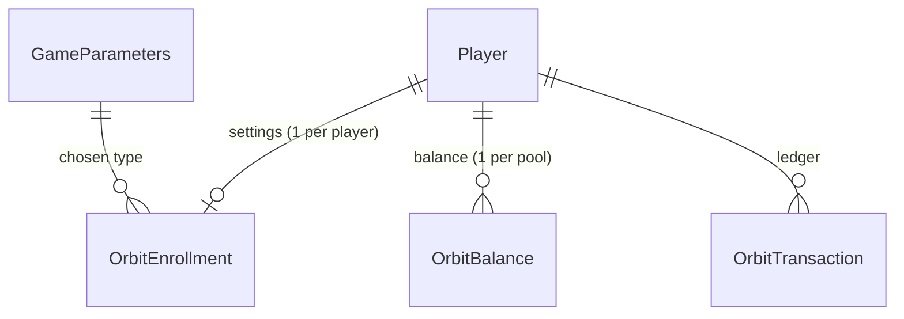
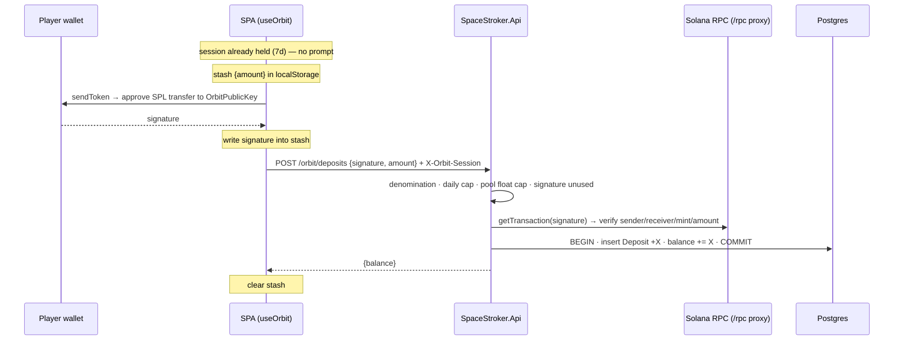
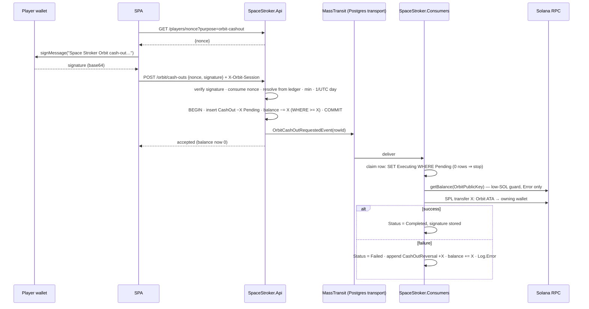

# Space Stroker — "Orbit (1/3) — Custodial Orbit Wallet" — Implementation Spec

> **Status: SHIPPED to `release/orbit` (2026-07-31)** — merged via `feature/orbit-custodial-wallet`;
> **not on `main`** until #122 and #123 join the train. Distilled into
> `../features/orbit-custodial-wallet.md`, which also records what shipped differently.
>
> Originally re-refined via Trello card
> [Orbit (1/3) — custodial Orbit wallet: deposits, balance ledger, cash-out + design pass](https://trello.com/c/R4Qe0jxX)
> (2026-07-30). Product decisions for the whole epic live on the umbrella card
> [Orbit #118](https://trello.com/c/yxwdNTrb) — **read it and its four comments first**.
> Repos affected: `monkify-backend`, `monkify-front`, and this doc in `monkify-meta`.
>
> **Purpose:** Give a player a house-held **Orbit balance** — funded by fixed on-chain USDC deposits,
> tracked by an append-only ledger, protected by wallet-ownership proof, and withdrawable on demand.
> This is the **money foundation only**: nothing bets yet. Child 2
> ([#122](https://trello.com/c/h7MF4Oky)) spends this balance; child 3
> ([#123](https://trello.com/c/NIH7XFHi)) notifies on it.
>
> ⚠️ **This spec supersedes the archived one** at git tag `archive/orbit-custodial-wallet-preop`
> (`monkify-meta` `84afddf`), which was written against the pre-operator-removal world. Where the two
> disagree, this one wins. §16 lists what changed and why.

---

## 1. Summary

Today a paid bet is funded by a per-round on-chain SPL transfer signed by the player's own wallet
(`RegisterBetHandler` → `ISolanaService.ValidateBetPayment`). There is **no** notion of a player
balance held by the house — `Player` carries a wallet, a display name, `LastSeenAt` and the two
self-exclusion columns, and nothing else. Orbit introduces one.

| Concern | Today | After this card |
| --- | --- | --- |
| Player money at rest | none — every stake comes straight from the wallet | an **Orbit balance** per `(OrbitAccount, MintAddress, PlayerId)` pool |
| Auditability | `Bet` + the unified `TransactionLog`, per bet | append-only **`OrbitTransaction`** ledger, authoritative for the balance |
| House key material | one bet/payout keypair in `GeneralSettings:Operator:Token` | **plus** a separate Orbit keypair in `…:Token:Orbit` |
| Who may act for a wallet | player endpoints are public; a write proves ownership per action (`WalletSignature`) | a **stateless HMAC Orbit session** for reads, **plus** a fresh purpose-scoped signature on every money movement |
| Game-type eligibility | `Active` | **plus** `GameParameters.AllowOrbit` |

Three money paths ship here:

| Path | Direction | Host | Ledger row |
| --- | --- | --- | --- |
| **Deposit** | player wallet → Orbit account (client-signed transfer, backend verifies it) | API | `Deposit` `+X` |
| **Cash-out** | Orbit account → player wallet (house-signed) | API accepts + **reserves**, **Consumers executes** | `CashOut` `−X` |
| **Cash-out failure** | nothing moves | Consumers | `CashOutReversal` `+X` |

`BetDebit`, `WinCredit` and `Refund` are **defined in the enum but never written** by this card —
they are #122's. Defining them now keeps #122 free of a second migration.

---

## 2. Constraints (MANDATORY)

From `monkify-meta/constraints.md` (full list there):

- **Worktree-per-repo §2:** work lives in `.worktrees/orbit-custodial-wallet/<repo>`; the hubs stay on
  `main`. Branch `feature/orbit-custodial-wallet` in all three repos — **already created and pushed**
  (2026-07-30 restart), so do **not** re-run the pre-flight/create step.
- **Unit tests §3:** update/add in `SpaceStroker.Tests`; run via `scripts/run_tests.bat` (never a bare
  `dotnet test` — `ProductionSessions` is a slow Monte-Carlo suite). Report changed tests at the end.
- **Integration test §3 (mandatory — this card is a `Feature`):** a happy-path test in
  `SpaceStroker.Tests.Integration` (Testcontainers), **plus a second for the failed-transfer reversal**
  (a "particularly complex flow"). Run via `scripts/run_integration_tests.bat`. See §11.2.
- **EF mapping §4:** inline in `SpaceStrokerDbContext.OnModelCreating`; no `IEntityTypeConfiguration`.
- **Migrations §4:** under `SpaceStroker.Infrastructure/Migrations/`; applied only by
  `SpaceStroker.Consumers` at startup. Never hand-edit the model snapshot.
- **Secrets §1:** the committed `spacestrokersettings.json` gets **mock-only** Orbit key material
  (`MOCK_ORBIT_*`) and a **mock session secret**. Never log an Orbit private key, a session token, a
  session secret, or a nonce signature.
- **Vague messaging §6 (rewritten post-operator-removal):** a bad signature, an unknown nonce and a
  replayed nonce are **indistinguishable** to the caller — reuse `ErrorMessages.SelfExclusionRequestInvalid`'s
  discipline via a new Orbit-scoped message. Unknown/ineligible game types stay vague. The **float-cap**
  refusal is deliberately vague (§6.4). Limit refusals that are ordinary game state (below minimum
  cash-out, already cashed out today) are **clear** — they are not the vague-auth path.
- **Host split §8:** the API stays stateless and never moves money — it only *reserves*. Every SPL
  transfer, the reconciliation job and the low-SOL guard live in `SpaceStroker.Consumers`.
- **⚠️ Ops (not code):** the new `/orbit/*` endpoints carry base58/base64 signatures in POST bodies,
  which is exactly what the priority-900 Cloud Armor OWASP rule false-positives on
  (`cloud-armor-waf-blocks-crypto-payloads`). They also need their own `AspNetCoreRateLimit` rules
  (§5.4). Funding the mainnet Orbit account with USDC and SOL is an **ops step for the user** — never
  done from here (`constraints.md` §5).

---

## 3. Resolved product decisions

Answer mode during re-refinement: **short**. Decisions 1-9 are this card's (Trello #121); 10-18 are
inherited from #118 and repeated because they are load-bearing here.

| # | Decision |
| --- | --- |
| 1 | **Deposit credit is session-only — no second signature.** ⚠️ **Amends #118 decision 5.** A deposit already carries a wallet-signed on-chain SPL transfer, and `ValidateIncomingTransfer` checks mint, exact amount, receiver = the Orbit account, **sender = the session wallet**, and signature-not-reused. Someone without the private key cannot produce that transfer, so an extra `signMessage` proves nothing and costs a wallet round-trip — a full app-hop on mobile — mid-deposit. **Cash-out keeps its signature**: nothing on-chain exists at request time to stand in for it. |
| 2 | **The session is a STATELESS HMAC token**, not a Redis entry: `wallet` + expiry signed with a new config secret, TTL **7 days**, carried as `X-Orbit-Session`. Chosen over an opaque Redis token because it survives a Redis flush and costs no lookup. ⚠️ Two consequences: a **new secret** to provision (§5.2), and **no revocation** — see decision 9. |
| 3 | **A settings change that moves money is signature-gated; the rest is session-only.** `PATCH /orbit/settings` needs only the session for `gameParametersId` and `cashOutAtThreshold`, but **disabling** an enabled enrolment triggers the forced cash-out and therefore demands the same `orbit-cashout` signature as a manual cash-out. Keeps the rule honest: *money never moves on a session alone.* |
| 4 | **Self-exclusion disables Orbit and forces the cash-out, wired in THIS slice.** `SetSelfExclusionHandler` flips the enrolment off and reserves a `ForcedOnSelfExclusion` cash-out (exempt from the daily limit); the enrolment's `GameParametersId` and `CashOutAtThreshold` are **preserved** so a lapsed timed exclusion resumes in one tap. Chosen over deferring to #122 because cash-out lives here — otherwise `main` carries a window where a self-excluded player's custodial gambling balance sits parked. |
| 5 | **Per-pool keying ships; the withdraw-from-an-old-pool UI does not.** Balances and ledger rows carry their `(OrbitAccount, MintAddress)` pool from day one and reconciliation runs **per pool**; the cash-out path can target a superseded pool. `GET /orbit` returns only the **configured** pool. If the account or mint ever changes, surfacing the old balance is a small follow-up card against data that is already correct. |
| 6 | **Both orphaned-deposit recoveries ship** — a `localStorage` pending-deposit stash auto-resubmitted on the next boot/modal open, **plus** a manual "recover a deposit" field. Both post the same signature-idempotent endpoint. Side effect: a raw transfer sent outside the app **is** creditable when it is exactly 1/5/10 to the Orbit account from the session wallet, so #118's manual-recovery carve-out shrinks to odd amounts. |
| 7 | **The design pass is NOT re-run** (#118 decision 14). Orbit modal → **variant A** (one column); header two-balance cluster → **variant A** (stacked `WALLET` / `ORBIT` rows); first-win upsell → **variant B** (built in #123). Mockups: <https://claude.ai/code/artifact/585a0677-f0b1-4d3a-bca0-54dbcb0b30d1>. Chrome is #124's **system tier**, hand-rolled here — Orbit becomes the reference implementation #124 later extracts a shared shell from. |
| 8 | **#124's two overlay tiers are written into `conventions/frontend.md` as part of this work** (#118 decision 15) — both #121 and #124 claim they are recorded there and they are **not**. See §7.6. |
| 9 | **No feature flag.** All three Orbit cards merge to `main` before anything deploys (confirmed with the user 2026-07-30). ⚠️ Between this merge and #123's, `main` carries a visible Orbit surface whose enable toggle has no engine behind it — **expected**, including in the local Docker verification at the end of `/monkify-implement-feature`. |
| 10 | **The Orbit keypair lives in `GeneralSettings:Operator:Token:Orbit`** — the only home operator-removal left standing. Rotation is a redeploy, exactly as for the payout key. Still a **separate keypair** from the bet/payout wallet: float must stay separable from pot money or "player balances vs on-chain balance" is not checkable, and a same-account transfer confirms as an on-chain **no-op** (the prod "sent less tokens than informed" incident). |
| 11 | **The custodial statement is its own append-only `OrbitTransaction` table**, not an extension of the unified `TransactionLog` — different question, key and lifecycle; folding it in would need `Signature` nullable plus a `Status` column on the table every stats aggregate and `BetDomainService` path reads. |
| 12 | **The ledger is authoritative; the column self-heals.** Money-moving operations recompute from `SUM(OrbitTransaction.Amount)`; a disagreeing `OrbitBalance.Amount` is corrected to the ledger and an `Error` is logged. Fail-closed would freeze real funds over one bad row. |
| 13 | **Debits are an atomic conditional update** (`ExecuteUpdateAsync` with `WHERE Amount >= x`); zero rows affected ⇒ insufficient funds. The balance can never go negative. **Debit before transfer, always** — a transfer signed first by a debit-loser is money already gone. |
| 14 | **Deposits are fixed 1 / 5 / 10**, ≤ 10 per deposit, ≤ 100 per UTC day; manual cash-out **1 per UTC day** and ≥ the minimum. Threshold, forced-on-disable and forced-on-self-exclusion cash-outs are **exempt** from the daily limit — a rate limit must never trap funds. |
| 15 | **Cash-out only ever pays the owning wallet.** No caller-supplied destination exists in the request contract at all. |
| 16 | **House pays all SOL fees / ATA rent** (the Orbit keypair is fee payer). Charging players would need a SOL→USDC price the codebase deliberately has no oracle for. **Cash-out is free** — the shipped 0.5% per-win crypto cut is the only commission, and taxing the withdrawal too would mean someone who deposits 10, never wins and withdraws gets back less than 10. |
| 17 | **Limits (conservative launch profile):** minimum cash-out **1 USDC**, **per-pool** float cap **1,000 USDC**, minimum SOL guard **0.02** **per Orbit account**. All ordinary config, tunable without a code change. |
| 18 | **`AllowOrbit` is config-driven per game type** (`DefaultGameSettings`) with an admin-portal checkbox at create time, reaching live rows via a name-matched `ExecuteUpdate` self-heal. Seeded `true` for Cosmic Sprint + Beast Mode, `false` for Space Jackpot — on a 24h lottery an auto-bet locks funds for a day. Chosen over hardcoding type names, which operator-removal had just finished un-hardcoding. |

---

## 4. Data model

### 4.1 Entity / column changes

**`SpaceStroker.Domain/Games/Entities/GameParameters.cs`** — eligibility flag:

```csharp
// Whether this game type may be auto-played by Orbit (#122). Config-driven for seeded types
// (DefaultGameSettings.AllowOrbit) and admin-settable at creation; never editable afterwards, because
// the portal is deactivate-or-create. Seeded true for Cosmic Sprint and Beast Mode, false for
// Space Jackpot.
public bool AllowOrbit { get; set; }
```

**New — `SpaceStroker.Domain/Orbit/Entities/OrbitEnrollment.cs`** (settings; one row per player):

```csharp
public class OrbitEnrollment : TableEntity
{
    public Guid PlayerId { get; set; }
    public Player Player { get; set; }

    public bool Enabled { get; set; }
    public Guid? GameParametersId { get; set; }        // the ONE chosen Orbit game type (#122 uses it)
    public GameParameters? GameParameters { get; set; }
    public decimal? CashOutAtThreshold { get; set; }   // null = no threshold; >= MinimumCashOut

    // #123 fills this; created here so slice 3 needs no migration.
    public string? TelegramChatId { get; set; }
}
```

> **Not pool-keyed on purpose.** An enrolment is a *preference* (which game type, what threshold), not
> money. Preferences must survive a pool change untouched — that is exactly decision 4's carve-out for
> self-exclusion, and the same reasoning applies to a mint rotation.

**New — `SpaceStroker.Domain/Orbit/Entities/OrbitBalance.cs`** — the hot row every atomic conditional
debit contends on, kept deliberately narrow:

```csharp
public class OrbitBalance : TableEntity
{
    // The POOL key. OrbitAccount is the configured Orbit public key; MintAddress the token it holds.
    // Together they identify the on-chain account this balance is a claim against, so reconciliation
    // is SUM(balance) per pool vs THAT account's ATA — not one unfalsifiable global aggregate. A
    // config change starts a new pool at zero and leaves the old one intact and withdraw-only.
    public string OrbitAccount { get; set; }
    public string MintAddress { get; set; }
    public Guid PlayerId { get; set; }

    public decimal Amount { get; set; }
}
```

**New — `SpaceStroker.Domain/Orbit/Entities/OrbitTransaction.cs`** (append-only ledger, same pool key):

```csharp
public class OrbitTransaction : TableEntity
{
    public string OrbitAccount { get; set; }
    public string MintAddress { get; set; }
    public Guid PlayerId { get; set; }

    public OrbitTransactionType Type { get; set; }
    // SIGNED: credits positive, debits negative. The balance is SUM(Amount) over ALL rows —
    // Status never filters the sum (see §4.5). This is what makes the ledger trivially auditable.
    public decimal Amount { get; set; }
    public OrbitTransactionStatus Status { get; set; }
    public OrbitCashOutSource? Source { get; set; }   // CashOut rows only
    public string? Signature { get; set; }            // the on-chain signature (named per remove-operators)
    public string? Reason { get; set; }
    public Guid? BetId { get; set; }                  // #122 only; always null here
}
```

**New value objects** (`SpaceStroker.Domain/Orbit/ValueObjects/`):

```csharp
public enum OrbitTransactionType { Deposit = 1, CashOut = 2, CashOutReversal = 3,
                                   BetDebit = 4, WinCredit = 5, Refund = 6 }

// Only CashOut rows use anything but Completed. Deposits are Completed on write.
public enum OrbitTransactionStatus { Completed = 1, Pending = 2, Executing = 3, Failed = 4 }

// Manual is capped at 1/UTC day. Everything else is EXEMPT (decision 14) — a rate limit must never
// trap funds. Threshold is written by #122; the two Forced* values are written by this card.
public enum OrbitCashOutSource { Manual = 1, Threshold = 2, ForcedOnDisable = 3,
                                 ForcedOnSelfExclusion = 4 }
```

### 4.2 EF configuration (inline, in `SpaceStrokerDbContext.OnModelCreating`)

Add three `DbSet`s beside the existing ten (`SpaceStrokerDbContext.cs:15-24`):

```csharp
public DbSet<OrbitEnrollment> OrbitEnrollments { get; set; }
public DbSet<OrbitBalance> OrbitBalances { get; set; }
public DbSet<OrbitTransaction> OrbitTransactions { get; set; }
```

Extend the existing `GameParameters` block (`:33-50`) with one property, and add three blocks:

```csharp
// inside modelBuilder.Entity<GameParameters>(...)
builder.Property(x => x.AllowOrbit).IsRequired().HasDefaultValue(false);

modelBuilder.Entity<OrbitEnrollment>(builder =>
{
    builder.HasKey(x => x.Id);
    builder.Property(x => x.Enabled).IsRequired().HasDefaultValue(false);
    builder.Property(x => x.CashOutAtThreshold).HasPrecision(18, 9);
    builder.Property(x => x.TelegramChatId).HasMaxLength(50);
    builder.HasOne(x => x.Player).WithMany().HasForeignKey(x => x.PlayerId).OnDelete(DeleteBehavior.Restrict);
    builder.HasOne(x => x.GameParameters).WithMany().HasForeignKey(x => x.GameParametersId)
           .IsRequired(false).OnDelete(DeleteBehavior.Restrict);
    builder.HasIndex(x => x.PlayerId).IsUnique();
});

modelBuilder.Entity<OrbitBalance>(builder =>
{
    builder.HasKey(x => x.Id);
    builder.Property(x => x.OrbitAccount).IsRequired().HasMaxLength(50);
    builder.Property(x => x.MintAddress).IsRequired().HasMaxLength(50);
    builder.Property(x => x.Amount).HasPrecision(18, 9).IsRequired();
    // One balance row per player per pool. This is the row the conditional debit targets.
    builder.HasIndex(x => new { x.OrbitAccount, x.MintAddress, x.PlayerId }).IsUnique();
});

modelBuilder.Entity<OrbitTransaction>(builder =>
{
    builder.HasKey(x => x.Id);
    builder.Property(x => x.OrbitAccount).IsRequired().HasMaxLength(50);
    builder.Property(x => x.MintAddress).IsRequired().HasMaxLength(50);
    builder.Property(x => x.Type).IsRequired();
    builder.Property(x => x.Status).IsRequired();
    builder.Property(x => x.Amount).HasPrecision(18, 9).IsRequired();
    builder.Property(x => x.Signature).HasMaxLength(100);
    builder.Property(x => x.Reason).HasMaxLength(300);
    // The ledger-sum query: every read is "this player, this pool".
    builder.HasIndex(x => new { x.OrbitAccount, x.MintAddress, x.PlayerId });
    builder.HasIndex(x => x.Status);
    // Deposit idempotency at the DB layer. Postgres treats multiple NULLs as DISTINCT, so cash-out
    // rows (signature null until executed) never collide — the same trick as Bet.ExclusiveChoice.
    builder.HasIndex(x => x.Signature).IsUnique();
});
```

> **⚠️ `OrbitBalance` has no navigation properties on purpose.** `SpaceStrokerDbContext` is
> `NoTracking` by default (`OnConfiguring`, `:26-30`) and the debit path is `ExecuteUpdateAsync` — a
> load-mutate-`SaveChanges` on this row would silently persist nothing (the known
> `dbcontext-notracking-updates` trap that `SetSelfExclusionHandler` works around with `AsTracking()`).

### 4.3 Migration

```bash
cd monkify-backend/src
dotnet ef migrations add AddOrbitCustodialWallet --project SpaceStroker.Infrastructure --startup-project SpaceStroker.Consumers
```

One migration covering `GameParameters.AllowOrbit` and the three new tables with their indexes.
Applied only by `SpaceStroker.Consumers` at startup.

### 4.4 ER diagram



### 4.5 The balance invariant

> **`OrbitBalance.Amount == SUM(OrbitTransaction.Amount)` for that `(OrbitAccount, MintAddress,
> PlayerId)` — over ALL rows, with no status filter.**

`Status` describes a cash-out's *execution*, never its *accounting*. A failed cash-out is **not**
removed or zeroed; it stays `Failed` at `−X` and is cancelled by an appended `CashOutReversal` at
`+X`. That keeps the ledger genuinely append-only and makes reconciliation a single `SUM`.

The second invariant, checked by §6.10: for each pool, `SUM(OrbitBalance.Amount) ≤` the on-chain SPL
balance of `OrbitAccount` for `MintAddress`. **`≤`, not `==`** — the house may pre-fund the account
with SOL-fee float and spare USDC. Only `>` is an error: that means custodied money is missing.

---

## 5. Configuration

### 5.1 `GeneralSettings:Operator:Token:Orbit` (new block)

`SpaceStroker.Domain/Configs/Entities/OrbitSettings.cs` (new), referenced from `TokenSettings`:

```csharp
public OrbitSettings Orbit { get; set; } = new();
```

```csharp
[ExcludeFromCodeCoverage]
public class OrbitSettings
{
    // The Orbit custody account — a SEPARATE keypair from TokenOwner* on TokenSettings. Player
    // deposits land here; cash-outs and (from #122) auto-bet stakes are signed from here. MOCK values
    // in the committed config; real values injected via Secret Manager in production. Blank PublicKey
    // => Orbit is not configured and every /orbit endpoint returns the vague unavailable message.
    public string PublicKey { get; set; }
    public string PrivateKey { get; set; }

    // HMAC key for the stateless Orbit session token (decision 2). MOCK in committed config.
    public string SessionSecret { get; set; }

    // ⚠️ DO NOT initialize this to [1,5,10] here. ConfigurationBinder APPENDS to a pre-initialized
    // array, so a C# initializer PLUS the config entry yields [1,5,10,1,5,10] — six deposit buttons.
    // That shipped on the archived build, was invisible to handler tests (they read the array back)
    // and was caught only in QA. Bind into an uninitialized target and expose the fallback separately.
    public decimal[] DepositOptions { get; set; }

    public decimal[] AvailableDepositOptions
        => DepositOptions is { Length: > 0 } ? DepositOptions : [1m, 5m, 10m];

    public decimal MaxDepositPerTransaction { get; set; } = 10m;
    public decimal MaxDepositPerDay { get; set; } = 100m;
    public decimal MinimumCashOut { get; set; } = 1m;
    // PER POOL (decision 17) — it bounds the one (account, mint) pool that can actually be drained.
    public decimal PoolFloatCap { get; set; } = 1000m;
    // PER ORBIT ACCOUNT — each keypair pays its own fees.
    public decimal MinimumSolBalance { get; set; } = 0.02m;
    public int SessionTtlDays { get; set; } = 7;
    public int CashOutSweepStaleMinutes { get; set; } = 10;
}
```

`SpaceStroker.Common/spacestrokersettings.json`, inside `GeneralSettings.Operator.Token`
(**mock only**, per `constraints.md` §1):

```json
"Orbit": {
    "PublicKey": "MOCK_ORBIT_PUBLIC_KEY",
    "PrivateKey": "MOCK_ORBIT_PRIVATE_KEY",
    "SessionSecret": "MOCK_ORBIT_SESSION_SECRET",
    "DepositOptions": [ 1, 5, 10 ],
    "MaxDepositPerTransaction": 10,
    "MaxDepositPerDay": 100,
    "MinimumCashOut": 1,
    "PoolFloatCap": 1000,
    "MinimumSolBalance": 0.02,
    "SessionTtlDays": 7,
    "CashOutSweepStaleMinutes": 10
}
```

### 5.2 ⚠️ Deploy plumbing for the two new secrets (not optional)

`Orbit:PrivateKey` and `Orbit:SessionSecret` are real secrets. Per the `solana-rpc-api-key` precedent
they must reach **three** places or the deployed app silently runs on the mock values:

1. `monkify-meta/deploy/secrets.<env>.json` — the unversioned local source.
2. The **two hard-coded secret-id lists** in `monkify-meta/deploy/terraform/workload/main.tf` (the
   tool owns the containers; Terraform only binds IAM).
3. `EnvNaming.DerivedIds()` in `SpaceStroker.Deploy`, or the `validate` command's id-cap assertion
   passes vacuously (the `gcp-dashboards` finding).

### 5.3 Seeding

`DefaultGameSettings` gains `public bool AllowOrbit { get; set; }`. The committed
`spacestrokersettings.json` sets it `true` on **Cosmic Sprint** and **Beast Mode**, `false` on
**Space Jackpot**. `ToGameParameters` (`Consumers/Program.cs:278-300`) carries it onto the row.

### 5.4 Rate limiting (`spacestrokersettings.json` → `IpRateLimiting.GeneralRules`)

New rules alongside the existing `/rpc` and `/solana/*` entries. Money endpoints are cheap to call and
expensive to abuse:

```json
{ "Endpoint": "*:/orbit/session",   "Period": "1m", "Limit": 20 },
{ "Endpoint": "*:/orbit/deposits",  "Period": "1m", "Limit": 20 },
{ "Endpoint": "*:/orbit/cash-outs", "Period": "1m", "Limit": 10 },
{ "Endpoint": "*:/orbit/settings",  "Period": "1m", "Limit": 20 },
{ "Endpoint": "*:/orbit",           "Period": "1m", "Limit": 60 }
```

⚠️ Per `rate-limiter-keying`: the **more specific rule wins** (measured), `ForwardLimit = 2` and
`RealIpHeader = ""` are already set so these are genuinely per-IP, and `*:/orbit` must **not** be
relied on to cover the sub-paths. **These five rules will trip #112's exact-set assertion in
`RateLimitSettingsTests` — by design.** Update that test deliberately and keep its guard that the
**bet path never gains a rule**.

> **No launch-token gating.** Operator-removal deleted `LaunchTokenValidationMiddleware`'s player
> surface; `/orbit/*` is **public**, and the Orbit session + per-action signature are the **only**
> gate. This is why decision 1 keeps a signature on cash-out rather than trusting the session alone.

---

## 6. Backend behaviour

All handlers live under `SpaceStroker.Infrastructure/Handlers/Orbit/<Action>/`, following the shipped
one-folder-per-handler layout (`Handlers/Players/GetWalletNonce/`).

### 6.1 Wallet-ownership proof — reuse, don't rebuild

**No new nonce endpoint.** `GET /players/nonce?wallet=&purpose=` is already public and shipped
(`PlayersController.cs:75`, `GetWalletNonceHandler`). Orbit adds two purposes to
`WalletNoncePurpose` (`GetWalletNonceRequest.cs:11-18`):

```csharp
public const string OrbitSession = "orbit-session";
public const string OrbitCashOut = "orbit-cashout";

public static bool IsKnown(string? purpose)
    => purpose == SelfExclusion || purpose == Preferences
    || purpose == OrbitSession  || purpose == OrbitCashOut;
```

The nonce is Redis-held with a **5-minute** TTL (`CacheHelper.GenerateWalletNonceCacheSettings`), is
keyed by purpose **and** wallet, and is consumed **only on a successful verify** — so a mistyped or
rejected signature does not force a fresh round-trip. Signatures are **base64** (`WalletSignature.IsValid`
does `Convert.FromBase64String`; the frontend sends `toBase64(signed)`) — **not** base58, which the
archived spec got wrong.

Canonical messages, byte-identical between C# and TS (the shipped convention — see
`SetSelfExclusionHandler.BuildMessage` and `useSelfExclusion.ts:43-46`):

```
Space Stroker Orbit session          |   Space Stroker Orbit cash-out
Wallet: <wallet>                     |   Wallet: <wallet>
Nonce: <nonce>                       |   Nonce: <nonce>
```

> **The cash-out message deliberately binds no amount.** The amount is always the whole balance,
> resolved server-side from the ledger at request time, and the destination is always the owning
> wallet. There is nothing an attacker gains by replaying it inside the 5-minute window that they
> could not achieve by simply asking for the same cash-out — and the nonce is single-use anyway.

### 6.2 The Orbit session (`POST /orbit/session`)

`CreateOrbitSessionHandler`, body `{ wallet, nonce, signature }`:

1. Orbit configured? (`OrbitSettings.PublicKey` non-blank.) No ⇒ vague unavailable.
2. `TryGet` the cached nonce for `(orbit-session, wallet)`; missing or mismatched ⇒ vague reject.
3. `WalletSignature.IsValid(wallet, BuildSessionMessage(wallet, nonce), signature)` ⇒ vague reject on
   failure. **Only now** `_cache.Remove(...)` — mirroring `SetSelfExclusionHandler:70-71`.
4. **Upsert the `Player`** by `ExternalPlayerId == wallet` (`AsTracking()`, because the context is
   `NoTracking`), touching `LastSeenAt` — a player may now exist before ever betting. This is exactly
   what `SetSelfExclusionHandler:78-91` already does.
5. Mint and return the token (§6.3).

**Stateless token format** (`OrbitSessionService`, `Infrastructure/Services/Orbit/`):

```
payload = "{wallet}|{expiresAtUnixSeconds}"
token   = Base64Url(payload) + "." + Base64Url(HMACSHA256(payload, OrbitSettings.SessionSecret))
```

Validation: split on `.`, recompute the HMAC, compare with **`CryptographicOperations.FixedTimeEquals`**
(never `==` — a timing oracle on a money surface), then check the expiry. Returns
`{ Wallet }` or null. **Never logged.**

**`IOrbitSessionAccessor`** (API-scoped, mirroring how `ILaunchContext` used to be wired): an action
filter reads `X-Orbit-Session`, validates it, and exposes `{ Wallet, PlayerId }`. Every other
`/orbit` endpoint returns the vague message when it is absent, malformed, or expired.

> **⚠️ Accepted: the session cannot be revoked.** A self-excluded player keeps a valid token until it
> expires (≤ 7 days). This is contained, not dangerous: §6.6 re-checks `Player.IsSelfExcluded` on
> every settings write, `PATCH` cannot re-enable while excluded, and **every money movement needs a
> fresh signature** — so the worst a stale session can do is read a balance. Document it; do not add
> a revocation list, which would reintroduce the Redis dependency decision 2 removed.

### 6.3 `GET /orbit`

Everything the modal and the header cluster need in one call:

```jsonc
{
  "balance": 12.5,
  "tokenLabel": "USDC",
  "tokenDecimals": 6,
  "mintAddress": "…",
  "orbitReceiver": "…",          // OrbitSettings.PublicKey — the deposit destination
  "depositOptions": [1, 5, 10],
  "minimumCashOut": 1,
  "canCashOutToday": true,
  "enabled": false,
  "gameParametersId": null,
  "cashOutAtThreshold": null,
  "selfExcluded": false,          // blocks the enable toggle in the UI
  "eligibleGameTypes": [ { "id": "…", "name": "Cosmic Sprint", "requiredAmount": 1 } ],
  "totalWonViaOrbit": 0,          // SUM of WinCredit rows — always 0 until #122
  "orbitBetsPlaced": 0,           // COUNT of BetDebit rows — always 0 until #122
  "pausedReason": null            // "InsufficientFunds" when enabled && balance < required stake
}
```

`eligibleGameTypes` = active types with `AllowOrbit == true`. The handler **recomputes the balance
from the ledger and self-heals the column** (§6.7) before returning, for the **configured** pool only
(decision 5).

### 6.4 `POST /orbit/deposits`

Body `{ signature, amount }`. **Session only — no wallet signature** (decision 1). Order matters, so
a bad request never costs an RPC call:

1. `amount` must be one of `AvailableDepositOptions` **and** ≤ `MaxDepositPerTransaction`.
2. Sum today's `Deposit` rows (UTC day) for this player+pool; `+ amount` ≤ `MaxDepositPerDay`.
3. Pool float: `SUM(OrbitBalance.Amount)` for this pool `+ amount` ≤ `PoolFloatCap`. Over ⇒ **vague**
   refusal + `Log.Error` (a capacity signal the operator must see).
4. Signature not already used: `OrbitTransactions.Any(x => x.Signature == signature)` ⇒ return the
   current balance **without** a second credit — **idempotent, not an error**. The auto-resubmit stash
   hits this constantly.
5. `ISolanaService.ValidateIncomingTransfer(signature, senderWallet: session wallet,
   receiverPublicKey: OrbitSettings.PublicKey, mint, decimals, expectedAmount: amount)` (§6.8).
6. In **one** `IDbContextTransaction`: insert the `Deposit` row (`+amount`, `Completed`, signature),
   then upsert `OrbitBalance` (`ExecuteUpdateAsync` `Amount += amount`; zero rows ⇒ insert). A `23505`
   on the unique signature index means a concurrent duplicate — swallow it and return the current
   balance, exactly as step 4 would have.

### 6.5 `POST /orbit/cash-outs`

Body `{ nonce, signature }` — **session + a fresh `orbit-cashout` signature** (decision 1). No amount
and no destination exist in the contract at all (decision 15). Verify the signature **first** (§6.1),
then in one `IDbContextTransaction`:

1. Recompute the ledger sum; self-heal the column if they differ (§6.7).
2. `amount` = that sum. Reject if `< MinimumCashOut` with a **clear** reason — this is game/limit
   state, not an auth failure, so the vague rule does not apply.
3. Reject if a `CashOut` row with `Source = Manual` already exists for this player+pool in the current
   UTC day. `Threshold` / `ForcedOn*` rows are **not** counted (decision 14).
4. Insert the `CashOut` row: `−amount`, `Status = Pending`, `Source = Manual`, signature null.
5. `ExecuteUpdateAsync` on `OrbitBalance` `WHERE Amount >= amount` → `Amount -= amount`. **Zero rows
   ⇒ roll back the whole transaction** and return insufficient funds.
6. Commit, then `IMessageBus.PublishEventAsync(new OrbitCashOutRequestedEvent(orbitTransactionId))`.

The balance reads `0` the instant the request is accepted — the money is **reserved**, not merely
promised. This is what stops #122's auto-bet spending money already owed to an accepted cash-out.

### 6.6 `PATCH /orbit/settings`

Body `{ enabled?, gameParametersId?, cashOutAtThreshold?, nonce?, signature? }`, PATCH-style
allow-list like `UpdatePlayerPreferences`.

| Field changing | Auth |
| --- | --- |
| `gameParametersId`, `cashOutAtThreshold`, `enabled: true` | session only |
| `enabled: false` on a currently-enabled enrolment | session **+ a fresh `orbit-cashout` signature** (decision 3) |

Validation:

- `gameParametersId` must be an **active** type with `AllowOrbit == true`. Anything else ⇒ vague.
- `cashOutAtThreshold` must be null or `>= MinimumCashOut`.
- `enabled = true` requires a `gameParametersId` (a live enrolment with no target is meaningless) and
  is **refused while `Player.IsSelfExcluded(now)`** (decision 4).
- Disabling reserves a `ForcedOnDisable` cash-out for the whole balance via the same §6.5 steps 1-6,
  **exempt from the daily limit**, and skips it when the balance is zero.

**No behaviour is attached to `Enabled` in this card** beyond the above — #122 reads it.

### 6.7 Ledger-vs-column drift (shared helper)

`OrbitLedgerService.ResolveBalance(playerId, pool)` in `Infrastructure/Services/Orbit/`:

```
ledger = SUM(OrbitTransaction.Amount)     -- all rows for (pool, player), NO status filter (§4.5)
column = OrbitBalance.Amount
if (ledger != column) {
    ExecuteUpdateAsync -> Amount = ledger
    Log.Error("Orbit balance drift for player {PlayerId} in pool {Account}/{Mint}: column {Column} != ledger {Ledger}. Column corrected.", …)
}
return ledger
```

Called by `GET /orbit`, the deposit handler, the cash-out handler and the reconciliation job. The
ledger always wins — fail-closed would freeze real funds over one bad row.

> **⚠️ `ExecuteUpdateAsync` does not run on the EF in-memory provider** (verified by probe on the
> archived build). This service's write paths — the atomic debit, the credit upsert, the drift
> self-heal — therefore have **no unit coverage by construction** and are proven only by the
> integration suite against real Postgres. §11.1 accounts for this; do not "fix" it with a fake.

### 6.8 `ISolanaService` additions

Three new members (`Infrastructure/Services/Solana/ISolanaService.cs`), implemented in `SolanaService`
under the same retry + one-shot-fallback + masked-logging discipline as the rest, and all added to
`FakeSolanaService`:

```csharp
// House-signed SPL transfer to an arbitrary wallet. This is the existing PRIVATE TransferTokens
// (SolanaService.cs:307) promoted to the interface — RefundTokens now delegates to it and keeps its
// refund-specific logging, so an Orbit cash-out never logs "Failed to refund wallet".
Task<string?> TransferTokensToWallet(string wallet, BetTransactionAmountResult amount, SolanaTokenDescriptor token);

// Deposit verification. The same pre/postTokenBalances comparison as ValidateBetPayment
// (SolanaService.cs:337) but parameterised instead of Bet-shaped: asserts the receiver gained exactly
// expectedAmount AND the sender lost it, for this mint.
Task<ValidationResult> ValidateIncomingTransfer(string signature, string senderWallet, string receiverPublicKey,
                                                string mintAddress, int decimals, decimal expectedAmount);

// Lamports/1e9 on the Orbit keypair, for the low-SOL guard. The dead SOL getBalance was deleted by
// frontend-helius-gateway, so this is a genuine re-add with exactly one purpose.
Task<decimal?> GetSolBalance(string publicKey);
```

Refactor `ValidateBetPayment` to call `ValidateIncomingTransfer` internally rather than duplicating
`GetAccountBalances` / the token-exchange validation — one verification path, one set of tests.

> **⚠️ `SolanaTokenDescriptor.SenderAccount` feeds `TokenProgram.Transfer`'s SOURCE, which must be a
> TOKEN ACCOUNT, not a wallet address.** The archived build's first cut passed the Orbit wallet — an
> invalid instruction that would only have failed on-chain, after money moved. `IOrbitAccountResolver`
> must **derive the Orbit ATA** for `(OrbitPublicKey, MintAddress)`, and a regression test must assert
> it matches the value the shipped config hard-codes for that owner+mint.

### 6.9 `OrbitCashOutConsumer` (Consumers)

Registered exactly like the existing eight (`Consumers/Program.cs:64-115`): `x.AddConsumer<…>()` plus
a `cfg.ReceiveEndpoint(nameof(OrbitCashOutConsumer), …)`.

1. **Claim the row atomically:** `ExecuteUpdateAsync` `SET Status = Executing WHERE Id = @id AND
   Status = Pending`. **Zero rows ⇒ return immediately** — another instance (or the sweep) owns it.
   This is what makes at-least-once bus delivery safe on a money transfer.
2. Build the Orbit `SolanaTokenDescriptor` via `IOrbitAccountResolver` (Orbit keypair from config,
   **ATA-derived** `SenderAccount` per §6.8, mint/decimals from `TokenSettings`).
3. **Low-SOL guard:** `GetSolBalance(OrbitSettings.PublicKey)`; below `MinimumSolBalance` ⇒ `Log.Error`
   and **still attempt the transfer** — a guard must never trap funds (decision 14).
4. `TransferTokensToWallet(owning wallet from the row's Player, amount, orbitDescriptor)`.
5. **Success:** `Status = Completed`, `Signature = <sig>`. **Failure (null):** `Status = Failed`,
   append a `CashOutReversal` row `+amount` (`Completed`), `ExecuteUpdateAsync` `Amount += amount` on
   the balance, `Log.Error`.

> **⚠️ The Consumers host resolves a DIFFERENT `FakeSolanaService` instance than the API host**
> (scoped vs the API's singleton). A test that needs the transfer to fail cannot reach it through the
> API's double — see §11.2.

### 6.10 `OrbitCashOutSweepJob` (Hangfire, hourly)

Modelled on `PendingRefundSweepJob`, registered in `ScheduleRecurringJobs` (`Program.cs:180-190`) as
`"0 * * * *"` plus `builder.Services.AddScoped<OrbitCashOutSweepJob>()`.

- Republish `OrbitCashOutRequestedEvent` for every row `Status = Pending` older than
  `CashOutSweepStaleMinutes` — these were never picked up, so re-driving them is safe.
- **Never republish an `Executing` row.** `Log.Error` naming the row id for manual resolution instead:
  an `Executing` row may have a transfer in flight and re-driving it could pay twice — the one failure
  mode worth a human. **Hourly**, not the refund sweep's 12-hourly, because a player is actively
  waiting on a withdrawal.

### 6.11 `OrbitReconciliationJob` (Hangfire, every 6h)

Registered as `"0 */6 * * *"`. Read-only; logs, never mutates money.

1. Per `(pool, player)`: compare `SUM(OrbitTransaction.Amount)` with `OrbitBalance.Amount`; `Log.Error`
   on any mismatch (§6.7 fixes it on next use).
2. **Per pool — enumerated from `SELECT DISTINCT (OrbitAccount, MintAddress) FROM OrbitBalances`, not
   from config** — compare `SUM(OrbitBalance.Amount)` with
   `ISolanaService.GetTokenBalance(OrbitAccount, MintAddress, decimals)`. This is what keeps a
   **superseded** pool reconciled after a config change (decision 5): its on-chain account still holds
   real money. Log `Error` only when the on-chain figure is **less** than the sum (§4.5).

### 6.12 `AllowOrbit` seeding + self-heal

In the seeding block (`Consumers/Program.cs:220-275`), after the existing `AllowFreeBet` heal
(`:261-274`), add a **name → desired value** heal. Unlike `AllowFreeBet` this is not one env-derived
value, so it needs a small loop:

```csharp
// Self-heal: align the configured types' Orbit eligibility with config. Rows seeded before this
// feature are NOT recreated by the create-only block above, so patch them here. ExecuteUpdate: the
// DbContext is NoTracking by default, so load-mutate-SaveChanges would silently persist nothing.
// Safe to run forever — the admin portal is deactivate-or-create and cannot edit an existing type.
var orbitPatched = 0;
foreach (var config in defaults)
{
    orbitPatched += context.GameParameters
        .Where(x => x.Name == config.Name && x.AllowOrbit != config.AllowOrbit)
        .ExecuteUpdate(s => s.SetProperty(x => x.AllowOrbit, config.AllowOrbit));
}

if (orbitPatched > 0)
{
    cacheService.Remove(CacheHelper.GenerateActiveParametersCacheSettings());
    Log.Information("Patched {Count} default type(s) for AllowOrbit.", orbitPatched);
}
```

> **⚠️ Cache-shape gotcha — do not delete that `Remove`.** `GameParametersDto` gains `allowOrbit`, and
> `ActiveParameters` has a **12h TTL** (`CacheHelper.cs:13-14`). On the first boot after deploy the
> cached blob predates the field and would deserialize it as `false` for up to half a day. The
> `cacheService.Remove` fires on that same first boot (every row needs patching), which clears it. It
> looks redundant and is not.

### 6.13 Self-exclusion → forced cash-out (decision 4)

`SetSelfExclusionHandler` (`Handlers/Players/SetSelfExclusion/`), **after** `SaveChangesAsync` at
`:94`:

1. Load the player's `OrbitEnrollment`; if absent, done.
2. `ExecuteUpdateAsync` `Enabled = false`. **`GameParametersId` and `CashOutAtThreshold` are left
   untouched** — the money leaves, the preferences do not, so a lapsed timed exclusion resumes in one
   tap (decision 4).
3. If the resolved balance for the configured pool is `> 0`, reserve a cash-out via the §6.5 steps 1-6
   with `Source = ForcedOnSelfExclusion` — **exempt from the daily limit and from `MinimumCashOut`**
   (someone who asked to stop must not be told their money is too small to return).

No new endpoint. The exclusion request already carries its own `self-exclusion` signature, so this
inherits proof of ownership.

### 6.14 Admin: `AllowOrbit` on game-type creation

`GameTypeRequestBody` gains `AllowOrbit` (default false); `CreateGameTypeHandler` persists it and
**rejects `true` for a lottery type**. Deactivate-or-create is unchanged — there is no edit path, which
is precisely why the §6.12 self-heal cannot stomp an admin's choice.

---

## 7. Frontend behaviour

Design is **settled** (decision 7) — variant **A** for the modal, variant **A** for the header
cluster. No design pass is run.

### 7.1 Service + types

- **`src/types/orbit.ts`** (new) — `OrbitState`, `OrbitSession`, `OrbitSettingsPatch`,
  `OrbitEligibleType`, `OrbitPendingDeposit`.
- **`src/services/orbitService.ts`** (new) — reuses the axios instance and interceptors from
  `mainService.ts` (so the 401 path and `useBootRecovery` back-off apply unchanged) and attaches
  `X-Orbit-Session` on every call: `createOrbitSession`, `getOrbit`, `creditOrbitDeposit`,
  `requestOrbitCashOut`, `patchOrbitSettings`. The **nonce** comes from the existing
  `mainService.getWalletNonce(wallet, purpose)` — no new nonce call.
  `getOrbit` joins the `singleFlight` allow-list (`mainService.ts:46`) — it is a boot-path GET fired
  by both the header and the modal, exactly the shape `player-lockouts` added `singleFlight` for.

### 7.2 `useOrbit.ts` (new composable, module singleton)

Owns the session (persisted at `space-stroker.orbit-session.<wallet>`, cleared on disconnect, wallet
switch, or a 401 from an Orbit call), the reactive `orbit` state, and the actions.

- **Session acquisition** — `ensureSession()`: return the stored token if unexpired; otherwise fetch
  the `orbit-session` nonce, sign it (§7.3), post it, store the token. Never called on mount; only
  when the player opens the modal or presses SIGN IN on the header balance.
- **Deposit** — stash `{ signature: null, amount, wallet }` under
  `space-stroker.orbit-pending-deposit.<wallet>` **before** sending; call `sendToken`
  (`useConnection.ts:201`) with `orbitReceiver` as the destination; write the signature into the stash
  the moment it is known; POST it; clear the stash only on a successful response. **No signMessage
  prompt anywhere in this flow** (decision 1).
- **Resume** — on boot and on modal open, if a stash with a signature exists, re-POST it. The endpoint
  is idempotent, so a duplicate is harmless.
- **Manual recovery** — `creditOrbitDeposit(signature, amount)` straight from the modal field.
- **Cash-out** — fetch the `orbit-cashout` nonce, sign, POST, refresh state.
- **Disable** — same signature flow as cash-out when the enrolment is currently enabled; a plain PATCH
  otherwise.

### 7.3 Signing — reuse only, nothing net-new

✅ **The archived card's headline cost is retired.** `signMessage` is fully shipped on **both** paths:

| Path | How |
| --- | --- |
| **Desktop extension** | `useWallet().signMessage` — the pattern in `useDisplayNameSigning.ts:41,62`. |
| **Mobile deeplink** (Phantom / Solflare / Backpack) | `buildSignMessageDeeplink` / `parseSignMessageReturn` (`utils/mobileWalletProtocol.ts:210,232`) via `useMobileWallet.ts:293,317`, with the stash-and-resume hop `useSelfExclusion.ts:133-171` already demonstrates. ⚠️ `detectDeeplinkReturn` has **no separate `'signMessage'` case on purpose** — the wallet's return params are byte-identical to `signAllTransactions`, so it returns `'sign'` for both; the **stash** disambiguates. Do not "fix" this. |
| **Mobile in-app browser** | Injected provider — the desktop path applies. |
| **Embedded (iframe)** | **N/A** — Orbit is hidden when embedded. |

Signatures are sent **base64** (`toBase64(signed)`), matching `WalletSignature.IsValid`.

### 7.4 Header

`GameHeader.vue`:

- New **ORBIT** entry in the existing menu beside Settings · Stats · Fair · History, inside the
  `v-if="!isEmbedded"` block (`:280-281`), opening `OrbitModal`.
- New **`OrbitBalance.vue`** beside `TokenBalance.vue`, forming the **stacked two-row cluster**
  (`WALLET` / `ORBIT`, variant A). Without a session it renders the `SIGN IN` affordance — kept by
  explicit decision, because the balance is genuinely unreadable without ownership proof, so there is
  no number to show. Hidden when embedded, and hidden entirely when Orbit is not configured.
- ⚠️ The header already hides the wallet balance below 360px (`:113`) so the wallet/menu controls are
  not pushed off-screen. The second row must respect the same breakpoint discipline.

### 7.5 `OrbitModal.vue` (new, `components/orbit/`)

**Variant A — one column**: balance · fixed 1/5/10 deposits · cash out · auto-play settings ·
recover a deposit · won/bets counters, stacked in one scroll. No inert "Auto-play" tab advertising a
feature that does not work until #122 (the toggle itself is present and dead — decision 9).

Non-negotiables:

- `<Teleport to="#app">` — `GameHeader`'s root carries `backdrop-blur-md`, which makes it the
  containing block for `position: fixed` descendants; without the teleport the modal renders half
  off-screen (the shipped `fair-modal-off-screen` bug, recorded in `conventions/frontend.md`).
- Mobile is **always** `html.light-graphics` (`usePerfMode` short-circuits below `lg`), so no
  `backdrop-filter`, no `blur()`, no infinite animation. #124's chrome uses a **9px diagonal dither**
  backdrop, not a blur, for exactly this reason.
- Esc closes; backdrop dismissal via `useClickOutside`.
- ⚠️ Plain Tailwind, **not** `.btn-arcade` — `main.css` imports `arcade.css` *after*
  `@tailwind utilities`, so that class's `justify-content`/padding beat equal-specificity utilities
  (the `mobile-preset-keypad` finding, recorded in `conventions/frontend.md`).

### 7.6 `conventions/frontend.md` — write down #124's two overlay tiers (decision 8)

Add a **"Two overlay tiers"** section recording what today exists only on the #124 card and an
external URL:

- **System tier** — overlays the player opens themselves and reopens constantly (Settings, Provably
  Fair, Connect Wallet, **Orbit modal**, **header cluster**). Neutral hairline `1px --color-line`,
  4px radius, 36px titlebar (44px mobile), 18px body padding, sizes compact 380 / standard 520 /
  wide 720 / mobile 100%, void-55% + 9px dither backdrop, Esc.
- **Tutorial / help tier** — overlays that appear **unprompted** and are shown once then never again
  (Quick Tour, **#123's first-win upsell**). Black + 2px CRT-cyan frame.
- The test is **frequency, not subject matter**.

---

## 8. Flow diagrams

### 8.1 Deposit — one wallet prompt, not two



### 8.2 Cash-out — signature required, debit before transfer



---

## 9. Out of scope

- **Auto-betting and everything downstream of it** (#122): writing `BetDebit` / `WinCredit` / `Refund`
  rows, the round-creation hook, the start gate, seed-derived choice generation, the threshold
  cash-out actually **firing**, and refunds routed back into the Orbit account. The enum values and
  `OrbitCashOutSource.Threshold` ship here **unused**, purely so #122 needs no second migration.
- **Notifications, Telegram linking, the first-win upsell implementation** (#123).
  `OrbitEnrollment.TelegramChatId` ships unused.
- **The multi-pool withdraw UI** (decision 5) — the data is keyed correctly and reconciled; surfacing
  a superseded pool's balance is a follow-up card, needed only if a pool is ever superseded.
- Lottery types (`AllowOrbit` false).
- Auto-crediting raw on-chain transfers of amounts outside 1/5/10.
- Browser/OS-level Web Push; a price oracle or SOL↔USDC conversion; player-paid network fees.
- Multiple simultaneous Orbit game types per player; multiple Orbit bets per round.
- Session **revocation** (§6.2) — deliberately not built.
- Any change to the existing bet, payout, refund or stats paths.

---

## 10. File checklist

### 10.1 Backend (`monkify-backend`)

| # | File | Change |
| --- | --- | --- |
| 1 | `Domain/Games/Entities/GameParameters.cs` | add `AllowOrbit` |
| 2 | `Domain/Orbit/Entities/OrbitEnrollment.cs` | **new** entity (per `PlayerId`, not pool-keyed) |
| 3 | `Domain/Orbit/Entities/OrbitBalance.cs` | **new** entity — pool-keyed, narrow, no navigations |
| 4 | `Domain/Orbit/Entities/OrbitTransaction.cs` | **new** append-only ledger entity |
| 5 | `Domain/Orbit/ValueObjects/OrbitTransactionType.cs` | **new** enum |
| 6 | `Domain/Orbit/ValueObjects/OrbitTransactionStatus.cs` | **new** enum |
| 7 | `Domain/Orbit/ValueObjects/OrbitCashOutSource.cs` | **new** enum (4 values) |
| 8 | `Domain/Configs/Entities/OrbitSettings.cs` | **new** — ⚠️ uninitialized `DepositOptions` + `AvailableDepositOptions` |
| 9 | `Domain/Configs/Entities/TokenSettings.cs` | add `Orbit` property |
| 10 | `Domain/Configs/Entities/OperatorSettings.cs` | `DefaultGameSettings` += `AllowOrbit` |
| 11 | `Infrastructure/Data/Context/SpaceStrokerDbContext.cs` | 3 `DbSet`s + 3 inline model blocks + `AllowOrbit` on the existing `GameParameters` block |
| 12 | `Infrastructure/Migrations/*_AddOrbitCustodialWallet.cs` | **new** migration (generated) |
| 13 | `Infrastructure/Services/Orbit/IOrbitLedgerService.cs` + impl | **new** — resolve/self-heal balance, atomic debit, credit upsert, limit checks |
| 14 | `Infrastructure/Services/Orbit/IOrbitAccountResolver.cs` + impl | **new** — config → `SolanaTokenDescriptor` with the Orbit keypair and the **ATA-derived** `SenderAccount` |
| 15 | `Infrastructure/Services/Orbit/IOrbitSessionService.cs` + impl | **new** — mint/validate the stateless HMAC token (`FixedTimeEquals`) |
| 16 | `Infrastructure/Services/Solana/ISolanaService.cs` + `SolanaService.cs` | add `TransferTokensToWallet`, `ValidateIncomingTransfer`, `GetSolBalance`; `RefundTokens` + `ValidateBetPayment` delegate to the new members |
| 17 | `Infrastructure/Handlers/Players/GetWalletNonce/GetWalletNonceRequest.cs` | add `OrbitSession` + `OrbitCashOut` purposes to `WalletNoncePurpose` |
| 18 | `Infrastructure/Handlers/Orbit/CreateOrbitSession/*` | **new** — verify signature, upsert `Player`, mint session |
| 19 | `Infrastructure/Handlers/Orbit/GetOrbit/*` | **new** — §6.3 payload |
| 20 | `Infrastructure/Handlers/Orbit/CreditOrbitDeposit/*` | **new** — §6.4 |
| 21 | `Infrastructure/Handlers/Orbit/RequestOrbitCashOut/*` | **new** — §6.5 |
| 22 | `Infrastructure/Handlers/Orbit/UpdateOrbitSettings/*` | **new** — §6.6 |
| 23 | `Infrastructure/Handlers/Players/SetSelfExclusion/SetSelfExclusionHandler.cs` | disable enrolment + reserve `ForcedOnSelfExclusion` cash-out (§6.13) |
| 24 | `Infrastructure/Consumers/OrbitCashOut/OrbitCashOutRequestedEvent.cs` + `OrbitCashOutConsumer.cs` | **new** — §6.9 |
| 25 | `Infrastructure/Jobs/OrbitCashOutSweepJob.cs` | **new** — hourly, §6.10 |
| 26 | `Infrastructure/Jobs/OrbitReconciliationJob.cs` | **new** — 6-hourly, §6.11 |
| 27 | `Infrastructure/Contracts/Admin/GameTypeRequestBody.cs` + `CreateGameTypeHandler.cs` | accept + persist `AllowOrbit`; reject `true` for a lottery |
| 28 | `Infrastructure/DependencyInjection.cs` | register the three Orbit services |
| 29 | `Api/Controllers/OrbitController.cs` | **new** — the five routes + OPTIONS for CORS preflight |
| 30 | `Api/Orbit/IOrbitSessionAccessor.cs` + action filter | **new** — reads + validates `X-Orbit-Session` |
| 31 | `Api/Program.cs` | wire the Orbit session accessor |
| 32 | `Consumers/Program.cs` | `AddScoped` both jobs; `AddConsumer` + `ReceiveEndpoint` for `OrbitCashOutConsumer`; two `AddOrUpdate` recurring jobs; `AllowOrbit` heal (§6.12) |
| 33 | `Common/spacestrokersettings.json` | `Operator.Token.Orbit` block (**mock only**), `AllowOrbit` on the 3 default games, 5 rate-limit rules |
| 34 | DTOs: `GameParametersDto` + `GameTypeAdminDto` | expose `allowOrbit` |

### 10.2 Frontend (`monkify-front`)

| # | File | Change |
| --- | --- | --- |
| 1 | `src/types/orbit.ts` | **new** types |
| 2 | `src/services/orbitService.ts` | **new** — five calls + `X-Orbit-Session` |
| 3 | `src/services/mainService.ts` | add `getOrbit` to the `singleFlight` allow-list |
| 4 | `src/hooks/useOrbit.ts` | **new** — session, state, deposit/resume/recover, cash-out, settings |
| 5 | `src/components/OrbitBalance.vue` | **new** — second header row + SIGN IN affordance |
| 6 | `src/components/orbit/OrbitModal.vue` | **new** — variant A, teleported, system-tier, mobile-safe |
| 7 | `src/components/GameHeader.vue` | ORBIT menu entry + the stacked two-balance cluster, inside `!isEmbedded` |
| 8 | `src/components/admin/GameTypeForm.vue` | Orbit checkbox (hidden for lottery) |
| 9 | `src/services/adminService.ts` + `src/hooks/useAdmin.ts` | carry `allowOrbit` on create |
| 10 | `src/types/game.ts` | `allowOrbit` on the game-type type |

> **No change to `mobileWalletProtocol.ts`, `useMobileWallet.ts` or `main.ts`** — the signMessage
> deeplink hop is already shipped (§7.3). This is the single biggest saving versus the archived spec.

### 10.3 Meta (`monkify-meta`)

| # | File | Change |
| --- | --- | --- |
| 1 | `specs/orbit-custodial-wallet.md` | this spec |
| 2 | `INDEX.md` | map row + "Feature currently in flight" |
| 3 | `conventions/frontend.md` | **"Two overlay tiers"** section (§7.6, decision 8) |
| 4 | `features/orbit-custodial-wallet.md` | **at ship** (`/monkify-ship-feature`) — not now |

---

## 11. Tests

### 11.1 Unit tests — `monkify-backend/src/SpaceStroker.Tests`

Run via `scripts/run_tests.bat`.

| Test file | Test cases | Expected |
| --- | --- | --- |
| `UnitTests/Handlers/Orbit/CreateOrbitSessionTests.cs` | valid signature; another wallet's signature; unknown nonce; replayed nonce; wrong purpose; `Player` created when absent | session only on a valid, unconsumed nonce; player upserted once; all four rejections identical |
| `UnitTests/Services/OrbitSessionServiceTests.cs` | round-trip; tampered payload; tampered signature; expired; malformed | only an untampered, unexpired token validates |
| `UnitTests/Handlers/Orbit/CreditOrbitDepositTests.cs` | each denomination; amount not in options; > per-transaction cap; day total > 100; pool float cap; signature already used; RPC validation failure; **no signature required** | credit only on the full happy path; duplicate signature returns the balance without a second row; float-cap logs `Error` |
| `UnitTests/Handlers/Orbit/RequestOrbitCashOutTests.cs` | valid signature; missing/invalid signature; below minimum; second manual same UTC day; a same-day `ForcedOnSelfExclusion` row does **not** block | `Pending` row + debit only on success; unsigned request refused |
| `UnitTests/Handlers/Orbit/UpdateOrbitSettingsTests.cs` | `AllowOrbit` type; non-Orbit type; threshold below minimum; enable without a type; enable while self-excluded; disable without a signature; disable with one | only valid patches persist; disable is signature-gated |
| `UnitTests/Handlers/SetSelfExclusionOrbitTests.cs` | excluded with a balance; with zero balance; with no enrolment; settings preserved | enrolment disabled, forced cash-out reserved, `GameParametersId`/threshold untouched |
| `UnitTests/Services/OrbitLedgerServiceTests.cs` | column == ledger; drifts high; drifts low; `Failed` + reversal rows still sum correctly | ledger always wins, `Error` logged. ⚠️ **read-path only** — the `ExecuteUpdateAsync` writes cannot run in-memory (§6.7) and are covered by §11.2 |
| `UnitTests/Consumers/OrbitCashOutConsumerTests.cs` | happy path; row already `Executing`; transfer returns null; low SOL | claim-or-stop honoured; failure appends `CashOutReversal`; low SOL logs `Error` but still attempts |
| `UnitTests/Jobs/OrbitCashOutSweepJobTests.cs` | stale `Pending`; fresh `Pending`; `Executing` | only stale `Pending` republished; `Executing` logs `Error`, never re-driven |
| `UnitTests/Jobs/OrbitReconciliationJobTests.cs` | matching; per-player drift; on-chain less than the sum; on-chain greater (pre-funded); a superseded pool still enumerated | `Error` only on a real shortfall; nothing mutated |
| `UnitTests/Api/OrbitSettingsBindingTests.cs` | bind the committed config | `AvailableDepositOptions` is exactly `[1,5,10]` — pins the `ConfigurationBinder` append trap |
| `UnitTests/Api/RateLimitSettingsTests.cs` | **existing** — extend the exact set with the 5 Orbit rules | keep the guard that the **bet path never gains a rule** |
| `UnitTests/Handlers/AdminGameTypeHandlerTests.cs` | **existing** — `AllowOrbit` on create; rejected for a lottery | admin cannot create an ineligible Orbit type |
| `UnitTests/Consumers/DefaultGameSeedingTests.cs` | **existing** — `AllowOrbit` true/true/false across the three configured types | seed intent pinned |

### 11.2 Integration tests (MANDATORY — `Feature`)

`monkify-backend/src/SpaceStroker.Tests.Integration/OrbitFlowTests.cs`, run via
`scripts/run_integration_tests.bat`. Follows the `GameFlowTests` pattern against real
Postgres/Redis/transport containers with `FakeSolanaService` swapped in.

**Test 1 — happy path (AC32):** `GET /players/nonce?purpose=orbit-session` → sign with a locally
generated Solnet keypair → `POST /orbit/session` → `POST /orbit/deposits` (5) → `GET /orbit` reads 5
and the ledger sums to 5 → `orbit-cashout` nonce + signature → `POST /orbit/cash-outs` → balance reads
0 and a `Pending` row exists → the consumer drives it to `Completed` with a signature → the ledger
still sums to 0.

**Test 2 — the reversal path** (a "particularly complex flow" per `constraints.md` §3): with the
**Consumers-host** `FakeSolanaService` set to fail the transfer, assert the row ends `Failed`, a
`CashOutReversal` exists, and the balance is restored to its pre-request value exactly once.

⚠️ **Harness work this needs:** `FakeSolanaService` (`Harness/TestDoubles.cs:52`) gains the three new
members with switches for "transfer fails" and "deposit validation fails", mirroring the existing
`NextReadFails`. Because **the Consumers host resolves a different instance than the API host**
(§6.9), test 2 must reach the Consumers-side double directly — the API's singleton will not do.

> **Frontend has no test runner** — `monkify-front` ships none and none is added. Its verification is
> `yarn lint` + `yarn build` + the manual QA in §13.

---

## 12. Acceptance criteria

Copied 1:1 from the Trello **Acceptance Criteria** checklist (32 items) on
[#121](https://trello.com/c/R4Qe0jxX).

1. Given a wallet, when it fetches `GET /players/nonce?purpose=orbit-session`, signs it and posts to `POST /orbit/session`, then a ~7-day HMAC session token is returned and a `Player` row exists for that wallet even if it has never placed a bet.
2. Given an `orbit-session` nonce that has already been consumed by a successful verify, when it is presented again, then it is rejected and no session is issued.
3. Given a missing, expired, tampered or other-wallet session token, when any `/orbit` endpoint is called, then the request is rejected and nothing is read, created or changed.
4. Given a bad signature, an unknown nonce and a replayed nonce, when each is submitted, then all three rejections are indistinguishable to the caller (`constraints.md` §6).
5. Given a connected wallet on desktop and on a mobile deeplink wallet (Phantom / Solflare / Backpack), when the player signs the `orbit-session` nonce, then `signMessage` completes on both paths — the mobile app-hop returning to the same page with the session established.
6. Given a valid session, when the player deposits 5 by transferring on-chain to the Orbit account and posting the signature with **NO additional `signMessage`**, then the balance reads 5, a `Deposit` ledger row exists for the configured `(OrbitAccount, MintAddress)` pool, and the balance column equals the ledger sum.
7. Given a deposit signature that has already been credited, when it is submitted again by either the auto-resubmit stash or the manual recovery field, then it is rejected and no second credit or ledger row is created.
8. Given a signature whose transfer does not match on mint, on exact amount (1/5/10), on receiver = the Orbit account, or on sender = the session wallet, when it is submitted, then no credit is made and no ledger row is written.
9. Given a deposit whose transfer confirmed but whose credit POST never landed, when the player next opens the app or the Orbit modal, then the stashed signature is auto-resubmitted and credited exactly once; and given the stash is gone (cache cleared or another device), when that signature is pasted into "recover a deposit", then it is credited exactly once.
10. Given a player who has already deposited 100 in the current UTC day, or who attempts a single deposit above 10, when they deposit, then it is refused and no credit is made.
11. Given the configured pool is at its float cap, when any player attempts a deposit, then it is refused with a vague message and an `Error` is logged.
12. Given a funded player presses "cash out now" with a valid fresh `orbit-cashout` signature, when the request is accepted, then a `Pending` `CashOut` ledger row is written AND the balance is debited in the same DB transaction, so the reserved amount is immediately unavailable to any other operation.
13. Given a cash-out request carrying only a session and no fresh `orbit-cashout` signature, when it is submitted, then it is refused, nothing is reserved and no transfer occurs.
14. Given a `Pending` cash-out, when Consumers executes it, then the transfer is sent to the owning wallet only (no caller-supplied destination is ever honoured), the amount is recomputed from the ledger rather than read from the balance column, and the row moves to `Completed` carrying the on-chain signature.
15. Given a cash-out whose on-chain transfer fails, when the failure is handled, then an appended `CashOutReversal` credit restores the balance, an `Error` is logged, and the player's money is neither lost nor sent twice.
16. Given a cash-out row left `Pending` because its consumer never completed, when the hourly sweep runs, then it is re-driven to a terminal state; and given a row in `Executing`, then the sweep never re-drives it and logs an `Error` naming the row.
17. Given a player who already used "cash out now" today, or whose balance is below the configured minimum cash-out, when they press it, then it is refused with a clear reason, nothing is reserved and no transfer occurs.
18. Given two debits for the same player are attempted concurrently with only enough balance for one, when both run, then exactly one succeeds via the atomic conditional update, the other is rejected as insufficient funds, and the balance never goes negative.
19. Given the stored balance column disagrees with `SUM(Amount)` over its pool's ledger rows (counted regardless of `Status`), when a money-moving operation runs for that player, then the ledger value is used, the column is corrected to it, and an `Error` is logged.
20. Given the 6h reconciliation job runs, when a per-player ledger sum diverges from its balance column, or a pool's total balances diverge from that Orbit account's on-chain balance for that mint, then an `Error` identifying the divergence is logged.
21. Given the Orbit account's SOL balance is below the configured minimum, when a cash-out is executed, then it is still attempted and an `Error` is logged.
22. Given the configured Orbit account or mint is changed, when the app starts, then the new pool begins at zero, every balance and ledger row in the superseded pool is unchanged and still readable, and no existing balance is silently re-pointed at the new account.
23. Given a valid session, when the player PATCHes their Orbit game type or "cash out at" threshold, then it persists and reads back with no signature required; and given a threshold below the configured minimum cash-out, then it is rejected.
24. Given an Orbit-enabled player disables Orbit, when the request carries a valid fresh `orbit-cashout` signature, then the enrolment is disabled and the balance is cashed out to the owning wallet exempt from the daily manual limit; and given no such signature, then it is refused and nothing changes.
25. Given a player self-excludes, when the exclusion is recorded, then Orbit is disabled, the balance is force-cashed-out to the owning wallet exempt from the daily limit, the enrolment's game type and threshold are preserved, and re-enabling Orbit is refused while the exclusion is active.
26. Given a database that already holds the live default game types, when Consumers starts with this migration applied, then the self-heal sets `AllowOrbit` true on Cosmic Sprint and Beast Mode and false on Space Jackpot without recreating any type (`parametersId` unchanged, so Stats and Games History are unaffected), and the `ActiveParameters` cache key is dropped on that same boot.
27. Given an admin creates a game type in the portal with the Orbit checkbox ticked, then the created type carries `AllowOrbit` true; and given a lottery type or any type with `AllowOrbit` false, when the player opens Orbit settings, then that type is not selectable.
28. Given an embedded (iframe) session, when the header renders, then no ORBIT menu entry and no Orbit balance are shown and no Orbit request is made.
29. Given a standalone session with a connected wallet and no Orbit session, then the Orbit row renders a `SIGN IN` affordance; and once signed, then the stacked `WALLET` and `ORBIT` balances both render without pushing the wallet or menu controls off-screen at 360px.
30. Given the Orbit modal is open, then it shows the balance, the fixed 1/5/10 deposit options, cash-out, auto-play settings, recover-a-deposit and the won/bets counters; it is teleported to `#app` so the header's backdrop-blur containing block never clips it; and under `html.light-graphics` it renders with no `backdrop-filter`, no blur and no infinite animation.
31. Given the committed configuration, when the repository is inspected, then `GeneralSettings:Operator:Token:Orbit` holds only `MOCK_ORBIT_*` placeholder key material and a placeholder session-signing secret, and no Orbit key or session token is ever written to a log.
32. Given `SpaceStroker.Tests.Integration`, when the Orbit happy path runs, then a session is established, a deposit is credited, the balance reads back correctly, and a cash-out is requested and executed to the owning wallet with the ledger sum equal to the balance at every step; and a second test proves the failed-transfer reversal restores the balance exactly once.

---

## 13. Manual QA (local Docker stack)

1. `scripts/setup_local_environment.bat`; confirm the migration applied and Consumers logged the
   `AllowOrbit` patch line.
2. Open `/space-stroker/game`, connect a devnet wallet holding the seeded token (see the
   `local-paid-solana-bet` notes — the local stack validates against **real devnet**).
3. Header shows the stacked cluster with the Orbit row as `SIGN IN`. Press it → **one** wallet
   signature prompt → the Orbit balance renders `0`.
4. ORBIT menu → deposit 1 → approve the transfer → balance reads 1, one `Deposit` ledger row. **Confirm
   there was no second signature prompt** (decision 1).
5. Kill the tab immediately after approving a second deposit, before the POST lands. Reopen → the
   stash resubmits and the balance reads 2 exactly once.
6. Cash out → **one signature prompt** → balance reads 0 immediately; within seconds the consumer
   completes the row and the wallet receives the tokens. ⚠️ The local Orbit account needs devnet SOL
   airdropped for fees, or the transfer fails (and you get to verify the reversal path for free).
7. Press cash out again → refused ("already cashed out today").
8. Self-exclude for 24h → Orbit disables, the balance leaves, and the enable toggle is refused.
9. Reload with `?embed=1` → no ORBIT entry, no second balance, no `/orbit` request in the network tab.
10. Phone (or DevTools device mode below 1024px): modal is readable, scrolls, has no blur, and the
    header controls stay on-screen at 360px.

---

## 14. Trello / pipeline

- **Source card:** [Orbit (1/3) — custodial Orbit wallet](https://trello.com/c/R4Qe0jxX) — list
  **Specs created**; the `## Implementation` block on the card carries branch, worktree, spec and Level.
- **Umbrella:** [Orbit #118](https://trello.com/c/yxwdNTrb) — all product decisions, plus the
  2026-07-30 amendment comment recording decision 1 of this spec.
- **Next:** `/monkify-implement-feature Orbit (1/3)` — the design pass is **already done** (decision 7),
  so implementation starts immediately. Then `/monkify-ship-feature Orbit (1/3)`.
- **Then:** #122 auto-bet engine → #123 notifications. Nothing deploys until all three are merged
  (decision 9).

---

## 15. Open items for the implementer

None blocking. Two things to confirm at implementation time rather than assume:

1. **`Solnet` ATA derivation helper** — confirm the exact API used to derive the Orbit associated
   token account (§6.8). The frontend already derives an ATA locally (`frontend-helius-gateway`), so
   the value is cross-checkable against `TokenSettings.SenderAccount` for the payout owner+mint; §11.1
   pins that as a regression test.
2. **`ValidateBetPayment` refactor blast radius** — it is the money path for every paid bet. Refactor
   it to delegate to `ValidateIncomingTransfer` **only if** the existing bet-payment unit tests stay
   green unchanged; if the shapes fight, ship `ValidateIncomingTransfer` alongside it and open a
   follow-up card rather than bending the shipped bet path for a new feature.

---

## 16. What changed versus the archived spec

The archived spec (`archive/orbit-custodial-wallet-preop`, `84afddf`) was written before
operator-removal. Recorded here so a reader of both is never confused about which is current.

| Area | Archived | Now |
| --- | --- | --- |
| Orbit keypair | `OperatorToken.OrbitPublicKey` + `OrbitPrivateKey`, encrypted with `ISecretProtector`, seeded by `EnsureMainOperatorToken` | `GeneralSettings:Operator:Token:Orbit` config block; `ISecretProtector` is deleted |
| Identity | `OperatorPlayer` / `OperatorPlayerId` | wallet-keyed `Player` / `PlayerId` |
| Pool key | `(OperatorPlayerId, OperatorTokenId)` | `(OrbitAccount, MintAddress, PlayerId)` — decision 5 |
| Nonce | new `POST /orbit/nonce` | the **shipped** public `GET /players/nonce?purpose=` + two new purposes |
| Session | opaque token, `SHA256` key in Redis, 7d | **stateless HMAC** token, no store — decision 2 |
| Deposit auth | session + (per #118) a fresh signature | **session only** — decision 1, amends #118 decision 5 |
| Settings auth | session | session, **+ signature when disabling** — decision 3 |
| Self-exclusion | not addressed | disables Orbit + forces the cash-out — decision 4 |
| Gating | `/orbit` added to `LaunchTokenValidationMiddleware.ProtectedPrefixes` | **public**; the session is the only gate |
| Signature encoding | base58 | **base64** (`WalletSignature.IsValid` / `toBase64`) |
| Mobile `signMessage` | net-new deeplink + return hop, on this card | **already shipped** — no frontend protocol work at all |
| Float cap / SOL guard | global | **per pool** / **per Orbit account** — decision 17 |
| Scope carve-out | "`SolanaToken` game types only" | moot — `PaymentMethod` is deleted; eligibility is `AllowOrbit` + the lottery exclusion |
| Ledger signature column | `ExternalTransactionReference` | `Signature` (renamed by `remove-operators`) |
| Design pass | to be run on this card | **already done**; variants A / A / B carried forward |
| Vague messaging | "expired or inactive operator" | wallet-proof failures + unknown game types (rewritten `constraints.md` §6) |

---

## 17. Revision log

| Date | Change |
| --- | --- |
| 2026-07-29 | Initial spec (archived at tag `archive/orbit-custodial-wallet-preop`; superseded). |
| 2026-07-30 | Rewritten from the re-refined card (#121) + umbrella (#118) against `main` at `dc1aefd`, after code exploration of `SpaceStrokerDbContext`, `Player`, `OperatorSettings`/`TokenSettings`, `SolanaService`, `Consumers/Program.cs`, `PendingRefundSweepJob`, `GetWalletNonceHandler`/`WalletSignature`/`CacheHelper`, `PlayersController`, `TestDoubles.cs`, `GameHeader.vue`, `useSelfExclusion.ts`, `useDisplayNameSigning.ts`, `mobileWalletProtocol.ts` and `mainService.ts`. See §16. |
