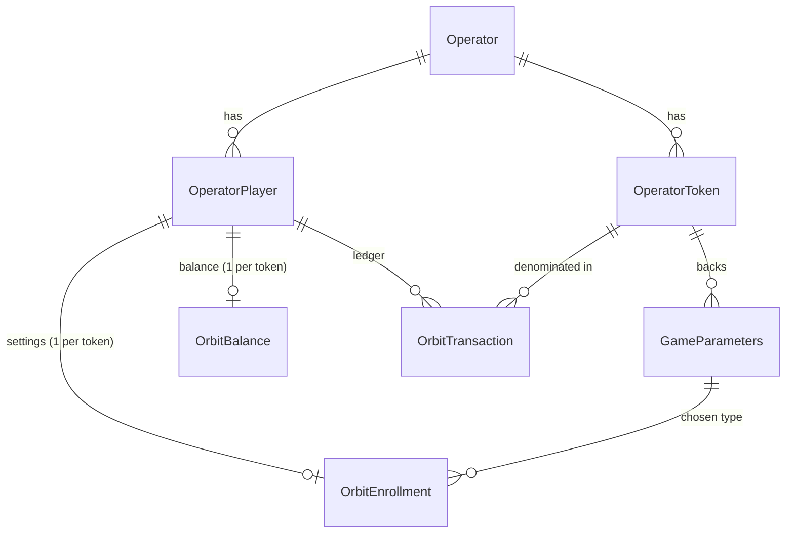
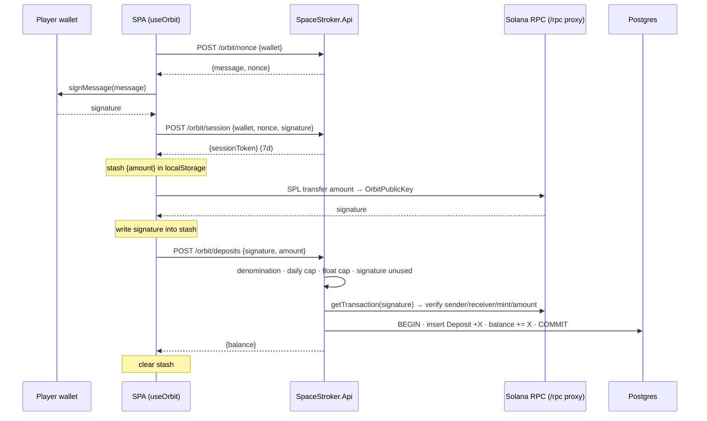
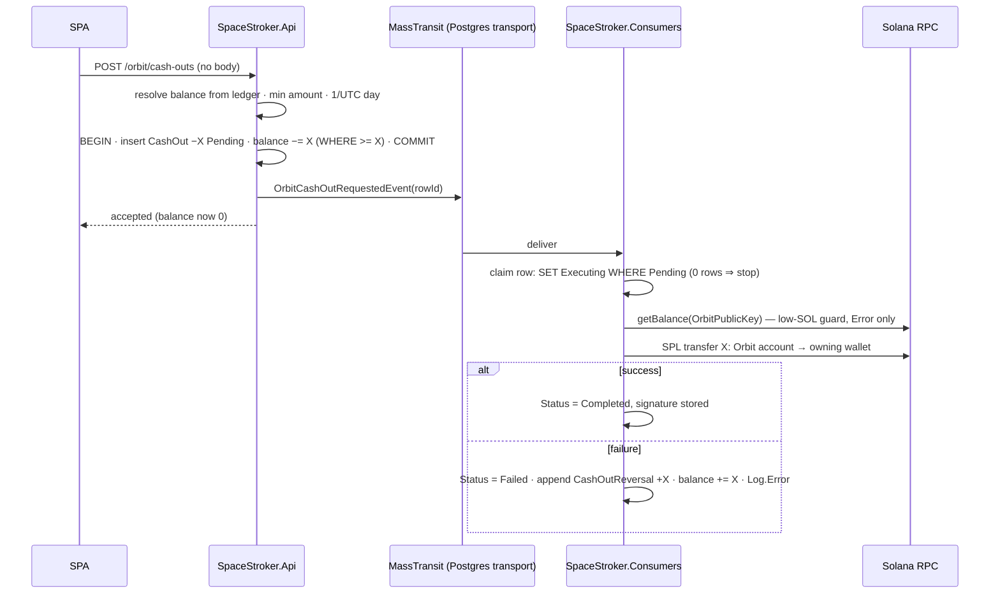

# SpaceStroker — "Orbit (1/3) — Custodial Orbit Wallet" — Implementation Spec

> **Status: Ready for implementation** — refined via Trello card
> [Orbit (1/3) — custodial Orbit wallet: deposits, balance ledger, cash-out + design pass](https://trello.com/c/R4Qe0jxX)
> (2026-07-29). Product decisions for the whole epic live on the umbrella card
> [Orbit #118](https://trello.com/c/yxwdNTrb) — **read it first**.
> Repos affected: `monkify-backend`, `monkify-front`, and this doc in `monkify-meta`.
>
> **Purpose:** Give a player a house-held **Orbit balance** for one operator token — funded by fixed
> on-chain USDC deposits, tracked by an append-only ledger, protected by wallet-ownership proof, and
> withdrawable on demand. This is the **money foundation only**: nothing bets yet. Child 2
> ([#122](https://trello.com/c/h7MF4Oky)) spends this balance; child 3
> ([#123](https://trello.com/c/NIH7XFHi)) notifies on it.

---

## 1. Summary

Today a paid bet is funded by a per-round on-chain SPL transfer signed by the player's own wallet
(`RegisterBetHandler` → `ISolanaService.ValidateBetPayment`). There is **no** notion of a player
balance held by the house — `OperatorPlayer` carries a display name and a currency preference and
nothing else. Orbit introduces one.

| Concern | Today | After this card |
| --- | --- | --- |
| Player money at rest | none — every stake comes straight from the wallet | an **Orbit balance** per `(OperatorPlayer, OperatorToken)` |
| Auditability | `Bet` + `TransactionLog` + `CryptoTransactionLog`, per bet | append-only **`OrbitTransaction`** ledger, authoritative for the balance |
| House key material | one bet/payout keypair per `OperatorToken` | **plus** a separate Orbit keypair on the same row |
| Who may act for a wallet | anyone — `wallet` is an unverified body field | a **signed-nonce Orbit session** (`X-Orbit-Session`), ~7 days |
| Game-type eligibility | `PaymentMethod` + `Active` | **plus** `GameParameters.AllowOrbit` |

Three money paths ship here:

| Path | Direction | Host | Ledger row |
| --- | --- | --- | --- |
| **Deposit** | player wallet → Orbit account (client-signed, backend verifies the signature) | API | `Deposit` `+X` |
| **Cash-out** | Orbit account → player wallet (house-signed) | API accepts + reserves, **Consumers executes** | `CashOut` `−X` |
| **Cash-out failure** | nothing moves | Consumers | `CashOutReversal` `+X` |

`BetDebit`, `WinCredit` and `Refund` are **defined in the enum but never written** by this card —
they are #122's. Defining them now keeps #122 free of a second migration.

---

## 2. Constraints (MANDATORY)

From `monkify-meta/constraints.md` (full list there):

- **Worktree-per-repo:** work lives in `.worktrees/orbit-custodial-wallet/<repo>`; the hubs stay on
  `main`. Branch `feature/orbit-custodial-wallet` in all three repos (already created + pushed).
- **Unit tests:** update/add in `SpaceStroker.Tests`; run via `scripts/run_tests.bat` (never the bare
  `dotnet test` — `ProductionSessions` is a slow Monte-Carlo suite). Report changed tests at the end.
- **Integration test (mandatory — this card is a `Feature`):** at least one happy-path test in
  `SpaceStroker.Tests.Integration` (Testcontainers), run via `scripts/run_integration_tests.bat`.
  See §11.2 — the deposit → balance → cash-out flow.
- **EF mapping:** inline in `SpaceStrokerDbContext.OnModelCreating`; no `IEntityTypeConfiguration`.
- **Migrations:** under `SpaceStroker.Infrastructure/Migrations/`; applied only by
  `SpaceStroker.Consumers` at startup. Never hand-edit the model snapshot.
- **Secrets/config §1:** the committed `spacestrokersettings.json` gets **mock-only** Orbit key
  material (`MOCK_ORBIT_*`). Never log an Orbit private key, a session token, or a nonce signature.
- **Operator messaging §6:** an expired/inactive operator gets the existing vague
  "not found / unavailable". The **float-cap** refusal is also deliberately vague (§6.4).
- **Host split §8:** the API stays stateless and never moves money — it only *reserves*. Every SPL
  transfer, the reconciliation job and the low-SOL guard live in `SpaceStroker.Consumers`.
- **⚠️ Ops (not code):** the new `/orbit/*` endpoints carry base58 signatures in POST bodies, which is
  exactly what the priority-900 Cloud Armor OWASP rule false-positives on
  (`cloud-armor-waf-blocks-crypto-payloads`). They also need their own `AspNetCoreRateLimit` rules
  (§5.3). Funding the mainnet Orbit account with USDC and SOL is an **ops step for the user** —
  never done from here (§5 of `constraints.md`).

---

## 3. Resolved product decisions

Answer mode during refinement: **short**. Decisions 1-9 are this card's; 10-14 are inherited from
#118 and repeated because they are load-bearing here.

| # | Decision |
| --- | --- |
| 1 | **The Orbit session gates every Orbit read *and* mutation.** `POST /orbit/nonce` → the exact message to sign; the wallet signs it; `POST /orbit/session` verifies the ed25519 signature and returns an opaque token carried as **`X-Orbit-Session`**, TTL **7 days**. The header Orbit balance shows a placeholder + SIGN IN affordance until signed. Chosen over opening reads: a per-endpoint auth split on a money surface rots. |
| 2 | **⚠️ `signMessage` does not exist in `monkify-front`.** Desktop uses `useWallet().signMessage`; **mobile needs a net-new `signMessage` deeplink** in `mobileWalletProtocol.ts` (which today implements only `connect` + `signAllTransactions`) plus its `localStorage` return hop. In scope for this card (§7.3). |
| 3 | **Cash-out reserves at request.** The API writes a `Pending` `CashOut` row **and** debits the balance in one DB transaction, then publishes `OrbitCashOutRequestedEvent`. Consumers executes and marks it `Completed`. Failure appends a `CashOutReversal` row and restores the balance. Chosen over debit-on-confirmation: otherwise #122's auto-bet can spend money already promised to an accepted cash-out. |
| 4 | **The Orbit keypair lives on `OperatorToken`** (`OrbitPublicKey` + encrypted `OrbitPrivateKey`), scoped per `(operator, token)`; Main's is seeded from the new `GeneralSettings.Token.Orbit` block by `EnsureMainOperatorToken`. **Collapses #118's two resolution paths into one** — "always the DB row; Main's is seeded from config". Still a **separate keypair** from the bet/payout wallet, which was the real requirement. |
| 5 | **`AllowOrbit` reaches live production rows via a name-matched startup self-heal** (`ExecuteUpdate`, beside the shipped `AllowFreeBet` heal at `Program.cs:345-361`) — `true` for Cosmic Sprint + Beast Mode, `false` for Space Jackpot. Chosen over a migration data-patch (default type ids are generated, not fixed) and over deactivate-and-recreate (a new `parametersId` resets per-type Stats and splits Games History). Safe because the admin portal is **deactivate-or-create and cannot edit an existing type**. |
| 6 | **Orphaned deposits get both recoveries** — a `localStorage` pending-deposit stash auto-resubmitted on the next boot/modal open, **plus** a manual "recover a deposit" field. Both post the same signature-idempotent endpoint. Side effect: a raw transfer sent outside the app **is** creditable when it is exactly 1/5/10 to the Orbit account from the session wallet, so #118's manual-recovery carve-out shrinks to odd amounts. |
| 7 | **The design pass draws inside #124's settled chrome** ([NIMydn5I](https://trello.com/c/NIMydn5I)) — 3 variants each explore **content and layout only**. Orbit modal + header two-balance cluster = **system tier** (hairline, dither backdrop, Esc); the **first-win upsell = tutorial tier** by #124's frequency test. Run the pass **before** implementing §7. |
| 8 | **Limits (conservative launch profile):** minimum cash-out **1 USDC**, global Orbit float cap **1,000 USDC**, minimum SOL guard **0.02**. All ordinary config, tunable without a code change. |
| 9 | **No feature flag.** All three Orbit cards merge to `main` before anything deploys. ⚠️ Between this merge and #123's, `main` carries a visible Orbit surface whose enable toggle has no engine behind it — **expected**, including in the local Docker verification at the end of `/monkify-implement-feature`. |
| 10 | **The ledger is authoritative; the column self-heals.** Money-moving operations recompute from `SUM(OrbitTransaction.Amount)`; a disagreeing `OrbitBalance.Amount` is corrected to the ledger and an `Error` is logged. Fail-closed would freeze real funds over one bad row. |
| 11 | **Debits are an atomic conditional update** (`ExecuteUpdateAsync` with `WHERE Amount >= x`); zero rows affected ⇒ insufficient funds. The balance can never go negative. |
| 12 | **Deposits are fixed 1 / 5 / 10**, ≤ 10 per deposit, ≤ 100 per UTC day; manual cash-out **1 per UTC day** and ≥ the minimum. Threshold + forced cash-outs are exempt from the daily limit (they arrive in #122 — the exemption flag ships here as `OrbitCashOutSource`). |
| 13 | **Cash-out only ever pays the owning wallet.** No caller-supplied destination exists in the request contract at all. |
| 14 | **Scope:** `SolanaToken` game types only, one balance per `(operator, token)`. Standard/USD games settle through the operator wallet API and hold no float. |

---

## 4. Data model

### 4.1 Entity / column changes

**`SpaceStroker.Domain/Games/Entities/OperatorToken.cs`** — two new nullable columns. Null ⇒ Orbit is
not configured for that token and every Orbit endpoint returns the vague unavailable message.

```csharp
// The Orbit custody account for this token — a SEPARATE keypair from TokenOwner* above. Player
// deposits land here, cash-outs and (from #122) auto-bet stakes are signed from here. Kept separate
// so "sum of player balances vs on-chain balance" is checkable and so an Orbit-funded bet is never a
// same-account transfer (which confirms as an on-chain no-op — the prod "sent less tokens than
// informed" incident). Null ⇒ Orbit unavailable for this token.
public string? OrbitPublicKey { get; set; }
public string? OrbitPrivateKey { get; set; }   // ENCRYPTED; never serialized out
```

**`SpaceStroker.Domain/Games/Entities/GameParameters.cs`** — eligibility flag:

```csharp
// Whether this game type may be auto-played by Orbit (#122). Seeded true for Cosmic Sprint and
// Beast Mode, false for Space Jackpot — on a 24h lottery an auto-bet locks funds for a day and the
// start gate is meaningless for a scheduled draw. Admin-settable at creation only.
public bool AllowOrbit { get; set; }
```

**New — `SpaceStroker.Domain/Orbit/Entities/OrbitEnrollment.cs`** (settings; one row per player+token):

```csharp
public class OrbitEnrollment : TableEntity
{
    public Guid OperatorPlayerId { get; set; }
    public OperatorPlayer OperatorPlayer { get; set; }
    public Guid OperatorTokenId { get; set; }
    public OperatorToken OperatorToken { get; set; }

    public bool Enabled { get; set; }
    public Guid? GameParametersId { get; set; }        // the ONE chosen Orbit game type (#122 uses it)
    public GameParameters? GameParameters { get; set; }
    public decimal? CashOutAtThreshold { get; set; }   // null = no threshold; >= MinimumCashOut

    // #123 fills these; created here so slice 3 needs no migration.
    public string? TelegramChatId { get; set; }
}
```

**New — `SpaceStroker.Domain/Orbit/Entities/OrbitBalance.cs`** (the hot row; deliberately narrow so
the atomic conditional debit contends on as little as possible):

```csharp
public class OrbitBalance : TableEntity
{
    public Guid OperatorPlayerId { get; set; }
    public Guid OperatorTokenId { get; set; }
    public decimal Amount { get; set; }
}
```

**New — `SpaceStroker.Domain/Orbit/Entities/OrbitTransaction.cs`** (append-only ledger):

```csharp
public class OrbitTransaction : TableEntity
{
    public Guid OperatorPlayerId { get; set; }
    public Guid OperatorTokenId { get; set; }

    public OrbitTransactionType Type { get; set; }
    // SIGNED: credits positive, debits negative. The balance is SUM(Amount) over ALL rows —
    // Status never filters the sum (see §4.5). This is what makes the ledger trivially auditable.
    public decimal Amount { get; set; }
    public OrbitTransactionStatus Status { get; set; }
    public OrbitCashOutSource? Source { get; set; }        // CashOut rows only
    public string? ExternalTransactionReference { get; set; } // the on-chain signature
    public string? Reason { get; set; }
    public Guid? BetId { get; set; }                        // #122 only; null here
}
```

**New value objects** (`SpaceStroker.Domain/Orbit/ValueObjects/`):

```csharp
public enum OrbitTransactionType { Deposit = 1, CashOut = 2, CashOutReversal = 3,
                                   BetDebit = 4, WinCredit = 5, Refund = 6 }

// Only CashOut rows use anything but Completed. Deposits are Completed on write.
public enum OrbitTransactionStatus { Completed = 1, Pending = 2, Executing = 3, Failed = 4 }

// Manual is capped at 1/UTC day; Threshold and ForcedOnDisable are exempt (#122 writes those).
public enum OrbitCashOutSource { Manual = 1, Threshold = 2, ForcedOnDisable = 3 }
```

### 4.2 EF configuration (inline, in `SpaceStrokerDbContext.OnModelCreating`)

Add three `DbSet`s beside the existing ones (`SpaceStrokerDbContext.cs:24-27`):

```csharp
public DbSet<OrbitEnrollment> OrbitEnrollments { get; set; }
public DbSet<OrbitBalance> OrbitBalances { get; set; }
public DbSet<OrbitTransaction> OrbitTransactions { get; set; }
```

Extend the existing `OperatorToken` block (`:92-104`) with the two new columns and add three blocks:

```csharp
// inside modelBuilder.Entity<OperatorToken>(...)
builder.Property(x => x.OrbitPublicKey).HasMaxLength(100);
builder.Property(x => x.OrbitPrivateKey).HasMaxLength(2000);   // encrypted ciphertext

// inside modelBuilder.Entity<GameParameters>(...)
builder.Property(x => x.AllowOrbit).IsRequired().HasDefaultValue(false);

modelBuilder.Entity<OrbitEnrollment>(builder =>
{
    builder.HasKey(x => x.Id);
    builder.Property(x => x.Enabled).IsRequired().HasDefaultValue(false);
    builder.Property(x => x.CashOutAtThreshold).HasPrecision(18, 9);
    builder.Property(x => x.TelegramChatId).HasMaxLength(50);
    builder.HasOne(x => x.OperatorPlayer).WithMany().HasForeignKey(x => x.OperatorPlayerId).OnDelete(DeleteBehavior.Restrict);
    builder.HasOne(x => x.OperatorToken).WithMany().HasForeignKey(x => x.OperatorTokenId).OnDelete(DeleteBehavior.Restrict);
    builder.HasOne(x => x.GameParameters).WithMany().HasForeignKey(x => x.GameParametersId).IsRequired(false).OnDelete(DeleteBehavior.Restrict);
    builder.HasIndex(x => new { x.OperatorPlayerId, x.OperatorTokenId }).IsUnique();
});

modelBuilder.Entity<OrbitBalance>(builder =>
{
    builder.HasKey(x => x.Id);
    builder.Property(x => x.Amount).HasPrecision(18, 9).IsRequired();
    builder.HasIndex(x => new { x.OperatorPlayerId, x.OperatorTokenId }).IsUnique();
});

modelBuilder.Entity<OrbitTransaction>(builder =>
{
    builder.HasKey(x => x.Id);
    builder.Property(x => x.Type).IsRequired();
    builder.Property(x => x.Status).IsRequired();
    builder.Property(x => x.Amount).HasPrecision(18, 9).IsRequired();
    builder.Property(x => x.ExternalTransactionReference).HasMaxLength(100);
    builder.Property(x => x.Reason).HasMaxLength(300);
    builder.HasIndex(x => new { x.OperatorPlayerId, x.OperatorTokenId });
    builder.HasIndex(x => x.Status);
    // Deposit idempotency at the DB layer. Postgres treats multiple NULLs as distinct, so cash-out
    // rows (signature null until executed) never collide — same trick as Bet.ExclusiveChoice.
    builder.HasIndex(x => x.ExternalTransactionReference).IsUnique();
});
```

> **⚠️ `OperatorBalance` has no navigation properties on purpose.** `SpaceStrokerDbContext` is
> `NoTracking` by default (`OnConfiguring`, `:32`), and the debit path is `ExecuteUpdateAsync` — a
> load-mutate-`SaveChanges` on this row would silently persist nothing (the known
> `dbcontext-notracking-updates` trap).

### 4.3 Migration

```bash
cd monkify-backend/src
dotnet ef migrations add AddOrbitCustodialWallet --project SpaceStroker.Infrastructure --startup-project SpaceStroker.Consumers
```

One migration covering: the two `OperatorToken` columns, `GameParameters.AllowOrbit`, and the three
new tables with their indexes. Applied only by `SpaceStroker.Consumers` at startup.

### 4.4 ER diagram



### 4.5 The balance invariant

> **`OrbitBalance.Amount == SUM(OrbitTransaction.Amount)` for that `(OperatorPlayerId,
> OperatorTokenId)` — over ALL rows, with no status filter.**

`Status` describes a cash-out's *execution*, never its *accounting*. A failed cash-out is **not**
removed or zeroed; it stays `Failed` at `−X` and is cancelled by an appended `CashOutReversal` at
`+X`. That keeps the ledger genuinely append-only and makes reconciliation a single `SUM`.

---

## 5. Configuration

### 5.1 `GeneralSettings.Token.Orbit` (new block)

`SpaceStroker.Domain/Configs/Entities/OrbitSettings.cs` (new), referenced from `TokenSettings`:

```csharp
public OrbitSettings Orbit { get; set; } = new();
```

```csharp
[ExcludeFromCodeCoverage]
public class OrbitSettings
{
    // Main's Orbit keypair — seeded onto Main's OperatorToken row by EnsureMainOperatorToken.
    // MOCK values in the committed config; real values injected via Secret Manager in production.
    public string PublicKey { get; set; }
    public string PrivateKey { get; set; }

    // Global limits (not per-operator). Ordinary config, not secrets.
    public decimal[] DepositOptions { get; set; } = [1m, 5m, 10m];
    public decimal MaxDepositPerTransaction { get; set; } = 10m;
    public decimal MaxDepositPerDay { get; set; } = 100m;
    public decimal MinimumCashOut { get; set; } = 1m;
    public decimal GlobalFloatCap { get; set; } = 1000m;
    public decimal MinimumSolBalance { get; set; } = 0.02m;
    public int SessionTtlDays { get; set; } = 7;
    public int NonceTtlMinutes { get; set; } = 5;
    public int CashOutSweepStaleMinutes { get; set; } = 10;
}
```

`SpaceStroker.Common/spacestrokersettings.json`, inside `GeneralSettings.Token` (**mock only**):

```json
"Orbit": {
    "PublicKey": "MOCK_ORBIT_PUBLIC_KEY",
    "PrivateKey": "MOCK_ORBIT_PRIVATE_KEY",
    "DepositOptions": [ 1, 5, 10 ],
    "MaxDepositPerTransaction": 10,
    "MaxDepositPerDay": 100,
    "MinimumCashOut": 1,
    "GlobalFloatCap": 1000,
    "MinimumSolBalance": 0.02,
    "SessionTtlDays": 7,
    "NonceTtlMinutes": 5,
    "CashOutSweepStaleMinutes": 10
}
```

### 5.2 Seeding

`EnsureMainOperatorToken` (`SpaceStroker.Consumers/Program.cs:279-301`) currently returns early when
Main already has a token. Extend it to **also self-heal the Orbit columns** on the existing row when
they are null and config supplies them (encrypt with `ISecretProtector.Protect`, exactly like
`TokenOwnerPrivateKey`). Without this, an existing dev/prod database never gets Orbit keys.

`DefaultGameParameters.GenerateMainDefaultParameters` sets `AllowOrbit` per type: Cosmic Sprint
`true`, Beast Mode `true`, Space Jackpot `false`.

### 5.3 Rate limiting (`spacestrokersettings.json` → `IpRateLimiting.GeneralRules`)

New rules, sitting above the existing `/rpc` and `/solana/*` entries. Money endpoints are cheap to
call and expensive to abuse:

```json
{ "Endpoint": "*:/orbit/nonce",     "Period": "1m", "Limit": 20 },
{ "Endpoint": "*:/orbit/session",   "Period": "1m", "Limit": 20 },
{ "Endpoint": "*:/orbit/deposits",  "Period": "1m", "Limit": 20 },
{ "Endpoint": "*:/orbit/cash-outs", "Period": "1m", "Limit": 10 },
{ "Endpoint": "*:/orbit",           "Period": "1m", "Limit": 60 }
```

⚠️ Per `rate-limiter-keying`, the more specific rule wins, and `ForwardLimit = 2` is already set, so
these are genuinely per-IP. `*:/orbit` must **not** be relied on to cover the sub-paths.

### 5.4 Launch-token gating

Add `"/orbit"` to `LaunchTokenValidationMiddleware.ProtectedPrefixes`
(`SpaceStroker.Api/Middleware/LaunchTokenValidationMiddleware.cs:21`).

This is deliberate and different from `/solana/*` and `/rpc`, which are ungated so the wallet-bridge
popup works. Orbit is **hidden when embedded** and always reached from the SPA, which always carries a
launch token (auto-minted for Main), so gating costs nothing and buys operator scoping for free via
`ILaunchContext.OperatorId`. **Both** gates apply to `/orbit/*`: launch token → *which operator*,
Orbit session → *which wallet*.

---

## 6. Backend behaviour

All handlers live under `SpaceStroker.Infrastructure/Handlers/Orbit/<Action>/` following the shipped
one-folder-per-handler layout (`Handlers/Players/GetPlayerPreferences/`).

### 6.1 Orbit session (`POST /orbit/nonce`, `POST /orbit/session`)

`CreateOrbitNonceHandler`:

1. Resolve the operator's active `OperatorToken`; if it has no `OrbitPublicKey`, return the vague
   unavailable message.
2. Generate 32 random bytes → base64url `nonce`.
3. Build the **exact message the wallet will sign** and return it, so client and server can never
   drift on whitespace:

   ```
   Space Stroker Orbit
   Wallet: <wallet>
   Operator: <operatorId>
   Nonce: <nonce>
   Issued At: <ISO-8601 UTC>
   ```

4. Cache it: `ICacheService.Set(new CacheSettings($"Orbit:Nonce:{wallet}:{nonce}",
   TimeSpan.FromMinutes(NonceTtlMinutes)), message)`.
5. Return `{ message, nonce, expiresAt }`.

`CreateOrbitSessionHandler` (`{ wallet, nonce, signature }`):

1. `TryGet` the cached message; missing ⇒ reject. **`Remove` it immediately** (single use).
2. Verify: `new PublicKey(wallet).Verify(Encoding.UTF8.GetBytes(message), Base58.Decode(signature))`.
   ⚠️ **Confirm `PublicKey.Verify` exists in Solnet.Wallet 6.1.0 at implementation time**; if not,
   use `Chaos.NaCl.Ed25519.Verify`, which Solnet.Wallet already depends on (no new package either
   way). Failure ⇒ reject, nothing created.
3. **Upsert the `OperatorPlayer`** for `(operatorId, wallet)` — a player may now exist before ever
   betting. Reuse the same resolution the prefs handlers use (`ExternalPlayerId == wallet`), touching
   `LastSeenAt`.
4. Mint a 32-byte opaque token; store `SHA256(token)` as the cache key →
   `{ operatorId, operatorPlayerId, wallet }` with `TimeSpan.FromDays(SessionTtlDays)`. Return
   `{ sessionToken, expiresAt }`.

> **Accepted residual:** a captured nonce+signature replayed inside the 5-minute window before the
> legitimate request lands yields a session for **the same wallet** — the same principal — so there is
> no privilege escalation. Documented rather than solved with a DB round-trip.

**`IOrbitSessionAccessor`** (new, API-scoped, mirroring `ILaunchContext`): a small middleware or
action filter reads `X-Orbit-Session`, hashes it, looks it up, and exposes
`{ OperatorPlayerId, Wallet }`. Every other `/orbit` endpoint returns the vague message when it is
absent, expired, or its `operatorId` does not match `ILaunchContext.OperatorId`.

### 6.2 `GET /orbit`

Returns everything the modal and the header cluster need in one call:

```jsonc
{
  "balance": 12.5,
  "tokenLabel": "USDC",
  "tokenDecimals": 6,
  "mintAddress": "…",
  "orbitReceiver": "…",          // OperatorToken.OrbitPublicKey — the deposit destination
  "depositOptions": [1, 5, 10],
  "minimumCashOut": 1,
  "canCashOutToday": true,
  "enabled": false,
  "gameParametersId": null,
  "cashOutAtThreshold": null,
  "eligibleGameTypes": [ { "id": "…", "name": "Cosmic Sprint", "requiredAmount": 1 } ],
  "totalWonViaOrbit": 0,          // SUM of WinCredit rows — always 0 until #122
  "orbitBetsPlaced": 0,           // COUNT of BetDebit rows — always 0 until #122
  "pausedReason": null            // "InsufficientFunds" when enabled && balance < required stake
}
```

`eligibleGameTypes` = active `SolanaToken` types for this operator with `AllowOrbit == true`. The
handler **recomputes the balance from the ledger and self-heals the column** (§6.6) before returning.

### 6.3 `POST /orbit/deposits`

Body `{ signature, amount }`. Order matters — the cheap rejections come first so a bad request never
costs an RPC call:

1. `amount` must be one of `DepositOptions` **and** ≤ `MaxDepositPerTransaction`.
2. Sum today's `Deposit` rows (UTC day) for this player+token; `+ amount` must be ≤ `MaxDepositPerDay`.
3. Global float: `SUM(OrbitBalance.Amount)` for this `OperatorTokenId` `+ amount` must be ≤
   `GlobalFloatCap`. Over ⇒ **vague** refusal + `Log.Error` (this is a capacity signal the operator
   must see).
4. Signature not already used: `OrbitTransactions.Any(x => x.ExternalTransactionReference == signature)`
   ⇒ return the current balance **without** a second credit (idempotent, not an error — the
   auto-resubmit stash hits this constantly).
5. `ISolanaService.ValidateIncomingTransfer(signature, sender: session wallet,
   receiver: OperatorToken.OrbitPublicKey, mint, decimals, expectedAmount: amount)` (§6.7).
6. In **one** `IDbContextTransaction`: insert the `Deposit` row (`+amount`, `Completed`, signature),
   then upsert `OrbitBalance` (`ExecuteUpdateAsync` `Amount += amount`; zero rows ⇒ insert the row).
   A `23505` on the unique signature index means a concurrent duplicate — swallow it and return the
   current balance, exactly as step 4 would have.

### 6.4 `POST /orbit/cash-outs`

Body is **empty** — the amount is always the whole balance and the destination is always the session
wallet (decision 13). In one `IDbContextTransaction`:

1. Recompute the ledger sum; self-heal the column if they differ (§6.6).
2. `amount` = that sum. Reject if `< MinimumCashOut` with a **clear** reason (this is a game/limit
   state, not operator status, so the vague-messaging rule does not apply).
3. Reject if a `CashOut` row with `Source = Manual` already exists for this player+token in the
   current UTC day.
4. Insert the `CashOut` row: `−amount`, `Status = Pending`, `Source = Manual`, signature null.
5. `ExecuteUpdateAsync` on `OrbitBalance` `WHERE Amount >= amount` → `Amount -= amount`. **Zero rows
   ⇒ roll back the whole transaction** and return insufficient funds.
6. Commit, then `IMessageBus.PublishEventAsync(new OrbitCashOutRequestedEvent(orbitTransactionId))`.

The player's balance reads `0` the instant the request is accepted — the money is reserved, not
merely promised.

### 6.5 `PATCH /orbit/settings`

Body `{ enabled?, gameParametersId?, cashOutAtThreshold? }`, PATCH-style allow-list like
`UpdatePlayerPreferences`. Validation:

- `gameParametersId` must be an active `SolanaToken` type of this operator with `AllowOrbit == true`.
  Anything else ⇒ vague rejection (never confirm that some other operator's type exists).
- `cashOutAtThreshold` must be null or `>= MinimumCashOut`.
- `enabled = true` requires a `gameParametersId` (a live enrollment with no target is meaningless).

Upserts the `OrbitEnrollment`. **No behaviour is attached to `Enabled` in this card** — #122 reads it.

### 6.6 Ledger-vs-column drift (shared helper)

`OrbitLedgerService.ResolveBalance(operatorPlayerId, operatorTokenId)` in
`SpaceStroker.Infrastructure/Services/Orbit/`:

```
ledger  = SUM(OrbitTransaction.Amount)      -- all rows, no status filter (§4.5)
column  = OrbitBalance.Amount
if (ledger != column) {
    ExecuteUpdateAsync -> Amount = ledger
    Log.Error("Orbit balance drift for player {PlayerId}/{TokenId}: column {Column} != ledger {Ledger}. Column corrected.", …)
}
return ledger
```

Called by `GET /orbit`, the deposit handler, the cash-out handler and the reconciliation job. The
ledger always wins — fail-closed would freeze real funds over one bad row.

### 6.7 `ISolanaService` additions

Three new members (`SpaceStroker.Infrastructure/Services/Solana/ISolanaService.cs`), all implemented
in `SolanaService` under the same retry + one-shot-fallback + masked-logging discipline as the rest,
and all added to `FakeSolanaService`:

```csharp
// House-signed SPL transfer to an arbitrary wallet. This is the existing PRIVATE TransferTokens
// promoted to the interface — RefundTokens now delegates to it and keeps its refund-specific
// logging, so an Orbit cash-out never logs "Failed to refund wallet".
Task<string?> TransferTokensToWallet(string wallet, BetTransactionAmountResult amount, SolanaTokenDescriptor token);

// Deposit verification. Same preTokenBalances/postTokenBalances comparison as ValidateBetPayment,
// but parameterised instead of Bet-shaped: asserts the receiver gained exactly expectedAmount AND
// the sender lost it, for this mint.
Task<ValidationResult> ValidateIncomingTransfer(string signature, string senderWallet, string receiverPublicKey,
                                                string mintAddress, int decimals, decimal expectedAmount);

// Lamports/1e9 on the Orbit keypair, for the low-SOL guard. Note: the dead SOL getBalance was
// deleted by frontend-helius-gateway, so this is a genuine re-add with one purpose.
Task<decimal?> GetSolBalance(string publicKey);
```

Refactor `ValidateBetPayment` to call `ValidateIncomingTransfer` internally rather than duplicating
`GetAccountBalances` / `ValidateTokenExchangeFor*Account` — one verification path, one set of tests.

### 6.8 `OrbitCashOutConsumer` (Consumers)

Registered exactly like the existing eight (`Program.cs:66-116`): `x.AddConsumer<OrbitCashOutConsumer>()`
plus a `cfg.ReceiveEndpoint(nameof(OrbitCashOutConsumer), …)`.

1. **Claim the row atomically:** `ExecuteUpdateAsync` `SET Status = Executing WHERE Id = @id AND
   Status = Pending`. **Zero rows ⇒ return immediately** — another instance (or the sweep) owns it.
   This is what makes the at-least-once bus delivery safe on a money transfer.
2. Load the `OperatorToken`; decrypt `OrbitPrivateKey` with `ISecretProtector.Unprotect`; build a
   `SolanaTokenDescriptor` whose owner keys are the **Orbit** pair (mint/senderAccount/decimals from
   the token row).
3. **Low-SOL guard:** `GetSolBalance(OrbitPublicKey)`; below `MinimumSolBalance` ⇒ `Log.Error` and
   **still attempt the transfer** (a rate limit must never trap funds — #118).
4. `TransferTokensToWallet(session wallet recorded on the row's player, amount, orbitDescriptor)`.
5. **Success:** `Status = Completed`, `ExternalTransactionReference = signature`.
   **Failure (null):** `Status = Failed`, append a `CashOutReversal` row `+amount` (`Completed`),
   `ExecuteUpdateAsync` `Amount += amount` on the balance, `Log.Error`.

### 6.9 `OrbitCashOutSweepJob` (Hangfire, hourly)

Modelled on `PendingRefundSweepJob`, registered in `ScheduleRecurringJobs`
(`Program.cs:183-193`) as `"0 * * * *"` and `builder.Services.AddScoped<OrbitCashOutSweepJob>()`.

- Republish `OrbitCashOutRequestedEvent` for every row `Status = Pending` older than
  `CashOutSweepStaleMinutes` — these were never picked up, so re-driving them is safe.
- **Never republish an `Executing` row.** Instead `Log.Error` naming the row id for manual
  resolution. An `Executing` row may have a transfer in flight, and re-driving it could pay twice —
  the one failure mode worth a human. Hourly (not 12-hourly like the refund sweep) because this is a
  withdrawal a player is actively waiting on.

### 6.10 `OrbitReconciliationJob` (Hangfire, every 6h)

Registered as `"0 */6 * * *"`. Read-only; logs, never mutates money:

1. Per `(player, token)`: compare `SUM(OrbitTransaction.Amount)` with `OrbitBalance.Amount`; log
   `Error` on any mismatch (the self-heal in §6.6 fixes it on next use).
2. Per `OperatorToken` with Orbit configured: compare `SUM(OrbitBalance.Amount)` with
   `ISolanaService.GetTokenBalance(OrbitPublicKey, mint, decimals)`. The on-chain figure should be
   **≥** the sum (the house may pre-fund); log `Error` when it is **less** — that means custodied
   money is missing.

### 6.11 `AllowOrbit` seeding + self-heal

In `CreateDefaultGameParametersAsync` (`Program.cs:303-364`), after the existing `AllowFreeBet`
heal, add a **name → desired value** heal. Note it is *not* a single env-derived value like the
`AllowFreeBet` block, so it needs a small loop:

```csharp
// Self-heal: align Main's default types' Orbit eligibility with the seed intent. Rows seeded before
// this feature are NOT recreated by the block above (that only runs on a zero-type operator), so
// patch them here. ExecuteUpdate: the DbContext is NoTracking by default, so load-mutate-SaveChanges
// would silently persist nothing. Safe to run forever — the admin portal is deactivate-or-create and
// cannot edit an existing type, so this can only ever stomp a same-name recreation.
var orbitDefaults = DefaultGameParameters.GenerateMainDefaultParameters(Guid.Empty)
    .ToDictionary(x => x.Name, x => x.AllowOrbit);

var orbitPatched = 0;
foreach (var (name, desired) in orbitDefaults)
{
    orbitPatched += context.GameParameters
        .Where(x => x.OperatorId == mainOperator.Id && x.Name == name && x.AllowOrbit != desired)
        .ExecuteUpdate(s => s.SetProperty(x => x.AllowOrbit, desired));
}

if (orbitPatched > 0)
{
    cacheService.Remove(CacheHelper.GenerateActiveParametersCacheSettings(mainOperator.Id));
    Log.Information("Patched {Count} Main default type(s) for AllowOrbit.", orbitPatched);
}
```

> **⚠️ Cache-shape gotcha.** `GameParametersDto` gains `allowOrbit`, and
> `ActiveParameters:{operatorId}` has a **12h TTL**. On the first boot after deploy the cached blob
> predates the field and would deserialize it as `false` for up to 12 hours. The `cacheService.Remove`
> above fires on that same first boot (every row needs patching), which clears it — **do not remove
> that line** thinking it is redundant.

### 6.12 Admin: `AllowOrbit` on game-type creation

`CreateGameTypeRequest` gains `AllowOrbit` (default false); `CreateGameTypeHandler` persists it and
rejects `true` for a lottery type or a non-`SolanaToken` type. Deactivate-or-create is unchanged —
there is no edit path.

---

## 7. Frontend behaviour

**Run the §3 decision-7 design pass first.** Everything below is structure, not visual design; the
approved variant decides layout, copy placement and density.

### 7.1 Service + types

- **`src/types/orbit.ts`** (new) — `OrbitState`, `OrbitSession`, `OrbitSettingsPatch`,
  `OrbitEligibleType`, `OrbitPendingDeposit`.
- **`src/services/orbitService.ts`** (new) — reuses the existing axios instance and interceptors from
  `mainService.ts` (so the 401 → re-mint path and `useBootRecovery` back-off apply unchanged), and
  attaches `X-Orbit-Session` on every call: `getOrbitNonce`, `createOrbitSession`, `getOrbit`,
  `creditOrbitDeposit`, `requestOrbitCashOut`, `patchOrbitSettings`.
  `getOrbit` joins the `singleFlight` allow-list in `mainService.ts` — it is a boot-path GET fired by
  both the header and the modal, exactly the shape `player-lockouts` added `singleFlight` for.

### 7.2 `useOrbit.ts` (new composable, module singleton)

Owns: the session (persisted at `space-stroker.orbit-session.<wallet>`, cleared on disconnect,
wallet switch, or a 401 from an Orbit call), the reactive `orbit` state, and the three actions.

- **Session acquisition** — `ensureSession()`: return the stored token if unexpired; otherwise fetch
  the nonce, sign it (§7.3), post it, store the token. Never called on mount; only when the player
  opens the modal or presses SIGN IN on the header balance.
- **Deposit** — stash `{ signature: null, amount, wallet }` under
  `space-stroker.orbit-pending-deposit.<wallet>` **before** sending; call `sendToken` from
  `useConnection.ts` with `orbitReceiver` as the destination; write the signature into the stash the
  moment it is known; POST it; clear the stash only on a successful response.
- **Resume** — on boot and on modal open, if a stash with a signature exists, re-POST it. The
  endpoint is idempotent, so a duplicate is harmless.
- **Manual recovery** — `creditOrbitDeposit(signature, amount)` straight from the modal field.
- **Cash-out** — POST, then refresh state.

### 7.3 `signMessage` — the net-new plumbing (decision 2)

| Path | How |
| --- | --- |
| **Desktop extension** | `useWallet().signMessage` from `solana-wallets-vue`, already available on the adapter; nothing new but the call. |
| **Mobile deeplink** (Phantom / Solflare / Backpack) | **New**: `buildSignMessageDeeplink()` + `parseSignMessageReturn()` in `utils/mobileWalletProtocol.ts`, mirroring the existing `buildSignAllTransactionsDeeplink` / `parseSignReturn` pair (same shared-secret box, same `redirect_link` carrying `?type=`). Extend `detectDeeplinkReturn()` with `'signMessage'` and add its params to `DEEPLINK_RETURN_PARAMS`. Add `signMessage()` to `useMobileWallet.ts` and a pending-hop stash so `main.ts`'s pre-router capture resumes it — the same mechanism that fixed the Android connect loop. |
| **Mobile in-app browser** | Already an injected provider — the desktop path applies. |
| **Embedded (iframe)** | **N/A** — Orbit is hidden when embedded, so the wallet-bridge popup is never involved. |

### 7.4 Header

`GameHeader.vue` (`:200-320`):

- New **ORBIT** menu entry beside Settings · Stats · Fair · History, `v-if="!isEmbedded"`, opening
  `OrbitModal`.
- New **`OrbitBalance.vue`** in `components/` beside `TokenBalance.vue`, forming the two-balance
  cluster (wallet USDC + Orbit). Without a session it renders a placeholder plus a SIGN IN affordance;
  with one, the Orbit balance. Hidden when embedded, and hidden entirely when the current operator
  token has no Orbit configured.
- ⚠️ The header already hides the wallet balance below 360px (`:122`) so the wallet/menu controls are
  not pushed off-screen. The second balance must respect the same breakpoint discipline — the
  approved design variant decides how (stack, truncate, or move into the ☰ menu on phones).

### 7.5 `OrbitModal.vue` (new, `components/orbit/`)

One modal, sections: **balance** · **deposit** (the 1/5/10 options) · **cash out** · **settings**
(enable, game type, cash-out-at) · **recover a deposit** · **stats so far** (won / bets placed,
both `0` until #122).

Non-negotiables regardless of the chosen variant:

- `<Teleport to="#app">` — `GameHeader`'s root carries `backdrop-blur-md`, which makes it the
  containing block for `position: fixed` descendants; without the teleport the modal renders
  half off-screen (the shipped `fair-modal-off-screen` bug, now recorded in `conventions/frontend.md`).
- Mobile is **always** `html.light-graphics` (`usePerfMode` short-circuits below `lg`), so no
  `backdrop-filter`, no `blur()`, no infinite animation. #124's chrome uses a **dither** backdrop, not
  a blur, for exactly this reason.
- Esc closes (per #124's shell contract), via `useClickOutside` for the backdrop.

---

## 8. Flow diagrams

### 8.1 Deposit



### 8.2 Cash-out



---

## 9. Out of scope

- **Auto-betting and everything downstream of it** (#122): writing `BetDebit` / `WinCredit` /
  `Refund` rows, the round-creation hook, the start gate, seed-derived choice generation, the
  threshold cash-out actually firing, and refunds routed back into the Orbit account. The enum values
  and `OrbitCashOutSource.Threshold` / `ForcedOnDisable` ship here **unused**, purely so #122 needs no
  second migration.
- **Notifications, Telegram linking, the first-win upsell implementation** (#123). Only the upsell's
  **3 design variants** are produced here; `OrbitEnrollment.TelegramChatId` ships unused.
- Standard/USD game types and lottery types (`AllowOrbit` false).
- Auto-crediting raw on-chain transfers of amounts outside 1/5/10.
- Browser/OS-level Web Push; a price oracle or SOL↔USDC conversion; player-paid network fees.
- Multiple simultaneous Orbit game types per player; multiple Orbit balances per token.
- Any change to the existing bet, payout, refund or stats paths.

---

## 10. File checklist

### 10.1 Backend (`monkify-backend`)

| # | File | Change |
| --- | --- | --- |
| 1 | `Domain/Games/Entities/OperatorToken.cs` | add `OrbitPublicKey`, `OrbitPrivateKey` (encrypted) |
| 2 | `Domain/Games/Entities/GameParameters.cs` | add `AllowOrbit` |
| 3 | `Domain/Orbit/Entities/OrbitEnrollment.cs` | **new** entity |
| 4 | `Domain/Orbit/Entities/OrbitBalance.cs` | **new** entity (narrow, no navigations) |
| 5 | `Domain/Orbit/Entities/OrbitTransaction.cs` | **new** append-only ledger entity |
| 6 | `Domain/Orbit/ValueObjects/OrbitTransactionType.cs` | **new** enum |
| 7 | `Domain/Orbit/ValueObjects/OrbitTransactionStatus.cs` | **new** enum |
| 8 | `Domain/Orbit/ValueObjects/OrbitCashOutSource.cs` | **new** enum |
| 9 | `Domain/Configs/Entities/OrbitSettings.cs` | **new** settings class |
| 10 | `Domain/Configs/Entities/TokenSettings.cs` | add `Orbit` property |
| 11 | `Infrastructure/Data/Context/SpaceStrokerDbContext.cs` | 3 `DbSet`s + 3 inline model blocks + 3 new properties on existing blocks |
| 12 | `Infrastructure/Migrations/*_AddOrbitCustodialWallet.cs` | **new** migration (generated) |
| 13 | `Infrastructure/Services/Orbit/IOrbitLedgerService.cs` + `OrbitLedgerService.cs` | **new** — resolve/self-heal balance, atomic debit, credit, limit checks |
| 14 | `Infrastructure/Services/Orbit/IOrbitAccountResolver.cs` + impl | **new** — `OperatorToken` → `SolanaTokenDescriptor` with the **Orbit** keypair decrypted |
| 15 | `Infrastructure/Services/Solana/ISolanaService.cs` + `SolanaService.cs` | add `TransferTokensToWallet`, `ValidateIncomingTransfer`, `GetSolBalance`; `RefundTokens` + `ValidateBetPayment` delegate to the new members |
| 16 | `Infrastructure/Handlers/Orbit/CreateOrbitNonce/*` | **new** handler + request |
| 17 | `Infrastructure/Handlers/Orbit/CreateOrbitSession/*` | **new** — verify signature, upsert `OperatorPlayer`, mint session |
| 18 | `Infrastructure/Handlers/Orbit/GetOrbit/*` | **new** — §6.2 payload |
| 19 | `Infrastructure/Handlers/Orbit/CreditOrbitDeposit/*` | **new** — §6.3 |
| 20 | `Infrastructure/Handlers/Orbit/RequestOrbitCashOut/*` | **new** — §6.4 |
| 21 | `Infrastructure/Handlers/Orbit/UpdateOrbitSettings/*` | **new** — §6.5 |
| 22 | `Infrastructure/Consumers/OrbitCashOut/OrbitCashOutEvent.cs` + `OrbitCashOutConsumer.cs` | **new** — §6.8 |
| 23 | `Infrastructure/Jobs/OrbitCashOutSweepJob.cs` | **new** — hourly, §6.9 |
| 24 | `Infrastructure/Jobs/OrbitReconciliationJob.cs` | **new** — 6-hourly, §6.10 |
| 25 | `Infrastructure/Handlers/Admin/CreateGameType/CreateGameTypeRequest.cs` + `Handler` | accept + persist `AllowOrbit`; reject for lottery / non-`SolanaToken` |
| 26 | `Infrastructure/DependencyInjection.cs` | register `IOrbitLedgerService`, `IOrbitAccountResolver` |
| 27 | `Api/Controllers/OrbitController.cs` | **new** — the six routes + OPTIONS |
| 28 | `Api/Middleware/LaunchTokenValidationMiddleware.cs` | add `"/orbit"` to `ProtectedPrefixes` |
| 29 | `Api/Orbit/IOrbitSessionAccessor.cs` + middleware/filter | **new** — reads `X-Orbit-Session` |
| 30 | `Api/Program.cs` | wire the Orbit session accessor after the launch-token middleware |
| 31 | `Consumers/Program.cs` | `AddScoped` both jobs; `AddConsumer` + `ReceiveEndpoint` for `OrbitCashOutConsumer`; two `AddOrUpdate` recurring jobs; Orbit key self-heal in `EnsureMainOperatorToken`; `AllowOrbit` heal in `CreateDefaultGameParametersAsync` |
| 32 | `Consumers/DefaultGameParameters.cs` | set `AllowOrbit` per Main default type |
| 33 | `Common/spacestrokersettings.json` | `Token.Orbit` block (**mock only**) + 5 rate-limit rules |
| 34 | DTOs: `GameParametersDto` (+ admin DTO) | expose `allowOrbit` |

### 10.2 Frontend (`monkify-front`)

| # | File | Change |
| --- | --- | --- |
| 1 | `src/types/orbit.ts` | **new** types |
| 2 | `src/services/orbitService.ts` | **new** — six calls + `X-Orbit-Session` |
| 3 | `src/services/mainService.ts` | add `getOrbit` to the `singleFlight` allow-list |
| 4 | `src/hooks/useOrbit.ts` | **new** — session, state, deposit/resume/recover, cash-out, settings |
| 5 | `src/utils/mobileWalletProtocol.ts` | **new** `buildSignMessageDeeplink` / `parseSignMessageReturn`; extend `detectDeeplinkReturn` + `DEEPLINK_RETURN_PARAMS` |
| 6 | `src/hooks/useMobileWallet.ts` | add `signMessage()` + its pending-hop stash |
| 7 | `src/main.ts` | extend the pre-router deeplink capture with the signMessage return |
| 8 | `src/components/OrbitBalance.vue` | **new** — the second header balance + SIGN IN affordance |
| 9 | `src/components/orbit/OrbitModal.vue` | **new** — teleported, system-tier, mobile-safe |
| 10 | `src/components/GameHeader.vue` | ORBIT menu entry + the two-balance cluster; both `v-if="!isEmbedded"` |
| 11 | `src/components/admin/GameTypeForm.vue` | Orbit checkbox (hidden for lottery / non-`SolanaToken`) |
| 12 | `src/services/adminService.ts` + `src/hooks/useAdmin.ts` | carry `allowOrbit` on create |
| 13 | `src/types/game.ts` | `allowOrbit` on the game-type type |

### 10.3 Meta (`monkify-meta`)

| # | File | Change |
| --- | --- | --- |
| 1 | `specs/orbit-custodial-wallet.md` | this spec |
| 2 | `INDEX.md` | map row + "Feature currently in flight" |
| 3 | `features/orbit-custodial-wallet.md` | **at ship** (`/monkify-ship-feature`) — not now |

---

## 11. Tests

### 11.1 Unit tests — `monkify-backend/src/SpaceStroker.Tests`

Run via `scripts/run_tests.bat`.

| Test file | Test cases | Expected |
| --- | --- | --- |
| `UnitTests/Handlers/Orbit/CreateOrbitSessionTests.cs` | valid signature; wrong wallet's signature; unknown/expired nonce; replayed nonce; `OperatorPlayer` created when absent | session only on a valid, unconsumed nonce; player upserted once |
| `UnitTests/Handlers/Orbit/CreditOrbitDepositTests.cs` | each denomination; amount not in `DepositOptions`; > per-transaction cap; day total > 100; float cap reached; signature already used; RPC validation failure | credit only on the full happy path; duplicate signature returns the balance without a second row; float-cap path logs `Error` |
| `UnitTests/Handlers/Orbit/RequestOrbitCashOutTests.cs` | balance ≥ minimum; below minimum; second manual same UTC day; concurrent debit leaves too little | `Pending` row + debit only on success; rollback leaves ledger and column untouched |
| `UnitTests/Handlers/Orbit/UpdateOrbitSettingsTests.cs` | `AllowOrbit` type; non-Orbit type; other operator's type; threshold below minimum; enable without a type | only valid patches persist |
| `UnitTests/Services/OrbitLedgerServiceTests.cs` | column == ledger; column drifts high; drifts low; debit with exact balance; debit with one unit too little | ledger always wins, column corrected, `Error` logged; debit never goes negative |
| `UnitTests/Consumers/OrbitCashOutConsumerTests.cs` | happy path; row already `Executing`; transfer returns null; low SOL | claim-or-stop honoured; failure appends `CashOutReversal` and restores the balance; low SOL logs `Error` but still attempts |
| `UnitTests/Jobs/OrbitCashOutSweepJobTests.cs` | stale `Pending`; fresh `Pending`; `Executing` | only stale `Pending` republished; `Executing` logs `Error` and is never re-driven |
| `UnitTests/Jobs/OrbitReconciliationJobTests.cs` | matching; per-player drift; on-chain less than the sum | `Error` per divergence; nothing mutated |
| `UnitTests/Consumers/DefaultGameParametersTests.cs` | **existing file** — assert `AllowOrbit` true/true/false across the three Main types | seed intent pinned |
| `UnitTests/Handlers/AdminGameTypeHandlerTests.cs` | **existing file** — `AllowOrbit` on create; rejected for lottery and for `Standard` | admin cannot create an ineligible Orbit type |

### 11.2 Integration test (MANDATORY — `Feature`)

`monkify-backend/src/SpaceStroker.Tests.Integration/OrbitFlowTests.cs`, run via
`scripts/run_integration_tests.bat`. Follows the `GameFlowTests` pattern against real
Postgres/Redis/transport containers, with `FakeSolanaService` swapped in.

**Happy path (AC28):** seed Orbit keys on the harness `OperatorToken` → `POST /orbit/nonce` → sign
with a locally generated Solnet keypair → `POST /orbit/session` → `POST /orbit/deposits` (5) →
`GET /orbit` reads 5 and the ledger sums to 5 → `POST /orbit/cash-outs` → balance reads 0 and a
`Pending` row exists → the consumer drives it to `Completed` with a signature → the ledger still sums
to 0.

**Second test — the reversal path (a "particularly complex flow" per `constraints.md` §3):** with
`FakeSolanaService` set to fail the transfer, assert the row ends `Failed`, a `CashOutReversal` exists,
and the balance is restored to its pre-request value.

`FakeSolanaService` (`Harness/TestDoubles.cs:54`) gains the three new members, with switches for
"transfer fails" and "deposit validation fails" mirroring the existing `NextReadFails`.

> **Frontend has no test runner** — `monkify-front` ships none and none is added. Its verification is
> `yarn lint` + `yarn build` + the manual QA in §13.

---

## 12. Acceptance criteria

Copied 1:1 from the Trello **Acceptance Criteria** checklist (28 items) on
[#121](https://trello.com/c/R4Qe0jxX).

1. Given a wallet that has signed the server nonce, when it deposits 5 with a verified on-chain signature to the Orbit account, then the Orbit balance reads 5, a `Deposit` ledger row exists, and the balance column equals the ledger sum.
2. Given a deposit signature that has already been credited, when it is submitted again by either the auto-resubmit stash or the manual recovery field, then the request is rejected and no second credit or ledger row is created.
3. Given a deposit whose on-chain transfer confirmed but whose credit POST never landed, when the player next opens the app or the Orbit modal, then the stashed signature is resubmitted automatically and the balance is credited exactly once; and given the stash is gone, when the player submits that signature in the "recover a deposit" field, then it is credited exactly once.
4. Given a signature whose transfer does not match on mint, exact amount (1/5/10), sender = the session wallet, or receiver = the Orbit account, when it is submitted, then no credit is made and no ledger row is written.
5. Given a player who has already deposited 100 in the current UTC day, or who attempts a single deposit above 10, when they deposit again, then it is refused and no credit is made.
6. Given total Orbit float is at the configured global cap of 1,000 USDC, when any player attempts a deposit, then it is refused with a vague message and an `Error` is logged.
7. Given a wallet with no session, an expired session, or a session belonging to a different wallet, when it calls any Orbit endpoint, then the request is rejected and nothing changes.
8. Given a fresh nonce from `POST /orbit/nonce`, when the wallet signs it and posts the signature, then a session token valid for ~7 days is returned and an `OperatorPlayer` row exists for that wallet even if it has never placed a bet; and given the same nonce is replayed, then it is rejected.
9. Given a connected wallet on desktop and on a mobile deeplink wallet, when the player signs the Orbit nonce, then `signMessage` completes on both paths — the mobile app-hop returning to the same page with the session established.
10. Given a funded player presses "cash out now", when the request is accepted, then a `Pending` `CashOut` ledger row is written and the balance is debited in the same DB transaction, so the reserved amount is immediately unavailable to any other operation.
11. Given a `Pending` cash-out, when Consumers executes it, then the SPL transfer is sent to the owning wallet only, the row moves to `Completed` carrying the signature, the amount is recomputed from the ledger rather than read from the balance column, and no caller-supplied destination is ever honoured.
12. Given a cash-out whose on-chain transfer fails, when the failure is handled, then a compensating credit ledger row restores the balance, an `Error` is logged, and the player's money is neither lost nor sent twice.
13. Given a cash-out row left `Pending` because its consumer never completed, when the Hangfire sweep runs, then the transfer is re-driven and the row reaches a terminal state; a completed row is never paid a second time.
14. Given a player who already used "cash out now" today, or whose balance is below the configured minimum of 1 USDC, when they press it, then it is refused with a clear reason, nothing is reserved and no transfer occurs.
15. Given two debits for the same player are attempted concurrently with only enough balance for one, when both run, then exactly one succeeds via the atomic conditional update, the other is rejected as insufficient funds, and the balance never goes negative.
16. Given the stored balance column disagrees with its ledger sum, when a money-moving operation runs for that player, then the ledger value is used, the column is corrected to it, and an `Error` is logged.
17. Given the reconciliation job runs on its 6h schedule, when per-player ledger sums diverge from their balance columns, or total player balances diverge from the Orbit account's on-chain balance for that mint, then an `Error` is logged identifying the divergence.
18. Given the Orbit keypair's SOL balance is below the configured minimum of 0.02, when a cash-out is executed, then it is still attempted and an `Error` is logged.
19. Given a database that already holds Main's live default game types, when Consumers starts with this migration applied, then the self-heal sets `AllowOrbit` true on Cosmic Sprint and Beast Mode and false on Space Jackpot without recreating any type, and their `parametersId` values are unchanged so Stats and Games History are unaffected.
20. Given an operator admin creates a game type in the portal, when they tick the Orbit checkbox, then the created type carries `AllowOrbit` true; and given a Standard, lottery, or `AllowOrbit`-false type, when the player opens Orbit settings, then that type is not selectable.
21. Given a player with a valid session, when they PATCH their Orbit settings, then the enabled flag, chosen game type and "cash out at" threshold persist and read back; and given a threshold below the configured minimum cash-out, then it is rejected.
22. Given an expired or inactive operator, when any Orbit endpoint is called, then only a vague "not found / unavailable" message is returned and no Orbit state is created, read or changed.
23. Given an embedded (iframe) session, when the header renders, then no ORBIT menu entry and no Orbit balance are shown and no Orbit request is made.
24. Given the header on a standalone session, when the wallet is connected but no Orbit session exists, then the Orbit balance renders as a placeholder with a SIGN IN affordance; and once signed, then both the wallet USDC and Orbit balances render together without pushing the wallet or menu controls off-screen at 360px.
25. Given the Orbit modal is open, when the player views it, then it shows the Orbit balance, the deposit options, cash-out, settings and the recover-a-deposit path, and it renders correctly on a phone (`html.light-graphics`) and on desktop where the header uses backdrop blur — i.e. it is teleported and not clipped by the header's containing block.
26. Given the design pass runs before implementation, when it is presented, then there are 3 content/layout variants each for the Orbit modal, the header two-balance cluster and the first-win upsell modal — the first two on #124's system tier and the upsell on the tutorial tier — and the chosen variant per surface is recorded on the card.
27. Given the committed configuration, when the repository is inspected, then `GeneralSettings.Token.Orbit` contains only mock/placeholder key material, the Orbit private key is stored encrypted via `ISecretProtector`, and no Orbit key or session token is ever written to a log.
28. Given `SpaceStroker.Tests.Integration`, when the Orbit happy path runs against `FakeSolanaService`, then a session is established, a deposit is credited, the balance reads back correctly, a cash-out is requested and executed to the owning wallet, and the ledger sum equals the final balance at every step.

---

## 13. Manual QA (local Docker stack)

1. `scripts/setup_local_environment.bat`; confirm the migration applied and Consumers logged the
   `AllowOrbit` patch line.
2. Open `/space-stroker/game`, connect a devnet wallet holding the seeded token
   (see the `local-paid-solana-bet` notes — the local stack validates against **real devnet**).
3. Header shows a second balance placeholder with SIGN IN. Press it → one wallet signature prompt →
   the Orbit balance renders `0`.
4. ORBIT menu → deposit 1 → approve the transfer → balance reads 1; the ledger has one `Deposit` row.
5. Kill the tab immediately after approving a second deposit, before the POST lands. Reopen → the
   stash resubmits and the balance reads 2 exactly once.
6. Cash out → balance reads 0 immediately; within seconds the Hangfire/consumer path completes the row
   and the wallet receives the tokens.
7. Press cash out again → refused ("already cashed out today").
8. Reload with `?embed=1` → no ORBIT entry, no second balance, no `/orbit` request in the network tab.
9. Phone (or DevTools device mode below 1024px): modal is readable, scrolls, has no blur, and the
   header controls stay on-screen at 360px.

---

## 14. Trello / pipeline

- **Source card:** [Orbit (1/3) — custodial Orbit wallet](https://trello.com/c/R4Qe0jxX) — list
  **Specs created**; the `## Implementation` block on the card carries branch, worktree, spec and Level.
- **Umbrella:** [Orbit #118](https://trello.com/c/yxwdNTrb) — all product decisions.
- **Next:** `/monkify-implement-feature Orbit (1/3)` — **run the design pass first** and record the
  chosen variants on the card before writing UI code. Then `/monkify-ship-feature Orbit (1/3)`.
- **Then:** #122 auto-bet engine → #123 notifications. Nothing deploys until all three are merged
  (decision 9).

---

## 15. Revision log

| Date | Change |
| --- | --- |
| 2026-07-29 | Initial spec from the refined card (#121) + umbrella (#118), after code exploration of `SpaceStrokerDbContext`, `LaunchTokenValidationMiddleware`, `SolanaService`, `Consumers/Program.cs`, `mobileWalletProtocol.ts` and `GameHeader.vue`. |
