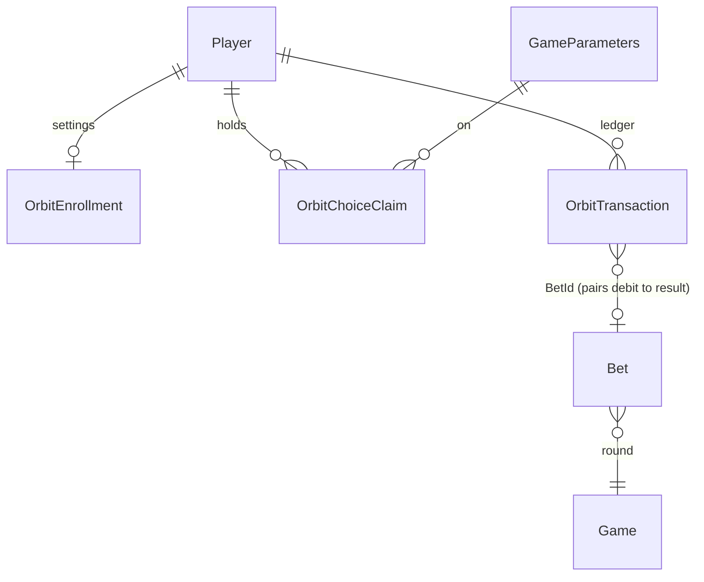
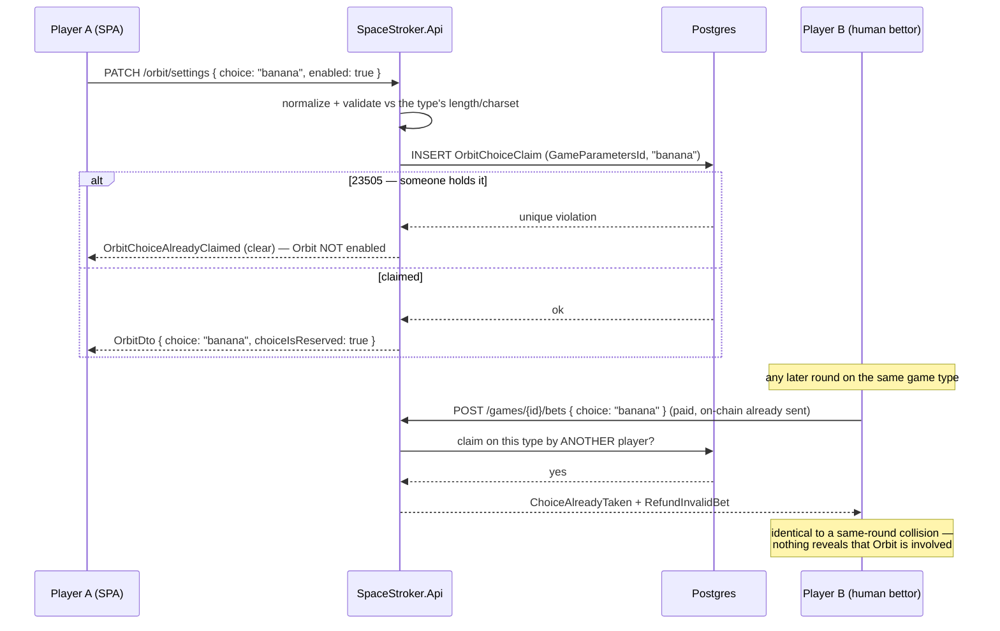

# Space Stroker — "Orbit feedback adjustments" — Implementation Spec

> **Status: Ready for implementation** — refined via Trello card
> [#150 Orbit feedback adjustments](https://trello.com/c/fiKfaawz) (2026-08-05).
> Repos affected: **`monkify-backend`**, **`monkify-front`**, and this doc in **`monkify-meta`**.
>
> **Purpose:** Orbit shipped as three cards (#121 custody, #122 auto-bet engine, #123 notifications)
> and came back from live testing with six pieces of feedback sharing one theme: **the player has too
> little control over what Orbit does with their money, and too little visibility into what it did.**
> Orbit picks their word for them, stopping it means withdrawing everything and waiting 24h, cashing
> out is all-or-nothing once a day, nothing tells them off-screen that they won or ran dry, and
> `/orbit` shows no history. This card closes all six.

---

## 0. Base branch — read this before anything else

⚠️ **This card is NOT based on `main`.** The card requires the slug be cut off
**`feature/orbit-ui-overhaul`** (#141, [knC5QbPJ](https://trello.com/c/knC5QbPJ)), which is still in
*Specs created* and carries the `/orbit` page this card extends.

At branch time (2026-08-05) that base was **behind `main`**: front by **41** commits, meta by **27**,
backend by **13**. It forked *before* #146 shipped the Orbit production gate, so
**`orbitEnabled` did not exist** in `monkify-front/src/constants/featureFlags.ts` on that base — only
`allowFreeBets`. This card's flag requirement was therefore unbuildable as-is.

**Resolution (owner's decision):** `feature/orbit-feedback-adjustments` was cut off
`feature/orbit-ui-overhaul` **and `origin/main` was merged into it immediately**, in all three repos,
as its first commit. #141's own branch was **not** touched. Two conflicts, both resolved keeping
**#141's structure + main's gate**:

| File | Resolution |
| --- | --- |
| `monkify-front/src/components/GameHeader.vue` | main's stacked `<OrbitBalance>` row is **not** restored — #141 deliberately replaced the WALLET-above-ORBIT pair with the bare square `OrbitLauncher` door. main's `orbitEnabled` gate survives and moves **onto the launcher**. The ☰ Orbit row stays a `RouterLink` to `/orbit` (#141's intent) and gains `v-if="orbitEnabled"` (main's gate). |
| `monkify-meta/INDEX.md` | both sides' spec rows kept; main's `Nothing in flight.` dropped as stale. |

⚠️ **Merge-order hazard, unchanged:** merging `feature/orbit-feedback-adjustments` into `main`
**before #141** silently drags the entire UI overhaul in with it, because that work is in its
ancestry. #141 must land first. This is AC35.

⚠️ **The front build was NOT run at spec time** — the fresh worktree has no `node_modules`, and this
skill does not install them. The header merge above is structurally verified by reading only.
`/monkify-implement-feature` must run `yarn lint` + `yarn build` before trusting it.

---

## 1. Summary

Six changes, one branch.

| # | Ask | Shape |
| --- | --- | --- |
| 1 | A fixed word for the player's Orbit bets | Optional per-enrolment choice. On **free-text** types it is a **standing claim on that game type** blocking every other player, Orbit or human. On **preset** types the pick is honoured but **not** reserved. |
| 2 | Partial cash-out; "cool-off 24h → 1h" | Amount field from `MinimumCashOut` to the full balance. **Both** 24h rules become 1h: the one-`Manual`-per-UTC-day cap becomes a rolling 1h gap, and `ReEnableLockHours` goes 24 → 1. |
| 3 | Telegram for wins + a notify-on picker | Three independent per-player Telegram toggles: `Cashout` (default on), `Zero out` (default on), `Any bet's wins` (default **off**). |
| 4 | A log of Orbit bets and results on `/orbit` | New session-gated paged `GET /orbit/bets`, rendered below the main card. Bets and their results only. |
| 5 | A pause button | New `Stopped` state, separate from `Enabled`: the planner skips you and **nothing else** changes. |
| 6 | Deposits during cool-off | The cool-off deposit refusal is dropped. The enable-first refusal stays. |

### 1.1 What does NOT change

The custody model, the pool key, the ledger invariant, the deposit idempotency-by-signature, the
`orbit-cashout` ed25519 requirement on every money movement, the daily deposit cap, the pool float
cap, the placement claim, the start gate, provable fairness, and Orbit's **invisibility to other
players**.

---

## 2. Constraints (MANDATORY)

From `../constraints.md` and `../AGENTS.md`:

- **Worktree-per-repo** (rule 6): `.worktrees/orbit-feedback-adjustments/<repo>`; all three shared
  checkouts stay on `main`. Branch `feature/orbit-feedback-adjustments`, pushed to `origin`.
- **Level `Feature`** ⇒ **mandatory happy-path integration test** (rule 8) in
  `SpaceStroker.Tests.Integration`, plus `features/orbit-feedback-adjustments.md` at ship.
- **Unit tests:** update/add in `SpaceStroker.Tests`; run via `scripts/run_tests.bat` (never the full
  `dotnet test` — `ProductionSessions` is a slow Monte Carlo suite). Report changed tests at the end.
- **EF mapping inline** in `SpaceStrokerDbContext.OnModelCreating`; **migrations applied only by
  `SpaceStroker.Consumers`**.
- ⚠️ **`SpaceStrokerDbContext` is `NoTracking` by default** — load-mutate-`SaveChanges` silently
  persists nothing. Use `AsTracking()` (as `UpdateOrbitSettingsHandler` already does) or
  `ExecuteUpdateAsync`.
- **Secrets/config:** mock/placeholder values only.
- **Orbit stays invisible to other players.** No refusal message, log row or notification may reveal
  that a given player runs Orbit. This is the #118 umbrella rule and it constrains §6.1 directly.
- **Every UI change gets 3 Claude-design mockups, signed off before implementation**, drawn against
  **#141's restructured `/orbit`**, not `main`'s page.
- **Design system:** every overlay through `ArcadeModal`; control heights from `--ctl-h-sm|md|lg`; do
  **not** stack Tailwind utilities on an arcade class (`arcade.css` is imported after
  `@tailwind utilities` and wins at equal specificity); dither, never blur — `usePerfMode` forces
  `html.light-graphics` below `lg`.
- **Everything new sits behind `orbitEnabled`** (`VUE_APP_ORBIT_ENABLED`, fail-closed `=== 'true'`),
  gated at the mount points **and inside the composables**.

---

## 3. Resolved product decisions

| # | Decision |
| --- | --- |
| **D1** | The word is **optional**. Unset ⇒ Orbit keeps deriving from the committed `ServerSeed` via `OrbitChoiceGenerator.DeriveChoice` exactly as today. The derived path stays alive as the fallback. |
| **D2** | On **free-text** types the word is a **standing claim on that game type** — held from the moment it is set until it is changed, cleared, or Orbit is disabled — blocking other Orbit players **and human bettors** in every round. |
| **D3** | The claim holds **even in rounds Orbit does not bet** (STOPPED, out of funds, cool-off). A conditional claim could be lost mid-losing-streak, which would make STOP dangerous. Accepted: a human can be blocked from a word nothing is currently betting. |
| **D4** | On **preset** types the pick is honoured but **never reserved**. Reserving preset choices would cap a preset round at 8 bets and start refunding human bets on a game that has never rejected a duplicate choice. |
| **D5** | **Disabling Orbit releases the claim; re-enabling re-validates it.** The word is remembered as a preference (as `GameParametersId` and the thresholds already are), but the claim drops the instant Orbit goes off. Re-enabling **re-attempts** the claim and is refused with a clear message if it was taken in the gap. Explicitly **not** a silent restore. |
| **D6** | Switching game type **re-claims on the new type**, validated at switch time (available + valid for the new type's length/charset). The switch is refused if it fails, and the old claim is released **only once the new one succeeds**. |
| **D7** | A blocked human sees the existing `ErrorMessages.ChoiceAlreadyTaken` and the shipped refund path — byte-identical to a same-round collision. A distinct "reserved" message was rejected: it would announce that somebody on this type runs Orbit. |
| **D8** | Cash-out gains an **amount**, floored at `MinimumCashOut` and ceilinged at the ledger balance, with a one-tap **MAX**. No-minimum was rejected — each cash-out is a real SPL transfer paid in SOL from the Orbit account's own fee balance. |
| **D9** | **Both** 24h rules become **1h**: the one-`Manual`-per-UTC-day cap becomes a **rolling 1h gap**, and `ReEnableLockHours` goes 24 → 1. They move together — the re-enable lock exists *only* to stop off/on/off walking around the cash-out cap. |
| **D10** | `Threshold`, `Floor`, `ForcedOnDisable` and `ForcedOnSelfExclusion` stay **exempt** from the gap and the minimum, and still cash out the **whole** balance. A rate limit must never trap funds. |
| **D11** | Three independent Telegram toggles, **Telegram only**: `Cashout` (on), `Zero out` (on), `Any bet's wins` (**off**). The in-app toasts keep firing as #123 shipped them. |
| **D12** | ⚠️ This **deliberately reverses #123's** decision not to send Telegram for wins. Opt-in is what makes the reversal safe. Do not re-litigate. |
| **D13** | **"Zero out" = the balance can no longer cover the selected type's stake.** "The floor fired" was rejected — every completed cash-out already sends Telegram, so it would only rename an existing message. |
| **D14** | The log shows **bets and their results only**: timestamp · game type · choice · stake · outcome (won / lost / refunded) · payout. The whole ledger was rejected (it buries the history in bookkeeping and "result" stops being a column). |
| **D15** | The log is **server-side paged, newest first**, `pageSize` capped at 30, all history reachable, and **NOT Redis-cached** — one player's private money history, unlike the public stats/history endpoints. |
| **D16** | **Skipped rounds are NOT logged.** The planner's skip decisions are log lines, not rows; persisting them means new writes on the hot placement path for a page nobody watches. |
| **D17** | **STOP is a new state separate from `Enabled`.** The planner skips the player and nothing else: balance stays put (**no forced cash-out ⇒ no cool-off owed**), the claim stays held, deposits and cash-outs still work, notifications still fire, resuming is instant. |
| **D18** | **Naming: `STOP` / `STOPPED`** for the deliberate stop. The automatic `isPausedForFunds` state **keeps** the word "paused", so no shipped copy moves. |
| **D19** | Deposits: **drop the cool-off refusal only**. The enable-first rule stays. Accepting deposits any time Orbit is off was rejected — it re-opens what enable-first prevents. |
| **D20** | Branch cut off `feature/orbit-ui-overhaul`, merged to `main` **only after #141**. See §0. |

### 3.1 Spec-time corrections to the card

Three things the refined card asserted that code exploration corrected. **These override the card.**

| Card said | Reality | Consequence |
| --- | --- | --- |
| The log pairs each `BetDebit` with "the `WinCredit` or `Refund` carrying the same **`GameId`**". | **`OrbitTransaction.GameId` is set on `BetDebit` rows ONLY** — it *is* the placement claim (unique with the pool key). `WinCredit` and `Refund` carry **`BetId`**, not `GameId`. | The pairing key is **`BetId`**, not `GameId`. See §6.4. |
| (silent) | A `BetDebit` whose placement failed after the debit has **`BetId == null`** — the bet never existed, and the stake came back as a compensating `Refund`. | The log lists `BetDebit` rows **with a non-null `BetId`** only. A failed placement is not a bet and must not be rendered as one. See §6.4.3. |
| The word claim can live on `OrbitEnrollment` as a unique `(GameParametersId, Choice)`. | A unique index on the enrolment row **cannot express D5** — the row still holds the value after a disable, so the claim would never release. | The claim needs its **own row** whose existence *is* the claim. New `OrbitChoiceClaim` entity. See §4.2. |

### 3.2 Decided here, beyond the card

`Zero out` needs a **server-side** trigger and server-side once-per-episode tracking. Today the
"paused for funds" state is derived **client-side** in `useOrbit` and de-duplicated per wallet in
`localStorage` — neither of which the Telegram sender can read. This spec therefore adds
`OrbitEnrollment.ZeroOutNotifiedAt` (§4.1) and evaluates it at settlement (§6.5.2). Without it the
message either never fires or fires every round.

---

## 4. Data model

One additive migration. Every new column is nullable or defaulted, so **no backfill** is needed and
every pre-existing enrolment reads as: no word, not stopped, cash-out + zero-out notifications on,
wins off (AC24).

### 4.1 `OrbitEnrollment` — new columns

`monkify-backend/src/SpaceStroker.Domain/Orbit/Entities/OrbitEnrollment.cs`

```csharp
/// <summary>
/// The word (free-text types) or preset pick this player's Orbit always backs. NULL ⇒ Orbit derives
/// the choice from the round's committed ServerSeed, exactly as it did before #150.
///
/// This is the REMEMBERED PREFERENCE, not the claim. On a free-text type the live reservation is an
/// OrbitChoiceClaim row, which is released the instant Orbit is disabled — the value here survives so
/// the player sees their word when they come back, and re-enabling RE-ATTEMPTS the claim (D5).
/// </summary>
public string? Choice { get; set; }

/// <summary>
/// The deliberate pause. Separate from Enabled ON PURPOSE: disabling force-cashes-out the balance and
/// owes a cool-off, and a player who just wants Orbit to sit out a few rounds should pay neither.
/// Stopped skips the planner and NOTHING else — the balance, the claim, deposits, cash-outs and every
/// notification are untouched (D17).
/// </summary>
public bool Stopped { get; set; }

/// <summary>Telegram, per event. Cash-out defaults ON so nobody linked loses a message they get today.</summary>
public bool NotifyOnCashOut { get; set; } = true;
public bool NotifyOnZeroOut { get; set; } = true;

/// <summary>
/// Defaults OFF. #123 rejected Telegram-for-wins outright because an always-on Orbit player would get
/// dozens a day; #150 reverses that, and opt-in is what makes the reversal safe (D12).
/// </summary>
public bool NotifyOnWin { get; set; }

/// <summary>
/// When the "Orbit ran out of funds" Telegram message last fired, so it fires ONCE PER EPISODE rather
/// than every settled round. Cleared the moment the balance covers the stake again.
///
/// Server-side because the sender lives in Consumers: the shipped in-app pause toast is derived in
/// useOrbit and de-duplicated in localStorage, neither of which a background consumer can read (§3.2).
/// </summary>
public DateTime? ZeroOutNotifiedAt { get; set; }
```

### 4.2 `OrbitChoiceClaim` — new entity (the reservation)

`monkify-backend/src/SpaceStroker.Domain/Orbit/Entities/OrbitChoiceClaim.cs`

```csharp
/// <summary>
/// A live reservation of one normalized word on one game type. THE ROW'S EXISTENCE IS THE CLAIM:
/// inserted when a free-text word is claimed, deleted when it is changed, cleared, or Orbit is
/// disabled (D5). That is why this is not a column on OrbitEnrollment — a unique index on the
/// enrolment row could not release the claim without also forgetting the player's preference.
///
/// Deliberately NOT pool-keyed, matching OrbitEnrollment: a reservation is a preference about a game
/// type, not money, so rotating the Orbit account or mint must not disturb it.
///
/// FREE-TEXT TYPES ONLY. A preset pick writes no row (D4) — Beast Mode choices stay shared.
/// </summary>
public class OrbitChoiceClaim : TableEntity
{
    public Guid PlayerId { get; set; }
    public Player Player { get; set; }

    public Guid GameParametersId { get; set; }
    public GameParameters GameParameters { get; set; }

    /// <summary>Normalized exactly like Bet.Choice: trimmed, lowercase, no spaces or symbols.</summary>
    public string Choice { get; set; }
}
```

### 4.3 EF configuration (inline)

`monkify-backend/src/SpaceStroker.Infrastructure/Data/Context/SpaceStrokerDbContext.cs`, in
`OnModelCreating`, beside the existing Orbit blocks:

```csharp
modelBuilder.Entity<OrbitChoiceClaim>(builder =>
{
    builder.Property(x => x.Choice).HasMaxLength(20).IsRequired();

    // THE reservation guard. The application check in RegisterBetHandler is the friendly path; this
    // index is what actually holds under concurrency, exactly as (GameId, ExclusiveChoice) does for
    // per-round exclusivity. A loser surfaces 23505 and is mapped to the same clear message (AC10).
    builder.HasIndex(x => new { x.GameParametersId, x.Choice }).IsUnique();

    // The money-path read is "does a DIFFERENT player hold this word on this type", and the unique
    // index above already serves it. This one serves the release path (delete every claim this player
    // holds) and the settings read, both keyed on the player.
    builder.HasIndex(x => x.PlayerId);

    builder.HasOne(x => x.Player).WithMany().HasForeignKey(x => x.PlayerId);
    builder.HasOne(x => x.GameParameters).WithMany().HasForeignKey(x => x.GameParametersId);
});

modelBuilder.Entity<OrbitEnrollment>(builder =>
{
    builder.Property(x => x.Choice).HasMaxLength(20);
    builder.Property(x => x.Stopped).HasDefaultValue(false);
    builder.Property(x => x.NotifyOnCashOut).HasDefaultValue(true);
    builder.Property(x => x.NotifyOnZeroOut).HasDefaultValue(true);
    builder.Property(x => x.NotifyOnWin).HasDefaultValue(false);
});
```

`HasMaxLength(20)` matches `Bet.ExclusiveChoice` (`SpaceStrokerDbContext.cs:134`) so a claim can never
be too short to hold a legal choice.

### 4.4 Migration

Name: **`AddOrbitFeedbackAdjustments`**.

```bash
dotnet ef migrations add AddOrbitFeedbackAdjustments \
  --project src/SpaceStroker.Infrastructure \
  --startup-project src/SpaceStroker.Consumers
```

Additive only: one new table, five new columns, two new indexes. `Down` drops them. Applied by
`SpaceStroker.Consumers` at startup, as always.

### 4.5 ER



---

## 5. Configuration

`monkify-backend/src/SpaceStroker.Common/spacestrokersettings.json`, under
`GeneralSettings:Operator:Token:Orbit`, bound by
`SpaceStroker.Domain/Configs/Entities/OrbitSettings.cs`:

| Setting | Was | Becomes | Why |
| --- | --- | --- | --- |
| `ReEnableLockHours` | `24` | **`1`** | D9. Its own doc-comment says it exists only to stop off/on/off walking around the manual cash-out cap; with that cap at 1h, a longer lock protects nothing. |
| `ManualCashOutGapMinutes` | *(new)* | **`60`** | D9. Replaces the implicit "one per UTC calendar day". `0` disables the gap entirely, mirroring how `ReEnableLockHours = 0` disables the lock. |

No new secret, no new Terraform id, no deploy-tool change.

---

## 6. Backend behaviour

### 6.1 The word claim on the bet path

`monkify-backend/src/SpaceStroker.Infrastructure/Handlers/Games/RegisterBet/RegisterBetHandler.cs`

The new check goes inside the **existing** `isFreeTextGame` block in `ValidateBetParameters`
(currently `:259-268`), immediately after the per-round exclusivity query and before
`GameNotValidForBets`:

```csharp
var isFreeTextGame = betGame?.Parameters?.PresetChoices.IsNullOrEmpty() ?? false;
if (isFreeTextGame)
{
    var choiceTaken = await _spacestrokerDbContext.GameBets
        .AnyAsync(x => x.GameId == request.GameId && x.Choice == _bet.Choice);
    if (choiceTaken)
        await RefundInvalidBet(ErrorMessages.ChoiceAlreadyTaken);

    // #150: the CROSS-ROUND reservation. A word another player has claimed on this game type is
    // refused in every round, whether or not their Orbit is betting right now (D3).
    //
    // ⚠️ "another player" is load-bearing twice over: the claimant's own Orbit bet must not be
    // rejected by their own claim, and neither must a manual bet they place themselves.
    //
    // ⚠️ Same message and same path as the per-round collision above — deliberately
    // indistinguishable. A distinct "reserved" message would announce that somebody on this type
    // runs Orbit, which the #118 umbrella forbids (D7).
    var reservedByAnother = await _spacestrokerDbContext.OrbitChoiceClaims
        .AnyAsync(x => x.GameParametersId == betGame!.ParametersId
                    && x.Choice == _bet.Choice
                    && x.PlayerId != _bet.PlayerId);

    if (reservedByAnother)
        await RefundInvalidBet(ErrorMessages.ChoiceAlreadyTaken);
}
```

Notes the implementer needs:

- `RefundInvalidBet` **throws**, so no `return` follows it — matching every neighbouring block.
- It refunds a **paid** bet (the on-chain transfer already landed) and is log-only for a free bet.
  This is the shipped bet-less refund path from `legal-docs-self-exclusion` — the event carries
  `GameId` + signature, because no `Bet` row exists yet.
- `_bet.PlayerId` is **null** for an anonymous free bet. `x.PlayerId != null-guid` is not expressible
  that way; write the comparison so a null player never matches a claim
  (`_bet.PlayerId == null || x.PlayerId != _bet.PlayerId`), following the explicit-null discipline the
  `SecondBetNeedsAnotherPlayer` block already documents at `:246-250`.
- ⚠️ **Ordering:** this runs *before* `BetDomainService.ChoiceIsValidForGame`, so `_bet.Choice` has
  been trimmed/normalized by the handler but not yet charset-validated. That is fine for a lookup —
  an invalid choice simply matches no claim and is rejected a few lines later — and moving the check
  after validation would put it after `GameNotValidForBets`, which is wrong.

### 6.2 Placement — use the word when it is set

`monkify-backend/src/SpaceStroker.Infrastructure/Consumers/OrbitBetPlacement/PlaceOrbitBetConsumer.cs`

The choice loop (`:193-210`, `MaxChoiceAttempts = 10`) becomes conditional:

- Enrolment `Choice` **set** ⇒ use it verbatim. **Skip the attempt loop entirely** — there is nothing
  to re-derive, and a collision now means the player's own claim is unusable this round, not that a
  new candidate should be drawn.
- Enrolment `Choice` **null** ⇒ today's `OrbitChoiceGenerator.DeriveChoice(serverSeed, playerId,
  attempt, parameters)` loop, unchanged.

⚠️ **`OrbitChoiceGenerator.DeriveSeed` is NOT touched.** `Bet.Seed` stays
`HMAC(ServerSeed, "orbit-seed|playerId")` with `Nonce = 0` whether or not a word is set, so offline
verification is unaffected. What changes is only that the *choice* stops being seed-derived — exactly
as it already is for every human bet.

⚠️ On a free-text type with a word set, a collision is possible only against a **human** who took the
word in this round *before* the claim existed, or against the player's own earlier bet. The consumer
must treat that as **skip the round**, not as a retry: it has no second candidate to fall back to.

### 6.3 Eligibility — `Stopped`

`monkify-backend/src/SpaceStroker.Infrastructure/Services/Orbit/OrbitBetPlacementService.cs`,
`ResolveCandidates` (`:61-79`):

```csharp
var candidates = await _context.OrbitEnrollments
    .Where(enrollment => enrollment.Enabled
                      && !enrollment.Stopped          // #150 — D17
                      && enrollment.GameParametersId == parameters.Id)
    // … self-exclusion join, balance join, already-bet filter unchanged …
```

That single predicate is the whole of STOP on the placement side. Everything else about a stopped
player — balance, claim, deposits, cash-outs, notifications, the start gate — is deliberately
untouched.

⚠️ **STOP never abandons an armed gate.** A placement already dispatched behind
`Game.ExpectedOrbitBets` must still land or decrement (`ReleaseGateSlot`), or the round waits on a bet
that never comes. STOP takes effect from the **next** planning pass. No code change is needed for
this — it falls out of `Stopped` being read only in `ResolveCandidates` — but it is an acceptance
criterion (AC20) and must be tested.

### 6.4 The bet log

#### 6.4.1 Endpoint

`monkify-backend/src/SpaceStroker.Api/Controllers/OrbitController.cs`:

```csharp
[HttpGet("bets")]
public async Task<IActionResult> GetBets([FromQuery] int pageNumber = 1, [FromQuery] int pageSize = 20)
```

- **Session-gated** exactly like every other route on this controller — the wallet comes from the
  validated `X-Orbit-Session` via `OrbitSessionAccessor`, never from the caller.
- Add `[HttpOptions("bets")]` to the existing CORS list at `:33-40`.
- New rule `"*:/orbit/bets"` in `spacestrokersettings.json` beside the other eight Orbit rules
  (`:26-61`). ⚠️ **`RateLimitSettingsTests` asserts the rule set EXACTLY** — update it deliberately.
  **Its guard that the bet path never gains a rule stays untouched.**
- `pageSize` clamped to **30**, `pageNumber` clamped at ≥ 1, mirroring the games-history endpoint. An
  out-of-range page returns an **empty page**, never a 400 (AC28).
- **No Redis cache** (D15).

#### 6.4.2 Handler

New `Handlers/Orbit/GetOrbitBets/{GetOrbitBetsRequest,GetOrbitBetsHandler}.cs`, returning
`PaginatedList<OrbitBetLogDto>` (`SpaceStroker.Common/Models/PaginatedList.cs`, via
`PaginatedList<T>.CreateAsync`).

```csharp
public class OrbitBetLogDto
{
    public DateTime PlacedAt { get; set; }        // the BetDebit row's CreatedDate
    public string GameTypeName { get; set; }
    public string Choice { get; set; }
    public decimal Stake { get; set; }            // abs(BetDebit.Amount)
    public OrbitBetOutcome Outcome { get; set; }  // Won | Lost | Refunded | Pending
    public decimal? Payout { get; set; }          // the WinCredit / Refund amount; null when none
    public string TokenLabel { get; set; }
}
```

#### 6.4.3 The query — pairing is on `BetId`, not `GameId`

⚠️ **This corrects the card** (§3.1). `OrbitTransaction.GameId` is set on **`BetDebit` rows only** —
it *is* the placement claim. `WinCredit` and `Refund` rows carry **`BetId`**.

```
rows  = OrbitTransactions
        WHERE PlayerId = me
          AND Type = BetDebit
          AND BetId IS NOT NULL          -- see below
        ORDER BY CreatedDate DESC
join  Bet          ON Bet.Id = row.BetId                    -- Choice, GameId
join  Game         ON Game.Id = Bet.GameId                  -- Status (is it settled?)
join  GameParameters ON …                                   -- GameTypeName
left  OrbitTransactions result
      ON result.BetId = row.BetId AND result.Type IN (WinCredit, Refund)
```

Outcome resolution:

| Condition | Outcome | Payout |
| --- | --- | --- |
| a `WinCredit` exists for the bet | `Won` | its `Amount` |
| a `Refund` exists for the bet | `Refunded` | its `Amount` |
| neither, and the round has reached a final status | `Lost` | `null` |
| neither, and the round is still open/running | `Pending` | `null` |

⚠️ **`BetId IS NOT NULL` is load-bearing** (§3.1). A `BetDebit` is written **before** the transfer is
signed and its `BetId` is filled in only *after* the bet lands. A placement that failed after the
debit therefore leaves a `BetDebit` with a null `BetId`, compensated by a `Refund`. That was never a
bet, and rendering it as one would show the player a bet they never had. It is excluded here and the
money still reconciles, because the ledger — not this page — is the accounting record.

⚠️ **Pool scoping:** filter on the current `(OrbitAccount, MintAddress)` pool like every other Orbit
read, or a rotated account would mix two pools' history in one table under one `TokenLabel`.

### 6.5 Notifications

#### 6.5.1 Win

`Infrastructure/Services/Orbit/OrbitBetSettlementService.cs` already publishes
`OrbitWinNotificationEvent` after `Settle` commits and after `EvaluateThreshold`.
`Consumers/OrbitNotification/OrbitNotificationConsumer.cs` pushes it to the per-player SignalR group.

Add the Telegram send **in the consumer**, gated on `NotifyOnWin`. The SignalR push stays
**ungated** — D11: the toggles govern Telegram only.

#### 6.5.2 Zero out

Evaluated in `OrbitBetSettlementService`, in the same settle-time pass that already runs
`EvaluateFloor` (so it acts on a **resolved** bet, never a placed one — the rule #123 established and
this card must not break):

```
after settlement for this player:
    stake   = the enrolment's game type RequiredAmount
    balance = ledger balance
    if balance < stake and ZeroOutNotifiedAt is null and enrolment.Enabled and not Stopped:
        send Telegram if NotifyOnZeroOut
        set ZeroOutNotifiedAt = UtcNow
    if balance >= stake and ZeroOutNotifiedAt is not null:
        clear ZeroOutNotifiedAt        -- the episode is over; a later pause notifies again
```

The clear must **also** run on a credited deposit (`CreditOrbitDepositHandler`), or a player who tops
up and never bets again stays flagged and misses their next real pause (AC23).

⚠️ Mirror the shipped in-app rule: a **freshly enabled** Orbit that has never bet is *not* paused, it
is unfunded. Guard on `OrbitBetsPlaced > 0` — deliberately **not** `balance > 0`, because a real pause
very often lands on exactly `0`.

#### 6.5.3 Cash-out

`Consumers/OrbitCashOut/OrbitCashOutConsumer.cs` already sends on `Completed` for all five sources.
Wrap that send in `NotifyOnCashOut`. **Nothing else about it changes** — a failed or reversed transfer
still sends nothing, and Telegram is still never allowed to fail a money path.

### 6.6 Cash-out — amount and the 1h gap

`Infrastructure/Services/Orbit/OrbitCashOutReserver.cs`:

```csharp
public async Task<OrbitCashOutReservationResult> Reserve(
    Guid playerId, OrbitCashOutSource source, bool enforceLimits,
    decimal? requestedAmount = null,            // #150 — null ⇒ the whole balance (MAX, and every
    CancellationToken cancellationToken = default)   //        non-Manual source)
```

Inside, after `ResolveBalance` (which stays the **ledger** read — a cash-out must not be sized by a
cache):

```csharp
var available = await _ledger.ResolveBalance(playerId, cancellationToken);
if (available <= 0m) return … NothingToCashOut …

var amount = requestedAmount ?? available;      // null ⇒ everything, today's behaviour

if (enforceLimits)
{
    if (amount > available)  return … InsufficientFunds …
    if (amount < orbit.MinimumCashOut) return … BelowMinimum …
    if (await HasManualCashOutWithinGap(playerId, cancellationToken))
        return … AlreadyCashedOutToday …        // enum value kept; see below
}
```

- ⚠️ **`requestedAmount` is ignored when `enforceLimits: false`.** Every `Threshold` / `Floor` /
  `Forced*` caller passes `false` and must keep taking the **whole** balance (D10). Do not thread a
  partial amount into them.
- `HasManualCashOutToday` (`:93-102`) becomes `HasManualCashOutWithinGap`, replacing
  `DateTime.UtcNow.Date` with `DateTime.UtcNow.AddMinutes(-ManualCashOutGapMinutes)`. The
  `Source == Manual` filter is **unchanged** — only manual cash-outs consume the gap.
- The `OrbitCashOutReservation.AlreadyCashedOutToday` enum member is **kept** (renaming it churns
  every call site and test for no behavioural gain), but its user-facing string
  `ErrorMessages.OrbitAlreadyCashedOutToday` **must be re-worded** — it currently says *"already
  cashed out today"*, which becomes a lie at a 1h gap. New copy: *"You have cashed out recently.
  Please try again shortly."* Ordinary game state ⇒ stays **clear**, not vague (#121's rule).
- The `Pending` row + atomic conditional `TryDebit` inside one transaction, and publishing
  `OrbitCashOutRequestedEvent` only **after** the commit, are untouched.

`Handlers/Orbit/RequestOrbitCashOut/RequestOrbitCashOutRequest.cs`:

```csharp
public class RequestOrbitCashOutRequestBody
{
    public decimal? Amount { get; set; }   // #150 — null ⇒ the whole balance
    public string? Nonce { get; set; }
    public string? Signature { get; set; }
}
```

⚠️ The record's doc-comment currently states *"There is deliberately NO destination and NO amount in
this contract"* — **update it**. There is still no destination; there is now an amount. The **fresh
`orbit-cashout` ed25519 signature over a purpose-scoped nonce is still required**, unchanged.

`OrbitCashOutDto.Balance`'s comment ("Always 0 on success") is now wrong for a partial — it must
return the **remaining** balance.

### 6.7 Settings — word, STOP, flags

`Handlers/Orbit/UpdateOrbitSettings/UpdateOrbitSettingsRequest.cs` body gains:

```csharp
public string? Choice { get; set; }
public bool ClearChoice { get; set; }        // same explicit-clear pattern as the two thresholds
public bool? Stopped { get; set; }
public bool? NotifyOnCashOut { get; set; }
public bool? NotifyOnZeroOut { get; set; }
public bool? NotifyOnWin { get; set; }
```

`UpdateOrbitSettingsHandler` gains the claim lifecycle. Order matters:

1. **Validate the word** against the *target* game type (the one in this patch if present, else the
   stored one): normalized (trim + lowercase; no spaces or symbols, per `bet-choice-casing`), and
   exactly `ChoiceRequiredLength` characters drawn from `AllowedCharacters`. Reuse the same predicate
   `BetDomainService.ChoiceIsValidForGame` applies, so a claimable word can never be a word the bet
   path would reject. Invalid ⇒ `ErrorMessages.OrbitChoiceInvalid` (**new**, clear — this is the
   player's own input, not a probe).
2. **Preset target ⇒ store `Choice`, write NO claim** (D4).
3. **Free-text target ⇒ claim it.** Insert an `OrbitChoiceClaim`; a `23505` on
   `(GameParametersId, Choice)` ⇒ `ErrorMessages.OrbitChoiceAlreadyClaimed` (**new**, clear).
4. **Game-type switch (D6):** insert the claim on the **new** type first; delete the old type's claim
   **only after** the insert succeeds. A failure leaves the player exactly where they were.
5. **`ClearChoice` / disable ⇒ delete this player's claim rows.** `Choice` on the enrolment survives a
   disable (it is the remembered preference) and is nulled only by `ClearChoice`.
6. **Enable (D5):** re-attempt the claim as part of the same patch. Taken ⇒ reject with
   `OrbitChoiceAlreadyClaimed` and **do not enable** — the player picks another word first.
7. `Stopped` and the three notify flags are plain writes. **`Stopped` requires no signature** — it
   moves no money, so it follows the game-type/threshold rule, not the cash-out rule.

⚠️ The handler reads the enrolment `AsTracking()` already (`:70`); the new claim writes must go
through the same `SaveChangesAsync`, and the forced cash-out on disable must still run **after** the
flag is persisted, as it does today.

⚠️ `ConsiderTheCurrentRound` (the best-effort `GameOpenedEvent` re-plan) should now **not** fire when
the patch leaves the player `Stopped` — publishing a re-plan for a player the planner will skip is
harmless but noisy.

### 6.8 Deposits during cool-off

`Handlers/Orbit/CreditOrbitDeposit/CreditOrbitDepositHandler.cs` — **delete** the cool-off deferral at
`:87-102` (the `OrbitReEnableLock.ResolveLockedUntil` block and its
`ErrorMessages.OrbitDepositCoolOff` refusal). D19.

**Keep, unchanged:**

- the enable-first deferral immediately below it (`:110-120`, `ErrorMessages.OrbitNotEnabled`),
- its position **after** the idempotency check, so a replay of an already-credited deposit still
  succeeds,
- the daily cap, the pool float cap and the on-chain transfer verification.

`ErrorMessages.OrbitDepositCoolOff` becomes unused — **delete the resource entry** rather than leaving
a dangling string.

⚠️ **`OrbitReEnableLock` itself stays** — it still gates *re-enabling*, only at 1h. Only its use in the
deposit path goes.

### 6.9 `GET /orbit` — new fields

`Handlers/Orbit/GetOrbit/GetOrbitRequest.cs` → `OrbitDto`:

```csharp
public string? Choice { get; set; }
public bool ChoiceIsReserved { get; set; }   // false on preset types even when Choice is set
public bool Stopped { get; set; }
public bool NotifyOnCashOut { get; set; }
public bool NotifyOnZeroOut { get; set; }
public bool NotifyOnWin { get; set; }

/// <summary>
/// When the next MANUAL cash-out is allowed; null when one is allowed now. Replaces CanCashOutToday,
/// which cannot express a rolling gap. Our own SPA is the only consumer, so this is a clean break.
/// </summary>
public DateTime? NextManualCashOutAt { get; set; }
```

⚠️ **`CanCashOutToday` is removed, not kept alongside.** Leaving both would let the two disagree the
moment the gap is not a calendar day. Update `types/orbit.ts` and every read in the same commit.

---

## 7. Frontend behaviour

All of it inside `orbitEnabled` (see §0 — the flag now exists on this branch).

### 7.1 `hooks/useOrbit.ts`

- New state off `GET /orbit`: `choice`, `choiceIsReserved`, `stopped`, the three notify flags,
  `nextManualCashOutAt`.
- `saveChoice(word)` / `clearChoice()` / `setStopped(bool)` / `setNotify(flag, bool)` — all through
  the existing `PATCH /orbit/settings`, all surfacing **the server's own message** on failure (the
  `error.message`-is-the-status-line fix #123 shipped).
- `cashOut(amount?)` — `amount` omitted ⇒ MAX, preserving today's call shape.
- `loadBets(page)` → `GET /orbit/bets`, its own loading/error state, **not** folded into the main
  `GET /orbit` poll.
- Module-level state and **per-wallet re-scoping** are preserved — switching wallets must not leave
  the previous wallet's word or log rows on screen.

### 7.2 `pages/OrbitPage.vue` (as restructured by #141)

The page is a four-step collapse-to-dashboard list (`OrbitStepRow`, `:index` 1–4: Game · Money · Stop
rules · Telegram). This card adds:

| Where | What |
| --- | --- |
| **Step 1 · Game** | The word field, beside the game picker — it is a property *of the game you chose*, and it must re-validate when the game changes. Collapsed summary shows the word. |
| **Step 3 · Stop rules** | Nothing structural — the two existing rule editors stay. |
| **Step 4 · Telegram** | The three notify-on toggles, inside the existing linked block. Hidden with the rest of the section when Telegram is unconfigured/unlinked. |
| **Cash-out row** | The amount field + **MAX**. Still a **secondary/outline** control, never amber — a healthy running Orbit shows no amber (#141 R5). |
| **Utility strip** | **STOP** / **RESUME**. Not a step: it acts on a *running* Orbit, so it has no place in a setup order (#141 R4). |
| **Below the main card** | The log table (§7.4). |
| **Status banner** | Must distinguish `STOPPED` from `PAUSED` at a glance (D18). |

⚠️ **No control on the page opens a modal** (#141 R6). The word editor, the notify toggles, STOP and
the log are all inline.

### 7.3 `components/orbit/OrbitModal.vue`

STOP is surfaced in the compact modal (it is a mid-round action — the whole reason the modal exists).
The **word is edited on the page only**: it is setup, it needs game-type context, and a mis-tap beside
the bet lever must never re-point a player's Orbit.

### 7.4 The log table

New `components/orbit/OrbitBetLog.vue`, rendered below the main panel. Columns: **WHEN · GAME ·
CHOICE · STAKE · RESULT · PAYOUT**. Newest first, paged, `pageSize ≤ 30`.

- Wide content must scroll inside its own container — the page body never scrolls horizontally.
- Empty state is a plain line ("Orbit has not placed a bet yet"), not an error.
- Result uses the semantic palette #141 established: green won, red lost, plain ink refunded/pending.
- Every phone runs `html.light-graphics`, so no `backdrop-filter`, no `blur()`, no infinite animation.

### 7.5 `useGame.bet()`

A **pre-pay guard**: if the chosen word is reserved by someone else, refuse before the transfer,
mirroring the shipped choice-exclusivity guard so a crypto player is never charged for a bet that will
be refunded. **Best-effort only — the backend is authoritative** (§6.1).

⚠️ It must reuse whatever the reserved-word signal is **without** naming Orbit in the copy: the same
"that choice is already taken" the per-round guard shows. Anything else leaks (D7).

---

## 8. Flow — claiming a word and blocking a human



---

## 9. Out of scope

- Reserving **preset** choices — Beast Mode picks stay shared.
- Logging **skipped rounds** or exposing the planner's reasoning.
- Web Push, email/SMS, a broadcast channel; Telegram for deposits or losses.
- Orbit on **lottery** types — the engine excludes them by design.
- `useOrbitRedirect`'s 2s poll cadence (earmarked follow-up).
- The `/admin` `Allow Orbit auto-play` checkbox.
- Flipping `VUE_APP_ORBIT_ENABLED` on in production — an ops decision.
- The committed **devnet** keypair (deliberate, user-authorised; production overrides it).
- Anything **#141** owns: the `/orbit` restructure itself, `.arcade-frame--orbit`, the semantic
  palette, the console module, the mobile deeplink stash.

---

## 10. File checklist

### 10.1 Backend (`monkify-backend`)

| # | File | Change |
| --- | --- | --- |
| 1 | `src/SpaceStroker.Domain/Orbit/Entities/OrbitEnrollment.cs` | +`Choice`, `Stopped`, 3 notify flags, `ZeroOutNotifiedAt` |
| 2 | `src/SpaceStroker.Domain/Orbit/Entities/OrbitChoiceClaim.cs` | **new** — the reservation row |
| 3 | `src/SpaceStroker.Domain/Configs/Entities/OrbitSettings.cs` | `ReEnableLockHours` 24→1; +`ManualCashOutGapMinutes` |
| 4 | `src/SpaceStroker.Infrastructure/Data/Context/SpaceStrokerDbContext.cs` | inline mapping + unique `(GameParametersId, Choice)` + `PlayerId` index; `DbSet<OrbitChoiceClaim>` |
| 5 | `src/SpaceStroker.Infrastructure/Migrations/…_AddOrbitFeedbackAdjustments.cs` | **new** — additive |
| 6 | `src/SpaceStroker.Infrastructure/Handlers/Games/RegisterBet/RegisterBetHandler.cs` | cross-round reservation check in `ValidateBetParameters` |
| 7 | `src/SpaceStroker.Infrastructure/Consumers/OrbitBetPlacement/PlaceOrbitBetConsumer.cs` | use `Choice` when set; skip the attempt loop |
| 8 | `src/SpaceStroker.Infrastructure/Services/Orbit/OrbitBetPlacementService.cs` | `!Stopped` in `ResolveCandidates` |
| 9 | `src/SpaceStroker.Infrastructure/Services/Orbit/OrbitCashOutReserver.cs` | `requestedAmount`; `HasManualCashOutToday` → `HasManualCashOutWithinGap` |
| 10 | `src/SpaceStroker.Infrastructure/Services/Orbit/IOrbitCashOutReserver.cs` | signature |
| 11 | `src/SpaceStroker.Infrastructure/Handlers/Orbit/RequestOrbitCashOut/RequestOrbitCashOutRequest.cs` | +`Amount`; correct the "NO amount" doc-comment and `Balance`'s |
| 12 | `…/RequestOrbitCashOut/RequestOrbitCashOutHandler.cs` | pass the amount through |
| 13 | `…/UpdateOrbitSettings/UpdateOrbitSettingsRequest.cs` | +`Choice`/`ClearChoice`/`Stopped`/3 flags |
| 14 | `…/UpdateOrbitSettings/UpdateOrbitSettingsHandler.cs` | claim lifecycle (§6.7) |
| 15 | `…/CreditOrbitDeposit/CreditOrbitDepositHandler.cs` | delete the cool-off deferral; clear `ZeroOutNotifiedAt` |
| 16 | `…/GetOrbit/GetOrbitRequest.cs` + `GetOrbitHandler.cs` | new DTO fields; `CanCashOutToday` → `NextManualCashOutAt` |
| 17 | `…/GetOrbitBets/{GetOrbitBetsRequest,GetOrbitBetsHandler}.cs` | **new** — the paged log |
| 18 | `src/SpaceStroker.Infrastructure/Services/Orbit/OrbitBetSettlementService.cs` | zero-out evaluation beside `EvaluateFloor` |
| 19 | `src/SpaceStroker.Infrastructure/Consumers/OrbitCashOut/OrbitCashOutConsumer.cs` | gate the send on `NotifyOnCashOut` |
| 20 | `src/SpaceStroker.Infrastructure/Consumers/OrbitNotification/OrbitNotificationConsumer.cs` | Telegram send gated on `NotifyOnWin`; SignalR push ungated |
| 21 | `src/SpaceStroker.Api/Controllers/OrbitController.cs` | `GET /orbit/bets` + `[HttpOptions("bets")]` |
| 22 | `src/SpaceStroker.Common/spacestrokersettings.json` | `*:/orbit/bets` rate rule; the two Orbit settings |
| 23 | `src/SpaceStroker.Common/Resources/ErrorMessages.resx` (+ `.Designer.cs`) | +`OrbitChoiceInvalid`, +`OrbitChoiceAlreadyClaimed`; re-word `OrbitAlreadyCashedOutToday`; **delete** `OrbitDepositCoolOff` |

### 10.2 Frontend (`monkify-front`)

| # | File | Change |
| --- | --- | --- |
| 1 | `src/types/orbit.ts` | new `OrbitState` fields; `OrbitSettingsPatch`; `OrbitBetLogRow`; drop `canCashOutToday` |
| 2 | `src/services/orbitService.ts` | `getOrbitBets(page, size)`; amount on the cash-out call |
| 3 | `src/hooks/useOrbit.ts` | §7.1 |
| 4 | `src/pages/OrbitPage.vue` | word field, STOP, amount field, notify toggles, log mount |
| 5 | `src/components/orbit/OrbitBetLog.vue` | **new** |
| 6 | `src/components/orbit/OrbitModal.vue` | STOP in the compact modal |
| 7 | `src/components/orbit/OrbitStatusBanner.vue` | `STOPPED` vs `PAUSED` |
| 8 | `src/components/orbit/OrbitStatusTag.vue` | the `STOPPED` tag |
| 9 | `src/hooks/useGame.ts` | pre-pay reserved-word guard |

### 10.3 Meta (`monkify-meta`)

| # | File | Change |
| --- | --- | --- |
| 1 | `specs/orbit-feedback-adjustments.md` | this spec |
| 2 | `INDEX.md` | map row + "Feature currently in flight" |
| 3 | `features/orbit-feedback-adjustments.md` | **at ship** (`/monkify-ship-feature`) |
| 4 | `features/orbit-{custodial-wallet,auto-bet-engine,notifications}.md` | corrected at ship |

---

## 11. Unit tests

Project: `monkify-backend/src/SpaceStroker.Tests`. Run with `scripts/run_tests.bat`.

| Test file | Cases | Expected |
| --- | --- | --- |
| `UnitTests/Handlers/Games/RegisterBetTests.cs` | word reserved by another player on a free-text type; reserved by **the caller**; reserved on a **different** type; preset type with a claim row present (impossible by construction, assert it is ignored) | reject+refund · allow · allow · allow |
| `UnitTests/Handlers/Orbit/UpdateOrbitSettingsTests.cs` | set a valid word; wrong length; illegal charset; uppercase; already claimed; `ClearChoice`; disable releases; re-enable re-validates (free vs taken); game-type switch (ok vs taken); preset target writes no claim; `Stopped` needs no signature | per §6.7 |
| `UnitTests/Services/OrbitCashOutReserverTests.cs` | partial within bounds; below minimum; above balance; null ⇒ whole balance; inside the 1h gap; outside it; `enforceLimits:false` ignores the amount and takes everything | per §6.6 |
| `UnitTests/Services/OrbitBetPlacementServiceTests.cs` | `Stopped` excluded from candidates; not stopped included | eligibility |
| `UnitTests/Consumers/PlaceOrbitBetConsumerTests.cs` | word set ⇒ used verbatim, no derivation; word null ⇒ derived; word set + collision ⇒ skip, not retry | per §6.2 |
| `UnitTests/Handlers/Orbit/GetOrbitBetsTests.cs` | pairing on `BetId`; `Won`/`Lost`/`Refunded`/`Pending`; **`BetId == null` excluded**; another player's rows never returned; `pageSize` clamp; out-of-range page ⇒ empty | per §6.4 |
| `UnitTests/Consumers/OrbitCashOutConsumerTests.cs` | flag on ⇒ send; flag off ⇒ no send; failed transfer ⇒ no send either way | per §6.5.3 |
| `UnitTests/Consumers/OrbitNotificationConsumerTests.cs` | `NotifyOnWin` off ⇒ SignalR still pushed, Telegram not sent | D11 |
| `UnitTests/Services/OrbitBetSettlementServiceTests.cs` | zero-out fires once per episode; cleared on recovery; not fired for `OrbitBetsPlaced == 0` | §6.5.2 |
| `UnitTests/Api/RateLimitSettingsTests.cs` | exact-set assertion updated for `*:/orbit/bets`; **the bet-path guard untouched** | §6.4.1 |

### 11.1 Integration (mandatory — `AGENTS.md` rule 8)

`monkify-backend/src/SpaceStroker.Tests.Integration/OrbitFeedbackFlowTests.cs` — happy path end to
end: enable Orbit with a word → deposit → Orbit places a bet **on that word** → a second player's bet
on the same word is rejected and refunded → the round settles → the log lists the bet with its result
→ a **partial** cash-out leaves the ledger correct.

⚠️ This is the **only** place the claim's unique-index violation, the ledger's `ExecuteUpdateAsync`
writes and the placement claim execute at all — the EF in-memory provider cannot run them.

⚠️ Existing suites seeding Orbit enrolments must be re-checked: `OrbitFlowTests`,
`OrbitAutoBetFlowTests`, `OrbitNotificationsFlowTests`.

---

## 12. Acceptance criteria

The **35** Given/When/Then items on the Trello card's `Acceptance Criteria` checklist are the
authoritative list and map 1:1 onto this spec:

| ACs | Covered by |
| --- | --- |
| 1–10 | §6.1, §6.2, §6.7 — the word, its claim, the release/re-validate cycle, the type switch, preset behaviour, the index race |
| 11–15 | §6.6, §5 — partial cash-out, the bounds, the rolling 1h gap, the exempt sources, the 1h re-enable lock |
| 16–17 | §6.8 — deposits during cool-off, idempotency preserved |
| 18–20 | §6.3 — STOP, resume, and the armed start gate |
| 21–25 | §6.5, §4.1 — the three toggles, defaults, zero-out episodes, backward compatibility, Telegram inertness |
| 26–30 | §6.4, §7.4 — the log's contents, paging, session isolation, freshness |
| 31–33 | §7, §0 — the flag, embedded, `STOPPED` vs `PAUSED` |
| 34 | §2 — 3 signed-off mockups per UI change |
| 35 | §11 — both suites green |
| 36 | §0 — #141 on `main` before this merges |

*(The checklist numbers 35 items; the merge-order gate is the last.)*

---

## 13. Manual QA

1. Build the front with `VUE_APP_ORBIT_ENABLED=true`; run the local Docker stack.
2. Connect a wallet, `SIGN IN` to Orbit, enable it on **Cosmic Sprint** with the word `banana`.
3. From a **second** wallet, bet `banana` on that type — expect the ordinary "already taken" refusal,
   and confirm the copy says nothing about Orbit.
4. Deposit, watch Orbit place `banana`, let the round settle, open `/orbit` and confirm the log row.
5. Press **STOP** — confirm no cash-out, no cool-off, the word still shown as reserved, and that Orbit
   skips the next round. **RESUME** and confirm it bets again immediately.
6. Cash out **part** of the balance; immediately try again and expect the gap refusal; confirm the
   remaining balance is right.
7. Disable Orbit; from the second wallet claim `banana`; re-enable the first and confirm the enable is
   **refused** until a different word is chosen.
8. Rebuild with the flag **off** and confirm the network tab shows **no** `/orbit/*` call at all.

---

## 14. Trello / pipeline

- **Source card:** [#150 Orbit feedback adjustments](https://trello.com/c/fiKfaawz) — list
  **Specs created**; the `## Implementation` section carries branch, spec, worktree and Level.
- **Depends on:** [#141 Orbit UI/UX overhaul](https://trello.com/c/knC5QbPJ) — must reach `main` first.
- **Next:** `/monkify-implement-feature Orbit feedback adjustments`, then
  `/monkify-ship-feature Orbit feedback adjustments`.

---

## 15. Revision log

| Date | Change |
| --- | --- |
| 2026-08-05 | Initial spec from refined card #150. Adds §0 (stale base branch + the `orbitEnabled` gap and its catch-up merge), §3.1 (three spec-time corrections to the card: `BetId` not `GameId`, null-`BetId` exclusion, the claim needs its own row) and §3.2 (`ZeroOutNotifiedAt`, decided here). |
