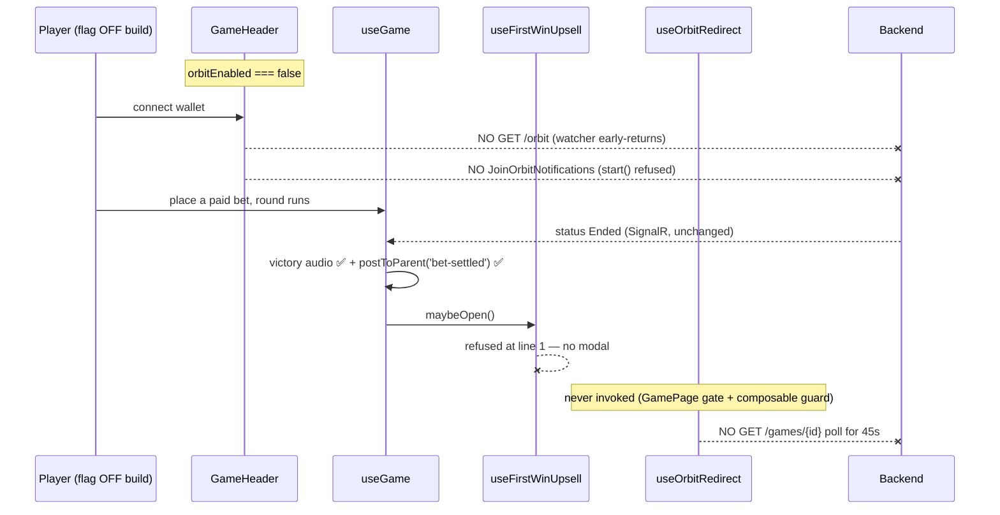

# Space Stroker — "Hide Orbit behind a frontend env flag" — Implementation Spec

> **Status: Shipped — merged to `main` on 2026-08-04** via `feature/orbit-frontend-flag` in
> `monkify-front` + `monkify-backend` + `monkify-meta`. Distilled into
> `features/orbit-custodial-wallet.md` → "The production gate" and `conventions/frontend.md` →
> "Feature flags".
> Verified before the merge: `yarn lint` + `yarn build` clean; backend **761 unit** and **98
> integration** tests green; the flag proved reversible in the browser (OFF → no ☰ Orbit row and
> **zero `/orbit/*` requests**; ON → the row returns and the modal opens, same build).
>
> ⚠️ **AC 11 (local Docker stack) was not run** — the running stack was left intact by choice.
> ⚠️ **AC 12 was satisfied by owner attestation, not by a query.** At ship time the owner confirmed
> production has no Orbit-enrolled players and no `AllowOrbit = true` game type. That is the entire
> safety argument for a frontend-only gate — **re-verify it before any deploy that flips the flag.**
>
> Refined via Trello card
> [Hide orbit in frontend, env controlled](https://trello.com/c/zJsoFVaW) (#146, refined 2026-08-04).
> Repos affected: **`monkify-front`**, **`monkify-backend`** (one generated env line in a `.bat`
> script — **no C#**), and this doc in **`monkify-meta`**.
> Branch / worktree: `feature/orbit-frontend-flag` → `.worktrees/orbit-frontend-flag/<repo>`.
> Level: **QOL / release-gating change** (see §2 — no integration test, no new `features/` doc).
>
> **Purpose:** the Orbit release train (#121 custody, #122 auto-bet engine, #123 notifications) is on
> `main` in both repos but is **not production-deliverable** — it is still in testing and
> improvements. Because everything else also lands on `main`, shipping *anything* today means
> shipping Orbit. This card adds a single **build-time frontend flag**, `VUE_APP_ORBIT_ENABLED`, that
> hides every Orbit surface **and silences every Orbit runtime path**, so a production build can go
> out with Orbit dark while local and the GCP development deploy keep it on.

---

## 0. ⚠️ The two things that make this card dangerous — read before touching code

**1. The gate is UI *and* runtime, and the runtime half is the load-bearing one.** A `v-if`-only
gate would still leave a production build calling `/orbit/*`, joining the `JoinOrbitNotifications`
hub group, and polling `GET /games/{id}` every 2 s for 45 s after every round ends. The whole point
of the card is that a flag-off build makes **zero** Orbit network calls. Every guard in §7 is
required; none is decorative.

**2. `useFirstWinUpsell.maybeOpen()` is called from inside `useGame`'s victory one-shot** —
`src/hooks/useGame.ts:335`, the same `if` block that plays the victory/lose audio and posts the
embedded `bet-settled` message:

```ts
if (didBet && endedGameId && endAudioFiredForGame !== endedGameId) {
  endAudioFiredForGame = endedGameId;
  ...
  if (audioTabActive()) playAudio(won ? victoryAudio : loseAudio);
  if (won && ownBetWasPaid.value) useFirstWinUpsell().maybeOpen();   // <-- line 335
  postToParent('bet-settled', { ... });                               // <-- embedded balance refresh
}
```

**Guard inside `maybeOpen()`, never by editing line 335 or the `if` around it.** Gating that block
would cost a flag-off build its **win audio** and the **embedded `bet-settled` signal** the casino
uses to refresh the player's balance. This is acceptance criterion 6 and it is the single most
likely way to get this card wrong.

---

## 1. Summary

One new build-time constant, then guards at every Orbit entry point.

| # | Change | Surface |
| --- | --- | --- |
| A | **New flag** `orbitEnabled`, read from `VUE_APP_ORBIT_ENABLED`, **fail-closed** (`=== 'true'`). | `src/constants/featureFlags.ts` |
| B | **Mount points gated** — `OrbitBalance` row, ☰ **Orbit** menu row, `OrbitModal`, `OrbitFirstWinModal`, the wallet-change `syncWallet`/`loadIfSignedIn` watcher, `useOrbitNotifications().start()`. | `components/GameHeader.vue` |
| C | **Composable guards (defence in depth)** — a first-line early return inside `useOrbit`'s wallet sync, `useOrbitNotifications.start()`, `useOrbitRedirect()` and `useFirstWinUpsell.maybeOpen()`. | `hooks/*.ts` |
| D | **Owner-only `ORBIT` markers gated** — the `myBetThisRoundIsOrbit` computed, the `YOU · ORBIT` terminal label, the two history chips. | `hooks/useGame.ts`, `components/game/GameTerminal.vue`, `pages/GameHistoryPage.vue` |
| E | **Env plumbing** — documented in `.env.example`, `"false"` in `deploy/secrets.example.json` → `frontBuild`, `=true` written by the local Docker setup script. | 3 committed files across 3 repos |

**Nothing about Orbit's behaviour changes.** This card only hides what exists.

### Gate placement is deliberately doubled

Every runtime path is gated **both** at its mount point in `GameHeader.vue` **and** inside its own
composable. That is not redundancy for its own sake: the first-win upsell is invoked from inside
`useGame`, not from a template, so a future caller could reintroduce Orbit traffic simply by
forgetting a `v-if`. The composable guard is the one that cannot be bypassed.

---

## 2. Constraints (MANDATORY)

From `monkify-meta/constraints.md` (full list there):

- **Worktree per repo** (§2): work in `.worktrees/orbit-frontend-flag/<repo>`; the hubs stay clean on
  `main`. Branch `feature/orbit-frontend-flag` in all three repos, already pushed to `origin`. Never
  commit on `main`, never force-push, never skip hooks.
- **Secrets/config (§1): mock/placeholder values only** in committed files. `deploy/secrets.example.json`
  keeps every existing `REPLACE_ME` untouched — the one added key is plain config (`"false"`), not a
  credential. `.env.local`, `.env.production` and `secrets.{development,production}.json` are
  **git-ignored** and are set by hand (§5.3).
- **Unit tests (§3): N/A** — no C# behaviour changes, so no test in `SpaceStroker.Tests` is affected.
  `monkify-front` has no test runner. **Nothing to run, nothing to report.**
- **Integration test: WAIVED.** `constraints.md` §3 mandates a happy-path integration test for every
  **new feature**. This is a **gating / release-management change** with **no backend surface**: the
  only file touched in `monkify-backend` is `scripts/setup_local_environment.bat`, which is a
  developer script, not application code. The Orbit integration tests already on `main` are unaffected
  and must stay green.
- **No new `features/<slug>.md`.** The flag is recorded as a paragraph in the existing
  `features/orbit-custodial-wallet.md` (and cross-referenced from the other two Orbit feature docs)
  at ship time — see §10.3.
- **Gates:** `yarn lint` + `yarn build` in `monkify-front`, plus **manual QA of both flag states**
  (§13). ⚠️ `yarn lint` needs **uniform CRLF** — see §12.2.

---

## 3. Resolved product decisions

| # | Decision |
| --- | --- |
| 1 | The flag is **`VUE_APP_ORBIT_ENABLED`**, exported as **`orbitEnabled`** from `src/constants/featureFlags.ts` — beside `allowFreeBets`, in the same file, with the same build-time semantics. |
| 2 | **Fail-closed: `process.env.VUE_APP_ORBIT_ENABLED === 'true'`.** A build that omits the key ships Orbit **hidden**. This is deliberately the *opposite* test from its neighbour `allowFreeBets` (`!== 'false'`, fail-open) — the entire point of the card is that an un-configured production build must not leak Orbit. **`allowFreeBets` is not changed.** |
| 3 | **Gate depth = UI *and* runtime.** A flag-off build makes zero Orbit network calls, joins no Orbit hub channel, and starts no Orbit poller. Not just `v-if`. |
| 4 | **Gate placement = mount points *and* composable guards** (defence in depth) — see §1. |
| 5 | **The owner-only `ORBIT` bet markers are gated too.** They can only render on an Orbit-funded bet, which cannot exist in production while enrolment is hidden — gated anyway so the word can never surface from legacy data. Cost: one computed + three render sites. |
| 6 | **The admin `Allow Orbit auto-play` checkbox is NOT gated.** Admin is an internal token-gated surface, not a player one, and the portal is deactivate-or-create with `allowOrbit` **settable at creation only**. Hiding it would leave every game type created while Orbit is dark permanently non-Orbit-eligible, forcing live types to be recreated (new ids, split history) when Orbit ships. |
| 7 | **No escape hatch.** Build-time only: no `?orbit=1`, no `localStorage` override. Anything in the bundle is discoverable, and a hatch would let a stranger enrol real money into a feature we have explicitly called not production-ready. Test Orbit on the development deploy or locally. |
| 8 | **No backend code.** Replaced by a **one-off production state verification** (§9.1). Explicitly rejected: an `OrbitSettings.Enabled` kill switch in the planner/consumers. |
| 9 | **Environment matrix:** local `yarn serve` **ON**, local Docker stack **ON**, GCP **development** deploy **ON**, GCP **production** deploy **OFF**. |
| 10 | **No `SpaceStroker.Deploy` (C#) change.** `Deployer.WriteFrontEnv` (`deploy/tools/SpaceStroker.Deploy/Deployer.cs:588`) serializes the *whole* `frontBuild` dictionary into `.env.production.local`, so the flag rides the existing mechanism — the same one GA4 uses. An omitted key simply lands as hidden, which is what fail-closed wants. |
| 11 | **Dead Orbit code stays compiled in.** `services/orbitService.ts`, `types/orbit.ts`, `components/orbit/*` and the `viaOrbit`/`myBetViaOrbit` type fields are untouched. Lazy-loading / code-splitting Orbit out of the bundle was considered and **rejected**: bundle size is not a goal of this card. |
| 12 | **Stranded balance is accepted** (§9.2). A cash-out-only partial modal was rejected. |

---

## 4. Data model

**N/A — no entity, column, EF mapping or migration change.** This card adds no backend state. The
`OrbitEnrollment` / `OrbitTransaction` tables shipped by #121–#123 are untouched, as is
`GameParameters.AllowOrbit`.

---

## 5. Configuration

### 5.1 The flag

`monkify-front/src/constants/featureFlags.ts` — the file today is two lines:

```ts
// Enabled by default; set VUE_APP_ALLOW_FREE_BETS=false in production to hide the toggle.
export const allowFreeBets = process.env.VUE_APP_ALLOW_FREE_BETS !== 'false';
```

Append:

```ts
/**
 * Orbit (#121/#122/#123) is on `main` but is NOT production-deliverable yet. This hides every Orbit
 * surface AND silences every Orbit runtime path — no request, no hub group, no poller — so a
 * production build can ship with Orbit dark while local and the development deploy keep it on.
 *
 * ⚠️ FAIL-CLOSED, and deliberately the opposite test from `allowFreeBets` above: a build that omits
 * the key ships Orbit HIDDEN, because an un-configured production build must never leak a feature we
 * have called not production-ready. The cost is that a developer whose (git-ignored) .env.local
 * predates this line loses Orbit locally until they add it.
 *
 * Build-time only, by design — no `?orbit=1`, no localStorage override: anything in the bundle is
 * discoverable, and an escape hatch would let a stranger enrol real money into an untested feature.
 */
export const orbitEnabled = process.env.VUE_APP_ORBIT_ENABLED === 'true';
```

### 5.2 Committed env files (3 repos)

| File | Repo | Value |
| --- | --- | --- |
| `.env.example` | `monkify-front` | documented, `VUE_APP_ORBIT_ENABLED=true` (local work) |
| `deploy/secrets.example.json` → `frontBuild` | `monkify-meta` | `"VUE_APP_ORBIT_ENABLED": "false"` |
| `scripts/setup_local_environment.bat` | `monkify-backend` | writes `VUE_APP_ORBIT_ENABLED=true` |

**`.env.example`** — add after the free-bet block (which reads
`# Free bet mode toggle — enabled by default; production: false` / `VUE_APP_ALLOW_FREE_BETS=true`):

```
# Orbit (custodial wallet + auto-bet + notifications). FAIL-CLOSED: only the exact string "true"
# enables it — unset, empty or anything else hides every Orbit surface AND silences every Orbit
# runtime path (no request, no hub group, no post-round poller). Note this is the OPPOSITE test from
# VUE_APP_ALLOW_FREE_BETS above, which is fail-open.
# production: false (Orbit is not production-deliverable yet); development deploy: true
VUE_APP_ORBIT_ENABLED=true
```

**`deploy/secrets.example.json`** — one key inside the existing `frontBuild` block, next to
`VUE_APP_ALLOW_FREE_BETS`:

```json
"VUE_APP_ALLOW_FREE_BETS": "false",
"VUE_APP_ORBIT_ENABLED": "false",
```

Also extend the `_comment_orbit` note (or add a short `_comment_orbit_flag`) recording that the
frontend flag is separate from the three Orbit secrets: the secrets keep the **backend** engine
configured, the flag decides whether the **SPA** shows it. Do **not** touch any `REPLACE_ME`.

**`scripts/setup_local_environment.bat`** — one line inside the caret-continued PowerShell block that
generates `../monkify-front/.env.production.local` (lines 58–76). Add after the
`VUE_APP_ALLOW_FREE_BETS` line at :73:

```
  "  'VUE_APP_ORBIT_ENABLED=true'," ^
```

⚠️ **Two traps in this file, both documented in its own comments and both fatal:**

1. **No `REM` line may appear inside the caret continuation** (a trailing `^` splices the next line
   into the same command, comment or not) — the block's own warning at lines 53–56.
2. **No literal double quote** may appear inside a caret-continued argument — lines 96–100.
   The line above uses single quotes inside the outer double quotes, exactly like its neighbours.

Without this line the local prod-built container hides Orbit: `.env.production.local` is Vue CLI's
**highest-priority** env file and overrides `.env.local`.

### 5.3 Git-ignored files the operator/dev sets by hand

`monkify-front/.gitignore` ignores `.env.production`, `.env.local` and `.env.*.local`; the only
tracked env file is `.env.example`. These are **not** repo changes:

| File | Value | Who sets it |
| --- | --- | --- |
| `monkify-front/.env.local` | `VUE_APP_ORBIT_ENABLED=true` | each developer |
| `deploy/secrets.development.json` → `frontBuild` | `"true"` | ops |
| `deploy/secrets.production.json` → `frontBuild` | `"false"` | ops |

⚠️ **Every developer's existing `.env.local` lacks the key**, so Orbit disappears from local
`yarn serve` until each dev adds the line. That is the accepted cost of fail-closed — **call it out
in the ship notes** and in the PR description.

---

## 6. Backend behaviour

**No C# change. No entity, handler, consumer, migration, endpoint or configuration change.** The
Orbit engine (planner, placement, reward routing, cash-out sweep, notification fan-out) keeps running
exactly as shipped by #122/#123.

The safety argument for a frontend-only gate is stated in full in §9.1 and **must be verified once
against production before the flag-off deploy** — it is the only thing standing between "frontend-only
gate" and real money moving with no UI to show or stop it.

The single change in `monkify-backend` is the one generated env line in
`scripts/setup_local_environment.bat` (§5.2) — a developer script for the local Docker stack.

---

## 7. Frontend behaviour

All paths relative to `monkify-front/src/`. Line numbers are against `main` at `1ecf175`.

### 7.1 `components/GameHeader.vue` — the mount points

Import the flag beside the existing imports (line ~21 imports from `@/constants/helpers`):

```ts
import { orbitEnabled } from '@/constants/featureFlags';
```

Four sites:

| Site | Today | Change |
| --- | --- | --- |
| Wallet-change watcher (:74–81) | `syncWallet(wallet)` then `void loadIfSignedIn(wallet)` on **every** wallet change, `immediate: true` — `loadIfSignedIn` fires `GET /orbit` for anyone with a stored session | Wrap the body in `if (!orbitEnabled) return;` (first line inside the callback). ⚠️ Keep the watcher itself registered — see the note below. |
| `useOrbitNotifications().start()` (:90) | called unconditionally on setup | `if (orbitEnabled) useOrbitNotifications().start();` — belt and braces with §7.3 |
| `<OrbitBalance v-if="!isEmbedded && effectiveWallet">` (:255–260) | renders the ORBIT row whenever a wallet is connected and not embedded | `v-if="orbitEnabled && !isEmbedded && effectiveWallet"` |
| ☰ menu **Orbit** button (:356–362), inside `<template v-if="!isEmbedded">` | first item in the Stats/Fair group | wrap the button in its own `v-if="orbitEnabled"` — **do not** widen the enclosing `!isEmbedded` template, which also guards Stats and Fair |
| `<OrbitModal>` (:420) | always mounted | `v-if="orbitEnabled"` |
| `<OrbitFirstWinModal v-if="!isEmbedded">` (:425–430) | mounted app-wide except embedded | `v-if="orbitEnabled && !isEmbedded"` |

> **Note on the watcher.** Guard *inside* the callback rather than deleting the `watch` — the
> callback is a two-statement body whose `syncWallet` call carries a load-bearing comment about
> module-level state leaking between wallets (:69–72). An early return keeps that comment attached to
> the code it explains and makes the flag-off behaviour obvious at the call site.

`isOrbitOpen` / `openOrbit` / `acceptFirstWinUpsell` stay as they are — with every opener gated, they
are simply unreachable, and removing them would churn the file for nothing.

### 7.2 `hooks/useOrbit.ts` — no change

Deliberately **not** guarded. Nothing here self-starts: every function is called by a caller that is
itself gated (§7.1, §7.3, §7.4). Its module-level state stays `null` and no request leaves the app.
Adding a guard here would mean touching ~20 exported functions for no additional coverage.

### 7.3 `hooks/useOrbitNotifications.ts` — the hub channel

`start()` (:91) is already idempotent-and-embedded-guarded:

```ts
const start = () => {
  if (started || isEmbedded) return;
  ...
```

Extend that first line to `if (!orbitEnabled || started || isEmbedded) return;` and document why.
This is what satisfies **AC 3**: `joinOrbitChannel` is the **only** caller that ever sets
`useGameHub`'s module-level `orbitSessionToken` (`hooks/useGameHub.ts:210`), and
`built.onreconnected` (:52–61) invokes `JoinOrbitNotifications` **only** `if (orbitSessionToken)`.
With `start()` refused, that token is never set, so the reconnect path after an idle disconnect is
clean and **`useGameHub.ts` needs no change**.

It also kills the pause watcher (`watchPause`, :67–85) and therefore the
`"Orbit is paused — your balance no longer covers a bet."` toast.

### 7.4 `hooks/useOrbitRedirect.ts` — the cross-round poller

`useOrbitRedirect()` is called once, from `pages/GamePage.vue:30`. Today it registers a watcher on
`gameInstance.value?.status` and, on `GameStatus.Ended`, polls `mainService.getGameInstance(...)`
every **2 s for up to 45 s** (`POLL_INTERVAL_MS` / `POLL_TIMEOUT_MS`) looking for an Orbit-funded bet
on the player's configured type.

Gate **both ends**:

- `pages/GamePage.vue:30` → `if (orbitEnabled) useOrbitRedirect();`
- `hooks/useOrbitRedirect.ts` → first line of the exported `useOrbitRedirect` factory:
  `if (!orbitEnabled) return;`, placed **before** the `useGame()` / `useOrbit()` / `useRouter()`
  destructuring so the composable does nothing at all.

That satisfies **AC 5** — no polling requests, no navigation to another game type. The `onUnmounted`
cancel is unreachable when the early return fires, which is correct: there is nothing in flight to
cancel.

### 7.5 `hooks/useFirstWinUpsell.ts` — the upsell (⚠️ see §0)

Add the flag as the **first** refusal in `maybeOpen()` (:63), ahead of `if (seen.value) return;`:

```ts
const maybeOpen = () => {
  if (!orbitEnabled) return; // Orbit is dark in this build — nothing to invite them into
  if (seen.value) return; // once, ever
  ...
```

Every refusal in this function is already silent by design, so this one fits the existing contract
exactly. **Do not touch `useGame.ts:335` or the `if` block around it** — that block also owns the
victory audio and the embedded `bet-settled` post (§0, **AC 6**).

An extra benefit of guarding here: `seen` is **never persisted** on a flag-off build, so a player who
wins while Orbit is dark still gets the invitation the first time they win after Orbit ships.

### 7.6 The owner-only `ORBIT` markers

Three independent render paths, all reading the backend's owner-only `viaOrbit` / `myBetViaOrbit`
flags. All three are gated.

**(a) `hooks/useGame.ts:198` — `myBetThisRoundIsOrbit`.** One computed covers **four** strings:

```ts
const myBetThisRoundIsOrbit = computed(() => {
  if (!orbitEnabled) return false;
  const me = currentPlayerId.value;
  ...
```

Downstream, unchanged:
- `components/game/GameConsole.vue:341` and `:488` — the two
  `> ORBIT PLACED YOUR BET FOR THIS ROUND.` notes (`GameConsole` destructures the computed straight
  from `useGame()` at :60, so there is no prop to thread).
- `hooks/useGame.ts:493` and `:500` — the two `betOutput` strings, which fall back to the ordinary
  copy (`'One bet per round in this game.'` / `'Waiting for another player before you can bet
  again.'`) exactly as **AC 7** requires.

⚠️ **Returning `false` is the correct shape, not `undefined`.** The computed is consumed by `v-if`
and by ternaries; a falsy value keeps every consumer on its existing "ordinary bet" branch with no
call-site change.

**(b) `components/game/GameTerminal.vue:77` — the `'YOU · ORBIT'` row label.**
`betPlayerLabel` reads `placedBet.viaOrbit` directly:

```ts
return placedBet.viaOrbit ? 'YOU · ORBIT' : 'YOU';
```
→
```ts
return orbitEnabled && placedBet.viaOrbit ? 'YOU · ORBIT' : 'YOU';
```

`GameTerminal.vue` already imports `allowFreeBets` from `@/constants/featureFlags` (:20) — extend
that import rather than adding a second one.

**(c) `pages/GameHistoryPage.vue:218` and `:263` — the two `ORBIT` chips** (desktop table + mobile
card), both `v-if="row.myBetViaOrbit"`. Add a local computed or gate each `v-if`:

```html
<span v-if="orbitEnabled && row.myBetViaOrbit" class="chip ml-1 align-middle">ORBIT</span>
```

Import `orbitEnabled` in that page's `<script setup>`.

### 7.7 Explicitly untouched

| File | Why |
| --- | --- |
| `services/orbitService.ts`, `types/orbit.ts`, `components/orbit/*`, `components/OrbitBalance.vue` | Dead code when off, still compiled in. Decision 11 — bundle size is not a goal. |
| `types/index.ts` (`viaOrbit`, `myBetViaOrbit`, `allowOrbit`) | Wire-format types; the backend keeps sending them. |
| `hooks/useGameHub.ts` | Its Orbit branch is token-gated and the token is never set (§7.3). **AC 3** holds with no edit. |
| `components/admin/GameTypeForm.vue` (`Allow Orbit auto-play`, :139–143) | **Decision 6 — deliberately NOT gated.** **AC 8** asserts it still renders and still saves. |
| `hooks/useOrbit.ts` | §7.2 — nothing self-starts. |
| `constants/guideSections.ts`, `HowToPlayPage.vue`, `GuideSectionNav.vue` | The Orbit hits are **comments** about a deferred, unbuilt section. Nothing to hide, no `#orbit` deep-link contract to break. |
| `constants/practiceGame.ts` | The hit is the word `'orbits'` in the practice word pool. Unrelated. |
| `services/mainService.ts` | The hits are the `'orbit-session'` / `'orbit-cashout'` nonce purposes in a union type and the `?wallet=` comment. The optional `?wallet=` param on `GET /games/{gameTypeId}` stays as-is — it grants nothing and only marks the caller's own rows. |
| `monkify-lp` | Zero Orbit content (the only hit is the word "orbit" in a roadmap subtitle). **Not in scope.** |

---

## 8. Flow diagram — what a flag-off build does at round end



Everything not on an Orbit path — audio, the embedded settlement message, the round rollover, the
game hub — behaves exactly as on `main`.

---

## 9. Edge cases & failure modes

### 9.1 ⚠️ The backend engine still runs — verify production state once (AC 12)

The Orbit planner and placement consumers keep running on a flag-off deploy. They only ever act on a
player who is **enrolled** (`Enabled` on a game type) **and funded**, and enrolment is only reachable
through the UI this card hides. So the safety argument is:

> **no enrolled players + no `AllowOrbit = true` game type ⇒ the planner plans nothing.**

That must be **verified once against production before the flag-off deploy, not assumed.** Per
`constraints.md` §5 the agent must **not** run production queries — **ask the user to run them** and
record the result on the Trello card. Two reads:

```sql
-- expect 0
SELECT COUNT(*) FROM "OrbitEnrollments" WHERE "Enabled" = true;
-- expect 0
SELECT COUNT(*) FROM "GameParameters" WHERE "AllowOrbit" = true AND "Active" = true;
```

(Confirm the exact table/column names against `SpaceStrokerDbContext.OnModelCreating` before handing
the query over.) A non-zero result on either **blocks the flag-off deploy** and reopens the rejected
backend kill switch — say so rather than shipping around it.

### 9.2 Stranded balance (accepted)

A wallet that already holds an Orbit balance sees no balance, no cash-out and no disable on a
flag-off build. Recovery is a flag-on build (development deploy or local) or a manual backend payout.
Real exposure ≈ nil: production has never rendered the enrolment UI. **Rejected alternative:** a
cash-out-only modal when a balance exists — it leaves the word "Orbit" visible in production and adds
a second partial UI state to build and test for a case that should not occur.

### 9.3 Flag flipped back ON later

Nothing to migrate. Module-level Orbit state is built on mount and re-scoped per wallet
(`useOrbit.syncWallet`); a stored session token in localStorage is either still valid or 4xx-dropped
back to `SIGN IN` — shipped #122 behaviour, unchanged.

### 9.4 Embedded / regulated iframe

Already had no Orbit at all (`isEmbedded` guards the header cluster, the modals and
`useOrbitNotifications.start()`). The new gate **stacks on top** and must not change embedded
behaviour: keep every existing `!isEmbedded` test, do not replace one with the flag.

### 9.5 Idle websocket disconnect

With the flag off there is no Orbit channel to re-join, so the reconnect path in `useGameHub`
(`built.onreconnected`, :52) must stay clean — no `JoinOrbitNotifications` invoke with a null token.
Guaranteed by §7.3; **AC 3** tests it explicitly after an idle disconnect.

### 9.6 `/how-to-play`

No Orbit section exists (deferred/unbuilt, per the comments in `constants/guideSections.ts:78` and
`HowToPlayPage.vue:10`) ⇒ nothing to hide there, and no `#orbit` deep-link contract to break.

### 9.7 ⚠️ Concurrent Orbit work in flight

`feature/orbit-ui-overhaul` worktrees exist in `monkify-front` and `monkify-meta` (cut from
`993261e`). That branch reworks Orbit's UI; this card hides it. They touch overlapping files
(`GameHeader.vue`, `components/orbit/*`). **Whichever lands second must re-apply the gates** — a
rebase that silently drops an `orbitEnabled` check would ship Orbit into production. Flag it in the
PR.

---

## 10. File checklist

### 10.1 Frontend (`monkify-front`)

| # | File | Change |
| --- | --- | --- |
| 1 | `src/constants/featureFlags.ts` | **New** `orbitEnabled` export, fail-closed `=== 'true'`, with the doc block from §5.1 |
| 2 | `src/components/GameHeader.vue` | Import the flag; guard the wallet watcher body, `useOrbitNotifications().start()`, `<OrbitBalance>`, the ☰ **Orbit** button, `<OrbitModal>`, `<OrbitFirstWinModal>` (§7.1) |
| 3 | `src/hooks/useOrbitNotifications.ts` | `start()` first line → `if (!orbitEnabled \|\| started \|\| isEmbedded) return;` + comment (§7.3) |
| 4 | `src/hooks/useOrbitRedirect.ts` | First line of the factory → `if (!orbitEnabled) return;`, before any destructuring (§7.4) |
| 5 | `src/pages/GamePage.vue` | `:30` → `if (orbitEnabled) useOrbitRedirect();` + import |
| 6 | `src/hooks/useFirstWinUpsell.ts` | First refusal in `maybeOpen()` → `if (!orbitEnabled) return;` (§7.5). ⚠️ **Nothing in `useGame.ts:335`** |
| 7 | `src/hooks/useGame.ts` | Import the flag; `myBetThisRoundIsOrbit` returns `false` when off (:198). Covers the 2 console notes + 2 `betOutput` strings |
| 8 | `src/components/game/GameTerminal.vue` | Extend the existing `featureFlags` import (:20); `betPlayerLabel` (:77) → `orbitEnabled && placedBet.viaOrbit` |
| 9 | `src/pages/GameHistoryPage.vue` | Import the flag; gate both `ORBIT` chips (:218, :263) |
| 10 | `.env.example` | Document `VUE_APP_ORBIT_ENABLED=true` with the fail-closed warning (§5.2) |

### 10.2 Backend (`monkify-backend`)

| # | File | Change |
| --- | --- | --- |
| 1 | `scripts/setup_local_environment.bat` | One line after :73 — `"  'VUE_APP_ORBIT_ENABLED=true'," ^` inside the caret block. ⚠️ No `REM`, no literal `"` inside the continuation (§5.2) |

**No C#. No migration. No test change.**

### 10.3 Meta (`monkify-meta`)

| # | File | Change |
| --- | --- | --- |
| 1 | `specs/orbit-frontend-flag.md` | This spec (created by `/monkify-create-spec`) |
| 2 | `INDEX.md` | Spec row + "Feature currently in flight" (created by `/monkify-create-spec`) |
| 3 | `deploy/secrets.example.json` | `"VUE_APP_ORBIT_ENABLED": "false"` in `frontBuild`; extend the Orbit comment (§5.2) |
| 4 | `features/orbit-custodial-wallet.md` | **At ship time** — record the flag: name, fail-closed semantics, what it gates, the environment matrix, and the stranded-balance limitation |
| 5 | `features/orbit-auto-bet-engine.md`, `features/orbit-notifications.md` | **At ship time** — one cross-reference line each ("the frontend surface is gated by `VUE_APP_ORBIT_ENABLED`; the engine is not") |
| 6 | `conventions/frontend.md` | **At ship time** — a short "Feature flags" note: flags live in `src/constants/featureFlags.ts`, are build-time `VUE_APP_*`, and **state their fail direction explicitly** (`allowFreeBets` fail-open vs `orbitEnabled` fail-closed) |

---

## 11. Unit tests

**None.** No backend behaviour changes, so nothing in `SpaceStroker.Tests` is affected;
`monkify-front` has no test runner. The Orbit suites already on `main` (unit + integration) must stay
green — run them once to confirm the branch did not disturb them:

```
scripts\run_tests.bat
```

> ⚠️ Use `run_tests.bat`, **not** a bare `dotnet test`: the script excludes the `ProductionGames`
> Monte Carlo suite by design, and a bare run "fails" ~156 tests that were never in scope.

---

## 12. Implementation notes

### 12.1 Order of work

1. `featureFlags.ts` first — everything else imports it.
2. The **runtime** guards (§7.3, §7.4, §7.5) before the UI ones: they are what AC 2/3/5/6 test, and
   they are the ones a reviewer cannot see by looking at the page.
3. The UI guards (§7.1) and the markers (§7.6).
4. Env plumbing (§5.2) last, then the local Docker verification (§13.2).

### 12.2 ⚠️ `yarn lint` and line endings

`monkify-front` lints with prettier under `autocrlf=true`, so the tree must stay **uniformly CRLF**.
Editing with a tool that rewrites whole files as LF produces a wall of `Insert ␍` errors that look
like a formatting bug and are not. Fix with `unix2dos <file>`; verify with `od -c <file> | head`.
Run `yarn lint` **before** committing, not after.

### 12.3 Verifying the flag actually baked in

`VUE_APP_*` is inlined at build time, so a stale bundle is indistinguishable from a broken gate. After
`yarn build`, grep the emitted bundle for a string that only exists on the Orbit path:

```bash
grep -r "ORBIT PLACED YOUR BET" dist/js/ | head
```

The string will still be present (the code is compiled in, §7.7 / decision 11) — so this is **not**
the test. The real test is behavioural: **open the page and watch the network tab** (§13). Per the
`app-home-changes` post-mortem recorded in `INDEX.md`: nothing in `monkify-front` type-checks `.vue`
script blocks, and grepping a built bundle for copy strings does not catch a broken render.

---

## 13. Manual QA

Both flag states must be exercised. This is the acceptance evidence — there is no automated test.

### 13.1 Flag OFF (`yarn serve` with the key removed from `.env.local`)

1. Connect a wallet. **Network tab: zero requests to `/orbit/*`** — no `POST /orbit/session`, no
   `GET /orbit`, and no `GET /players/nonce?purpose=orbit-session|orbit-cashout`. (**AC 2**)
2. Header: **no ORBIT row** under WALLET; the WALLET balance, the wallet buttons and every other
   header control are unchanged and there is **no layout gap** where the row used to sit. (**AC 4**,
   **AC 13**)
3. ☰ menu: **no Orbit row**; Settings, Stats, Fair, History and Responsible Gaming all present.
4. Play a round to `Ended` on `/game`: **no `GET /games/{id}` poll** in the following 45 s, and no
   navigation to another game type. (**AC 5**)
5. Win a **paid** bet: **no first-win modal**, and **victory audio still plays once**. In an embedded
   frame, the `bet-settled` message is still posted to the parent. (**AC 6**)
6. Background the tab past the idle disconnect, then return: on reconnect, **`JoinOrbitNotifications`
   is never invoked** (check the hub frames in the WS panel). (**AC 3**)
7. Admin portal → game-type form: **`Allow Orbit auto-play` is still there** and still saves
   `allowOrbit` on creation. (**AC 8**)
8. If you can produce a round containing an own bet with `viaOrbit: true` (a flag-on build placing
   the bet, then reloading with the flag off): **no** `> ORBIT PLACED YOUR BET FOR THIS ROUND.`, **no**
   `YOU · ORBIT` in the terminal, **no** `ORBIT` chip in history, and the bet output reads
   `One bet per round in this game.` (**AC 7**)
9. Viewports **1366×768** and **390×844**. (**AC 13**)

### 13.2 Flag ON

10. `VUE_APP_ORBIT_ENABLED=true` in `.env.local` → every Orbit surface and runtime path behaves
    **exactly as on `main` today**: header balance, modal, notifications channel, cross-round
    redirect, first-win upsell, owner-only markers. No regression. (**AC 9**)
11. Local Docker stack: run `scripts\setup_local_environment.bat`, confirm the generated
    `monkify-front/.env.production.local` contains `VUE_APP_ORBIT_ENABLED=true`, and that Orbit is
    **visible** in the container on `http://localhost:6003`. (**AC 11**)

### 13.3 Deploy path

12. With `VUE_APP_ORBIT_ENABLED` present in `secrets.<env>.json` → `frontBuild`, the deploy tool
    writes it verbatim into `.env.production.local` with **no change to `SpaceStroker.Deploy` C#
    code** (`Deployer.WriteFrontEnv` serializes the whole dictionary). (**AC 10**)

### 13.4 Gates

13. `yarn lint` and `yarn build` both pass in `monkify-front`. (**AC 13**)

---

## 14. Acceptance criteria

Copied 1:1 from the Trello checklist (#146).

1. Given a build where `VUE_APP_ORBIT_ENABLED` is unset, empty, or any value other than the exact
   string `"true"`, when the app loads, then `orbitEnabled` is `false` and no Orbit surface renders
   anywhere.
2. Given Orbit is disabled, when a player connects a wallet and browses the app for a full round,
   then the network tab shows **ZERO** requests to any Orbit endpoint (no orbit session/state load, no
   `orbit-session` or `orbit-cashout` challenge).
3. Given Orbit is disabled, when the Games hub connects and later reconnects after an idle
   disconnect, then `JoinOrbitNotifications` is never invoked and no Orbit win or "paused —
   insufficient funds" toast can appear.
4. Given Orbit is disabled and a wallet is connected, when the header renders, then the ORBIT balance
   row and the ☰ Orbit menu row are absent, while the WALLET balance, the wallet buttons and every
   other menu item are unchanged.
5. Given Orbit is disabled, when a round ends on `/game/play`, then `useOrbitRedirect` issues no
   polling requests and the player is never navigated to another game type.
6. Given Orbit is disabled, when the player wins their first PAID bet, then the Orbit first-win modal
   does not open **AND** the victory audio still plays once and the embedded `bet-settled` message is
   still posted to the parent frame.
7. Given Orbit is disabled and the loaded round contains an Orbit-funded bet of the player's own
   (`viaOrbit` true), when the console, terminal and history render, then no ORBIT note, no
   `YOU · ORBIT` label and no ORBIT chip appear, and the bet output uses the ordinary copy instead of
   "Orbit placed your bet for this round."
8. Given Orbit is disabled, when an admin opens the game-type form in the admin portal, then the
   "Allow Orbit auto-play" checkbox is still present and still saves `allowOrbit` on creation
   (deliberately **NOT** gated).
9. Given `VUE_APP_ORBIT_ENABLED=true`, when the app runs, then every Orbit surface and runtime path
   behaves exactly as it does on `main` today — header balance, modal, notifications channel,
   cross-round redirect, first-win upsell and the owner-only markers — with no regression.
10. Given `secrets.<env>.json` carries `VUE_APP_ORBIT_ENABLED` in its `frontBuild` block, when the
    deploy tool builds the static site, then the value is written verbatim into
    `.env.production.local` with **NO** change to `SpaceStroker.Deploy` C# code.
11. Given the local Docker stack is prepared with `scripts/setup_local_environment.bat`, when the
    front image is built, then the generated `.env.production.local` contains
    `VUE_APP_ORBIT_ENABLED=true` and Orbit is visible in the local container.
12. Given the production database, when Orbit state is checked once before the flag-off deploy, then
    there are no Orbit-enrolled players and no game type with `AllowOrbit=true` — recorded on this
    card, since that is the entire safety argument for a frontend-only gate.
13. Given the feature branch, when `yarn lint` and `yarn build` run in `monkify-front`, then both
    pass, and manual QA at 1366×768 and 390×844 confirms no layout gap where the ORBIT header row
    used to sit.

---

## 15. Out of scope

- Any Orbit **behaviour** change — this card only hides what exists.
- A backend kill switch (`OrbitSettings.Enabled`) and any Orbit code/config change in
  `monkify-backend` beyond the one `setup_local_environment.bat` line.
- Lazy-loading / code-splitting the Orbit components out of the bundle.
- A general feature-flag *system* (registry, remote config, per-player targeting) — one env constant
  beside `allowFreeBets`, nothing more.
- Hiding the admin `Allow Orbit auto-play` checkbox.
- `monkify-lp`.

---

## 16. Trello / pipeline

- **Source card:** [#146 Hide orbit in frontend, env controlled](https://trello.com/c/zJsoFVaW) —
  list **Specs created**; the **Implementation** section on the card carries branch, worktree and spec
  path.
- **Branch / worktree:** `feature/orbit-frontend-flag` →
  `.worktrees/orbit-frontend-flag/{monkify-backend,monkify-front,monkify-meta}` (all three pushed to
  `origin`).
- **Next:** `/monkify-implement-feature 146`, then `/monkify-ship-feature 146`.
- ⚠️ **AC 12 blocks the production deploy, not the merge.** The production state check is an ops
  action the user runs; record the result on the card before the flag-off build goes out.

---

## 17. Revision log

| Date | Change |
| --- | --- |
| 2026-08-04 | Initial spec from refined card #146 (+ its refinement changelog comment). Code exploration against `monkify-front@1ecf175`, `monkify-backend@22e16a7`, `monkify-meta@0f103ed` confirmed every touchpoint and added four findings the card did not carry: `useGameHub.ts` needs **no** change (its Orbit branch is token-gated and the token is never set); `GameConsole.vue` reads `myBetThisRoundIsOrbit` straight from `useGame()` rather than via a prop, so the single computed covers all four strings; the `.bat` edit sits inside a caret-continued block with two documented fatal traps (no `REM`, no literal `"`); and a concurrent `feature/orbit-ui-overhaul` worktree touches the same files (§9.7). |
