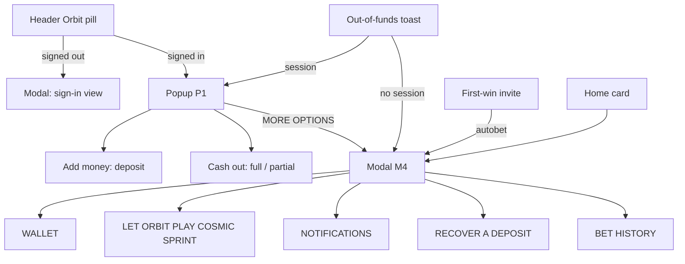

# SpaceStroker — "Orbit Improvements" (quick popup + one sectioned modal) — Implementation Spec

> **Status: Shipped — merged to main via `feature/orbit-improvements` on 2026-09-30.** Distilled in
> [`../features/orbit.md`](../features/orbit.md) §5 (Minor change: no dedicated `features/` doc).
> Refined via Trello card
> [#198 Orbit improvements](https://trello.com/c/eoY4MEGK/198-orbit-improvements) (2026-09-29).
> Repos affected: `monkify-front`, and this doc in `monkify-meta`. **`monkify-backend` is NOT affected**
> (no endpoint, DTO, entity, migration, event or SignalR change).
> Branch / worktree: `feature/orbit-improvements` → `.worktrees/orbit-improvements/<repo>`. Level: **`Minor change`**.
>
> **Purpose:** Orbit confuses new players. It is spread over two overlapping surfaces (the in-round
> panel and the five-tab `/orbit` page) and the panel mixes wallet actions with auto-bet setup. This
> card makes Orbit **one quick popup** (balance, add money, cash out) behind the header pill and **one
> modal** with collapsible sections that separate the wallet from Cosmic Sprint auto-betting. The
> `/orbit` page is deleted.

> ⚠️ **Owner feedback after the first local test (2026-09-30) supersedes parts of §3/§7/§12** — see
> §16. In short: sections are an **accordion (one open, no scrolling)**, **BET HISTORY is removed**, the
> status tag keeps PAUSED / RUNNING, the modal is **pinned** (no re-centring jump), cash-out is **empty = everything**, and buttons follow the
> mockup palette.

---

## 1. Summary

| Surface | Today | After this card |
| --- | --- | --- |
| Header Orbit pill (`OrbitLauncher`) | Opens the Orbit modal | Signed in → opens the **popup** (§7.2). Signed out → opens the modal's sign-in view (unchanged) |
| Popup | — | **New.** ORBIT HOLDS + status tag, ADD MONEY, CASH OUT (full or partial), "More options" → modal. Design **P1 (stacked)** |
| Orbit modal (`OrbitModal`) | One long panel: status + GAME MODE, ORBIT HOLDS + PER ROUND, add money, game picker / word, auto cashout, RUN/CASH OUT bar, "Orbit settings" link | **Sectioned** modal, design **M4 (jump strip)**: balance + status, a chip strip, five collapsible sections (WALLET · LET ORBIT PLAY COSMIC SPRINT · NOTIFICATIONS · RECOVER A DEPOSIT · BET HISTORY), "How Orbit works" link |
| `/orbit` page (`OrbitPage`) | Five tabs: WALLET, AUTO-BET, AUTO CASH-OUT, RECOVER, TELEGRAM + bet log | **Deleted**, along with the route and the ☰ ORBIT cell. No redirect |
| Partial cash-out | Only on `/orbit` (`OrbitMoneyTab`) | In the popup and the WALLET section |
| Telegram, recover, bet log | Only on `/orbit` | NOTIFICATIONS, RECOVER A DEPOSIT, BET HISTORY sections |

Design source: the owner picked **P1 + M4** from the mockup page
<https://claude.ai/artifact/6r4paQdamzmSn9UKdX9vbu> (five options per flow, 2026-09-29). The mockups
are static and use the app's real tokens; §7 is authoritative where they are vague.

---

## 2. Constraints (MANDATORY)

From `monkify-meta/constraints.md` (full list there):

- **Worktree-first:** all work in `.worktrees/orbit-improvements/monkify-front` (+ `monkify-meta` for
  docs). The hubs stay on `main`.
- **No backend change**, so no backend tests change and `SpaceStroker.Tests` needs no run for this card.
  If implementation finds it needs a backend change, stop and raise it: it is out of scope.
- **Frontend verification:** `monkify-front` has no test runner. Definition of done = `yarn lint` +
  `yarn build` in the worktree + the browser QA in §13. Watch the known gotchas: copy the hub
  `yarn.lock` into the worktree before any Docker build, and CRLF/prettier reflow failures in `yarn build`.
- **Money UI:** no change to amounts, signatures, endpoints or validation rules. Every money action
  reuses the existing `useOrbit()` function it uses today.
- **Messaging:** keep every existing Orbit error/refusal string. The only new copy is listed in §7.6.
- **Feature flag:** everything stays behind `orbitEnabled` (`VUE_APP_ORBIT_ENABLED`); no new `VUE_APP_*` key.
- **Level `Minor change`:** no new integration test and no new `features/` doc, but
  `features/orbit.md` §5 and `features/orbit-wallet.md` → "Frontend behaviour" must be corrected at ship.

---

## 3. Resolved product decisions

| # | Decision |
| --- | --- |
| 1 | **Delete `/orbit` entirely**: route, `OrbitPage.vue`, ☰ ORBIT cell, the panel's "Set up notifications and more in Orbit settings" link. Everything it held moves into the modal. |
| 2 | **Popup is fully inline**: ADD MONEY and CASH OUT (full or partial) work inside it with today's flows and signatures. |
| 3 | **Controls split by what they govern**: RUN/PAUSE becomes the start/pause button inside the auto-bet section; CASH OUT joins ADD MONEY in WALLET; the top keeps ORBIT HOLDS + the status tag. `OrbitControlBar` leaves the modal. CASH OUT is never gated on the word. |
| 4 | **Collapsible sections with smart defaults + memory**: first open → WALLET expanded, the rest collapsed; LET ORBIT PLAY also expanded whenever auto-bet is running; otherwise remembered per device; a deep link forces its section open; BET HISTORY fetches only when expanded. |
| 5 | **The auto-bet section is hard-wired to the single eligible type** (Cosmic Sprint). Starting it creates/updates the enrolment from any page with no navigation. The game picker, auto-pointing and the switch guard are removed. Hidden with zero eligible types. |
| 6 | **Design gate done in this skill**: 5 mockups per flow; owner picked **P1** (popup) and **M4** (modal). |
| 7 | **No `/orbit` redirect.** Old links hit the catch-all. Deeplink returns still complete via `useOrbit().resumeOrbitDeeplink`; the popup/modal is not reopened. |
| 8 | **Popup contents**: ORBIT HOLDS + status tag, ADD MONEY, CASH OUT, "More options" gear → modal. No auto-bet controls. |
| 9 | **The `/orbit` pitch cards are dropped.** The modal's sign-in view stays as it is; the modal gains a "How Orbit works" link to `/how-to-play#orbit`. "Orbit page" copy is rewritten. |
| 10 | **Section names**: WALLET · LET ORBIT PLAY COSMIC SPRINT (subtitle below) · NOTIFICATIONS · RECOVER A DEPOSIT · BET HISTORY. |
| 11 | **Wiring defaults**: out-of-funds toast → popup; first-win invite → modal on LET ORBIT PLAY; home card → modal; NOTIFICATIONS hidden when `telegramEnabled` is false; auto cashout keeps threshold + floor with the old stop-rules info tips. |
| 12 | **☰ menu keeps 8 cells** after the ORBIT cell goes; the 3×3 grid ends with one empty slot (nothing new fills it). |

---

## 4. Data model

None. No entity, column, migration or DTO change.

---

## 5. Configuration

None. One new **browser-only** preference key (§7.4): `space-stroker.orbit.sections`.

---

## 6. Backend behaviour

Unchanged. Endpoints used (all existing): `POST /orbit/session`, `GET /orbit`, `POST /orbit/deposits`,
`POST /orbit/cash-outs`, `PATCH /orbit/settings`, `POST /orbit/telegram/link`, `POST /orbit/telegram/verify`,
`DELETE /orbit/telegram`, `GET /orbit/history`, deposit recovery.

---

## 7. Frontend behaviour

Paths below are relative to `monkify-front/src/`.

### 7.1 Shared money controls (extract first)

Today the deposit logic lives in `OrbitModal.onDeposit` and partial cash-out lives only in
`tabs/OrbitMoneyTab.vue` (`canCashOut` 120-122, `cashOutAmount` 134-142, `isFullCashOut` +
`cashOutAmountIsValid` 157-161, `onCashOut` 163-175, UI 240-282). The popup and the WALLET section both
need them, so extract two self-contained components that read `useOrbit()` and the wallet themselves and
report through `emit('notice', text | null)` (the pattern `OrbitRecoverTab` already uses):

- **`components/orbit/OrbitDepositControl.vue`**: `OrbitAmountField` + `depositChips` +
  `depositBounds` + ADD, calling `deposit(wallet, amount)`. Carries over the modal's `onDeposit` exactly:
  client-side bound check with the sanctioned *"Deposits are between 0.001 and 5 SOL."* message, the busy
  state, and the success toast only when the balance actually changed (a mobile hop returns without
  throwing).
- **`components/orbit/OrbitCashOutControl.vue`**: amount input pre-filled with the balance, a MAX
  button, and a "CASH OUT" button, carrying `OrbitMoneyTab`'s rules over unchanged:
  - `0 < amount <= balance`, and `amount >= minimumCashOut` **unless** it is the full balance.
  - A full withdrawal sends **no amount**: `cashOut(wallet)`. Partial: `cashOut(wallet, amount)`.
  - Disabled while `isWithinCashOutGap` (show the existing "Cashout cool off — {nextManualCashOutLabel}"
    line) or `isBusy`, or when the balance is 0.
  - The success toast fires only if the balance dropped (same mobile-hop reason as the modal's current
    `onCashOut` 783-805).
  - ⚠️ Never gated on the word, a game or the enrolment.

Both take an optional `compact` prop (popup sizing). `tabs/OrbitMoneyTab.vue` is deleted once the logic is moved.

### 7.2 The popup (design P1)

New **`components/orbit/OrbitQuickPanel.vue`**, mounted in `GameHeader.vue` next to `OrbitLauncher`
(inside a `relative` wrapper so `useClickOutside` covers trigger + panel).

- **Open state:** `useHeaderModals()` gains `orbitPopupOpen` and `openOrbitPopup()`.
- **Launcher click** (`OrbitLauncher.vue:80`):
  - `hasSession && orbit !== null` → toggle the popup.
  - Otherwise → `openOrbit()` (the modal's sign-in view).
  - Update its accessible labels (62-67): *"Open Orbit"* for the popup, *"Sign in to Orbit"* when signed out.
- **Layout, top to bottom** (P1):
  1. A row with `OrbitStatusBanner` in its one-card form (`stake = null`, `walletBalance = null`,
     `roundsLeft = null`, so only ORBIT HOLDS renders) and `OrbitStatusTag`.
  2. `ADD MONEY` eyebrow + `OrbitDepositControl compact`.
  3. `CASH OUT` eyebrow + `OrbitCashOutControl compact`.
  4. A dashed divider, then the "MORE OPTIONS" button with a gear icon (`AppIcon`; add a `settings`/gear
     glyph if none exists): closes the popup and calls `openOrbit()`.
  5. The notice / `lastError` line when set.
- **Desktop (≥ `lg`):** an anchored panel under the pill: `absolute right-0 top-[calc(100%+8px)]
  z-popover`, width ~320px, `bg-void-deep`, `border-2 border-orbit`, with a hard offset shadow in
  `--color-orbit-deep` and a caret toward the pill, as in the mockup. Closes on outside click
  (`useClickOutside`), on Esc (register with `useOverlayStack().registerOverlay({ dismissible: true, close })`
  and unregister on close), on "More options", and on route change.
- **Below `lg`:** render the same content inside `ArcadeModal size="compact" variant="orbit" title="ORBIT"`,
  which is already a bottom sheet there. One content component, two shells; no second design.
- The popup has **no** auto-bet control, word or rules.
- Opening the popup must not trigger a sign-in: it only renders when a session exists.

### 7.3 The modal (design M4)

`components/orbit/OrbitModal.vue` keeps its shell (`ArcadeModal size="compact" variant="orbit"`), the
titlebar `?` help popover (1055-1086), the signed-out sign-in view (1102-1136) and the self-excluded note.

**Remove:**

| What | Where today |
| --- | --- |
| Switch guard | template 1146-1186; `switchGuardDismissed` 155, `switchGuardActive` 157-163, `onSwitchToCurrentGame` 173-196, resets in the watchers at 998 and 1006-1014 |
| GAME MODE line | 1197-1209 (keep `OrbitStatusTag`) |
| PER ROUND card | pass `stake = null` to `OrbitStatusBanner` (1214-1222) |
| Game picker | template 1266-1306; `gamePick` 203, `pickableGames` 205, `preselectCurrentGame` 212-215, `onConfirmGamePick` 228-243, the reset at 999, the call at 958, CSS `.orbit-pick-select` 1744-1750 |
| Auto-point at the current game | `autoPointAtCurrentGame` 917-932 and its call in `afterLoad` 954 |
| `currentGame` (from `route.query.type`) | 132-136; its readers get the new source below |
| Control bar | `<OrbitControlBar compact>` 1565-1578 |
| Footer link | `goToOrbitSettings` 855-867, button 1603-1619, CSS `.orbit-advanced` 1864-1886 |
| `useRoute` / `useRouter` | 82-83, unless the "How Orbit works" link uses `router.push` |

**New body, top to bottom (signed in):**

1. **Top row:** `OrbitStatusBanner` in its one-card form + `OrbitStatusTag`.
2. **Jump strip** (`components/orbit/OrbitSectionStrip.vue`): a horizontally scrollable row of chips,
   one per **visible** section, in section order, labelled `WALLET · AUTO-BET · ALERTS · RECOVER · HISTORY`.
   Clicking a chip expands that section (and remembers it, §7.4) and scrolls it into view inside the
   modal body (`scrollIntoView({ block: 'start', behavior })`, with `behavior: 'auto'` under
   `prefers-reduced-motion`). The chip of the section most recently jumped to or expanded gets the
   active (violet) style. Chips are `<button>`s. A hidden section has no chip.
3. **Five sections** (`components/orbit/OrbitSection.vue`, a small wrapper). The title row is a
   `<button>` with `aria-expanded` and `aria-controls`, the section title in `.orbit-section-title`
   type, and a chevron that rotates when open. The body is `v-if`'d, **not** `v-show`, so a collapsed
   BET HISTORY never mounts and never fetches. The existing `.orbit-block` material is the section
   surface.
   - **WALLET** (`id: 'wallet'`): `ADD MONEY` eyebrow + `OrbitDepositControl`, then `CASH OUT` eyebrow +
     `OrbitCashOutControl`.
   - **LET ORBIT PLAY {TYPE NAME}** (`id: 'autobet'`): see §7.5. Hidden when `eligibleGameTypes` is empty.
   - **NOTIFICATIONS** (`id: 'notifications'`): the current `tabs/OrbitTelegramTab.vue` content, moved to
     `components/orbit/sections/OrbitNotificationsSection.vue`. Drop its internal `TELEGRAM` title (121);
     the section title replaces it. Hidden when `orbit.telegramEnabled` is false.
   - **RECOVER A DEPOSIT** (`id: 'recover'`): `tabs/OrbitRecoverTab.vue` moved to
     `components/orbit/sections/OrbitRecoverSection.vue` and its title dropped.
   - **BET HISTORY** (`id: 'history'`): `<OrbitBetLog :wallet="wallet" />` (it loads on mount, so the
     `v-if` body makes it lazy).
   - ⚠️ The Telegram and Recover content use `orbit-field-lg` / `orbit-field-label`, which only apply
     under `.orbit-page` (`arcade.css:1631`). Replace them with the modal's standard control sizing
     (`input-arcade`, `btn-dialog`, `--ctl-h-md`) so they match the other sections; do not keep a
     page-scoped class alive for them.
4. The notice / `lastError` line (1585-1586), then a centred **"How Orbit works"** text link →
   `{ name: 'HowToPlay', hash: '#orbit' }` (the guide registry already deep-links `#orbit`). It closes
   the modal first.

The `OrbitRecoverSection` / `OrbitNotificationsSection` `notice` emits are wired to the modal's
existing `notice` ref, as `OrbitPage.vue:508-517` does today.

### 7.4 Section open state

Types in `types/orbit.ts`: `type OrbitSectionId = 'wallet' | 'autobet' | 'notifications' | 'recover' | 'history'`.
Remove `OrbitTabDef` (316).

On every modal open, the set of expanded sections is computed once:

1. Start from the remembered set in `localStorage['space-stroker.orbit.sections']` (JSON array of
   `OrbitSectionId`). If absent, unreadable or throwing → the default `['wallet']`.
2. If auto-bet is **running** (`orbitStatus === 'running'`), add `'autobet'`.
3. If the modal was opened **for** a section (§7.7), add it and scroll to it after render.
4. Drop ids whose section is hidden.

Every expand/collapse by the player (title click or chip) writes the new set back to storage, in
`try/catch`; a failing write changes nothing on screen. Steps 2-3 are **not** written back on their own.
A small composable **`hooks/useOrbitSections.ts`** owns this so the modal stays a template.

### 7.5 LET ORBIT PLAY section

- **Game source:** `autoBetType = orbit.eligibleGameTypes[0]` (today exactly one: Cosmic Sprint). This
  replaces `currentGame` everywhere it fed the word and the run target: `wordGame` (470) becomes
  `activeGameType ?? autoBetType`; `runTarget` (730) and `onToggle`'s `gameParametersId` spread (768)
  use `autoBetType.id`. With more than one eligible type, still use the first: multi-type is out of scope (§9).
- **Title:** `LET ORBIT PLAY ${autoBetType.name.toUpperCase()}`. Chip label stays `AUTO-BET`.
- **Subtitle** (`.dialog-copy`): *"Orbit plays one {name} round for you every round, and cashes out when
  your rules say so."*
- **Word block:** the existing word section (1312-1407) unchanged in behaviour: `OrbitWordField`,
  preset `<select>` for preset types, "Choose a random word for me every game", auto-save when complete
  and legal.
- **Auto cashout:** the existing rules block (1422-1537) moves in here under the eyebrow
  **`AUTO CASHOUT · AUTO-BETS ONLY`**, with the "These rules only watch auto-bets…" line kept. Keep the
  two fields (OVER / LESS THAN) and add the two `ArcadeInfoTip`s from `tabs/OrbitStopRulesTab.vue`
  (`thresholdHelp` 263-264, `floorHelp` 301-302), copying the help strings verbatim. The rules keep
  their word gate (`orbit-block--locked` until `hasPlayableChoice`).
- **Start / pause:** one full-width button at the end of the section, replacing `OrbitControlBar`'s toggle:
  - Paused/off → `▶ START AUTO-BET` (RUN styling: live-green tint). Disabled with the existing
    sub-note ("Add money first" / word needed) under the same conditions `OrbitControlBar` used
    (`hasFundsForRound` 740-744, `hasPlayableChoice`, `isBusy`, self-excluded).
  - Running → `❚❚ PAUSE AUTO-BET` (STOP styling).
  - The click calls the existing `onToggle` (762-774): `updateSettings(wallet, { enabled, gameParametersId: autoBetType.id })`.
    **No navigation** in either direction.
- The auto-play lock on the game console, `useOrbitRedirect`, and the "Orbit is auto-playing this game —
  pause it to bet manually." refusal are **unchanged**.

### 7.6 New / changed copy

| Where | Text |
| --- | --- |
| Section titles | `WALLET` · `LET ORBIT PLAY COSMIC SPRINT` (from type name) · `NOTIFICATIONS` · `RECOVER A DEPOSIT` · `BET HISTORY` |
| Chip labels | `WALLET` · `AUTO-BET` · `ALERTS` · `RECOVER` · `HISTORY` |
| Auto-bet subtitle | Orbit plays one Cosmic Sprint round for you every round, and cashes out when your rules say so. |
| Auto-bet buttons | `▶ START AUTO-BET` / `❚❚ PAUSE AUTO-BET` |
| Popup button | `MORE OPTIONS` |
| Modal link | How Orbit works |
| `GuideOrbit.vue:72-75` | Replace the `/orbit` link sentence with: *"Tap the Orbit button in the header to add money or cash out. MORE OPTIONS opens everything else: auto-bet, notifications, deposit recovery and your bet history."* |
| `HomeOrbitCard.vue` / `HomePage.vue` comment 85-89 | Button label stays `Set up Orbit`; comment updated (no page) |

### 7.7 Entry points

`useHeaderModals.ts` gains `orbitSection: Ref<OrbitSectionId | null>` and changes `openOrbit` to
`openOrbit(section?: OrbitSectionId)`, which sets both `orbitOpen` and `orbitSection`. The modal reads and
clears `orbitSection` on open (§7.4 step 3).

| Entry point | Today | After |
| --- | --- | --- |
| Header pill | `openOrbit()` | §7.2 (popup when signed in, modal otherwise) |
| ☰ ORBIT cell (`GameHeader.vue:207-211`) | → `/orbit` | **Removed** |
| Out-of-funds toast (`useOrbitOutOfFunds.ts:62-67`) | → `/orbit?tab=wallet` | `openOrbitPopup()` when a session exists, otherwise `openOrbit('wallet')`. Update the comment at 60-61 |
| First-win invite (`GameHeader.vue:122-125`) | opens the modal | `openOrbit('autobet')` |
| Home card (`HomePage.vue:98-101`) | → `/orbit` | keep `trackHomeLinkClick({ link: 'orbit' })`, then `openOrbit()` |
| Guide (`GuideOrbit.vue:72-75`) | link to `/orbit` | copy in §7.6, no link |
| Modal "Orbit settings" link | → `/orbit` | **Removed** |

⚠️ The home card can be pressed with **no wallet connected**, which `/orbit` handled ("/orbit needs no
wallet"). The modal's sign-in button is already disabled without a wallet (`OrbitModal.vue:1124`).
Check that the signed-out view also says why. If it doesn't, port `OrbitPage`'s `!wallet` line (the
`
` under its sign-in button) into it verbatim.

### 7.8 Deletions

- `pages/OrbitPage.vue`; the `Orbit` route in `routes.ts:120-133` (route + comment).
- `'Orbit'` in `EMBED_REDIRECT_ROUTES` (`main.ts:106`) and its comment (100-101).
- The ☰ ORBIT cell (`GameHeader.vue:207-211`) and the comment above it.
- `components/orbit/OrbitTabBar.vue`, `OrbitStatStrip.vue`, `OrbitControlBar.vue` (unused after §7.3),
  `tabs/OrbitGameTab.vue`, `tabs/OrbitMoneyTab.vue` (after §7.1), `tabs/OrbitStopRulesTab.vue` (after
  copying the help strings), and the `tabs/` folder once Telegram/Recover have moved to `sections/`.
- `arcade.css`: the `.orbit-page*` rules (about 1431-1467 and 1584-1640+), `.orbit-statstrip*`, and
  `.orbit-field-lg` / `.orbit-field-label` if nothing else uses them (grep before deleting).
- Stale comments that point at the page: `colors.css:114`, `OrbitStatusBanner.vue:108` (and its header
  comment about "the page passes it and gets three"), `HomeTokenCard.vue:47`, and the OrbitModal header
  comment (1-78), which must be rewritten for the new structure.
- `services/orbitService.ts` `/orbit/...` URLs are **API** paths: leave them.

After deleting, `grep -rn "name: 'Orbit'\|'/orbit'\|\"/orbit\"\|OrbitPage\|orbit-page" src` must return
nothing but API paths.

---

## 8. Flow diagram

---

## 9. Out of scope

- Any backend change.
- Auto-bet on more game types, or a type picker in the auto-bet section.
- RUN/PAUSE in the popup.
- Any change to the sign-in flow.
- A `/orbit` redirect.
- Reopening the popup/modal after a mobile deeplink return.
- LP changes.
- Filling the ninth ☰ menu slot.

---

## 10. File checklist

### 10.1 Backend (`monkify-backend`)

None.

### 10.2 Frontend (`monkify-front/src`)

| # | File | Change |
| --- | --- | --- |
| 1 | `components/orbit/OrbitDepositControl.vue` | **New.** Deposit field + chips + ADD (§7.1) |
| 2 | `components/orbit/OrbitCashOutControl.vue` | **New.** Full/partial cash-out, cool-off line (§7.1) |
| 3 | `components/orbit/OrbitQuickPanel.vue` | **New.** Popup P1; anchored ≥ lg, `ArcadeModal` sheet < lg (§7.2) |
| 4 | `components/orbit/OrbitSection.vue` | **New.** Collapsible section wrapper (§7.3) |
| 5 | `components/orbit/OrbitSectionStrip.vue` | **New.** Jump chips (§7.3) |
| 6 | `components/orbit/sections/OrbitNotificationsSection.vue` | Moved from `tabs/OrbitTelegramTab.vue`; title dropped; restyled |
| 7 | `components/orbit/sections/OrbitRecoverSection.vue` | Moved from `tabs/OrbitRecoverTab.vue`; title dropped; restyled |
| 8 | `hooks/useOrbitSections.ts` | **New.** Open-state defaults + storage (§7.4) |
| 9 | `components/orbit/OrbitModal.vue` | Rebuilt per §7.3/§7.5; removals listed there; header comment rewritten |
| 10 | `components/orbit/OrbitLauncher.vue` | Click → popup or modal; aria labels (§7.2) |
| 11 | `hooks/useHeaderModals.ts` | `orbitPopupOpen`, `openOrbitPopup()`, `orbitSection`, `openOrbit(section?)` |
| 12 | `components/GameHeader.vue` | Mount `OrbitQuickPanel`; remove ☰ ORBIT cell; first-win → `openOrbit('autobet')` |
| 13 | `hooks/useOrbitOutOfFunds.ts` | Toast click → popup / `openOrbit('wallet')` |
| 14 | `pages/HomePage.vue` | `openOrbit()` instead of route push; comment |
| 15 | `components/guide/sections/GuideOrbit.vue` | Copy per §7.6; no `/orbit` link |
| 16 | `components/orbit/OrbitStatusBanner.vue` | Comment only (no page); callers pass `stake = null` |
| 17 | `types/orbit.ts` | Add `OrbitSectionId`; remove `OrbitTabDef` |
| 18 | `routes.ts`, `main.ts` | Remove the `Orbit` route and the embed-redirect entry |
| 19 | `pages/OrbitPage.vue`, `components/orbit/OrbitTabBar.vue`, `OrbitStatStrip.vue`, `OrbitControlBar.vue`, `tabs/*` | **Delete** (§7.8) |
| 20 | `assets/styles/arcade.css`, `colors.css`, `components/home/HomeTokenCard.vue` | Remove page-only CSS; fix stale comments |
| 21 | `components/ui/AppIcon.vue` / `constants/icons.ts` | Gear glyph for MORE OPTIONS, only if none exists |

### 10.3 Meta (`monkify-meta`)

| # | File | Change |
| --- | --- | --- |
| 1 | `specs/orbit-improvements.md` | This spec |
| 2 | `INDEX.md` | Map row + in-flight entry |
| 3 | `features/orbit.md` §5, `features/orbit-wallet.md` → Frontend behaviour | **At ship:** replace every `/orbit` page / tab description with the popup + sectioned modal |

---

## 11. Tests

No backend test changes (no backend change). `monkify-front` has no test runner, so the checks are:

| Check | Expected |
| --- | --- |
| `yarn lint` (front worktree) | Clean |
| `yarn build` (front worktree) | Succeeds (watch CRLF/prettier) |
| `grep` from §7.8 | Only API paths remain |
| Browser QA §13 | Every step passes |

---

## 12. Acceptance criteria

From the Trello **Acceptance Criteria** checklist:

1. Given a signed-in Orbit player, when they click the header Orbit pill, then a popup opens (anchored on desktop, bottom sheet below lg) showing ORBIT HOLDS, the status tag, ADD MONEY, CASH OUT and a 'More options' gear.
2. Given the popup is open, when the player enters a valid amount and presses ADD, then the same wallet-signed deposit as today runs and the balance updates, without opening the modal.
3. Given the popup is open with a non-zero balance, when the player cashes out the full balance or a partial amount >= 0.001, then the same orbit-cashout signature flow as today runs; a full withdrawal is accepted however small.
4. Given the popup is open, when the player presses 'More options', then the popup closes and the Orbit modal opens.
5. Given a signed-out player, when they click the Orbit pill, then the modal opens on the unchanged sign-in view.
6. Given the modal is open, then it shows no PER ROUND box, no GAME MODE line, no game picker, no switch guard, no bottom control bar and no 'Orbit settings' footer link.
7. Given the modal, then it has collapsible sections WALLET, LET ORBIT PLAY COSMIC SPRINT, NOTIFICATIONS, RECOVER A DEPOSIT and BET HISTORY, each toggled by its title. *(Design M4: plus a chip strip that jumps to and opens each visible section.)*
8. Given a first-time open, when the modal opens, then WALLET is expanded and the others are collapsed; given auto-bet is RUNNING, then LET ORBIT PLAY is also expanded.
9. Given the player collapsed/expanded sections, when they reopen the modal later on the same device, then the remembered states apply (falling back to defaults if storage is unavailable).
10. Given the WALLET section, then it contains ADD MONEY (unchanged) and CASH OUT, and CASH OUT is usable even when no word is set.
11. Given the LET ORBIT PLAY section on any page, when the player sets a word (or random) and switches auto-bet on, then the enrolment for Cosmic Sprint is created/enabled with no navigation, and switching it off pauses it.
12. Given the LET ORBIT PLAY section, then it holds the win-threshold and floor auto cashout rules with their 'auto-bets only' copy and info tips, and saving them uses the same PATCH as today.
13. Given a deployment with a Telegram bot, then NOTIFICATIONS shows the current Telegram link/verify/toggle UI; given no bot, the section is absent.
14. Given BET HISTORY is collapsed, then no history request is made; when expanded, the AUTO/MANUAL bet log loads.
15. Given the app, then the /orbit route no longer exists, OrbitPage is removed and the menu shows no ORBIT cell.
16. Given the out-of-funds toast, when clicked, then the popup opens; given the first-win invite CTA, then the modal opens with LET ORBIT PLAY expanded; given the home Orbit card CTA, then the modal opens.
17. Given the How to Play Orbit section and the home card, then no copy refers to an 'Orbit page', and the modal offers a 'How Orbit works' link to HOW TO PLAY -> Orbit.
18. Given a mobile deeplink wallet, when a deposit, cash-out or sign-in hop is started from the popup or modal, then on return the action completes as today (the UI need not reopen).
19. Given the front worktree, then yarn lint and yarn build pass.

---

## 13. Manual QA

On the local stack (in-place front redeploy, no migration: see the local-stack redeploy notes), with a
devnet wallet:

1. Signed out: click the pill → modal sign-in view. Sign in.
2. Click the pill → popup. Deposit 0.001 → balance updates in the popup and the pill. Try 6 SOL →
   bound message, no wallet prompt.
3. In the popup, cash out a partial 0.001 → balance drops by 0.001. Clear the field / MAX → full
   cash-out works with a tiny balance.
4. MORE OPTIONS → modal; popup closed. First open: only WALLET expanded; strip shows the visible chips.
5. Click the AUTO-BET chip → section opens and scrolls into view. Set a word, START AUTO-BET from the
   **lobby** (not a game page) → no navigation; tag reads RUNNING. Close and reopen → LET ORBIT PLAY expanded.
6. Collapse WALLET, expand HISTORY (network tab: `/orbit/history` fires only now), close, reload, reopen →
   same layout. Repeat in a private window with storage blocked → defaults, no errors.
7. NOTIFICATIONS: present with a bot configured; absent without.
8. Drain Orbit below the stake while on a Cosmic Sprint game → out-of-funds toast → click → popup opens.
9. ☰ menu: no ORBIT cell. Visit `/orbit` → catch-all. HOW TO PLAY → Orbit: new copy, no page link.
10. Below 1024px: the popup is a bottom sheet; the modal is a bottom sheet with a scrollable chip strip.
11. Embedded (`?embed=1`): no Orbit surfaces, as today.

---

## 14. Trello / pipeline

- **Source card:** [#198 Orbit improvements](https://trello.com/c/eoY4MEGK/198-orbit-improvements):
  list **Specs created**; the **Implementation** section on the card lists branch, worktree and spec.
- **Next:** `/monkify-implement-feature Orbit improvements`, then `/monkify-ship-feature Orbit improvements`
  (which corrects `features/orbit.md` §5 and `features/orbit-wallet.md`).

---

## 15. Revision log

| Date | Change |
| --- | --- |
| 2026-09-29 | Initial spec from refined card #198 + design gate (owner picked P1 + M4) |
| 2026-09-30 | Owner feedback after local test: accordion, no bet history, PAUSED/RUNNING kept, pinned modal, cash-out empty = all, mockup button palette (§16) |

---

## 16. Changes after the first local test (owner, 2026-09-30)

| # | Change | Supersedes |
| --- | --- | --- |
| F1 | **One section open at a time** (accordion), no scrolling inside the modal. The jump strip's lit chip is always the open section; a chip opens its section, a title click toggles it. Start section: deep link → auto-bet while running → last one the player left open (`space-stroker.orbit.section`, `none` when all collapsed) → WALLET. | Decision 4, §7.3 item 2, §7.4 |
| F2 | **BET HISTORY removed** from the modal (and `OrbitBetLog.vue` deleted). Orbit has no bet log surface any more. | §7.3 item 3, AC 7 / AC 14 |
| F3 | ~~Status tag reads AUTO BET ON / OFF~~ — **reverted the same day at the owner's request**: the tag keeps its original PAUSED / RUNNING / OFF / NEEDS MONEY labels (unchanged from `main`). | — |
| F4 | Cash out: the field starts **empty with placeholder `all X`**; empty or exactly the balance = full cash-out (no amount sent). No MAX button. The field is no longer disabled by the shared `isBusy` flag (it locked whenever a word/rule auto-save was in flight). | §7.1 cash-out control |
| F5 | Button palette from the mockups: ADD amber fill (`OrbitAmountField` `confirmPrimary`), CASH OUT / RECOVER amber outline (`.btn-dialog--outline-primary`), START AUTO-BET violet fill (`.btn-dialog--orbit`), PAUSE / Telegram buttons violet outline (`.btn-dialog--orbit-outline`); popup money labels violet. The dead `.orbit-trio*` styles went with the control bar. | §7.5 start/pause styling |
| F7 | The modal is **pinned** (`ArcadeModal` `pinned`, only Orbit uses it): top-anchored on desktop with `min-height: min(720px, 84dvh)`, and a fixed `90dvh` bottom sheet on mobile, so switching sections never re-centres or resizes it upward. | §7.3 shell |
| F6 | Local testing of NOTIFICATIONS uses the prod bot via an untracked compose override (`.worktrees/orbit-improvements/telegram.local-override.yml`, env `GeneralSettings__Operator__Token__Orbit__TelegramBot*`). ⚠️ The link flow's `getUpdates` shares the bot's update queue with production, so a local verify can acknowledge a production player's pending `/start` (they would simply re-send it). Never committed. | — |
