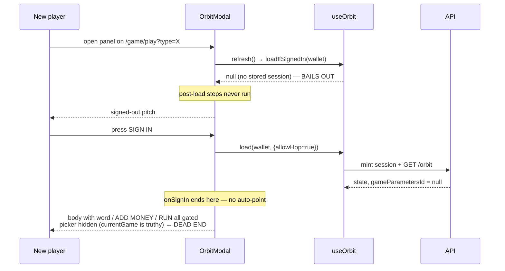
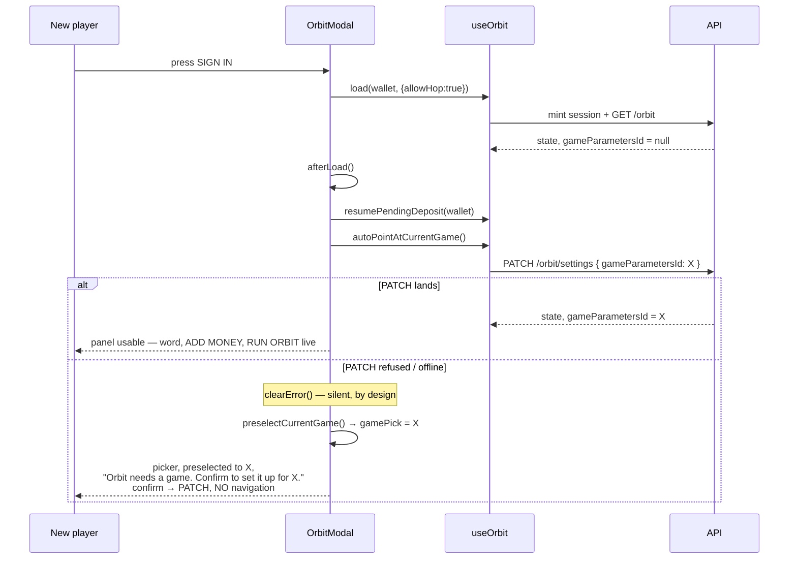

# SpaceStroker — "Orbit modal not loading the game type" — Implementation Spec

> **Status: Ready for implementation** — refined via Trello card
> [Orbit modal not loading the game type](https://trello.com/c/R8RHJgeY) (#164, 2026-08-10).
> Repos affected: **`monkify-front`** and this doc in **`monkify-meta`**.
> **`monkify-backend` is NOT affected** — no entity, enum, handler, consumer, EF mapping, migration,
> endpoint or SignalR contract changes. The only write involved is the already-shipped,
> preference-only `PATCH /orbit/settings` (`gameParametersId`), unchanged in shape and semantics.
>
> **Purpose:** a **new player** who sets Orbit up from the panel lands in a dead end — the panel is
> open beside a round, Orbit has **no game pointer**, and there is **no control in the panel that can
> set one**. This spec fixes the two independent defects that stack into that dead end: the pointer
> is never set on the sign-in path, and the picker that could set it is suppressed on a game page.

---

## 1. Summary

Two defects, one symptom.

| # | Defect | Where | Effect |
| --- | --- | --- | --- |
| 1 | The post-load sequence (`resumePendingDeposit` → `autoPointAtCurrentGame`) runs **only** from `refresh()`. A player with **no stored Orbit session** bails out of `refresh()` at `loadIfSignedIn` (`OrbitModal.vue:867`) and gets the signed-out pitch. **SIGN IN** runs `onSignIn` (`:920`), which calls `load()` **and nothing else**. | `OrbitModal.vue` script | `gameParametersId` stays `null` after the very first sign-in — the path **every** new player takes. |
| 2 | The picker's condition is `!orbit?.gameParametersId && !currentGame` (`:1174`). On a game page `currentGame` is truthy, so the picker is **hidden** — while the word field, `ADD MONEY` ("Pick a game first — Orbit needs to know what it would play.", `:1337`) and `RUN ORBIT` are all gated on the pointer the picker is the only way to set. | `OrbitModal.vue` template | The pointerless state is a **dead end**: the only escape is closing and reopening the panel (which re-runs `refresh()`) or leaving for `/orbit`. |

`autoPointAtCurrentGame` is **best-effort and silent by design** (its `catch` calls `clearError()`,
`:905-909`), so a refused/offline PATCH reproduces the *identical* dead end even once defect 1 is
fixed. That is why both are in scope — the failure path is one the code's own comment at `:1330-1332`
already anticipates ("survives for the failure path").

**The fix, in three moves:**

1. **One shared post-load sequence.** Extract `resumePendingDeposit` + `autoPointAtCurrentGame` out
   of `refresh()` into a single helper that **both** `refresh()` and `onSignIn()` end in — so the two
   paths cannot drift again.
2. **The picker renders on `!gameParametersId` alone.** The `&& !currentGame` half is dropped. This
   is the guarantee: **no reachable panel state gates every control on a pointer that nothing can
   set.**
3. **The picker becomes contextual when there IS a current game** — preselected, reworded, and it
   skips the `router.push` when the pick is the page the player is already on. With no `currentGame`
   it degrades to **today's exact** copy and navigation.

### Before / after

| State | Today | After |
| --- | --- | --- |
| New player, first panel open on `/game/play?type=X`, presses SIGN IN | Signed-in body renders with `gameParametersId` null → word, `ADD MONEY` and `RUN ORBIT` all dead; no picker (suppressed by `currentGame`) | Post-load helper runs → Orbit is pointed at X → panel is immediately usable |
| Auto-point PATCH refused / offline | Same dead end, silently | Picker renders, **preselected to X**, one press away from usable. Still no error band |
| Pointerless, standing on a round | Picker hidden | Picker shown, preselected, "Orbit needs a game. Confirm to set it up for `<name>`." — confirming saves and **does not navigate** |
| Pointerless, away from a round | Picker shown, "Pick the game Orbit plays — confirming takes you there to finish setting up." | **Unchanged** — no preselect, same copy, real navigation |
| Self-excluded, pointerless | Picker hidden on a game page; the "Auto-play is unavailable on this wallet." line at `:1495` lives in the `v-else` body the picker branch never reaches | Picker renders **disabled** with that sentence repeated **inside** the picker block |
| Wallet that already has a pointer | — | **Unchanged.** Picker never renders; auto-point never re-points (`:898` returns on a present `gameParametersId`); the switch guard is untouched |

---

## 2. Constraints (MANDATORY)

From `monkify-meta/constraints.md` (full list there):

- **Worktree-per-repo** (§2): work in `.worktrees/orbit-modal-game-type/monkify-front` and
  `.worktrees/orbit-modal-game-type/monkify-meta`. The shared checkouts stay on `main`; the branch
  `feature/orbit-modal-game-type` is the merge/PR ref and is the same name in both repos.
- **Unit tests (§3): N/A — nothing to run.** `monkify-front` has **no test runner** (no `.spec` /
  `.test` files in the repo), and `monkify-backend` is not touched, so `SpaceStroker.Tests` has
  nothing to update.
- **Integration test (`AGENTS.md` rule 8 / `constraints.md` §3): explicitly NOT required.** That rule
  scopes to **new features** with a backend happy path. This card is a **bug fix** with **zero
  backend surface** — there is no endpoint, event or state transition for
  `SpaceStroker.Tests.Integration` to exercise that is not already covered. Stated here so the skip is
  a recorded decision, not a silent omission.
- **Secrets/config (§1):** no config file is touched. If one is, mock values only.
- **User-facing messaging (§6):** the picker's copy names a **game**, not a session, nonce or wallet
  state — nothing here loosens the vague-auth rules. The self-excluded sentence is the copy already
  shipped at `:1495`, repeated verbatim.
- **EF / migrations (§4):** N/A — no backend change.

---

## 3. Resolved product decisions

| # | Decision | Why |
| --- | --- | --- |
| 1 | **Fix BOTH defects, not one.** | The auto-point makes the dead end not happen; the render rule makes it **not a dead end** when the silent write fails. Render-guard-only was **rejected** (it puts a "pick a game" step in front of every new player who is already standing on the game). Auto-point-only was **rejected** (the trap survives on the failure path `:1332` already anticipates). |
| 2 | **One shared post-load sequence**, called by `refresh()` **and** `onSignIn()`. | The two paths drifting **is** this bug. A helper both paths end in cannot drift again. |
| 3 | The sequence keeps **`resumePendingDeposit` first, `autoPointAtCurrentGame` second** — identical order to today's `refresh()`. | Deliberately picks up the **deposit replay** on the sign-in path too: it matters for a returning player whose session expired with money in the stash (AC 10). |
| 4 | Picker `v-if` becomes **`!orbit?.gameParametersId`** — the `&& !currentGame` half is dropped. | The guarantee: no reachable panel state gates every control on a pointer nothing can set. |
| 5 | **Contextual picker when `currentGame` exists:** preselect it, reword to *"Orbit needs a game. Confirm to set it up for `<name>`."*, and **skip the `router.push`** when the pick equals the current route's `?type=`. | Pushing the route you are already on is a no-op at best and a remount at worst; the copy must not promise a trip that will not happen. |
| 6 | With **no `currentGame`** the picker degrades to **today's exact** shape: no preselection, *"Pick the game Orbit plays — confirming takes you there to finish setting up."*, real navigation. | That surface was never broken; this card must not redesign it. |
| 7 | **Self-excluded wallet:** dropdown + button render **disabled**, and *"Auto-play is unavailable on this wallet."* is shown **inside the picker block** — **repeated**, not moved from `:1495`. | `autoPointAtCurrentGame` skips a self-excluded wallet (`:898`), so this is the one wallet that *always* meets the picker. `:1495` sits in the `v-else` body the picker branch never reaches, and the `v-else` body still needs it. Matches the shipped `ADD MONEY` pattern — "a control that explains itself is not a dead button" — and the "no control that can only ever fail" rule. |
| 8 | **`autoPointAtCurrentGame` stays silent on failure** — no toast, no error band, `clearError()` in the `catch` unchanged. | The now-visible picker **is** the consequence. A toast about a write nobody asked for stays wrong. |
| 9 | **Verification split:** the minimal repro is the dev loop; the card's full wipe-and-win repro is the acceptance check. | The full repro costs a container wipe and two wallets; the dev loop is one `localStorage` delete. |

---

## 4. Data model

**N/A.** No entity, column, enum, EF mapping or migration. No backend change of any kind.

---

## 5. Configuration

**N/A.** No new env var, no `GeneralSettings` key, no seed data. `VUE_APP_ORBIT_ENABLED` (existing)
must be `true` locally to see the panel at all — that is a QA prerequisite, not a change.

---

## 6. Backend behaviour

**No change.** For the record, so the implementer does not go looking:

- The only write on any path in this spec is `PATCH /orbit/settings` with
  `{ gameParametersId }` — the same preference-only call `OrbitGameTab.commitGame` and
  `autoPointAtCurrentGame` already send. It moves no money, does not set `enabled`, and creates the
  enrolment row (which is why `ADD MONEY` starts working the moment it lands).
- Self-exclusion is enforced server-side regardless; the disabled picker means the client simply
  never sends a request that would be refused.

---

## 7. Frontend behaviour (`monkify-front`)

**Everything in this card is in one file: `src/components/orbit/OrbitModal.vue`.**

Not changed, and deliberately: `src/hooks/useOrbit.ts` (no new export, no signature change),
`src/services/*`, `src/types/orbit.ts`, `src/components/orbit/OrbitControlBar.vue`,
`src/pages/OrbitPage.vue`, `src/components/orbit/tabs/*` (the GAME tab picker on `/orbit` is
unaffected — that surface was never blocked), `src/constants/icons.ts`, `src/routes.ts`.

### 7.1 The shared post-load sequence (script)

Extract the two post-load steps out of `refresh()` (`:862-879`) into one helper, and call it from
both entry points.

```ts
/**
 * Everything that must happen AFTER a successful read, wherever the read came from.
 *
 * ⚠️ THIS EXISTS BECAUSE THE TWO READ PATHS DRIFTED. `refresh()` ran these steps and `onSignIn()`
 * did not, so a player with no stored session — every NEW player's first open — signed in and got a
 * panel with no game pointer and (before this card) no control that could set one. Both paths end
 * here now so they cannot diverge again.
 *
 * Must not throw: it runs from watchers and onMounted. `resumePendingDeposit` absorbs its own
 * failures, `autoPointAtCurrentGame` swallows and clears its own.
 */
const afterLoad = async () => {
  if (!props.wallet) return;

  // A deposit whose credit POST never landed is replayed here; the endpoint is idempotent, so this
  // is safe on every open. Reached only WITH a session, so it cannot prompt either.
  await resumePendingDeposit(props.wallet);

  // A fresh Orbit opened beside a round is pointed at it — see the function for why this one silent
  // write is allowed where minting a session is not.
  await autoPointAtCurrentGame();

  // The picker below is what the player meets if that write did not land. Preselect it to the round
  // they are standing in so the fallback is one press, not a decision.
  preselectCurrentGame();
};
```

`refresh()` becomes:

```ts
const refresh = async () => {
  if (!props.wallet) return;
  loadFailed.value = false;
  if (!(await loadIfSignedIn(props.wallet))) return;
  await afterLoad();
};
```

`onSignIn()` becomes:

```ts
const onSignIn = async () => {
  if (!props.wallet) return;
  loadFailed.value = false;

  try {
    await load(props.wallet, { allowHop: true });
    await afterLoad();
  } catch {
    loadFailed.value = true;
  }
};
```

**Notes for the implementer:**

- `load()` **throws** on failure (`useOrbit.ts:491-507`) and returns `OrbitState | null` on success,
  so `afterLoad()` inside the `try` only runs on a successful read — matching `refresh()`, which only
  reaches it on a truthy `loadIfSignedIn`. Do **not** move it into a `finally`.
- `allowHop: true` stays on `onSignIn`'s `load` only. Nothing in `afterLoad` mints a session
  (`resumePendingDeposit` calls `ensureSession` with no hop; `autoPointAtCurrentGame` runs
  `updateSettings` on the session that now exists), so the "opening the panel must not prompt a
  wallet signature" rule at `:854-857` is preserved.
- `autoPointAtCurrentGame` already guards on `props.open`, a present `gameParametersId` and
  `selfExcluded` (`:896-901`) — leave all three.
- **Known, unchanged ordering nuance:** `resumePendingDeposit` **defers** (keeps the stash) when
  there is no enrolment row yet (`useOrbit.ts:698-703`), so a brand-new player who somehow has a
  pending stash *and* no pointer replays on the next open rather than this one. This is today's
  behaviour on the `refresh()` path and is **deliberately not changed** — reordering the two steps is
  out of scope for this card.

### 7.2 Preselecting the picker (script)

```ts
/**
 * The picker's default when the player is standing in a playable round: that round. It is the only
 * answer that is ever right in context, and it turns the failure path from a decision into a
 * confirmation. Empty (today's behaviour) anywhere else — there is nothing contextual to adopt.
 */
const preselectCurrentGame = () => {
  if (orbit.value?.gameParametersId) return;   // no picker will render
  gamePick.value = currentGame.value?.id ?? '';
};
```

- Called at the end of `afterLoad()` — **after** the auto-point, so it only ever matters on the path
  where the pointer is still null.
- The existing `watch(() => currentGame.value?.id, ...)` at `:952-957` (which resets
  `switchGuardDismissed`) also calls `preselectCurrentGame()`, so navigating between rounds with the
  panel open re-points the preselection instead of leaving a stale one.
- The `open` watcher at `:932-948` still clears `gamePick` to `''` per open (a half-picked game left
  behind by a closed picker is not a choice anyone confirmed); `afterLoad()` runs after it and sets
  the contextual default.

### 7.3 `onConfirmGamePick` — save always, navigate only when it means something

```ts
const onConfirmGamePick = async () => {
  if (!props.wallet || !gamePick.value || isBusy.value || orbit.value?.selfExcluded) return;
  notice.value = null;

  // ⚠️ Compared against the ROUTE, not `currentGame`: the honest question is "am I already on that
  // page?". Pushing the route we are standing on is a remount of the round for no reason, and the
  // contextual copy above promises no trip.
  const alreadyThere = gamePick.value === (route.query.type as string | undefined);

  try {
    await updateSettings(props.wallet, { gameParametersId: gamePick.value });
    if (!alreadyThere) router.push({ name: 'Game', query: { type: gamePick.value } });
  } catch {
    // useOrbit already surfaced the reason in lastError.
  }
};
```

- **Save first, navigate second** stays (`:202-211`): the save is what creates the enrolment row, and
  a refused save must leave the player in the panel with the reason, not on a game page with an unset
  Orbit.
- **No `emit('close')`** before the push — still the one navigation in this file that keeps the panel
  open.
- The `selfExcluded` early return is belt-and-braces behind the disabled button (decision 7): no
  PATCH is ever sent from this control on that wallet.

### 7.4 The picker block (template, replacing `:1173-1208`)

- **`v-if="!orbit?.gameParametersId"`** — the `&& !currentGame` half is gone.
- Headline unchanged (`Play a game automatically`).
- Body copy is contextual:
  - `currentGame` present → **"Orbit needs a game. Confirm to set it up for `{{ currentGame.name }}`."**
  - otherwise → today's exact string, **"Pick the game Orbit plays — confirming takes you there to finish setting up."**
- `<select>` keeps its `Name · stake` option shape (two lists of the same games spelling their entries
  differently would read as two catalogues) and gains
  `:disabled="isBusy || !!orbit?.selfExcluded"`.
- Button keeps the `Set up Orbit` label and gains the same self-exclusion term:
  `:disabled="!gamePick || isBusy || !!orbit?.selfExcluded"`.
- **New, inside the block**, after the button:

  ```html
  <p v-if="orbit?.selfExcluded" class="dialog-copy mt-2 !text-[17px] !text-ink-mute">
    Auto-play is unavailable on this wallet.
  </p>
  ```

  Same classes as `:1495`, which **stays where it is** — the `v-else` body still needs it.
- No new CSS, no new icon, no change to `arcade.css`.

### 7.5 Copy inventory

| String | Where | Status |
| --- | --- | --- |
| `Play a game automatically` | picker headline | unchanged |
| `Orbit needs a game. Confirm to set it up for <name>.` | picker body, **with** a current game | **new** |
| `Pick the game Orbit plays — confirming takes you there to finish setting up.` | picker body, **no** current game | unchanged |
| `Pick a game` / `Set up Orbit` | picker select placeholder / button | unchanged |
| `Auto-play is unavailable on this wallet.` | picker block (**new instance**) and `:1495` (**kept**) | repeated verbatim |
| `Pick a game first — Orbit needs to know what it would play.` | `ADD MONEY` sub-note, `:1337` | unchanged — now effectively unreachable in the panel (the picker takes that state), and kept as the honest statement if it ever is |

---

## 8. Flow diagrams

### 8.1 Today — the dead end



### 8.2 After



---

## 9. Out of scope

- Any `/orbit` page change — its GAME tab already offers a picker, so that surface was never blocked.
- Making `autoPointAtCurrentGame` loud or retrying, or adding a toast on its failure.
- Re-opening how the first-win modal hands over to the panel
  (`GameHeader.acceptFirstWinUpsell`) — the handoff is correct; what it opened into was not.
- Any backend change, including the session/nonce flow.
- The stop-rules / word auto-save behaviour shipped by card #163
  (`specs/orbit-modal-improvements.md`).
- Reordering `resumePendingDeposit` vs `autoPointAtCurrentGame` (see §7.1's ordering note).

---

## 10. File checklist

### 10.1 Backend (`monkify-backend`)

**None.** No branch is created in this repo.

### 10.2 Frontend (`monkify-front`)

| # | File | Change |
| --- | --- | --- |
| 1 | `src/components/orbit/OrbitModal.vue` | Extract `afterLoad()` (deposit replay → auto-point → preselect) out of `refresh()`; call it from `refresh()` **and** `onSignIn()`; add `preselectCurrentGame()` and call it from the `currentGame` watcher too; picker `v-if` → `!orbit?.gameParametersId`; contextual picker copy + preselect; `router.push` skipped in `onConfirmGamePick` when the pick equals `route.query.type`; self-excluded disabled state + repeated note inside the picker block |

### 10.3 Meta (`monkify-meta`)

| # | File | Change |
| --- | --- | --- |
| 1 | `specs/orbit-modal-game-type.md` | This spec (added by `/monkify-create-spec`) |
| 2 | `INDEX.md` | KB map row + "Feature currently in flight" entry |
| 3 | `features/orbit-modal-improvements.md`, `features/orbit-ui-overhaul.md` | **At ship time only** (`/monkify-ship-feature`): the panel's picker is no longer "away from a round only", and the sign-in path now runs the post-load sequence |

---

## 11. Unit tests

**None — and that is a decision, not an omission.**

- `monkify-front` has **no test runner**: the repo contains no `.spec` / `.test` files and no test
  script. There is nothing to extend.
- `monkify-backend` is untouched, so `SpaceStroker.Tests` has nothing to update and
  `SpaceStroker.Tests.Integration` has no new path to drive. `AGENTS.md` rule 8 scopes its mandatory
  happy-path integration test to **new features**; this is a **bug fix** with zero backend surface.

Verification is therefore §13's manual QA plus `yarn lint` and `yarn build`.

---

## 12. Acceptance criteria

Copied 1:1 from the card's **Acceptance Criteria** checklist.

1. Given a wallet with no stored Orbit session standing on `/game?type=X`, when the player opens the
   Orbit panel and presses **SIGN IN**, then Orbit is pointed at X and the word field, `ADD MONEY`
   and `RUN ORBIT` are usable **without closing and reopening the panel**.
2. Given a new player who has just won and accepts the first-win modal on `/game?type=X`, when the
   Orbit panel opens and they sign in, then no step of the setup reports "Pick a game first" and the
   panel is immediately usable.
3. Given a signed-in Orbit with `gameParametersId` null while standing on a playable round, when the
   panel renders, then the game picker is shown (**regardless of there being a current game**) so no
   panel state gates every control on a pointer nothing can set.
4. Given the picker renders while the player is standing on an Orbit-eligible round, when it appears,
   then the dropdown is **preselected** to that round and the copy names it ("Orbit needs a game.
   Confirm to set it up for `<name>`.").
5. Given the picker's selection equals the game type in the current route, when the player confirms
   it, then the settings PATCH is sent and **no navigation occurs** (the panel stays open on the page
   it is already on).
6. Given the panel is opened away from any playable round with no game saved, when the picker
   renders, then it keeps **today's behaviour exactly**: no preselection, the "Pick the game Orbit
   plays — confirming takes you there to finish setting up." copy, and confirming navigates to that
   game's page with the panel still open.
7. Given a self-excluded wallet with no game saved, when the picker renders, then its dropdown and
   button are **disabled** and "Auto-play is unavailable on this wallet." is shown **inside the
   picker block**, and **no settings PATCH is ever sent from it**.
8. Given the silent auto-point PATCH fails (refused, offline or 4xx), when the panel finishes
   loading, then **no error band or toast** is shown and the picker is what the player sees instead
   of a dead panel.
9. Given a wallet whose Orbit already has a game saved, when the panel is opened beside any round,
   then **nothing changes**: the picker never renders, the auto-point never re-points anything, and
   the switch guard still fires on a mismatch.
10. Given a pending deposit stash for a wallet whose Orbit session had expired, when that player
    signs in from the panel, then the idempotent credit replay runs on the **sign-in path** (not only
    on the next panel open).
11. Given the change is complete, when the front is verified, then `yarn lint` and `yarn build` are
    clean and the card's full repro (wipe containers incl. DB → redeploy → ~5 bets + 1 on a second
    wallet → first-win modal → **ENABLE**) leaves the panel usable on the first try.

---

## 13. Manual QA

Local Docker stack, `VUE_APP_ORBIT_ENABLED=true` in the front's `.env.local`.

**Dev loop — minimal repro (AC 1, 3, 4, 5):**

1. Open `/game?type=<an Orbit-eligible type>` with a connected wallet.
2. In DevTools → Application → Local Storage, delete the stored Orbit session entry for that wallet
   (and reload) so the panel comes up on the signed-out pitch.
3. Open the Orbit panel → press **SIGN IN**.
4. Expect: the panel lands **usable** — word field live, `ADD MONEY` live, `RUN ORBIT` reachable —
   with **no** close/reopen. GAME MODE names the round on screen.
5. Now force defect 2's path: block `PATCH /orbit/settings` in DevTools (Network → block request URL)
   and repeat steps 2–3. Expect the **picker**, preselected to this round, copy naming it, **no**
   error band. Unblock, press **Set up Orbit** → PATCH sent, **URL unchanged**, panel drops into the
   normal body.

**Away-from-a-round regression (AC 6):**

6. From the lobby or dashboard (no `?type=`), with a wallet that has no game saved: open the panel →
   picker with **no** preselection, today's copy, confirming **navigates** to that game's page with
   the panel still open.

**Self-exclusion (AC 7):**

7. On a self-excluded wallet with no game saved, open the panel on a game page: dropdown and button
   **disabled**, "Auto-play is unavailable on this wallet." inside the picker block, and the Network
   tab shows **no** `PATCH /orbit/settings`.

**Acceptance check — the card's full repro (AC 2, 11):**

8. Wipe all containers **including the DB** → redeploy → place ~5 bets, plus 1 on a second wallet, to
   trigger the first-win modal → **ENABLE** → the panel is usable immediately, with no "Pick a game
   first" anywhere in the flow.

**Untouched paths to re-check (AC 9):**

9. A wallet that already has a game saved: panel beside its own game (normal body, no picker) and
   beside a different game (switch guard, unchanged copy and press).

---

## 14. Trello / pipeline

- **Source card:** [#164 — Orbit modal not loading the game type](https://trello.com/c/R8RHJgeY) —
  list **Specs created**; the card's **Implementation** section carries branch, worktree and spec
  path.
- **Worktrees:** `.worktrees/orbit-modal-game-type/monkify-front`,
  `.worktrees/orbit-modal-game-type/monkify-meta`. Branch `feature/orbit-modal-game-type` in both.
- **Next:** `/monkify-implement-feature Orbit modal not loading the game type`, then
  `/monkify-ship-feature Orbit modal not loading the game type`.

---

## 15. Revision log

| Date | Change |
| --- | --- |
| 2026-08-10 | Initial spec from refined card #164 (root cause + decisions from the 2026-08-10 refinement comment), with line-level touchpoints confirmed against `OrbitModal.vue` and `useOrbit.ts` on `main` (`c6a0138`). |
