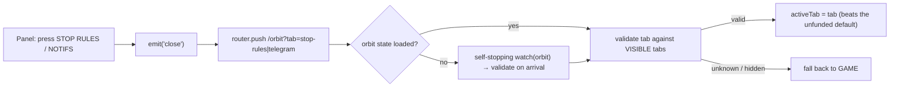

# SpaceStroker — "Orbit modal improvements" — Implementation Spec

> **Status: SHIPPED 2026-08-10** — merged to `main` via `feature/orbit-modal-improvements` in
> `monkify-front` + `monkify-meta`. Distilled in
> [`../features/orbit-modal-improvements.md`](../features/orbit.md), which is the
> summary to read first; this spec stays as the deep design archive.
> Refined via Trello card [#163 Orbit modal improvements](https://trello.com/c/77laekQh) (2026-08-10).
> Repos affected: `monkify-front`, and this doc in `monkify-meta`. **`monkify-backend` is not
> touched at all.**
>
> **Purpose:** Bring the Orbit **panel** (`OrbitModal.vue`) back in line with the `/orbit` page after
> the single-control merge: the panel's two-button transport pair becomes the shared
> `OrbitControlBar` (RUN/PAUSE + CASH OUT), the panel's way-out link names notifications and lands on
> `/orbit`'s TELEGRAM tab via a new validated `?tab=` query, and the rule fields on **both** surfaces
> stop losing a value typed and never blurred.
>
> ### ⚠️ REVISED DURING IMPLEMENTATION (2026-08-10) — read §17 before §3
>
> Change ③ as originally specified — **delete the panel's stop-rule editors, replace them with two
> icon'd nav buttons (STOP RULES / NOTIFS)** — was built, reviewed on screen by the owner, and
> **rejected**. It is NOT in the shipped branch. The editors stay in the panel exactly as they were.
> Every §3 decision numbered 5-8, the §7.3 deletions, the `notify` icon, and acceptance criteria
> 7-10 are superseded accordingly. §17 is the authoritative record of what shipped.

---

## 1. Summary

Four changes, all frontend, all in `monkify-front`.

| # | Area | Today | After |
| --- | --- | --- | --- |
| 1 | Panel controls | `RUN ORBIT` + `STOP ORBIT` transport pair, both always drawn, the one matching the current state disabled (`OrbitModal.vue:1399-1427`). **No cash-out at all.** | The shared `OrbitControlBar` in a **compact** size: ONE `RUN`/`RESUME`↔`PAUSE ORBIT` toggle + `CASH OUT`. |
| 2 | Panel money-out | Money-out from a live round means leaving for `/orbit`. | `CASH OUT` in the panel — full balance, straight to the wallet signature, **never word-gated**. |
| 3 | Panel position ③ | `AUTO CASHOUT (PAUSES ORBIT)` — two editable number fields + `rulesHint` + `ruleError`. | ~~Two icon'd button-links, STOP RULES and NOTIFS~~ → **UNCHANGED. Rejected on review (§17.1).** The editors stay. |
| 3b | Panel way out | `ADVANCED SETTINGS` → plain `/orbit`. | **"Set up notifications and more in Orbit settings"** → `/orbit?tab=telegram`, or "More in Orbit settings" → `/orbit` where no bot is configured (§17.2). |
| 4 | Rule auto-save | `OrbitStopRulesTab.vue` **and** `OrbitModal.vue` both commit on `@blur` / `@keyup.enter` only — leaving the tab, the page, or **closing the panel** with a field still focused **silently loses the typed value**. | Both get a **1.2 s debounce** + a flush (on unmount for the tab, on **close** for the panel), alongside the existing blur/Enter commit (§17.3). |

Two behaviour changes fall out of (1) deliberately, and are accepted:

- The panel's `PAUSE`/`STOP` was **dead while `unfunded`** (`canStop` gated on funds). The bar's
  toggle is live whenever `status === 'running'`, and shows a dead `RUN ORBIT / Add money first`
  in `unfunded`. The bar's table wins.
- The panel's RUN **never said RESUME**. The bar says `RESUME` once Orbit has placed a bet
  (`hasRunBefore`).

### ~~This re-opens `orbit-ui-overhaul.md` §3.1, knowingly~~ — WITHDRAWN

**It does not.** `orbit-ui-overhaul.md` §3.1 stays closed exactly as it was: both rule editors remain
in the panel. The removal was built and rejected on review — see §17.1. Nothing downstream needs to
correct §3.1, and `features/orbit-ui-overhaul.md` needs no change on that point.

---

## 2. Constraints (MANDATORY)

From `monkify-meta/constraints.md` (full list there):

- **Worktree per repo:** `.worktrees/orbit-modal-improvements/<repo>`; branch
  `feature/orbit-modal-improvements` in `monkify-front` and `monkify-meta`. Hubs stay on `main`
  (`constraints.md` §2).
- **No backend change ⇒ no unit-test mandate and no integration test.** `constraints.md` §3 /
  `AGENTS.md` rule 8 apply to backend behaviour and to **new features**; this is a **minor change**
  (UI convergence on already-shipped behaviour) with **zero** backend surface. `scripts/run_tests.bat`
  is not required for this card.
- **`monkify-front` has no test runner** (no `.spec` / `.test` files). The automated bar is
  `yarn lint` + `yarn build` clean; correctness is manual QA against §12.
- **Orbit is dark in production** (`VUE_APP_ORBIT_ENABLED`, fail-closed). QA on the local Docker
  stack with the flag on.
- **Colour rule** (`features/orbit-ui-overhaul.md`): green = running/satisfied, red = warning only,
  amber = the active step's primary action only. **A healthy running Orbit shows no amber and no
  red.** The two new nav buttons carry **no** accent fill; the missing-floor sub-line is the single
  red exception.
- **No Orbit-scoped icon files.** #159 retired `OrbitMark.vue` / `OrbitGlyph.vue`; every glyph lives
  in `src/constants/icons.ts` and renders through `<AppIcon>`.
- **Money-out is never harder to reach than money-in** (`orbit-ui-overhaul.md`). This is why
  `CASH OUT` escapes the word gate that `ADD MONEY` keeps.
- **Timestamps, not timers** for any deadline (`useIdleDisconnect.ts`). The debounce here is a plain
  input debounce, not a deadline — the distinction holds.
- **Secrets/config:** nothing in this card touches config. No env var is added.

---

## 3. Resolved product decisions

| # | Decision |
| --- | --- |
| 1 | **Reuse `OrbitControlBar.vue` in the panel**, with a compact/size modifier — not a modal-specific rebuild. The RUN/PAUSE/CASH-OUT state table exists **once**. A second copy is exactly how the status tag and the buttons came to disagree before. |
| 2 | The bar's `.orbit-trio` look was drawn to sit **outside** a card, at page scale. It needs a compact variant to fit the panel — see §7.2 for the CSS blocker this exposes. |
| 3 | **CASH OUT goes straight to the wallet signature**, exactly like `/orbit`. No inline "send X and pause Orbit?" confirm row: the signature **is** the confirmation, and a second press would make the panel's cash-out heavier than the page's for no new protection. |
| 4 | **CASH OUT is never word-gated.** A player who funded Orbit and then could not save a word must still be able to get their money out from the round screen. **ADD MONEY keeps its word gate.** |
| 5 | The `AUTO CASHOUT` block at ③ is **replaced** by two icon'd, button-like links at the same position, with `ADVANCED SETTINGS` still below the controls. Two, not three — three targets lose their sub-lines at phone width. |
| 6 | Those two link to **STOP RULES** and **NOTIFS**, not MONEY: money is already inline in the panel (ADD MONEY above, CASH OUT below), so a MONEY link would point at what the player is already looking at. The rules just lost their editor and need to stay one tap away. |
| 7 | The **missing-floor warning survives** as the STOP RULES button's own red sub-line (today's `rulesHint` text: *"No floor set — Orbit plays down to zero."*), so the round screen still says when there is no floor. |
| 8 | **NOTIFS is hidden entirely when `telegramEnabled` is false** — the panel's existing "no button that can only ever fail" rule, the same one that drops the page's TELEGRAM tab on a deployment with no bot. STOP RULES then sits alone. |
| 9 | **`/orbit` gains a validated `?tab=<id>` query**, matched against the *visible* tab list and falling back to `game`. An explicit tab in the URL **wins over** the existing "open on MONEY when unfunded/first-deposit" default. A query, not a hash — it composes with the existing route. |
| 10 | The **debounce lands on `OrbitStopRulesTab.vue` only** (the panel no longer has rule fields): **1.2 s**, *alongside* the existing blur/Enter commit, plus a **flush of a dirty field on unmount**. |
| 11 | ⚠️ **1.2 s and not the word's 600 ms.** Every prefix of a number is itself a legal value, and `CashOutAtThreshold` fires at *balance ≥ it*. A long pause while typing `100` can briefly save `1`, and the next win credit then **cashes out for real and pauses Orbit** — money moved, cool-off gap consumed. The existing `minimumCashOut` check is the only other guard; the longer window is the mitigation, and the residual risk is accepted. |
| 12 | **The word fields are left exactly as they are.** They already debounce at 600 ms in both `OrbitModal.vue` (`WORD_AUTOSAVE_DELAY_MS`) and `OrbitGameTab.vue`. Verified during refinement; the card's "word" mention was a false alarm. |
| 13 | No `src/types/orbit.ts` change and no `src/services/` change. No backend, DTO or SignalR contract change. |

---

## 4. Data model

**N/A.** No entity, column, EF mapping or migration. Every value this card renders
(`cashOutAtThreshold`, `cashOutFloor`, `telegramEnabled`, `telegramLinked`, `nextManualCashOutAt`,
`minimumCashOut`, `balance`, `orbitBetsPlaced`) is already on the `GET /orbit` payload
(`src/types/orbit.ts`), and the cash-out uses the shipped signed `POST` path unchanged.

---

## 5. Configuration

**N/A.** No new env var, no `spacestrokersettings.json` key, no deploy-config change. Orbit stays
behind the existing `VUE_APP_ORBIT_ENABLED` flag; nothing here changes when or how it is read.

---

## 6. Backend behaviour

**N/A — no backend surface.** No entity, handler, consumer, migration, endpoint, header or config
change. No new rate-limit rule and no Cloud Armor surface. **No `monkify-backend` branch or worktree
is created for this card.**

---

## 7. Frontend behaviour (`monkify-front`)

### 7.1 `OrbitControlBar.vue` — a compact variant

Add one optional prop; the state table, labels and colours are otherwise **untouched**.

```ts
const props = defineProps<{
  status: OrbitStatus;
  busy: boolean;
  hasChoice: boolean;
  hasGame: boolean;
  hasFunds: boolean;
  hasRunBefore: boolean;
  hasBalance: boolean;
  cashOutGapLabel: string | null;
  /** Panel scale: shorter buttons, smaller type/icon, two-across from the smallest width. */
  compact?: boolean;
}>();
```

Root element becomes `:class="['orbit-trio', { 'orbit-trio--compact': compact }]"`, and the
`AppIcon` size drops from `28` to `24` in compact (matching what the transport pair renders today).
Nothing else in the component's script changes.

### 7.2 ⚠️ HIDDEN BLOCKER — the trio's styles are scoped to `.orbit-page`

Every rule for the bar is written as a **descendant of `.orbit-page`** in
`src/assets/styles/arcade.css` (lines ~1691-1814): `.orbit-page .orbit-trio`,
`.orbit-page .orbit-trio__btn`, `--run`, `--stop`, `--off`, `__btn-icon`, `__btn-text`,
`__btn-title`, `__btn-sub`, `:disabled`, `:active`, and the `@media (min-width: 640px)` row step.
The component itself declares **no styles at all**.

Mounted inside `OrbitModal.vue` there is no `.orbit-page` ancestor, so the bar would render as
**three unstyled inline buttons**. This is not a polish item — it is the difference between the
component working and not.

**Resolution (decided here, `constraints.md` §8 — reversible, low-risk):** *de-scope* the block.
Rewrite every `.orbit-page .orbit-trio*` selector in `arcade.css` as a bare `.orbit-trio*` selector
in the same place in the file, keeping the declarations byte-identical, then add the
`.orbit-trio--compact` overrides directly beneath.

- Do **not** duplicate the block into `OrbitModal.vue`'s scoped styles — two copies of the control
  bar's look is the same drift the single-component decision exists to prevent.
- Do **not** wrap the panel in a `.orbit-page` class — that class also carries the page's
  `relative z-[2]` starfield fix and its own layout, and borrowing it for a modal is a lie that the
  next reader has to unpick.
- `.orbit-trio` is used **nowhere else** in the codebase, so de-scoping widens nothing in practice.
  Verify with `grep -rn "orbit-trio" src/` before and after: the page must render pixel-identically.

The compact modifier:

```css
/* Panel scale. The page bar is `--ctl-h-xl` full-width and stacks below 640px; inside a compact
   dialog the same control has to be two-across at EVERY width (the panel's own body is already
   narrow) and one control rung shorter, matching the transport pair it replaces (3.375rem). */
.orbit-trio--compact { flex-direction: row; gap: 0.5rem; }
.orbit-trio--compact .orbit-trio__btn { flex: 1 1 0%; height: auto; min-height: 3.375rem; padding: 0.5rem 0.625rem; }
.orbit-trio--compact .orbit-trio__btn-icon { font-size: 24px; }
.orbit-trio--compact .orbit-trio__btn-title { font-size: 0.625rem; }
.orbit-trio--compact .orbit-trio__btn-sub { font-size: 0.9375rem; }
```

Those numbers are lifted from the `.orbit-transport*` block being deleted (`OrbitModal.vue`
~1690-1776), so the panel keeps the geometry it has today.

The reduced-motion block at the foot of `OrbitModal.vue`'s `<style>` currently names
`.orbit-transport`; `.orbit-trio__btn` has an `:active { transform: translateY(1px) }` and colour
transitions that need the same treatment. Add `.orbit-trio__btn` to the existing
`@media (prefers-reduced-motion: reduce)` block in **`arcade.css`** (beside the de-scoped rules), not
in the modal — the page instance deserves it too, and it is missing there today.

### 7.3 `OrbitModal.vue` — the panel

**Delete:**

- The transport markup (`~1392-1427`) and every `.orbit-transport*` scoped style (`~1688-1776`).
- `onRun`, `onStop`, `canRun`, `canStop`, `runBlocker`, `runSub`, `isRunning`, `isOutOfFunds`,
  `hasFundsForRound`, `runTarget` — their logic lives in the bar.
  ⚠️ **`runTarget` and `isRunning` have other readers** — check before deleting. `runTarget` feeds
  `hasFundsForRound`; `isRunning` is also read by `runBlocker`. Both are local to the deleted set,
  but the **switch guard** reads `orbit.value?.enabled` directly (`onSwitchToCurrentGame`'s
  `wasRunning`) and must keep doing so. Grep each name before removing it.
- The whole `AUTO CASHOUT (PAUSES ORBIT)` section (`~1272-1390`) and its script: `commitRule`,
  `thresholdInput`, `floorInput`, `ruleError`, `syncRuleFields`, the `watch` that calls
  `syncRuleFields`, and the `.rule-field*` scoped styles (`~1624-1686`).
  ⚠️ `asText` is used **only** by the rule fields in this file — delete it with them. Verify.
- Keep `floorAtRisk` and `rulesHint` — repurposed as the STOP RULES button's sub-line.
- Keep `stopRules` and `hasCashOutFloor` in the `useOrbit()` destructure — the button states both
  live values.

**Add:**

- Pull `cashOut` and `nextManualCashOutLabel` from `useOrbit()` (neither is destructured today).
- `onCashOut`, mirroring `OrbitPage.onCashOut` exactly:

  ```ts
  const onCashOut = async () => {
    if (!props.wallet) return;
    notice.value = null;
    // ⚠️ Read BEFORE the call — by the time it returns the balance is 0.
    const amount = orbit.value?.balance ?? 0;
    const label = orbit.value?.tokenLabel ?? '';
    try {
      await cashOut(props.wallet);
      toast.info(`${amount} ${label} is on its way to your wallet.`);
    } catch {
      // useOrbit already surfaced the reason in lastError.
    }
  };
  ```

  This needs `import { toast } from 'vue3-toastify'` in `OrbitModal.vue` (the page already has it).
  ⚠️ **The `'hopped'` path must not toast.** `useOrbit.cashOut` **returns** `orbit.value` when
  `signOrbitMessage` reports `'hopped'` — it does **not** throw — so a mobile deeplink hop would fall
  straight into the success toast above. `OrbitPage.onCashOut` has the same shape and the same
  exposure. Guard it in the panel: compare the balance after the await, or have the call site treat
  an unchanged `orbit.value?.balance` as "no toast". Pick one and state it in a comment; do **not**
  change `useOrbit.cashOut`'s signature (the page and the MONEY tab both call it).

- `onToggle`, mirroring `OrbitPage.onToggle`:

  ```ts
  const onToggle = async () => {
    if (!props.wallet) return;
    notice.value = null;
    try {
      await updateSettings(props.wallet, {
        // A first press from a round enrols and points Orbit at it in one PATCH — the one thing
        // the panel's old `onRun` did that the page's `onToggle` does not.
        ...(orbit.value?.gameParametersId ? {} : { gameParametersId: currentGame.value?.id }),
        enabled: orbitStatus.value !== 'running',
      });
    } catch {
      // useOrbit already surfaced the reason in lastError.
    }
  };
  ```

  ⚠️ **Keep the enrol-on-first-press behaviour.** The page's `onToggle` is a bare
  `{ enabled: … }` PATCH because a player on `/orbit` has already picked a game. The panel's RUN has
  always doubled as the enrolment press for the round it was opened beside. Dropping the
  `gameParametersId` spread would break the "open the panel beside a round, press RUN" path.
  The old success notices (`'Orbit is running.'` / `'Orbit is on. Add money and it starts playing.'`
  / `'Orbit is paused. Your money stays where it is.'`) are **dropped** — the page's toggle prints
  none, and the bar's own face plus the status tag already report the result.

**Mount the bar** where the transport pair was (position ④), passing the same gates the page passes,
with the panel's own `runTarget`-equivalent for `hasGame`:

```vue
<OrbitControlBar
  compact
  :status="orbitStatus"
  :busy="isBusy"
  :has-choice="hasPlayableChoice"
  :has-game="!!orbit?.gameParametersId || !!currentGame"
  :has-funds="hasFundsForARound"
  :has-run-before="(orbit?.orbitBetsPlaced ?? 0) > 0"
  :has-balance="(orbit?.balance ?? 0) > 0"
  :cash-out-gap-label="nextManualCashOutLabel"
  @toggle="onToggle"
  @cash-out="onCashOut"
/>
```

`hasFundsForARound` is the panel's surviving funds computed — the deleted `hasFundsForRound`
renamed, or kept under its own name; it must still price against `activeGameType ?? currentGame`,
because the panel can be opened beside a round Orbit is not yet enrolled in.

⚠️ **Do not add a `signedIn` guard around the bar in the panel.** The panel's body already sits
inside its own signed-in branch, and `OrbitControlBar` self-guards on `status !== 'signed-out'`.
The page needs the extra `v-if="signedIn"` because its trio sits *outside* the card; the panel's
does not.

⚠️ **No second ticker.** `nextManualCashOutLabel` is driven by `gapNow`, a **module-level** ref in
`useOrbit.ts` with a module-level `setInterval` that only exists while a gap is pending
(`useOrbit.ts:117-144`). Reading it from a second component adds no interval. Nothing in this card
may create one.

⚠️ **`orbit-block--locked` must not wrap the bar or the nav buttons.** The word gate applies to
`ADD MONEY` and applied to the (now deleted) rule fields. `CASH OUT` escaping the gate is decision
#4; the toggle carries its own `Pick a word first` sub-note; the nav buttons are navigation.

**Position ③ — the two nav buttons** (replacing the deleted `AUTO CASHOUT` section, above the
control bar):

| Button | Sub-line | Target |
| --- | --- | --- |
| `STOP RULES` | `floorAtRisk` → `rulesHint.text` in red; otherwise both live values, e.g. `Win at 100 · Falls to 5 USDC`; a rule that is off reads `off` in its slot | `/orbit?tab=stop-rules` |
| `NOTIFS` | `Linked` / `Not linked yet` off `orbit?.telegramLinked` | `/orbit?tab=telegram` |

- `NOTIFS` renders **only** when `orbit?.telegramEnabled`. With no bot, STOP RULES sits alone —
  full width, not half a row with a hole in it.
- Both **close the panel first, then push**, exactly like `goToOrbitSettings` does and for the same
  reason (the panel is the header-owned singleton; leaving it open would strand a backdrop over the
  page it just navigated to):

  ```ts
  const goToOrbitTab = (tab: string) => {
    emit('close');
    router.push({ name: 'Orbit', query: { tab } });
  };
  ```

- Icons come from the shared registry via `<AppIcon>`. `falls-to` already exists and carries the
  semantic warm red — **do not use it here**: it is one of exactly two icons in `constants/icons.ts`
  with a baked `fill`, and red on a healthy STOP RULES button breaks the colour rule (§2). Use
  `settings` for STOP RULES. **NOTIFS has no glyph today** — the registry has no bell/notification
  mark (`IconName` in `src/constants/icons.ts:36-63`). Add one: coarse 8×8 `b` grid, `currentColor`,
  **no `fill`** (decision: the file says in as many words *"Do not bake a colour into a third"*).
  Name it `notify`. Add the name to the `IconName` union and a `notify:` entry to `ICONS`.
- ⚠️ **No accent fill on either button.** Button-*like*: a hairline border, ink label, muted
  sub-line, hover to `--color-orbit` like `.orbit-advanced` does. The only colour permitted here is
  the STOP RULES red sub-line when `floorAtRisk`.
- `ADVANCED SETTINGS` stays exactly where it is — centred, below the control row, last in the panel.

**Do not render either the bar or the nav buttons in the switch-guard or game-picker branches.** Both
already replace the whole panel body (`v-if="switchGuardActive"` / the picker branch); the new
elements go **inside** the same `<template v-else>` the transport pair lives in today, so this is a
placement rule, not a new condition.

### 7.4 `OrbitPage.vue` — the `?tab=` query

Read and validate `route.query.tab` against the **visible** tab list (`tabs`, not `TABS`), falling
back to `game`. An explicit valid tab **wins over** `applyBlockedTabIfUnchosen()`.

```ts
const requestedTab = computed(() => {
  const raw = route.query.tab;
  // A repeated query param arrives as an array; take the first and never trust the shape.
  const id = Array.isArray(raw) ? raw[0] : raw;
  return typeof id === 'string' && tabs.value.some((t) => t.id === id) ? id : null;
});
```

⚠️ **Validation must run against loaded state, not at `setup()`.** `tabs` drops `telegram` when
`orbit?.telegramEnabled` is false — and `orbit` is `null` until `load()`'s round trip resolves, so at
`setup()` time `tabs` may not yet contain `telegram` **even on a deployment that has a bot**. A
synchronous-only check would silently downgrade a valid `?tab=telegram` deep link to `game`.

Fold the tab query into the **existing** two-branch pattern in the file (the sync check + the
self-stopping `watch(orbit, …)` at `OrbitPage.vue:232-240`) rather than adding a third mechanism:

```ts
const applyInitialTab = () => {
  if (requestedTab.value) {
    activeTab.value = requestedTab.value;   // explicit tab beats the unfunded default
    return;
  }
  applyBlockedTabIfUnchosen();
};
```

…and call `applyInitialTab()` where `applyBlockedTabIfUnchosen()` is called today, in both branches.
The existing comment block above that code explains the TDZ hazard and why it is not a plain
`watch(..., { immediate: true })` — **keep that comment and extend it**, do not replace it.

- `activeTab` stays a local `ref` otherwise. **No URL write-back on tab clicks** (out of scope) — so
  a player who deep-links to `?tab=telegram` and then clicks GAME leaves a stale query in the URL.
  Accepted: the query is only ever read once, on arrival.
- **Signed out:** the signed-out branch owns the screen and renders no tabs. `activeTab` still holds
  the requested value, and the self-stopping watcher fires when `orbit` lands after sign-in — so the
  target survives the sign-in and applies afterwards. Verify this rather than assuming it: if the
  watcher has already stopped, the deep link must drop cleanly to `game`, never to an absent tab.
- **Embedded:** `/orbit` is in `EMBED_REDIRECT_ROUTES` (`src/main.ts:101`) and a framed player is
  redirected to the lobby by the `beforeEach` guard **before this component mounts**. Nothing here
  changes that, and the panel's nav buttons must never be reachable in an iframe — the panel itself
  is behind the same gate.

### 7.5 `OrbitStopRulesTab.vue` — debounce + flush

Wrap the **existing** `commitRule` — do not rewrite its validation, its `parsed === current`
short-circuit, its `minimumCashOut` check or its `syncRuleFields()`-on-refusal path.

```ts
/**
 * ⚠️ 1.2 s, NOT the word field's 600 ms. Every prefix of a number is itself a legal value and
 * `CashOutAtThreshold` fires at *balance ≥ it*: a pause while typing `100` can briefly save `1`,
 * and the next win credit then cashes out FOR REAL and pauses Orbit — money moved, cool-off gap
 * consumed. `minimumCashOut` is the only other guard. The longer window is the mitigation.
 */
const RULE_AUTOSAVE_DELAY_MS = 1200;
```

Required behaviour:

1. **Typing** (an `@input` on each field, or a `watch` on the two input refs) arms a per-field timer.
   Re-typing **cancels and re-arms** — one timer per field, never a shared one, or editing the floor
   would cancel a pending threshold save.
2. **Blur / Enter** commits immediately **and cancels that field's pending timer**, so exactly one
   PATCH is sent. This is the acceptance criterion that fails most easily.
3. **Unmount** (`onBeforeUnmount`) **flushes a dirty field exactly once**, then cancels its timer.
   "Dirty" = `asText(input) !== String(saved ?? '')`. A clean field flushes nothing.
   ⚠️ The tab **unmounts on every tab switch** — `OrbitPage` mounts only the active tab
   (`v-else-if` chain). That is what makes unmount the right hook for "left the tab mid-edit", and
   it is also why the flush must be idempotent: switching away must not fire the timer afterwards.
4. **A refused value must not re-arm the timer.** `commitRule`'s `catch` calls `syncRuleFields()`,
   which writes `thresholdInput` / `floorInput` — if the debounce is armed from a `watch` on those
   refs, that resync re-arms it, `commitRule` fires again, is refused again, and the tab sits in a
   **PATCH loop**. This is the single most likely way to ship a bug here. Guard it: set a
   `syncing` flag around `syncRuleFields()` that the arming watcher checks, or arm from `@input`
   (a real user event) instead of from a `watch`. **`@input` is the recommended shape** — it cannot
   fire from a programmatic write at all.
5. The refusal reason keeps surfacing through the existing `thresholdError` / `floorError` inline
   alerts and `useOrbit`'s `lastError`; nothing new is needed for AC16.

The `isBusy` disable on both inputs stays as it is — a debounce that fires while a PATCH is in
flight is prevented by the field being disabled, not by new logic.

### 7.6 What is explicitly **not** changed

- `OrbitModal.vue`'s word field and its 600 ms `WORD_AUTOSAVE_DELAY_MS` (decision #12).
- `OrbitGameTab.vue`'s word debounce.
- `useOrbit.ts` — no new export, no signature change. (`cashOut` and `nextManualCashOutLabel` are
  already exported; the panel simply starts destructuring them.)
- `src/types/orbit.ts`, `src/services/*`, `src/routes.ts`, `src/main.ts`.
- `/orbit`'s tab set, order, or the "no URL write-back on click" behaviour.

---

## 8. Flow diagrams

### 8.1 Panel cash-out, including the mobile deeplink hop

```mermaid
sequenceDiagram
  participant P as Player
  participant M as OrbitModal
  participant B as OrbitControlBar
  participant U as useOrbit.cashOut
  participant W as Wallet

  P->>B: press CASH OUT
  B->>M: emit('cash-out')
  M->>M: amount = orbit.balance (BEFORE the call)
  M->>U: cashOut(wallet)
  U->>U: ensureSession + getWalletNonce('orbit-cashout')
  U->>W: signOrbitMessage(..., 'cashout', nonce, allowHop=true)
  alt desktop / in-app signature
    W-->>U: signature
    U->>U: requestOrbitCashOut + optimistic debit/credit + refreshQuietly
    U-->>M: OrbitState
    M->>P: toast "amount TOKEN is on its way"
    Note over M: balance now 0 → auto-park watcher parks Orbit;<br/>the toggle must flip to its parked face in the SAME tick
  else mobile deeplink hop
    W-->>U: 'hopped' (page is navigating to the wallet app)
    U-->>M: returns orbit.value — DOES NOT THROW
    Note over M: ⚠️ must NOT toast here (see §7.3)
  end
```

### 8.2 Panel → `/orbit` tab deep link



---

## 9. Out of scope

- Any backend change, including anything on `GET /orbit` or the cash-out endpoint.
- **Partial** cash-out in the panel (stays on `/orbit`'s MONEY tab) and deposit **recovery**.
- Restoring rule editing to the panel by another route (a popover, an inline expander).
- Reworking `/orbit`'s tab set, order, or making tab clicks write back to the URL.
- Telegram **linking** inside the panel — the panel only points at the tab.
- New notification types, Web Push, or any change to the three notify toggles.
- Any change to `OrbitModal.vue`'s word field, its debounce, or `OrbitGameTab.vue`.
- `#154` (Orbit stop-loss trigger) and `#153` (failed-transfer claim recovery) — separate cards,
  both backend.

---

## 10. File checklist

### 10.1 Backend (`monkify-backend`)

**None.** No branch, no worktree, no commit.

### 10.2 Frontend (`monkify-front`)

| # | File | Change |
| --- | --- | --- |
> ⚠️ **This is the ORIGINAL plan. What actually shipped is §17.4** — five files, not six.

| 1 | `src/components/orbit/OrbitControlBar.vue` | Add optional `compact` prop → `.orbit-trio--compact` on the root; icon size 28 → 24 in compact. **Plus `selfExcluded`** (§17.5). |
| 2 | `src/assets/styles/arcade.css` | **De-scope** every `.orbit-page .orbit-trio*` rule to bare `.orbit-trio*` (declarations byte-identical); add the `.orbit-trio--compact` overrides; add `.orbit-trio__btn` to the reduced-motion block. **Also de-scope the two `:focus-visible` lists** (§17.6). |
| 3 | `src/components/orbit/OrbitModal.vue` | Delete the transport pair + `.orbit-transport*` styles + `onRun`/`onStop`/`canRun`/`canStop`/`runBlocker`/`runSub`/`isRunning`/`isOutOfFunds`. **KEEP `runTarget` and `hasFundsForRound`** — the bar cannot compute them (§17.4). ~~Delete the `AUTO CASHOUT` section~~ — **not done, §17.1**. Add `onToggle`, `onCashOut` (with the `'hopped'` guard), the compact `OrbitControlBar` mount, the rule debounce (§17.3) and the new way-out copy/target (§17.2). Import `toast`. |
| 4 | `src/pages/OrbitPage.vue` | `requestedTab` computed + `applyInitialTab()`; wire into both existing branches of the initial-tab logic. Extend, don't replace, the TDZ comment. **Plus the `self-excluded` binding** (§17.5). |
| 5 | `src/components/orbit/tabs/OrbitStopRulesTab.vue` | 1.2 s per-field debounce armed from `@input`, cancelled by blur/Enter, flushed once on unmount. Existing `commitRule` body unchanged. |
| ~~6~~ | ~~`src/constants/icons.ts`~~ | **NOT TOUCHED.** `notify` was added and then reverted with the NOTIFS button (§17.1). The registry is unchanged on this branch. |

### 10.3 Meta (`monkify-meta`)

| # | File | Change |
| --- | --- | --- |
| 1 | `specs/orbit-modal-improvements.md` | This spec (new). |
| 2 | `INDEX.md` | KB-map row + "Feature currently in flight". |
| 3 | `features/orbit-ui-overhaul.md` | **Downstream, at ship time:** §3.1's residue is re-opened — the panel's rule editors are gone again. Correct the note that says the trade-off was closed. |
| 4 | `features/orbit-single-control.md` | **Downstream, at ship time:** it describes the panel's transport pair and its editable rules. Both are now false. |
| 5 | `features/orbit-notifications.md` | **Downstream, at ship time:** the panel now points at the TELEGRAM tab; note the `?tab=` entry point. |

> Items 3-5 are `monkify-ship-feature`'s KB sync, **not** implementation work. No new
> `features/<slug>.md` is required — this is a minor change to an existing feature line.

---

## 11. Unit tests

**N/A — `monkify-front` has no test runner** (no `.spec` / `.test` files anywhere in the repo) and
this card has **no backend surface**, so neither `SpaceStroker.Tests` nor
`SpaceStroker.Tests.Integration` is touched. `constraints.md` §3 and `AGENTS.md` rule 8 do not apply:
rule 8 is scoped to **new features** with a backend happy path, and this is a frontend-only minor
change.

The verification bar is therefore:

| Gate | Command / method |
| --- | --- |
| Lint | `yarn lint` in `monkify-front` — clean |
| Build | `yarn build` in `monkify-front` — clean |
| Behaviour | Manual QA against §12, desktop **and** phone widths, on the local Docker stack with `VUE_APP_ORBIT_ENABLED` on |
| Regression | `/orbit`'s own control bar renders **pixel-identically** after the CSS de-scope (§7.2) |

---

## 12. Acceptance criteria

Copied 1:1 from the Trello checklist.

1. Given a signed-in player with Orbit running, when they open the Orbit panel, then the controls are
   the shared `OrbitControlBar` — one `PAUSE ORBIT` toggle and one `CASH OUT` — and **no separate
   RUN + STOP pair renders anywhere in the panel**.
2. Given Orbit is parked, when the player opens the panel, then the toggle reads `RUN ORBIT` if Orbit
   has never placed a bet and `RESUME` if it has — the same wording `/orbit` shows for the same state.
3. Given no game, no word, or no funds, when the player opens the panel, then the toggle is dead and
   its sub-note names the missing step (`Pick a game first` / `Pick a word first` / `Add money
   first`), **in that order**.
4. Given a balance above zero and no active cash-out gap, when the player presses `CASH OUT` in the
   panel, then a wallet signature is requested with **no intermediate confirm step**, the **whole**
   balance is sent, and the amount + token are toasted **from the value read before the call**.
5. Given the player is inside the manual cash-out gap, when the panel is open, then `CASH OUT` is
   disabled showing the live countdown and **re-enables itself** the second the gap elapses, without
   a reload and **without starting a second ticker**.
6. Given Orbit holds a balance but has no playable word, when the panel is open, then `ADD MONEY` is
   dimmed and dead while `CASH OUT` is live — **money-out is never behind the word gate**.
7. **SUPERSEDED (§17.1).** ~~position ③ becomes two icon'd button-links~~ → **Given the panel is
   open, when the player looks at position ③, then the `AUTO CASHOUT (PAUSES ORBIT)` block is
   UNCHANGED** — both number fields, `rulesHint` and `ruleError`, still word-gated.
8. **SUPERSEDED (§17.1).** ~~the STOP RULES button's sub-line states both live values~~ → the values
   are readable in the fields themselves, and the missing-floor warning stays where it has always
   been: `rulesHint`, in red, under the rule row.
9. **SUPERSEDED (§17.1).** ~~NOTIFS does not render~~ → there is no NOTIFS button on any deployment.
   The Telegram-configured case is now AC 9′ below.
10. **SUPERSEDED (§17.2).** ~~pressing NOTIFS opens the TELEGRAM tab~~ → **AC 9′/10′:** given a
    deployment WITH a bot, when the player presses the panel's way-out link, then it reads
    *"Set up notifications and more in Orbit settings"*, the panel closes, and `/orbit` opens on the
    **TELEGRAM** tab. Given NO bot, it reads *"More in Orbit settings"* and opens `/orbit` on its
    normal default tab — never on an absent tab.
11. Given a `?tab=` value that is unknown or names a tab hidden on this deployment, when `/orbit`
    loads, then it falls back to the **GAME** tab and never renders an absent tab.
12. Given an unfunded player who would normally land on the MONEY tab, when they arrive at
    `/orbit?tab=telegram`, then the **TELEGRAM** tab opens — an explicit tab in the URL beats the
    unfunded default.
13. Given the STOP RULES tab on `/orbit`, when the player types a valid rule value and stops typing
    **without leaving the field**, then the value is saved automatically after the debounce window
    with no blur required.
14. Given a pending debounce on a rule field, when the player blurs it or presses Enter, then the
    value is committed immediately and **exactly one PATCH** is sent — the pending timer is
    cancelled, not left to re-fire.
15. Given a rule field with an uncommitted edit still focused, when the player switches tabs or
    leaves `/orbit`, then the value is **flushed exactly once** instead of being silently lost.
16. Given the server refuses a rule value saved by the debounce, when the field resyncs from server
    state, then the resync **does not itself re-arm the timer** (no PATCH loop) and the reason is
    surfaced to the player.
17. Given the panel is in its switch-guard or game-picker state, when it renders, then **neither the
    control bar nor the two nav buttons appear** — the guard still owns the whole body.
18. Given a mobile deeplink wallet, when the player presses `CASH OUT` from the panel, then the hop
    to the wallet app and the return through the pending-hop stash both work, and a `'hopped'` result
    **never shows a false success toast**.
19. Given the branch is complete, when `yarn lint` and `yarn build` are run in `monkify-front`, then
    both pass clean, and the panel has been QA'd by hand at desktop **and** phone widths on the local
    Docker stack with `VUE_APP_ORBIT_ENABLED` on.

---

## 13. Edge cases the implementer must actively verify

Beyond the acceptance criteria, from the card's own edge-case list:

- **Cash-out empties the balance ⇒ the auto-park watcher parks Orbit mid-round.** Intended ("cash out
  and leave" is one press) but it happens *beside a live round*: the toggle must flip to its parked
  face **in the same tick**, not lag behind the toast.
- **A bet is riding when CASH OUT is pressed** — unchanged backend behaviour; the reserver's atomic
  conditional debit arbitrates. The panel must **not** imply the riding stake comes back.
- **`unfunded` state** — the panel previously left PAUSE dead here; the bar shows a disabled
  `RUN ORBIT / Add money first`. The behaviour change is deliberate; confirm it reads right beside a
  live round.
- **Signed out / no session** — `OrbitControlBar` self-guards on `status !== 'signed-out'`, but the
  panel must not mount it before `orbit` itself has loaded (the trap `OrbitPage` documents: a live
  `RUN` rendering during the `getOrbit` round trip). The panel's signed-in branch is what covers
  this — confirm it actually does.
- **Rule debounce + tab switch** — leaving STOP RULES mid-edit must flush **exactly once**, not flush
  and then re-fire on the pending timer.
- **Deep link straight to `/orbit?tab=telegram` while signed out** — the signed-out branch owns the
  screen; the tab target must survive the sign-in and apply afterwards, or be dropped cleanly.
- **Self-excluded wallet** — auto-play stays unavailable; `CASH OUT` behaviour is unchanged by this
  card. The panel's `Auto-play is unavailable on this wallet.` line stays where it is.
- **Two rule fields, two timers** — editing the floor must not cancel a pending threshold save.

---

## 14. Manual QA (local Docker stack)

1. `docker compose up -d` in `monkify-backend` (or `docker start` if the stack already exists — see
   the port-remap note in the workspace memory); confirm `GET :6001/health`.
2. `yarn serve` in `.worktrees/orbit-modal-improvements/monkify-front` on a **verified-free port**;
   copy the hub's `.env.local` and `yarn.lock` into the worktree first (both are gitignored) and make
   sure `VUE_APP_ORBIT_ENABLED` is on.
3. Sign in to Orbit, deposit, pick a game + word. Open the panel from a live round:
   - toggle reads `RUN ORBIT` → run → reads `PAUSE ORBIT`; pause → `RESUME`.
   - clear the word (on `/orbit`) → `ADD MONEY` dim and dead, `CASH OUT` live.
   - press `CASH OUT` → one signature, no confirm row, toast names the pre-call amount, Orbit parks.
4. Set only a threshold on `/orbit` → the panel's `STOP RULES` sub-line goes red with the
   missing-floor warning while Orbit is enabled and holding a balance.
5. Press `STOP RULES` → panel closes, `/orbit?tab=stop-rules` opens on that tab. Same for `NOTIFS`.
6. Hit `/orbit?tab=nonsense` and `/orbit?tab=telegram` on a bot-less deployment → both land on GAME.
7. On STOP RULES: type `100`, wait ~1.5 s without blurring → saved. Type `55`, immediately blur →
   exactly one PATCH (watch the network tab). Type `7`, switch to MONEY → flushed once.
8. Type a value below `minimumCashOut` → refused inline, field resyncs, **no repeating PATCH**.
9. Repeat step 3 at phone width (≤ 640px) and, if a device is available, on a real mobile wallet for
   the cash-out hop.
10. `yarn lint && yarn build`. Load `/orbit` and compare the control bar against `main` — the CSS
    de-scope must be a no-op there.

---

## 15. Trello / pipeline

- **Source card:** [#163 Orbit modal improvements](https://trello.com/c/77laekQh) — list
  **Specs created**; the **Implementation** section on the card carries branch, worktree and spec.
- **Branch:** `feature/orbit-modal-improvements` in `monkify-front` and `monkify-meta`.
- **Worktree:** `.worktrees/orbit-modal-improvements/<repo>`.
- **Next:** `/monkify-implement-feature Orbit modal improvements`, then
  `/monkify-ship-feature Orbit modal improvements` (which also applies the §10.3 KB corrections).

---

## 16. Revision log

| Date | Change |
| --- | --- |
| 2026-08-10 | Initial spec from refined card #163 (+ live code exploration: the `.orbit-page`-scoped trio CSS, the non-throwing `'hopped'` cash-out path, the resync/PATCH-loop hazard, and the missing `notify` glyph are all findings from the code, not from the card). |
| 2026-08-10 | **Implementation revision.** Change ③ (delete the panel's rule editors, add STOP RULES + NOTIFS nav buttons) was built, shown to the owner and rejected. Reverted. Way-out link re-copied and pointed at the TELEGRAM tab instead; rule debounce extended to the panel; `selfExcluded` added to the shared bar. See §17. |

---

## 17. What actually shipped (authoritative)

This section overrides §1, §3, §7.3, §10.2 and §12 wherever they disagree. Written after
implementation, from the branch.

### 17.1 Change ③ was built and REJECTED — the panel's rule editors stay

Position ③ was rebuilt as two icon'd button-links (STOP RULES + NOTIFS) with a `notify` glyph, per
§3 decisions 5-8. Shown on screen, the owner rejected it: *"I don't like how this feels like a grid
of buttons"*, then, after a borderless second cut, *"honestly I don't like any of these. Let's
revert back to the original stop loss rules IN THERE."*

Reverted by restoring `OrbitModal.vue` and `icons.ts` from `HEAD` and re-applying only the control-bar
work, so the `AUTO CASHOUT (PAUSES ORBIT)` block, `commitRule`, `thresholdInput`, `floorInput`,
`ruleError`, `syncRuleFields`, `asText` and the `.rule-field*` styles are **byte-identical to `main`**.

Consequences, all of them subtractions from the original plan:

- **`orbit-ui-overhaul.md` §3.1 is NOT re-opened.** No downstream KB correction is needed for it.
- **`features/orbit-single-control.md`'s description of the panel's editable rules stays TRUE.** Only
  its account of the transport pair is now false (that part is genuinely superseded — see 17.4).
- **`src/constants/icons.ts` is untouched.** No `notify` glyph; the registry still holds exactly two
  baked fills.
- The two nav buttons, `stopRulesSummary`, `goToOrbitTab` and `.orbit-nav*` do not exist.

### 17.2 The way out carries the Telegram hook instead

The card's fourth ask — *"a hook to TG (notifications) in the modal, redirecting to the /orbit page
tab"* — is delivered by the panel's existing way-out link rather than by a dedicated button:

| `telegramEnabled` | Label | Target |
| --- | --- | --- |
| true | `Set up notifications and more in Orbit settings` | `/orbit?tab=telegram` |
| false | `More in Orbit settings` | `/orbit` (normal default tab) |

Both halves flip together, deliberately: naming notifications on a deployment whose `/orbit` renders
no TELEGRAM tab is a promise the page cannot keep. This is the same "no control that can only ever
fail" rule that drops the tab in the first place, and it keeps `?tab=` (§7.4, shipped unchanged) with
a real caller instead of dead code.

`.orbit-advanced` moved from Press Start 2P `0.5rem` to **VT323 18px**: the label is a sentence now,
and 46 characters of 8px pixel type wraps into a block in a compact dialog. This restores what the
comment above that markup already claimed the treatment was — the CSS had drifted.

### 17.3 The debounce landed on BOTH surfaces, not just the tab

§3 decision 10 scoped the debounce to `OrbitStopRulesTab.vue` *"only (the panel no longer has rule
fields)"*. Since 17.1 gives the panel its fields back, that premise is void and the original card's
complaint applies there too — so `OrbitModal.commitRule` got the same treatment (owner's call).

The panel's version differs in one load-bearing way:

- ⚠️ **The flush hangs off `watch(() => props.open)` going false, NOT `onBeforeUnmount`.**
  `OrbitModal` is `v-if`-ed on a feature flag rather than on `open`, so it stays mounted for the whole
  session and its unmount hook effectively never runs — the same trap the file's wallet watcher
  already documents for the word auto-save. `open` going false IS the close, and Esc / the backdrop /
  the ✗ all reach it without ever firing blur.
- A **wallet change cancels** both timers rather than flushing them: a pending floor belongs to the
  wallet that typed it, and firing it after the switch would write one account's rule onto another's
  Orbit. Same reasoning as the existing `cancelPendingWordSave()` on that watcher.
- Everything else matches the tab: `RULE_AUTOSAVE_DELAY_MS = 1200`, one timer per field, armed from
  `@input` (never a `watch`, or `syncRuleFields()` re-arms it into a PATCH loop), and `commitRule`
  cancels its own field's timer as its first statement so exactly one PATCH is ever sent.

### 17.4 `runTarget` and `hasFundsForRound` survive in the panel

§7.3 listed both for deletion. They are kept: `hasFundsForRound` is what the bar is *told* as
`hasFunds`, and `runTarget` (`activeGameType ?? currentGame`) is what it prices against — only the
panel knows the round on screen is a legitimate target for a first, enrolling press. The bar cannot
derive either. `:has-game="!!runTarget"` is the binding, not the §7.3 sketch's
`!!orbit?.gameParametersId || !!currentGame` (same answer, one source).

### 17.5 `OrbitControlBar` gained `selfExcluded` — a deviation, user-approved

§7.1 said the state table was "otherwise untouched". It is not. The panel's `canRun` included
`!orbit.selfExcluded`; the bar had no such input, so a straight swap would have dropped a
responsible-gaming guard from the panel. An optional `selfExcluded` prop was added as the FIRST
branch of `setupBlocker` (above the three setup steps, because no press clears it), with the sub-note
`Auto-play unavailable`, and bound on **both** surfaces.

⚠️ It gates only the RUN direction. The `status === 'running'` branch is untouched — **pausing must
never have a precondition**, including for a self-excluded wallet whose Orbit is still running.

This also closes the same hole on `/orbit`, where the toggle has always been live for a self-excluded
wallet with only the server refusing.

### 17.6 The CSS de-scope covers the focus lists too

§7.2 named the block at `arcade.css` ~1691-1814. `.orbit-page .orbit-trio__btn:focus-visible` also
appears in the two `:focus-visible` lists at ~1308 and ~1339 (the base outline, and Orbit's violet
`outline-color` override). Both were de-scoped as well — left page-scoped, the panel's bar would focus
with the browser default instead of the violet ring. `.orbit-page .orbit-tab` and
`.orbit-page .orbit-autopick__box` are genuinely page-only and keep their prefix.

A `@media (prefers-reduced-motion: reduce)` block for `.orbit-trio__btn` was added beside the
de-scoped rules — `arcade.css` had none, so the PAGE instance had been missing the treatment that
`OrbitModal`'s deleted `.orbit-transport` carried.

### 17.7 Verification

`monkify-front` has no test runner, so the bar is `yarn lint` + `yarn build` (both clean) plus manual
QA by the owner on the local Docker stack with `VUE_APP_ORBIT_ENABLED=true` — done, and the branch was
approved off the back of it. **No backend surface**, so no `SpaceStroker.Tests` run and no integration
test (`AGENTS.md` rule 8 does not apply — frontend-only minor change).

⚠️ Telegram is not configured on the local stack by default, so `telegramEnabled` was flipped for QA
by supplying a placeholder bot token through the compose `--env-file` hook that
`monkify-backend/docker-compose.yml` already documents, from a file at the **workspace root** (outside
every repo). Nothing in `monkify-backend` was modified and no branch was created there.

### 17.8 Downstream KB corrections for `monkify-ship-feature`

Narrower than §10.3, because ③ was withdrawn:

| File | Correction |
| --- | --- |
| `features/orbit-single-control.md` | Its account of the panel's **transport pair** is now false — the panel renders the shared `OrbitControlBar`. Its account of the panel's **editable stop rules** is still true and must be left alone. |
| `features/orbit-ui-overhaul.md` | §3.1's residue is **still closed**. Do NOT "correct" it. The only true change is that the panel now has a CASH OUT, so money-out is reachable from the round screen. |
| `features/orbit-notifications.md` | Note the new entry point: the panel's way-out link lands on `/orbit?tab=telegram` when a bot is configured. |
| `features/orbit-ui-overhaul.md` or wherever the panel is described | The way-out link is no longer `ADVANCED SETTINGS`. |

No new `features/<slug>.md` — this is a minor change to an existing feature line.
