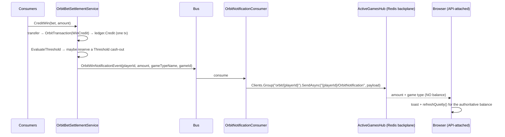

# Space Stroker — "Orbit (3/3) — Notifications, Telegram and the First-Win Upsell" — Implementation Spec

> **Status: SHIPPED** — via `feature/orbit-notifications` into `release/orbit` (2026-08-03) in
> `monkify-backend`, `monkify-front` and `monkify-meta`, 734 unit + 93 integration green on the branch
> before the merge; it completed the train, which landed on **`main`** the same day. The distilled
> summary of what actually runs
> is [`../features/orbit-notifications.md`](../features/orbit.md); this spec stays the
> deep design archive. Three things below were superseded during implementation — the **no-migration**
> claim (§4, `AddOrbitCashOutFloor` shipped; see §6.9), **`EnvNaming.DerivedIds()`** (§5.4, it needed
> no change), and the §8.1 diagram's `{playerId}/OrbitNotification` label (the send uses the
> **constant** `OrbitNotification`, per §5.2).
>
> Originally refined via Trello card
> [Orbit (3/3) — notifications (in-app push + Telegram) and the first-win upsell modal](https://trello.com/c/NIH7XFHi)
> (2026-08-02). Umbrella [#118](https://trello.com/c/yxwdNTrb); builds on
> [#121](https://trello.com/c/R4Qe0jxX) (`specs/orbit-custodial-wallet.md`) and
> [#122](https://trello.com/c/h7MF4Oky) (`specs/orbit-auto-bet-engine.md`), both already on
> `release/orbit`.
>
> Repos affected: `monkify-backend`, `monkify-front`, and this doc in `monkify-meta`.
>
> ⚠️ **Base branch is `origin/release/orbit`, NOT `main`.** `main` carries zero Orbit code, so nothing
> here compiles against it. Branch `feature/orbit-notifications` in all three repos; worktrees at
> `.worktrees/orbit-notifications/<repo>`.
>
> **Purpose:** Orbit now bets and settles with nobody watching. Nothing tells the player. This card
> closes the loop — a per-player realtime channel that announces every Orbit win, Telegram messages
> when money leaves custody, an honest "paused" state when Orbit stops betting, and a one-time
> invitation into Orbit for a first-time winner.

---

## 1. Summary

Four deliverables, one shared idea: **the player should learn what Orbit did without opening a modal
to find out.**

| # | Deliverable | Where it lives | Cost |
| --- | --- | --- | --- |
| 1 | **In-app win push** — a per-player group on the existing `ActiveGamesHub`, joined with the Orbit session token, fired on every Orbit win | backend hub + a consumer; frontend hook + toast | 1 hub method pair, 1 event, 1 consumer |
| 2 | **Telegram on cash-outs** — all four cash-out sources, sent when the transfer confirms; linking via a `t.me` deep link + a single `getUpdates` read | backend service + 3 public endpoints; Orbit modal section | no poller, no webhook, no migration |
| 3 | **"Paused — insufficient funds"** — modal state + one toast per pause episode | frontend only, derived from data `GET /orbit` already returns | zero backend |
| 4 | **First-win upsell** — one tutorial-tier modal on a player's first *paid* win when Orbit is off | frontend only, `localStorage`-tracked | 1 modal + 1 composable |

**There is no migration.** `OrbitEnrollment.TelegramChatId` was added by #121 *for this card*; the
linking code and the Telegram read offset live in Redis; the pause flag and the upsell flag live in
`localStorage`.

**What this card deliberately does not build:** browser/OS Web Push, Telegram for wins, any
replacement of `useOrbitRedirect`'s poll (§9).

---

## 2. Constraints (MANDATORY)

From `monkify-meta/constraints.md`:

- **§1 Secrets** — `TelegramBotToken` is a **placeholder** in committed config
  (`MOCK_TELEGRAM_BOT_TOKEN`); the real value arrives from Secret Manager. Never log the token, and
  never log a `chat_id`. The committed devnet-keypair exception inherited from #121/#122 stands and
  is not widened here.
- **§2 Git** — worktree per repo at `.worktrees/orbit-notifications/<repo>`, **cut from
  `origin/release/orbit`**; hubs stay clean on `main`; same branch name everywhere; push after
  branch work; never force-push.
- **§3 Tests** — update/add unit tests in `SpaceStroker.Tests` and report which changed. This is a
  **`Feature`** ⇒ a mandatory happy-path integration test in `SpaceStroker.Tests.Integration`
  (§11.2).
- **§4 Database** — **no migration on this card.** If one becomes unavoidable, EF mapping stays
  inline in `SpaceStrokerDbContext.OnModelCreating` and migrations are applied only by
  `SpaceStroker.Consumers`.
- **§5 Production data** — no production queries; **no test or local run ever calls the real
  Telegram API** (the notifier is inert without a token, and the integration suite uses a fake).
- **§6 Messaging** — a missing/expired/forged session, an unknown link code and a replayed link code
  are **indistinguishable** to the caller. The two *ordinary-state* refusals — "no `/start` found
  yet" and "Telegram is not linked" — are **clear**, following the #121 rule that a vague message on
  ordinary game state just makes the player retry blindly.
- **§8 Host split** — the **API** owns link/verify/unlink and reads; **Consumers** owns every send
  (win push, Telegram) because that is where money settles. The API stays stateless.
- Feature-specific: the three new **public** endpoints each need an `AspNetCoreRateLimit` rule, and
  `RateLimitSettingsTests`' exact-set assertion must be updated **deliberately** while keeping its
  guard that the bet path never gains a rule (§5.3).

---

## 3. Resolved product decisions

| # | Decision |
| --- | --- |
| 1 | **Joining the channel costs the Orbit session token.** `ActiveGamesHub.JoinOrbitNotifications(sessionToken)`, validated by `IOrbitSessionService`; the group name is derived **server-side** and never supplied by the caller. Joining by wallet was rejected: a wallet address is public on every bet list, so anyone could subscribe to a stranger's win amounts and learn they use Orbit — which the umbrella's invisibility rule forbids. A second opaque channel id was rejected because the session already exists, is already stored and already expires. |
| 2 | **No wallet prompt at boot.** An enabled player with no stored session gets the channel only after they press `SIGN IN` (which they must do anyway to read the balance). An unauthenticated "is this wallet enrolled?" read was rejected — it re-opens the membership leak decision 1 closes. |
| 3 | **The idle disconnect wins.** `useGameHub.stopForIdle()` still kills the socket after 30 min hidden / 60 min inactive and the channel dies with it. Exempting Orbit players would pin a Cloud Run request per idle tab — the cost `unified-websocket-connection` (#120) exists to remove. |
| 4 | **The win notice is a toast + a quiet balance re-read.** The payload carries **amount + game type name, never a balance**: a threshold cash-out fires the instant the credit lands, so a pushed balance can already be zero on arrival. It fires **even on the winning round's own page** — the terminal reveal says they won, it does not say the money went into Orbit rather than their wallet. |
| 5 | **`useOrbitRedirect` keeps polling.** Its comment rejected a per-wallet channel as too expensive for a once-a-round hint; that reasoning is now stale, but it is freshly merged #122 code with the same session precondition a push would have, so replacing it buys latency, not correctness. |
| 6 | **"Paused — insufficient funds" is derived client-side** from `enabled && balance < selected type's requiredAmount`, both already in `GET /orbit`. One toast per **pause episode**, `localStorage`-tracked, cleared when the balance covers the stake again. Pushing it from the planner would need a new per-player "already notified" flag or it fires every round. |
| 7 | **All four cash-out sources send Telegram, on completion** (`Manual`, `Threshold`, `ForcedOnDisable`, `ForcedOnSelfExclusion`) — #118 said "manual and threshold" before the two `Forced*` values existed, and a forced cash-out is exactly the movement the player did not initiate. **Failed/reversed transfers send nothing**: an ops event the player cannot act on, with the balance already restored. |
| 8 | **The link code and the `getUpdates` offset both live in Redis** via `ICacheService`; the code is short-lived, single-use and scoped to the player. A flush costs one more VERIFY press. The offset advances **only** when a code matches. `GET /orbit` gains `telegramEnabled`, so with no bot token the section is **hidden** rather than rendering a button that always fails. |
| 9 | **The first-win upsell fires on paid own-bet wins only** — a free-bet win cannot fund a custodial USDC balance, so the modal's premise would be false. One `localStorage` key **per browser** (not per wallet); once ever; suppressed when Orbit is enabled, when the Quick Tour is open, and when embedded; its CTA opens the **existing** `OrbitModal` enable flow. Variant **B** (centred, art on top), **tutorial tier** per `conventions/frontend.md`. |
| 10 | **Telegram can be unlinked, session-only.** It moves no money, so it follows the game-type/threshold rule, not the cash-out rule. Without it a linked chat is permanent — a changed phone or Telegram account keeps receiving that player's cash-out amounts. |
| 11 | **This card plumbs all three Orbit secret ids** into `deploy/terraform/workload/main.tf` and `EnvNaming.DerivedIds()` — the new bot token **plus** #121's two unplumbed ids. `base_secret_ids` currently lists six ids and none are Orbit's; the train cannot deploy to a real environment until that is fixed. |

---

## 4. Data model

> ⚠️ **Superseded in part (2026-08-02).** The card shipped one migration after all —
> `AddOrbitCashOutFloor`, adding `OrbitEnrollment.CashOutFloor` — because live testing surfaced that
> "cash out at" only ever fires on a **win**, so a balance losing its way down through the number is
> never caught. See §6.9. Everything else below still holds: no other schema change was needed.

### 4.1 No migration (except the floor, §6.9)

Nothing is added to the schema. The one column this card writes already exists, created by #121 for
exactly this purpose:

```csharp
// SpaceStroker.Domain/Orbit/Entities/OrbitEnrollment.cs — ALREADY PRESENT, do not re-add
// Filled by the notifications card (#123); created here so that card needs no migration.
public string? TelegramChatId { get; set; }
```

⚠️ Do **not** create a migration "for tidiness". `AddOrbitAutoBetEngine` (2026-07-31) is the last
Orbit migration on the train; adding an empty one would make the release train's migration list lie
about what changed.

**An enrolment row may not exist yet.** Linking Telegram before ever enabling Orbit is allowed, so
the link handler **upserts** a disabled `OrbitEnrollment` the same way `UpdateOrbitSettingsHandler`
does. It is harmless: no cash-out can happen without a balance, and a balance requires Orbit on.

### 4.2 Redis keys (new, in `CacheHelper`)

| Key | Value | TTL | Notes |
| --- | --- | --- | --- |
| `Telegram:LinkCode:{code}` | `PlayerId` (string) | `TelegramLinkCodeTtlMinutes` (10) | Single-use; `Remove`d on a successful verify. Several outstanding codes for one player are harmless — they all resolve to the same player. |
| `Telegram:UpdateOffset` | next `update_id` to read (long) | 24h | Advanced **only** when a code matched. A flush is self-healing: Telegram re-serves everything still unconfirmed (24h retention). |

Both follow the shipped `GenerateWalletNonceCacheSettings` shape — Redis-held, no entity, no
migration, expires itself.

### 4.3 `localStorage` keys (frontend)

| Key | Purpose |
| --- | --- |
| `space-stroker.orbit.paused-notified.{wallet}` | The pause episode already toasted. Cleared as soon as the balance covers the stake. Per wallet — a different wallet is a different balance. |
| `space-stroker.orbit.first-win-seen` | The upsell has been shown in this browser. **Deliberately not per wallet** (#118): it is a once-ever onboarding modal, and keying it per wallet would re-show it to the same human on their second address. |

---

## 5. Configuration

### 5.1 `OrbitSettings` additions

`SpaceStroker.Domain/Configs/Entities/OrbitSettings.cs`:

```csharp
/// <summary>
/// Telegram bot token. MOCK in committed config; the real value arrives from Secret Manager.
/// NEVER logged. Blank ⇒ Telegram is INERT: no HTTP call is attempted anywhere, the modal hides
/// its Telegram section, and nothing fails because of it (local, dev and tests run this way).
/// </summary>
public string TelegramBotToken { get; set; }

/// <summary>
/// The bot's @username, WITHOUT the '@'. Plain config, not a secret: it is needed to build the
/// t.me/<bot>?start=<code> deep link, and configuring it avoids a getMe round-trip on every link
/// request. Blank counts as "not configured" alongside the token.
/// </summary>
public string TelegramBotUsername { get; set; }

/// <summary>How long a link code is worth presenting. Short: it only has to survive one app-hop.</summary>
public int TelegramLinkCodeTtlMinutes { get; set; } = 10;

/// <summary>Both halves are required — a token with no username cannot build a deep link.</summary>
public bool IsTelegramConfigured
    => !string.IsNullOrWhiteSpace(TelegramBotToken)
       && !TelegramBotToken.StartsWith("MOCK_")
       && !string.IsNullOrWhiteSpace(TelegramBotUsername);
```

⚠️ The `MOCK_` prefix check mirrors `OrbitAccountResolver.IsConfigured`'s treatment of
`MOCK_ORBIT_PUBLIC_KEY`: committed config must fail **closed** into "not configured", not into a
live bot.

### 5.2 `spacestrokersettings.json`

Inside `GeneralSettings:Operator:Token:Orbit` (mock values only):

```json
"TelegramBotToken": "MOCK_TELEGRAM_BOT_TOKEN",
"TelegramBotUsername": "",
"TelegramLinkCodeTtlMinutes": 10
```

Inside `GeneralSettings:Games`, alongside the existing endpoint names:

```json
"OrbitNotificationEndpoint": "OrbitNotification"
```

and the matching `public string OrbitNotificationEndpoint { get; set; }` on
`Domain/Configs/Entities/GameSettings.cs`.

⚠️ **A constant name, not a `{0}/…` format** (resolving §15 item 1 at build time). The game streams
embed the round id because they are *per round*; an Orbit notification is already scoped by its
**per-player group**, so there is nothing to disambiguate. The codebase already has exactly this
shape: `ActiveGamesEndpoint = "GameReceived"` is constant for the same reason. Consequence:
**`OrbitDto` carries no `notificationEvent` field** — the client binds the constant.

### 5.3 Rate-limit rules

Add to `IpRateLimiting.GeneralRules` in `spacestrokersettings.json`:

```json
{ "Endpoint": "*:/orbit/telegram/link",   "Period": "1m", "Limit": 10 },
{ "Endpoint": "*:/orbit/telegram/verify", "Period": "1m", "Limit": 20 },
{ "Endpoint": "*:/orbit/telegram",        "Period": "1m", "Limit": 10 }
```

Rules are matched **exactly** (only `*:/solana/*` uses a wildcard tail), so `*:/orbit/telegram` does
not swallow its two children — the same way `*:/orbit` does not swallow `*:/orbit/session` today.

⚠️ `SpaceStroker.Tests/UnitTests/Api/RateLimitSettingsTests.cs` pins the rule set **exactly** and will
fail. That is the assertion doing its job. Add the three endpoints to its expected set and add
`[InlineData]` rows for their limits — and **do not** touch its guard that the bet path never gains a
rule.

### 5.4 Deploy plumbing (decision 11)

`monkify-meta/deploy/terraform/workload/main.tf` → `locals.base_secret_ids` and `base_secret_env`,
plus `deploy/secrets.example.json`:

⚠️ **Build-time correction:** `EnvNaming.DerivedIds()` needs **no code change**. It enumerates
`secrets.<env>.json`'s own `secrets` keys (`EnvNaming.Create(…, s.Secrets.Keys)`), so it already
validates whatever the operator configures — the card and this spec both said otherwise. What was
genuinely missing is the **Terraform** list (hardcoded) and the **example secrets file**, which had no
Orbit entries at all: an operator copying the template would deploy an Orbit-less config and, because
committed config now carries a real devnet keypair, boot Orbit **against devnet** instead of failing
closed.

| Secret id | Env var | Owner |
| --- | --- | --- |
| `GeneralSettings-Operator-Token-Orbit-PrivateKey` | `GeneralSettings__Operator__Token__Orbit__PrivateKey` | #121 (missing today) |
| `GeneralSettings-Operator-Token-Orbit-SessionSecret` | `GeneralSettings__Operator__Token__Orbit__SessionSecret` | #121 (missing today) |
| `GeneralSettings-Operator-Token-Orbit-TelegramBotToken` | `GeneralSettings__Operator__Token__Orbit__TelegramBotToken` | this card |

The deploy tool creates the secret **containers** and syncs values from the unversioned
`secrets.<env>.json`; Terraform only binds IAM (see `features/terraform-gcp-deploy.md` and the
`solana-rpc-api-key` precedent). `TelegramBotUsername` is **not** a secret — it ships in config.

---

## 6. Backend behaviour

### 6.1 The channel — `ActiveGamesHub`

`SpaceStroker.Infrastructure/Hubs/ActiveGamesHub.cs` gains one method pair. Everything else on the
hub is untouched.

```csharp
public const string OrbitGroupItemKey = "orbit-group";

/// <summary>
/// Joins the caller's OWN Orbit notification group. The session token is the only credential —
/// the group name is derived here and never accepted from the caller, because a wallet address is
/// public and an Orbit group keyed on one would let anybody watch a stranger's wins (and learn
/// they use Orbit at all, which the whole feature is built to hide).
///
/// A bad, expired or forged token joins NOTHING and says nothing (constraints.md §6). There is no
/// error to report: the client cannot act on it, and a distinguishable refusal is a probe.
/// </summary>
public async Task JoinOrbitNotifications(string sessionToken)
{
    var wallet = _sessions.ValidateAndGetWallet(sessionToken);
    if (string.IsNullOrWhiteSpace(wallet)) return;

    var playerId = await _context.Players
        .Where(x => x.ExternalPlayerId == wallet)
        .Select(x => (Guid?)x.Id)
        .FirstOrDefaultAsync();

    if (playerId is not { } id) return;

    var group = OrbitNotificationChannel.GroupFor(id);
    await Groups.AddToGroupAsync(Context.ConnectionId, group);
    Context.Items[OrbitGroupItemKey] = group;
}

/// <summary>Leaves it. Takes no token — the connection already knows which group it joined.</summary>
public async Task LeaveOrbitNotifications()
{
    if (Context.Items.TryGetValue(OrbitGroupItemKey, out var group) && group is string name)
    {
        await Groups.RemoveFromGroupAsync(Context.ConnectionId, name);
        Context.Items.Remove(OrbitGroupItemKey);
    }
}
```

- The hub gains `IOrbitSessionService` and `SpaceStrokerDbContext` constructor parameters. SignalR
  resolves a hub per invocation from a DI scope, so a scoped `DbContext` is correct here.
- **One indexed read per join**, not per message. Grouping by `PlayerId` rather than by wallet keeps
  the publisher (which only ever has a `PlayerId`) free of a lookup on the hot path.
- New `SpaceStroker.Infrastructure/Services/Orbit/OrbitNotificationChannel.cs`:

  ```csharp
  public static class OrbitNotificationChannel
  {
      public static string GroupFor(Guid playerId) => $"orbit/{playerId}";
  }
  ```

  One definition, used by the hub and the consumer — a drifted string here is a silent
  never-delivered notification, which is the hardest kind of bug to see.

### 6.2 Publishing the win — `OrbitBetSettlementService.CreditWin`

`Infrastructure/Services/Orbit/OrbitBetSettlementService.cs` gains `IMessageBus` and publishes
**after** `Settle` commits and after `EvaluateThreshold`:

```csharp
var result = await Settle(bet, amount, OrbitTransactionType.WinCredit, playerId.Value, reason: null, cancellationToken);
if (!result.IsSuccess) return result;

await EvaluateThreshold(playerId.Value, cancellationToken);
await PublishWinNotification(bet, playerId.Value, amount, cancellationToken);
return result;
```

```csharp
/// <summary>
/// Fire-and-report-only: a notification that fails to publish must never fail a settlement that
/// already moved money. The player still sees the win in the modal and Games History.
/// </summary>
private async Task PublishWinNotification(Bet bet, Guid playerId, decimal amount, CancellationToken cancellationToken)
{
    try
    {
        var gameTypeName = await _context.Games
            .Where(x => x.Id == bet.GameId)
            .Select(x => x.Parameters.Name)
            .FirstOrDefaultAsync(cancellationToken) ?? string.Empty;

        await _messageBus.PublishEventAsync(new OrbitWinNotificationEvent(playerId, amount, gameTypeName, bet.GameId));
    }
    catch (Exception ex)
    {
        Log.Error(ex, "Could not publish the Orbit win notification for player {PlayerId}.", playerId);
    }
}
```

⚠️ Publishing **after** the threshold evaluation is deliberate: the toast and the Telegram cash-out
message then arrive in the order the money actually moved.

New contract `Infrastructure/Consumers/OrbitNotification/OrbitWinNotificationEvent.cs`:

```csharp
public record OrbitWinNotificationEvent(Guid PlayerId, decimal Amount, string GameTypeName, Guid GameId);
```

⚠️ **Ids and primitives only.** `GameOpenedEvent` exists because #122 discovered that publishing an
event carrying a `GameParameters` entity throws in MassTransit's serializer on the navigation cycle.
Do not put an entity on this record.

### 6.3 Delivering the win — `OrbitNotificationConsumer`

`Infrastructure/Consumers/OrbitNotification/OrbitNotificationConsumer.cs`, modelled exactly on
`BetNotificationConsumer`:

```csharp
public class OrbitNotificationConsumer : BaseConsumer<OrbitWinNotificationEvent>
{
    public OrbitNotificationConsumer(IServiceScopeFactory serviceScopeFactory) : base(serviceScopeFactory) { }

    public override async Task ProcessMessage(OrbitWinNotificationEvent message)
    {
        using var scope = ServiceScopeFactory.CreateScope();
        var hubContext = scope.ServiceProvider.GetRequiredService<IHubContext<ActiveGamesHub>>();
        var settings = scope.ServiceProvider.GetRequiredService<GeneralSettings>();

        // NO balance in the payload: the threshold cash-out may already have emptied it (decision 4).
        var payload = new
        {
            amount = message.Amount,
            gameTypeName = message.GameTypeName,
            tokenLabel = settings.Operator.Token.Symbol,
            gameId = message.GameId,
        }.AsJson();

        await hubContext.Clients
            .Group(OrbitNotificationChannel.GroupFor(message.PlayerId))
            .SendAsync(settings.Games.OrbitNotificationEndpoint, payload);
    }
}
```

`SpaceStroker.Consumers` already registers SignalR with the Redis backplane
(`Consumers/Program.cs:177-191`), so a message sent here reaches a browser attached to the **API**.

### 6.4 Telegram — `ITelegramNotifier`

`Infrastructure/Services/Telegram/{ITelegramNotifier,TelegramNotifier}.cs`:

```csharp
public interface ITelegramNotifier
{
    /// <summary>False ⇒ every method below is a no-op. Local, dev and tests run this way.</summary>
    bool IsConfigured { get; }

    /// <summary>The t.me deep link the modal shows. Null when not configured.</summary>
    string? BuildStartLink(string code);

    /// <summary>Best effort. Never throws; logs and returns false. A cash-out is never failed by it.</summary>
    Task<bool> SendMessage(string chatId, string text, CancellationToken cancellationToken = default);

    /// <summary>
    /// ONE getUpdates read, scanning for "/start {code}". Returns the chat id on a match and
    /// advances the stored offset; returns null and leaves the offset untouched otherwise.
    /// </summary>
    Task<string?> FindChatIdForCode(string code, CancellationToken cancellationToken = default);
}
```

Implementation notes the implementer must not re-derive:

- **Named `HttpClient`** (`AddHttpClient(TelegramOptions.HttpClientName, …)` with
  `BaseAddress = https://api.telegram.org/`), registered in **both** hosts — the API verifies,
  Consumers sends. Follow `RpcProxyOptions.HttpClientName` in `Api/Program.cs:87`. Never
  `new HttpClient()`.
- **The token appears only in the request path** (`/bot{token}/sendMessage`). Log the operation, never
  the URL. `MaskRpcUrl` in `SolanaService` is the precedent for "the URL itself is a secret".
- ⚠️ **That path MUST be rooted (`/bot…`).** A bot token contains a colon, so the unrooted string
  `bot8736…:AAG…/getUpdates` parses as an **absolute** URI whose *scheme* is `bot8736…`, and
  `HttpClientFactory`'s pipeline throws `The 'bot8736…' scheme is not supported` before anything
  leaves the process. Caught live on the local stack: the notifier's own `catch` turned it into a
  bland "we have not seen your message yet" for a `/start` that was sitting in the bot's queue.
  ⚠️ The unit tests **passed** through all of it — a bare `HttpClient` over a stub handler never
  validates the scheme, only the factory's pipeline does — so the stub now refuses anything that is
  not `http(s)` and a test pins both verbs to an absolute `https://api.telegram.org/bot…` URI.
- `FindChatIdForCode` calls `getUpdates?offset={stored}&limit=100&timeout=0`. It matches
  `update.message.text` trimmed against `"/start " + code` (case-sensitive; Telegram sends the payload
  verbatim). On a match it returns `update.message.chat.id` **as a string** and writes
  `update_id + 1` to `Telegram:UpdateOffset`.
- ⚠️ **The offset advances only on a match** (#118). The cost, accepted and documented: unmatched
  updates stay unconfirmed and are re-served on the next call, capped by `limit=100` and Telegram's
  24h retention. Advancing on every read would consume another player's `/start` before they pressed
  VERIFY — which is exactly the failure this rule prevents.
- Any transport failure, timeout, non-200 or malformed body ⇒ log an `Error` and return
  `false`/`null`. Telegram is **never** allowed to fail a money path.

### 6.5 Telegram on cash-out completion — `OrbitCashOutConsumer`

After the row flips to `Completed` with a signature (`Consumers/OrbitCashOut/OrbitCashOutConsumer.cs`,
right after the `ExecuteUpdateAsync` that sets `Completed`):

```csharp
await NotifyCashOut(scope, context, row, amount);
```

```csharp
/// <summary>
/// Every source notifies — Manual, Threshold, ForcedOnDisable and ForcedOnSelfExclusion (decision 7).
/// A forced cash-out is precisely the one the player did not ask for.
///
/// Wrapped whole: the transfer has landed and the ledger is correct, so a Telegram failure is an
/// ops event, not a money event.
/// </summary>
private static async Task NotifyCashOut(IServiceScope scope, SpaceStrokerDbContext context, OrbitTransaction row, decimal amount)
{
    var telegram = scope.ServiceProvider.GetRequiredService<ITelegramNotifier>();
    if (!telegram.IsConfigured) return;

    var chatId = await context.OrbitEnrollments
        .Where(x => x.PlayerId == row.PlayerId)
        .Select(x => x.TelegramChatId)
        .FirstOrDefaultAsync();

    if (string.IsNullOrWhiteSpace(chatId)) return;

    var settings = scope.ServiceProvider.GetRequiredService<GeneralSettings>();
    await telegram.SendMessage(chatId, $"Orbit sent {amount} {settings.Operator.Token.Symbol} to your wallet.");
}
```

**Not sent on `FailAndRestore`** — a reversal is an operational failure the player cannot act on, and
the balance is already whole again.

### 6.6 The three endpoints

All on `Api/Controllers/OrbitController.cs`, all **public**, all session-gated through the existing
`RejectWithoutSession` helper, all added to the `[HttpOptions]` list for CORS preflight.

| Route | Handler | Body / result |
| --- | --- | --- |
| `POST /orbit/telegram/link` | `Handlers/Orbit/StartTelegramLink/` | → `{ code, deepLink, expiresAt }` |
| `POST /orbit/telegram/verify` | `Handlers/Orbit/VerifyTelegramLink/` | `{ code }` → `{ linked: true }` |
| `DELETE /orbit/telegram` | `Handlers/Orbit/UnlinkTelegram/` | → `{ linked: false }` |

**`StartTelegramLinkHandler`**

1. `IsTelegramConfigured` false ⇒ `ErrorMessages.OrbitUnavailable` (the client hides the section
   anyway; this is the belt).
2. Resolve the player from the session wallet; **upsert** a disabled `OrbitEnrollment` if none exists
   (§4.1).
3. Generate a code: 8 chars from an unambiguous alphabet (`ABCDEFGHJKLMNPQRSTUVWXYZ23456789`) via
   `RandomNumberGenerator` — it is typed by a human into a chat, so no `0/O`, no `1/I`.
4. `cache.Set(CacheHelper.GenerateTelegramLinkCodeCacheSettings(code), playerId)`.
5. Return the code, `telegram.BuildStartLink(code)` and the expiry.

**`VerifyTelegramLinkHandler`**

1. `IsTelegramConfigured` false ⇒ `OrbitUnavailable`.
2. `cache.TryGet(...)` on the code. **Miss, or a `PlayerId` that is not the session's player**
   ⇒ `ErrorMessages.OrbitRequestInvalid` — the same vague message a forged session gets. An unknown
   code and someone else's code must not be distinguishable.
3. `telegram.FindChatIdForCode(code)`:
   - **null** ⇒ `ErrorMessages.OrbitTelegramNotFound` — a **clear** retry message ("We haven't seen
     your message yet. Send `/start` to the bot and press VERIFY again."). This is ordinary state, not
     a proof failure.
   - **a chat id** ⇒ `ExecuteUpdateAsync` sets `OrbitEnrollment.TelegramChatId`, then
     `cache.Remove(code)` so the code is single-use. Return `{ linked: true }`.

**`UnlinkTelegramHandler`** — `ExecuteUpdateAsync` sets `TelegramChatId = null` for the session's
player. Session-only (decision 10). Idempotent: unlinking when nothing is linked succeeds.

### 6.7 `GetOrbitHandler` / `OrbitDto` additions

```csharp
TelegramEnabled = telegram.IsConfigured,      // hides the whole section when false
TelegramLinked  = !string.IsNullOrWhiteSpace(enrollment?.TelegramChatId),
```

⚠️ **Never return the `chat_id` itself.** The client needs to know *that* a chat is linked, never
which one; a chat id in a JSON body is one screenshot away from being public.

### 6.9 The cash-out floor (added 2026-08-02, from live testing)

**The problem, reported from the running stack.** A player set "cash out at" to 3, watched Orbit lose
four rounds (balance 5 → 1) and was never cashed out. Nothing was broken: `EvaluateThreshold` runs
**only after a win credit** and fires at `balance >= threshold`, so a balance *falling through* the
number cannot trigger it. That is a take-profit, and the player was asking for a floor. Both are
legitimate and they answer opposite questions, so the feature gained a second setting rather than
changing the meaning of the first.

| Setting | Fires when | Evaluated |
| --- | --- | --- |
| `CashOutAtThreshold` (existing) | a **win** lifts the balance to ≥ it | after each `WinCredit` |
| `CashOutFloor` (new) | the balance falls to ≤ it | once the round **settles** |

⚠️ **Both act on a RESOLVED bet, never on a placed one.** The floor first shipped evaluated at
placement and on save, which was wrong in a way that only shows on the running stack: a stake leaves
the balance the moment it is placed, so the floor could cash a player out **while the bet they had
just made was still riding** — their money going home mid-round, the round playing on without them.
A live bet is not a loss yet. `RewardGameConsumer` now evaluates it for every Orbit-funded bettor
after the round is settled, and neither the placement path nor the settings save touches it.

- **Schema:** `OrbitEnrollment.CashOutFloor` (`decimal?`, precision 18,9), migration
  `AddOrbitCashOutFloor`, EF mapping inline. Additive and nullable — no backfill.
- **Source:** a new `OrbitCashOutSource.Floor = 5` rather than reusing `Threshold`. A ledger that
  cannot tell "I won enough" from "I have lost enough" cannot explain to a player why their money came
  back — and `GetOrbitHandler` counts only `Manual` toward the daily cap, so `Floor` is exempt for free.
- **Where it runs:** `IOrbitBetSettlementService.EvaluateFloor`, called from `RewardGameConsumer` once
  the round is settled, for every distinct `FundedByOrbit` bettor in it. Deliberately **not** from
  `PlaceOrbitBetConsumer` and **not** from `UpdateOrbitSettingsHandler` — see the warning above.
- **Guards:** it must be ≥ `MinimumCashOut` (below that the reserver could only ever refuse), and a
  balance of 0 reserves nothing — a zero cash-out row would claim money moved when none did.

### 6.8 Registration

- `Consumers/Program.cs`: `x.AddConsumer<OrbitNotificationConsumer>()` +
  `cfg.ReceiveEndpoint(nameof(OrbitNotificationConsumer), e => e.ConfigureConsumer<OrbitNotificationConsumer>(context))`,
  beside the `OrbitCashOutConsumer` block.
- `Infrastructure/DependencyInjection.cs`: `ITelegramNotifier` → `TelegramNotifier` (scoped) and the
  named `HttpClient`; both hosts pick it up from there.
- No Hangfire job, no new recurring schedule.

---

## 7. Frontend behaviour

### 7.1 Types — `src/types/orbit.ts`

```ts
export interface OrbitState {
  // …existing fields…
  /** False ⇒ the whole Telegram section is hidden (no bot token in this environment). */
  telegramEnabled: boolean;
  /** Whether a chat is linked. The chat id itself is never sent to the client. */
  telegramLinked: boolean;
}

export interface OrbitTelegramLink {
  code: string;
  deepLink: string;
  expiresAt: string;
}

/** What the per-player channel delivers. No balance — see spec §6.3. */
export interface OrbitWinNotification {
  amount: number;
  gameTypeName: string;
  tokenLabel: string;
  gameId: string;
}
```

### 7.2 `src/services/orbitService.ts`

Three calls in the existing `withSession(...)` style: `startTelegramLink`, `verifyTelegramLink(code)`,
`unlinkTelegram`.

### 7.3 `src/hooks/useGameHub.ts` — the Orbit group

The socket stays exactly as `unified-websocket-connection` shipped it. Three additions:

```ts
// The token the Orbit group was joined with, kept module-level so a reconnect can re-join without
// the caller having to notice the socket ever dropped.
let orbitSessionToken: string | null = null;

const joinOrbitChannel = async (sessionToken: string, handler: (payload: string) => void) => { … };
const leaveOrbitChannel = async () => { … };
```

- `joinOrbitChannel` calls `ensureConnected()`, then `invoke('JoinOrbitNotifications', token)`, then
  binds `live.on('OrbitNotification', handler)` — the **constant** event name (§5.2). The per-player
  group is what scopes delivery, so the client needs to know nothing about its own `PlayerId`.
- `onreconnected` re-joins the Orbit group when `orbitSessionToken` is set, right beside the existing
  `JoinGame` re-join. Without it the channel silently dies on the first network blip.
- `stopForIdle` clears `orbitSessionToken` and the bound handler with everything else (decision 3).

### 7.4 `src/hooks/useOrbitNotifications.ts` (new)

A module singleton, mounted once by `GameHeader` beside the existing Orbit state watcher.

- **Joins** when `hasSession && orbit.enabled` (decision 2 — never mints a session itself), **leaves**
  when either goes false or the wallet changes.
- On a message: `toast.info(\`Orbit won ${amount} ${tokenLabel} on ${gameTypeName}.\`)` then
  `refreshQuietly(wallet)` for the balance (decision 4).
- **Never** in an embedded session (`useEmbed`) — no join, no toast.

### 7.5 The paused notice (decision 6)

In `useOrbit`:

```ts
/** Orbit is on, a type is chosen, and the balance no longer covers that type's stake. */
const isPausedForFunds = computed(() => { … balance < requiredAmount of gameParametersId … });
```

- `OrbitModal` renders a paused row naming the reason and pointing at the deposit buttons.
  ⚠️ `features/orbit-auto-bet-engine.md` claims this state already exists; it does not — the modal
  has only the cool-off line today.
- One toast per **episode**: on transition to `isPausedForFunds`, if the `localStorage` flag for that
  wallet is unset, toast and set it. Clear the flag the moment `isPausedForFunds` goes false, so a
  later pause notifies again.

### 7.6 The Telegram section in `OrbitModal.vue`

Rendered only when `telegramEnabled`. Two states:

- **Not linked** — a `LINK TELEGRAM` button that calls `startTelegramLink`, then shows the code, an
  "open Telegram" anchor to `deepLink`, and a `VERIFY` button. Verify failure with
  `OrbitTelegramNotFound` renders inline as a retry hint, not a toast — the player is mid-flow.
- **Linked** — a confirmation line plus `UNLINK`.

Chrome follows the modal's existing system tier (`conventions/frontend.md` → "Two overlay tiers");
the section is plain markup inside the modal, not a new overlay.

### 7.7 The first-win upsell (decision 9)

**`src/hooks/useFirstWinUpsell.ts`** — modelled on `useQuickTour`: module singleton, `localStorage`
hydration wrapped in try/catch, a guarded `maybeOpen()` that refuses silently. Guards, cheapest first:

1. already seen in this browser;
2. `isEmbedded`;
3. `orbit.enabled` is true (nothing to sell);
4. `openTour.value !== null` — never two modals (the Quick Tour rule, reused verbatim);
5. `recovering`, `isIdleDisconnected`, `relaunching`, `!termsAccepted` — the same overlay ordering
   `useQuickTour.maybeAutoOpen` already documents.

**The trigger** lives in `useGame.ts`, inside the existing `GameStatus.Ended` one-shot that already
computes `didBet` and `won` (`useGame.ts:316-338`) — no second watcher, no new round detection:

```ts
if (didBet && won && ownBetWasPaid.value) firstWinUpsell.maybeOpen();
```

`ownBetWasPaid` is a new module-level ref set where the bet is placed (the `isFree` branch at
`useGame.ts:466`/`509`) and reset with `ownBetChoices` on rollover. A free-bet win must not open it:
free coins cannot fund a custodial USDC balance, so the modal's own premise would be false.

**`src/components/orbit/OrbitFirstWinModal.vue`** — **tutorial tier** (black + 2px CRT-cyan frame),
variant **B** (centred, art on top) using `src/assets/edson.png`, `<Teleport to="#app">`, dithered
backdrop, no `backdrop-filter`/blur/infinite animation (every phone runs `html.light-graphics`).
Dismissal contract: X / Esc / backdrop / primary — and **every** exit marks it seen, so nobody is
nagged for closing it "the wrong way". The primary CTA closes the modal and opens `OrbitModal`.

Mounted in `GameHeader.vue`, where `OrbitModal` and `QuickTourModal` already live.

---

## 8. Flow diagrams

### 8.1 An Orbit win reaches the player



### 8.2 Linking Telegram without a poller or a webhook

```mermaid
sequenceDiagram
    participant P as Player
    participant M as OrbitModal
    participant A as API
    participant R as Redis
    participant T as Telegram

    M->>A: POST /orbit/telegram/link (X-Orbit-Session)
    A->>R: SET Telegram:LinkCode:{code} = playerId (10 min)
    A-->>M: { code, deepLink, expiresAt }
    P->>T: /start {code}   (via t.me deep link)
    P->>M: press VERIFY
    M->>A: POST /orbit/telegram/verify { code }
    A->>R: GET Telegram:LinkCode:{code} → playerId (must equal the session's player)
    A->>T: ONE getUpdates?offset={stored}&limit=100
    alt a message matches "/start {code}"
        A->>A: OrbitEnrollment.TelegramChatId = chat.id
        A->>R: offset = update_id + 1 ; DEL the code
        A-->>M: { linked: true }
    else no match
        A-->>M: clear retry message; offset UNCHANGED, nothing stored
    end
```

---

## 9. Out of scope

- **Browser/OS-level Web Push** (service worker + Web Push) — the websocket channel is the agreed
  mechanism (#118).
- **Telegram for wins** and any broadcast/marketing channel — an always-on Orbit player would get
  dozens of messages a day.
- **Replacing `useOrbitRedirect`'s poll** with a pushed `orbit-bet-placed` event (decision 5). A
  clean follow-up card if the poll ever shows up in the numbers.
- **Email/SMS.** Server-side tracking of the upsell or the pause notice (both `localStorage`, #118).
- Multi-pool withdraw UI, lottery Orbit, a price oracle, player-paid fees — inherited from #118.
- A stale-round timeout for a race stuck in `WaitingBets` — pre-existing platform gap with its own
  card.

---

## 10. File checklist

### 10.1 Backend (`monkify-backend`)

| # | File | Change |
| --- | --- | --- |
| 1 | `src/SpaceStroker.Domain/Configs/Entities/OrbitSettings.cs` | `TelegramBotToken`, `TelegramBotUsername`, `TelegramLinkCodeTtlMinutes`, `IsTelegramConfigured` |
| 2 | `src/SpaceStroker.Domain/Configs/Entities/GameSettings.cs` | `OrbitNotificationEndpoint` |
| 3 | `src/SpaceStroker.Common/spacestrokersettings.json` | Orbit Telegram keys (mock), `OrbitNotificationEndpoint`, 3 rate-limit rules |
| 4 | `src/SpaceStroker.Common/Resources/ErrorMessages.resx` (+ Designer) | `OrbitTelegramNotFound` (clear retry copy) |
| 5 | `src/SpaceStroker.Infrastructure/Services/Orbit/OrbitNotificationChannel.cs` | **new** — the single group-name definition |
| 6 | `src/SpaceStroker.Infrastructure/Services/Telegram/ITelegramNotifier.cs` | **new** |
| 7 | `src/SpaceStroker.Infrastructure/Services/Telegram/TelegramNotifier.cs` | **new** — send + single `getUpdates`, inert without a token, never logs the token |
| 8 | `src/SpaceStroker.Infrastructure/Services/Telegram/TelegramOptions.cs` | **new** — named `HttpClient` constant |
| 9 | `src/SpaceStroker.Infrastructure/Services/Cache/CacheHelper.cs` | `GenerateTelegramLinkCodeCacheSettings`, `GenerateTelegramUpdateOffsetCacheSettings` |
| 10 | `src/SpaceStroker.Infrastructure/Hubs/ActiveGamesHub.cs` | `JoinOrbitNotifications` / `LeaveOrbitNotifications` + 2 ctor deps |
| 11 | `src/SpaceStroker.Infrastructure/Consumers/OrbitNotification/OrbitWinNotificationEvent.cs` | **new** — ids + primitives only |
| 12 | `src/SpaceStroker.Infrastructure/Consumers/OrbitNotification/OrbitNotificationConsumer.cs` | **new** — group push, mirrors `BetNotificationConsumer` |
| 13 | `src/SpaceStroker.Infrastructure/Services/Orbit/OrbitBetSettlementService.cs` | publish the win event after commit; never fails settlement |
| 14 | `src/SpaceStroker.Infrastructure/Consumers/OrbitCashOut/OrbitCashOutConsumer.cs` | Telegram send after `Completed` (all four sources) |
| 15 | `src/SpaceStroker.Infrastructure/Handlers/Orbit/StartTelegramLink/*` | **new** handler + request/body |
| 16 | `src/SpaceStroker.Infrastructure/Handlers/Orbit/VerifyTelegramLink/*` | **new** handler + request/body |
| 17 | `src/SpaceStroker.Infrastructure/Handlers/Orbit/UnlinkTelegram/*` | **new** handler + request |
| 18 | `src/SpaceStroker.Infrastructure/Handlers/Orbit/GetOrbit/GetOrbitRequest.cs` (`OrbitDto`) | `TelegramEnabled`, `TelegramLinked` |
| 19 | `src/SpaceStroker.Infrastructure/Handlers/Orbit/GetOrbit/GetOrbitHandler.cs` | fill the three new fields |
| 20 | `src/SpaceStroker.Infrastructure/DependencyInjection.cs` | `ITelegramNotifier` + named `HttpClient` |
| 21 | `src/SpaceStroker.Api/Controllers/OrbitController.cs` | 3 routes + `[HttpOptions]` entries |
| 22 | `src/SpaceStroker.Consumers/Program.cs` | register `OrbitNotificationConsumer` + its receive endpoint |

### 10.2 Frontend (`monkify-front`)

| # | File | Change |
| --- | --- | --- |
| 1 | `src/types/orbit.ts` | `telegramEnabled`, `telegramLinked`, `OrbitTelegramLink`, `OrbitTelegramState`, `OrbitWinNotification` |
| 2 | `src/services/orbitService.ts` | `startTelegramLink`, `verifyTelegramLink`, `unlinkTelegram` |
| 3 | `src/hooks/useGameHub.ts` | `joinOrbitChannel` / `leaveOrbitChannel`, re-join in `onreconnected`, clear in `stopForIdle` |
| 4 | `src/hooks/useOrbitNotifications.ts` | **new** — join/leave lifecycle, toast, quiet refresh, embedded gate |
| 5 | `src/hooks/useOrbit.ts` | Telegram actions, `isPausedForFunds`, the pause-episode flag |
| 6 | `src/hooks/useFirstWinUpsell.ts` | **new** — `localStorage` once-ever + guarded `maybeOpen()` |
| 7 | `src/hooks/useGame.ts` | `ownBetWasPaid` ref; fire `maybeOpen()` inside the existing Ended one-shot |
| 8 | `src/components/orbit/OrbitModal.vue` | Telegram section (link / code / VERIFY / UNLINK) + the paused-for-funds state |
| 9 | `src/components/orbit/OrbitFirstWinModal.vue` | **new** — tutorial tier, variant B, `edson.png` |
| 10 | `src/components/GameHeader.vue` | mount the upsell modal; mount `useOrbitNotifications` |

### 10.3 Meta (`monkify-meta`)

| # | File | Change |
| --- | --- | --- |
| 1 | `specs/orbit-notifications.md` | this spec |
| 2 | `INDEX.md` | spec row + "in flight" entry |
| 3 | `deploy/terraform/workload/main.tf` | 3 Orbit secret ids in `base_secret_ids` + `base_secret_env` |
| 4 | `deploy/secrets.example.json` | the 3 secrets + `Orbit:PublicKey` / `Orbit:TelegramBotUsername` in `appConfig`, placeholders only (`EnvNaming.DerivedIds()` needs no change — it reads this file's keys) |
| 5 | `features/orbit-notifications.md` | **at ship**, by `/monkify-ship-feature` (Level: Feature) |

---

## 11. Tests

### 11.1 Unit tests — `monkify-backend/src/SpaceStroker.Tests`

| Test file | Cases | Expected |
| --- | --- | --- |
| `UnitTests/Hubs/ActiveGamesHubTests.cs` | join with a valid session; join with a missing/expired/forged token; join for a wallet with no `Player` row; leave without a prior join | group added exactly once for the token's player; **no group added** and no throw in the other three |
| `UnitTests/Services/Telegram/TelegramNotifierTests.cs` | not configured; `MOCK_` token; send success; send on a 500/timeout; `FindChatIdForCode` match; no match; malformed body | inert (no HTTP) when unconfigured; `false`/`null` + logged error on failure; offset advanced **only** on a match |
| `UnitTests/Handlers/Orbit/StartTelegramLinkHandlerTests.cs` | configured; not configured; no enrolment row | code + deep link returned and cached; `OrbitUnavailable`; enrolment upserted disabled |
| `UnitTests/Handlers/Orbit/VerifyTelegramLinkHandlerTests.cs` | happy path; unknown code; another player's code; no matching update; second use of a consumed code | chat id stored + code removed; **vague** for unknown/other-player; **clear** retry for no match; second use vague |
| `UnitTests/Handlers/Orbit/UnlinkTelegramHandlerTests.cs` | linked; not linked | column cleared; idempotent success |
| `UnitTests/Handlers/Orbit/GetOrbitHandlerTests.cs` (existing) | configured / unconfigured Telegram; linked / unlinked | `telegramEnabled` + `telegramLinked` correct; **no chat id ever in the DTO** |
| `UnitTests/Consumers/OrbitNotificationConsumerTests.cs` | a win event | sends to `orbit/{playerId}` on `{playerId}/OrbitNotification`; payload has amount + type + token label and **no balance** |
| `UnitTests/Services/Orbit/OrbitBetSettlementServiceTests.cs` (existing) | win credited; publish throws | event published once after commit; a publish failure does not fail `CreditWin` |
| `UnitTests/Consumers/OrbitCashOutConsumerTests.cs` (existing) | completion for each of the 4 sources; unlinked player; unconfigured; send throws; `FailAndRestore` | one send per completion for all four; no send otherwise; **never** fails the cash-out |
| `UnitTests/Api/RateLimitSettingsTests.cs` (existing) | exact rule set + limits | the 3 new endpoints present; the bet-path guard still passes |

### 11.2 Integration tests (MANDATORY — `Feature`)

New `src/SpaceStroker.Tests.Integration/OrbitNotificationsFlowTests.cs`, following `OrbitFlowTests` /
`OrbitAutoBetFlowTests` and `HubBetNotificationTests` (which already drives a real SignalR client
against the API host):

1. **Happy path (required):** a funded, enabled player's Orbit bet wins → a real SignalR client that
   joined via `JoinOrbitNotifications` receives one message carrying the amount and the game type,
   and **no** balance field.
2. **Isolation (required):** a second connection that joined with a *different* player's session
   receives **nothing** for the first player's win.
3. **Telegram (required):** a completed cash-out attempts exactly one send against a
   `FakeTelegramNotifier` registered in the fixture (beside `FakeSolanaService` in
   `Harness/TestDoubles.cs`), carrying the amount sent; and with the notifier reporting
   `IsConfigured == false`, the same cash-out completes with **zero** attempts.

⚠️ The fake must be wired the way `FakeSolanaService` is — a real HTTP call to Telegram from CI is a
`constraints.md` §5 violation, not a flaky test.

---

## 12. Acceptance criteria

Copied 1:1 from the Trello **Acceptance Criteria** checklist (30 items).

1. Given a player with a valid Orbit session, when the client calls `JoinOrbitNotifications` with that session token, then the connection joins a group whose name the server derived from the token's `PlayerId`, and the client never supplies or learns another player's group name.
2. Given a missing, expired, tampered or other-wallet session token, when `JoinOrbitNotifications` is called with it, then no group is joined, no Orbit message is ever delivered on that connection, and the refusal is indistinguishable from any other wallet-proof failure (`constraints.md` §6).
3. Given an Orbit-funded bet wins and the credit commits, when the notification is published, then the player receives it on their own channel carrying the amount won and the game type name, and it carries no balance figure.
4. Given a win whose credit immediately triggers a threshold cash-out, when the toast renders, then the balance it shows comes from the authoritative re-read and never from the pushed payload.
5. Given an enabled player sitting on the lobby, the stats page or the history page with no game round open, when an Orbit win is credited, then the notification is still delivered and the toast is shown.
6. Given the player is watching the very round their Orbit bet won, when the round ends, then they get the terminal reveal AND the Orbit toast telling them the money went into the Orbit balance rather than their wallet.
7. Given the tab's SignalR connection drops and automatically reconnects, when it comes back, then the Orbit group is re-joined alongside the current game group and notifications resume without the player doing anything.
8. Given the idle disconnect has fired, when an Orbit win is credited, then nothing is delivered and nothing errors; and when the player returns and the socket reopens, then the Orbit group is joined again and the missed win is visible in the Orbit modal and Games History.
9. Given a player whose Orbit is enabled but who has no Orbit session stored on this device, when the app boots, then no wallet prompt is raised and no channel is joined; and when they press `SIGN IN` and sign, then the channel is joined in that same session without a reload.
10. Given a visitor with no wallet connected, or a connected wallet whose Orbit is not enabled, when the app boots on the lobby, then no socket is opened for notifications and the shipped lazy-on-first-game-load behaviour is unchanged.
11. Given the player switches to a different wallet in the same tab, when the switch completes, then the previous wallet's Orbit group is left, no notification for the previous wallet is ever delivered afterwards, and the new wallet's channel is joined only once it has its own session.
12. Given an embedded (iframe) session, when the app runs, then no Orbit group is joined, no Orbit toast is shown, no Telegram UI renders and the first-win upsell never opens.
13. Given a player opens the Telegram section, when they request a link, then a single-use short-lived code is issued and the modal shows a `t.me` deep link built from the configured bot username; and when they have sent `/start` with that code and press VERIFY, then one `getUpdates` call is made, the chat id is stored on their enrolment, and the modal confirms the link.
14. Given VERIFY is pressed before the player has sent `/start`, or with a code no update matches, then a clear retry state is shown, nothing is stored, and the stored `getUpdates` offset does **not** advance.
15. Given two players are linking at the same time, when each presses VERIFY, then each matches only their own code, neither consumes the other's pending `/start`, and both end up linked to their own chat.
16. Given a linking code that has expired or has already been used, when it is presented again, then it is refused, no chat id is stored, and requesting a new code issues a fresh one.
17. Given a linked player, when a cash-out completes for ANY of the four sources, then exactly one Telegram message carrying the amount sent is delivered, and only after the row reaches `Completed` with an on-chain signature.
18. Given a cash-out whose transfer fails and is reversed, when the reversal is applied, then NO Telegram message is sent and the balance is restored exactly once; and given a player who never linked Telegram, when any cash-out completes, then it completes silently with no error.
19. Given no Telegram bot token is configured, when the modal renders, then `telegramEnabled` is false and the whole Telegram section is hidden; and when a cash-out completes or a win is credited, then no Telegram HTTP call is attempted and no operation fails because of it.
20. Given the Telegram API errors, times out or rate-limits, when a cash-out message is attempted, then the failure is logged, the cash-out row stays `Completed`, and no money path is affected.
21. Given a linked player presses UNLINK with only a session and no signature, when it succeeds, then the stored chat id is cleared, the modal shows the unlinked state, and no further cash-out message reaches that chat.
22. Given an enabled player whose balance is below their chosen game type's required amount, when the Orbit modal is opened, then it shows the paused — insufficient funds state naming the reason; and one toast is shown the first time that pause is observed, with no repeat on later rounds while it persists.
23. Given a paused player deposits enough to cover the stake, when the balance is credited, then the paused state and its once-per-episode flag clear, betting resumes without re-enabling, and a later pause notifies again.
24. Given a player wins a PAID own bet for the first time in this browser and Orbit is not enabled, when the round ends, then the upsell modal opens once with the Edson art on tutorial-tier chrome, and its call to action opens the existing Orbit modal enable flow.
25. Given the upsell has already been shown in this browser, or Orbit is already enabled, or the win was on a free bet, or the Quick Tour is open, when a win lands, then the upsell modal does not open.
26. Given the three new public Orbit endpoints, when the rate-limit configuration is inspected, then each carries its own `AspNetCoreRateLimit` rule, `RateLimitSettingsTests`' exact-set assertion is updated deliberately, and its guard that the bet path never gains a rule still passes.
27. Given the committed configuration and the logs, when they are inspected, then the Telegram bot token is a placeholder only and neither the token nor a chat id is ever written to a log line.
28. Given the deploy tooling, when it is inspected, then all three Orbit secret ids appear in `base_secret_ids` and `base_secret_env` in `deploy/terraform/workload/main.tf` and in `EnvNaming.DerivedIds()`, and `spacestroker-deploy validate` reports them.
29. Given `SpaceStroker.Tests.Integration`, when the Orbit notifications happy path runs, then an Orbit-funded win publishes a notification addressed to that player's channel only, and a completed cash-out attempts exactly one Telegram send against a fake notifier carrying the amount sent.
30. Given a phone running `html.light-graphics`, when the upsell modal and the Telegram section render, then there is no `backdrop-filter`, no blur and no infinite animation, the backdrop is dithered, and neither surface is clipped by the header's containing block.

---

## 13. Manual QA (local Docker stack)

Telegram is **inert** locally unless you supply a real bot token — which `constraints.md` §1 forbids
committing. Two passes:

**Pass A — no token (the default, and what CI does)**

1. Bring the stack up, connect a wallet, sign into Orbit, enable it on Cosmic Sprint and deposit.
2. Open the Orbit modal: the Telegram section must be **absent** (`telegramEnabled: false`).
3. Let Orbit win a round (see `specs/orbit-auto-bet-engine.md` §13 for filling a round): expect one
   toast with the amount + game type, and the header balance to update from the re-read.
4. Cash out: it completes normally, with **no** Telegram call in the logs.
5. Reload on the lobby with Orbit enabled: the socket opens and the channel joins with no wallet
   prompt. Clear `localStorage` and reload: no channel until `SIGN IN`.
6. Withdraw until the balance is under the stake: the modal shows *paused — insufficient funds* and
   one toast fires; reload and confirm it does **not** toast again; deposit and confirm it clears.
7. With Orbit disabled, win a **paid** bet: the upsell opens once. Close it, win again: it does not
   reopen. Repeat on a **free** bet in a fresh browser profile: it must not open at all.

**Pass B — with a real bot token (a developer's own throwaway bot, supplied via user secrets or an
environment variable — never committed)**

8. Link: press LINK TELEGRAM, open the deep link, send `/start <code>`, press VERIFY → confirmation.
9. Press VERIFY **before** sending `/start`: clear retry copy, nothing stored.
10. Cash out (manual, then by threshold, then by disabling Orbit): one message each, all carrying the
    amount sent.
11. UNLINK, then cash out again: no message.

---

## 14. Trello / pipeline

- **Source card:** [#123 — Orbit (3/3)](https://trello.com/c/NIH7XFHi) — list **Specs created**; the
  card's **Implementation** block carries branch, worktree, spec path, Level and release branch.
- **Umbrella:** [#118](https://trello.com/c/yxwdNTrb) — every product decision, plus its six comments.
- **Next:** `/monkify-implement-feature Orbit (3/3)` — implement in
  `.worktrees/orbit-notifications/<repo>`, base `origin/release/orbit`.
- **Then:** `/monkify-ship-feature Orbit (3/3)` merges into **`release/orbit`** and leaves the card in
  **Implemented**; the train lands separately with `/monkify-ship-feature release/orbit`, which is
  what finally moves all three Orbit cards to **Shipped**.

---

## 15. Open items for the implementer

1. ✅ **Settled at build time — the notification event name is the constant `"OrbitNotification"`.**
   The per-player group already scopes delivery, and `ActiveGamesEndpoint = "GameReceived"` is the
   existing precedent for a constant, non-scoped event name. `OrbitDto` therefore carries no
   `notificationEvent` field (§5.2, §6.3, §7.3).
2. **`Context.Items` on a Redis backplane.** It is per-connection and lives on the server that owns
   the connection, which is where `LeaveOrbitNotifications` runs — correct as specified. Do not
   "improve" it into a distributed cache.
3. **`getUpdates` conflicts with a webhook.** If a bot token ever has a webhook set, `getUpdates`
   returns 409. Log it plainly; it is a bot-configuration mistake, not a code path to handle.
4. **`FakeTelegramNotifier` placement** — beside `FakeSolanaService` in
   `Tests.Integration/Harness/TestDoubles.cs`, registered in `IntegrationTestFixture`'s service
   overrides the same way.

---

## 16. Revision log

| Date | Change |
| --- | --- |
| 2026-08-02 | Initial spec from the refined card (#123), written against `origin/release/orbit` — backend `fe9dab6`, front `c5c708c`, meta `119703a`. |
| 2026-08-02 | Three more from live testing. **(a)** A **cash-out floor** (§6.9) — the only schema change this card makes. **(b)** `BetPlacedConsumer` re-plans on a gate of `null` **or 0**: a round that opens with nobody eligible is stamped 0, and that stamp locked Orbit out of the round for a player who enrolled and funded while it was open — the most ordinary sequence there is. Belongs to #122's engine; fixed here because the feature is untestable without it. **(c)** "Paused — insufficient funds" now requires `orbitBetsPlaced > 0`, so a freshly enabled Orbit is never called paused, and the game-picker `<option>`s carry their own colours (a native select's popup is painted by the browser, so `bg-transparent` left them white-on-white). |
| 2026-08-02 | Logging: framework categories (`Microsoft`, `System`, `MassTransit`, `Hangfire`) pinned to Warning, so the console carries the app's own lines instead of ~1000 ASP.NET/EF/HttpClient lines per 30 minutes. |
| 2026-08-02 | Live-stack fixes against a real bot: the Bot API path must be **rooted** (§6.4 — a token's colon otherwise makes it an absolute URI with a bogus scheme, and the unit tests could not see it), and `useOrbit` now surfaces the **server's** message instead of axios's `Request failed with status code 400`, without which the deliberately clear Telegram retry copy never reached the player. |
| 2026-08-02 | Implemented. Two deviations recorded above: the notification event name is the **constant** `"OrbitNotification"` (§15 item 1 settled; no `notificationEvent` on the DTO), and the deploy fix is **Terraform + `secrets.example.json`**, not `EnvNaming.DerivedIds()`, which turned out to be data-driven from the operator's own secrets file (§5.4). Also: the two Telegram column writes use tracked saves rather than `ExecuteUpdateAsync` — single uncontended rows on a human-paced path, and `ExecuteUpdateAsync` cannot run on the EF in-memory provider, so tracked saves keep them unit-testable. |
