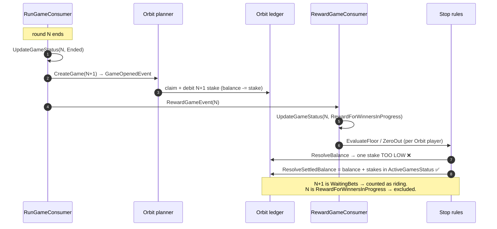

# SpaceStroker — "Orbit Stop Loss trigger" — Implementation Spec

> **Status: Ready for implementation** — refined via Trello card
> [Orbit Stop Loss trigger #154](https://trello.com/c/kCzYE9Bi) (re-refined 2026-08-10).
> Repos affected: `monkify-backend`, and this doc in `monkify-meta`. **No `monkify-front` change.**
>
> **Level: `Minor change`** — a bug fix to shipped Orbit behaviour. No new integration test and no
> new `features/<slug>.md` are mandated; unit tests and the correction of the existing Orbit KB docs
> still apply.
>
> **Purpose:** Orbit's three settlement stop rules — the cash-out **floor**, the take-profit
> **threshold** and the **zero-out** — decide on a custodial balance that the *next* round has
> already spent from. The floor cashes a player out while their stake is still riding, the zero-out
> announces "out of funds" and surrenders their reserved word on the same wrong number, and the
> take-profit can be missed entirely. This spec makes all three read a **settled balance**, and makes
> a round that ends with **no winner** evaluate the rules at all.

---

> ### ⚠️ §0 — Read this before the rest
>
> **This card was specced and implemented once before, on 2026-08-07/08, and that design was
> discarded on 2026-08-10.** The prior branch was never merged; its commits are preserved on the
> pushed tag **`archive/orbit-stop-loss-trigger-v1`** in `monkify-backend` (`2c0ef3f`),
> `monkify-front` (`6e19e9c`) and `monkify-meta` (`f224555`). Treat that tag as **reference only,
> never as a base** — the current `feature/orbit-stop-loss-trigger` is cut fresh from `origin/main`.
>
> The prior design added a provisional "stop", a `RidingBetStaleAfterMinutes` config knob, a planner
> eligibility gate, an hourly Hangfire sweep and a client-derived "stopped by your stop loss" state.
> **None of that is in scope here.** §3.1 records why each was rejected, because two of those
> rejections are load-bearing and an implementer who reads only the old code will reintroduce them.

---

## 1. Summary

### 1.1 The defect

`RunGameConsumer.ProcessMessage` creates the **successor round before** it publishes the reward
event:

| Line | `Consumers/RunGame/RunGameConsumer.cs` | Effect |
| --- | --- | --- |
| 44 | `UpdateGameStatus(game, Ended)` | round N is over |
| 50-61 | `GetActiveParametersForRollover` → `CreateGame(parameters, carry)` | round **N+1** opens → `GameOpenedEvent` → the Orbit planner claims, debits and signs N+1's stake |
| 63 | `UpdateBetStatus(..., NeedsRewarding)` | winners marked |
| 66 | `PublishEventAsync(new RewardGameEvent(...))` | round N settlement *starts* |

By the time `RewardGameConsumer.EvaluateOrbitFloors` (line 134) runs, the player's ledger balance is
already **one stake lower** than their real position. Both sides are on-chain paths of similar
duration, so this is a race — it misfires intermittently, not every round.

Three symptoms, one cause:

| # | Rule | Where | What goes wrong |
| --- | --- | --- | --- |
| 1 | `EvaluateFloor` | `OrbitBetSettlementService.cs:333-358` | Cashes the player out **mid-bet** — the exact thing the rule was placed at settlement time to prevent. |
| 2 | `EvaluateZeroOut` | `OrbitBetSettlementService.cs:199-256` | Announces "Orbit has stopped betting" and **releases the reserved word** (line 239) on a balance that only looks empty. The per-round claim churn its own comment at lines 232-239 exists to prevent is happening today. |
| 3 | `EvaluateThreshold` | `OrbitBetSettlementService.cs:165-181`, called from `CreditWin` | The take-profit reads the same low number, so a win that really did cross the threshold may not fire — and the next losing round takes the profit away. |

### 1.2 The second defect — a no-winner round never evaluates at all

`RewardGameConsumer.cs:57-62` returns early when no bet is `NeedsRewarding`, **before**
`EvaluateOrbitFloors` at line 134. On a preset type (e.g. **Beast Mode**) where the typed beast had
no backers, every Orbit player lost their entire stake — and that round is skipped entirely. This is
what the card's original one-line description asked for: *"after the game is ended and the
winners/losers have been resolved, it should trigger an event to evaluate the stop loss."*

### 1.3 The fix

1. Add **`ResolveSettledBalance`** to `IOrbitLedgerService` — the ledger balance **plus** the stakes
   of the player's Orbit bets whose round is still in `Game.ActiveGamesStatus`.
2. Read it in **all three** stop rules. It is **decision input only**; cash-out amounts keep coming
   from the raw ledger.
3. Evaluate the stop rules on the **no-winners** exit of `RewardGameConsumer`.
4. **Stop dispatching to a player who has reached their floor** (§3.2, added after live testing) —
   `ResolveCandidates` excludes them, and `CashOutFloorStoppedPlayers` cashes out anyone the
   settlement pass can no longer reach. Without this the floor still trips one bet late, because the
   next stake is signed before the previous round settles.

Nothing else changes: no entity, no EF mapping, no migration, no config key, no endpoint, no event,
no frontend, and no change to when the successor round is created.

---

## 2. Constraints (MANDATORY)

From `monkify-meta/constraints.md` (full list there):

- **§2 Git — worktree per repo.** Work lives in `.worktrees/orbit-stop-loss-trigger/<repo>`; the
  shared checkouts stay on `main` and are never switched. Branch `feature/orbit-stop-loss-trigger`
  in `monkify-backend` and `monkify-meta`, pushed to `origin`. **Never force-push.**
- **§3 Unit tests.** Update and add in `SpaceStroker.Tests`; run via `scripts/run_tests.bat` (**not**
  bare `dotnet test` — that pulls in the slow `ProductionGames` Monte Carlo suite). Report exactly
  which tests changed at the end.
- **§3 Integration tests.** `Minor change` with no game-flow change ⇒ **no new integration test is
  mandated**. `SpaceStroker.Tests.Integration/OrbitAutoBetFlowTests.cs` must still pass.
- **§4 Database.** No migration and no `OnModelCreating` change — this spec adds no schema.
- **§6 User-facing messaging.** No copy changes; nothing to review.
- **§8 Host responsibilities.** All of this is background/money work in `SpaceStroker.Consumers`. The
  API is untouched.
- **Feature-specific:** the ledger stays append-only, and the balance invariant
  `OrbitBalance.Amount == SUM(OrbitTransaction.Amount)` is not touched by anything here — the new
  read never writes.

---

## 3. Resolved product decisions

| # | Decision |
| --- | --- |
| 1 | **Fix the balance the rules read; do not reorder the game loop.** Rejected: moving the rollover into `RewardGameConsumer`, and gating the planner on the previous round settling. See §3.1. |
| 2 | **"Still riding" = the stake's round is in `Game.ActiveGamesStatus`** (`WaitingBets`, `GameStarting`, `InProgress`). Rejected: a deny-list of terminal statuses. See §3.1. |
| 3 | **All three rules read the settled balance** — floor, zero-out **and** threshold. |
| 4 | **Decision input only.** Cash-out amounts still come from the raw ledger via `OrbitCashOutReserver.Reserve` (line 41). Accepted consequence: a threshold cash-out can pay one stake less than the number the player set, because that stake is genuinely committed to a live round. |
| 5 | **A round stuck open defers the stop loss — accepted.** No staleness cutoff. See §3.1. |
| 6 | **Evaluate on the no-winners path** (`RewardGameConsumer.cs:57-62`). Both error paths keep today's behaviour: the line 130 path already evaluates, the line 81 blockhash-failure return does not. |
| 7 | **A tripped floor does not write `OrbitEnrollment.Enabled`.** The cash-out empties the balance, so the planner's `balance >= RequiredAmount` check stops placement server-side and the frontend auto-park watcher parks the enrolment. |
| 8 | **The 2026-08-07 design is discarded**; its branch is archived under `archive/orbit-stop-loss-trigger-v1` and deleted. See §0. |
| 9 | **Reaching the floor also stops the DISPATCH** (added after live testing — §3.2). `ResolveCandidates` excludes a player at or below their `CashOutFloor`, so no stake is committed once they have stopped; `CashOutFloorStoppedPlayers` cashes out anyone the settlement pass can no longer reach. Removes the one-round tail and makes the floor pay out at the number the player set. ⚠️ Narrows decision 4: the one-stake shortfall now applies to the **threshold only**. |

### 3.1 Rejected alternatives — and why the rejections matter

**Rejected: roll the successor round over after rewards instead of before.**
It fixes the same bug deterministically, but it delays *every* round for *every* player by the
on-chain payout time, and it couples rollover to the reward path. There is **no recurring
game-creation worker** — `CreateGamesInterval` in `WorkerSettings` is dead config with no reader, and
`OpenNewGames` (`SpaceStroker.Consumers/Program.cs:479-514`) runs **only at host startup**. So any
exit path of `RewardGameConsumer` that failed to create the successor would stop that game type
rolling until a Consumers restart. That is a large blast radius on the core game loop for an
Orbit-only defect.

**Rejected: a deny-list of terminal statuses for "riding".**
This is what the archived attempt did — `bet.Game.Status != RewardForWinnersCompleted && != ErrorWhenProcessingRewards && != GameEndedAbruptely` over `GameBets`. It has a defect the allow-list
does not: **at round N's own settlement, round N is `RewardForWinnersInProgress`**, which is not in
that deny-list, so round N's own resolved stake was counted as riding *and* added back. Combined
with N+1's stake, the settled balance was inflated by **two** stakes at exactly the moment the floor
should fire. That plausibly explains why the archived design then needed an hourly Hangfire sweep to
finish a cash-out the settlement pass could never trigger — stated here as a strong inference from
the code, not a verified root cause. `Game.ActiveGamesStatus` excludes round N for free (see §6.3)
and is an existing, already-maintained constant.

**Rejected: a `RidingBetStaleAfterMinutes` cutoff.**
A race has **no stale-round timeout** — only lotteries self-refund when under-subscribed
(`BetPlacedConsumer.cs:70-88`); a race just `return`s and sits in `WaitingBets` indefinitely. That is
the *normal* state of a low-traffic game type, not a malfunction, and a time cutoff cannot tell it
apart from #153's claim jam. It would therefore declare a genuinely live stake "settled" and re-fire
this very bug on healthy rounds — precisely the game types Orbit exists to serve. Accepting the
deferral is correct: while a stake is riding, **no loss has occurred**, so there is nothing for a
stop *loss* to react to, and manual cash-out is unaffected throughout.

**Rejected: gating the planner on the previous round having settled.**
Deterministic and adds no inter-round latency, but it needs a fourth re-plan trigger and changes the
start gate's timing — more moving parts than the defect warrants. **Still rejected**; the gate that
was adopted (§3.2) is a different, cheaper thing: it keys off the player's own floor, not off whether
the previous round has settled, so it adds no trigger and does not touch the start gate.

### 3.2 Adopted after live testing — the stop-loss placement gate

**Everything above shipped and was then tested on the local stack, which exposed a second half of the
same defect that the settled balance alone does not fix.** Observed 2026-08-10 with a deposit of 10
and a floor of 8 (stake 1):

| Time | Event | Balance |
| --- | --- | --- |
| 20:02:29 | `BetDebit` → round A | 9 |
| 20:02:50 | `BetDebit` → round B | **8** |
| 20:03:29 | `BetDebit` → round C | **7** |
| 20:03:29 | **CashOut −7, `Source = Floor`** | 0 |

The floor tripped at the right moment — at 20:02:50 the raw balance was exactly 8 and the settled
balance was 9, so the fix correctly declined to fire a round early. But **round C's stake had already
been signed by the time the floor tripped**, so:

1. **The player was cashed out for 7, not the 8 they set.** That 1 was committed to a live round and
   was not available to send home.
2. **Round C still played.** The player watched a round run after being told they had stopped.

Both follow from the ordering that caused the original bug: the successor round opens, and Orbit
signs its stake, *before* the previous round settles. **A stop rule that is only evaluated at
settlement is therefore always one bet behind, no matter how correct its arithmetic is.** Reaching
the floor has to stop the **dispatch**, not just fire the cash-out.

**Adopted:** `ResolveCandidates` excludes a player whose `CashOutFloor` is set and whose balance is
**at or below** it — `CashOutFloor == null || Amount > CashOutFloor`, the same strictly-above
comparison `EvaluateFloor` makes, so the two rules cannot disagree about where the line is.

With the gate, the same run ends: balance reaches 8 → the next round opens and commits **nothing** →
the round the player is still in settles → the floor trips on a settled balance of 8 → cashed out for
**8**, with **no tail round**.

⚠️ **The gate alone would strand money, so it does not ship alone.** The settlement pass only
evaluates players who bet in the round that just settled. A balance that is at or under the floor
with *nothing left in flight* — a floor set above the current balance, or a deposit under it — would
never be cashed out and would sit there silently. `CashOutFloorStoppedPlayers` runs at planning time
and finishes the job. It is idempotent (`Amount > 0` drops a player once emptied) and decides nothing
itself: `EvaluateFloor` still re-checks against the settled balance and declines anyone a riding
stake has lifted back above their floor.

**What this changes about decision 4.** The "a cash-out can pay one stake less than the number you
set" consequence **no longer applies to the floor** — a gated player has no stake committed when it
trips, so they are cashed out at their floor exactly. It still applies to the **threshold**, which
has no equivalent gate (a take-profit is not a reason to stop betting).

---

## 4. Data model

**No change.** No entity, no property, no EF mapping, no migration, no
`SpaceStrokerDbContext.OnModelCreating` edit. Everything the new read needs already exists:

- `OrbitTransaction.Type` (`OrbitTransactionType.BetDebit`)
- `OrbitTransaction.Amount` — **signed**; debits are stored negative
- `OrbitTransaction.GameId` — set on `BetDebit` rows **and nothing else** (it is the placement claim,
  unique-indexed with the pool key). Deposits, cash-outs, wins and refunds leave it `NULL`.
- `Game.Status` and the existing `Game.ActiveGamesStatus` array

Because the claim row carries the `GameId`, **no join to `Bet` is required** — and a stake that has
been debited but whose bet has not been registered yet (the in-flight window between step 2 and step
4 of placement) is counted correctly, which a `Bet`-based query would miss.

---

## 5. Configuration

**No change.** No new `GeneralSettings` key, no `OrbitSettings` field, no env var, no secret. The
archived attempt added `OrbitSettings.RidingBetStaleAfterMinutes`; that field is **not** part of this
spec (decision 5).

---

## 6. Backend behaviour

### 6.1 `IOrbitLedgerService` — new member

`src/SpaceStroker.Infrastructure/Services/Orbit/IOrbitLedgerService.cs`

```csharp
/// <summary>
/// The balance to DECIDE on: the ledger balance plus the stakes of Orbit bets that are still
/// riding — i.e. whose round has not run yet.
///
/// A stake leaves the balance the instant the bet is placed, and the successor round opens BEFORE
/// the previous one settles (RunGameConsumer creates it at line 50-61, then publishes
/// RewardGameEvent at line 66). Every settlement-time stop rule that reads the raw ledger therefore
/// reads it one stake too low.
///
/// ⚠️ DECIDE ONLY — never size money with this. A cash-out must be sized from ResolveBalance, which
/// is what OrbitCashOutReserver.Reserve does: the riding stake is committed to a live round and is
/// not available to send home.
/// </summary>
Task<decimal> ResolveSettledBalance(Guid playerId, CancellationToken cancellationToken = default);
```

### 6.2 `OrbitLedgerService.ResolveSettledBalance`

`src/SpaceStroker.Infrastructure/Services/Orbit/OrbitLedgerService.cs` — add after `ResolveBalance`
(line 116). No constructor change: `_context` and `_accounts` are already fields.

```csharp
/// <inheritdoc />
public async Task<decimal> ResolveSettledBalance(Guid playerId, CancellationToken cancellationToken = default)
{
    // ⚠️ THE LEDGER IS READ FIRST, AND THE ORDER IS DELIBERATE. A placement can land between the two
    // reads either way, but the two orders fail in opposite directions:
    //   ledger-then-riding  → the new debit is in `riding` but not in `ledger`, so the settled
    //                         balance comes out one stake HIGH and the floor is DEFERRED one round.
    //   riding-then-ledger  → the new debit is in `ledger` but not in `riding`, so it comes out one
    //                         stake LOW and the floor fires EARLY — the exact bug this fixes.
    // Deferring self-corrects at the next settlement; firing early sends a player's money home while
    // their bet is still riding and cannot be undone. So: ledger first.
    //
    // Reuse ResolveBalance rather than re-summing the ledger — it owns the REPEATABLE READ snapshot
    // and the guarded self-heal, and duplicating that read is how the column-drift bug comes back.
    var ledger = await ResolveBalance(playerId, cancellationToken);

    var account = _accounts.OrbitAccount;
    var mint = _accounts.MintAddress;

    // ⚠️ RIDING IS DECIDED BY GAME STATUS, NEVER BET STATUS. A losing bet is never transitioned — it
    // stays BetStatus.Made forever — so a bet-status test would treat every past loss as riding, grow
    // the settled balance without bound, and stop the floor from ever firing again.
    //
    // ⚠️ ALLOW-LIST (ActiveGamesStatus), not a deny-list of terminal statuses. At its own settlement
    // round N is already RewardForWinnersInProgress (RewardGameConsumer.cs:86) or, on the no-winners
    // path, RewardForWinnersCompleted — neither is in ActiveGamesStatus, so round N's own resolved
    // stake is excluded for free. A deny-list would add it back and suppress the very trip we are
    // trying to make correct. See spec §3.1.
    //
    // Only BetDebit rows carry a GameId (it IS the placement claim), so this cannot pick up a
    // deposit, cash-out, win or refund.
    var riding = await _context.OrbitTransactions
        .Where(x => x.OrbitAccount == account
                 && x.MintAddress == mint
                 && x.PlayerId == playerId
                 && x.Type == OrbitTransactionType.BetDebit
                 && x.GameId != null
                 && _context.Games.Any(g => g.Id == x.GameId && Game.ActiveGamesStatus.Contains(g.Status)))
        .SumAsync(x => (decimal?)x.Amount, cancellationToken) ?? 0m;

    // Debits are stored NEGATIVE, so subtracting adds the riding stakes back.
    return ledger - riding;
}
```

Notes for the implementer:

- `OrbitTransaction` has **no `Game` navigation property**, hence the correlated `_context.Games.Any(...)`
  rather than `x.Game.Status`. It translates to an `EXISTS` on Postgres and runs on the EF in-memory
  provider, so it is unit-testable.
- `ResolveBalance` commits and disposes its own snapshot in its `finally` (line 79-88), so the riding
  query runs under a fresh snapshot. That is the window the ordering comment above accounts for; it
  is acceptable because both reads are decision-only and the money write is still the conditional
  `TryDebit` inside `OrbitCashOutReserver`, which rolls the whole reservation back if the balance
  moved.
- Required usings: `SpaceStroker.Domain.Games.Entities` (for `Game`), `SpaceStroker.Domain.Orbit.ValueObjects`
  (for `OrbitTransactionType`).

### 6.3 `EvaluateFloor` — read the settled balance

`OrbitBetSettlementService.cs:333-358`. Replace the `_ledger.ResolveBalance` call at line 340 with
`_ledger.ResolveSettledBalance`. Both guards then evaluate on the settled number:

- `if (balance > floor) return;` — strictly above the floor is still playing (unchanged semantics).
- `if (balance <= 0) return;` — nothing to send home.

Update the log line to say which number it is. `Reserve(playerId, OrbitCashOutSource.Floor, enforceLimits: false, ...)`
is unchanged and still sizes the payout from `ResolveBalance` internally (decision 4).

### 6.4 `EvaluateZeroOut` — read the settled balance

`OrbitBetSettlementService.cs:199-256`. Replace the `ResolveBalance` call at line 215. Both branches
follow:

- `balance >= requiredAmount` (line 217) — the **recovery** branch: `TryReclaimWord` and clear
  `ZeroOutNotifiedAt`. With the settled balance, a player whose stake is riding is correctly seen as
  still playable, so their word is **not** surrendered and no false "out of funds" is announced.
- Below the stake — `_claims.Release` (line 239) and, if not already flagged, the zero-out
  notification.

The `hasBet` guard (lines 244-248), `ZeroOutNotifiedAt` de-duplication and the Telegram send are
unchanged. **Correct the comments at lines 186-197 and 232-239**, which currently justify the raw
read as "evaluated on a RESOLVED bet" — that claim only becomes true with this change.

### 6.5 `EvaluateThreshold` — read the settled balance

`OrbitBetSettlementService.cs:165-181`, reached from `CreditWin` (line 66). Replace the
`ResolveBalance` call at line 172. `Reserve(..., OrbitCashOutSource.Threshold, enforceLimits: false, ...)`
is unchanged.

⚠️ Accepted consequence (decision 4): because `Reserve` sizes from the raw ledger, a threshold
cash-out fired on a settled balance can pay out **one stake less** than the threshold the player set.
That stake is committed to a live round; paying it would be paying money that is not there. Document
this in the method comment.

### 6.6 `RewardGameConsumer` — evaluate on the no-winners path

`src/SpaceStroker.Infrastructure/Consumers/RewardGame/RewardGameConsumer.cs`

1. Move the `IOrbitBetSettlementService` resolve (currently line 66) **above** the no-winners early
   return at line 57. `ISolanaService` and `ITokenSettlementService` stay where they are — the
   no-winners path must not need them.
2. In the no-winners branch, after `UpdateGameStatus(game, GameStatus.RewardForWinnersCompleted)`,
   call `await EvaluateOrbitFloors(game, orbitSettlement);` before returning.
3. Leave the other exits exactly as they are:
   - `game == null` (line 45-49) — nothing to evaluate.
   - `game.Bets.IsNullOrEmpty()` (line 51-55) — no Orbit bets by definition.
   - blockhash failure (line 76-83) — payouts never ran, so the floor must not decide on that state.
   - `ErrorWhenProcessingRewards` at line 130-134 — **already** evaluates; keep it.
4. `EvaluateOrbitFloors` itself is unchanged, including its per-player `try/catch` (lines 158-173):
   a stop rule that throws must never undo a settled round.

Update the doc-comment at lines 137-147 so it describes the settled balance rather than the raw one.

### 6.7 `OrbitBetPlacementService` — the stop-loss placement gate

`src/SpaceStroker.Infrastructure/Services/Orbit/OrbitBetPlacementService.cs`. Added after live
testing; see §3.2 for the observed run that motivated it.

1. **Constructor** gains `IOrbitBetSettlementService settlement`. No cycle:
   `OrbitBetSettlementService` does not depend on the placement service.
2. **`ResolveCandidates`** carries `enrollment.CashOutFloor` through both projections and adds one
   predicate after the existing `Amount >= RequiredAmount` filter:

   ```csharp
   .Where(x => x.CashOutFloor == null || x.Amount > x.CashOutFloor)
   ```

   Strictly above the floor is still playing — the same comparison `EvaluateFloor` makes. Keep them
   identical: if they ever disagree, a player stops either a round early or a round late.

   The materialized column is read here, exactly as the surrounding planning read does and for the
   same stated reason — this is a filter for "who is worth looking at", and the authoritative check
   still happens elsewhere.

3. **`CashOutFloorStoppedPlayers`**, called from `PlanPlacements` **before** `ResolveCandidates` and
   **regardless of the candidate count**, evaluates the floor for every enabled player on this type
   whose balance is `> 0` and `<= CashOutFloor`. Each call is wrapped in `try/catch` — a floor that
   cannot be evaluated must never stop a round from being planned.

   - `Amount > 0` is what makes it idempotent: once the cash-out empties the balance the player drops
     out of the query, so re-planning the same round cannot reserve twice.
   - It decides nothing on its own. `EvaluateFloor` re-checks against the **settled** balance, so a
     player whose riding stake lifts them back above the floor is simply declined there.

⚠️ Do **not** move this into `ResolveCandidates`. That method is a pure read called from more than
one place; reserving money inside it would fire a cash-out from a query.

### 6.8 What deliberately does not change

`OrbitCashOutReserver` (sizing, limits, the word-claim release at lines 101-118), the placement
planner, the start gate, `OrbitChoiceClaimService`, `RunGameConsumer` (the rollover stays exactly
where it is), `OrbitEnrollment` writes on a floor trip, and every notification payload.

---

## 7. Frontend behaviour

**None.** No `monkify-front` change and no `monkify-front` worktree for this card. `OFF / PAUSED /
RUNNING`, the auto-park watcher, `useOrbit` and the Orbit modal behave exactly as today — they simply
stop being driven by a wrong balance. The archived attempt's "stopped by your stop loss" client state
is out of scope (decision 7).

---

## 8. Flow diagram



---

## 9. Out of scope

- **#153** — the orphaned Orbit placement claim that permanently bars a player from a round.
- The missing **stale-round timeout for races** (a race under `MinimumNumberOfPlayers` sits in
  `WaitingBets` forever; only lotteries self-refund).
- Reordering the rollover in `RunGameConsumer`, or any change to when the successor round is created.
- The two error paths in `RewardGameConsumer` (blockhash failure at line 81; the
  `ErrorWhenProcessingRewards` path at line 130).
- Writing `OrbitEnrollment.Enabled` on a floor trip; the manual STOP, the cool-off, and the daily
  cash-out limit.
- `OrbitCashOutReserver` sizing, and any new player-facing copy, notification or `GET /orbit` field.
- The archived design's provisional stop, staleness knob, Hangfire sweep and client-derived UI state.
  ⚠️ Its **planner gate** is *not* on this list any more: §3.2 adopts a gate, though a different one —
  it keys off the player's own floor rather than off whether the previous round has settled, so it
  adds no re-plan trigger and does not touch the start gate.

---

## 10. File checklist

### 10.1 Backend (`monkify-backend`)

| # | File | Change |
| --- | --- | --- |
| 1 | `src/SpaceStroker.Infrastructure/Services/Orbit/IOrbitLedgerService.cs` | Declare `ResolveSettledBalance` with the decide-only warning (§6.1). |
| 2 | `src/SpaceStroker.Infrastructure/Services/Orbit/OrbitLedgerService.cs` | Implement `ResolveSettledBalance` after `ResolveBalance` (§6.2). No constructor change. |
| 3 | `src/SpaceStroker.Infrastructure/Services/Orbit/OrbitBetSettlementService.cs` | `EvaluateFloor` (line 340), `EvaluateZeroOut` (line 215) and `EvaluateThreshold` (line 172) read `ResolveSettledBalance`; correct the comments at 158-164, 183-197, 232-239 and 313-331 that justify the raw read. |
| 4 | `src/SpaceStroker.Infrastructure/Consumers/RewardGame/RewardGameConsumer.cs` | Move the `IOrbitBetSettlementService` resolve above line 57; evaluate the stop rules on the no-winners return; update the doc-comment at 137-147. |
| 4b | `src/SpaceStroker.Infrastructure/Services/Orbit/OrbitBetPlacementService.cs` | **§3.2/§6.7** — inject `IOrbitBetSettlementService`; carry `CashOutFloor` through `ResolveCandidates` and exclude players at or below it; add `CashOutFloorStoppedPlayers`, called from `PlanPlacements`. |
| 4c | `src/SpaceStroker.Tests/UnitTests/Services/OrbitBetPlacementServiceTests.cs` | New `_settlement` mock + the 6th constructor argument; `cashOutFloor` on `SeedEnrolledPlayers`; 7 new cases (§11). |
| 5 | `src/SpaceStroker.Tests/UnitTests/Services/OrbitLedgerServiceTests.cs` | New cases for `ResolveSettledBalance` (§11). |
| 6 | `src/SpaceStroker.Tests/UnitTests/Services/OrbitBetSettlementServiceTests.cs` | New cases for the three rules reading the settled balance (§11). |
| 7 | `src/SpaceStroker.Tests/UnitTests/Consumers/RewardGameConsumerTests.cs` | **New file** — the no-winners evaluation path (§11). |

### 10.2 Frontend (`monkify-front`)

**None.**

### 10.3 Meta (`monkify-meta`)

| # | File | Change |
| --- | --- | --- |
| 1 | `specs/orbit-stop-loss-trigger.md` | This spec. |
| 2 | `INDEX.md` | Spec row (status **Ready**) + "Feature currently in flight". |
| 3 | `features/orbit-auto-bet-engine.md` | **At ship time** — its "Settlement" section says both rules "act on a **resolved** bet, never a placed one". That only becomes true with this card. |
| 4 | `features/orbit-notifications.md` | **At ship time** — same claim at the "cash-out floor" section (lines ~170-192). |
| 5 | `features/orbit-feedback-adjustments.md` | **At ship time** — same correction where it describes the floor/zero-out timing. |

---

## 11. Unit tests

Project: `monkify-backend/src/SpaceStroker.Tests`. Run with **`scripts/run_tests.bat`**.

| Test file | Test case | Expected |
| --- | --- | --- |
| `Services/OrbitLedgerServiceTests.cs` | `ResolveSettledBalance_AddsBackStakesRidingInAnOpenRound` | A `BetDebit` of −1 on a `WaitingBets` game ⇒ settled = ledger + 1. |
| ″ | `ResolveSettledBalance_ExcludesTheRoundBeingSettled` | A `BetDebit` on a game in `RewardForWinnersInProgress` **and** one in `RewardForWinnersCompleted` ⇒ neither is added back. **The single most important case.** |
| ″ | `ResolveSettledBalance_ExcludesTerminalAndAbortedRounds` | Debits on `Ended`, `ErrorWhenProcessingRewards`, `GameEndedAbruptely`, `NotEnoughPlayersToStart` ⇒ none added back (only `ActiveGamesStatus` counts). |
| ″ | `ResolveSettledBalance_CountsGameStartingAndInProgress` | Debits on `GameStarting` and `InProgress` ⇒ both added back. |
| ″ | `ResolveSettledBalance_IgnoresNonBetDebitRows` | Deposit / `WinCredit` / `Refund` / `CashOut` rows (all `GameId == null`) ⇒ never added back. |
| ″ | `ResolveSettledBalance_IgnoresAnotherPlayerAndAnotherPool` | Rows for a different `PlayerId`, `OrbitAccount` or `MintAddress` ⇒ excluded. |
| ″ | `ResolveSettledBalance_EqualsLedgerWhenNothingIsRiding` | No open-round debits ⇒ settled == `ResolveBalance`. |
| `Services/OrbitBetSettlementServiceTests.cs` | `EvaluateFloor_DoesNotCashOutWhenOnlyARidingStakeTookTheBalanceToTheFloor` | Mock `ResolveSettledBalance` above the floor while `ResolveBalance` is at it ⇒ `Reserve` never called. |
| ″ | `EvaluateFloor_CashesOutWhenTheSettledBalanceIsAtOrBelowTheFloor` | Settled ≤ floor and > 0 ⇒ `Reserve(Floor, enforceLimits: false)` called once. |
| ″ | `EvaluateFloor_SizesTheCashOutFromTheRawLedgerNotTheSettledBalance` | Assert the reserver is invoked without an amount, so it sizes from `ResolveBalance` (decision 4). |
| ″ | `EvaluateZeroOut_DoesNotReleaseTheWordOrNotifyWhileAStakeIsRiding` | Settled ≥ `RequiredAmount`, raw below ⇒ `_claims.Release` not called, no `ZeroOutNotifiedAt` write, no Telegram. |
| ″ | `EvaluateZeroOut_StillFiresWhenTheSettledBalanceIsGenuinelyBelowTheStake` | Nothing riding, settled < stake, player has a `BetDebit` ⇒ release + flag + notify, exactly as today. |
| ″ | `EvaluateThreshold_FiresOnTheSettledBalance` | Settled ≥ threshold while raw is one stake below ⇒ `Reserve(Threshold, enforceLimits: false)` called. |
| ″ | `EvaluateThreshold_DoesNotFireWhenTheSettledBalanceIsBelowTheThreshold` | No reservation. |
| `Consumers/RewardGameConsumerTests.cs` *(new)* | `NoWinners_StillEvaluatesTheOrbitStopRules` | Game with Orbit bets, none `NeedsRewarding` ⇒ status `RewardForWinnersCompleted` **and** `EvaluateFloor` + `EvaluateZeroOut` called once per distinct Orbit player. |
| ″ | `NoWinners_WithNoOrbitBets_EvaluatesNothing` | Only wallet-funded bets ⇒ no calls on `IOrbitBetSettlementService`. |
| ″ | `NoBets_EvaluatesNothing` | Empty `Bets` ⇒ early return, no calls. |
| `Services/OrbitBetPlacementServiceTests.cs` | `NotACandidate_OnceTheBalanceHasReachedTheStopLoss` (Theory: 8, 5) | Balance at **and** under a floor of 8 ⇒ `ResolveCandidates` is empty. |
| ″ | `StillACandidate_WhileStillAboveTheStopLoss` | Balance 9, floor 8 ⇒ still dispatched (strictly above). |
| ″ | `StillACandidate_WithNoStopLossSet` | `CashOutFloor` null ⇒ untouched by the gate. |
| ″ | `CashesOutAPlayerWhoseStopLossHasBeenReached_EvenWithNothingLeftInFlight` | Balance 5, floor 8, nothing riding ⇒ `EvaluateFloor` called once. |
| ″ | `DoesNotReCashOutAnAlreadyEmptiedBalance` | Balance 0 ⇒ never called (idempotence). |
| ″ | `DoesNotCashOutAPlayerStillAboveTheirStopLoss` | Balance 9, floor 8 ⇒ never called. |

⚠️ **Assert eligibility through `ResolveCandidates`, not `PlanPlacements`.** Both of
`PlanPlacements`' exits that reach a dispatch decision write the gate with `ExecuteUpdateAsync`,
which the in-memory provider cannot translate — it **throws**, it does not no-op. The three
cash-out cases go through `PlanPlacements` and are seeded to stop at the **viability guard**
(candidates ≥ 1, minimum 3, no humans), the one exit that returns without writing.

Follow the existing patterns: `OrbitBetSettlementServiceTests` mocks `IOrbitLedgerService` and
`IOrbitCashOutReserver` with Moq over an in-memory `SpaceStrokerDbContext`; `PlaceOrbitBetConsumerTests`
shows the consumer + `IServiceScopeFactory` harness. `UnitTestsClass` already downgrades the
in-memory transaction warning, so `ResolveSettledBalance` runs there.

⚠️ Unchanged limitation: the money writes around this code (`ExecuteUpdateAsync`, the `BetDebit`
claim's unique index, `TryDebit`) cannot run on the EF in-memory provider. They stay covered by
`SpaceStroker.Tests.Integration`. The new read is a plain `SumAsync` and is **not** affected.

---

## 12. Acceptance criteria

Mapped 1:1 from the Trello **Acceptance Criteria** checklist on card #154.

1. Given an Orbit player holding a `BetDebit` whose round is in `Game.ActiveGamesStatus` (`WaitingBets`, `GameStarting` or `InProgress`), when the settled balance is resolved, then it equals the raw ledger balance plus that stake.
2. Given the round currently being settled (`RewardForWinnersInProgress` on the normal path, `RewardForWinnersCompleted` on the no-winners path), when the settled balance is resolved for a player who bet in it, then that round's own stake is **not** added back.
3. Given an Orbit player whose raw ledger balance is at or below their `CashOutFloor` **only** because the successor round's stake has already been debited, when the round settles, then no `Floor` cash-out is reserved and Orbit keeps playing.
4. Given an Orbit player whose **settled** balance is at or below their `CashOutFloor` and above zero, when the round settles, then a `Floor` cash-out is reserved with `enforceLimits: false`.
5. Given a `Floor` or `Threshold` cash-out fires while a stake is still riding, when the cash-out is reserved, then the reserved amount is the **raw** ledger balance — the riding stake is not paid out and the settled balance is never used to size money.
6. Given an Orbit player whose settled balance still covers the type's `RequiredAmount` because a stake is riding, when the round settles, then no zero-out notification is sent, `ZeroOutNotifiedAt` is not set, and their reserved word claim is **not** released.
7. Given an Orbit player whose settled balance genuinely falls below the type's `RequiredAmount` with nothing riding, when the round settles, then the zero-out fires exactly as today (word claim released, one notification, `ZeroOutNotifiedAt` set).
8. Given an Orbit win whose credit brings the player's **settled** balance to or above `CashOutAtThreshold` while the successor round's stake has already left the raw balance, when `CreditWin` runs, then a `Threshold` cash-out is reserved.
9. Given a round that ends with no bet in `NeedsRewarding` (e.g. a preset type whose typed choice had no backers), when `RewardGameConsumer` processes it, then the game reaches `RewardForWinnersCompleted` **and** the stop rules are evaluated once for every distinct Orbit player who bet in that round.
10. Given a round that returns early because the game is missing or has no bets, or because the Solana blockhash pre-check failed, when `RewardGameConsumer` processes it, then the stop rules are **not** evaluated — unchanged from today.
11. Given a `Floor` cash-out fires, when it completes, then `OrbitEnrollment.Enabled` is left untouched and betting stops only via the emptied balance failing the planner's `balance >= RequiredAmount` check.
12. Given a stake in a round that stays in `WaitingBets` indefinitely, when any later round settles, then that stake keeps counting toward the settled balance and no `Floor` trip occurs on its account — the stop loss is deferred, not lost, and manual cash-out still works.
13. Given `RewardGameEvent` is redelivered for a round whose stop rules already ran, when they re-run, then no second cash-out is reserved and no duplicate zero-out notification is sent.
14. Given the change is complete, when `SpaceStroker.Tests` runs via `scripts/run_tests.bat`, then the whole suite is green with new coverage for the settled-balance resolution and the no-winners evaluation path, and the changed/added tests are reported.

Added with §3.2 (the placement gate):

15. Given an Orbit player whose balance has reached their `CashOutFloor`, when the next round is planned, then they are **not** a candidate and no stake is committed on their behalf.
16. Given an Orbit player whose balance is still strictly **above** their `CashOutFloor`, when the next round is planned, then they are dispatched exactly as before; a player with no floor set is unaffected.
17. Given an Orbit player whose stop loss trips, when they are cashed out, then the amount is their **full** balance at the floor — no stake is left committed to a live round — and **no further round plays** on their behalf.
18. Given an Orbit player at or below their floor with **no bet left in flight** (a floor set above their balance, or a deposit under it), when any round of that type is planned, then their balance is cashed out rather than stranded.
19. Given that player's balance has already been emptied by the floor cash-out, when the next round is planned, then no second cash-out is reserved.

---

## 13. Manual QA (local stack)

Orbit is dark in production behind `VUE_APP_ORBIT_ENABLED`, so verify locally with the flag on.

1. Bring the local stack up and enrol a wallet in Orbit on a **race** type with a low
   `MinimumNumberOfPlayers` (Cosmic Sprint). Fund it with roughly 3 stakes.
2. Set a **cash-out floor** just under the current balance — close enough that a single stake leaving
   would cross it.
3. Let rounds run with the player losing. **Before the fix**, the floor fires while the successor
   round's stake is already placed. **After**, the floor holds until the balance genuinely reaches
   it, the player is cashed out for the **full** amount at the floor (not one stake less), and
   **no further round plays** — verified on the local stack 2026-08-10 (§3.2).
4. Watch the Consumers log for the floor/zero-out lines and confirm the balance they report is the
   settled one.
5. For the second defect, use a **preset** type (Beast Mode): have the Orbit player back a beast that
   is not typed first and no other bet match the winner, so the round ends with no winner. Confirm
   the game reaches `RewardForWinnersCompleted` and the stop rules run (they are skipped today).
6. Confirm `OrbitEnrollment.Enabled` is untouched throughout — Orbit parks only because the balance
   emptied.

---

## 14. Trello / pipeline

- **Source card:** [Orbit Stop Loss trigger #154](https://trello.com/c/kCzYE9Bi) — list **Specs
  created**; branch, worktree, spec path and Level are in the card's **Implementation** section.
- **Archived first attempt:** tag `archive/orbit-stop-loss-trigger-v1` in `monkify-backend`,
  `monkify-front` and `monkify-meta`. Reference only.
- **Next:** `/monkify-implement-feature Orbit Stop Loss trigger`, then
  `/monkify-ship-feature Orbit Stop Loss trigger`.

---

## 15. Revision log

| Date | Change |
| --- | --- |
| 2026-08-10 | Initial spec from the re-refined card. Supersedes the discarded 2026-08-07 spec of the same name (archived under `archive/orbit-stop-loss-trigger-v1`). |
| 2026-08-10 | **§3.2 added after live testing on the local stack.** The settled balance fixed *when* the floor trips but not that the next stake is already signed when it does, so the player was cashed out one stake short and watched one more round play. Adds the placement gate + `CashOutFloorStoppedPlayers` (§6.7), decision 9, ACs 15-19, and 7 unit tests. Narrows decision 4 to the threshold. Note this **adopts** a planner gate, which §3.1 rejects in a different form — read both. |
