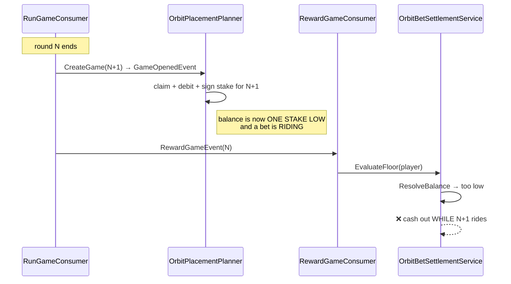
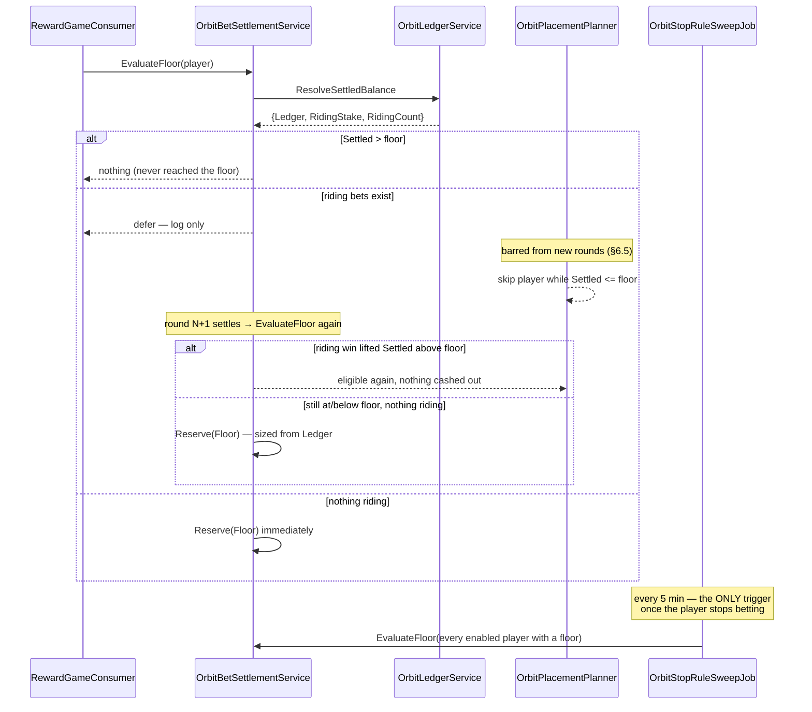

# SpaceStroker — "Orbit stop loss trigger" — Implementation Spec

> **Status: Ready for implementation** — refined via Trello card
> [#154 Orbit Stop Loss trigger](https://trello.com/c/kCzYE9Bi) (2026-08-07).
> Repos affected: **`monkify-backend`**, **`monkify-front`**, and this doc in **`monkify-meta`**.
> Branch `feature/orbit-stop-loss-trigger` in all three, cut from `origin/main`.
> **Level: `Minor change`** — see §2.1 for what that waives.
>
> **Purpose:** Orbit's stop loss (the **cash-out floor**, `OrbitEnrollment.CashOutFloor`) fires against
> a balance that already has the *next* round's stake debited, so it can trip one stake early and cash
> a player out **while their bet is still riding**. This spec makes every settlement-time stop rule
> read a **settled** balance, defers the floor's cash-out until nothing is riding, and stops the
> planner entering a player whose floor has been crossed.
>
> ⚠️ **Three implementation deviations — the code wins over §6.6 and §7 below.** All three trace to the
> **auto-park watcher** (`useOrbit.ts`), which the single-control merge added and which this spec did
> not account for: it PATCHes `enabled: false` the moment Orbit cannot pay for a round, which is
> exactly what a tripped floor produces.
>
> 1. **The sweep does NOT filter on `Enabled`** (§6.6 said it did). An `Enabled` filter would skip
>    precisely the players the sweep exists to pay — auto-parked mid-deferral — and skip them
>    permanently, since they are also barred from new rounds. **Accepted consequence (owner,
>    2026-08-07): a parked player at or below their floor is now cashed out**, which previously could
>    not happen because `EvaluateFloor` was only reachable through settlement.
> 2. **`isStoppedByFloor` is NOT gated on `enabled`** (§7.2 said it was), and `'stop-loss'` outranks
>    **`off`** as well as `unfunded`. Gated on `enabled` the state would be all but unreachable, and the
>    player would be shown PAUSED or NEEDS MONEY for a balance deliberately sent home.
> 3. **Two more frontend files were touched** than §7 lists: `OrbitControlBar.vue` (RUN is disabled with
>    "Stop loss reached — raise or clear it", because pressing it would flip the flag and change nothing
>    — the backend gate still bars the player) and `OrbitStatusBanner.vue` (the rounds-left line is
>    suppressed). The floor's explanatory copy lives in **`components/orbit/tabs/OrbitStopRulesTab.vue`**,
>    not `OrbitPage.vue` — the field moved in the `/orbit` restructure.

---

## 0. Base — read this before anything else

⚠️ **`origin/main` moved after this card was refined.** The branch is cut from `origin/main` at
`1252b5b` (backend) / `1d4f9bf` (front) / `78cc40f` (meta) — the **single-control merge**
(`specs/orbit-single-control.md`, 2026-08-07). Two things the refined card says are no longer true of
the code, and **the code wins**:

| Card says | Reality on this base |
| --- | --- |
| The trip must not clobber "a STOP the player pressed" (`OrbitEnrollment.Stopped`) | **`Stopped` no longer exists.** `Enabled` is the single play/pause switch; the only surviving mention is a doc comment on `OrbitEnrollment.Enabled`. |
| The new UI state replaces `"paused — insufficient funds"` | `orbitStatus` was reduced to `'signed-out' \| 'off' \| 'unfunded' \| 'running'` (`monkify-front/src/types/orbit.ts:255`). The state this card displaces is **`'unfunded'`** ("NEEDS MONEY"). `'paused'`, `'stopped'` and `'cooling-off'` are gone; a parked pause is now derived in `OrbitStatusTag.vue` from `orbitBetsPlaced > 0` on an `off` Orbit. |

**Neither changes the design, and the second makes it stronger.** The decision to hold the tripped
state as a *derived* planner condition rather than a stored flag was taken so it could not clobber the
player's own switch — and with `Enabled` now the single control, writing to it would be strictly
worse: it is the same field the player toggles, so an automatic write is indistinguishable from their
own, and the "re-evaluate and resume if a riding win saves it" behaviour (§3, decision 3) would have
nothing to distinguish an automatic stop from a deliberate one. **Nothing in this card writes
`Enabled`.**

⚠️ **The defect itself is untouched by the merge.** `RunGameConsumer.cs`, `RewardGameConsumer.cs` and
`OrbitLedgerService.cs` are byte-identical between the pre-merge hub and this base.

---

## 1. Summary

### 1.1 The defect

`OrbitEnrollment.CashOutFloor` shipped in #123
([`orbit-notifications.md`](../features/orbit-notifications.md) → "The cash-out floor"). That card
deliberately moved the floor **off** the placement path and **onto** settlement, because a stake
leaves the balance the moment it is placed — so evaluating at placement sends a player's money home
while their bet is still riding.

**The rollover order defeats it.** `RunGameConsumer.ProcessMessage` ends like this:

```csharp
// RunGameConsumer.cs:48-66  (order is the bug)
var parameters = await gameService.GetActiveParametersForRollover(game.ParametersId);
if (parameters != null)
    await gameService.CreateGame(parameters, carry);      // ← publishes GameOpenedEvent
                                                          //   → OrbitPlacementPlannerConsumer
                                                          //   → claim + debit + sign round N+1's stake
await gameService.UpdateBetStatus(...NeedsRewarding);
await messageBus.PublishEventAsync(new RewardGameEvent(message.GameId));   // ← settlement starts HERE
```

By the time `RewardGameConsumer.EvaluateOrbitFloors` (`RewardGameConsumer.cs:134,148-175`) runs for
round N, round N+1's stake has already left the balance. So:

1. `EvaluateFloor` compares against a balance that is **one stake too low** → it can trip on a settled
   balance that never actually reached the floor.
2. It reserves a cash-out **while a live Orbit bet is riding** in round N+1 — the exact failure #123
   claims to have fixed.

Two sibling rules in the same settlement pass read the same too-low number:

| Rule | Where | Effect of the too-low read |
| --- | --- | --- |
| `EvaluateFloor` | `OrbitBetSettlementService.cs:333` (via `RewardGameConsumer`) | trips ~one stake early, cashes out mid-bet |
| `EvaluateThreshold` | `OrbitBetSettlementService.cs:161` (via `CreditWin`) | fires ~one stake **late** |
| `EvaluateZeroOut` | `OrbitBetSettlementService.cs:195` (via `RewardGameConsumer`) | can send a false "Orbit has stopped betting"; `ZeroOutNotifiedAt` then suppresses the real one |

### 1.2 A second, independent gap

A floor cash-out today **only empties the balance** — nothing stops Orbit. The enrolment stays
`Enabled`, so a win credit from the still-riding bet, or a later deposit, resumes betting. The shipped
`/orbit` copy already promises *"Orbit stops and sends what is left if a bet takes the balance down to
here."* (`OrbitPage.vue`). This card makes that copy true.

### 1.3 The shape

| # | Change | Where |
| --- | --- | --- |
| 1 | **`ResolveSettledBalance`** — ledger balance **plus** the stakes of the player's still-riding Orbit bets, with a count | `OrbitLedgerService` |
| 2 | The floor **defers** its cash-out while anything is riding, and compares on the settled number | `EvaluateFloor` |
| 3 | The planner **will not enter** a player whose settled balance is at or below their floor | `OrbitBetPlacementService.ResolveCandidates` |
| 4 | The threshold and the zero-out read the settled number too (arithmetic only — the threshold keeps its immediate cash-out) | `EvaluateThreshold`, `EvaluateZeroOut` |
| 5 | A **5-minute recurring sweep** re-drives the floor for players who have stopped betting | new `OrbitStopRuleSweepJob` |
| 6 | A **`'stop-loss'`** status on `/orbit` and in the modal, derived client-side | `useOrbit`, `types/orbit.ts`, `OrbitStatusTag.vue` |

**No entity change. No migration. No new endpoint. No API contract change.**

---

## 2. Constraints (MANDATORY)

From [`../constraints.md`](../constraints.md):

- **Worktree-per-repo (§2):** work lives in `.worktrees/orbit-stop-loss-trigger/<repo>`; the hubs stay
  on `main`. Branch `feature/orbit-stop-loss-trigger` is already created and pushed in all three.
- **Unit tests (§3):** update and add in `SpaceStroker.Tests`; **report exactly which tests changed**
  at the end. Run with `scripts/run_tests.bat` — **never** bare `dotnet test`, which pulls in the slow
  `ProductionGames` Monte Carlo suite.
- **EF (§4):** no entity or mapping change is required here. If one becomes necessary, mapping stays
  **inline** in `SpaceStrokerDbContext.OnModelCreating` and the migration is applied only by
  `SpaceStroker.Consumers`.
- **Secrets/config (§1):** the new `RidingBetStaleAfterMinutes` is a plain integer with a code default;
  committed config carries mock values only.
- **Messaging (§6):** nothing here is user-facing on an unauthenticated path. The new client state is
  derived from data `GET /orbit` already returns to the session's owner.
- **Hosts (§8):** the sweep is background work and belongs to **`SpaceStroker.Consumers`**, never the API.
- **Money paths:** a stop rule that cannot be evaluated must never fail a settlement that has already
  moved money — every new call site keeps the existing swallow-and-log posture.

### 2.1 Level — `Minor change`

Agreed on the card (owner's call, 2026-08-07). This **waives**:

- the mandatory happy-path **integration test** in `SpaceStroker.Tests.Integration`, and
- a dedicated **`features/orbit-stop-loss-trigger.md`** knowledge-base doc.

It does **not** waive unit tests, and it does **not** waive keeping the KB true. At ship time these
three existing docs are wrong until corrected — all three state the floor acts on a resolved bet,
which only becomes true with this card:

- [`../features/orbit-notifications.md`](../features/orbit-notifications.md) → "The cash-out floor"
- [`../features/orbit-auto-bet-engine.md`](../features/orbit-auto-bet-engine.md) → "Settlement"
- [`../features/orbit-feedback-adjustments.md`](../features/orbit-feedback-adjustments.md)

> ⚠️ The three writes Orbit's design rests on — the placement **claim**, the atomic conditional
> **debit**, and the **gate** — have no unit coverage by construction (the EF in-memory provider
> cannot execute them). Everything this card adds is deliberately built to be **in-memory testable**:
> no `ExecuteUpdateAsync`, no raw constraint reliance. See §11.

---

## 3. Resolved product decisions

| # | Decision | Why this over the alternative |
| --- | --- | --- |
| 1 | **Stop first, then cash out.** Crossing the floor stops the player entering new rounds; the cash-out follows once nothing is riding. | Over "fix the arithmetic only" (still cashes out mid-bet, still never stops Orbit) and over "block the planner until the previous round settles" (breaks the engine's "bet every round, no cap" rule for every player, not just tripped ones). |
| 2 | **The tripped state is derived, never stored** — one extra condition in `ResolveCandidates`: `settled balance > floor`. | Over a new `FloorTrippedAt` column (a migration, plus a second stop state to reason about) and over writing `Enabled` (§0: it is the player's own switch since the single-control merge; an automatic write is indistinguishable from theirs). Nothing to clear ⇒ nothing to leak. |
| 3 | **The stop is provisional.** If the last riding bet wins and lifts the settled balance back above the floor, Orbit resumes and **nothing is cashed out**. | Owner's explicit call over "the stop is final". Falls out of decision 2 for free: the condition is re-evaluated every plan, so a saving win un-trips it with no state transition. |
| 4 | **Riding is decided by GAME status, never bet status.** A riding bet = `FundedByOrbit`, whose `Game.Status` has not reached a terminal value, inside the staleness window. | ⚠️ A **losing** bet stays `BetStatus.Made` forever — it is never transitioned. Keying on bet status would treat every past loss as still riding and the floor would never fire again. |
| 5 | **The threshold gets the arithmetic fix only** — settled comparison, immediate cash-out, no deferral. | Its promise is *"Orbit sends the balance to your wallet as soon as a win takes it here"*; deferring it a round would break shipped copy. Accepted consequence in §6.4. |
| 6 | **Zero-out reads the settled balance too.** | Two lines, and it stops a false *"Orbit has stopped betting"* while a bet is riding — which `ZeroOutNotifiedAt` would then make permanent for that episode. |
| 7 | **A never-resolving bet ages out** after `RidingBetStaleAfterMinutes` (default 60). | Over trusting game status alone: card #153 documents a round sitting in `WaitingBets` for **32h** looking perfectly normal. A trapped stop loss holds money the player asked to have sent home. |
| 8 | **A 5-minute recurring sweep re-drives the floor.** | Once the floor trips the player stops betting, so **no settlement pass will ever run for them again** — the only other trigger is gone. Without the sweep, decision 7's window is decorative and a player who walks away is never cashed out. It also clears anyone already stuck in this state today. |
| 9 | **The client derives a `'stop-loss'` status**; no `GET /orbit` change. | The inputs (`enabled`, `cashOutFloor`, `balance`, `orbitBetsPlaced`) are already on the payload. Over a backend-only card (the sit-out window would be silent, and after the cash-out "NEEDS MONEY" is a lie) and over a new server field (a shipped contract change for something the client can compute). |
| 10 | **The settled balance is a DECISION INPUT ONLY.** Cash-out amounts still come from `ResolveBalance`. | Sizing a transfer off the settled balance would send money that is currently staked in a live round. |
| 11 | **The sweep ignores `Enabled`** — added during implementation (owner, 2026-08-07). | The auto-park watcher parks a player mid-deferral, and an `Enabled` filter would then strand the very cash-out the sweep exists to complete. See the deviation note in the header. |

---

## 4. Data model

**No change.** No new entity, no new column, no migration, no `SpaceStrokerDbContext` edit.

`OrbitEnrollment.CashOutFloor` (`decimal?`, 18,9, migration `AddOrbitCashOutFloor`, 2026-08-02)
already exists and is unchanged. Everything this card adds is computed.

### 4.1 One new value object (not persisted)

```csharp
// SpaceStroker.Infrastructure/Services/Orbit/OrbitSettledBalance.cs  (new)

/// <summary>
/// A player's Orbit position split into money they HAVE and money that is currently STAKED.
///
/// The split exists because the two numbers answer different questions and the stop rules need both:
/// <see cref="Settled"/> decides WHETHER a rule has been crossed, and <see cref="Ledger"/> is the only
/// number that may ever size a transfer — a stake in a live round is not ours to send.
/// </summary>
/// <param name="Ledger">The authoritative ledger balance (what <c>ResolveBalance</c> returns).</param>
/// <param name="RidingStake">The summed stake of every Orbit bet still riding.</param>
/// <param name="RidingCount">How many bets that is. Carried separately rather than inferred from
/// RidingStake > 0, so a zero-amount bet could never read as "nothing riding".</param>
public readonly record struct OrbitSettledBalance(decimal Ledger, decimal RidingStake, int RidingCount)
{
    /// <summary>What the player is really worth right now — the stop rules' comparison number.</summary>
    public decimal Settled => Ledger + RidingStake;

    public bool HasRidingBets => RidingCount > 0;
}
```

---

## 5. Configuration

One new value on `OrbitSettings` (`SpaceStroker.Domain/Configs/Entities/OrbitSettings.cs`), bound from
`GeneralSettings:Operator:Token:Orbit` like every other Orbit setting:

```csharp
/// <summary>
/// How long an unresolved Orbit bet may keep counting as "riding" before the stop rules stop waiting
/// for it.
///
/// A bet is normally riding for seconds. This bound exists for the pathological case: card #153
/// documents a round sitting in WaitingBets for 32h looking perfectly healthy, and without a bound the
/// stop loss would wait on it forever — holding money the player explicitly asked to have sent home.
///
/// ⚠️ Accepted consequence: if such a round eventually DOES settle, its win credit or refund lands in
/// a balance that has already been emptied. That is strictly better than the alternative, which is
/// never cashing the player out at all.
///
/// 0 disables the ageing (every unresolved bet counts as riding forever) — never do this in a
/// deployed environment.
/// </summary>
public int RidingBetStaleAfterMinutes { get; set; } = 60;
```

No new secret. No `deploy/terraform` or `secrets.example.json` change (the value is not sensitive and
has a working code default).

The sweep's cadence is a **Cron string at the registration site**, not config — it sits beside the
four existing recurring jobs and follows their convention (§6.6).

---

## 6. Backend behaviour

### 6.1 `ResolveSettledBalance` — the one new read

Add to `IOrbitLedgerService` / `OrbitLedgerService`
(`SpaceStroker.Infrastructure/Services/Orbit/`):

```csharp
Task<OrbitSettledBalance> ResolveSettledBalance(Guid playerId, CancellationToken cancellationToken = default);
```

Implementation:

1. `var ledger = await ResolveBalance(playerId, cancellationToken);` — **reuse it**, do not re-implement.
   It owns the REPEATABLE READ snapshot and the guarded self-heal that #150 added, and duplicating that
   read is how the drift bug it fixed comes back.
2. Sum the riding stakes in one query:

```csharp
var staleBefore = DateTime.UtcNow.AddMinutes(-_settings.Operator.Token.Orbit.RidingBetStaleAfterMinutes);

var riding = await _context.GameBets
    .Where(bet => bet.PlayerId == playerId
               && bet.FundedByOrbit
               && bet.CreatedDate > staleBefore
               && bet.Game.Status != GameStatus.RewardForWinnersCompleted
               && bet.Game.Status != GameStatus.ErrorWhenProcessingRewards
               && bet.Game.Status != GameStatus.GameEndedAbruptely)
    .Select(bet => bet.Amount)
    .ToListAsync(cancellationToken);

return new OrbitSettledBalance(ledger, riding.Sum(), riding.Count);
```

⚠️ **Terminal game statuses are listed explicitly, as a deny-list of three, rather than
`< RewardForWinnersCompleted`.** `GameStatus` is an ordered enum today
(`…Ended, RewardForWinnersInProgress, RewardForWinnersCompleted, ErrorWhenProcessingRewards,
GameEndedAbruptely`), so a comparison would read `ErrorWhenProcessingRewards` as *later* than complete
and silently treat an errored round as settled — which is true here, but only by accident of ordering.
A new status inserted anywhere would change the meaning of a comparison without touching this file.

⚠️ `OrbitLedgerService` gains a `GeneralSettings` constructor dependency for the staleness window.
Every registration is DI-resolved (`AddScoped<IOrbitLedgerService, OrbitLedgerService>`), so no call
site changes — but **every unit test that news up `OrbitLedgerService` directly must be updated**
(§11).

### 6.2 `EvaluateFloor` — compare settled, defer while riding

`OrbitBetSettlementService.cs:333`. Replace the body's balance read and add one guard:

```csharp
public async Task EvaluateFloor(Guid playerId, CancellationToken cancellationToken = default)
{
    var enrollment = await _context.OrbitEnrollments.FirstOrDefaultAsync(x => x.PlayerId == playerId, cancellationToken);

    if (enrollment?.CashOutFloor is not { } floor)
        return;

    var position = await _ledger.ResolveSettledBalance(playerId, cancellationToken);

    // Strictly ABOVE the floor is still playing. Unchanged semantics — only the number is now the
    // SETTLED one, so the next round's stake (already debited by the time settlement runs, see §1.1)
    // no longer trips a player who never actually reached their floor.
    if (position.Settled > floor)
        return;

    // ⚠️ TRIPPED, BUT NOT YET PAYABLE. A stake in a live round is not ours to send, and this is the
    // whole point of the card: cashing out here is what sent a player's money home mid-bet. The
    // planner will not enter them into anything new (§6.5), so the wait is bounded by the round they
    // are already in — and if it never resolves, the staleness window (§5) drops it out of `riding`
    // and the sweep (§6.6) finishes the job.
    if (position.HasRidingBets)
    {
        Log.Information(
            "Orbit floor {Floor} crossed for player {PlayerId} (settled {Settled}), but {Count} bet(s) are still riding — deferring the cash-out.",
            floor, playerId, position.Settled, position.RidingCount);
        return;
    }

    // Nothing to send. Unchanged: a zero cash-out row claims money moved when none did.
    if (position.Ledger <= 0)
        return;

    Log.Information("Orbit balance {Balance} fell to the cash-out floor {Floor} for player {PlayerId}.",
        position.Ledger, floor, playerId);

    // ⚠️ enforceLimits: false and NO requestedAmount — the reserver sizes from ResolveBalance itself,
    // so the settled number never becomes a transfer amount (decision 10).
    await _cashOutReserver.Reserve(playerId, OrbitCashOutSource.Floor, enforceLimits: false, cancellationToken: cancellationToken);
}
```

Nothing else about the floor changes: `OrbitCashOutSource.Floor` is unchanged, it stays exempt from the
manual gap and the minimum, and it still cashes out the **whole** balance.

### 6.3 `EvaluateZeroOut` — settled comparison

`OrbitBetSettlementService.cs:195`. The only change is the balance read: swap
`await _ledger.ResolveBalance(...)` for `(await _ledger.ResolveSettledBalance(...)).Settled` in the
comparison against the type's `RequiredAmount`.

⚠️ **Leave the rest of the method exactly as it is on this base**, including the word-claim
`Release` / `TryReclaimWord` calls the single-control merge added (§0). Those act on the *same*
"can this balance pay for a round" question, so they benefit from the corrected number for free — but
they are not this card's subject and must not be restructured.

### 6.4 `EvaluateThreshold` — arithmetic only

`OrbitBetSettlementService.cs:161`. Swap the read for `.Settled`; **do not** add a riding guard.

```csharp
var position = await _ledger.ResolveSettledBalance(playerId, cancellationToken);

if (position.Settled < threshold)
    return;
```

⚠️ **Accepted consequence, and it must be stated in the code comment:** the threshold can now fire
when the *ledger* balance is below the threshold, because a riding stake made up the difference. The
amount that goes home is the ledger balance — less than the number on screen. This is the honest
reading of *"cash out on a win at X"* (the player's total position reached X) and it is what makes the
rule fire at the number they set instead of ~one stake late. The riding bet, when it settles, credits
into an emptied balance and may re-fire the rule; that is correct, not a defect.

### 6.5 The planner — one new eligibility condition

`OrbitBetPlacementService.ResolveCandidates`. **This is the "stop" half of "stop first, then cash
out"** — and it is the only thing that keeps the deferred cash-out in §6.2 bounded.

The existing candidate query is a single set-based LINQ join and must stay that way; adding riding
stakes to it would need a left join to a grouped subquery, which the EF in-memory provider does not
reliably translate — and every new rule here would then have **no unit coverage**, in a service whose
own test file already documents that problem. So: **filter after the existing query**, over the small
candidate list it returns.

After the existing `alreadyBet` filter, add:

```csharp
var eligible = candidates.Where(id => !alreadyBet.Contains(id)).ToList();

if (eligible.Count == 0)
    return eligible;

// ⚠️ THE STOP-LOSS GATE. A player whose settled balance has reached their floor does not enter a new
// round — that is what makes the floor a stop loss rather than a withdrawal. It is DERIVED, so there
// is no flag to set and none to clear: a riding win that lifts the settled balance back over the floor
// simply makes them eligible again on the next plan (decision 3), and a player's own Enabled switch is
// never written by anything automatic (§0).
var floors = await _context.OrbitEnrollments
    .Where(x => eligible.Contains(x.PlayerId) && x.CashOutFloor != null)
    .Select(x => new { x.PlayerId, Floor = x.CashOutFloor!.Value })
    .ToListAsync(cancellationToken);

if (floors.Count == 0)
    return eligible;

var barred = new List<Guid>();

foreach (var entry in floors)
{
    var position = await _ledger.ResolveSettledBalance(entry.PlayerId, cancellationToken);

    if (position.Settled <= entry.Floor)
        barred.Add(entry.PlayerId);
}

if (barred.Count > 0)
    Log.Information("Orbit skipped {Count} player(s) whose cash-out floor has been reached.", barred.Count);

return eligible.Where(id => !barred.Contains(id)).ToList();
```

- ⚠️ `OrbitBetPlacementService` gains an **`IOrbitLedgerService`** constructor dependency. Its unit
  tests construct it directly and must be updated (§11).
- The per-player loop only runs for candidates who **have a floor set**, which is a small subset of an
  already-small list; the common case costs **one** extra query and often zero.
- The planner's existing balance read stays on the materialized column, unchanged — it is a planning
  read and the conditional debit is still the authority.
- **Viability is computed from the filtered list.** `PlanPlacements` already calls `ResolveCandidates`
  and derives both the `MinimumNumberOfPlayers` check and the gate count from its result, so a barred
  player is correctly absent from both. Do not add the filter anywhere else.

### 6.6 `OrbitStopRuleSweepJob` — the only other trigger

New file `SpaceStroker.Infrastructure/Jobs/OrbitStopRuleSweepJob.cs`, following
`OrbitCashOutSweepJob` exactly in shape.

```csharp
/// <summary>
/// Re-drives the cash-out floor for players nothing else will ever re-check.
///
/// ⚠️ This is not belt-and-braces; it is the ONLY remaining trigger for a tripped player. EvaluateFloor
/// is called from settlement, and settlement only happens for a round the player bet in — but a player
/// whose floor has tripped is barred from new rounds (§6.5). So the moment their last riding bet
/// resolves, they leave the settlement path forever. Without this job, a floor that trips while a bet
/// is riding in a round that then jams (#153: 32h in WaitingBets) never pays out at all.
///
/// Every guard lives in EvaluateFloor, so this is a thin driver — and idempotent for free: Reserve
/// debits the balance inside its own transaction, so a second pass finds nothing to cash out.
/// </summary>
public class OrbitStopRuleSweepJob
{
    public OrbitStopRuleSweepJob(SpaceStrokerDbContext context, IOrbitBetSettlementService settlement)
    {
        _context = context;
        _settlement = settlement;
    }

    private readonly SpaceStrokerDbContext _context;
    private readonly IOrbitBetSettlementService _settlement;

    public async Task Run()
    {
        // Enabled + a floor set is the whole candidate set. Everything narrower would duplicate a guard
        // EvaluateFloor already owns, and the two copies would drift.
        var players = await _context.OrbitEnrollments
            .Where(x => x.Enabled && x.CashOutFloor != null)
            .Select(x => x.PlayerId)
            .ToListAsync();

        foreach (var playerId in players)
        {
            try
            {
                await _settlement.EvaluateFloor(playerId);
            }
            catch (Exception ex)
            {
                // One player's failure must not stop the rest — this is the only thing that pays them.
                Log.Error(ex, "Could not evaluate the Orbit cash-out floor for player {PlayerId}.", playerId);
            }
        }
    }
}
```

Wiring, both in `SpaceStroker.Consumers/Program.cs`:

```csharp
builder.Services.AddScoped<OrbitStopRuleSweepJob>();                          // beside line 62-63

// in ScheduleRecurringJobs(), beside the existing four:
// Every 5 minutes: a tripped stop loss is barred from new rounds, so settlement will never re-check it.
recurringJobs.AddOrUpdate<OrbitStopRuleSweepJob>("orbit-stop-rule-sweep", job => job.Run(), "*/5 * * * *");
```

⚠️ **Consumers only.** The API does not run Hangfire recurring jobs and must not gain one
(`constraints.md` §8).

---

## 7. Frontend behaviour

Read §0 first — the status surface was rebuilt by the single-control merge and is **not** what the
refined card describes.

### 7.1 `src/types/orbit.ts`

```diff
-export type OrbitStatus = 'signed-out' | 'off' | 'unfunded' | 'running';
+export type OrbitStatus = 'signed-out' | 'off' | 'stop-loss' | 'unfunded' | 'running';
```

No DTO change — `OrbitDto` already carries `enabled`, `balance`, `cashOutFloor` and `orbitBetsPlaced`.

### 7.2 `src/hooks/useOrbit.ts`

A new derived flag beside `isPausedForFunds` / `needsFirstDeposit`:

```ts
/**
 * The stop loss has been reached, so Orbit is not entering new rounds — whether or not the money has
 * been sent home yet.
 *
 * ⚠️ `orbitBetsPlaced > 0` is load-bearing, exactly as it is in `isPausedForFunds`. A brand-new
 * enrolment sits at 0.00 with a floor of, say, 1, so `balance <= floor` is trivially true — and
 * telling someone their stop loss triggered before Orbit ever placed a bet is both wrong and alarming.
 *
 * Derived, never pushed: the backend's own gate (§6.5) is the same comparison over the same numbers,
 * and both are already on the /orbit payload.
 */
const isStoppedByFloor = computed(() => {
  const state = orbit.value;
  if (!state?.enabled || state.cashOutFloor === null) return false;
  if (state.orbitBetsPlaced <= 0) return false;
  return state.balance <= state.cashOutFloor;
});
```

Add it to `orbitStatus`, **above `unfunded`** — after a floor cash-out the balance is 0, which
`needsFirstDeposit` / `isPausedForFunds` would otherwise render as "NEEDS MONEY", and that is a lie:
the money is not missing, it was deliberately sent home.

```ts
const orbitStatus = computed<OrbitStatus>(() => {
  if (!hasSession.value) return 'signed-out';
  if (!orbit.value?.enabled) return 'off';
  // ⚠️ STOP-LOSS outranks UNFUNDED. A floor cash-out empties the balance by design, so the
  // "needs money" reading is technically true and completely misleading — it invites a deposit
  // into an Orbit that is deliberately stopped.
  if (isStoppedByFloor.value) return 'stop-loss';
  if (needsFirstDeposit.value || isPausedForFunds.value) return 'unfunded';
  return 'running';
});
```

Export `isStoppedByFloor` alongside the existing flags.

### 7.3 `src/components/orbit/OrbitStatusTag.vue`

- Add `'stop-loss': 'STOP LOSS'` to the `label` map.
- ⚠️ Guard `isParkedPause`: it is `orbitStatus === 'off' && orbitBetsPlaced > 0`, and `stop-loss`
  requires `enabled`, so the two cannot collide. **No change needed** — verify, do not "fix".
- `dotClass`: **red** (`bg-[color:oklch(0.8_0.16_25)] text-[color:oklch(0.8_0.16_25)]`), deliberately
  **not** the violet the parked pause wears. The violet exists to say "this is a state, not a problem";
  a stop loss firing is a loss the player asked to be protected from and reads as a warning. Set
  `text-*` alongside `bg-*` — the file documents that the dot's glow is `currentColor`.

### 7.4 `src/pages/OrbitPage.vue`

- The stop-rules step (`OrbitStepRow` index 3) and the page banner already bind `orbitStatus`; the new
  member flows through with no edit.
- The floor's helper copy currently reads *"Orbit stops and sends what is left if a bet takes the
  balance down to here."* — **now true; leave it.**
- Add one line under the floor field, shown only when `orbitStatus === 'stop-loss'`:
  > `Your stop loss triggered. Orbit is not entering new rounds. Raise or clear the floor, or add funds, to start it again.`
- ⚠️ `floorAtRisk` (the red "no floor" exposure state) is unrelated and must keep working — it fires on
  `!hasCashOutFloor`, which `stop-loss` cannot be true for at the same time.

### 7.5 `src/components/orbit/OrbitModal.vue`

Binds `orbitStatus` to `OrbitStatusTag` already; no change beyond confirming the new tag renders.

**No change** to `src/services/orbitService.ts`.

---

## 8. Flow diagrams

### 8.1 Today — the defect



### 8.2 After



---

## 9. Out of scope

- **Card #153** (Orbit claim recovery: failed-transfer claims, gate re-planning, the dead
  `OrbitChoiceClaims` schema). This card's staleness window makes the stop loss *survive* #153's jam;
  it does not fix it.
- **Reordering `RunGameConsumer`'s rollover vs. settlement publish**, or making settlement synchronous.
  Publishing `RewardGameEvent` earlier would not help — publish order is not processing order, so the
  race would remain, and delaying the successor round would delay every round for every player.
- Any change to `Enabled`, the manual cash-out gap, `ReEnableLockHours`, or `MinimumCashOut`.
- A server-pushed stop-loss state on `GET /orbit`; new Telegram message types; Web Push.
- The word-claim behaviour the single-control merge added to `EvaluateZeroOut` — touched only insofar
  as it reads a corrected balance (§6.3).

---

## 10. File checklist

### 10.1 Backend (`monkify-backend`)

| # | File | Change |
| --- | --- | --- |
| 1 | `src/SpaceStroker.Infrastructure/Services/Orbit/OrbitSettledBalance.cs` | **New.** The `(Ledger, RidingStake, RidingCount)` record struct with `Settled` / `HasRidingBets` (§4.1). |
| 2 | `src/SpaceStroker.Infrastructure/Services/Orbit/IOrbitLedgerService.cs` | Add `ResolveSettledBalance`. |
| 3 | `src/SpaceStroker.Infrastructure/Services/Orbit/OrbitLedgerService.cs` | Implement it (reusing `ResolveBalance`); add the `GeneralSettings` ctor dependency. |
| 4 | `src/SpaceStroker.Infrastructure/Services/Orbit/OrbitBetSettlementService.cs` | `EvaluateFloor` settled comparison + riding deferral; `EvaluateThreshold` and `EvaluateZeroOut` settled comparison. |
| 5 | `src/SpaceStroker.Infrastructure/Services/Orbit/OrbitBetPlacementService.cs` | Post-filter barring candidates at/below their floor; add the `IOrbitLedgerService` ctor dependency. |
| 6 | `src/SpaceStroker.Infrastructure/Jobs/OrbitStopRuleSweepJob.cs` | **New.** §6.6. |
| 7 | `src/SpaceStroker.Domain/Configs/Entities/OrbitSettings.cs` | Add `RidingBetStaleAfterMinutes` (default 60). |
| 8 | `src/SpaceStroker.Consumers/Program.cs` | `AddScoped<OrbitStopRuleSweepJob>()` (~line 62) + `AddOrUpdate` at `*/5 * * * *` in `ScheduleRecurringJobs` (~line 248). |
| 9 | `src/SpaceStroker.Api/appsettings*.json`, `src/SpaceStroker.Consumers/appsettings*.json` | Optional: surface `RidingBetStaleAfterMinutes` under `Operator:Token:Orbit`. Mock values only; the code default already works, so this is documentation, not a requirement. |

**No** migration, **no** `SpaceStrokerDbContext` change, **no** controller change, **no** rate-limit
rule, **no** new bus contract.

### 10.2 Frontend (`monkify-front`)

| # | File | Change |
| --- | --- | --- |
| 1 | `src/types/orbit.ts` | Add `'stop-loss'` to `OrbitStatus` (line 255). |
| 2 | `src/hooks/useOrbit.ts` | New `isStoppedByFloor` computed; slot it into `orbitStatus` above `unfunded`; export it. |
| 3 | `src/components/orbit/OrbitStatusTag.vue` | `'stop-loss': 'STOP LOSS'` label + the red `dotClass` branch (`bg-*` **and** `text-*`). |
| 4 | `src/pages/OrbitPage.vue` | One explanatory line under the floor field when `orbitStatus === 'stop-loss'`. |

⚠️ **Two known `monkify-front` worktree traps.** `yarn.lock` is gitignored, so a Docker build from a
fresh worktree can silently serve a **stale** image — copy the hub's `yarn.lock` in first and verify
the served bundle actually changed. And `yarn build` fails on CRLF (`prettier` `endOfLine: lf`). Run
`yarn lint` and `yarn build` **in the worktree** before declaring the frontend done.

### 10.3 Meta (`monkify-meta`)

| # | File | Change |
| --- | --- | --- |
| 1 | `specs/orbit-stop-loss-trigger.md` | **New** — this document. |
| 2 | `INDEX.md` | Spec row + "Feature currently in flight". |

At **ship** time (not now), `/monkify-ship-feature` must also correct the three `features/orbit-*.md`
docs listed in §2.1.

---

## 11. Unit tests

Project: `monkify-backend/src/SpaceStroker.Tests`. Run with **`scripts/run_tests.bat`**.

| Test file | Test cases | Expected |
| --- | --- | --- |
| `UnitTests/Services/OrbitLedgerServiceTests.cs` | `ResolveSettledBalance_AddsTheStakeOfARidingBet` | `Settled == Ledger + stake`, `RidingCount == 1` |
| | `ResolveSettledBalance_IgnoresASettledRound` (`RewardForWinnersCompleted`) | `RidingStake == 0`, `RidingCount == 0` |
| | `ResolveSettledBalance_IgnoresALosingBetThatStaysMade` — bet `Status == Made`, game `RewardForWinnersCompleted` | `RidingCount == 0` ⚠️ decision 4; this is the regression that would break the floor forever |
| | `ResolveSettledBalance_IgnoresABetOlderThanTheStalenessWindow` | `RidingCount == 0` |
| | `ResolveSettledBalance_IgnoresBetsNotFundedByOrbit` and `..._OfAnotherPlayer` | excluded |
| | `ResolveSettledBalance_IgnoresAnErroredOrAbruptlyEndedGame` | `RidingCount == 0` |
| `UnitTests/Services/OrbitBetSettlementServiceTests.cs` | `EvaluateFloor_DefersTheCashOut_WhileABetIsRiding` | `Reserve` **never** called |
| | `EvaluateFloor_CashesOut_OnceNothingIsRiding` | `Reserve(Floor, enforceLimits: false)` once |
| | `EvaluateFloor_DoesNothing_WhenTheSettledBalanceIsStillAboveTheFloor` — ledger below, riding stake lifts it | `Reserve` never called ⚠️ **the card's headline bug** |
| | `EvaluateFloor_DoesNothing_WhenTheRidingWinLiftedItBackAboveTheFloor` | `Reserve` never called |
| | existing `EvaluateFloor_*` cases (`CashesOutWhatIsLeft…`, `…FallsBelowIt`, `…StillAboveIt`, `…BalanceIsEmpty`, `…NoFloorIsSet`) | **updated** for the new ledger mock; behaviour unchanged with nothing riding |
| | `EvaluateThreshold_FiresAtTheSettledBalance_WhenAStakeIsRiding` | `Reserve(Threshold)` once, immediately (no deferral) |
| | `EvaluateZeroOut_DoesNotNotify_WhileTheSettledBalanceStillCoversTheStake` | no publish, `ZeroOutNotifiedAt` unchanged |
| `UnitTests/Services/OrbitBetPlacementServiceTests.cs` | `ResolveCandidates_SkipsAPlayerWhoseSettledBalanceReachedTheirFloor` | player absent |
| | `ResolveCandidates_KeepsAPlayerWhoseSettledBalanceIsAboveTheirFloor` | player present |
| | `ResolveCandidates_KeepsAPlayerWithNoFloorSet` | player present; **no** ledger call |
| | `PlanPlacements_ExcludesABarredPlayerFromTheViabilityCount` | round not planned when the minimum is only reachable by counting the barred player |
| | every existing test | **updated** for the new `IOrbitLedgerService` ctor arg |
| `UnitTests/Jobs/OrbitStopRuleSweepJobTests.cs` | **New.** `Run_EvaluatesEveryEnabledPlayerWithAFloor` | `EvaluateFloor` once per player |
| | `Run_SkipsPlayersWithNoFloor` and `..._SkipsDisabledEnrolments` | not evaluated |
| | `Run_KeepsGoing_WhenOnePlayerThrows` | remaining players still evaluated |
| `UnitTests/Background/RewardWinnersHandlerTests.cs` | existing `EvaluateFloor` / `EvaluateZeroOut` verifications | **unchanged** — the consumer's call sites do not move |

⚠️ Everything above is in-memory-testable on purpose: no `ExecuteUpdateAsync`, no reliance on a
database constraint. That is a deliberate design property of this card (§2.1), not a coincidence —
keep it that way if the implementation drifts.

---

## 12. Acceptance criteria

Mirrors the Trello **Acceptance Criteria** checklist 1:1.

1. Given an Orbit player with a cash-out floor whose round has just settled, when the Orbit planner has already claimed and debited the next round's stake, then the floor is evaluated against the settled balance (ledger + riding stakes) and does **not** fire while that settled balance is still above the floor.
2. Given a settled balance at or below the floor and a live Orbit bet still riding, when the floor is evaluated, then no cash-out is reserved (nothing is transferred) and the Orbit planner does not enter that player into any new round.
3. Given a tripped floor whose last riding bet then settles as a loss, when that round's settlement pass runs, then the whole remaining ledger balance is cashed out with source `Floor`, and the amount transferred is the **ledger** balance — never the settled balance.
4. Given a tripped floor whose last riding bet then **wins** and lifts the balance back above the floor, when that round settles, then nothing is cashed out, no state needs clearing, and the planner enters the player into the next round as normal.
5. Given a settled balance at or below the floor and **no** riding bet, when the floor is evaluated during that settlement pass, then the cash-out is reserved immediately in the same pass (no extra round of delay).
6. Given an Orbit bet in a game that never reaches `RewardForWinnersCompleted`, when the bet is older than `RidingBetStaleAfterMinutes`, then it stops counting as riding and the recurring sweep reserves the floor cash-out without waiting for that game to resolve.
7. Given a player whose enrolment already sits at or below their floor with no riding bet before this change ships, when the recurring sweep runs for the first time, then that player is cashed out with source `Floor` exactly once (the sweep is idempotent on a repeat run).
8. Given a player who paused Orbit themselves, when their floor is crossed and later a win lifts the balance back above it, then **`Enabled` is never written or cleared by any path in this card** and the player stays paused until they resume. *(Restated from the card's `Stopped` wording — see §0.)*
9. Given a take-profit threshold and a win credit at settlement while the next round's stake is already debited, when `EvaluateThreshold` runs, then it compares against the settled balance and fires at the number the player set — and still cashes out immediately, without waiting for riding bets.
10. Given a player whose settled balance still covers the type's stake but whose ledger balance is temporarily short because a bet is riding, when `EvaluateZeroOut` runs at settlement, then no zero-out notification is sent and `ZeroOutNotifiedAt` is not stamped.
11. Given an enabled player whose floor has tripped, when they open `/orbit` or the Orbit modal, then they see a **STOP LOSS** state instead of **NEEDS MONEY**, derived entirely from the existing `GET /orbit` response with no API contract change.
12. Given the change is complete, when `scripts/run_tests.bat` is run, then the whole unit suite is green including new cases for `ResolveSettledBalance`, the deferred floor, the saving-win re-evaluation, the planner eligibility condition and the recurring sweep — and **no EF migration was added**.

---

## 13. Manual QA (local stack)

Orbit is dark in production (`VUE_APP_ORBIT_ENABLED`), so verify locally with the flag on.

1. Enable Orbit on a fast race type, deposit enough for ~4 rounds, set the floor to roughly two stakes
   below the balance.
2. Watch it lose. At the moment the settled balance reaches the floor, confirm in the Consumers log:
   `Orbit floor … crossed … but N bet(s) are still riding — deferring the cash-out.`
3. Confirm **no** new Orbit bet is dispatched for that player on the following round, and that the
   round's viability check does not count them.
4. When the riding bet resolves as a loss, confirm one `Floor` cash-out for the **ledger** amount and
   the `STOP LOSS` tag on `/orbit`.
5. Repeat, but arrange for the last riding bet to **win** past the floor: confirm **no** cash-out and
   that Orbit resumes on the next round.
6. Set `RidingBetStaleAfterMinutes` to `1`, leave a round jammed in `WaitingBets`, and confirm the
   5-minute sweep pays the player out anyway.
7. Re-run the sweep and confirm it writes nothing the second time.

---

## 14. Trello / pipeline

- **Source card:** [#154 Orbit Stop Loss trigger](https://trello.com/c/kCzYE9Bi) — list
  **Specs created**; the `## Implementation` block carries branch, worktree, spec path and level.
- **Branch:** `feature/orbit-stop-loss-trigger` in `monkify-backend`, `monkify-front`, `monkify-meta`.
- **Worktree:** `.worktrees/orbit-stop-loss-trigger/<repo>`.
- **Next:** `/monkify-implement-feature 154`, then `/monkify-ship-feature 154`.
- **Level `Minor change`** ⇒ no new integration test and no new `features/` doc; the three existing
  `features/orbit-*.md` docs in §2.1 **must** be corrected at ship time.

---

## 15. Revision log

| Date | Change |
| --- | --- |
| 2026-08-07 | Initial spec from refined card #154. Includes the §0 base note reconciling the card against the single-control merge (`Stopped` removed, `orbitStatus` reduced), which landed on `main` after refinement. |
| 2026-08-07 | Implemented. Header amended with the three deviations the **auto-park watcher** forced (sweep ignores `Enabled`; `isStoppedByFloor` not gated on `enabled` and outranking `off`; two extra frontend files, and the floor copy living in `OrbitStopRulesTab.vue`). Decision 11 added. 874 unit tests green, no migration; integration suite 110/110 — see the flake note below. |
| 2026-08-07 | ⚠️ **Open item:** on the FIRST full integration run, `OrbitFeedbackFlowTests.ASettledOrbitRound_LeavesTheBalanceAndTheLedgerAgreeing` failed with the column one stake below the ledger. It did **not** reproduce in two further full runs, nor in isolation on this branch, and the same test passed isolated and in a full run on the `origin/main` baseline. Most likely mechanism: the integration harness boots Hangfire (`ScheduleRecurringJobs` on `ApplicationStarted`), so the new **5-minute** `orbit-stop-rule-sweep` now fires during the ~5-minute suite — a concurrent writer the baseline did not have. It only selects enrolments with a `CashOutFloor`, and that test's player has none, so it cannot have written that column directly; the effect would be timing, not corruption. **Not closed — watch this test.** |
