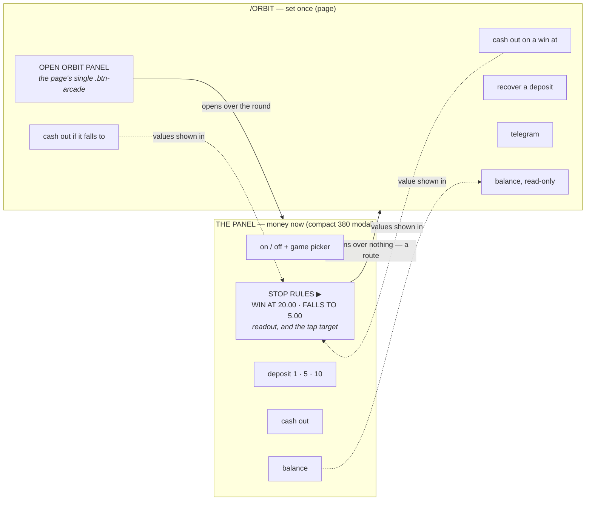
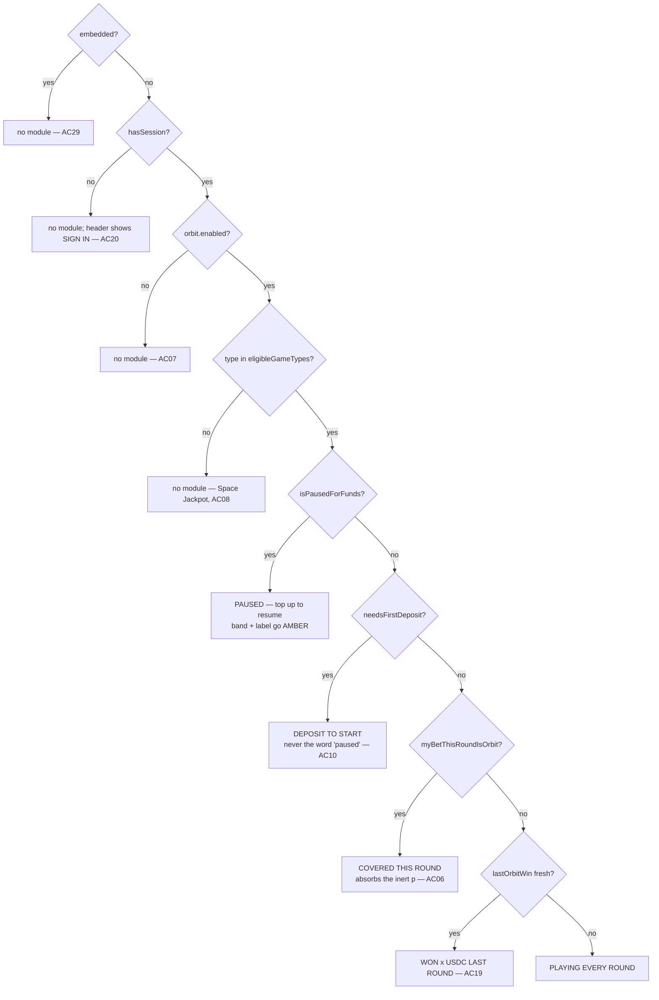

# Space Stroker — "Orbit UI/UX overhaul" — Implementation Spec

> **Status: Ready for implementation** — refined via Trello card
> [Orbit UI/UX overhaul (#141)](https://trello.com/c/knC5QbPJ/141-orbit-ui-ux-overhaul) (2026-08-03),
> container bake-off decided the same day (**Option C**). Written against `monkify-front@993261e` /
> `monkify-meta@824d1dd`, read on 2026-08-03.
> Repos affected: **`monkify-front`**, and this doc in **`monkify-meta`**. **No backend change —
> `monkify-backend` gets no branch and no worktree.**
>
> **Purpose:** Orbit ([#121](../features/orbit-custodial-wallet.md) custody →
> [#122](../features/orbit-auto-bet-engine.md) engine → [#123](../features/orbit-notifications.md)
> notifications) shipped functionally complete and visually unfinished: `OrbitModal.vue` is a
> **916-line hand-rolled overlay** that bypasses the shipped design system entirely, and Orbit's
> presence on the game screen is eight scattered touchpoints with no surface that says what it is
> doing right now. This card rebuilds the visual layer onto `ArcadeModal.vue`, splits the surface into
> a **compact 380 modal (money you move now) + an `/orbit` page (rules you set once)**, adds a
> **console-cabinet module** on `/game/play`, gives Orbit an **identity** (one accent, a mark, four
> glyphs), and closes the four flow items — including #121's unmet **AC5** (mobile deeplink sign-in).

---

## 1. Summary

### 1.1 What ships

| Surface | Today | After this card |
| --- | --- | --- |
| `components/orbit/OrbitModal.vue` | 916 lines, own `<Teleport>`, own backdrop (`.orbit-backdrop`), own `window.addEventListener('keydown')`, literal `z-[60]`, `max-w-[520px]`, hardcoded `#0b0b12`, **nine** flat sections in one scroll | a **compact 380 `ArcadeModal variant="grey"`** with **four** things plus a seam row; **zero** shell markup of its own |
| `components/orbit/OrbitFirstWinModal.vue` | 150 lines, own `<Teleport>`, own `bg-black/80`, own X, own Esc, `.first-win-frame` | an **`ArcadeModal variant="black"`**; behaviour (mark-seen, CTA hand-off) untouched |
| Setup / rules / recovery | buried in the modal's scroll | a new **`/orbit` page** — `.arcade-frame .arcade-frame--grey`, one 1000px frame, three bands |
| `/game/play` Orbit presence | an inert `> ORBIT PLACED YOUR BET FOR THIS ROUND.` `<p>`, a `YOU · ORBIT` terminal tag, a header row, a menu item, three toasts, an upsell | **one console-cabinet module** — balance + the one live state + the entrance — that **absorbs** the inert `<p>` |
| Orbit's colour | none — it borrows amber and white/40 | **`--color-orbit: oklch(0.72 0.17 292)`** (+ `-deep`), **identity only** |
| Orbit's icons | none | the **Orbit mark** (one shared asset) + **four Orbit-scoped glyphs**; **no app-wide icon system** |
| The stop rules mid-round | editable in the modal | **readable** in the modal (`STOP RULES` row, both live values), **editable** on `/orbit` — see D10 and the accepted trade-off in §3.1 |
| Mobile deeplink wallet | Orbit is **unusable** — `signMessage.value` is null and `useMobileWallet`'s pending-hop stash has no Orbit purpose | SIGN IN, cash out and disable all survive the hop (#121 **AC5 closed**) |
| `useOrbitRedirect`'s 3 s hop | happens **to** the player | the player can **decline** it; poll cadence and detection logic **untouched** |

### 1.2 The split, in one sentence

**Money now in the panel, rules once on the page.** Neither surface is a dead end: the modal carries
the page's two rule values as a readout, and the page carries the modal's balance read-only plus one
`.btn-arcade` back to it. Whichever one a player opens first, the other one is named on it.

### 1.3 What does NOT change

Every Orbit **behaviour** is preserved exactly (AC32): enable-with-game-prompt, deposit, cash-out,
threshold save/clear, floor save/clear, recover-a-deposit, Telegram link/verify/unlink, disable with
force-cash-out and cool-off. The three #123 toasts fire unchanged (AC19). `useOrbitRedirect`'s **2 s
poll cadence and redirect-detection logic** are untouched (AC28). **`monkify-backend` is diffed
against `main` and has zero changes** (AC33).

---

## 2. Constraints (MANDATORY)

From `../constraints.md` and `../conventions/frontend.md` (full lists there):

- **Worktree-per-repo** (`AGENTS.md` rule 6): work lives in
  `.worktrees/orbit-ui-overhaul/{monkify-front,monkify-meta}`; both shared checkouts stay on `main`.
  Branch `feature/orbit-ui-overhaul`, same name in both repos, pushed to `origin`.
- **Every overlay goes through `ArcadeModal.vue`.** Teleport to `#app` (never `body`), named `z-*`
  scale (never a literal), no consumer-declared `max-width` / `max-height`, no hand-rolled backdrop,
  no per-component Esc listener (`useOverlayStack` owns Esc routing).
- **Every control takes its height from `--ctl-h-sm|md|lg`.** No control derives its height from
  padding. Below 1023px the tokens step themselves up — **no call-site class changes on mobile, ever**.
- **Do not stack Tailwind utilities on an arcade class.** `arcade.css` is imported after
  `@tailwind utilities` at equal specificity and wins. #135 found **six** shipped stacks doing
  nothing. Use the class as-is, use plain Tailwind for a differently-shaped control, or add a
  **modifier in `arcade.css`**.
- **Dither, never blur.** `backdrop-filter`, `blur()`, infinite animations and wide glows are stripped
  under `html.light-graphics`, which `usePerfMode` forces on **every** viewport below `lg`. A
  mobile-only surface *always* runs in that mode.
- **Grey vs black is a rule, not a style.** Orbit modal + `/orbit` page = **grey** (money, and the
  player is doing something). First-win upsell = **black** (unprompted, once-ever, light in tone).
  Reskinning both must not blur that.
- **`constraints.md` §6 survives the copy pass verbatim in effect.** A forged session, an unknown
  nonce and a missing session stay **indistinguishable**; ordinary-state refusals stay **clear**.
- **Secrets/config:** mock/placeholder values only. (No config file is touched by this card.)
- **The console module is a documented design-system exception** — game-screen furniture, built in the
  cabinet language (metal bezel / rivets / CRT), *not* `.btn-dialog` / `.input-arcade` /
  `.arcade-frame`. It joins the named-exceptions list in `conventions/frontend.md` beside
  `GameTerminal`, `GameConsole`, the lever, Edson and the docked side panel.
- **Tests:** frontend-only, and a UI overhaul of an **existing** feature ⇒ **no integration test is
  possible or required** under `AGENTS.md` rule 8. Recorded here explicitly so it is not
  re-litigated. See §11.
- **Design workflow** (`conventions/frontend.md`): the two attached artifacts are the design source of
  truth and **outrank this spec's prose on design**; **copy comes from the card's decisions and from
  §7.10 below**. Run the `impeccable` skill and screenshot-compare at desktop **and** phone widths
  before hand-off.

---

## 3. Resolved product decisions

| # | Decision |
| --- | --- |
| D1 | **Container = Option C.** A **compact 380** modal for money you touch mid-round (on/off + game picker, balance, deposit, cash out, the STOP RULES seam row) **plus a new `/orbit` page** for setup, rules and recovery. Both on the grey panel material, one control scale, no blur, no glow. Rejected: **A** (one big modal), **B** (page-only — topping up mid-round would mean leaving the round), **D** (reskin only — answers one of four asks). |
| D2 | **Game-screen trigger = ONE console-cabinet module.** Rejected: a CHAT-style right-edge dock rail (desktop-only; STATS/FAIR were deliberately moved *out* of that area), and state-triggered entry points scattered elsewhere. |
| D3 | **The module shows balance + the ONE live state + an entrance.** Click opens the modal. **No inline money action** in the console: a mis-tap beside the bet lever spends real USDC, and every deposit guard (`canDeposit`, cool-off, self-deposit, enable-first) would have to be reproduced in a space too small to explain them. |
| D4 | **The module renders ONLY for enrolled+enabled players, and ONLY on Orbit-eligible game types.** Orbit cannot play lotteries — `AllowOrbit` is seeded false for **Space Jackpot** — so a module there would advertise something that cannot happen. Discovery stays owned by the first-win upsell and the header row. |
| D5 | **The module ABSORBS the inert `> ORBIT PLACED YOUR BET FOR THIS ROUND.` line** in **both** `GameConsole` branches. "Covered this round" becomes a **state of the module**, not a separate dead `<p>`. |
| D6 | **Orbit gets its own accent: `--color-orbit: oklch(0.72 0.17 292)`**, a knowing exception beside `GameTypeCard`'s three-way archetype accent. 6.1:1 on `--color-surface`, 10.4:1 on the cabinet's near-black, **flat, no glow**. `--color-orbit-deep: oklch(0.5 0.13 292)` for hairlines. Rejected: **cyan** (the scarce one-per-grey-panel accent, the black panel's frame, and Beast Mode's archetype accent — and the module renders inside Beast Mode); **magenta** (means *lottery*, the one thing Orbit cannot do); **amber only** (leaves the whole identity ask on the mark). |
| D6.1 | **Violet is identity ONLY** — the mark, the balance figure's marker, the ownership of a rule. Hover, focus, control borders and **every primary action stay amber**; the focus ring stays the single **cyan** element. When Orbit **pauses**, the band and label go **amber**, because then the state is a call to act, not an identity. The **one** exception: the not-yet-enabled picker prompt takes a violet border — Orbit asking a question about itself. |
| D7 | **Icons: the Orbit MARK first, then 4 action glyphs**, Orbit-scoped. The app has no icon system (two SVG assets + inline `<svg>` in five components), so whatever ships becomes the precedent — which is why it stays scoped. Rejected: seeding an app-wide icon system off one feature (the dangling-rule condition #124 was filed to fix). |
| D8 | **The header `ORBIT` row STAYS on every route**, visually subordinate to the module. Hiding it on `/game/play` was rejected: the module only renders for enrolled players on eligible types, so signed-out, not-enrolled and Space Jackpot players would lose the `SIGN IN` affordance to the ☰ menu, and header chrome that appears/disappears by route reads as a bug. ⚠️ Two live renderings of one balance now exist and Orbit's balance **moves without the player acting**, so both must read **one module-level state** and never refresh independently. |
| D9 | **All three toasts stay; the module additionally carries `paused` and the last win AS STATE.** The toasts are page-independent by design and #123 behaviour is preserved untouched. This is not duplication — the toast says *"it happened"*, the module says *"it is true"*. Suppressing toasts conditionally on module visibility was rejected as coupling that goes stale. |
| D10 | **Density: group and re-weight FIRST; no `ADVANCED` flap is needed under Option C.** The C split already removes the density problem. ⚠️ **Amended — see §3.1.** The floor is never *hidden*, but its **edit** moves off the round; the mitigation is **mandatory, not decorative**. Rejected: tabs inside the container, and a persistent SIMPLE/ADVANCED mode switch. |
| D11 | **All four flow items are IN scope:** reskin `OrbitFirstWinModal` onto `ArcadeModal variant="black"`; a **copy pass** across all Orbit surfaces; **mobile deeplink sign-in** (closes #121 AC5); **`useOrbitRedirect` navigation becomes cancellable**. |
| D12 | **`/orbit` joins `EMBED_REDIRECT_ROUTES`.** Orbit is hidden entirely when embedded, so a framed player reaching `/orbit` is a leak. It takes `.arcade-frame .arcade-frame--grey`, matching `/game/history`, `/game/stats` and `/responsible-gaming`. |
| D13 | **`/orbit` is NOT an `isPlayerRoute()`** — decided here, per the card's "answer it deliberately". `isPlayerRoute()` in `App.vue` exists solely to boot **display-name preferences** and the name prompt; `/orbit` renders no display name. Its own state (balance, rules, `selfExcluded`, counters) comes from `useOrbit`, which `GameHeader`'s app-wide `effectiveWallet` watcher already hydrates via `loadIfSignedIn` on every route. Adding it would fire a preferences GET and a name prompt on a money page for no gain. Matches `/responsible-gaming` and `/how-to-play`. |
| D14 | **The Orbit modal's open state moves to `useHeaderModals.ts`** (module singleton), because `/orbit`'s `OPEN ORBIT PANEL` button must open the header-owned instance rather than mount a second one with its own backdrop and Esc handler. Same reason the dashboard's quick links and the guide open `settingsOpen` / `fairOpen`. See §7.0 finding **F1**. |
| D15 | **The mobile-deeplink Orbit stash carries an `action` discriminator — `session` \| `cashout` \| `disable`.** ⚠️ Slightly wider than the card's literal wording ("sign-in and the cash-out signature"): **disabling Orbit signs the same `orbit-cashout` message**, so a two-value stash would ship a known-dead disable path on the exact device this item exists to fix. See §7.8. |
| D16 | **Only explicitly player-initiated Orbit actions may hop out to the wallet app.** `ensureSession` has ~10 callers, several of them background (`loadIfSignedIn`, `resumePendingDeposit`, the notification channel). A blanket hop would bounce a deeplink player out to Phantom **on boot**. `ensureSession` gains an explicit opt-in; everything else fails silently as it does today. See §7.0 finding **F5**. |

### 3.1 ⚠️ The accepted trade-off (amends D10) — read before implementing §7.2 and §7.3

Refinement decision #10 said the cash-out **floor** must never be hidden, because the floor exists
precisely because a real player lost money without it (set "cash out at 3", fell 5 → 1 over four
losing rounds, never cashed out, because the threshold only fires on a **win**).

**Option C does not hide it — but it does move its EDIT off the round**, and C's own review says so:

> *"CASH OUT IF IT FALLS TO is the control that protects a player **during** a losing run, and Option
> C is the option that makes them leave the round to change it."*
> *"A stop-loss you can read but not edit mid-round is still a stop-loss you cannot edit mid-round."*

**The mitigation C ships, and which this spec MUST implement — it is the reason C is acceptable at
all:**

1. The modal carries a **`STOP RULES ▶` row stating BOTH live rule values** (`WIN AT 20.00` ·
   `FALLS TO 5.00`). It is a **readout, not a link** — the player learns what lives on the page by
   reading the page's own numbers inside the round.
2. An unset floor renders as a warm-red **`FALLS TO  NOT SET`**, so the exposure is legible from
   inside a live round.
3. **That same row is the tap target** to `/orbit`. A bare `SETTINGS ▸` button was rejected: it would
   teach nothing.
4. On the page, an OFF rule is **drawn, not hidden** — the empty field keeps a warm-red border and
   states the consequence in words.
5. **Rule order is fixed everywhere** — rise on top, balance between, fall underneath — on desktop, on
   phone and in the modal's seam row. Reordering per breakpoint is how a pair stops being a pair.

⚠️ **The residue is real and is being accepted knowingly:** on a phone, a player on a losing run must
leave the round, load a page, set the floor and come back. **If this ever proves wrong in the wild,
the fix is Option A's shape (both rule editors in the modal), not more seam design.** Recorded so a
future agent does not re-derive it.

---

## 4. Identity layer — tokens, the mark, the glyphs

There is **no data model change**: no entity, no column, no migration, no DTO. This section is the
card's equivalent — the new **design tokens and assets** everything else consumes.

### 4.1 The accent tokens — `src/assets/styles/colors.css`

Declared beside the existing accents (`--color-cyan` at line 21, `--color-magenta` at 25,
`--color-live` at 30), with the exception documented in the comment exactly as `--color-live`'s is:

```css
/* — Orbit violet: the custodial wallet's identity. A KNOWING exception to the one-accent rule,
     beside GameTypeCard's three-way archetype accent (conventions/frontend.md → "Named exceptions").
     Hue 292 sits between the surfaces' 280 and magenta's 350, and nowhere near cyan's 205.
     6.1:1 on --color-surface, 10.4:1 on the console cabinet's near-black. FLAT — no glow: every
     phone runs html.light-graphics, which strips one, so a legibility that depended on it would be
     invisible on the device the console module is built for.
     ⚠️ IDENTITY ONLY: the mark, the balance figure's marker, the ownership of a rule. Hover, focus,
     control borders and every primary action stay AMBER; the focus ring stays the single cyan
     element. When Orbit PAUSES the band and label go amber — a call to act is not an identity.
     Cyan was rejected (it is the scarce one-per-grey-panel accent, the black panel's frame, AND
     Beast Mode's archetype accent — and the module renders inside Beast Mode); magenta was rejected
     (it means LOTTERY in GameTypeCard, the one thing Orbit cannot play). */
  --color-orbit: oklch(0.72 0.17 292);
  --color-orbit-deep: oklch(0.5 0.13 292); /* hairlines / rules on the violet-owned blocks */
```

The 13 % tint used for the violet-owned block fills is **not** a token — it is
`color-mix(in oklab, var(--color-orbit) 13%, transparent)` at the call site, matching how
`--color-bg-button` and the `.btn-dialog--active` fill are already written.

**Tailwind exposure:** add `orbit: 'var(--color-orbit)'` and `'orbit-deep'` to `theme.extend.colors`
in `tailwind.config.js` **only if** a call site needs `text-orbit` / `border-orbit`; otherwise use
`text-[color:var(--color-orbit)]`. Prefer the token utility (the file already exposes the other
accents this way) so the two spellings do not drift.

### 4.2 The Orbit mark — `src/components/orbit/OrbitMark.vue` (new)

**One shared component, drawn once (AC15).** The header row, the console module and the modal
titlebar all render *this*; nothing re-inlines the path.

| Property | Value |
| --- | --- |
| Grid | **16px**, 2px pixels — every edge lands on the 2px grid so it stays crisp at 12px |
| Fill | **`currentColor`** — the consumer decides the colour, which is what keeps "violet is identity" enforceable at the call site |
| Shape | a **body inside a stepped orbital path**, with the satellite thickened to a **4px node at the top right** so the path reads directional |
| Shipping sizes | **12** (header row), **14** (modal titlebar), **16** (console module) |
| Not | a wallet, a gear, or a coin |

Props: `size?: number` (default 16), and nothing else — colour comes from `currentColor`, so the
component sets no `fill`/`stroke` colour of its own. `aria-hidden="true"` at every call site; the
adjacent text is the label.

### 4.3 The four action glyphs — `src/components/orbit/OrbitGlyph.vue` (new)

One component, `name: 'deposit' | 'cash-out' | 'win-at' | 'falls-to'`, same 16px/2px grid, shipping
at **16px**. Each pair is **one glyph flipped**:

| Glyph | Shape | Colour |
| --- | --- | --- |
| `deposit` | an arrow **into** a bar | `currentColor` |
| `cash-out` | the same bar, **mirrored** | `currentColor` |
| `win-at` | three columns **rising into a ceiling** | **semantic green** — `--color-live` |
| `falls-to` | three columns **hanging down to a floor** | **semantic warm red** — the `ERR` hue, `oklch(0.8 0.16 25)` |

The two rule glyphs carry **semantic** colour — the same two hues the dialog's `OK`/`ERR` strips
already use — so **nothing is stolen from the accents**: none of the four is amber, cyan or violet.

⚠️ **No app-wide icon system (AC16).** These two components live under `components/orbit/`, are
imported only by Orbit surfaces, and no sprite sheet, `<Icon>` wrapper or registry is introduced.

---

## 5. Configuration

**None.** No env var, no `GeneralSettings`, no seed data, no feature flag. Every state the new UI
renders is already on `GET /orbit` or already computed client-side.

### 5.1 The one derived predicate the new surfaces need

The console module's eligibility test (D4 / AC05 / AC07 / AC08) needs **no new API field**. `AllowOrbit`
already reaches the client as `OrbitState.eligibleGameTypes` (`src/types/orbit.ts:41`), whose `id` is
the same identifier as `ActiveGame.gameTypeId` and `OrbitState.gameParametersId` —
`useOrbitRedirect.ts:60` already matches the two against each other.

```ts
// src/hooks/useOrbit.ts — exported alongside isPausedForFunds / needsFirstDeposit
/**
 * Is `gameTypeId` a type Orbit is allowed to play? Derived from `eligibleGameTypes`, which the
 * backend already builds from GameParameters.AllowOrbit — so there is nothing new to fetch and no
 * new DTO field. Space Jackpot is absent from that list by seed, which is exactly AC08.
 * Returns false while Orbit is unloaded: unknown is not "eligible", and the module must not flash in.
 */
const isOrbitEligibleType = (gameTypeId: string | null | undefined): boolean =>
  !!gameTypeId && !!orbit.value?.eligibleGameTypes.some((type) => type.id === gameTypeId);
```

---

## 6. Backend behaviour

**None (AC33).** No endpoint, DTO, entity, migration, consumer, SignalR contract, rate-limit rule or
config change. `monkify-backend` has **no `feature/orbit-ui-overhaul` branch and no worktree**, and
`git diff main` in that repo must come back empty at review time.

---

## 7. Frontend behaviour (`monkify-front`)

### 7.0 Hidden blockers found in the code — read this first

Every one of these was verified in the live tree and would otherwise be discovered mid-implementation.

**F1 — `isOrbitOpen` is a LOCAL ref, so `/orbit` cannot open the modal.**
`GameHeader.vue:55` declares `const isOrbitOpen = ref(false)`. `settingsOpen` and `fairOpen`, by
contrast, are module singletons in `hooks/useHeaderModals.ts` precisely so other surfaces can open the
header-owned instance. `/orbit`'s `OPEN ORBIT PANEL` button (AC43) has no way to reach a local ref, and
mounting a second `<OrbitModal>` on the page would mean **two backdrops and two Esc handlers**.
**Fix:** move it into `useHeaderModals.ts` as `orbitOpen` + `openOrbit()`, and have `GameHeader`,
the console module and `/orbit` all use that. **D14.**

**F2 — `useFirstWinUpsell`'s "never two modals" guard watches `settingsOpen || fairOpen` only.**
`hooks/useFirstWinUpsell.ts` guards on the two header modals. Once `orbitOpen` is a shared singleton
(F1) it **must** join that guard — otherwise a first win landing while the player has the Orbit panel
open puts an unprompted black modal over an open grey one. (`orbit.value?.enabled` does **not** cover
it: the not-enrolled player with the panel open mid-enable is exactly the collision.)

**F3 — `GameConsole`'s `v-else` branch serves TWO different mounts, not one.**
`GameTerminal.vue:533` renders `<GameConsole v-if="!mobile">` inside the desktop column, and
`GamePage.vue:206` renders `<game-console wide>` inside the **600–1023px** band, which is
aspect-locked (`aspect-[4095/1000]`) and uses `wideSpriteCrop`. The card's "both the desktop and the
mobile branch" is correct about the **branches**, but anything added to the `v-else` branch must be
checked at **both** mounts. The two inert `<p>`s to absorb are at **`GameConsole.vue:341-343`**
(mobile) and **`GameConsole.vue:487-492`** (desktop + wide).

**F4 — `GameConsole` does not import `useOrbit` today, deliberately.**
It reads `myBetThisRoundIsOrbit` from `useGame` (`useGame.ts:198-202`), which is documented as
*"useOrbit is deliberately not consulted, because its session costs a wallet prompt and this has to
work for a player who never signs in"*. Adding the module **does** introduce `useOrbit` into
`GameConsole` — which is correct and does **not** break that rule, because the module only renders
when a session already exists (`hasSession`), and `useOrbit` mints nothing on read. **Do not** call
`ensureSession` or `load` from `GameConsole`; `GameHeader`'s app-wide watcher
(`GameHeader.vue:74-81`) is the only hydration point, which is also what satisfies AC18.

**F5 — `ensureSession` has ~10 callers, several of them background.**
`useOrbit.ts:231` is reached by `load`, `loadIfSignedIn`, `resumePendingDeposit`, `deposit`,
`recoverDeposit`, `cashOut`, `updateSettings` and the three Telegram calls. On a deeplink wallet
`signMessage.value` is null, so today they all throw `'This wallet cannot sign messages.'`. If §7.8
makes `ensureSession` hop out to the wallet app unconditionally, a **deeplink player's boot** —
`loadIfSignedIn` → `ensureSession` — would navigate them into Phantom. **D16:** the hop is opt-in per
call site.

**F6 — `disconnectMobileWallet()` clears four keys; the new Orbit key must join them.**
`useMobileWallet.ts:327-333` removes `SESSION_KEY`, `PENDING_BET_KEY`,
`PENDING_SELF_EXCLUSION_KEY` and `CONNECT_ATTEMPT_KEY`. A new `PENDING_ORBIT_KEY` left out would let a
stale Orbit hop resume against a wallet that is no longer connected.

**F7 — the `kind === 'error'` arm clears only the pending BET.**
`useGame.ts:726-731` calls `clearMobilePendingBet()` and returns. A cancelled Orbit hop would leave
its stash behind — and `MobilePendingSelfExclusion` already has this shape (existing behaviour,
bounded by `STALE_HOP_MS`). Give the Orbit stash the same 5-minute staleness guard `getPendingBet()`
uses (`useMobileWallet.ts:177-184`) rather than widening the error arm, so the fix cannot change
self-exclusion's behaviour.

**F8 — `readSelfExclusionSignature` is already generic.**
`useMobileWallet.ts:312-325` is `parseSignMessageReturn` + base58→base64 and knows nothing about
self-exclusion. **Rename it `readSignedMessageSignature`** and update its one caller
(`useSelfExclusion.ts:163`). ⚠️ **Rename, do not alias** — an alias is how two names for one thing
start drifting (`conventions/frontend.md`, the `.dialog-input` → `.input-arcade` precedent).

**F9 — `thresholdInput` / `floorInput` are `string | number` on purpose.**
`OrbitModal.vue:59-72` documents it: `<input type="number">` makes Vue's `v-model` cast to a number,
so `.trim()` on the raw ref throws and takes the whole SAVE click down. The `/orbit` page inherits
these fields — **carry `thresholdText()` / `floorText()` across verbatim**, do not "clean them up".

**F10 — the mobile console has a hard height floor and `overflow-hidden`.**
`GameConsole.vue:326` is `absolute inset-x-[11%] top-[10%] bottom-[15%] … overflow-hidden`, and
`GamePage.vue` pins the console band so it **never shrinks** (band priority console > terminal >
Edson). The module competes with the visor and the keyboard inside that plate, so on the mobile branch
it must be a **single fixed-height strip** (§7.4.3), not a growable block — and its removal of the
inert `<p>` (which already sits in that column, line 341) buys back most of what it costs.

**F11 — `.orbit-field` scoped CSS exists only because the old modal used bare Tailwind.**
`OrbitModal.vue:891-903` hand-rolls `color-scheme: dark` and `option` colours because
`bg-transparent` left the native `<select>` popup on white. `.input-arcade--select` already owns the
appearance and the gutter; the `option` colouring still has to be carried (the dropdown **list** stays
OS-drawn — documented as unavoidable in `arcade.css`). Keep those two rules, move them to the surface
that still renders a `<select>`.

---

### 7.1 Shared state — `src/hooks/useOrbit.ts`

**No new network call.** Everything below is derived from, or written into, the existing module-level
state — which is what makes AC18 and AC31 true by construction.

| Addition | Shape | Why |
| --- | --- | --- |
| `isOrbitEligibleType(gameTypeId)` | `(string \| null \| undefined) => boolean` | §5.1 — the module's `AllowOrbit` test (AC05/AC07/AC08) |
| `lastOrbitWin` | `ref<OrbitWinNotification \| null>(null)`, module-level | D9 / AC19 — the module renders the last win **as state** beside the toast that announced it |
| `hasCashOutFloor` / `hasCashOutThreshold` | `computed(() => orbit.value?.cashOutFloor !== null)` etc. | the seam row's `NOT SET` (AC38) and the page's warm-red border |
| `stopRules` | `computed(() => ({ threshold, floor }))` | one source for the seam row, the page ladder and the phone layout, so **rule order cannot drift** (AC39) |
| `signOrbitMessage` | gains the deeplink branch | §7.8 |
| `ensureSession(wallet, { allowHop })` | `allowHop` defaults **false** | **D16 / F5** |
| `resumeOrbitDeeplink(params)` | `(URLSearchParams) => Promise<boolean>` | §7.8 |

⚠️ **`lastOrbitWin` lives in `useOrbit.ts`, not in `useOrbitNotifications.ts`** (the card names the
latter). Reason: `useOrbitNotifications` transitively imports `useGameHub` and `useMobileWallet`, and
`GameConsole` must not pull the SignalR hub in to render a label. `useOrbitNotifications` already
imports `useOrbit`, so its `onWin` handler (`useOrbitNotifications.ts:40-57`) simply **writes** the
ref next to the toast it already fires. This also re-scopes it for free: `reset()`
(`useOrbit.ts:172-177`) clears it, so a wallet switch cannot leave the previous wallet's win on screen
(**AC31**).

---

### 7.2 The compact 380 modal — `src/components/orbit/OrbitModal.vue` (rebuilt)

**Deleted outright:** the `<Teleport>` (515), the `fixed inset-0 z-[60]` wrapper (516), the
`.orbit-backdrop` element and its `<style>` rule (519, 906-915), the `max-w-[520px] max-h-[90dvh]
bg-[#0b0b12] border-… rounded-[4px]` panel div (521-523), the `<header>` + its `✕` (524-536), the
`onKeydown` Esc listener (83-85, 509) and its `onMounted` registration. **AC01 / AC03.**

**Shell:**

```vue
<ArcadeModal
  :open="open"
  size="compact"          <!-- 380 desktop; bottom sheet below lg — AC42 -->
  variant="grey"          <!-- money, and the player is doing something -->
  title="ORBIT"
  @close="emit('close')"
>
  <template #titlebar-actions><!-- nothing; the mark rides in the title, see below --></template>
  <template #strip>…</template>   <!-- paused-for-funds and cool-off only -->
  …body…
  <template #footer>…</template>
</ArcadeModal>
```

⚠️ The **mark in the titlebar (AC15)** cannot go in the `title` string. `ArcadeModal`'s grey titlebar
renders `title` inside `.dialog__title`, whose `::before` is the 6px amber square (`arcade.css:227`).
Ship it via the **`titlebar-actions` slot is the wrong side** — instead add a **`titlebar-lead` slot**
to `ArcadeModal.vue`, rendered immediately before `<h2 class="dialog__title">` on the grey variant
only. That is a shell change, so it is a **design-system addition, not a call-site hack**
(`conventions/frontend.md`: *"if a needed primitive is missing, add it to the design system"*). It is
the one violet pixel in the bar (`color: var(--color-orbit)`).

**Body — one reading order, top to bottom.** Four things you would do mid-round, plus the seam:

| # | Band | Content | Controls |
| --- | --- | --- | --- |
| 1 | `ORBIT PLAYS` | the game picker (`<select class="input-arcade input-arcade--select">`) + *"Turning this off cashes your whole balance out to your wallet."* | one `--ctl-h-md` select; the on/off control |
| 2 | `ORBIT BALANCE` | `12.50` **USDC**, tabular-nums, with the **violet marker**; sub-line *"Betting 1.00 a round on Cosmic Sprint."* | none |
| 3 | `DEPOSIT` (glyph) | the `depositOptions` ladder `1 · 5 · 10` + *"Sent from your connected wallet. One approval — no extra signature."* | `.btn-dialog` ×3 at `--ctl-h-md` |
| 4 | `CASH OUT` (glyph) | `CASH OUT 12.50 USDC` | **the only `.btn-dialog--primary` in the box** — the only irreversible money move |
| 5 | **seam** — `SET ONCE — ON THE ORBIT PAGE` | `STOP RULES ▶` with **both** live values: `WIN AT 20.00` · `FALLS TO 5.00`; sub-line *"Telegram · Recover a deposit · Counters"* | the **whole row** is the tap target to `/orbit` (**AC37**) |

**Footer:** `CLOSE` (`.btn-dialog`) + `ORBIT PAGE ▶` — the route out is a **hairline**, so navigation
never outshouts the money.

**Amber is spent once.** `CASH OUT` is the only filled button. Violet appears **only** on the mark,
the balance marker and the `STOP RULES` block's border (**AC40**).

**Geometry:** fits **~600px** with no scrollbar against the shell's 90dvh cap on a 1440×900 desktop
(**AC42**) — that is what 380 buys, and why the rest went to the page. Below `lg` the shell's
`dialog--sheet` treatment takes over: full-width bottom sheet, ~two thirds of the height, **terminal
still running above it** (**AC42**), 44px titlebar and 44px controls straight from the token block, and
dialog type steps 8px → 9px. **No new breakpoint, no per-call-site class.**

#### 7.2.1 The five states

Same shell, same order, different truth. The footer is identical in all five.

| # | State | Predicate | What renders |
| --- | --- | --- | --- |
| 1 | **enabled + funded** | `orbit.enabled && !isPausedForFunds && !needsFirstDeposit` | the table above, as written |
| 2 | **enabled, never funded** | `needsFirstDeposit` (`orbitBetsPlaced === 0`) | balance `0.00` **muted, not alarmed**; deposit row takes the amber and reads `DEPOSIT TO START`; *"Orbit starts the round after your first deposit."*; `CASH OUT — NOTHING IN THERE` disabled; seam: *"Neither is set. Set them before the money is real."* ⚠️ **the word "paused" appears nowhere** (**AC10**) |
| 3 | **paused for funds** | `isPausedForFunds` (`orbitBetsPlaced > 0 && balance < requiredAmount`) | **the one state that earns the full-bleed `ERR` strip**: *"Paused — 0.40 left and a round costs 1.00. Orbit skips rounds until you top up."*; deposit reads `TOP UP TO RESUME`; the band and label go **amber, not violet** (D6.1); seam shows the exposure — `FALLS TO NOT SET` in warm red (**AC09**, **AC40**) |
| 4 | **not yet enabled — picker open** | `pendingEnable` | `ENABLE ORBIT — LET IT PLAY FOR ME` → `WHICH GAME SHOULD ORBIT PLAY?` + `TURN ON`; *"One bet a round, at that game's stake, until you turn it off."*; **the only place violet takes a border** — Orbit asking a question about itself; everything below stays visible at **35 %** so the player already knows the shape of the box they are unlocking; *"Deposits unlock once Orbit is on."* |
| 5 | **cool-off** | `enableLockedUntil` in the future | **`ERR` skin with the tag `WAIT`** (**AC41**) — never a failure word. *"Cooling off until 19:42 UTC."* / *"You turned Orbit off at 19:12 and we sent 12.50 USDC back to your wallet. Deposits and turning it on again are refused for 30 minutes."* Two cells answer the only two questions worth asking: `SENT BACK 12.50 USDC` and `AVAILABLE AGAIN 19:42 UTC`. Seam: `Kept: WIN AT 20.00 · FALLS TO 5.00` |

⚠️ **State 5 needs an `ArcadeModal` addition too.** `.dialog__strip--err`'s tag is hard-wired to the
string a consumer passes into `.dialog__strip-tag`, so `WAIT` needs no CSS change — but the tag must
be **authored as `WAIT`**, not `ERR`, at that call site. Tagging a deliberate safety hold as a failure
would be a lie.

⚠️ **What LEAVES the modal** (moves to `/orbit`): the two rule editors, recover-a-deposit, Telegram,
and the `WON VIA ORBIT` / `ORBIT BETS` counters. Their *values* stay visible in the modal only through
the seam row.

---

### 7.3 The `/orbit` page — `src/pages/OrbitPage.vue` (new)

`.arcade-frame .arcade-frame--grey`, **one 1000px frame**, **three bands of different shapes** so it
never reads as the modal at double width. Same fill and hairline as `/game/history`; **no sunken bars,
because it is a page**.

**Desktop (1440), in order:**

1. **Header** — the mark + `ORBIT`, then *"Your balance is held by the house and plays one bet a round
   for you. Set the rules that take the money back out."*, with `◀ BACK TO GAME`.
2. **Band A — `ORBIT BALANCE — READ ONLY`** — a hairline-grid readout strip (`.dialog-cells`):
   `12.50 USDC` with the violet marker · *"Playing Cosmic Sprint · 1.00 a round"* · `WON VIA ORBIT
   4.25 USDC` · `ORBIT BETS 17`. Footnote: *"Deposits and cash-outs stay in the Orbit panel, so you
   can use them without leaving a round."* The strip's last cell is **`OPEN ORBIT PANEL`** — **the
   page's single `.btn-arcade`**, sharing its row with nothing (**AC43**).
3. **Band B — `STOP RULES — BOTH DIRECTIONS`** — one framed pair with its own titlebar. *"One rule
   catches a rise. The other catches a fall. They are not alternatives — set both."*
   - **The ladder is the argument**, and the **only** thing on the page **drawn** rather than written:
     ceiling `20.00` · `NOW 12.50` · floor `5.00`. An OFF rule leaves a **visibly open end**.
   - `CASH OUT ON A WIN AT` (glyph `win-at`) — `.input-arcade` + `SAVE` + `OFF`; *"Orbit sends your
     balance to your wallet as soon as a win takes it to 20.00."*
   - `CASH OUT IF IT FALLS TO` (glyph `falls-to`) — same three controls; *"Orbit stops and sends what
     is left to your wallet if a bet takes your balance down to 5.00."*
   - `WHY BOTH` — *"A rule that fires on a win cannot catch a fall. With only the top rule set, a
     balance sliding to zero is never stopped."*
   - ⚠️ **Order is fixed: rise on top, balance between, fall underneath** — desktop, phone and the
     modal's seam row (**AC39**).
   - ⚠️ **An OFF rule is drawn, not hidden**: the empty field keeps a **warm-red border**, placeholder
     `Off — min 1`, and states the consequence in words — *"OFF — nothing stops Orbit if your balance
     falls."* (**AC38**)
4. **Band C — two equal cards:**
   - `RECOVER A DEPOSIT` — *"Sent a deposit that never showed up? Paste its transaction signature."* +
     the amount select + `RECOVER`; *"We check it on-chain before crediting. Nothing is credited
     twice."*
   - `TELEGRAM` — three states carried over verbatim: **not linked** (*"Link Telegram and Orbit
     messages you whenever it sends money to your wallet."* → `LINK TELEGRAM`), **linking** (the
     `/start ABCD2345` code, `OPEN TELEGRAM`, `VERIFY`, and the inline retry hint), **linked**
     (`UNLINK`). Hidden entirely when `telegramEnabled` is false, exactly as today.
5. **`TURN ORBIT OFF`** — *"Turning Orbit off cashes your whole balance out to your wallet, then locks
   it for 30 minutes."*

**Phone (390):** the ladder **rotates into the gap between the two rule cards**, so the pair stays
adjacent and both stay visible **without a disclosure**. **Section order changes with width:** rules
come **before** Telegram and recovery — the two that matter to money go above the fold, the two
once-a-lifetime chores below it. Every text input is floored at **21px** (`.input-arcade`'s `lg` rung)
so iOS never zooms.

**Why it does not read as padded:** three bands, each a different shape — a hairline-grid readout
strip, one framed pair with its own titlebar, then two equal cards. The page never repeats the modal's
single column at double width.

**Guards (AC29/AC30/AC20):** when `isEmbedded`, the route never mounts (D12, §7.7). When Orbit is not
configured or there is no session, the page shows the same `SIGN IN` affordance the header row does —
never a zero — and no rule editor.

---

### 7.4 The console module — `src/components/orbit/OrbitConsoleModule.vue` (new)

**Cabinet furniture, and a *documented* design-system exception (AC11).** Built in the game screen's
own language — metal bezel, rivets, recessed CRT, the `#5c6a8c` / `#92a1b9` / `#424c6e` palette the
cabinet already uses — and using **none** of `.btn-dialog`, `.input-arcade` or `.arcade-frame`.

#### 7.4.1 When it renders

```ts
const showOrbitModule = computed(
  () =>
    !isEmbedded &&                                    // AC29
    hasSession.value &&                               // AC20 — signed out ⇒ absent
    orbit.value?.enabled === true &&                  // AC07 — not enrolled / disabled ⇒ absent
    isOrbitEligibleType(selectedGame.value?.gameTypeId) // AC08 — Space Jackpot ⇒ absent
);
```

⚠️ Switching **to** an ineligible type must remove the module **without a layout error** (AC08). The
module is a fixed-height strip inside a flex column, so its removal reflows the column and nothing
else — verify at the 600–1023px band, where the console box is aspect-locked (F3).

#### 7.4.2 What it shows — balance + the ONE live state + an entrance

Exactly one state line, resolved in this order (first match wins):

| Order | State | Line | Band |
| --- | --- | --- | --- |
| 1 | `isPausedForFunds` | *"Paused — top up to resume."* | **amber** (D6.1 — a call to act) |
| 2 | `needsFirstDeposit` | *"Deposit to start."* — **never "paused"** (AC10) | neutral |
| 3 | `myBetThisRoundIsOrbit` | *"Covered this round."* — **the absorbed line** (D5 / AC06) | violet marker |
| 4 | `lastOrbitWin` fresh | *"Won 1.80 USDC last round."* (D9 / AC19) | violet marker |
| 5 | — | *"Playing every round."* | violet marker |

Plus the **balance**, tabular-nums, with the violet marker, and the **mark** (`OrbitMark`, 16px). The
whole module is one button: **click opens the Orbit modal** (`useHeaderModals().openOrbit()`, D14/F1).
**No inline money action** (D3).

#### 7.4.3 Where it goes — both `GameConsole` branches

| Branch | Location | Replaces | Notes |
| --- | --- | --- | --- |
| **mobile** (`v-if="mobile"`) | inside the left plate's flex column, **`GameConsole.vue:341-343`** | the inert `<p>` verbatim | **F10** — a **single fixed-height strip**, never growable. The column is `overflow-hidden` with a hard floor; the removed `<p>` buys back most of the room. The console still never shrinks and the lever stays reachable (**AC12**). No text input is added here, so the 16px floor is untouched. |
| **desktop + wide** (`v-else`) | above the visor in the `w-[30%]` column, **`GameConsole.vue:487-492`** | the inert `<p>` verbatim | **F3** — check **both** mounts: `GameTerminal.vue:533` (desktop column) and `GamePage.vue:206` (`wide`, aspect-locked band). |

After this, `myBetThisRoundIsOrbit` has **no standalone `<p>` consumer left in either branch** (AC06);
`useGame.ts:493` and `:500` still use it for the bet-refusal copy and are untouched.

⚠️ **The module is NOT the discovery surface.** A player who is not enrolled sees nothing here — the
first-win upsell and the header row own discovery (D4).

---

### 7.5 The first-win upsell — `src/components/orbit/OrbitFirstWinModal.vue` (reskinned)

**Deleted:** the `<Teleport>` (45), the `<Transition name="first-win">` and its scoped keyframes
(46, 124-149), the `fixed inset-0 z-[60]` wrapper (47), the `bg-black/80` backdrop (50), the
`.first-win-frame` panel + its `max-h-[90dvh] max-w-[26rem]` (52-54, 120-122), the hand-rolled X
button and its inline `<svg>` (55-71), and the `onKeydown` Esc listener (26-39).

**Shell:** `<ArcadeModal variant="black" size="standard" :dismissible="true" chrome="titlebar">`
(**AC21**). Black is correct here and **must not blur the rule**: unprompted, once-ever, purely to
read, light in tone. **The Orbit modal stays grey.**

**Behaviour untouched (AC22):** X, Esc, backdrop **and** the primary CTA all mark it seen, and the CTA
still hands over to the Orbit enable flow. Concretely, `@close` (whatever the reason) routes to
`dismiss()` exactly as the three separate paths do today, and `acceptFirstWinUpsell`
(`GameHeader.vue:97-100`) still dismisses then opens the Orbit modal — now through
`useHeaderModals().openOrbit()`.

The Edson art, the `Nice win!` heading and the two-button stack survive; the buttons come off the
**control-sizing scale** rather than their current bespoke `px-6 py-3.5` / bare text.

⚠️ **F2:** add `orbitOpen` to `useFirstWinUpsell`'s "never two modals" guard in the same change.

---

### 7.6 The header row — `src/components/OrbitBalance.vue`

It **stays on every route** (D8 / **AC17**) and becomes **visually subordinate** to the module on
`/game/play`: the mark leads the row at **12px**, the label and figure stay at 10px, and it carries
**no violet fill and no border of its own** — only the mark and the figure's marker are violet. On
`/game/play` with the module present, the module is the loud one; the header row is a readout.

**Signed out it still shows `SIGN IN`, never `0`** (**AC20**) — the balance is genuinely unreadable
without ownership proof.

**AC18 is structural, not a rule to remember:** both surfaces call `useOrbit()`, whose state is
module-level, and **only** `GameHeader.vue:74-81` hydrates it. Neither the module nor the page may
call `load` / `refreshQuietly` on its own — a second refresh path is exactly how the two numbers would
disagree while `refreshQuietly` moves the balance without the player acting.

`@open` / `@sign-in` both route to `useHeaderModals().openOrbit()`.

---

### 7.7 Routing and embed

**`src/routes.ts`** — a new record after `ResponsibleGaming`:

```ts
// The Orbit page: setup, the two stop rules, recovery and Telegram. The MODAL keeps the money you
// move mid-round (deposit / cash out) — see specs/orbit-ui-overhaul.md §3.1 for why the split is
// drawn where it is, and why the modal still shows this page's two rule values.
// Deliberately NOT an isPlayerRoute() in App.vue: it renders no display name, so booting player
// preferences for it is wasted work — its own state comes from useOrbit, which GameHeader hydrates
// app-wide. Embedded loads redirect to the lobby (main.ts): a framed player reaching a custody
// surface is a leak, and Orbit is hidden in a frame by construction rather than by remembering to
// hide a link.
{
  name: 'Orbit',
  path: '/orbit',
  component: require('@/pages/OrbitPage.vue').default,
},
```

**`src/main.ts:79`** — `'Orbit'` joins `EMBED_REDIRECT_ROUTES` (**D12 / AC29**):

```ts
const EMBED_REDIRECT_ROUTES = new Set(['Home', 'HowToPlay', 'ResponsibleGaming', 'Practice', 'Orbit']);
```

**`src/App.vue:200-205`** — `isPlayerRoute()` is **unchanged** (**D13**).

**Navigate by route name, never by literal path** — `{ name: 'Orbit' }` from the modal's seam row, the
modal footer and the ☰ menu.

⚠️ **The ☰ menu's `Orbit` row** (`GameHeader.vue:356-362`) currently opens the modal. It keeps doing
so — the modal is still where the money is, and the page is one tap further via the seam row. Leaving
it as a modal opener also keeps the menu's shape unchanged for a not-enrolled player.

---

### 7.8 Mobile deeplink sign-in — closing #121's AC5

**Today Orbit is unusable on a deeplink wallet.** `useOrbit.signOrbitMessage` (`useOrbit.ts:219-224`)
reads `signMessage.value` from `solana-wallets-vue`, which is **null** when the wallet connected via
the deeplink protocol — so `ensureSession` throws `'This wallet cannot sign messages.'` and there is no
route to a session at all. The mechanism that fixes it already exists for self-exclusion; it is
**per-purpose**, and Orbit has no purpose in it.

#### 7.8.1 The stash

`src/types/mobileWallet.ts` — a new interface, modelled on `MobilePendingSelfExclusion`:

```ts
/**
 * An Orbit action waiting on its signature from the wallet app. The nonce is carried across the hop
 * because it is single-use server-side: re-fetching one on return would invalidate the signature the
 * player just produced.
 *
 * ⚠️ `action` is REQUIRED, not cosmetic. Orbit signs TWO different messages — `orbit-session` for
 * SIGN IN and `orbit-cashout` for a withdrawal — and DISABLING Orbit signs the cash-out message too,
 * because turning it off forces a cash-out. Three completions, one signature shape.
 */
export interface MobilePendingOrbit {
  walletApp: WalletApp;
  wallet: string;
  action: 'session' | 'cashout' | 'disable';
  nonce: string;
  createdAt: number;
}
```

`src/hooks/useMobileWallet.ts`:

- `const PENDING_ORBIT_KEY = 'swMobileWalletPendingOrbit';` — **a distinct key.** ⚠️ The card's own
  warning: *"a wrong stash key here breaks the bet hop, which is the money path."*
- `signMobileOrbit(session, pending, message)` — mirrors `signMobileSelfExclusion`
  (`useMobileWallet.ts:285-301`): write the stash, `stashReturnTo()`, `window.location.replace(buildSignMessageDeeplink(...))`.
- `getPendingOrbit()` — with the **`STALE_HOP_MS` (5 min) guard** `getPendingBet()` uses (**F7**), not
  the bare read `getPendingSelfExclusion()` does.
- `clearPendingOrbit()`.
- **`readSelfExclusionSignature` → `readSignedMessageSignature`** (**F8**), one caller updated.
- **`disconnectMobileWallet()` also removes `PENDING_ORBIT_KEY`** (**F6**).

#### 7.8.2 The hop

`useOrbit.signOrbitMessage` gains the branch — the shape `useSelfExclusion.exclude` already uses
(`useSelfExclusion.ts:130-152`, returning `'hopped' | 'submitted'`):

```ts
// A deeplink wallet has no in-page signMessage. Stash what this signature is FOR and hop out; the
// return lands on resumeOrbitDeeplink(). Anything that reaches here has been asked for explicitly —
// see ensureSession's `allowHop`, which is false everywhere else.
```

**D16 / F5 — `ensureSession(wallet, { allowHop = false })`.** `allowHop: true` is passed by **exactly
three** entry points, all of them a deliberate press:

| Entry point | Action | Message |
| --- | --- | --- |
| `OrbitBalance`'s `SIGN IN` → `load(wallet, { allowHop: true })` | `session` | `orbit-session` |
| `cashOut(wallet)` | `cashout` | `orbit-cashout` |
| `updateSettings(wallet, { enabled: false })` | `disable` | `orbit-cashout` |

Everything else — `loadIfSignedIn`, `resumePendingDeposit`, `deposit`, `recoverDeposit`, the three
Telegram calls, the notification channel — keeps today's behaviour: no session, no hop, fail quietly.
⚠️ **A deposit never needs a signature at all** (the on-chain transfer is the proof), so it must not
hop; it already hops via `sendToken`'s own path.

#### 7.8.3 The return

`useGame.handleMobileDeeplinkReturn` (`useGame.ts:710-748`) — insert a **third arm** in the
`kind === 'sign'` chain, **after** self-exclusion and **before** the bet:

```ts
// kind === 'sign' covers signAllTransactions (a bet) and signMessage (a self-exclusion, and now an
// Orbit action) — the wallet returns the same shape for each, so what we stashed before leaving is
// the only thing that tells them apart. Each arm is a no-op unless its OWN stash is present, and the
// bet is deliberately last: it is the money path, and a wrong `true` above it would drop a paid bet.
try {
  if (await useSelfExclusion().resumeFromDeeplink(params)) { … }
} catch { … }

try {
  if (await useOrbit().resumeOrbitDeeplink(params)) {
    stripParams();
    return consumeReturnTo();
  }
} catch {
  // The Orbit action could not be completed; fall through rather than stranding the return hop.
}
```

`resumeOrbitDeeplink(params)` in `useOrbit.ts`:

1. `getPendingOrbit()` → `null` ⇒ **return `false` immediately** (this is what protects the bet hop —
   **AC27**).
2. `clearPendingOrbit()`, then `readSignedMessageSignature(params)` → `null` ⇒ return `false`.
3. Dispatch on `action`:
   - `session` → `orbitService.createOrbitSession(wallet, nonce, signature)` → `storeSession` → `load`.
   - `cashout` → `orbitService.requestOrbitCashOut(token, nonce, signature)` → `refreshQuietly`.
   - `disable` → `orbitService.patchOrbitSettings(token, { enabled: false, nonce, signature })` →
     the same disable toast the in-page path fires (`OrbitModal.vue:345-349`).
4. Return `true`.

⚠️ **Verifiable only on a physical phone** (**AC26**), and the `/responsible-gaming` deeplink return
has never been run on one either — exercise **both**, plus a bet hop (**AC27**), in the same session.

---

### 7.9 Cancellable redirect — `src/hooks/useOrbitRedirect.ts`

**Untouched (AC28):** `POLL_INTERVAL_MS = 2000`, `POLL_TIMEOUT_MS = 45000`, `findOrbitRound`,
`followOrbit`, the `Ended` watcher and the `onUnmounted` cancel. Their cost is a separate follow-up
card and is explicitly out of scope.

**Changed:** the announcement in `follow()` (`useOrbitRedirect.ts:76-78`) stops being a bare
`toast.info(string)` and becomes a toast that **carries the decline control**:

```ts
// The 3s window is the decline window. The toast — not the console module — carries STAY HERE,
// because the module renders only for an enrolled player on an Orbit-eligible type, and this fires
// exactly when the player is watching a DIFFERENT type (Space Jackpot included), where there is no
// module on screen to put a button in.
let declined = false;
toast.info(
  h(OrbitRedirectToast, { gameName: type.name, onStay: () => (declined = true) }),
  { autoClose: REDIRECT_DELAY_MS, closeOnClick: false }
);

await sleep(REDIRECT_DELAY_MS);
if (cancelled || declined) return;   // declining cancels the navigation
```

`vue3-toastify@0.2.8`'s `Content` type is `string | VNode | ((props) => VNode) | DefineComponent`, so a
`h()`-built VNode is a supported first-class content value — no new dependency.

**`src/components/orbit/OrbitRedirectToast.vue` (new):** *"Orbit placed a bet for you on {game}.
Taking you there…"* + a `STAY HERE` text button. Nothing else — a toast is not a dialog.

⚠️ **Closing the toast is NOT declining.** Only pressing `STAY HERE` sets `declined`; dismissing a
toast reads as acknowledging, and silently cancelling a redirect on dismissal would strand a player on
a dead round while their money rides on a live one — the exact failure `useOrbitRedirect` exists to
fix. Hence `closeOnClick: false`.

---

### 7.10 The copy pass

**⚠️ No money-meaning may be shortened away.** Three things must survive verbatim in effect:

1. **`constraints.md` §6's vague/clear split (AC23).** A **forged session, an unknown nonce and a
   missing session stay indistinguishable**. The ordinary-state refusals stay **clear and name their
   reason**: *already cashed out today*, *below the minimum cash-out*, *"we haven't seen your `/start`
   yet"*, *deposit refused while Orbit is off*, *deposit refused during the cool-off*. ⚠️ The copy pass
   must not flip a vague refusal to clear, **or a clear one to vague** — both directions are defects.
2. **Threshold vs floor (AC24).** The two state **opposite** conditions and neither explanation may be
   shortened into the other:
   - *"Orbit sends your balance to your wallet as soon as **a win takes it to** 20.00."*
   - *"Orbit stops and sends what is left to your wallet if **a bet takes your balance down to** 5.00."*
3. **"Turning this off cashes your whole balance out to your wallet."** — the single most consequential
   sentence in the feature. It appears on the modal's on/off band **and** above `TURN ORBIT OFF` on
   `/orbit`.

**Cool-off is a fact with a time, not a fault (AC41).** *"Cooling off until 19:42 UTC. You turned
Orbit off at 19:12 and we sent 12.50 USDC back to your wallet. Deposits and turning it on again are
refused for 30 minutes."* Tag `WAIT`.

**"Paused" is reserved.** It may appear **only** when `isPausedForFunds` is true — i.e.
`orbitBetsPlaced > 0`. A freshly enabled Orbit is **unfunded**, not paused (**AC10**), and
`needsFirstDeposit` copy is an invitation.

**Switching to an ineligible type must read as deliberate, not broken (AC08).** When the module
disappears on Space Jackpot the surrounding copy carries the reason — the terminal already names the
type, and the header row stays put.

⚠️ **Where a mockup's wording conflicts with this section or with the card's decisions, this card's
copy wins** (**AC35**, and `conventions/frontend.md` → Design workflow).

---

## 8. Flow diagrams

### 8.1 The seam — neither surface is a dead end



### 8.2 The console module's one live state



### 8.3 Mobile deeplink — the three-arm return

```mermaid
sequenceDiagram
  participant P as Player (mobile browser)
  participant A as App
  participant W as Wallet app
  P->>A: SIGN IN (Orbit)
  A->>A: GET /players/nonce?purpose=orbit-session
  A->>A: writePendingOrbit({action:'session', nonce})<br/>stashReturnTo()
  A->>W: signMessage deeplink (location.replace)
  W-->>A: return ?data&nonce (SPA reloads)
  A->>A: detectDeeplinkReturn ⇒ 'sign'
  A->>A: 1. selfExclusion.resumeFromDeeplink → false (no stash)
  A->>A: 2. orbit.resumeOrbitDeeplink → PENDING_ORBIT present
  A->>A: POST /orbit/session (nonce + signature) → store, load
  A-->>P: balance loads; back to the game (consumeReturnTo)
  Note over A: 3. the BET arm is never reached — it is last<br/>on purpose, and each arm no-ops without its own stash
```

---

## 9. Out of scope

- **All backend work** — no endpoint, DTO, entity, migration, consumer, SignalR contract or config.
- The admin `AllowOrbit` checkbox (`components/admin/GameTypeForm.vue`) and `/admin` generally.
- **An app-wide icon system** — the glyph set stays Orbit-scoped (D7).
- Orbit on lottery types — the engine excludes them by design.
- **`useOrbitRedirect`'s 2 s poll cadence** — a known, earmarked follow-up card; only the navigation
  becomes cancellable here.
- The committed **devnet keypair** in config (deliberate, user-authorised; production overrides it).
- Web Push, Telegram for wins, email/SMS.
- Bringing `/admin`'s `.admin-input` onto the control scale (its own card).

---

## 10. File checklist

### 10.1 Backend (`monkify-backend`)

**None.** No branch, no worktree, no diff (AC33).

### 10.2 Frontend (`monkify-front`)

| # | File | Change |
| --- | --- | --- |
| 1 | `src/assets/styles/colors.css` | **+** `--color-orbit` / `--color-orbit-deep` beside the existing accents, with the one-accent-exception comment (§4.1) |
| 2 | `tailwind.config.js` | **+** `orbit` / `orbit-deep` in `theme.extend.colors` (only if a call site needs the utility form) |
| 3 | `src/components/orbit/OrbitMark.vue` | **NEW** — the shared 16px-grid mark, `currentColor`, sizes 12/14/16 (§4.2, AC15) |
| 4 | `src/components/orbit/OrbitGlyph.vue` | **NEW** — the four action glyphs; the two rule glyphs carry semantic green / warm red (§4.3, AC16) |
| 5 | `src/components/ui/ArcadeModal.vue` | **+** a `titlebar-lead` slot before `.dialog__title` on the grey variant, so the Orbit mark rides in the bar without a call-site hack (§7.2) |
| 6 | `src/components/orbit/OrbitModal.vue` | **REBUILT** — compact 380 `ArcadeModal variant="grey"`, five states, the `STOP RULES` seam row; **deletes** its Teleport, backdrop, titlebar, Esc listener, `z-[60]`, `max-w`, `#0b0b12` and `.orbit-backdrop` (§7.2, AC01-04, AC37-42) |
| 7 | `src/components/orbit/OrbitFirstWinModal.vue` | **RESKINNED** onto `ArcadeModal variant="black"`; behaviour untouched (§7.5, AC21-22) |
| 8 | `src/components/orbit/OrbitConsoleModule.vue` | **NEW** — cabinet-language module: balance + one live state + the entrance (§7.4, AC05-13) |
| 9 | `src/components/orbit/OrbitRedirectToast.vue` | **NEW** — the announcement plus `STAY HERE` (§7.9, AC28) |
| 10 | `src/pages/OrbitPage.vue` | **NEW** — `.arcade-frame .arcade-frame--grey`, three bands, the drawn ladder (§7.3, AC38-39, AC43) |
| 11 | `src/routes.ts` | **+** the `Orbit` route with the comment block from §7.7 |
| 12 | `src/main.ts` | **+** `'Orbit'` in `EMBED_REDIRECT_ROUTES` (line 79) — AC29 |
| 13 | `src/hooks/useHeaderModals.ts` | **+** `orbitOpen` + `openOrbit()` (F1 / D14) |
| 14 | `src/components/GameHeader.vue` | local `isOrbitOpen` → `useHeaderModals().orbitOpen`; `openOrbit` delegates; the ☰ row and `acceptFirstWinUpsell` follow |
| 15 | `src/components/OrbitBalance.vue` | subordinate readout: the mark at 12px, no violet fill/border, `SIGN IN` unchanged (§7.6, AC17/AC20) |
| 16 | `src/components/game/GameConsole.vue` | **−** both inert `> ORBIT PLACED YOUR BET FOR THIS ROUND.` `<p>`s (341-343, 487-492); **+** `<OrbitConsoleModule>` in both branches (§7.4.3, AC06) |
| 17 | `src/hooks/useOrbit.ts` | **+** `isOrbitEligibleType`, `lastOrbitWin`, `stopRules`, `resumeOrbitDeeplink`; `ensureSession(wallet, { allowHop })`; the deeplink branch in `signOrbitMessage` (§7.1, §7.8, D16) |
| 18 | `src/hooks/useOrbitNotifications.ts` | `onWin` **writes `lastOrbitWin`** beside the toast it already fires; the toast itself is unchanged (D9 / AC19) |
| 19 | `src/hooks/useOrbitRedirect.ts` | the announcement becomes a VNode toast carrying `STAY HERE`; `declined` cancels the navigation. **Cadence and detection untouched** (§7.9, AC28) |
| 20 | `src/hooks/useMobileWallet.ts` | **+** `PENDING_ORBIT_KEY`, `signMobileOrbit`, `getPendingOrbit` (with the `STALE_HOP_MS` guard), `clearPendingOrbit`; **rename** `readSelfExclusionSignature` → `readSignedMessageSignature`; add the key to `disconnectMobileWallet` (§7.8, F6-F8) |
| 21 | `src/types/mobileWallet.ts` | **+** `MobilePendingOrbit` with the `action` discriminator (D15) |
| 22 | `src/hooks/useSelfExclusion.ts` | call-site update for the F8 rename — **no behaviour change** (AC27) |
| 23 | `src/hooks/useGame.ts` | **+** the Orbit arm in `handleMobileDeeplinkReturn`'s `'sign'` chain, **after** self-exclusion, **before** the bet (§7.8.3, AC27) |
| 24 | `src/hooks/useFirstWinUpsell.ts` | **+** `orbitOpen` in the "never two modals" guard (F2) |

### 10.3 Meta (`monkify-meta`)

| # | File | Change |
| --- | --- | --- |
| 1 | `specs/orbit-ui-overhaul.md` | **NEW** — this document |
| 2 | `INDEX.md` | **+** a KB-map row for this spec; **Feature currently in flight** updated |
| 3 | `conventions/frontend.md` | **at ship** — record `--color-orbit` beside `GameTypeCard`'s archetype accent in "Named exceptions", the console module as game-page furniture, the `titlebar-lead` slot, and `/orbit` in the routing bullet + `EMBED_REDIRECT_ROUTES` (AC14) |
| 4 | `features/orbit-custodial-wallet.md` | **at ship** — close the two "Known gaps" this card fixes: the design-system gap and **AC5 (mobile deeplink sign-in)** |
| 5 | `features/orbit-auto-bet-engine.md` | **at ship** — the redirect is now declinable |
| 6 | `features/orbit-notifications.md` | **at ship** — the win/pause toasts now have a persistent state counterpart |

---

## 11. Tests

**No unit test project and no integration test — recorded so it is not re-litigated.**

- `monkify-front` ships **no test framework** (no `.spec` / `.test` file in the repo, no runner in
  `package.json`). There is nothing to extend.
- `AGENTS.md` rule 8 / `constraints.md` → "Integration tests are mandatory for every new feature"
  applies to **new features** and is satisfied by `SpaceStroker.Tests.Integration/OrbitFlowTests.cs`,
  which already covers Orbit's happy path end to end. This card is a **visual and interaction-surface
  overhaul of an existing feature** with **zero backend change**, so no new integration test is
  possible (there is no new backend behaviour to drive) or required.
- **The verification bar is therefore §12 + §13**: `yarn lint` and `yarn build` clean (**AC36**), and
  a screenshot comparison against the chosen mockup at desktop **and** phone widths (**AC35**).

⚠️ **`yarn lint` needs uniform CRLF.** The repo is on `core.autocrlf=true`; editing with a tool that
writes LF produces `Insert ␍` prettier failures across the whole file. Fix with `unix2dos`, verify with
`od -c`.

---

## 12. Acceptance criteria

Copied 1:1 from the Trello **Acceptance Criteria** checklist (43 items).

1. **AC01** — Given the Orbit modal is open, when its markup is inspected, then it is rendered by
   `ArcadeModal.vue` (variant grey) and `OrbitModal.vue` declares no `Teleport`, backdrop, titlebar or
   geometry of its own.
2. **AC02** — Given any control inside the Orbit modal, when its computed height is measured, then it
   equals one of `--ctl-h-sm` / `--ctl-h-md` / `--ctl-h-lg` and no control derives its height from
   padding.
3. **AC03** — Given the Orbit modal, when its z-index and width are inspected, then both come from the
   named `z-*` scale and an `ArcadeModal` size token — no literal `z-[60]`, no component-declared
   max-width, no hardcoded `#0b0b12`.
4. **AC04** — Given a viewport running `html.light-graphics` (every phone), when any Orbit surface
   renders, then no `backdrop-filter`, `blur()`, infinite animation or wide glow is applied and the
   overlay backdrop is the 9px dither.
5. **AC05** — Given an enrolled and enabled player on an `AllowOrbit` game type, when `/game/play`
   loads, then the Orbit console module renders showing the Orbit balance, the one current Orbit state,
   and an entrance that opens the Orbit modal.
6. **AC06** — Given Orbit has placed that player's bet for the round, when the console renders, then
   the module shows the "covered this round" state and the standalone
   `> ORBIT PLACED YOUR BET FOR THIS ROUND.` paragraph no longer exists in either the desktop or the
   mobile `GameConsole` branch.
7. **AC07** — Given a player with no Orbit enrolment (or Orbit disabled), when `/game/play` loads, then
   the Orbit console module does not render at all.
8. **AC08** — Given an enrolled player on Space Jackpot (`AllowOrbit` false), when `/game/play` loads,
   then the Orbit console module does not render, and switching to it from an eligible type removes the
   module without any layout error.
9. **AC09** — Given an enrolled player whose Orbit balance no longer covers the type's
   `requiredAmount` and whose `orbitBetsPlaced > 0`, when the module renders, then it shows the
   paused-for-funds state on the game screen.
10. **AC10** — Given a freshly enabled player who has never funded Orbit (`orbitBetsPlaced == 0`), when
    the module renders, then it shows the needs-first-deposit invitation and never uses the word
    "paused".
11. **AC11** — Given the Orbit console module, when its styling is inspected, then it is built in the
    cabinet language (bezel / rivets / CRT, matching the game screen's furniture) and uses none of
    `.btn-dialog`, `.input-arcade` or `.arcade-frame`.
12. **AC12** — Given the module is added to the mobile game screen, when the screen is measured on a
    short viewport, then the console still never shrinks, the lever stays reachable, and any text input
    on that screen remains at or above 16px.
13. **AC13** — Given the new Orbit accent token, when it renders on `--color-surface` (dialog) and on
    the console cabinet's near-black, then it is legible on both and carries no glow it depends on,
    since glows are stripped under light-graphics.
14. **AC14** — Given the Orbit accent is added, when `colors.css` and `conventions/frontend.md` are
    reviewed, then the token is declared beside the existing accents and the exception to the
    one-accent rule is documented alongside `GameTypeCard`'s.
15. **AC15** — Given the header ORBIT row, the console module and the Orbit modal titlebar, when each
    renders, then the Orbit mark is present in all three and is drawn from one shared asset, not
    re-inlined per component.
16. **AC16** — Given the deposit, cash-out, cash-out-at-win and cash-out-floor sections, when they
    render, then each carries its glyph from the Orbit-scoped set on a fixed pixel grid using
    `currentColor`, and no app-wide `Icon` component or sprite system was introduced.
17. **AC17** — Given a connected wallet, Orbit configured and a non-embedded context, when any route
    renders, then the header ORBIT row is present, and on `/game/play` it is visually subordinate to
    the console module rather than competing with it.
18. **AC18** — Given the header row and the console module are both visible, when the Orbit balance
    changes without player action (a win credit, a threshold or floor cash-out), then both read from
    the same module-level state and never display different values.
19. **AC19** — Given an Orbit win, when the notification arrives, then the existing win toast still
    fires unchanged (#123 behaviour) and the module additionally reflects the win as persistent state.
20. **AC20** — Given a signed-out player with no Orbit session, when the header renders, then it shows
    `SIGN IN` and never a zero balance, and the console module does not render.
21. **AC21** — Given the first-win upsell fires, when it renders, then it is an `ArcadeModal` with
    `variant="black"` and `OrbitFirstWinModal.vue` declares no `Teleport`, backdrop, close button or
    z-index of its own — while the Orbit modal itself stays grey.
22. **AC22** — Given the first-win upsell, when it is dismissed by any route (X, Esc, backdrop or the
    primary CTA), then it is marked seen exactly as today and the primary CTA still hands over to the
    Orbit enable flow.
23. **AC23** — Given the copy pass is complete, when the Orbit refusals are reviewed, then a forged
    session, an unknown nonce and a missing session remain indistinguishable to the caller, and the
    ordinary-state refusals (already cashed out today, below the minimum cash-out, no `/start` seen
    yet, deposit refused while off or in cool-off) remain clear and name their reason.
24. **AC24** — Given the copy pass is complete, when the cash-out-at-win and cash-out-floor sections
    are read, then the two still state opposite conditions unambiguously (a win lifting the balance to
    X, versus the balance falling to Y) and neither explanation was shortened into the other.
25. **AC25** — Given any `ADVANCED` flap is introduced, when its contents are inspected, then it holds
    only recover-a-deposit, Telegram and the counters — the cash-out-at-win threshold and the cash-out
    floor are never inside it. *(Under Option C no flap is introduced at all; this AC is satisfied
    vacuously and must stay satisfied if one is added later.)*
26. **AC26** — Given a mobile deeplink wallet (Phantom / Solflare via deeplink, not the in-app
    browser), when the player presses `SIGN IN` on Orbit and returns from the wallet app, then the
    Orbit session is created and the balance loads — closing #121's unmet AC5. **Verified on a physical
    phone.**
27. **AC27** — Given the Orbit purpose is added to `useMobileWallet`'s pending-hop stash, when a bet hop
    and a self-exclusion hop are exercised on a physical phone, then both still complete correctly and
    neither is misread as an Orbit hop.
28. **AC28** — Given Orbit is enabled on a game type other than the one being watched, when the watched
    round ends and the redirect is announced, then the player can decline it and stay on the current
    page, and declining cancels the navigation — while the 2 s poll cadence and the redirect-detection
    logic are unchanged.
29. **AC29** — Given the app is embedded (iframe or `?embed=1`), when any page loads, then no Orbit
    surface renders at all — no console module, no header row, no modal, no first-win upsell, no
    Telegram UI — and the `/orbit` page redirects to the lobby via `EMBED_REDIRECT_ROUTES`.
30. **AC30** — Given a deployment with no Orbit account configured (`IsConfigured` false, e.g. the local
    default), when the app loads, then every Orbit surface hides and nothing errors.
31. **AC31** — Given the player switches wallets with an Orbit surface open, when the switch completes,
    then Orbit state re-scopes to the new wallet and the module, the header row and the modal all show
    the same wallet's numbers — never the previous wallet's.
32. **AC32** — Given every Orbit money flow (enable with game prompt, deposit, cash out, threshold
    save/clear, floor save/clear, recover a deposit, Telegram link/verify/unlink, disable with
    force-cash-out and cool-off), when each is exercised after the redesign, then all behave exactly as
    they did before this card — this is a visual and interaction-surface change, not a behavioural one.
33. **AC33** — Given the card is implemented, when `monkify-backend` is diffed against `main`, then it
    has zero changes — no endpoint, DTO, entity, migration, consumer, SignalR contract or config.
34. **AC34** — Given the winning container design (A or C) is chosen, when the spec is written, then its
    mockups are attached to this card and the spec is written against them — no spec is produced before
    the bake-off is decided. ✅ **Met at spec time:** Option C decided 2026-08-03, both artifacts
    attached, this spec written against C.
35. **AC35** — Given the redesign is complete, when every Orbit surface is screenshot-compared against
    the chosen mockup at both desktop and phone widths, then they match on design; where mockup copy
    conflicts with this card's decisions, this card's copy wins.
36. **AC36** — Given the redesign is complete, when `yarn lint` and `yarn build` are run in
    `monkify-front`, then both pass clean.
37. **AC37** — Given the Orbit modal is open during a live round, when the `STOP RULES` row renders,
    then it states BOTH current rule values (cash-out-on-a-win and cash-out-floor) as a readout, and
    that same row is the tap target to `/orbit` — not a bare "Settings" link.
38. **AC38** — Given the cash-out floor is unset, when the modal's `STOP RULES` row and the `/orbit`
    page's floor field render, then both show the exposure explicitly — a warm-red `NOT SET` in the
    row, and a warm-red-bordered field on the page stating the consequence in words — never a blank or
    an omitted control.
39. **AC39** — Given any surface showing the two stop rules (modal seam row, `/orbit` desktop, `/orbit`
    phone), when they render, then the order is always rise-on-top, balance-between, fall-underneath —
    the pair is never reordered per breakpoint.
40. **AC40** — Given the new `--color-orbit` violet, when every Orbit surface is audited, then violet
    appears ONLY as identity (the mark, the balance marker, the ownership of a rule) and never on a
    hover, focus ring, control border or primary action — amber keeps all four, cyan keeps the focus
    ring — and when Orbit is paused the band and label go amber, not violet.
41. **AC41** — Given the cool-off state, when the modal renders it, then it uses the `ERR` skin with the
    tag `WAIT` (never a failure word) and states it as a fact with a time — where the money went and
    when Orbit is available again — not as an error the player caused.
42. **AC42** — Given the compact 380 modal in its enabled+funded state, when measured on a 1440×900
    desktop, then the body fits without scrolling against the 90dvh cap — a live round is never behind
    a scrollbar — and on a phone the bottom sheet leaves the running terminal visible above it.
43. **AC43** — Given the `/orbit` page, when it renders, then neither surface is a dead end: the page
    carries the balance read-only plus a single `.btn-arcade` back to the Orbit panel, and the modal
    carries the page's two rule values — whichever is opened first names the other.

---

## 13. Manual QA (local Docker stack)

Prerequisites: Docker up, the stack running (`monkify-backend/setup_local_environment.bat` or
`docker compose up -d --build`), `monkify-front` served from the worktree with the hub's `.env.local`
and `yarn.lock` copied in (see `features/dev-qol-stuff.md` and the workspace memory on serving from a
worktree). ⚠️ Orbit is **inert without a configured Orbit account** — if `IsConfigured` is false every
surface hides, which is AC30 but tests nothing else.

**Desktop (1440×900, GPU-rasterizing — `backdrop-filter` traps are invisible on a phone):**

1. `/game/play` on **Cosmic Sprint**, signed out → **no module**, header shows `SIGN IN` (AC20).
2. `SIGN IN` → sign → module appears, balance matches the header exactly (AC05, AC18).
3. Open the panel → measure: **no scrollbar**, 380 wide, `z-modal`, dithered backdrop (AC01-04, AC42).
4. Deposit `1` → header **and** module both move; no second fetch fires (AC18, AC32).
5. Press `STOP RULES ▶` → lands on `/orbit`; set the floor; go back via `OPEN ORBIT PANEL` → the seam
   row shows the new value (AC37, AC43).
6. Clear the floor → seam row shows warm-red `NOT SET`; the page field keeps a warm-red border and
   states the consequence (AC38).
7. Switch the game type to **Space Jackpot** → module disappears, no layout error, header row stays
   (AC08, AC17).
8. Turn Orbit off → forced cash-out toast, cool-off state renders with the **`WAIT`** tag (AC41),
   deposits and re-enable refused with their reasons named (AC23).
9. Switch wallets in the extension with the panel open → every surface re-scopes; the previous wallet's
   numbers never appear (AC31).
10. Audit violet: it appears **only** on the mark, the balance marker and the `STOP RULES` block. No
    hover, no focus ring, no control border, no primary action (AC40).

**Phone (390×844, real device — `light-graphics` is forced here):**

11. Repeat 2-6; the panel is a bottom sheet and the **terminal keeps running above it** (AC42).
12. Focus the bet input → the console does not shrink, the lever stays reachable, no iOS zoom (AC12).
13. **Deeplink wallet (Phantom, NOT the in-app browser):** `SIGN IN` → approve → return → **session
    created and balance loads** (AC26). Then cash out → approve → return → balance zeroes.
14. **Regression, same session:** place a **paid bet** via the deeplink hop, and run a
    **self-exclusion** from `/responsible-gaming`. Both must complete, and neither may be swallowed by
    the Orbit arm (AC27). ⚠️ This is the money path.

**Embedded:** load with `?embed=1` → no module, no header row, no modal, no upsell, no Telegram, and
`/orbit` redirects to the lobby (AC29).

**Redirect:** enable Orbit on Beast Mode, watch Cosmic Sprint to the end → the toast offers
`STAY HERE`; press it → you stay. Repeat and ignore it → you are taken there after 3 s (AC28).

**Finally:** `yarn lint && yarn build` clean (AC36), and screenshot-compare every surface against the
Option C artifact at both widths (AC35).

---

## 14. Trello / pipeline

- **Source card:** [Orbit UI/UX overhaul (#141)](https://trello.com/c/knC5QbPJ/141-orbit-ui-ux-overhaul)
  — list **Specs created**; the **Implementation** block on the card carries the branch, the spec path
  and the worktree.
- **Design source of truth (attached to the card):**
  - ✅ **Chosen —** [Option C design system review](https://claude.ai/code/artifact/6c01827b-629f-45e6-b6ce-b0cd56286c3c)
  - 📎 **Reference only —** [Orbit Modal Rebuild Option A](https://claude.ai/code/artifact/2dc8b0ef-61fe-4eea-a8b6-0abf516d02ef)
    (mined for its modal-band structure, its violet-usage rules and the `WAIT` cool-off tag)
- **Worktree:** `.worktrees/orbit-ui-overhaul/{monkify-front,monkify-meta}`, branch
  `feature/orbit-ui-overhaul` in both, pushed to `origin`.
- **Next:** `/monkify-implement-feature Orbit UI/UX overhaul` — then `/monkify-ship-feature`, which
  syncs §10.3's KB edits on the feature branch before merging.
- **Related:** parents [#121](https://trello.com/c/R4Qe0jxX) ·
  [#122](https://trello.com/c/h7MF4Oky) · [#123](https://trello.com/c/NIH7XFHi); umbrella
  [#118](https://trello.com/c/yxwdNTrb). Design-system parents: #124 (the two panels), #135 (the
  control scale), #134 (the mobile cabinet).

---

## 15. Revision log

| Date | Change |
| --- | --- |
| 2026-08-03 | Initial spec from the refined card + the two 2026-08-03 comments (bake-off decision and the accepted trade-off amending D10), written against the chosen **Option C** artifact and verified against `monkify-front@993261e`. Adds eleven code findings the card did not carry (§7.0), decides `/orbit` is **not** an `isPlayerRoute()` (D13), moves the modal's open state to `useHeaderModals` (D14/F1), and widens the mobile-deeplink stash to a three-value `action` discriminator so **disable** is not shipped dead (D15). |
