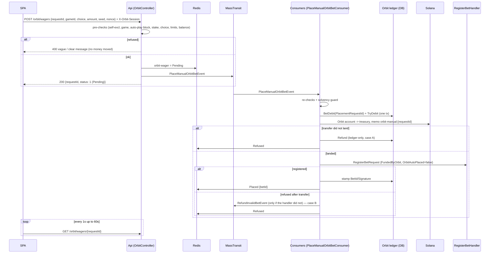

# SpaceStroker — "Orbit Wallet" (manual bets from the Orbit balance) — Implementation Spec

> **Status: Ready for implementation** — refined via Trello card
> [#194 Make orbit your wallet on the game.](https://trello.com/c/AXAtCEcN/194-make-orbit-your-wallet-on-the-game) (2026-09-23).
> Repos affected: `monkify-backend`, `monkify-front`, and this doc in `monkify-meta`.
> Branch / worktree: `feature/orbit-wallet` → `.worktrees/orbit-wallet/<repo>`. Level: **`Feature`**.
>
> **Purpose:** Orbit becomes the player's **in-house wallet**. A player deposits once and then places
> **manual** bets on **any paid game** straight from their Orbit balance — no wallet transaction to sign
> per bet. Wallet-signed bets keep working unchanged, and Orbit **auto-bet** keeps working, but a game
> type Orbit is auto-playing cannot also be played by hand.

---

## 1. Summary

Today the Orbit balance has exactly one spender: the auto-bet engine (`OrbitPlacementPlannerConsumer` →
`PlaceOrbitBetConsumer`), one bet per round, on `AllowOrbit` types only (Cosmic Sprint). This card adds a
second spender — **the player, by hand** — through a new session-gated endpoint whose placement reuses the
engine's proven money path (claim + debit → house-signed custody transfer → ordinary `RegisterBetHandler`
with `FundedByOrbit`).

| Aspect | Wallet bet (unchanged) | Orbit **auto** bet (unchanged, except where noted) | Orbit **manual** bet (new) |
| --- | --- | --- | --- |
| Who decides | Player | Engine, every round | Player |
| Game types | All paid | `AllowOrbit` (Cosmic Sprint) | **All paid** (Cosmic Sprint, Space Jackpot, Hyper Roll) |
| Authorisation | Wallet-signed transfer | Enrolment `Enabled` | **`X-Orbit-Session` only** — no per-bet signature |
| Stake source | Player wallet | Orbit balance | Orbit balance — picked **automatically**: Orbit first when its server balance covers the stake, otherwise the wallet pays; **no toggle** (decision 7) |
| Transfer | Player → treasury (SPA-built) | Orbit account → treasury (house-signed) | Orbit account → treasury (house-signed) |
| Choice | Player | Enrolment word or derived | Player |
| Stake | `RequiredAmount` / Hyper Roll variable | `RequiredAmount` | `RequiredAmount` / **Hyper Roll variable** |
| Seed | Client seed | `DeriveSeed(ServerSeed, playerId)` | **Client seed** (like a wallet bet) |
| Win / refund lands in | Player wallet | Orbit balance | **Orbit balance** |
| Threshold / floor / stop-loss | n/a | Evaluated | **Never evaluated** (decision 9) |
| "Orbit won" private toast | n/a | Fires | **Does not fire** (normal win toast instead) |
| Lottery $STROKE bonus | Yes | No | **Yes** (to the connected wallet) |
| `Bet.FundedByOrbit` | false | true | true |
| `Bet.OrbitAutoPlaced` (new) | false | **true** | false |

**The one new rule for everyone:** while a player's enrolment is `Enabled` on a game type, **every manual
bet** from that player on that type — wallet **and** Orbit — is refused. A **paused** enrolment does not
block.

---

## 2. Constraints (MANDATORY)

From `monkify-meta/constraints.md` (full list there):

- **Worktree-per-repo:** work only in `.worktrees/orbit-wallet/<repo>` on `feature/orbit-wallet`; the hubs
  stay on `main`.
- **Unit tests:** update/add in `SpaceStroker.Tests`; run via `scripts/run_tests.bat` (never the full
  `dotnet test` — `ProductionSessions` is a slow Monte-Carlo suite); **report changed tests** at the end.
- **Integration test (Feature):** mandatory happy-path test in `SpaceStroker.Tests.Integration` (§11.2).
- **EF mapping:** inline in `SpaceStrokerDbContext.OnModelCreating`; no `IEntityTypeConfiguration`.
- **Migrations:** under `SpaceStroker.Infrastructure/Migrations/`; applied only by `SpaceStroker.Consumers`
  at startup.
- **Money moves only in `SpaceStroker.Consumers`** (constraints §8). The API validates and publishes; it
  never signs.
- **NoTracking DbContext:** use `ExecuteUpdate` or a tracked re-query; load-mutate-`SaveChanges` persists
  nothing.
- **Secrets/config:** mock values only in committed files. Never log a session token, key or signature.
- **Vague messaging (§6):** refusals reuse existing vague copy. Two **sanctioned clear messages**, both the
  caller's own state: *insufficient Orbit balance* and *Orbit is auto-playing this game*.
- **Orbit ledger invariant:** `OrbitBalance.Amount == SUM(OrbitTransaction.Amount)` per pool and player,
  all rows, no status filter. Corrections are appended rows, never deletes.
- **`monkify-front` has no test runner:** DoD there is `yarn lint` + `yarn build` + browser QA. Remember
  the worktree `yarn.lock` and CRLF/prettier gotchas.

---

## 3. Resolved product decisions

| # | Decision |
| --- | --- |
| 1 | **Every paid game type** accepts manual Orbit-paid bets. `AllowOrbit` keeps meaning *auto-bet allowed* and is **not** consulted on the manual path. `ComingSoon` / inactive types still refuse. |
| 2 | **Authorisation is the Orbit session alone** (`X-Orbit-Session`, 7-day stateless HMAC), with no per-bet `signMessage`. This deliberately amends Orbit's rule *"money never moves on a session alone"* **for bets only**: cash-outs keep their `orbit-cashout` signature. Accepted risk: a stolen session can gamble the balance but never withdraw it. Self-exclusion is re-checked server-side on every bet. |
| 3 | **Winnings and refunds go back to the Orbit balance** (`WinCredit` / `Refund` rows), as for auto-bets. Cash-out is the way to the wallet. |
| 4 | **No manual + auto on the same game type.** While the enrolment is `Enabled` with `GameParametersId == type`, every manual bet on that type (wallet or Orbit) is refused. A **paused** enrolment does not block. |
| 5 | Manual Orbit bets follow **exactly** the wallet-bet rules: per-round limits, choice exclusivity, `OrbitChoiceClaim` reservations. |
| 6 | **Transport = the engine's path.** Claim + debit → house-signed custody → treasury transfer (memo-distinguished) → `RegisterBetHandler` with `FundedByOrbit`. The house pays gas. The client shows *placing…* until the outcome is known. Ledger-only bets were rejected. |
| 7 | **Automatic source, no user choice** (owner, 2026-09-24 — replaces the 2026-09-23 "Pay from: Wallet / Orbit" switch, which is removed). Every manual bet pays from **Orbit first** when Orbit is usable (`orbitEnabled`, not embedded, not free-bet mode, wallet connected) and its **server** balance covers the stake; **otherwise the wallet pays**. A device that has held an Orbit session for this wallet before but has none now re-mints it with one `signMessage` at bet time; a cancelled sign-in, or a device that never used Orbit, pays from the wallet with no prompt. If Orbit refuses *only* for insufficient balance (a race), the same bet is retried from the wallet. The header pill that will pay is **lit**. The game console carries **no Orbit control or Orbit copy**, so the 2026-08-04 owner call "the game screen has no Orbit entry point" (`GameConsole.vue`) stands again. |
| 8 | **Wallet decoupled from auto-bet.** Deposits no longer need an `OrbitEnrollment`. `/orbit` shows the **Wallet** first and **Auto-bet** as an optional section. The silent auto-commit of the single eligible type is removed. |
| 9 | **Threshold, floor and stop-loss apply to auto-bet settlements only.** A manual win or loss never triggers an automatic cash-out. The UI **says so everywhere these settings appear** (§7.6). |
| 10 | A **manual** Orbit-paid Space Jackpot winner **gets** the 100,000 $STROKE bonus, sent to their connected wallet. Only **auto-placed** bets stay excluded. |
| 11 | The Orbit bet log labels each bet **Manual** or **Auto**. The private "Orbit won" toast fires for **auto** wins only. Telegram cash-out messages are unchanged. |
| 12 | **All checks run before the debit/transfer.** A refusal moves no money. A post-transfer failure is made whole exactly once. Double-submit is guarded by a client idempotency key, and claims are keyed **per request**. |

---

## 4. Data model

### 4.1 `Bet` — new column `OrbitAutoPlaced`

File: `monkify-backend/src/SpaceStroker.Domain/Games/Entities/Bet.cs` (next to `FundedByOrbit`).

```csharp
/// True ONLY for a bet the Orbit ENGINE placed (PlaceOrbitBetConsumer). A manual bet paid from the
/// Orbit balance is FundedByOrbit = true, OrbitAutoPlaced = false. Everything that means "auto-bet"
/// (start gate, house-seed count, stop rules, win toast, $STROKE exclusion, BetDto.ViaOrbit) reads
/// THIS, never FundedByOrbit. FundedByOrbit keeps its one job: skip on-chain validation and route
/// the win/refund to custody.
public bool OrbitAutoPlaced { get; set; }
```

`RegisterBetRequest` gains `public bool OrbitAutoPlaced { get; init; }`. It is internal, never bound from
the body, and copied onto `_bet` next to `FundedByOrbit` (`RegisterBetHandler.cs` ~L119).
`PlaceOrbitBetConsumer.RegisterBet` sets it to `true`. The manual placer leaves it `false`.

### 4.2 `OrbitTransaction` — new column `PlacementRequestId`

File: `monkify-backend/src/SpaceStroker.Domain/Orbit/Entities/OrbitTransaction.cs`.

```csharp
/// The client idempotency key of a MANUAL bet placement. Null on every other row (deposits,
/// cash-outs, auto BetDebits, credits). Set on the manual BetDebit claim row and on its case-A
/// compensation Refund (§6.3). The case-B on-chain refund (RefundToOrbit) does not carry it.
public Guid? PlacementRequestId { get; set; }
```

**Why:** the placement claim is the `BetDebit` row itself. Its uniqueness today is
`(OrbitAccount, MintAddress, PlayerId, GameId)` (`SpaceStrokerDbContext.cs` L417), which allows **one
Orbit debit per player per round**. A free-text round permits a second manual bet once another player has
bet, so that key cannot express manual bets. `GameId` stays set on manual `BetDebit` rows, because
`OrbitLedgerService.ResolveSettledBalance` uses it to add riding stakes back when the auto stop rules
decide.

### 4.3 EF configuration (inline)

In `SpaceStrokerDbContext.OnModelCreating`:

```csharp
// Bet block (~L210)
builder.Property(x => x.OrbitAutoPlaced).IsRequired().HasDefaultValue(false);

// OrbitTransaction block (~L417) — the auto claim keeps "one per player per round", scoped to
// auto rows; manual rows are unique per request instead.
builder.HasIndex(x => new { x.OrbitAccount, x.MintAddress, x.PlayerId, x.GameId })
       .IsUnique()
       .HasFilter("\"PlacementRequestId\" IS NULL");
// The manual claim: one BetDebit (Type 4) per request.
builder.HasIndex(x => x.PlacementRequestId, "IX_OrbitTransactions_PlacementRequestId_BetDebit")
       .IsUnique()
       .HasFilter("\"PlacementRequestId\" IS NOT NULL AND \"Type\" = 4");
// The case-A make-whole: at most one Refund (Type 6) per request, so a concurrent or repeated
// compensation loses on 23505 instead of crediting twice.
builder.HasIndex(x => x.PlacementRequestId, "IX_OrbitTransactions_PlacementRequestId_Refund")
       .IsUnique()
       .HasFilter("\"PlacementRequestId\" IS NOT NULL AND \"Type\" = 6");
```

⚠️ The existing unique index becomes **filtered**. Postgres treats NULLs as distinct, so an unfiltered
composite including `PlacementRequestId` would silently stop protecting the auto claim, and
`PlaceOrbitBetConsumer`'s 23505 → `AlreadyClaimed` path depends on that protection.

⚠️ `PlacementRequestId` has **two** filtered unique indexes, split by `Type`, because the manual
case-A Refund row carries the same request id as the BetDebit it reverses. Both use the **named**
`HasIndex` overload: EF keys an index by its property set, so two bare `HasIndex(x => x.PlacementRequestId)`
calls would configure one index, and the second filter would silently replace the first.

### 4.4 Migration

```bash
# from monkify-backend/src/SpaceStroker.Infrastructure
dotnet ef migrations add AddOrbitManualBets \
  --startup-project ../SpaceStroker.Consumers/SpaceStroker.Consumers.csproj \
  --context SpaceStrokerDbContext
```

The migration must:

1. Add `GameBets.OrbitAutoPlaced boolean NOT NULL DEFAULT false`.
2. **Backfill:** `UPDATE "GameBets" SET "OrbitAutoPlaced" = true WHERE "FundedByOrbit" = true;`. Every
   Orbit-funded bet before this card was engine-placed. Without the backfill, a round open at deploy
   holds its start gate one bet short, and historic auto wins would relabel as Manual.
3. Add `OrbitTransactions.PlacementRequestId uuid NULL`.
4. Drop and recreate the composite unique index with the filter, then create the two filtered
   `PlacementRequestId` unique indexes (BetDebit `Type = 4`, Refund `Type = 6`).

Previous migration: `20260921202859_IncludePlayerIdInReferralCodeIndex`. Both index operations are on
`OrbitTransactions` (small). The `GameBets` column add has a default and one `UPDATE` over `FundedByOrbit`
rows. Neither is a long lock.

⚠️ **`Down()` only works before any player has two manual Orbit bets in one round.** It recreates the
original **unfiltered** unique index on `(OrbitAccount, MintAddress, PlayerId, GameId)`; once a player holds two
`OrbitTransactions` rows for one round (two manual `BetDebit`s — the second-bet rule allows it once someone else
has bet — or a manual stake plus its case-A `Refund`), that `CreateIndex` fails on the duplicates. Rolling back
after that point needs a hand-written data fix first; treat the migration as forward-only once manual bets exist.

---

## 5. Configuration

`SpaceStroker.Common/spacestrokersettings.json`, `IpRateLimiting.GeneralRules`, add:

```json
{ "Endpoint": "post:/orbit/wagers", "Period": "1m", "Limit": 30 },
{ "Endpoint": "get:/orbit/wagers/*", "Period": "1m", "Limit": 120 }
```

⚠️ **The route is `/orbit/wagers`, not `/orbit/bets`, on purpose.** `RateLimitSettingsTests.GeneralRules_NeverCoverTheBetPath`
forbids any rule containing `"/bets"`: the human bet path must never be throttled. This path, though, is
house-signed and house-gassed, so it **is** a spend vector and gets a limit. (`/orbit/history` was routed
away from `/bets` for the same reason.) Match the rule syntax to the existing entries in the file. The
patterns above show intent; copy the file's verb and wildcard convention. Update
`GeneralRules_AreExactlyTheQuotaProtectingPatterns`.

No new secret. No new env var on the backend. Frontend: no new `VUE_APP_*`. The switch rides the
existing `VUE_APP_ORBIT_ENABLED` (`orbitEnabled`).

---

## 6. Backend behaviour

### 6.1 New endpoint — `POST /orbit/wagers` (API, stateless)

`OrbitController` (`SpaceStroker.Api/Controllers/OrbitController.cs`): add `[HttpOptions("wagers")]` to the
OPTIONS list (L34-42) and:

```csharp
[HttpPost("wagers")]
public async Task<IActionResult> PlaceWager([FromBody] PlaceOrbitWagerRequestBody body)
{
    if (RejectWithoutSession(out var wallet)) return NotFoundResult();
    return await ProcessRequest(new PlaceOrbitWagerRequest(wallet!, body));
}

[HttpGet("wagers/{requestId}")]
public async Task<IActionResult> GetWager(Guid requestId)
{
    if (RejectWithoutSession(out var wallet)) return NotFoundResult();
    return await ProcessRequest(new GetOrbitWagerRequest(wallet!, requestId));
}
```

Handler folder `SpaceStroker.Infrastructure/Handlers/Orbit/PlaceOrbitWager/`:

```csharp
public class PlaceOrbitWagerRequestBody
{
    [Required] public Guid? RequestId { get; set; }      // client idempotency key
    [Required] public Guid? GameId { get; set; }         // the round (Hyper Roll: the solo round from POST /games/{type}/boards)
    [Required, MaxLength(20)] public string Choice { get; set; }
    [Required] public decimal? Amount { get; set; }      // must equal RequiredAmount, or be within Hyper Roll's bounds
    [Required, MaxLength(64)] public string Seed { get; set; }  // client seed, exactly as a wallet bet
    public long Nonce { get; set; }
}
```

`PlaceOrbitWagerHandler`: **cheap pre-checks, then publish**. It never signs and never debits. In order:

1. Orbit configured (`IOrbitAccountResolver.IsConfigured`), otherwise `OrbitUnavailable`.
2. Resolve the `Player` by session wallet, otherwise `OrbitRequestInvalid` (vague).
3. **Idempotency:** if a result for `RequestId` exists (§6.4), return it (200) without re-publishing.
4. Self-excluded → `SelfExclusionActive`.
5. Load the game (with `Parameters`, `PresetChoices`, `LotteryParameters`, `BoardChoices`). If it's
   missing, not in `Game.GameAcceptingBets`, `ComingSoon`, or `!Active`, return `GameNotValidForBets`
   (existing vague copy).
6. **Auto-play block (decision 4):** `OrbitEnrollments.Any(PlayerId, Enabled, GameParametersId ==
   game.ParametersId)` → **`ErrorMessages.OrbitAutoPlayActive`** (new, clear, §6.9).
7. **Stake:** a house-edge type must satisfy `RequiredAmount ≤ Amount ≤ MaximumStake` at 9-dp precision
   (the `BetDomainService.HouseEdgeChoiceIsValid` rule). Every other type requires `Amount ==
   RequiredAmount`. Failure → the existing `InvalidAmount` copy.
8. **House-edge board freshness:** if `BoardExpiresAt < UtcNow + 10s`, or the round already has an
   owner/bet, return the existing house-edge "board changed/expired" failure the SPA already handles
   (`useGame.ts:1056-1074`). The async placement takes seconds, and a board expiring mid-flight would
   refuse *after* the transfer.
9. **Choice:** `BetDomainService.ChoiceIsValidForGame` + free-text exclusivity + the `OrbitChoiceClaim`
   check, in the **same** shape `RegisterBetHandler.ValidateBetParameters` uses. Extract a shared read-only
   helper rather than copying. Failure → `ChoiceAlreadyTaken` / the existing validation copy.
10. **Per-round limits** (`OneBetPerPresetRound`, `SecondBetNeedsAnotherPlayer`), same helper, same copy.
11. **Balance:** `OrbitLedgerService.ResolveBalance(player) >= Amount` → otherwise
    **`ErrorMessages.OrbitInsufficientBalance`** (new, clear).
12. Record `Pending` for `RequestId` (§6.4), publish
    `PlaceManualOrbitBetEvent(RequestId, PlayerId, GameId, Choice, Amount, Seed, Nonce)`, and return
    **200** with the Pending result DTO `{ requestId, status: 1, betId: null, message: null }` (the
    codebase's `ProcessRequest` pattern; `status` is **numeric**, like every other Orbit enum). If the
    publish fails, overwrite the stored result with `Refused` (`FailedToRegisterBet`) and refuse the POST
    with that copy (400). No claim exists, so no money moved.

A retried POST with a `RequestId` that already has a stored result returns that result and publishes
nothing (step 3, before self-exclusion).

Everything in 4–11 is **re-checked** by the consumer (§6.2) or by `RegisterBetHandler` itself. The API
pass exists so the common refusal costs no claim, no transfer and no gas.

### 6.2 New consumer — `PlaceManualOrbitBetConsumer` (Consumers)

Folder `SpaceStroker.Infrastructure/Consumers/OrbitBetPlacement/`, on its **own receive endpoint**, so a
burst of manual bets never delays the auto planner (the same reasoning as the planner / house-seed split).

**Refactor first:** extract the claim → transfer → register → make-whole core of `PlaceOrbitBetConsumer`
(L178-228, `ClaimAndDebit`, `TransferStake`, `RegisterBet`, `StampClaim`, `CompensateFailedTransfer`,
`IsLowOnFees`) into an injectable **`OrbitStakePlacer`** (`Services/Orbit/`). The auto consumer keeps its
own planning concerns (gate, `SkipPlacement`/`FailPlacement`, derived choice, enrolment word) and calls
the placer. Behaviour of the auto path must stay **byte-identical** apart from `OrbitAutoPlaced = true`
and the make-whole fix in §6.3.

Manual flow:

1. Load the game and player. Re-check self-exclusion, accepting-bets, `ComingSoon`, the auto-play block,
   and low SOL (`IsLowOnFees`, the pool-aware solvency guard, unchanged). Any failure: **no claim**, record
   `Refused` with the matching vague/clear message, return.
2. `EnsureServerSeedCommitted` (same as auto).
3. **Claim + debit** in one DB transaction: insert `OrbitTransaction { Type = BetDebit, Amount = -Amount,
   GameId, PlacementRequestId = RequestId, Status = Completed }`, then `ledger.TryDebit(playerId,
   Amount)`. A 23505 on the `PlacementRequestId` index means the request was already claimed: return
   without touching the result (a duplicate POST whose twin claimed first; `BaseConsumer` swallows
   exceptions, so there is no redelivery). Step 1 is preceded by the claim look-up in §6.4. `TryDebit` false → rollback → `Refused`
   (`OrbitInsufficientBalance`).
4. **Transfer:** `TransferTokensWithMemo(..., memo: $"orbit-manual:{requestId:N}")`. The memo is
   load-bearing: two identical custody → treasury transfers would otherwise share a signature, and the
   second would be rejected as a replay.
5. Transfer did not land → ledger-only make-whole (§6.3, case A) → `Refused` (generic vague bet failure).
6. **Register:** `mediator.Send(new RegisterBetRequest(gameId, body) { FundedByOrbit = true,
   OrbitAutoPlaced = false })` with the **player's** choice, amount, seed and nonce, `Wallet =
   player.ExternalPlayerId`, `DisplayName = player.DisplayName`, `PaymentSignature = signature`.
   `RegisterBetHandler` stamps the referral from the `Player` row, exactly as for auto.
7. On success: stamp the claim (`BetId`, `Signature`) with the `StampClaim` pattern, keyed by
   `PlacementRequestId` instead of `(GameId, PlayerId)`. Record `Placed { betId }`.
8. Register failed after the transfer landed → make-whole (§6.3, case B) → `Refused` with the handler's
   message.

It never calls `FailPlacement`, `SkipPlacement`, `ReleaseGateSlot`, `MarkPlanned` or `ArmGate`. The
manual path does not touch the auto gate.

### 6.3 Making the player whole — exactly once (fixes a latent double-credit)

⚠️ **Finding.** When `RegisterBetHandler` refuses a `FundedByOrbit` bet on a *refund* path, it writes a
`PaymentRefundClaim` and publishes `RefundInvalidBetEvent(..., FundedByOrbit: true)`. That leads to
`RefundToOrbit`: an on-chain treasury → Orbit transfer plus a `Refund` row. Meanwhile
`PlaceOrbitBetConsumer`'s catch block (L214-228) **also** runs `CompensateFailedTransfer`, a ledger-only
`Refund` row with a *different* `Reason`. Neither dedupes against the other, so the balance can be
credited **twice**. The ledger-only credit also leaves the lamports sitting in the treasury: custody then
owes more than it holds.

Rule for the shared placer (auto **and** manual):

- **Case A — transfer did not land:** the money never left custody. The ledger-only compensation is
  correct. Dedupe key: `PlacementRequestId` (manual) or the existing per-game reason (auto).
- **Case B — transfer landed, registration refused:** the money is in the **treasury**.
  - If a `PaymentRefundClaim` exists for the signature, the handler's refund path owns it. Do **nothing**.
  - Otherwise (plain-failure paths that publish no refund, e.g. the reuse guard), publish
    `RefundInvalidBetEvent(BetId: Guid.Empty, wallet, amount, reason, gameId, signature,
    FundedByOrbit: true)`. That goes through the existing **without-bet** refund path
    (`RefundInvalidBetConsumer.RefundWithoutBet`, with `TryClaimRefund` dedupe) and moves the lamports
    back on-chain.
  - **Never** ledger-only credit in case B.

**Before changing the auto path**, run `OrbitAutoBetFlowTests.ARefundedOrbitStake_ReturnsToCustody_AndRestoresTheBalanceExactlyOnce`
and add a case-B test (§11). If the existing test proves the double-credit cannot happen for auto, keep
auto's current behaviour and apply the rule to the manual path only. Record which in the implementation
report.

### 6.3b Unknown transfer outcomes — check the chain before crediting

⚠️ **Finding.** `SolanaService.TransferTokensWithMemo` returned `null` both when the stake transfer was
**never sent** and when it was **sent with an unknown outcome**: after the Polly retries and the one fallback
attempt, a transaction the primary already forwarded can come back as "already processed", a timeout or an
error. The placer read every `null` as case A and credited the ledger, so a stake that had actually landed in
the treasury was paid back twice. Owner decision (2026-09-23): **check the chain before crediting.**

**Tri-state transfer (Orbit stakes only).** `ISolanaService.TransferStakeWithMemo` is a sibling of
`TransferTokensWithMemo`; every other caller keeps the old method. It builds and signs the transaction
**locally** (same instructions, memo, native-SOL rent guard, SPL token-account lookup and Finalized preflight
as the shipped transfer, through a shared `BuildSignedTransfer`), so the signature is known before anything is
sent, and it answers:

| Outcome | Meaning | Placer |
| --- | --- | --- |
| `NotSent` | Failed before submission: no blockhash, build/sign failure, zero amount, rent guard, no token account, or the pre-send stamp lost / threw. | Case A: ledger-only credit, exactly once → `TransferFailed`. |
| `Confirmed(signature)` | The RPC answered with **our** signature. | As before: register, stamp `BetId`, case B on refusal → `Placed` / `RegistrationRefused`. |
| `Unknown(signature, lastValidBlockHeight)` | A send was attempted and did not come back with our signature (failed everywhere, threw, or answered a different signature). | **No credit, no bet.** The claim stays `Open` with its signature → new outcome **`InDoubt`**; `Log.Warning` with ids only. |

`lastValidBlockHeight` comes from the same `getLatestBlockhash` answer the transaction was signed with.

**Stamp before send.** The transfer takes a `beforeSend(signature, lastValidBlockHeight)` callback and sends
only if it returns true. The placer uses it to write `Signature` and `LastValidBlockHeight` onto its `BetDebit`
claim (the signature column is already unique). **Nothing is ever sent without its signature on the claim**, so
an open claim with no signature provably moved no money.

**Claim state (new columns, same unshipped `AddOrbitManualBets` migration).** `OrbitTransaction.ClaimState`
(`Open = 1`, `Settled = 2`, null on every other row and on claims written before this change) and
`OrbitTransaction.LastValidBlockHeight` (`bigint`, nullable), `OrbitTransaction.FirstSeenExpiredAt` (`timestamptz`,
nullable: when the reconciler first saw the transfer expired), plus a filtered index
`IX_OrbitTransactions_OpenClaims` on `CreatedDate` WHERE `"ClaimState" = 1`. The placer writes new claims as
`Open`. Every decision about an open claim is a **conditional UPDATE** (`OrbitStakeClaimStore`): the stamp
needs `Open`, no signature, no `BetId`; settling and linking a bet need `Open`, no `BetId` (and, where the caller
decided on a signature, that signature). The case-A credit settles the claim
**inside the credit's transaction**, so the placer and the reconciler can each win it at most once, and a
stake credited by the reconciler can never be stamped and sent by a slow placer afterwards. Legacy claims
(null state) are never touched: whatever the code that wrote them decided still stands.

**Consumers.** Auto (`PlaceOrbitBetConsumer`) handles `InDoubt` exactly like `TransferFailed`: the gate is
released so the round doesn't wait. Manual (`PlaceManualOrbitBetConsumer`) leaves the wager result `Pending`.
The GET ledger fallback already reads a `BetDebit` with no `BetId` and no `Refund` as `Pending`.

**Reconciler — `OrbitStakeReconciliationJob`** (Consumers, Hangfire recurring `orbit-stake-reconciliation`,
`Cron.Minutely()`, `[DisableConcurrentExecution]` with no automatic retry: a run that cannot take the lock is
dropped and the next minute's run does the work). It reads open claims of the configured pool with no `BetId`,
older than **2 minutes**, oldest first, in pages of 100, and walks the pages in order (keyset on `CreatedDate`),
so a page of claims the chain cannot decide yet never starves the newer claims behind it. A run **stops taking
new claims after 45 seconds** (`RunBudget`), so a run with a slow RPC can never outlive Hangfire's distributed
lock; the claims it did not reach are the next run's.

⚠️ **Every decision is made from a snapshot, so every write re-checks the signature state it was decided on.**
A slow placer can stamp its signature and send between the reconciler's read and its credit. The credit's
conditional settle therefore also requires `Signature IS NULL` on the unsigned path and `Signature = <observed>`
on the signed paths (`ExpectedSignature` on `UnsentStake` / `TrySettle`). If the signature changed, the credit
loses: nothing is credited, the claim stays `Open`, and the next run asks the chain about the new signature. The
placer's own `NotSent`-after-stamp settle is unguarded, because the placer itself knows nothing was sent. For each
claim:

1. **Already compensated** (a `Refund` carrying the `PlacementRequestId` for manual claims, or the per-round
   reason `Orbit stake for game {id} was not placed.` for auto claims): settle it and credit nothing.
2. **No signature**: it was never sent. Case A credit through `IOrbitStakePlacer.ReturnUnsentStake`, exactly
   once.
3. **A bet carries the signature**: only the stamp was lost. Link `BetId` and settle; no money moves.
4. **A `PaymentRefundClaim` exists for the signature**: the refund path owns it (case B). Settle it.
5. Otherwise, **ask the chain** (`CheckStakeTransfer`): read the finalized block height first, then call
   `getSignatureStatuses` with `searchTransactionHistory = true`. **Both** reads go to the primary endpoint only,
   with no fallback: "not found" credits the ledger, and a height from one node next to a status from another
   could call a landed stake expired. Only a **finalized** status decides.
   - **Landed**: the stake is in the treasury. Once the signature was stamped at least **5 minutes** ago
     (so a registration still in flight is not refused needlessly), **take the return first, then publish**.
     `TryClaimReturn` settles the claim (`Open`, no `BetId`, this signature) **and** writes the
     `PaymentRefundClaim` (`Requested`, `FundedByOrbit`) in one transaction. Only if that won does it publish
     `RefundInvalidBetEvent(Guid.Empty, wallet, stake, reason, gameId, signature, FundedByOrbit: true)`, which is
     the existing on-chain return to custody; `RefundToOrbit` credits the ledger when the money is back. The reason
     is the per-round / per-request compensation text, so the return also counts as the claim's compensation. If
     the settle lost, the bet's link won (see "The bet and its claim are one transaction" below): nothing is
     published, nothing is logged as landed, nothing is recorded as Refused. If a return was already requested for
     the signature, the claim is settled and nothing is published.
     Settle-then-publish was chosen over publish-then-settle: publishing first could return a stake whose bet
     commits a moment later, because `RefundWithoutBet`'s "backs a persisted bet" guard is check-then-act. A crash
     between the commit and the publish is recoverable instead: the `Requested` row is the marker (next step).
   - **Failed** (finalized with an error, fees only): case A credit, exactly once.
   - **Expired** (not found, and the finalized height is past `LastValidBlockHeight` **plus a safety margin of 150
     blocks**, about a minute, so it can never land): **believed only on a second run.** The first run that sees it
     records `FirstSeenExpiredAt` (conditional: `Open`, same signature) and decides nothing; a later run that sees
     it expired again credits it (case A, exactly once). Both guards apply: the margin
     (`SolanaService.StakeExpiryMarginBlocks`) keeps a node that lags at the edge answering Undetermined, and the
     second sighting keeps one wrong "not found" from ever crediting a stake that landed.
   - **Undetermined** (RPC error, not yet finalized, or not found while the blockhash is still valid): skip it
     and retry next run.
6. Manual claims: once resolved, record `Refused` with `FailedToRegisterBet`, or `Placed` for step 3. The store
   never downgrades a `Placed`.
7. Any claim still unresolved **1 hour** after its creation is logged at `Error` on every run, for alerting.
8. **Republish unpublished returns.** Every run first republishes the `RefundInvalidBetEvent` of each
   `PaymentRefundClaim` that is `FundedByOrbit`, still `Requested`, between 2 minutes and 1 hour old, and whose
   signature is on a `Settled` Orbit claim of the pool: a return that was taken but whose publish crashed or threw
   (from the reconciler, the placer's case B or the handler's refusal). `RefundInvalidBetConsumer` moves
   `Requested` → `Sending` exactly once, so a duplicate event moves no money. After an hour it is a human's (the
   existing refund-failure alerts).

**The bet and its claim are one transaction.** ⚠️ `Confirmed` only means the RPC echoed our signature; the
transfer can still be dropped. If the placer then stalls before registering, the reconciler can find the claim
`Open`, see the transfer expired and credit it back (or see it landed and request its return). So the placer passes
its claim id on `RegisterBetRequest.OrbitClaimId` (internal, `init`-only, never bound from the public body, like
`FundedByOrbit`), and `RegisterBetHandler` links the claim **inside the bet insert's transaction**: a conditional
`TryLinkBet` (`Open`, no `BetId`, `Signature` = the bet's signature). Pari-mutuel bets open their own transaction;
house-edge bets join the coverage lock's. If the link matches no row, the insert is rolled back and the bet refused
with `FailedToRegisterBet` and **no refund event**: whoever settled the claim owns the stake. Since every reconciler
settle is conditional on the same row, **a stake can never both back a riding bet and be credited or returned**.
The placer no longer links anything after registration; it only looks up the bet id for its result.

A **refusal** of an Orbit bet that carries a claim takes the return the same way: `TryClaimReturn` (settle + the
`Requested` refund row, one transaction), and only a win publishes. If the claim was already decided, the refusal
answers the plain message and requests nothing. The placer's case B (a refusal that published nothing itself, or a
registration that threw) uses the same call, so the handler, the placer and the reconciler can each take a stake's
return at most once between them, and never after a ledger credit.

**A landed stake whose on-chain return fails ends `Settled` and needs manual follow-up**, exactly as a case-B
refund that fails today. The return is taken (claim settled, `Requested` row written) before the
`RefundInvalidBetEvent` is published; the transfer itself runs in `RefundInvalidBetConsumer`, so if that transfer
fails, the ledger is not credited and the claim does not come back. Alert on these log lines:

| Level | Message (prefix) | Meaning |
| --- | --- | --- |
| Error | `Orbit claim {ClaimId} ... is still unresolved after` | Open for over an hour; not credited. Check it against the chain. |
| Error | `Orbit claim {ClaimId} has a signature but no last valid block height` | Cannot be decided automatically. |
| Error | `Orbit claim {ClaimId} landed but has no player wallet or game` | A landed stake with nowhere to return it. |
| Error | `Orbit stake reconciliation failed for claim` | One claim threw; retried next run. |
| Warning | `Orbit bet ... NOT registered: its claim was already decided by the stake reconciler` | The stalled-placer race was caught: the bet was rolled back and refused, the stake was credited or returned once by the reconciler. No action. A bet riding on a credited or returned stake is no longer possible (the link and every settle are conditional on the same claim row). |
| Warning | `the in-doubt stake LANDED; requested its on-chain return` | Follow the refund to completion (the existing refund-failure alerts of `RefundInvalidBetConsumer` apply). |
| Warning | `Republished the on-chain return of Orbit payment` | A taken return's publish had failed; it was sent again. Repeats for up to an hour mean the consumer is not taking it. |
| Warning | `Orbit stake reconciliation stopped after ...: the run's time budget is spent` | Many claims or a slow RPC; the next run continues. Persistent means the RPC is degraded. |
| Warning | `changed signature since it was judged unsent; NOT crediting` | The race above was caught. No action. |

The reconciler also closes the earlier gap where a crash or throw after the claim committed skipped the
make-whole forever: that claim is now an open claim like any other. It also covers a case-B refund whose
publish threw, because the placer leaves that claim open and the reconciler re-requests the return once the
chain shows the stake landed.

Accepted: a plain preflight rejection on the first attempt is now `Unknown` rather than `NotSent`, because
the retries hide which attempt failed. That player waits for expiry plus one reconciler run (a few minutes)
instead of an immediate credit. After the result TTL, a landed-unknown manual wager reads `Pending` from the
ledger, like a case-B refusal (§6.4).

### 6.4 Wager result store (`GET /orbit/wagers/{requestId}`)

The placement is asynchronous and many of its refusals happen before any ledger row exists, so the
outcome is recorded explicitly:

- Redis key `OrbitWager:{playerId}:{requestId}`, TTL **15 min**, value `{ requestId, status, betId?,
  message? }` with a **numeric** `status`: `Pending = 1`, `Placed = 2`, `Refused = 3`, `NotFound = 4`.
  Follow the existing `CacheHelper` settings pattern.
- The API writes `Pending` before publishing, and the consumer overwrites it with `Placed` / `Refused`.
  **A stored `Placed` is final:** the store never overwrites it with `Pending` or `Refused`
  (read-then-write, not atomic).
- **Duplicate POSTs.** Two concurrent POSTs with one `requestId` can both publish. Before any re-check,
  the consumer looks up the `BetDebit` carrying this `PlacementRequestId`: with a `BetId` it records
  `Placed { betId }` and stops; without one, the other run owns the request, so it stops without touching
  the store. Without this, the second run's pre-checks would see the first run's bet and record `Refused`
  over a real `Placed`.
- `GetOrbitWagerHandler` is scoped by the session's player, so a request id from another player reads as
  not found (vague). **The ledger is authoritative for `Placed`:** a `BetDebit` with this
  `PlacementRequestId` and a `BetId` returns `Placed`, whatever the store holds. This also closes the
  store's residual read-then-write race. Otherwise it returns the stored value, and a stored `Pending` is
  upgraded to `Refused` when the ledger shows a case-A compensation. If the key is missing (expired or
  flushed), it falls back to the ledger: a stamped `BetDebit` means `Placed`, a `BetDebit` plus a `Refund`
  carrying the id (case A) means `Refused`, an unstamped `BetDebit` with no such `Refund` means `Pending`,
  and no `BetDebit` means `NotFound`. The SPA treats `NotFound` after a timeout as "check your Orbit
  history".
- **Accepted gap:** the case-B refund (`RefundToOrbit`, §6.3) does not carry the request id. After the
  15-minute TTL, a case-B refusal therefore reads as `Pending` from the ledger. The stored `Refused`,
  with the handler's copy, covers the first 15 minutes, and the Orbit history shows the refund.
- `message` is the user-facing copy, and only ever an existing vague message or one of the two sanctioned
  clear ones.
- **Settle refresh (front, final-review I1).** The only other post-settlement Orbit refresh is
  `useOrbitNotifications.onWin`, and the backend sends that only for **auto** bets. So after a manual bet is
  `Placed`, the SPA remembers that round (same wallet/round guards as the Placed arm) and re-reads the Orbit
  balance when it finishes: once ~5s after `Ended`, and again (then forgets it) on `RewardForWinnersCompleted`
  (`'win'`), `NotEnoughPlayersToStart` (`'refund'`) or `ErrorWhenProcessingRewards` (unattributed). The reads
  are armed, and an armed read publishes only a same-signed delta, so a loss shows nothing and the repeated read
  cannot double a chip (§7.4).

### 6.5 `RegisterBetHandler` — the auto-play block for wallet bets

> ⚠️ **Superseded ordering — validate the payment before ANY refund (final-review C1, 2026-09-23).** The
> snippet below originally sat **before** `ValidatePayment`, next to self-exclusion and `ComingSoon`. That let
> anyone post a fabricated, never-used signature with a large amount while self-excluded (or on a coming-soon /
> auto-played type) and be "refunded" it from the treasury — `RefundWithoutBet` paid `message.Value` to
> `message.Wallet` checking only claim/ledger idempotency, never that the payment existed. **Rule: never
> refund what has not been verified.**
>
> 1. **Handler.** A paid bet runs `ValidatePayment()` (reuse guard + on-chain validation of this signature,
>    from this wallet, to the treasury, for this amount) **first**, then self-exclusion → `ComingSoon` → the
>    auto-play block → `ValidateBetParameters`. An invalid payment ends with the existing validation failure and
>    **no** refund event. Free bets are not validated and every refusal stays reject-only. `FundedByOrbit`
>    bets skip only the on-chain half (the house made that transfer) and keep the reuse guard.
> 2. **`RefundInvalidBetConsumer.RefundWithoutBet` (defence in depth).** After taking the claim and before
>    paying a **non-Orbit** bet-less refund, it re-runs `ITokenSettlementService.ValidatePayment` on the
>    detached bet (signature, `message.Wallet` as sender, treasury as receiver, `message.Value`). If it does not
>    verify, nothing is paid: the claim ends **`Failed`** (terminal, never retried) and `Log.Error` records
>    "refund refused: payment not verified" with the signature and wallet. `FundedByOrbit` refunds
>    (`RefundToOrbit`, custody → custody) are unchanged; the flag lives only on the internal
>    `RegisterBetRequest` and the event, never on the public `RegisterBetRequestBody`.

In `Handlers/Games/RegisterBet/RegisterBetHandler.cs`, after the `ComingSoon` check (and, per the note above,
**after** `ValidatePayment`):

```csharp
// Decision 4 (#194): a game type Orbit is auto-playing for this player cannot also be played by hand.
// Applies to wallet bets AND manual Orbit bets; never to the engine's own bets.
if (!_orbitAutoPlaced && playerId != null && await OrbitIsAutoPlaying(playerId.Value, betGame.ParametersId))
    return await RefundInvalidBet(ErrorMessages.OrbitAutoPlayActive);
```

A paid wallet bet refused here has already moved money — verified by `ValidatePayment` first — so it takes the
normal refund path (the SPA blocks it client-side first, §7.3). This is the only check the stale-SPA case relies on.

### 6.6 Auto-only readers switch from `FundedByOrbit` to `OrbitAutoPlaced`

| Reader | File | Change |
| --- | --- | --- |
| Start gate | `Consumers/BetPlaced/BetPlacedConsumer.cs` L151-161 | `gameBets.Count(x => x.OrbitAutoPlaced) < ExpectedOrbitBets`. A manual Orbit bet must not satisfy a slot the planner armed for the engine. |
| House-seed viability | `Services/HouseSeed/HouseSeedBetService.cs` `CountOrbitPlayers` (~L223) | Count `OrbitAutoPlaced` bets only. |
| Stop rules at settlement | `RewardGameConsumer.EvaluateOrbitFloors` (L296-323) | Iterate distinct players with an **`OrbitAutoPlaced`** bet in the round. A round a player only played manually never evaluates floor / zero-out for them. |
| Threshold + win toast | `OrbitBetSettlementService.CreditWin` (L51-69) | `Settle(WinCredit)` always. `EvaluateThreshold` and `PublishWinNotification` run **only if `bet.OrbitAutoPlaced`**. |
| $STROKE exclusion | `Services/Games/JackpotRewardService.cs` ~L126 | `.Where(bet => !bet.OrbitAutoPlaced)`. Manual Orbit lottery winners get the bonus at `bet.GetWalletAddress()` (the player's wallet; $STROKE is never custodied). Update the comment. |
| `BetDto.ViaOrbit` | `Contracts/Games/BetDto.cs` L27-30 | Caller-scoped as today, but means **auto** (`OrbitAutoPlaced`). The SPA's `viaOrbit` drives the console lock, the once-per-round Orbit pill debit and `YOU · ORBIT`, all of which are auto concepts. |

**Unchanged on purpose:** `RewardGameConsumer` L181 (`FundedByOrbit` → `CreditWin`), `RefundInvalidBetConsumer`
L76-78 / L164-166 (`FundedByOrbit` → `RefundToOrbit`), and `RegisterBetHandler.ValidatePayment`'s
`FundedByOrbit` skip. Custody routing is about *where the money is*, not *who decided*.

### 6.7 Hyper Roll

- The SPA opens the board exactly as today (`POST /games/{typeId}/boards`) and passes the returned
  **round id** as `GameId`, plus a variable `Amount` and a board word as `Choice`.
- `RegisterHouseEdgeBet` (coverage lock, `ValidateSoloRoundUnderLock`, `EvaluateAsync`, `ClaimSoloRound`)
  runs unchanged inside step 6 of §6.2. A coverage refusal after the transfer is case B of §6.3.
- **Payout:** the generic `RewardGameConsumer` L181 branch already routes a `FundedByOrbit` winner to
  `CreditWin` → `CreditToWallet(bet, amount, OrbitAccount)`, treasury → Orbit account. **Verify**
  `AddHouseEdgePayout`: it currently records `winner.GetWalletAddress()`, the player's wallet. If that
  value is the payout **destination** and not just a display/recording field, route it to the Orbit
  account for `FundedByOrbit` winners. The treasury-available pre-check (L109-113) is unchanged.
- `AllowOrbit: false` on Hyper Roll stays: auto never plays it.
- ⚠️ **Merge-order risk:** `feature/hyper-roll-modes` (backend `dcce6e7`, `93a9606`: selectable board
  modes) is **unmerged**. It touches the house-edge board and bet path. Whichever lands second rebases, and
  the Hyper Roll integration test in §11.2 must run on the rebased code.

### 6.8 Deposits without an enrolment

`Handlers/Orbit/CreditOrbitDeposit/CreditOrbitDepositHandler.cs` L115-123: **delete** the
`isEnrolled` / `OrbitNotEnabled` refusal. Cash-out (`RequestOrbitCashOutHandler`,
`OrbitCashOutReserver`) and `GetOrbitHandler` already work without an enrolment (verified). Check the
"deposit re-plan" trigger (`PlaceOrbitBetConsumerTests` covers it) still behaves with no enrolment: it
should simply find no candidate.

### 6.9 New error messages

In `ErrorMessages` (same file and pattern as `OrbitNotEnabled`):

- `OrbitInsufficientBalance` = *"Not enough Orbit balance for that bet."*
- `OrbitAutoPlayActive` = *"Orbit is auto-playing this game — pause it to bet manually."*

Both describe the **caller's own** state (their balance, their enrolment) and reveal nothing about a round
or another player: the same justification as the published deposit bounds. Every other refusal on this
path reuses existing copy.

### 6.10 History

`GetOrbitHistoryHandler` + `OrbitBetLogDto`: add `OrbitBetSource Source` (`Auto = 1, Manual = 2`,
serialised as a number like `OrbitBetOutcome`). Derive it from the joined `Bet.OrbitAutoPlaced`, or from
`PlacementRequestId != null` on the `BetDebit`. Both are available, so prefer the `Bet` column. The
ledger-only case-A compensations still carry no `BetId` and still never appear as a history row.

---

## 7. Frontend behaviour

### 7.1 Types and service

- `src/types/orbit.ts`: `OrbitWagerBody { requestId, gameId, choice, amount, seed, nonce }`,
  `OrbitWagerStatus = 1 | 2 | 3 | 4` (Pending / Placed / Refused / NotFound, numeric on the wire),
  `OrbitWagerResult { requestId, status, betId?,
  message? }`, `OrbitBetSource` (1 Auto / 2 Manual) plus `source` on `OrbitHistoryRow`.
- `src/services/orbitService.ts`: `placeWager(body)` → `POST /orbit/wagers`, and `getWager(requestId)` →
  `GET /orbit/wagers/{id}`, both `withSession()`.

### 7.2 Source selection — automatic (`useGame.nextBetSource`)

There is **no** stored preference and **no** `usePaySource` hook (the 2026-09-23 version is deleted; the
orphaned `space-stroker.paySource` localStorage key is removed once on load, inside try/catch).

`useGame` exposes **one** computed, `nextBetSource: 'orbit' | 'wallet' | null`, read by **both** `runBet`
(once per bet) and the header, so the two can never disagree:

- `null` off the game page (`inGame` false), with no wallet or game, for an active free bet, or while
  Orbit auto-plays this type (the auto-play block below).
- `'orbit'` when Orbit is usable — `orbitEnabled && !isEmbedded && !freeBetMode && wallet connected` — the
  loaded Orbit state belongs to the connected wallet, and its **server** balance `orbit.value.balance`
  (never the optimistic display `balance`) is ≥ the stake (fixed `RequiredAmount`, or the Hyper Roll LCD
  stake).
- `'wallet'` otherwise. A short Orbit balance disables nothing: the wallet simply pays.

**Lapsed session.** `useOrbit.storeSession` also writes a durable marker
`space-stroker.orbit.used.<wallet>` = `'1'`, never removed (not on expiry, not by `forgetSession`); a stored
session key (expired or not) also counts as "used". When `nextBetSource` says `'wallet'` for a paid bet,
Orbit is usable, no Orbit state is loaded for this wallet **and** the marker is present, `runBet` calls
`useOrbit().ensureSession(wallet, { allowHop: true })` (one `signMessage`), then `load`, then re-reads
`nextBetSource`. A cancelled or failed sign-in → the wallet pays. A deeplink hop out to the wallet app stops
the bet (the page is leaving; the next press finds the session). No marker → the wallet pays, no prompt.
No backend endpoint is involved.

### 7.3 Bet control and header

`src/components/game/GameConsole.vue` has **no** source control, hint or Orbit status line. Its ⚠️ comment
records that the PAY FROM switch was removed (owner, 2026-09-24) and that the console reads Orbit state for
one purpose only: the lever's disabled state during the auto-play block. It still calls
`useOrbit().loadIfSignedIn(wallet)` (stored session only, never prompts).

- **Auto-play block (both sources, unchanged rule):** when `orbit.value?.enabled &&
  orbit.value.gameParametersId === selectedGame.gameTypeId`, the lever and inputs are disabled. There is
  **no console message**: pulling the lever prints the terminal line *"Orbit is auto-playing this game —
  pause it to bet manually."* via `betOutput`, and `runBet` refuses with the same line. With no session the
  server check (§6.5) is the backstop.
- **Header:** the pill that will pay the next bet — violet `OrbitLauncher` or amber `WalletButtons` — gets
  the `.lit` state (border in the source colour, `box-shadow: 0 0 0 1px var(--color-void), 0 0 16px -2px
  color-mix(in oklab, <source colour> 70%, transparent)`), driven by `nextBetSource`. The other pill is
  unchanged (never dimmed). Off the game page, or when no paid bet is possible, neither is lit. Both pills
  keep their click behaviour (doors to Orbit / the wallet).

### 7.4 Placing a manual bet — `useGame.ts`

In `runBet`, after the shared guards (self-exclusion, auto-play block, sequence taken, Hyper Roll stake,
per-round limits), the source is resolved once (§7.2), then the wallet fee-headroom check runs **only when
the wallet pays**, then the Hyper Roll board re-read / `checkGameAvailability`.

- Branch **before** any transfer building. For Orbit there is no `sendToken`, no deeplink and no popup
  (`placeFromOrbit`):
  1. `isLoadingBet = true` (the terminal shows `> PLACING BET…`), `requestId = randomUuid()` (`utils/uuid.ts`,
     generated **inside** the `try` — `crypto.randomUUID()` throws in an insecure context), and
     the seed/nonce from `useClientSeed().nextBetSeed()`, as for a wallet bet.
  2. `orbitService.placeWager({...})`. A 4xx → `betOutput = message`, then `onBetFail()`.
  3. Poll `getWager(requestId)` every **1s**, up to **60s**:
     - `Placed` → `betOutput = 'Your bet was successfully placed'`,
       `useOrbit().applyOrbitDebit(amount, 'stake')` (the Orbit pill, **not**
       `useTokenBalance().applyDebit`), then `refreshQuietly` (wallet-switch and round-rollover guards
       unchanged).
     - `Refused` → `betOutput = message`, `onBetFail()`, `refreshQuietly`.
     - Timeout / `NotFound` → *"Still placing — check your Orbit history."* and `refreshQuietly`.
  4. Keep the same `requestId` for any client retry of the POST, which is idempotent (§6.1 step 3).
- **Race fallback:** if the Orbit attempt is refused — the POST's 4xx **or** the polled `Refused` — with a
  message **exactly equal** to `OrbitInsufficientBalance` (*"Not enough Orbit balance for that bet."*,
  one front constant that must match the backend `ErrorMessages` entry), nothing is shown, `onBetFail` is
  not called, and the **same bet** is retried from the wallet in the same `runBet` (fee-headroom check
  applied, fresh seed/nonce, the wallet signature prompt appears). The refused Orbit attempt moved no money.
  Any other refusal is shown as before, with no fallback.
- The existing once-per-round Orbit debit (keyed on `viaOrbit`) stays **auto-only**. Because
  `viaOrbit` now means auto (§6.6), a manual bet never trips it, so there's no double debit.
- `myBetThisRoundIsOrbit` / `OrbitBetLock` / `YOU · ORBIT` keep keying on `viaOrbit` and stay auto-only.
  A manual Orbit bet renders like any own bet (`YOU`).
- `maybeFireWinToast` excludes `viaOrbit`, which is now auto-only, so a manual Orbit win gets
  the ordinary win toast. That is correct: decision 11.
- Hyper Roll: `hyperRollBetInFlight` wraps the Orbit branch (and its wallet fallback) exactly as it wraps
  the wallet branch.
- **Settle refresh:** the `Placed` arm remembers the round; the round-outcome watcher re-reads the Orbit
  balance when it finishes (§6.4, last bullet).

### 7.5 `/orbit` page — wallet first

`src/pages/OrbitPage.vue`:

- `TABS` (L186-192) becomes `wallet` (1, the current `money` tab renamed **WALLET**), `game` (2, renamed
  **AUTO-BET**), `stop-rules` (3, renamed **AUTO CASH-OUT**), `recover`, `telegram`. The default tab is
  `wallet`. Keep `?tab=money` working as an alias of `wallet` for old links.
  `applyBlockedTabIfUnchosen` still lands an unfunded player on `wallet`.
- The intro / pitch copy (L388-456) and the "WHAT ORBIT DOES" grid lead with *"Your in-game wallet — bet
  from it without signing every time"*, then auto-bet as the optional extra.
- `OrbitControlBar` (RUN / PAUSE) is shown in the AUTO-BET context. Its blocker copy "Pick a game first"
  (L83-90) is still correct *for auto-bet*.

`src/components/orbit/tabs/OrbitGameTab.vue`: **delete the auto-commit watcher** (L109-118). With one
eligible type, show the read-only line plus an explicit **"Use Orbit auto-bet on Cosmic Sprint"** action
that calls `commitGame()`. Creating the enrolment becomes a deliberate step, no longer a side effect of
opening the page.

`src/components/orbit/tabs/OrbitMoneyTab.vue`: `canDeposit` (L63-65) no longer requires
`gameParametersId`. Delete *"Pick a game first — Orbit needs to know what it would play."* (L221-223).
Change *"Orbit bets from this balance, not your wallet."* (L184) to *"Your bets are paid from this balance
first; when it can't cover a stake, your wallet pays. Auto-bet spends from it too."* (2026-09-24 wording.)

`src/hooks/useOrbit.ts` `deposit` (L553-659): delete the `gameParametersId` guard (L569-572).

`src/components/orbit/OrbitModal.vue`: `wordLocked` (L258) dims ADD MONEY until a word is saved. Stop
dimming **ADD MONEY**. Keep the dimming on the auto-bet rules.

### 7.6 "Auto-bets only" copy — everywhere (decision 9)

Every place threshold, floor or stop-loss appears states that it applies to **auto-bets only**:

| File | Where | Add / change |
| --- | --- | --- |
| `components/orbit/tabs/OrbitStopRulesTab.vue` | intro (L247-249), `thresholdHelp` (L75), `floorHelp` (L77-81), `floorAlert` (L86-93) | One line under the title: *"These rules only watch auto-bets. Manual bets from your Orbit balance never trigger them."* Help texts say "an auto-bet win" / "auto-bets". Fix the stale L20 comment. |
| `components/orbit/OrbitModal.vue` | "AUTO CASHOUT (PAUSES ORBIT)" (L1428), `rulesHint` (L287-289), help popover (L1061-1064) | Heading **"AUTO CASHOUT — AUTO-BETS ONLY"** plus the same line. |
| `components/guide/sections/GuideOrbit.vue` | rows L21-50, intro L55-59 | New row **"IT'S YOUR IN-GAME WALLET"** (bet from it manually on any game, no signing, wins land back in it). The "YOU SET WHEN IT STOPS" row says the rules apply to auto-bets only. "IT HAS ITS OWN BALANCE" is updated. One row notes the auto-play block. |
| `components/home/HomeOrbitCard.vue` | beats L42-55 | Mention wallet use. The stop-rules beat says auto-bets only. |
| `pages/OrbitPage.vue` | pitch grid L428-440 | "Banks a winning run…" / "Stops a losing one…" say *auto-bet*. |

Copy must stay consistent with `constraints.md` §6. None of it reveals another player's state.

### 7.7 Bet log

`src/components/orbit/OrbitBetLog.vue`: add a **TYPE** column (`AUTO` / `MANUAL`) from `row.source`. Fix
the stale "GET /orbit poll" comment (L10).

### 7.8 Header

The Orbit pill (`OrbitLauncher.vue`) already shows the Orbit balance whenever
`orbitEnabled && !isEmbedded && wallet`; manual placements animate it through `applyOrbitDebit`. New
(2026-09-24): the pill that will pay the next bet is **lit** (§7.3) — `OrbitLauncher` and `WalletButtons`
take a `lit` prop from `GameHeader`, fed by `useGame().nextBetSource`; the shared `.btn-door.lit` rule lives
in `arcade.css`.

---

## 8. Flow diagrams



Settlement: `RewardGameConsumer` → `FundedByOrbit` → `CreditWin` → treasury → Orbit account + `WinCredit`.
Threshold and toast run only when `OrbitAutoPlaced`, and floor/zero-out only for auto bettors.

---

## 9. Out of scope

- Off-chain / ledger-only bets (the per-bet on-chain custody transfer is kept).
- An inline deposit flow inside the bet control (link to `/orbit` only).
- Enabling auto-bet on more types (`AllowOrbit` unchanged; Hyper Roll and Space Jackpot stay auto-off).
- Session revocation or a shorter-lived betting token.
- Pushing wager outcomes over SignalR (polling is enough; the Orbit channel joins only when auto is
  enabled).
- The partner-cut question for Hyper Roll (open elsewhere).

---

## 10. File checklist

### 10.1 Backend (`monkify-backend/src`)

| # | File | Change |
| --- | --- | --- |
| 1 | `SpaceStroker.Domain/Games/Entities/Bet.cs` | `OrbitAutoPlaced` |
| 2 | `SpaceStroker.Domain/Orbit/Entities/OrbitTransaction.cs` | `PlacementRequestId` |
| 3 | `SpaceStroker.Domain/Orbit/ValueObjects/OrbitBetSource.cs` (new) | `Auto = 1, Manual = 2` |
| 4 | `SpaceStroker.Infrastructure/Data/Context/SpaceStrokerDbContext.cs` | Bet default; filtered unique indexes (§4.3) |
| 5 | `SpaceStroker.Infrastructure/Migrations/<ts>_AddOrbitManualBets.cs` | §4.4, incl. backfill |
| 6 | `SpaceStroker.Api/Controllers/OrbitController.cs` | `POST wagers`, `GET wagers/{id}`, OPTIONS |
| 7 | `SpaceStroker.Infrastructure/Handlers/Orbit/PlaceOrbitWager/*` (new) | Request/body/handler, pre-checks, publish |
| 8 | `SpaceStroker.Infrastructure/Handlers/Orbit/GetOrbitWager/*` (new) | Redis read + ledger fallback |
| 9 | `SpaceStroker.Infrastructure/Services/Orbit/OrbitStakePlacer.cs` (new) | Extracted claim/transfer/register/make-whole |
| 10 | `SpaceStroker.Infrastructure/Services/Orbit/OrbitWagerResultStore.cs` (new) | Redis `orbit-wager:*` |
| 11 | `SpaceStroker.Infrastructure/Consumers/OrbitBetPlacement/PlaceManualOrbitBetEvent.cs` + `PlaceManualOrbitBetConsumer.cs` (new) | §6.2; own receive endpoint |
| 12 | `SpaceStroker.Infrastructure/Consumers/OrbitBetPlacement/PlaceOrbitBetConsumer.cs` | Use the placer; `OrbitAutoPlaced = true`; §6.3 make-whole |
| 13 | Consumers MassTransit registration (where `PlaceOrbitBetConsumer`'s endpoint is configured) | Register the new consumer on its own endpoint |
| 14 | `SpaceStroker.Infrastructure/Handlers/Games/RegisterBet/RegisterBetRequest.cs` | `OrbitAutoPlaced` init prop |
| 15 | `SpaceStroker.Infrastructure/Handlers/Games/RegisterBet/RegisterBetHandler.cs` | Copy the flag; auto-play block (§6.5); extract the shared choice/limit validator for §6.1 |
| 16 | `SpaceStroker.Infrastructure/Consumers/BetPlaced/BetPlacedConsumer.cs` | Gate counts `OrbitAutoPlaced` |
| 17 | `SpaceStroker.Infrastructure/Services/HouseSeed/HouseSeedBetService.cs` | `CountOrbitPlayers` → auto only |
| 18 | `SpaceStroker.Infrastructure/Consumers/RewardGame/RewardGameConsumer.cs` | `EvaluateOrbitFloors` → auto bettors; verify `AddHouseEdgePayout` destination (§6.7) |
| 19 | `SpaceStroker.Infrastructure/Services/Orbit/OrbitBetSettlementService.cs` | Threshold + win notification only when `OrbitAutoPlaced` |
| 20 | `SpaceStroker.Infrastructure/Services/Games/JackpotRewardService.cs` | Exclude `OrbitAutoPlaced` only |
| 21 | `SpaceStroker.Infrastructure/Contracts/Games/BetDto.cs` | `ViaOrbit` ← `OrbitAutoPlaced` |
| 22 | `SpaceStroker.Infrastructure/Handlers/Orbit/CreditOrbitDeposit/CreditOrbitDepositHandler.cs` | Drop the enrolment precondition (L115-123) |
| 23 | `SpaceStroker.Infrastructure/Handlers/Orbit/GetOrbitHistory/*` + `OrbitBetLogDto` | `Source` |
| 24 | `ErrorMessages` (same file as `OrbitNotEnabled`) | `OrbitInsufficientBalance`, `OrbitAutoPlayActive` |
| 25 | `SpaceStroker.Common/spacestrokersettings.json` | Two rate-limit rules (§5) |
| 26 | Cache settings helper (`CacheHelper`) | `orbit-wager` settings, TTL 15 min |

### 10.2 Frontend (`monkify-front/src`)

| # | File | Change |
| --- | --- | --- |
| 1 | `types/orbit.ts` | Wager types, `OrbitBetSource`, `OrbitHistoryRow.source` |
| 2 | `services/orbitService.ts` | `placeWager`, `getWager` |
| 3 | ~~`hooks/usePaySource.ts`~~ | Removed 2026-09-24 (automatic source); `space-stroker.paySource` cleaned up on load |
| 4 | `hooks/useGame.ts` | `nextBetSource`; Orbit branch in `runBet`; wallet fee headroom only when the wallet pays; lapsed-session re-mint; insufficient-balance wallet fallback; poll |
| 5 | `hooks/useOrbit.ts` | Drop the deposit `gameParametersId` guard; durable `orbit.used.<wallet>` marker + `hasUsedOrbitOnDevice` |
| 6 | `components/game/GameConsole.vue` | Auto-play block (lever disabled, terminal line on pull), comment rewrite; no source control |
| 6b | `components/GameHeader.vue`, `orbit/OrbitLauncher.vue`, `header/WalletButtons.vue`, `assets/styles/arcade.css` | `lit` state on the pill that will pay |
| 7 | `pages/OrbitPage.vue` | Tab order / rename / default `wallet`, `money` alias, pitch copy |
| 8 | `components/orbit/tabs/OrbitGameTab.vue` | Remove auto-commit; explicit "use auto-bet" action |
| 9 | `components/orbit/tabs/OrbitMoneyTab.vue` | `canDeposit` without a game; copy |
| 10 | `components/orbit/tabs/OrbitStopRulesTab.vue` | Auto-bets-only copy; stale comment |
| 11 | `components/orbit/OrbitModal.vue` | ADD MONEY no longer word-locked; auto-bets-only copy |
| 12 | `components/orbit/OrbitTabBar.vue` | New labels |
| 13 | `components/orbit/OrbitBetLog.vue` | TYPE column; stale comment |
| 14 | `components/guide/sections/GuideOrbit.vue` | Wallet row; auto-only stop rules; auto-play block |
| 15 | `components/home/HomeOrbitCard.vue` | Wallet + auto-only beats |

### 10.3 Meta (`monkify-meta`)

| # | File | Change |
| --- | --- | --- |
| 1 | `specs/orbit-wallet.md` | This spec |
| 2 | `INDEX.md` | Map row + in-flight entry |
| 3 | At ship: `features/orbit.md`, `features/games.md`, `features/money.md`, `features/hyper-roll.md`, `features/leaderboards.md` (Orbit bets count — unchanged, confirm) | KB sync (by `/monkify-ship-feature`) |

---

## 11. Tests

Project: `monkify-backend/src/SpaceStroker.Tests` (unit) and `SpaceStroker.Tests.Integration`.

### 11.1 Unit

| Test file | Cases |
| --- | --- |
| `Handlers/Orbit/PlaceOrbitWagerTests.cs` (new) | No session / unknown player → vague; self-excluded; game not accepting / ComingSoon; **auto-play block → `OrbitAutoPlayActive`**; paused enrolment allowed; wrong fixed stake; Hyper Roll stake below min / above max / over-precise; board expiring < 10s; choice taken / reserved by another's `OrbitChoiceClaim`; per-round limits; **insufficient balance → `OrbitInsufficientBalance`**; happy path writes Pending + publishes once; **same requestId twice → no second publish** |
| `Handlers/Orbit/GetOrbitWagerTests.cs` (new) | Pending/Placed/Refused from store; other player's id → not found; store miss → ledger fallback |
| `Consumers/PlaceManualOrbitBetConsumerTests.cs` (new) | Happy path: debit row has `PlacementRequestId` + `GameId`, memo `orbit-manual:{id:N}`, `RegisterBetRequest` has `FundedByOrbit=true`, `OrbitAutoPlaced=false`, player's choice/seed/nonce; redelivery → one debit; `TryDebit` false → Refused, no transfer; low SOL → no claim; transfer fails → one ledger Refund (case A), Refused; register refused **with** `PaymentRefundClaim` → no extra credit (case B); register refused **without** claim → publishes without-bet `RefundInvalidBetEvent`, no ledger-only credit; never touches the gate (`ExpectedOrbitBets` unchanged) |
| `Consumers/PlaceOrbitBetConsumerTests.cs` | Existing cases green after the placer refactor; new: sets `OrbitAutoPlaced=true`; case B make-whole per §6.3 |
| `Handlers/RegisterBetHandlerTests.cs` | Wallet bet on a type with `Enabled` enrolment → refunded with `OrbitAutoPlayActive`; paused → accepted; engine bet (`OrbitAutoPlaced`) on its own enrolled type → accepted; flag persisted |
| `Consumers/BetPlacedConsumerTests` / `Services/OrbitBetPlacementServiceTests.cs` | Manual Orbit bet does not satisfy `ExpectedOrbitBets` |
| `Services/HouseSeed*Tests` | `CountOrbitPlayers` ignores manual Orbit bets |
| `Services/OrbitBetSettlementServiceTests.cs` | Manual win: WinCredit written, **no threshold reserve, no win notification**; auto win unchanged |
| `Consumers/RewardGameConsumerTests.cs` | Floor/zero-out evaluated only for auto bettors; manual-only player with a floor above the post-loss balance → no cash-out |
| `Services/JackpotRewardServiceTests.cs` | Rename/adjust `PayWinners_OrbitFundedWinner_ShouldBeSkipped` → auto skipped; new: manual Orbit winner paid $STROKE to wallet |
| `Handlers/Orbit/CreditOrbitDepositTests.cs` | Deposit with **no enrolment** is credited (replace the old refusal test) |
| `Handlers/Orbit/GetOrbitHistory*` / `OrbitFeedbackFlow` DTO tests | `Source` Auto/Manual |
| `Api/RateLimitSettingsTests.cs` | Exact-set includes the two `/orbit/wagers` rules; bet-path test still green |
| `BetDtoTests` | `ViaOrbit` true only for auto |

### 11.2 Integration (mandatory — `OrbitWalletFlowTests`, new)

1. **Happy path (AC1, AC2, AC9):** a player with **no enrolment** deposits → `POST /orbit/wagers` on
   Cosmic Sprint (a second wallet's bet starts the round) → poll until `Placed` → the round settles with
   the Orbit player winning → the balance equals deposit − stake + net win, a `WinCredit` row exists, the
   invariant holds, and **no** threshold cash-out happened even with a threshold below the new balance.
2. **Auto-play block (AC3):** enrolment `Enabled` on Cosmic Sprint → the wager is refused
   `OrbitAutoPlayActive` with no ledger movement. A wallet bet on the same type is refunded with the same
   message. Pause → the wager is accepted.
3. **Hyper Roll manual Orbit win (AC2):** open a board → wager with a variable stake → force a win (the
   existing provably-fair steering used by `HyperRoll*Tests`) → the treasury → Orbit account transfer on
   `ConsumersSolanaService`, plus `WinCredit` = stake × multiplier.
4. **Pre-debit refusal (AC4):** a reserved or taken word → Refused, zero `OrbitTransaction` rows added, no
   transfer recorded by the fake.
5. **Idempotency (AC7):** the same `requestId` posted twice → one bet, one debit.
6. **Transfer failure (AC6):** `NextTransferFails` on the Consumers fake → Refused, balance restored
   exactly once.

---

## 12. Acceptance criteria

1. Given a player with an Orbit balance ≥ the stake and a valid Orbit session, when they place a Cosmic
   Sprint bet, then Orbit pays automatically: no wallet signature is requested, the stake is debited from the
   Orbit balance, and the bet appears in the round like any other bet.
2. Given a manual Orbit-paid bet that wins (Cosmic Sprint, Space Jackpot or Hyper Roll), when the round
   settles, then the net winnings are credited to the player's Orbit balance with a WinCredit ledger row
   and the balance invariant holds.
3. Given a player whose Orbit auto-bet is Enabled on a game type, when they try to place any manual bet
   (wallet or Orbit) on that type, then it is refused before anything is signed or debited and the UI says
   "Orbit is auto-playing this game — pause it to bet manually."; given the enrolment is paused, manual
   bets are allowed.
4. Given a manual Orbit-paid bet that fails a pre-check (self-excluded, choice taken/reserved, per-round
   limit, game not accepting bets, low house SOL), when it is submitted, then no ledger debit and no
   on-chain transfer happen and the existing vague refusal is shown.
5. Given an Orbit balance below the stake, when the player places a paid bet, then the wallet pays (the
   usual wallet signature and fee-headroom check) and nothing is disabled; given a race that drains the
   Orbit balance server-side after the source was chosen, then Orbit refuses with "Not enough Orbit balance
   for that bet." with no money moved and the same bet is immediately retried from the wallet. Any other
   Orbit refusal is shown with no fallback.
6. Given the custody transfer does not land or bet registration is rejected after it, when the manual
   placement fails, then the stake is made whole exactly once: ledger-only if it never left custody,
   on-chain refund to custody if it reached the treasury.
7. Given the same manual Orbit bet request is submitted twice with the same idempotency key, when both are
   processed, then only one bet is placed and the balance is debited once.
8. Given a player with a cash-out threshold, floor or stop-loss set, when a MANUAL Orbit-paid bet settles
   (win or loss), then no automatic cash-out fires; when an AUTO bet settles, the rules behave as today.
   Every place these settings appear states they apply to auto-bets only.
9. Given a player with no Orbit enrolment, when they deposit on /orbit, then the deposit is credited and
   spendable on manual bets without choosing an auto-bet game; /orbit shows Wallet first and Auto-bet as
   an optional section.
10. Given there is no source toggle, when a paid bet is placed, then Orbit pays if it is usable and its
    server balance covers the stake, otherwise the wallet; the header pill that will pay is lit (game page
    only). Given no Orbit session on this device but a previous one for this wallet (the
    `orbit.used.<wallet>` marker), the bet first asks for one Orbit sign-in signature, then applies the
    rule; a cancelled sign-in, or a device that never used Orbit, pays from the wallet with no prompt.
    With orbitEnabled off, embedded or in free-bet mode, the wallet always pays.
11. Given a manual Orbit-paid Space Jackpot winner, when the lottery settles, then they receive the
    100,000 $STROKE bonus in their connected wallet; auto-placed Orbit bets remain excluded.
12. Given Orbit bets of both kinds, when the player views the Orbit bet log, then each is labelled Manual
    or Auto; the private "Orbit win" toast fires for auto wins only.
13. Given a self-excluded player with a still-valid Orbit session, when they submit a manual Orbit-paid
    bet, then it is refused server-side and nothing is debited.
14. Given the backend integration suite, when it runs, then a happy-path test covers deposit → manual
    Orbit-paid bet → win credited back to the Orbit balance, plus tests for the auto-bet block and a Hyper
    Roll manual Orbit win.

---

## 13. Manual QA

Run it on the local stack (see memory: *local-house-seed-activation*, *local-paid-solana-bet*; devnet funding is
real).

1. Fresh wallet → `/orbit` opens on **WALLET** → deposit 0.05 with no game picked → the balance shows.
2. Cosmic Sprint with an Orbit balance ≥ 0.01 → the violet Orbit pill is lit → pull the lever → no wallet
   pop-up → `> PLACING BET…` → the bet lands as `YOU` → the Orbit pill drops by 0.01.
3. Hyper Roll (Orbit pill lit) → pick a stake of 0.002 → play → a win credits the Orbit pill.
4. Enable auto-bet on Cosmic Sprint → the lever is disabled; pulling it prints "Orbit is auto-playing this
   game — pause it to bet manually." → pause → betting returns.
5. Set a threshold below the current balance → win manually → no cash-out happens; the stop-rules copy
   says auto-bets only.
6. Drain the Orbit balance below the stake → the amber wallet pill lights instead → pull the lever → the
   wallet signature prompt appears and the wallet pays. Race: with a balance just above the stake, let an
   auto bet (another type) spend it, then bet → the Orbit refusal is followed at once by the wallet prompt.
7. Delete the stored `space-stroker.orbit-session.<wallet>` (keep `space-stroker.orbit.used.<wallet>`) → bet
   → one Orbit sign-in prompt, then Orbit pays; cancel it instead → the wallet pays. Remove the marker too →
   bet → no Orbit prompt, the wallet pays.
8. The bet log shows MANUAL / AUTO rows.
9. With auto-bet **off**, place a manual Orbit bet and win it → within ~5s of the round ending the Orbit
   pill rises by the win (with its chip), and the next bet goes back to Orbit if the balance now covers it.
   Repeat with a round that refunds (not enough players) → the stake comes back the same way.

---

## 14. Trello / pipeline

- **Source card:** [#194](https://trello.com/c/AXAtCEcN/194-make-orbit-your-wallet-on-the-game), in list
  **Specs created**. The card's **Implementation** section holds branch + worktree + spec.
- **Next:** `/monkify-implement-feature Make orbit your wallet on the game.`, then
  `/monkify-ship-feature Make orbit your wallet on the game.`
- ⚠️ **Deploy note:** the backfill migration and the gate change must ship **together** in Consumers,
  and the API and Consumers deploy together (the new endpoint publishes an event only the new Consumers
  image consumes). The front deploys **after** the backend (see memory: *front-deploy-needs-backend-check*).

---

## 15. Revision log

| Date | Change |
| --- | --- |
| 2026-09-23 | Initial spec from the refined card (#194) and same-chat refinement; code exploration added §6.3 (double-credit), the filtered claim index, `OrbitAutoPlaced`, the `/wagers` route (rate-limit test) and the `GameConsole` reversal note. |
| 2026-09-23 | Matched to the Task 5 code after review: POST returns **200** with the Pending DTO (not 202), and `OrbitWagerStatus` is **numeric** on the wire (§6.1 step 12, §7.1, §8); a failed publish records `Refused`; the `PlacementRequestId` claim is **two** filtered unique indexes (BetDebit `Type = 4`, Refund `Type = 6`), and the manual case-A Refund carries the id (§4.2–§4.4); a stored `Placed` is never downgraded, the consumer checks the claim before re-checking, the ledger is authoritative for `Placed` on GET, and after the TTL a case-B refusal reads `Pending` from the ledger (accepted, §6.4). |
| 2026-09-23 | Final-review fixes: **validate the payment before any refund** — the handler runs `ValidatePayment` before self-exclusion / `ComingSoon` / the auto-play block, and `RefundWithoutBet` re-verifies a non-Orbit payment on-chain before paying (claim `Failed` otherwise) (§6.5); the SPA re-reads the Orbit balance when a manual Orbit bet's round settles (§6.4, §7.4, §13 step 9); the wager `requestId` comes from a never-throwing `randomUuid` (§7.4); `Down()` is forward-only once manual bets exist (§4.4). |
| 2026-09-23 | Owner decision: **check the chain before crediting** an in-doubt stake. New §6.3b: `TransferStakeWithMemo` signs locally and answers `NotSent` / `Confirmed` / `Unknown`; the signature and `LastValidBlockHeight` are stamped on the claim before the send; new `ClaimState` column (Open/Settled, conditional updates) and `LastValidBlockHeight` in the unshipped `AddOrbitManualBets` migration; placer outcome `InDoubt` (auto releases the gate, manual stays Pending); `OrbitStakeReconciliationJob` (every minute) credits unsigned / failed / expired claims once and returns landed stakes on-chain to custody. |
| 2026-09-23 | §6.3b review fixes: every reconciler settle/credit is conditional on the signature state it decided on (`ExpectedSignature`: IS NULL for unsigned, = observed for signed), closing a snapshot-vs-late-stamp double pay; block height AND status read from the primary only, and Expired needs 150 blocks past `LastValidBlockHeight`; the job is `[DisableConcurrentExecution]` and walks every open claim in keyset pages; the placer's `BetId` link is conditional (`TryLinkBet`) and never overwrites a reconciler settle; documented the landed-return-fails manual follow-up and the alert log lines. No migration change. |
| 2026-09-24 | §6.3b fix round 2: the claim → bet link moves **into the bet insert's transaction** (`RegisterBetRequest.OrbitClaimId`; `TryLinkBet` also requires the bet's signature; both `RegisterBet` and `RegisterHouseEdgeBet`), so a placer that stalls after a dropped "Confirmed" transfer can no longer register a bet on a stake the reconciler already credited or returned: the insert rolls back, the bet is refused, no refund event. Every Orbit on-chain return (reconciler Landed, placer case B, handler refusal) is **taken before it is published** (`TryClaimReturn`: settle + `Requested` `PaymentRefundClaim`, one transaction), and the reconciler republishes stale `Requested` rows of settled claims; a Landed claim whose bet link won publishes and logs nothing. Expired is only credited when **a second run** sees it again (new `FirstSeenExpiredAt` column, same unshipped `AddOrbitManualBets` migration, regenerated with the backfill kept). Runs stop taking claims after 45 s. |
| 2026-09-24 | owner: automatic Orbit-first source, no toggle. Decision 7 rewritten; the PAY FROM switch and `usePaySource` are removed (§7.2-7.4): `useGame.nextBetSource` picks Orbit when its server balance covers the stake, else the wallet; a lapsed session on a device that used Orbit before (`orbit.used.<wallet>` marker) is re-minted with one signature at bet time; an `OrbitInsufficientBalance` refusal retries the same bet from the wallet; the paying header pill is lit; the console has no Orbit copy (auto-play block prints on lever pull). §1 row, §7.5-7.8, §10.2, AC 1/5/10 and §13 steps 2-4/6/7/9 updated. |
