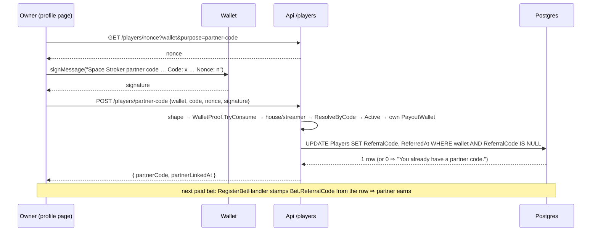

# Space Stroker — "Partner code on the profile page" — Implementation Spec

> **Status: Ready for implementation** — refined via Trello card
> [#213 Enter a partner (referral) code on the profile page](https://trello.com/c/dGgU5VOY) (2026-10-26).
> Repos affected: `monkify-backend`, `monkify-front`, and this doc in `monkify-meta`. `monkify-lp` NOT affected.
> Level: **`Feature`**.
>
> **Purpose:** let a player who has no partner yet link one **once**, from their own profile page. Today
> attribution only happens when a player arrives through `?ref=<code>` before their first bet or Orbit
> enrolment ([`features/referral-program.md`](../features/referral-program.md)); a player who already
> played, or who heard a code on a stream, has no way in. After this card they open their profile, press
> **+ PARTNER CODE**, type the code, sign, and every paid bet they place **from then on** earns that partner
> commission. Once linked, the code can never be changed.
>
> Design: Claude Design, owner picked **Option B · Button + dialog** —
> <https://claude.ai/design/p/9d33dcc9-6062-4643-864d-c54532c9844f?file=Partner+Code+Options.dc.html>.
> ⚠️ **Copy rule (owner, 2026-10-26): player-facing text says "partner", never "streamer".** The mockup's
> "Have a streamer's code?" / "your streamer or partner" lines are superseded by §7.3. ("Streamer wallets"
> in §6 are the play-money accounts of [`features/streamer-wallets.md`](../features/streamer-wallets.md) —
> an internal concept that never reaches this card's UI copy.)

---

## 1. Summary

| | Today (#175 / #177 / #195) | After this card |
| --- | --- | --- |
| How a player gets a partner | `?ref=` captured in the browser, written on first bet / Orbit enrolment | Same, **plus** a one-time signed link from the owner's profile |
| Existing player with no partner | Can never be attributed | Can link once |
| Changing a partner | Impossible (write-once) | Still impossible — from **every** path |
| Commission on bets before linking | n/a | **Never** — bets are stamped at placement; old bets stay `ReferralCode = NULL` |
| Player-level code on a public read | Never (#175 "Nothing leaks") | **`GET /players/profile` returns `partnerCode` + `partnerLinkedAt`** (owner decision) |
| "Does code X exist / is it active?" | Never answerable to a player | Answerable **only** after a valid `partner-code` signature (scoped §6 exception, like #195) |

**Commission needs no new logic.** `RegisterBetHandler` stamps `Bet.ReferralCode` from the **player row** at
placement (`RegisterBetHandler.cs:244-245`, re-resolved through the directory so an inactive partner stamps
NULL), and every earnings read — `ReferralEarningsService.EarningBets` (`:145-177`), the roster, the
cash-out statement, `deploy/sql/referral-payout-report.sql` — sums `Bet.ReferralCode`. Linking on
Oct 10 therefore earns the partner exactly the bets placed after Oct 10, Orbit auto-bets included, with no
backfill and no date filter.

⚠️ **One required fix found in code exploration (§6.4):** `RegisterBetHandler.UpsertPlayerAsync` loads the
player **NoTracking** and saves with `Players.Update(existing)`, which marks **every column** modified. A bet
(or Orbit auto-bet — they run continuously) that read the row a moment before a profile link would write
`ReferralCode = NULL` back over the freshly linked code. This card makes **every** referral write a single
atomic conditional `UPDATE … WHERE "ReferralCode" IS NULL` and stops the bet path from rewriting the column.

---

## 2. Constraints (MANDATORY)

From [`../constraints.md`](../constraints.md) (full list there):

- **Worktree-per-repo:** `feature/partner-code-on-profile` in `monkify-backend`, `monkify-front` and
  `monkify-meta`, each at `.worktrees/partner-code-on-profile/<repo>`. Already created and pushed by
  `/monkify-create-spec`. Hubs stay on `main`; never `git checkout -b` in a hub.
- **Unit tests:** update/add in `SpaceStroker.Tests`; **report changed tests** at the end. Run via
  `scripts/run_tests.bat` — never the raw full `dotnet test` (`ProductionSessions` is a slow Monte-Carlo suite).
- **Integration test is MANDATORY** (Level `Feature`): happy path end to end in
  `SpaceStroker.Tests.Integration` (§11.2), via `scripts/run_integration_tests.bat`. Docker must be up.
- **EF mapping inline** in `SpaceStrokerDbContext.OnModelCreating`. **No migration** in this card
  (`Player.ReferralCode` / `ReferredAt` exist since #175).
- **No new config, secrets or Terraform.** One new `IpRateLimiting` rule in the committed
  `spacestrokersettings.json` (not a secret).
- **§6 vague messaging:** every refusal **before** a valid proof is the existing vague
  `SelfExclusionRequestInvalid` ("We could not verify that request. Please try again."). The four specific
  messages exist **only after** the signature verifies and the nonce is consumed. Streamer-wallet and
  house-wallet refusals stay vague even after the proof (`PlayerProfileDto.cs:13-14`: nothing may reveal a
  streamer).
- **Nonce purposes stay isolated:** a new `partner-code` purpose; never reuse `preferences` (a captured
  name-save signature must not link a partner) or `referral-*`.
- **Copy:** "partner", never "streamer" (owner).
- **Front:** `yarn lint` + `yarn build` (no test runner exists); CRLF/prettier gotchas per memory.

---

## 3. Resolved product decisions

| # | Decision |
| --- | --- |
| 1 | Only a player whose `Player.ReferralCode` is NULL can link a code. |
| 2 | Once set, the code is **permanent** — no player or admin path changes or removes it (an ops correction stays hand SQL, out of scope). |
| 3 | The partner earns only on bets placed **after** linking. Achieved by the existing stamp-at-placement; **no backfill, no re-stamping**. |
| 4 | UI = mockup **B**: dashed **+ PARTNER CODE** button in the hero's right column → `ArcadeModal` dialog (input + ONE TIME ONLY box + CANCEL / LINK · SIGN) → once linked, a **PARTNER · CODE** badge with a lock and "since <date>". |
| 5 | Button and badge render **only on the owner's own profile** (`isOwner && !isEmbedded`). Visitors see neither. |
| 6 | The linked code **is public**: `GET /players/profile` returns `partnerCode` (canonical spelling) and `partnerLinkedAt`. ⚠️ Owner chose this over a yes/no flag knowing anyone can look up which partner referred any wallet. **Scope:** the player-level read only — bet DTOs, SignalR events, history, stats, leaderboards and the verification payload stay code-free. Partner codes are already public by nature (they are in shareable `?ref=` links). |
| 7 | **Specific errors, after a valid proof only:** unknown → "That code doesn't exist."; inactive → "That code is no longer active."; caller's wallet is that partner's `PayoutWallet` → "You can't use your own partner code."; player already has a code → "You already have a partner code.". Anything else → vague. (The caller has just proven they own the wallet, so telling them their own partner status leaks nothing.) |
| 8 | **Pre-fill** the dialog input from the browser's unexpired `?ref=` stash (`readReferral()`), editable. A successful link clears the stash. |
| 9 | **Streamer wallets** (play-money accounts): button hidden when the front knows (`orbitIsStreamer`), backend refuses with the **vague** message. Their bets are stamped NULL anyway. |
| 10 | **Self-excluded players:** the backend does **not** refuse them (linking moves no money). In practice the UI is unreachable while excluded, because `GET /players/profile` returns the `Unavailable` body for an active exclusion — accepted, no special handling. |
| 11 | **Copy says "partner", never "streamer".** |
| 12 | Level **`Feature`** ⇒ mandatory happy-path integration test + `features/partner-code-on-profile.md` at ship. |
| 13 | **(Spec, from code)** All three referral writers (new endpoint, `RegisterBetHandler`, `CreateOrbitSessionHandler`) go through one atomic conditional write (§6.4) — fixes the full-row overwrite race. |
| 14 | **(Spec, from code)** Code shape = `ReferralDirectory.Normalize` (trim, lowercase, `[a-z0-9_-]`, 1–32) — the **attribution** rule, not the 3–20 self-registration rule, because any configured partner code (including ops-inserted ones) must be linkable. |
| 15 | **(Spec, from code)** Phone wallets connected via the deeplink protocol have no in-page `signMessage`; they behave exactly like EDIT NAME / icon saves today (the sign step throws "This wallet cannot sign messages."). A stash-and-return signing flow is **out of scope**. |

---

## 4. Data model

**No entity, column, index or migration change.**

- `SpaceStroker.Domain/Games/Entities/Player.cs` — `ReferralCode` (L33), `ReferredAt` (L41). Update the
  doc comment at L27-28 ("Set only when currently NULL, by the two handlers …") to name **three** writers
  and the shared `IPlayerReferralWriter` (§6.4).
- `SpaceStrokerDbContext.cs:93-113` — mapping unchanged (`ReferralCode` max 32, `ExternalPlayerId` unique).
  Update the comment at L106-108 the same way.

---

## 5. Configuration

One new rate-limit rule in `SpaceStroker.Common/spacestrokersettings.json` → `IpRateLimiting.GeneralRules`:

```json
{ "Endpoint": "post:/players/partner-code", "Period": "1m", "Limit": 10 }
```

10/min/IP: each attempt costs the caller a wallet signature, and a probe of codes is bounded by the limit.
`RateLimitSettingsTests.GeneralRules_AreExactlyTheQuotaProtectingPatterns` (L81-111) pins the exact rule
set and **must** be updated.

---

## 6. Backend behaviour

### 6.1 New nonce purpose

`Handlers/Players/GetWalletNonce/GetWalletNonceRequest.cs` → `WalletNoncePurpose`:

```csharp
// #213. Its own purpose: a link WRITES permanent attribution, so neither a preferences signature
// nor any referral-* signature may be replayed as one (and vice versa).
public const string PartnerCode = "partner-code";
```

Add it to the hand-written `IsKnown` chain (L55-60). Nonce is minted/cached exactly like the others
(`WalletNonce:{purpose}:{wallet}`, 5 min).

### 6.2 Signed message

New `Services/Referrals/ReferralMessages.BuildPartnerCodeMessage(wallet, code, nonce)` beside
`BuildRegistrationMessage` (`ReferralMessages.cs:46-52`), joined with `"\n"`:

```
Space Stroker partner code
Wallet: {wallet}
Code: {code}
I understand this partner code is permanent.
Nonce: {nonce}
```

`{code}` is the **normalized** code (`ReferralDirectory.Normalize`), so the front signs exactly what the
server verifies. The front mirrors it byte-for-byte (§7.2).

### 6.3 `POST /players/partner-code`

**Controller** — `SpaceStroker.Api/Controllers/PlayersController.cs`: add `[HttpPost("partner-code")]` →
`LinkPartnerCode([FromBody] LinkPartnerCodeRequestBody body)` → `ProcessRequest(new LinkPartnerCodeRequest(body))`,
and `[HttpOptions("partner-code")]` on the existing OPTIONS handler (L134-135). XML doc in the style of
`UpdatePreferences` (L117-122).

**Body** — `Handlers/Players/LinkPartnerCode/LinkPartnerCodeRequest.cs`:

```csharp
public record LinkPartnerCodeRequestBody(string? Wallet, string? Code, string? Nonce, string? Signature);
public record LinkPartnerCodeRequest(LinkPartnerCodeRequestBody? Body) : IRequest<PlayerPartnerCodeDto>;
```

**Response** — `SpaceStroker.Infrastructure/Contracts/Players/PlayerPartnerCodeDto.cs`: `{ PartnerCode: string, PartnerLinkedAt: DateTime }`.
⚠️ Return a DTO, **never `bool`** — `BaseController.ProcessRequest` turns `true` into a 201.

**Handler** — `Handlers/Players/LinkPartnerCode/LinkPartnerCodeHandler.cs`, deps: `ICacheService`,
`IReferralDirectoryProvider`, `IStreamerLedger`, `IPlayerReferralWriter`, `TokenSettings` (house wallets).
Order (each refusal = `Messaging.ReturnValidationFailureMessage`, which throws → HTTP 400):

| # | Check | Refusal |
| --- | --- | --- |
| 1 | Body null; `WalletAddress.IsValid(wallet)` false; `ReferralDirectory.Normalize(code)` null; nonce/signature blank | `SelfExclusionRequestInvalid` (vague, pre-proof) |
| 2 | `WalletProof.TryConsume(_cache, WalletNoncePurpose.PartnerCode, wallet, nonce, signature, (w, n) => ReferralMessages.BuildPartnerCodeMessage(w, normalized, n))` false | vague |
| 3 | Wallet in `HouseWallets.Resolve(_token)` | vague |
| 4 | `await _streamers.IsActiveStreamer(wallet, ct)` | vague (never reveal a streamer) |
| 5 | `directory.ResolveByCode(normalized)` is null | **`PartnerCodeNotFound`** "That code doesn't exist." |
| 6 | partner `!Active` | **`PartnerCodeInactive`** "That code is no longer active." |
| 7 | `partner.PayoutWallet == wallet` (ordinal) | **`PartnerCodeOwnCode`** "You can't use your own partner code." |
| 8 | `await _writer.TryLinkAsync(wallet, partner.Code, now, ct)` returns false | **`PartnerCodeAlreadyLinked`** "You already have a partner code." |
| — | success | `PlayerPartnerCodeDto { partner.Code, now }` |

Notes:
- Step 2 consumes the nonce only on success (`WalletProof.cs:40`); every step from 3 on runs with the nonce
  already spent, so a retry needs a fresh nonce (the front always fetches one per attempt).
- Store **`partner.Code`** (the configured/canonical spelling), never the user's input — earnings match
  `x.ReferralCode == partner.Code` exactly (`ReferralEarningsService.cs` — never `lower()`).
- Step 8 is the **only** "already linked" guard. Do not pre-read the player row and refuse early — that read
  would race; the conditional write is the source of truth.
- Four new `ErrorMessages.resx` keys (+ designer) in `SpaceStroker.Common/Resources/`, next to the
  `Referral*` keys (L291-319).

### 6.4 One atomic referral writer (fixes the overwrite race)

New `Services/Referrals/IPlayerReferralWriter.cs` + `PlayerReferralWriter.cs` (scoped, registered in
`SpaceStroker.Infrastructure/DependencyInjection.cs`):

```csharp
/// The ONLY code that writes Player.ReferralCode / ReferredAt. Write-once, atomically:
/// UPDATE "Players" SET "ReferralCode" = @code, "ReferredAt" = @now
///  WHERE "ExternalPlayerId" = @wallet AND "ReferralCode" IS NULL
/// Returns true when this call set the code. Creates the Player row when missing
/// (a 23505 on ExternalPlayerId means a concurrent writer created it — retry the UPDATE once).
Task<bool> TryLinkAsync(string wallet, string canonicalCode, DateTime now, CancellationToken ct);
```

Implementation: `Context.Players.Where(p => p.ExternalPlayerId == wallet && p.ReferralCode == null)
.ExecuteUpdateAsync(s => s.SetProperty(p => p.ReferralCode, code).SetProperty(p => p.ReferredAt, now), ct)`.
If 0 rows: check whether the row exists (`AnyAsync`); if it does → return false (already linked); if not →
insert `new Player { ExternalPlayerId = wallet, LastSeenAt = now, ReferralCode = code, ReferredAt = now }`,
and on `DbUpdateException { InnerException: PostgresException { SqlState: "23505" } }` detach and retry the
`ExecuteUpdate` once, returning its result. (Pattern: `RegisterReferralPartnerHandler.cs:134-139`.)

**Call sites:**

1. **`LinkPartnerCodeHandler`** (§6.3, step 8).
2. **`RegisterBetHandler.UpsertPlayerAsync`** (`:363-412`) — ⚠️ **required fix.** Today it loads the row
   NoTracking and calls `Players.Update(existing)` (L395), which writes **every column**, including a stale
   `ReferralCode = NULL`. Change to:
   - existing row: update **only** `LastSeenAt` and (when provided) `DisplayName` with `ExecuteUpdateAsync`
     (or attach + mark just those two properties modified) — `ReferralCode`/`ReferredAt` are never in that
     write; then, if `resolvedReferral != null`, `await _referralWriter.TryLinkAsync(...)` (result ignored —
     first-touch, silent).
   - new row: keep the insert but **without** `ReferralCode`/`ReferredAt`, then `TryLinkAsync` when
     `resolvedReferral != null`. (Or keep them on the insert — an insert cannot overwrite; either is fine,
     but the 23505-on-insert path must not lose a concurrent link. Simplest: insert without, then link.)
   - Return value: the method returns the `Player`; re-read it (NoTracking) after the writes so the stamp at
     L244-245 sees the code just linked by any writer.
3. **`CreateOrbitSessionHandler.EnsurePlayerExists`** (`:80-116`) — it is tracking-based (only modified
   columns are written), but its `if (resolvedReferral != null && string.IsNullOrEmpty(player.ReferralCode))`
   is read-then-write: a profile link landing between its read and `SaveChanges` would be overwritten by the
   `?ref=` code. Replace the conditional block with `TryLinkAsync` (after the `SaveChanges` that updates
   `LastSeenAt`/creates the row).

Net invariant (pin it in `PlayerReferralWriterTests`): **once `ReferralCode` is non-NULL, no code path can
change it.**

### 6.5 Public read — `GET /players/profile`

`Handlers/Players/GetPlayerProfile/GetPlayerProfileHandler.cs`:

- Add `p.ReferralCode, p.ReferredAt` to the live-row projection (L60-63).
- Stamp them **live** on the returned copy (L110-116), like `DisplayName`/`AvatarId`:
  `PartnerCode = player.ReferralCode, PartnerLinkedAt = player.ReferredAt`. Live stamping means **no cache
  invalidation** is needed after a link (the cached body under `PlayerProfile:{wallet}` never holds them).
- `Contracts/Players/PlayerProfileDto.cs`: add `string? PartnerCode` and `DateTime? PartnerLinkedAt`.
  `Unavailable` (L45-49) keeps them **null** — it must stay byte-identical for every wallet. The
  "valid wallet, no row" body (L72-81) returns them null.
- The stored value is returned as stored — **not** re-resolved through the directory, so a later-deactivated
  partner still shows (decision: the badge reflects the permanent link, not current earning status).
- ⚠️ This reverses #175's "`ReferralCode` appears on no public endpoint" **for this one field**.
  `ReferralAttributionFlowTests.TheReferralCode_IsOnNoPublicResponse` (L192-220) checks `/games/*` only and
  keeps passing — **do not widen it to `/players/*`**; extend its comment to say why `/players/profile` is
  the deliberate exception.
- `GET /players/preferences` is **not** changed (the hero reads `/players/profile`).

---

## 7. Frontend behaviour

### 7.1 Types + service

- `src/types/index.ts` → `PlayerProfile` (L403-417): add `partnerCode: string | null; partnerLinkedAt: string | null;`.
- New types: `PartnerCodeLinkBody { wallet, code, nonce, signature }`, `PartnerCodeLinkResult { partnerCode: string; partnerLinkedAt: string }`.
- `src/services/mainService.ts`: add `'partner-code'` to the `getWalletNonce` purpose union (L250-263); add
  `linkPartnerCode(body)` → `POST /players/partner-code`; export it (L423-432).

### 7.2 Composable — `src/hooks/usePartnerCodeLink.ts` (new)

Mirrors `usePartnerRegistration.ts` (L99-115):

1. `normalized = normalizeReferral(input)` (`src/utils/referral.ts:30` — trim, lowercase, `/^[a-z0-9_-]{1,32}$/`);
   null ⇒ inline "Enter a valid code." and stop (no request).
2. `nonce = (await mainService.getWalletNonce(wallet, 'partner-code')).data.nonce`.
3. `message = buildPartnerCodeMessage(wallet, normalized, nonce)` — **byte-identical** to §6.2, defined in
   the composable and exported (one place, like `usePartnerEarnings.ts:26-37`).
4. `if (!signMessage.value) throw new Error('This wallet cannot sign messages.')` then sign
   `new TextEncoder().encode(message)` via `useWallet()`; signature `toBase64` (reuse
   `usePartnerEarnings.ts:50`). `isUserRejection` (`usePartnerRegistration.ts:32-36`) ⇒ silent, dialog stays open.
5. `mainService.linkPartnerCode({ wallet, code: normalized, nonce, signature })`.
6. Errors: mark `handled = true` (suppress the global toast, `services/handlers.ts:14-31`) and show
   `apiErrorMessage(e) ?? 'That request could not be processed.'` inline — the backend sentence verbatim;
   **no string matching**.
7. Success: `clearReferral()`, `forgetPlayerProfile(wallet)` + the page's `reload()`, `toast.success('Partner code linked.')`.

Exposes `{ submitting, error, link(code) }`.

### 7.3 UI — `src/pages/PlayerProfilePage.vue` + `src/components/player/PartnerCodeModal.vue` (new)

**Hero right column (L386-399):** the existing `<div v-if="canDonate || canMessage">` is never true for the
owner. Add an owner branch beside it:

```ts
const canLinkPartner = computed(() => isOwner.value && !isEmbedded && !orbitIsStreamer(effectivePublicKey.value));
```

- `canLinkPartner && !profile.partnerCode` → dashed button **`+ PARTNER CODE`** with caption
  *"Have a partner code? One time only."* (VT323, `text-ink-dim`).
- `isOwner && !isEmbedded && profile.partnerCode` → badge: `[lock] PARTNER` block in the theme colour
  (base: `.profile__lv` L698-705) + the code in VT323 on `--color-void-deep`, caption *"since 10 Oct 2026"*
  (`partnerLinkedAt`, same date formatting as `joined`).
- Visitors: nothing.
- New scoped styles: `.profile__partner-add` (from `.profile__ghost` L706-722, `border-style: dashed`,
  `border-color: var(--t)`, `color: var(--t)`, height 44px) and `.profile__partner-badge`.

**Dialog — `PartnerCodeModal.vue`:** `<arcade-modal size="compact" title="PARTNER CODE" :open :dismissible="!submitting">`
(bottom sheet on phones automatically). Mounted locally in `PlayerProfilePage.vue` (single page uses it —
no App-level singleton needed).

- Copy: *"Enter the code your partner gave you."* (`dialog-copy`)
- `dialog-label` "CODE" + `input-arcade` (maxlength 32, autocapitalize off, spellcheck off), pre-filled with
  `readReferral()` on open (decision 8).
- ONE TIME ONLY box (black panel, theme border): heading **ONE TIME ONLY**, body *"Once linked, this code can
  never be changed or removed. It only applies to bets you place after linking."*
- Error: `dialog__strip dialog__strip--err` with `ERR` tag + the message.
- Footer: `btn-dialog` **CANCEL** + `btn-dialog btn-dialog--primary` **LINK · SIGN** (disabled while
  `submitting` or the input is empty; label `SIGNING…` while submitting).
- No word "streamer" anywhere.

---

## 8. Flow



---

## 9. Out of scope

- Changing or removing a linked code (player or admin). Corrections stay hand SQL.
- Any bonus for the player who links a code (#190).
- Retroactive commission on pre-link bets.
- `monkify-lp` `/terms` copy.
- Showing the badge/code to visitors in the UI (the API is public; the UI is owner-only).
- A stash-and-return signing flow for deeplink-connected phone wallets (decision 15).
- Changing the earnings predicate, the roster, cash-out or the payout report.

---

## 10. File checklist

### 10.1 Backend (`monkify-backend`)

| # | File | Change |
| --- | --- | --- |
| 1 | `src/SpaceStroker.Infrastructure/Handlers/Players/GetWalletNonce/GetWalletNonceRequest.cs` | `PartnerCode = "partner-code"` + `IsKnown` |
| 2 | `src/SpaceStroker.Infrastructure/Services/Referrals/ReferralMessages.cs` | `BuildPartnerCodeMessage` |
| 3 | `src/SpaceStroker.Infrastructure/Services/Referrals/IPlayerReferralWriter.cs` + `PlayerReferralWriter.cs` (new) | atomic write-once writer (§6.4) |
| 4 | `src/SpaceStroker.Infrastructure/DependencyInjection.cs` | register `IPlayerReferralWriter` (scoped) |
| 5 | `src/SpaceStroker.Infrastructure/Handlers/Players/LinkPartnerCode/LinkPartnerCodeRequest.cs` + `LinkPartnerCodeHandler.cs` (new) | §6.3 |
| 6 | `src/SpaceStroker.Infrastructure/Contracts/Players/PlayerPartnerCodeDto.cs` (new) | response DTO |
| 7 | `src/SpaceStroker.Api/Controllers/PlayersController.cs` | `POST partner-code` + OPTIONS |
| 8 | `src/SpaceStroker.Common/Resources/ErrorMessages.resx` (+ `.Designer.cs`) | 4 keys: `PartnerCodeNotFound`, `PartnerCodeInactive`, `PartnerCodeOwnCode`, `PartnerCodeAlreadyLinked` |
| 9 | `src/SpaceStroker.Common/spacestrokersettings.json` | rate rule `post:/players/partner-code` 10/1m |
| 10 | `src/SpaceStroker.Infrastructure/Handlers/Games/RegisterBet/RegisterBetHandler.cs` | `UpsertPlayerAsync`: no full-row `Update`; referral via writer (§6.4) |
| 11 | `src/SpaceStroker.Infrastructure/Handlers/Orbit/CreateOrbitSession/CreateOrbitSessionHandler.cs` | referral via writer |
| 12 | `src/SpaceStroker.Infrastructure/Handlers/Players/GetPlayerProfile/GetPlayerProfileHandler.cs` | project + stamp `PartnerCode`/`PartnerLinkedAt` live |
| 13 | `src/SpaceStroker.Infrastructure/Contracts/Players/PlayerProfileDto.cs` | two nullable fields; `Unavailable` unchanged |
| 14 | `src/SpaceStroker.Domain/Games/Entities/Player.cs`, `SpaceStrokerDbContext.cs` | comments: three writers via `IPlayerReferralWriter` |


### 10.2 Frontend (`monkify-front`)

| # | File | Change |
| --- | --- | --- |
| 1 | `src/types/index.ts` | `PlayerProfile.partnerCode/partnerLinkedAt`; link body/result types |
| 2 | `src/services/mainService.ts` | `'partner-code'` nonce purpose; `linkPartnerCode` |
| 3 | `src/hooks/usePartnerCodeLink.ts` (new) | sign + POST + error/success handling; `buildPartnerCodeMessage` |
| 4 | `src/components/player/PartnerCodeModal.vue` (new) | the dialog |
| 5 | `src/pages/PlayerProfilePage.vue` | `canLinkPartner`, button / badge in the hero right column, modal mount, styles |

### 10.3 Meta (`monkify-meta`)

| # | File | Change |
| --- | --- | --- |
| 1 | `specs/partner-code-on-profile.md` | this spec |
| 2 | `INDEX.md` | map row + in-flight entry |
| 3 | at ship: `features/partner-code-on-profile.md` (new), `features/referral-program.md` ("Nothing leaks", "no `POST /players/referral`", write sites, one stamp site), `features/player-profile.md` (hero) | KB sync |

---

## 11. Tests

### 11.1 Unit — `SpaceStroker.Tests/UnitTests/`

⚠️ The InMemory provider **cannot run `ExecuteUpdateAsync`** (`UnitTestsClass.cs:25`). Tests that exercise
`PlayerReferralWriter` (directly or through a handler) use **SQLite in-memory**, as
`ChatModerationHandlerTests.cs:30-48` does. Handler tests may instead fake `IPlayerReferralWriter`.

| Test file | Cases | Expected |
| --- | --- | --- |
| `Handlers/Players/LinkPartnerCodeHandlerTests.cs` (new; base like `ReferralHandlerTestsBase`) | `Links_AnActiveCode_StoresCanonicalSpelling` (input `" EdsonFM "`) | writer called with `partner.Code`; DTO returned |
| | `RefusesVaguely_WhenBodyOrWalletOrCodeShapeInvalid` (3 rows) | `SelfExclusionRequestInvalid`, nonce untouched |
| | `RefusesVaguely_WhenSignatureInvalid` / `…_WhenNonceForAnotherPurpose` (`preferences`, `referral-register`) | vague; writer not called |
| | `ConsumesTheNonce` | second call with same nonce is vague |
| | `RefusesVaguely_HouseWallet`, `RefusesVaguely_ActiveStreamer` | vague, nothing written |
| | `UnknownCode_SaysDoesNotExist`, `InactiveCode_SaysNoLongerActive`, `OwnPayoutWallet_SaysOwnCode` | specific messages; writer not called |
| | `AlreadyLinked_SaysAlreadyHaveACode` (writer returns false) | specific message |
| | `PartnerCode_IsAKnownNoncePurpose` | `WalletNoncePurpose.IsKnown("partner-code")` |
| `Services/PlayerReferralWriterTests.cs` (new, SQLite) | `SetsCode_WhenNull`, `NeverOverwrites_AnExistingCode`, `CreatesPlayer_WhenMissing`, `SecondCallReturnsFalse` | write-once invariant |
| `Handlers/RegisterBetHandlerTests.cs` | **new** `ABetWithoutReferral_DoesNotClearALinkedCode` (row linked after the handler's read — simulate by linking between upsert steps, or assert the upsert no longer writes the column); existing `…_NeverOverwritesAnExistingReferral` (L241-319) stay green | regression for the §6.4 race |
| `Handlers/Orbit/CreateOrbitSessionTests.cs` | existing referral cases (L182-245) green via the writer | — |
| `Handlers/GetPlayerProfileHandlerTests.cs` | `ReturnsPartnerCode_Live` (link after the body is cached ⇒ still shown), `Unavailable_HasNoPartnerCode` | — |
| `Api/RateLimitSettingsTests.cs` | add `post:/players/partner-code` to the exact-set test; new `PartnerCodeRule_Is10PerMinute_OnThePostOnly` | — |
| `Handlers/Players/LinkPartnerCodeHandlerTests.cs` (message pin, like `RegisterReferralPartnerHandlerTests.cs` does for registration) | `BuildPartnerCodeMessage_IsExactlyTheFiveLines` | byte-exact (the front mirrors it) |

### 11.2 Integration — `SpaceStroker.Tests.Integration/PartnerCodeLinkFlowTests.cs` (new, MANDATORY)

Reuse `ReferralPlayersFlowTests.cs` helpers (`PaidBet`, `WaitForStatusAsync`, the referral session,
`MintWalletNonceAsync`, signing with `wallet.Account.Sign`) and the fixture partner `edsonfm`
(`IntegrationTestFixture.ReferralCode`, share 50).

1. **`LinkedCode_EarnsOnlyOnBetsPlacedAfterLinking` (happy path):** fresh wallet places a paid bet with **no**
   ref → round settles → `POST /players/partner-code` with `EdsonFM` (mixed case) signed over the
   `partner-code` nonce → 200, `partnerCode == "edsonfm"` → `GET /players/profile` returns the same code +
   `partnerLinkedAt` → second paid bet → settles → the partner's `GET /referrals/me/wagers` lists the wallet
   with wagered == the **second** stake only, and the first bet row still has `ReferralCode = NULL`.
2. **`SecondLink_IsRefused_AndChangesNothing`:** same wallet links again (fresh nonce) with a second partner
   (insert a `ReferralPartner` row + `Invalidate()` — the fixture comment at `IntegrationTestFixture.cs:289`
   claiming partners are DI-time only is stale; correct it) → 400 "You already have a partner code." → row
   unchanged.
3. **`UnknownCode_AfterValidProof_SaysDoesNotExist`** and **`WrongPurposeNonce_IsVague`**.

---

## 12. Acceptance criteria

1. Given a connected owner with no partner code (not a streamer wallet), when they open their own profile, then a "+ PARTNER CODE" button shows in the hero; visitors to that profile never see it.
2. Given a player with no code and an active partner code, when they enter it, sign the partner-code challenge and confirm, then `Player.ReferralCode` is set to the canonical code, `ReferredAt` = now, and the hero shows the PARTNER · CODE badge.
3. Given a player who placed paid bets before linking a code, when they link it and then place more paid bets, then the partner's earnings, roster and payout report count only the bets placed after linking (earlier bets keep `ReferralCode = NULL`).
4. Given a player who already has a partner code (from `?ref=` or the profile), when they try to link any code, then the request is refused with "You already have a partner code." and the stored code is unchanged; the button is not shown to them.
5. Given a valid signature, when the code is unknown / inactive / belongs to a partner whose `PayoutWallet` is the caller, then the dialog shows "That code doesn't exist." / "That code is no longer active." / "You can't use your own partner code." respectively and nothing is written.
6. Given an invalid signature, an expired/reused nonce, or a nonce minted for another purpose, when the link request is sent, then it fails with the generic validation failure (no code-specific message) and nothing is written.
7. Given a link request and a concurrent first bet carrying a different `?ref=` code for the same wallet, when both complete, then exactly one code is stored and it is never overwritten afterwards. **(Spec addition:** and a concurrent bet with **no** referral never clears a linked code — §6.4.)
8. Given a streamer wallet, when its owner views their profile, then no partner-code button shows, and a direct link request is refused with the generic failure.
9. Given the browser holds an unexpired `?ref=` stash, when the owner opens the partner-code dialog, then the input is pre-filled with it (editable), and a successful link clears the stash.
10. Given a player with a linked code, when anyone calls the public profile read for that wallet, then it returns `partnerCode` (canonical) and `partnerLinkedAt`; no bet DTO, SignalR event, history, stats or verification payload gains a referral code.
11. Given the partner-code dialog is open, when the player cancels or rejects the wallet signature, then nothing is sent or written and the dialog can be retried.

---

## 13. Manual QA

1. Local stack up; connect a devnet wallet with **no** prior referral; open `/player/<wallet>` → dashed **+ PARTNER CODE** shows; open the same URL from another wallet → nothing.
2. Click it → dialog; type `nope123` → LINK · SIGN → sign → "That code doesn't exist." inline.
3. Type the seeded partner code in caps → sign → dialog closes, toast, badge **PARTNER · code** + "since <today>".
4. Reload / open on another browser → badge persists (public read). Button gone.
5. Visit `/?ref=<code>` on a fresh wallet, then the profile → dialog is pre-filled.
6. On a phone (bottom sheet) check layout; on a deeplink-connected phone wallet, LINK shows "This wallet cannot sign messages." (decision 15).
7. Grep the built bundle for "streamer" in the new component — none.

---

## 14. Trello / pipeline

- **Source card:** [#213](https://trello.com/c/dGgU5VOY) — list **Specs created**; the card's
  **Implementation** section lists worktree, branch, spec and level.
- **Next:** `/monkify-implement-feature Enter a partner (referral) code on the profile page`, then
  `/monkify-ship-feature …` (writes `features/partner-code-on-profile.md` and updates
  `features/referral-program.md`).

---

## 15. Revision log

| Date | Change |
| --- | --- |
| 2026-10-26 | Initial spec from refined card #213 + same-chat refinement (mockup B; public code; specific post-proof errors; prefill; streamer wallets hidden; "partner" not "streamer" copy). Code exploration added decisions 13–15 and the §6.4 overwrite-race fix. |
