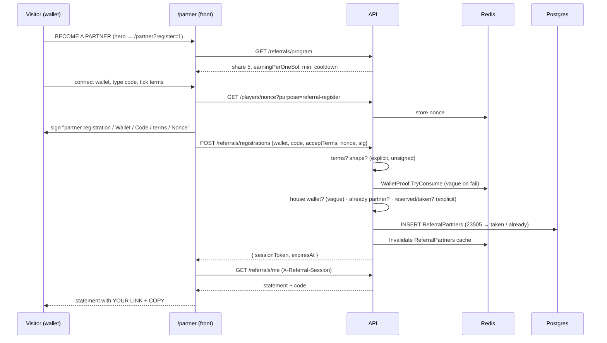

# Space Stroker — "Partner self-registration" — Implementation Spec

> **Status: Shipped** — merged via `feature/partner-self-registration` on **2026-09-29** (`main` in
> `monkify-backend`, `monkify-front`, `monkify-meta`; `master` in `monkify-lp`). Current truth is
> distilled in [`../features/partner-self-registration.md`](../features/partner-self-registration.md).
> Shipped as specified; the prod house cut is the committed **2%** (§15.1 resolved — no override in
> secrets or Terraform), so the explainer reads 0.001 SOL per 1 SOL bet.
>
> Originally refined via Trello card
> [#195 Public referral registering page](https://trello.com/c/fuLdOsMW/195-public-referral-registering-page)
> (2026-09-28).
> Repos affected: `monkify-backend`, `monkify-front`, `monkify-lp` (`master`), and this doc in `monkify-meta`.
> Level: **`Feature`**.
>
> **Purpose:** let anyone become a referral partner without the team. A visitor opens `/partner`,
> connects the wallet they want paid to, signs, picks a code and accepts the partner terms; a
> `ReferralPartner` row is written, live immediately, and they leave signed in with their
> `https://spacestroker.com/?ref=<code>` link. Until now every partner was a hand-run SQL `INSERT`
> ([`referral-cash-out.md`](../features/referral-cash-out.md) → "Ongoing management is hand-run SQL …
> no self-serve signup").

---

## 1. Summary

| | Today (#175 / #177 / #192) | After this card |
| --- | --- | --- |
| Becoming a partner | Ops writes a `ReferralPartners` row by SQL | Self-serve on `/partner`: sign + code + terms |
| Share rate | Whatever ops typed | **Fixed `SharePercentage = 5`** for self-registered partners (bespoke deals stay SQL) |
| Activation | Row's `Active` | `Active = true` on insert; attributes on the next bet (cache invalidated) |
| Terms | Numberless REFERRALS clause only | + **PARTNER PROGRAM** section in `/terms`, acceptance recorded (`TermsAcceptedAt`) |
| Partner's link | Sent to them by us | Shown on the statement with a COPY button, for **every** partner |
| Entry point | URL sent directly | + **BECOME A PARTNER** on the cold home hero |
| "Does code X exist?" | Never answerable (§6) | Answerable **only** on the signed register endpoint ("taken") |

**Nothing about attribution, the earnings predicate, cash-out, solvency or the player roster changes.**
A self-registered partner is an ordinary `ReferralPartner` row; every shipped path treats it exactly like
one ops inserted.

The money in one line: commission = `stake × CommissionPercentage (house cut) × SharePercentage`
= `stake × 2% × 5%` = **0.1% of every paid stake** at today's committed rate — a **1 SOL bet earns the
partner 0.001 SOL**. ⚠️ The house-cut rate is config, and the KB currently disagrees with itself about
its production value (§15.1), so no figure on any surface may be hand-typed from this paragraph.

---

## 2. Constraints (MANDATORY)

From [`../constraints.md`](../constraints.md) (full list there):

- **Worktree-per-repo:** `feature/partner-self-registration` in `monkify-backend`, `monkify-front`,
  `monkify-lp` (branched off **`master`**) and `monkify-meta`, each at
  `.worktrees/partner-self-registration/<repo>`. Hubs stay on `main`/`master`; never `git checkout -b`
  in a hub. Already created and pushed by `/monkify-create-spec`.
- **Unit tests:** update/add in `SpaceStroker.Tests`; **report changed tests** at the end. Run via
  `scripts/run_tests.bat` — never the raw full `dotnet test` (the `ProductionSessions` Monte-Carlo
  suite is slow).
- **Integration test is MANDATORY** (Level `Feature`): the happy path end to end in
  `SpaceStroker.Tests.Integration` (§11.2), via `scripts/run_integration_tests.bat`. Docker must be up.
- **EF mapping inline** in `SpaceStrokerDbContext.OnModelCreating`; **migration** under
  `SpaceStroker.Infrastructure/Migrations/`, generated with `dotnet ef migrations add`, applied only by
  `SpaceStroker.Consumers`. Never hand-edit the snapshot.
- **Secrets:** none introduced. Every new value (share 5, code bounds, reserved list) is a public,
  committed constant — no `spacestrokersettings.json` key, so **no Terraform secret binding** (the trap
  that silently broke Orbit #123 and the house seed #168 cannot occur here).
- **§6 messaging:** exactly **four** new explicit messages, all on the register endpoint (§6.7). Every
  other referral refusal stays the byte-identical vague `ReferralRequestInvalid`. No referral code on
  any **player**-facing contract (the partner's own code on their own session-gated statement is not
  player-facing).
- **Front build gotchas** (memory): copy the hub `yarn.lock` into the front worktree before a Docker
  build and verify the served bundle changed; prettier `endOfLine: lf` fails CRLF files in `yarn build`.
- **API stays stateless**; nothing here runs in Consumers except the migration.

---

## 3. Resolved product decisions

| # | Decision |
| --- | --- |
| 1 | **Fixed `SharePercentage = 5`** — 5% **of the house cut**, not of the stake (`ReferralPartner.SharePercentage` semantics, `ReferralEarningsService.ApplyShare`). A hard-coded constant for self-registration, **not** configurable. Owner lowered the card's 10 → 5. |
| 2 | **Live immediately** — `Active = true` on insert. No approval queue (there is no admin UI). Alt-wallet self-referral farming is accepted at ~0.1% of turnover and is a terms ground for deactivation (existing SQL `Active = false`). |
| 3 | **"Code taken" is said plainly** — a deliberate, **scoped exception to §6**: only on `POST /referrals/registrations`, only **after** a valid wallet signature, reveals existence only (codes are public in `?ref=` links), never name/wallet/share. An unknown `?ref=` still resolves byte-identically to no code. |
| 4 | **Code rules (registration only): 3–20 chars `[a-z0-9_-]`, stored lowercased** (`Code` = `NormalizedCode`) + a committed **reserved list** answering "taken". `ReferralDirectory.Normalize` (1–32) is **unchanged**, so SQL partners outside 3–20 keep working. No profanity filter. |
| 5 | **Partner terms required** — checkbox linking to a new **PARTNER PROGRAM** section in `monkify-lp` `/terms`. Acceptance stored as `ReferralPartner.TermsAcceptedAt` (nullable, no versioning) **and** bound into the signed message (§6.3). |
| 6 | **HOW PARTNERSHIP WORKS** explainer on the register view (owner addition): share the link → first-touch, permanent → 5% of the house cut on their **paid** bets, Orbit included → own bets never count → SOL cash-out to this wallet (minimum + cooldown) → deactivation for abuse keeps the earned balance payable. |
| 7 | **Worked example** in the explainer (owner addition): "a 1 SOL bet earns you 0.001 SOL" at today's rate, with the caveat that a bet counts once its round has paid out and refunded/free bets earn nothing. ⚠️ **Derived, never typed** — served by `GET /referrals/program` computed through `ApplyShare` itself (§6.8). |
| 8 | A wallet that **is already a partner** gets "already a partner — sign in"; one wallet = one code (existing filtered unique `IX_ReferralPartners_PayoutWallet`). |
| 9 | **Codes are permanent** — no rename, no second code per wallet. Ops rule "issue a new code" stands. |
| 10 | **`DisplayName` = the code.** No separate name field. |
| 11 | **Proof = fresh ed25519 signature on a new purpose `referral-register`**, nonce from the existing `GET /players/nonce`. Success **returns a referral session** (same shape as `POST /referrals/session`) — no second signature prompt. |
| 12 | **The partner's link is always on the statement** — `https://spacestroker.com/?ref=<code>` + COPY, for every partner. Requires `code` on `GET /referrals/me` (§6.9). |
| 13 | **Rate limit** `post:/referrals/registrations` **5/min per client IP**, in the pinned `RateLimitSettingsTests` set (no `/bets` substring). |
| 14 | **Cache**: a successful insert calls `IReferralDirectoryProvider.Invalidate()` — the link attributes on the very next bet, not up to 60 s later. |
| 15 | **BECOME A PARTNER on the COLD home hero only** (`HomeHero.vue`, wallet not connected), beside Connect wallet / Try it free; opens `/partner?register=1`. Not in the connected hero, not in the ☰ menu; `/partner` stays unlisted. |
| 16 | *(spec-level, from code exploration)* **Refuse the four house wallets** (treasury `TokenOwnerPublicKey`, `Orbit.PublicKey`, `HouseSeed.PublicKey`, `ReferralPayout.PublicKey`) with the vague message — the cash-out resolver would refuse to pay a collision anyway, and the leaderboards already treat these four as the house set. |
| 17 | *(spec-level)* **Explicit, pre-signature validation for terms and shape**; the "taken" / "already a partner" answers come only **after** the proof. The shape rules and the terms requirement are public knowledge, so answering them unsigned reveals nothing — and it saves the user a wasted wallet prompt. |
| 18 | *(spec-level, from code exploration)* **"Hidden when embedded" needs no new code** — `Home` is already in `EMBED_REDIRECT_ROUTES` (`main.ts`), so the hero never renders embedded. Don't add a second gate. |

---

## 4. Data model

### 4.1 Entity change

`monkify-backend/src/SpaceStroker.Domain/Referrals/Entities/ReferralPartner.cs` — add:

```csharp
/// <summary>
/// When the partner accepted the PARTNER PROGRAM terms (#195), or NULL for a partner ops created by
/// SQL / the DefaultPartners seed before self-registration existed. Not versioned: re-acceptance is
/// out of scope. The acceptance is ALSO inside the signed registration message, so this timestamp is
/// backed by a signature the partner produced.
/// </summary>
public DateTime? TermsAcceptedAt { get; set; }
```

### 4.2 EF configuration (inline)

In the existing `modelBuilder.Entity<ReferralPartner>` block of `SpaceStrokerDbContext` (~line 564),
beside `Active`:

```csharp
// #195. Nullable on purpose: SQL-created and seeded partners never accepted anything.
builder.Property(x => x.TermsAcceptedAt).IsRequired(false);
```

Npgsql maps `DateTime?` to `timestamp with time zone`; write it as `DateTime.UtcNow`. **No index**
(nothing reads by it). Both unique indexes stay exactly as they are — they are the concurrency guards
this feature relies on.

### 4.3 Migration

```bash
dotnet ef migrations add AddReferralPartnerTermsAcceptedAt \
  --project SpaceStroker.Infrastructure --startup-project SpaceStroker.Consumers
```

One nullable column added, **no backfill**, no lock of note (`ReferralPartners` is a tiny table, and
this is not `GameBets`). Down drops the column.

---

## 5. Configuration

**None added.** Constants live in code (`SpaceStroker.Domain/Referrals/ReferralSelfRegistration.cs`,
§6.1). Existing config read (not changed): `Token.CommissionPercentage`, `Token.Decimals`,
`Token.ReferralPayout.MinimumCashOut`, `Token.ReferralPayout.CashOutCooldownMinutes`,
`Token.Orbit.SessionTtlDays` (session TTL, shared with `CreateReferralSessionHandler`).

Rate limit (committed `SpaceStroker.Common/spacestrokersettings.json`, `IpRateLimiting.GeneralRules`,
next to `get:/referrals/me/wagers`):

```json
{
    "Endpoint": "post:/referrals/registrations",
    "Period": "1m",
    "Limit": 5
}
```

⚠️ `post:` only, never `*:` — the OPTIONS preflight must not eat the budget (same reasoning as the
roster rule).

---

## 6. Backend behaviour (`monkify-backend`)

### 6.1 `ReferralSelfRegistration` — the rules, in the Domain

New `SpaceStroker.Domain/Referrals/ReferralSelfRegistration.cs` (static, pure, unit-testable, no
DbContext — the same reason `ReferralDirectory` is pure):

```csharp
public static class ReferralSelfRegistration
{
    public const decimal SharePercentage = 5m;   // decision 1 — % OF THE HOUSE CUT
    public const int MinCodeLength = 3;          // decision 4
    public const int MaxCodeLength = 20;         // ≤ 32, so it always fits Bet/Player.ReferralCode

    // Reserved: answered as "taken". Compared against the NORMALIZED code.
    public static readonly IReadOnlySet<string> Reserved = new HashSet<string>(StringComparer.Ordinal)
    {
        "spacestroker", "space-stroker", "space_stroker", "chimpout", "monkify", "edson",
        "admin", "official", "support", "help", "house", "team", "staff", "mod", "moderator",
        "partner", "partners", "referral", "ref", "treasury", "orbit",
    };

    /// Trim + lower, then 3–20 of [a-z0-9_-]; null when malformed. Reuses ReferralDirectory.Normalize
    /// for the character rule so the two can never disagree about what a code IS.
    public static string? NormalizeForRegistration(string? raw) { … }

    public static bool IsReserved(string normalized) => Reserved.Contains(normalized);
}
```

`NormalizeForRegistration` = `ReferralDirectory.Normalize(raw)` then the extra `Length is >= 3 and <= 20`
check. The list above is the minimum; the implementer may add obvious impersonation terms but must not
remove any.

### 6.2 New nonce purpose

`SpaceStroker.Infrastructure/Handlers/Players/GetWalletNonce/GetWalletNonceRequest.cs`:

```csharp
// #195. Its own purpose, NOT ReferralSession: a registration WRITES a partner row and a session
// signature must never be able to do that (nor the reverse).
public const string ReferralRegister = "referral-register";
```

…and add it to `IsKnown`. Front sends `purpose=referral-register` to the existing `GET /players/nonce`.

### 6.3 The signed message

`SpaceStroker.Infrastructure/Services/Referrals/ReferralMessages.cs`:

```csharp
/// <summary>
/// #195. Binds the CODE and the TERMS ACCEPTANCE into the signature: the wallet cannot be registered
/// under a code its owner did not see, and TermsAcceptedAt is backed by something the partner signed.
/// ⚠️ `code` is the NORMALIZED code (trimmed, lower-cased) on BOTH sides.
/// </summary>
public static string BuildRegistrationMessage(string wallet, string code, string nonce)
    => string.Join("\n",
        "Space Stroker partner registration",
        $"Wallet: {wallet}",
        $"Code: {code}",
        "I accept the Space Stroker partner program terms.",
        $"Nonce: {nonce}");
```

`WalletProof.TryConsume` takes a `Func<string, string, string>` (wallet, nonce); pass
`(w, n) => ReferralMessages.BuildRegistrationMessage(w, normalizedCode, n)`. **No change to
`WalletProof`.**

### 6.4 `POST /referrals/registrations`

`SpaceStroker.Api/Controllers/ReferralsController.cs`:

- Add `[HttpOptions("registrations")]` to `GetOptions`.
- ```csharp
  /// Self-serve partner registration (#195). Public; the signature is the authorization.
  /// ⚠️ Routed /registrations: no referral path may contain "/bets" (RateLimitSettingsTests).
  [HttpPost("registrations")]
  public async Task<IActionResult> Register([FromBody] RegisterReferralPartnerRequestBody body)
      => await ProcessRequest(new RegisterReferralPartnerRequest(body));
  ```
- No session header — the caller has no session yet. **No referral code is attached** by the front
  (see `partnerService.ts` header comment: a partner action is not an acquisition event).

### 6.5 Request / response

New `SpaceStroker.Infrastructure/Handlers/Referrals/RegisterReferralPartner/RegisterReferralPartnerRequest.cs`:

```csharp
public record RegisterReferralPartnerRequest(RegisterReferralPartnerRequestBody? Body)
    : IRequest<ReferralSessionDto?>;

public class RegisterReferralPartnerRequestBody
{
    public string? Wallet { get; set; }      // becomes PayoutWallet
    public string? Code { get; set; }        // raw; normalized server-side
    public bool AcceptTerms { get; set; }
    public string? Nonce { get; set; }
    public string? Signature { get; set; }   // base64 ed25519 — NEVER logged
}
```

Response: the **existing** `ReferralSessionDto { SessionToken, ExpiresAt }` from
`CreateReferralSession` — the front stores it exactly like a sign-in.

### 6.6 `RegisterReferralPartnerHandler` — execution order

New `…/RegisterReferralPartner/RegisterReferralPartnerHandler.cs`, a `BaseRequestHandler`, **async**
(see the `CreateReferralSessionHandler` remark: `ReturnValidationFailureMessage` throws, and a non-async
handler throws synchronously). Dependencies: `SpaceStrokerDbContext`, `IMessaging`, `ICacheService`,
`IWalletSessionService`, `IReferralDirectoryProvider`, `GeneralSettings`.

1. **Terms.** `!body.AcceptTerms` → `ReferralTermsRequired`. *(unsigned, explicit — decision 17)*
2. **Shape.** `code = ReferralSelfRegistration.NormalizeForRegistration(body.Code)`; null →
   `ReferralCodeInvalid`. *(unsigned, explicit)*
3. **Proof.** `WalletProof.TryConsume(_cache, WalletNoncePurpose.ReferralRegister, body.Wallet, body.Nonce,
   body.Signature, (w, n) => ReferralMessages.BuildRegistrationMessage(w, code, n))`; false (incl.
   blank wallet) → **vague** `ReferralRequestInvalid`. The nonce is consumed only on success
   (`WalletProof` rule) — so every refusal **below** this line costs the user a new signature, which is
   the intended price of learning "taken".
4. **House wallets.** wallet ∈ {`Token.TokenOwnerPublicKey`, `Token.Orbit?.PublicKey`,
   `Token.HouseSeed?.PublicKey`, `Token.ReferralPayout?.PublicKey`} (ordinal) → **vague**
   `ReferralRequestInvalid` (decision 16).
5. **Already a partner.** `directory.ResolveByWallet(wallet) != null` → `ReferralWalletAlreadyPartner`.
   ⚠️ `ResolveByWallet` ignores `Active` — a **deactivated** partner's wallet is still a partner and must
   not be able to mint a fresh, active code for itself (that would undo a deactivation).
6. **Taken.** `IsReserved(code) || directory.ResolveByCode(code) != null` → `ReferralCodeTaken`
   (inactive partners' codes are taken too — `ResolveByCode` ignores `Active`).
   ⚠️ The directory is a ≤60 s-stale cache and malformed SQL codes are absent from it, so this check is
   an optimisation only — **the unique index in step 7 is the real guard.**
7. **Insert** (tracked add — the context defaults to NoTracking, but `Add` + `SaveChanges` works; do not
   load-mutate-save):
   ```csharp
   Context.ReferralPartners.Add(new ReferralPartner
   {
       Code = code, NormalizedCode = code, DisplayName = code,
       SharePercentage = ReferralSelfRegistration.SharePercentage,
       PayoutWallet = wallet, Active = true, TermsAcceptedAt = DateTime.UtcNow,
   });
   await Context.SaveChangesAsync(cancellationToken);
   ```
   Catch `DbUpdateException { InnerException: PostgresException { SqlState: "23505" } pg }` (pattern:
   `RefundInvalidBetConsumer.cs:256`) and map by `pg.ConstraintName`:
   `IX_ReferralPartners_NormalizedCode` → `ReferralCodeTaken`; `IX_ReferralPartners_PayoutWallet` →
   `ReferralWalletAlreadyPartner`. Anything else rethrows.
8. **Invalidate** `_referrals.Invalidate()` (decision 14).
9. **Session.** Return `new ReferralSessionDto { SessionToken = _sessions.Mint(wallet), ExpiresAt =
   DateTime.UtcNow.AddDays(_settings.Operator.Token.Orbit.SessionTtlDays) }` — identical to
   `CreateReferralSessionHandler`.
10. **No `Player` row** is created or touched (same reasoning as `CreateReferralSessionHandler`: a
    partner is not a player; creating one could self-attribute).

Log (Warning, since prod is Warning-only): `Referral partner self-registered {Code}` — **never** the
signature; the wallet may be logged truncated only.

### 6.7 Error messages

`SpaceStroker.Common/Resources/ErrorMessages.resx` (+ regenerate `ErrorMessages.Designer.cs`), next
to the existing `Referral*` entries, each with a `<comment>` citing #195 and §6:

| Key | Value | When |
| --- | --- | --- |
| `ReferralTermsRequired` | `Accept the partner program terms to register.` | step 1 |
| `ReferralCodeInvalid` | `Codes are 3–20 characters: letters, numbers, - and _.` | step 2 |
| `ReferralWalletAlreadyPartner` | `This wallet is already a partner. Sign in instead.` | step 5 / 23505 wallet |
| `ReferralCodeTaken` | `That code is taken. Try another.` | step 6 / 23505 code — **the scoped §6 exception** |

Everything else → existing `ReferralRequestInvalid` ("The request could not be processed."). These
come back through the normal `BadRequest(Messaging.Messages)` shape, which the front already reads with
`utils/apiError.apiErrorMessage`.

### 6.8 `GET /referrals/program` — the numbers the explainer shows

Decision 7 requires the example to be derived from the real formula, and §15.1 shows the house-cut rate
cannot be trusted from the KB. So the explainer reads a tiny **public, anonymous** endpoint:

`GET /referrals/program` → `ReferralProgramDto`:

```csharp
public class ReferralProgramDto
{
    public decimal SharePercentage { get; set; }        // 5 — ReferralSelfRegistration.SharePercentage
    public decimal HouseCutPercentage { get; set; }     // Token.CommissionPercentage
    public decimal EarningPerOneSol { get; set; }       // ApplyShare(new ReferralPartner { SharePercentage = 5 }, 1m)
    public decimal MinimumCashOut { get; set; }         // Token.ReferralPayout.MinimumCashOut
    public int CashOutCooldownMinutes { get; set; }     // Token.ReferralPayout.CashOutCooldownMinutes
    public int MinCodeLength { get; set; }              // 3
    public int MaxCodeLength { get; set; }              // 20
}
```

- Handler `GetReferralProgram` (MediatR), injecting `IReferralEarningsService` to call **`ApplyShare`
  itself** — never re-implementing the multiplication. That is what guarantees the example cannot drift
  from what is actually paid (floor at `Token.Decimals` included).
- Everything on it is already public (the terms say it) — no §6 concern, no session, no rate-limit rule
  (like every other cheap public GET). Add `[HttpOptions("program")]`.
- Not cached server-side (it reads config only; zero I/O).

### 6.9 `GET /referrals/me` gains `Code`

`GetReferralEarningsRequest.cs` → `ReferralEarningsDto` gains:

```csharp
/// <summary>#195 — the partner's OWN canonical code, so the page can print their link. Behind their
/// own session; never another partner's, never on a player-facing contract.</summary>
public string Code { get; set; }
```

`GetReferralEarningsHandler` sets `Code = partner.Code`. It is read from the directory row, **not** the
cached aggregate, so it does not ride the earnings cache. Applies to every partner (decision 12).

### 6.10 DI

MediatR picks up the handlers by assembly scan like the other referral handlers — confirm no manual
registration is needed (none exists for `CreateReferralSessionHandler`). No new services.

---

## 7. Frontend behaviour (`monkify-front`)

### 7.1 Types — `src/types/partner.ts`

```ts
export interface PartnerProgram {
  sharePercentage: number;
  houseCutPercentage: number;
  /** What a 1 SOL paid stake earns the partner, computed server-side by the payout formula itself. */
  earningPerOneSol: number;
  minimumCashOut: number;
  cashOutCooldownMinutes: number;
  minCodeLength: number;
  maxCodeLength: number;
}
```

`PartnerEarnings` gains `code: string`.

### 7.2 Service — `src/services/partnerService.ts`

- `getPartnerProgram()` → `GET /referrals/program`.
- `registerPartner(wallet, code, nonce, signature)` → `POST /referrals/registrations` with
  `{ wallet, code, acceptTerms: true, nonce, signature }`; returns `DefaultResponse<PartnerSession>`.
  (The checkbox gates the button; the body only ever sends `true`, and the server still enforces it.)
- Keep the header comment's rule: **no stashed `?ref=` is attached** to either call.

### 7.3 Message builder — `src/hooks/usePartnerEarnings.ts`

Beside the two existing builders, byte-identical to §6.3:

```ts
export const buildPartnerRegistrationMessage = (wallet: string, code: string, nonce: string): string =>
  [
    'Space Stroker partner registration',
    `Wallet: ${wallet}`,
    `Code: ${code}`,
    'I accept the Space Stroker partner program terms.',
    `Nonce: ${nonce}`,
  ].join('\n');
```

`usePartnerEarnings` gains **`adoptSession(token: string, expiresAt: string)`**: `storeSession` +
`sessionToken.value = token` + `loadEarnings(token)` — so registration lands on the statement through
the same code path a sign-in uses, and the roster's borrowed `sessionToken` works unchanged.

### 7.4 New hook — `src/hooks/usePartnerRegistration.ts`

State: `program` (loaded once on mount via `getPartnerProgram`; on failure the explainer renders
without figures — never with hand-typed ones), `code` (raw input), `normalizedCode` (computed:
`trim().toLowerCase()`), `codeValid` (`/^[a-z0-9_-]+$/` + length within `program.min/maxCodeLength`,
falling back to 3/20), `acceptTerms`, `submitting`, `error` (string | null).

`register()`:
1. Guard `wallet && codeValid && acceptTerms && !submitting`.
2. `nonce = (await mainService.getWalletNonce(wallet, 'referral-register')).data.nonce`.
3. `signature = sign(buildPartnerRegistrationMessage(wallet, normalizedCode, nonce))` (reuse the base64
   helper — export `toBase64`/`sign` from `usePartnerEarnings` or move them to a small shared util).
4. `session = await partnerService.registerPartner(wallet, normalizedCode, nonce, signature)`.
5. `await adoptSession(session.data.sessionToken, session.data.expiresAt)`.
6. On error: `error.value = apiErrorMessage(e) ?? 'That request could not be processed.'` — the server
   already chose explicit-vs-vague, so the client shows what it was given and never invents a reason.
   A user-cancelled signature → clear `submitting`, no error text.

### 7.5 The page — `src/pages/PartnerPage.vue`

Heading stays **PARTNER EARNINGS**; the new view adds a sub-mode. `register` mode is on when
`route.query.register === '1'` or the user pressed BECOME A PARTNER on the page.

| State (existing order kept) | Change |
| --- | --- |
| 1. Not connected | Copy → "Connect your wallet to open your statement, or to become a partner." In `register` mode, render the **explainer** (7.6) **above** the connect button, so a streamer arriving from the hero reads it before connecting. |
| 2. Restoring | unchanged |
| 3. Connected, not signed in | Two actions: **SIGN IN** (primary, unchanged) and **BECOME A PARTNER** (ghost) which opens the register view. In `register` mode the register view (7.6) replaces this block, with a small "Already a partner? SIGN IN" link back. |
| 4. Statement | New **YOUR LINK** row at the top of the statement card: `https://spacestroker.com/?ref=${earnings.code}` in a read-only field + **COPY** (`navigator.clipboard.writeText` + the existing toast, pattern in `components/home/HomeTokenCard.vue`). Shown for every partner. |

⚠️ Keep the existing vague `rejected` copy for SIGN IN exactly as is — the §6 exception is scoped to
registration only.

### 7.6 Register view — new `src/components/partner/PartnerRegisterPanel.vue`

1. **HOW PARTNERSHIP WORKS** (decision 6), six short lines, figures from `program`:
   - Share your link. Anyone who arrives through it and plays is yours — permanently (first touch).
   - You earn **{sharePercentage}% of the house cut** on every paid bet they place, Orbit auto-bets included.
   - **Example:** a 1 SOL bet earns you **{formatSol(earningPerOneSol)}**. A bet counts once its round has
     paid out; refunded and free bets earn nothing.
   - Your own bets never count.
   - Cash out in SOL to this wallet — minimum **{formatSol(minimumCashOut)}**, once every
     **{cashOutCooldownMinutes} minutes**.
   - We may deactivate a partner for abuse (e.g. referring your own wallets). Anything already earned
     stays payable.
   ⚠️ Figures through `utils/money.formatSol` (its significant-digit escape keeps 0.001 from reading
   `0.00`), not `PartnerPage.vue`'s local 9-decimal `formatSol`.
2. **Code field** — input, auto-lowercased on display, `maxlength` = max; live hint when invalid
   ("3–20 characters: letters, numbers, - and _"); a **preview** line
   `https://spacestroker.com/?ref=<normalizedCode>`.
3. **Checkbox (required)** — "I accept the [partner program terms]" linking
   `${TERMS_URL}#partner-program` (`TERMS_URL` from `utils/legalGate.ts`), `target="_blank" rel="noopener"`.
4. **REGISTER** button (primary) — disabled until `codeValid && acceptTerms`; label `SIGNING…` while
   submitting. Error line below it (red, same style as the sign-in refusal).

Mobile: single column, full-width input and button; verify at 360px.

### 7.7 Home hero — `src/components/home/HomeHero.vue` + `src/pages/HomePage.vue`

- `HomeHero.vue`: add `(e: 'partner'): void` to `defineEmits`; in the **cold** template's CTA row
  (the `div.flex.flex-wrap` holding `<wallet-buttons>` and **Try it free**, ~line 527), add after Try it
  free:
  ```html
  <!-- Trello #195: the partner programme's only entry point in the app. Cold hero only — a streamer
       arrives cold from a link. HomePage owns the destination and the tracking, like `practice`. -->
  <button type="button" class="btn-arcade btn-arcade--ghost-cyan" @click="emit('partner')">
    Become a partner
  </button>
  ```
  The row already `flex-wrap`s; confirm three buttons wrap cleanly at 360px and do not push the hero
  taller than the fold budget the #138 trim set (if they do, the partner button may drop to the
  `btn-arcade--sm`/text-link variant — note it in the PR).
- `HomePage.vue`: `@partner="startPartner"` →
  `trackHomeLinkClick({ link: 'partner' }); router.push({ name: 'Partner', query: { register: '1' } });`
- `src/hooks/useAnalytics.ts`: add `'partner'` to the `trackHomeLinkClick` `link` union.
- **No embed gate** (decision 18): `Home` is in `EMBED_REDIRECT_ROUTES`.

### 7.8 Routing

`/partner` is unchanged (unlisted, in `EMBED_REDIRECT_ROUTES`). Only its `register` query is new;
update the route comment in `routes.ts` ("There is deliberately no link to it anywhere in the app" →
"…except the cold home hero's BECOME A PARTNER, #195").

---

## 8. Landing page (`monkify-lp`, branch off `master`)

`src/pages/terms.astro` — new section **immediately after REFERRALS** (~line 113), with a stable anchor
and a JSX comment explaining it:

```astro
<h2 id="partner-program" class="mt-10 font-display text-[0.8rem] text-primary">PARTNER PROGRAM</h2>
```

Clauses (plain, matching the page's `list-disc` style):
- Anyone may register as a partner at the game's partner page by signing with a Solana wallet and
  choosing a code. The wallet you register with is where every commission is paid; it cannot be changed.
- A self-registered partner earns **{PARTNER_PROGRAM.sharePercentage}% of the house cut** on paid bets
  placed by players who first arrived through their link, including Orbit auto-bets, once each round has
  paid out. Refunded and free bets earn nothing. Your own bets never count.
- Attribution is first-touch and permanent: a player belongs to the partner whose link they arrived
  through first.
- Commissions are paid in SOL on request from the partner page, subject to a minimum of
  **{PARTNER_PROGRAM.minimumCashOutSol} SOL** and one cash-out every
  **{PARTNER_PROGRAM.cooldownMinutes} minutes**.
- Self-referral (including through other wallets you control), fake traffic or any other abuse may lead
  us to deactivate a partner. Deactivation stops new commissions; anything already earned stays payable.
- Codes are permanent and first come, first served; we may refuse or reserve codes, including ones that
  impersonate us or others.

⚠️ This **departs from the page's numberless convention** (REFERRALS / FEEDBACKER comments: "this page
is hand-maintained and has gone stale before"), on an explicit owner decision (card decision 5). Keep the
numbers in **one** place — a new `PARTNER_PROGRAM` constant in `src/constants.ts`
(`{ sharePercentage: 5, minimumCashOutSol: 0.1, cooldownMinutes: 60 }`) with a comment naming the backend
sources (`ReferralSelfRegistration.SharePercentage`, `Token.ReferralPayout.MinimumCashOut` /
`CashOutCooldownMinutes`) — and do **not** state the house-cut percentage here (the PAYOUTS AND THE HOUSE
CUT section owns it). Ungated (not behind `TOKEN_LIVE`), like REFERRALS.

---

## 9. Flow



---

## 10. Out of scope

- Admin approval queue / admin UI for partners; custom rates for self-serve partners (bespoke deals stay SQL).
- Renaming a code, multiple codes per wallet, changing the payout wallet.
- Profanity filter; terms versioning / re-acceptance.
- Any change to attribution, the earnings predicate, cash-out, solvency or the player roster.
- A ☰ menu entry for `/partner`; an LP marketing CTA for partners.
- Back-filling `TermsAcceptedAt` for existing partners.

---

## 11. Tests

### 11.1 Unit tests (`SpaceStroker.Tests`)

| Test file | Cases |
| --- | --- |
| **new** `UnitTests/Domain/ReferralSelfRegistrationTests.cs` | lowercases + trims (`" EdsonFM "` → `edsonfm`); rejects 2 and 21 chars, accepts 3 and 20; rejects `.`/space/unicode; every reserved entry is a well-formed code (guards typos in the list); `IsReserved` on normalized input; `SharePercentage == 5`. |
| **new** `UnitTests/Handlers/Referrals/RegisterReferralPartnerHandlerTests.cs` (extend `ReferralHandlerTestsBase`; seed partners through a **separate** context — the EF identity-conflict gotcha in `referral-program.md`) | happy path writes the row with every field of AC 1 and returns a session; `Invalidate()` called once; `acceptTerms=false` → `ReferralTermsRequired` and **nonce not consumed**; malformed code → `ReferralCodeInvalid`, nonce not consumed; bad signature / unknown nonce / replayed nonce → `ReferralRequestInvalid` (byte-identical to the session handler's); signature over a **different code** than the body → vague; each house wallet → vague; wallet already a partner (active **and** inactive) → `ReferralWalletAlreadyPartner`; code taken (any case, active **and** inactive) → `ReferralCodeTaken`; reserved code → `ReferralCodeTaken`; no `Player` row created. |
| **new** `UnitTests/Handlers/Referrals/GetReferralProgramHandlerTests.cs` | `EarningPerOneSol == ApplyShare(…, 1m)` at 2% (→ 0.001) **and** at another rate (e.g. 5% → 0.0025) — proving it follows config; min/cooldown pass through. |
| extend `UnitTests/Handlers/Referrals/GetReferralEarningsHandlerTests.cs` | statement carries `Code` = the partner's canonical code. |
| extend `UnitTests/Api/RateLimitSettingsTests.cs` | add `post:/referrals/registrations` to the pinned exact set in `GeneralRules_AreExactlyTheQuotaProtectingPatterns`; a rule test in the style of the roster one (5/1m, `post:` matches, `options:` and `post:/referrals/session` do not). |
| extend the `WalletNoncePurpose` tests (wherever `IsKnown` is covered) | `referral-register` is known. |

⚠️ The 23505 → message mapping cannot be unit-tested (the in-memory provider enforces no unique index)
— it is covered by integration 11.2 (c).

### 11.2 Integration tests — MANDATORY (`SpaceStroker.Tests.Integration`)

New `ReferralSelfRegistrationFlowTests.cs`, `[Collection(IntegrationCollection.Name)]`, structured like
`ReferralCashOutFlowTests` (its `NewWallet`/`Sign`/`GetNonceAsync`/`GetStatementAsync` plumbing; the
registration message **rebuilt in the test**, not referenced — the same deliberate two-places contract).

a) **Happy path (the mandatory one):** new wallet → nonce `referral-register` → sign → `POST
   /referrals/registrations` → 200 + session → `GET /referrals/me` with it returns `code` = the
   lowercased code, `sharePercentage` 5 → a **different** new player bets a paid stake **with
   `ReferralCode` = the new code** on a dedicated `InsertGameParametersAsync` type → round driven to
   `RewardForWinnersCompleted` (reuse the `EarnAsync` shape) → the bet row's `ReferralCode` is the new
   code (**proves the cache invalidation**: no 60 s wait) → statement `earnedAllTime` = `ApplyShare`
   of the stake (compute the expected value from the fixture's `CommissionPercentage`, not a literal).
b) **Duplicate code** (typed in different case) → 400 with the `ReferralCodeTaken` text; exactly one row.
c) **Concurrent registrations of one code from two wallets** (`Task.WhenAll`) → exactly one 200, one
   `ReferralCodeTaken`, one row — the real proof of the unique-index mapping.
d) **Same wallet twice** → second is `ReferralWalletAlreadyPartner`.
e) **Rate limit live:** 5 allowed then 429 — use `_fixture.CreateClientWithForwardedFor(...)` with a
   **dedicated** client IP (pattern: `ReferralPlayersFlowTests` ~line 232) so the exhausted budget is
   that client's alone and (a)–(d) are never throttled. ⚠️ (a)–(d) together register ≤ 5 times from the
   default client; keep it that way or give them their own IPs too.

Assert on deltas/own rows only — the suite shares one database and other tests seed partners.

---

## 12. Acceptance criteria

(From the Trello checklist, 1:1.)

1. Given a wallet that is not a partner, when it signs a referral-register challenge with a valid, free code (3–20 chars [a-z0-9_-]) and acceptTerms=true, then a ReferralPartner row is created with Code=NormalizedCode=lowercased code, DisplayName=code, SharePercentage=5, PayoutWallet=wallet, Active=true, TermsAcceptedAt set, and the response carries a referral session.
2. Given a partner just registered with code X, when a new player arrives via ?ref=X and places a paid bet, then the bet is stamped with X immediately (no 60s cache wait), and after the round reaches RewardForWinnersCompleted the partner's statement shows earnings = stake × 2% × 5%.
3. Given code X already exists (any case) or is on the reserved list, when a wallet with a valid signature tries to register X, then the API returns the explicit "code taken" message and writes nothing; two concurrent registrations of X yield exactly one row and one "taken".
4. Given a wallet that is already a partner's PayoutWallet, when it tries to register another code, then the API returns "already a partner — sign in" and writes nothing, and the /partner page offers SIGN IN instead.
5. Given a bad/expired/replayed signature or nonce, when registration is attempted, then the existing vague ReferralRequestInvalid message is returned (byte-identical to other referral refusals) and nothing is written; an unknown ?ref= code still behaves exactly like no code.
6. Given acceptTerms is false or the code is malformed (under 3, over 20, or chars outside [a-z0-9_-]), when registration is attempted, then the API refuses with the explicit terms-required / code-invalid message, and the UI blocks submission before signing (checkbox unchecked or invalid code disables REGISTER).
7. Given a connected non-partner on /partner, when they choose REGISTER, then they see the HOW PARTNERSHIP WORKS explainer (link, first-touch permanent, 5% of house cut, own bets never count, SOL cash-out 0.1 min / 60-min cooldown, deactivation keeps earned balance) including the worked example "a 1 SOL bet earns you 0.001 SOL", a code field with a live link preview, and a required terms checkbox linking to the PARTNER PROGRAM section of /terms.
8. Given a successful registration, when the response arrives, then the user lands signed in on their statement with no second signature prompt, and the statement (for every partner, always) shows https://spacestroker.com?ref=<code> with a working COPY button.
9. Given a visitor with no wallet connected on the home page (not embedded), when the cold hero renders, then a BECOME A PARTNER button sits alongside Connect wallet and Try it free and opens /partner on the register view; given the app is embedded or the wallet is connected, then the button is not shown; at phone width the three buttons wrap without overflow.
10. Given the LP terms page, when it is opened at the partner-program anchor, then a PARTNER PROGRAM section states the 5%-of-house-cut rate, first-touch permanent attribution, own-bets exclusion, abuse/self-referral deactivation (earned balance stays payable), 0.1 SOL minimum and 60-min cooldown; the existing numberless REFERRALS clause remains.
11. Given more than 5 POST /referrals/registrations from one IP within a minute, when the 6th arrives, then it gets 429; the rule is in the pinned RateLimitSettingsTests set and no referral path contains "/bets".
12. Given the migration runs, when Consumers starts, then ReferralPartners gains a nullable TermsAcceptedAt column, existing SQL/seeded partners keep NULL and keep working unchanged (including codes outside 3–20 chars), and the happy-path integration test (register → referred paid bet stamped → statement earnings) passes.

Notes: AC 2/7's "2% × 5%" and "0.001 SOL" are **today's committed rate**; the implementation derives them
(§6.8), so if production runs another house cut the page shows that rate's figure and the AC holds for
it. AC 8's link is rendered as `https://spacestroker.com/?ref=<code>` (trailing slash before the query —
same page).

---

## 13. File checklist

### 13.1 Backend (`monkify-backend`)

| # | File | Change |
| --- | --- | --- |
| 1 | `src/SpaceStroker.Domain/Referrals/Entities/ReferralPartner.cs` | + `TermsAcceptedAt` |
| 2 | `src/SpaceStroker.Domain/Referrals/ReferralSelfRegistration.cs` | **new** — share 5, bounds, reserved list, `NormalizeForRegistration` |
| 3 | `src/SpaceStroker.Infrastructure/Data/Context/SpaceStrokerDbContext.cs` | map `TermsAcceptedAt` (nullable) |
| 4 | `src/SpaceStroker.Infrastructure/Migrations/*_AddReferralPartnerTermsAcceptedAt.cs` (+ Designer, snapshot) | **new** via `dotnet ef` |
| 5 | `src/SpaceStroker.Infrastructure/Handlers/Players/GetWalletNonce/GetWalletNonceRequest.cs` | + `ReferralRegister` purpose, `IsKnown` |
| 6 | `src/SpaceStroker.Infrastructure/Services/Referrals/ReferralMessages.cs` | + `BuildRegistrationMessage` |
| 7 | `src/SpaceStroker.Infrastructure/Handlers/Referrals/RegisterReferralPartner/RegisterReferralPartnerRequest.cs` | **new** — request + body |
| 8 | `src/SpaceStroker.Infrastructure/Handlers/Referrals/RegisterReferralPartner/RegisterReferralPartnerHandler.cs` | **new** — §6.6 |
| 9 | `src/SpaceStroker.Infrastructure/Handlers/Referrals/GetReferralProgram/GetReferralProgramRequest.cs` + `…Handler.cs` | **new** — §6.8 |
| 10 | `src/SpaceStroker.Infrastructure/Handlers/Referrals/GetReferralEarnings/GetReferralEarningsRequest.cs` / `…Handler.cs` | + `Code` on the DTO, set from the partner |
| 11 | `src/SpaceStroker.Api/Controllers/ReferralsController.cs` | `POST registrations`, `GET program`, OPTIONS; update the class comment ("no route that lists partners" still true; note the one explicit-refusal exception) |
| 12 | `src/SpaceStroker.Common/Resources/ErrorMessages.resx` + `.Designer.cs` | 4 new messages (§6.7) |
| 13 | `src/SpaceStroker.Common/spacestrokersettings.json` | rate-limit rule |
| 14 | `src/SpaceStroker.Tests/UnitTests/…` | §11.1 |
| 15 | `src/SpaceStroker.Tests.Integration/ReferralSelfRegistrationFlowTests.cs` | **new** — §11.2 |

### 13.2 Frontend (`monkify-front`)

| # | File | Change |
| --- | --- | --- |
| 1 | `src/types/partner.ts` | + `PartnerProgram`; `PartnerEarnings.code` |
| 2 | `src/services/partnerService.ts` | + `getPartnerProgram`, `registerPartner` |
| 3 | `src/hooks/usePartnerEarnings.ts` | + `buildPartnerRegistrationMessage`, `adoptSession`; export/share the sign helper |
| 4 | `src/hooks/usePartnerRegistration.ts` | **new** — §7.4 |
| 5 | `src/components/partner/PartnerRegisterPanel.vue` | **new** — §7.6 |
| 6 | `src/pages/PartnerPage.vue` | register mode, BECOME A PARTNER action, copy tweak, YOUR LINK + COPY on the statement |
| 7 | `src/components/home/HomeHero.vue` | `partner` emit + button in the cold hero |
| 8 | `src/pages/HomePage.vue` | `startPartner` (track + route with `register=1`) |
| 9 | `src/hooks/useAnalytics.ts` | `'partner'` in the `trackHomeLinkClick` union |
| 10 | `src/routes.ts` | route comment update only |

### 13.3 Landing page (`monkify-lp`)

| # | File | Change |
| --- | --- | --- |
| 1 | `src/constants.ts` | + `PARTNER_PROGRAM` constant (single source of the numbers) |
| 2 | `src/pages/terms.astro` | + PARTNER PROGRAM section, `id="partner-program"` |

### 13.4 Meta (`monkify-meta`)

| # | File | Change |
| --- | --- | --- |
| 1 | `specs/partner-self-registration.md` | this spec |
| 2 | `INDEX.md` | map row + in-flight entry |
| 3 | *(at ship)* `features/partner-self-registration.md`; corrections in `features/referral-cash-out.md` / `referral-program.md` ("no self-serve signup"), `constraints.md` §6 (the scoped exception, beside the Orbit deposit one), `features/money.md` (resolve §15.1) | `/monkify-ship-feature` |

---

## 14. Manual QA

1. Local stack up (no-migration shortcut does **not** apply — this has a migration; see memory
   "Local stack in-place redeploy").
2. Open `/` disconnected → BECOME A PARTNER beside Try it free; at 360px the row wraps cleanly.
3. Click it → `/partner?register=1` shows the explainer with the example figure from the API
   (0.001 SOL at the committed 2%), then the connect button.
4. Connect a devnet wallet → register view; type `EdsonFM` → preview shows `…?ref=edsonfm`; REGISTER
   disabled until the box is ticked; `ab` / `a.b` show the shape hint.
5. Register `edson` → "That code is taken." (reserved). Register a fresh code → wallet prompt shows the
   registration message incl. the code and the terms line → lands on the statement with YOUR LINK;
   COPY works.
6. Disconnect/reconnect → restored session, no prompt. Register again from the same wallet (clear
   storage) → "already a partner".
7. Open the copied link in a private window, place a paid bet → `GameBets.ReferralCode` = the code.
8. LP: `/terms#partner-program` scrolls to the new section; REFERRALS unchanged.

---

## 15. Code-exploration findings

### 15.1 ⚠️ The KB disagrees with itself about the house cut

`features/money.md` §1 says the rate is **2%** (raised 1 → 2 on 2026-08-21), while its own file table
says `CommissionPercentage` = **`5.0` — the production rate**, and `specs/referral-cash-out.md`'s header
says that branch "raised the house cut 2% → 5%". The committed `spacestrokersettings.json` holds **2.0**.
Production may override it through Secret Manager — an agent must not check (constraints §5). This is
**why** §6.8 exists: the explainer's figure is computed from the running config by `ApplyShare`, so it
is right whichever value production runs. **Ask the owner to confirm the production rate**; resolve the
`money.md` contradiction at ship time. The LP terms deliberately avoid the house-cut number.

### 15.2 `Home` is already embed-redirected

`EMBED_REDIRECT_ROUTES` (`main.ts:101`) contains `Home`, so "hide the hero button when embedded" (AC 9)
is satisfied structurally. No `useEmbed` check in `HomeHero.vue`.

### 15.3 `ResolveByWallet` / `ResolveByCode` ignore `Active` — that is what we want

A deactivated partner's wallet and code both stay "taken". Using an Active-filtered lookup here would let
a deactivated farmer re-register the same wallet under a new code and undo the deactivation.

### 15.4 The directory check is not the guard

`ReferralDirectory` is a 60 s-stale snapshot and **skips** malformed SQL codes. Two racing registrations,
or a code ops just inserted, pass it. The UNIQUE indexes are the guard; the handler must map `23505` by
constraint name (§6.6 step 7).

### 15.5 No frontend unit-test runner

`monkify-front` has no jest/vitest (no `test` script, no `*.spec.ts`). The card's "unit tests for the new
composable" cannot be honoured without adding a test stack, which is out of scope. Frontend verification
= `yarn lint` + `yarn build` + §14. The registration message's byte-identity is instead pinned by the
integration test rebuilding it (§11.2), exactly as for the session/cash-out messages.

### 15.6 `PartnerPage.vue` carries a local `formatSol`

It duplicates `utils/money.formatSol` with a fixed 9-decimal trim — the drift `partner-player-roster.md`
warns about. New code (the explainer) must use `utils/money.formatSol`; migrating the page's existing
figures is optional and may ride this branch.

### 15.7 Tracked insert on a NoTracking context

`SpaceStrokerDbContext` defaults to `NoTracking` (memory: load-mutate-save persists nothing). `Add` +
`SaveChanges` of a **new** entity is tracked and works — do not "fix" it with `Update()`.

---

## 16. Trello / pipeline

- **Source card:** [#195](https://trello.com/c/fuLdOsMW/195-public-referral-registering-page) — list
  **Specs created**; the **Implementation** section on the card lists worktree, branch, spec and Level.
- **Next:** `/monkify-implement-feature Public referral registering page`, then
  `/monkify-ship-feature Public referral registering page` (merges `monkify-lp` to `master`).

---

## 17. Revision log

| Date | Change |
| --- | --- |
| 2026-09-28 | Initial spec from the refined card (#195) + same-chat refinement; adds the spec-level decisions 16–18, `GET /referrals/program` (§6.8) and findings §15. |
