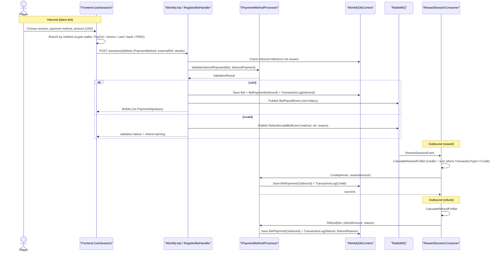

# Implementation Spec — Multiple Payment Methods

> Status: **Design / proposal**. This document is an implementation spec only. It does not implement anything.
> Feature goal: allow a Monkify game session to accept **multiple payment forms** (crypto, PayPal, Venmo, online banking, cards, and a free coin) instead of only a single Solana SPL token, and re-model the payment/audit data so every money movement (inbound stake, reward credit, refund) is fully auditable.

---

## 1. Constraints (MANDATORY — read first)

- **When changing existing code, fix the unit tests so they still pass and test the intended behavior; at the end, report which unit tests were changed.**
- **For this feature, a NEW git branch must be created and pushed in EACH affected repository (`monkify-backend` and `monkify-front`). Suggested branch name: `feature/payment-methods`.**
- **Never read or edit secrets/config files (appsettings.json, secrets.json, web.config, monkifysettings.json); assume valid config.** All provider credentials/keys (PayPal, Braintree/Venmo, Stripe, Solana owner keys, etc.) are assumed to already exist in configuration and are bound via the existing `GeneralSettings` mechanism (`Monkify.Infrastructure/DependencyInjection.cs:65-67`).
- The Central de Reservas test rule does not apply here (this is Monkify), but the spirit is the same: backend behavior changes require updating/adding unit tests in `Monkify.Tests` and reporting them.
- Migrations are applied **only** at startup of `Monkify.Consumers` via `ApplyMigrations` (`Monkify.Consumers/Program.cs:135,142-156` → `dbContext.Database.Migrate()`). No migration is applied by `Monkify.Api`. EF config is **inline** in `MonkifyDbContext.OnModelCreating` (`Monkify.Infrastructure/Data/Context/MonkifyDbContext.cs:31-129`).
- Provider is **PostgreSQL (Npgsql)** (`DependencyInjection.cs:63` `UseNpgsql`), so **JSONB columns are supported** and are used below.

---

## 2. Summary of the change

| Area | Today | After |
|------|-------|-------|
| Payment method | Single Solana SPL token only | N methods per session parameter (`PaymentMethod` enum) |
| Inbound payment proof | `Bet.PaymentSignature` (string) | `BetPayment` row (per-method reference + JSONB details) |
| Money ledger | `TransactionLog` (credit only) + separate `RefundLog`/`Refunds` table | Single `TransactionLog` audit ledger with `TransactionType` (Inbound/Credit/Refund); `RefundLog` deleted |
| Monetary unit | "tokens" (ambiguous) | **USD** everywhere (`Amount`) |
| Payment integration | `SolanaService` hard-wired in handlers/consumers | `IPaymentMethodProcessor` strategy, one impl per method, resolved by enum |
| Reward/refund math | sums all `TransactionLog.Amount` | sums only `TransactionType == Credit` |
| Frontend pay flow | crypto wallet only | branches per method + multi-currency display |

---

## 3. Data model

### 3.1 `PaymentMethod` enum (NEW)

Location: `Monkify.Domain/Bets/ValueObjects/PaymentMethod.cs` (new file; ValueObjects is where `BetStatus`, `BetValidationResult`, `BetTransactionAmountResult` live).

Use `System.ComponentModel.DescriptionAttribute`. **Integer codes are explicit and the description labels are VERBATIM (including the intentional SOL/USDC mismatch on USDT).**

```csharp
using System.ComponentModel;

namespace Monkify.Domain.Bets.ValueObjects
{
    public enum PaymentMethod
    {
        [Description("CryptoCurrency (SOL)")]
        SOL = 1,
        [Description("CryptoCurrency (USDC)")]
        USDT = 2,
        [Description("PayPal")]
        PayPal = 3,
        [Description("Venmo")]
        Venmo = 4,
        [Description("Fiat (Online banking)")]
        Fiat = 5,
        [Description("Credit card - Mastercard/Visa")]
        MastercardVisa = 6,
        [Description("FREE Coin")]
        FreeCoin = 7,
    }
}
```

Reading the description: there is an existing extension pattern (`StringValueOf()` used on enums such as `BetValidationResult` in `BetDomainService.cs:54,104` and `AllowedCharacters.StringValueOf()`). Add (or reuse) a helper to read `DescriptionAttribute`:

```csharp
public static string GetDescription(this Enum value)
{
    var field = value.GetType().GetField(value.ToString());
    var attr = field?.GetCustomAttribute<DescriptionAttribute>();
    return attr?.Description ?? value.ToString();
}
```

DECISION (§9.6): **reuse the existing `StringValueOf()`** in `Monkify.Common/Extensions/EnumExtensions.cs` — it already reads `DescriptionAttribute`. Do not add a new helper; the snippet above is illustrative of what `StringValueOf` does.

### 3.2 `TransactionType` enum (NEW)

Location: `Monkify.Domain/Bets/ValueObjects/TransactionType.cs`.

```csharp
namespace Monkify.Domain.Bets.ValueObjects
{
    public enum TransactionType
    {
        Inbound = 1,   // the stake the player paid in
        Credit = 2,    // a reward paid out to the player
        Refund = 3,    // a refund paid back to the player
    }
}
```

### 3.3 `PaymentDirection` enum (NEW, supports `BetPayment`)

```csharp
namespace Monkify.Domain.Bets.ValueObjects
{
    public enum PaymentDirection
    {
        Inbound = 1,    // money coming from the player into Monkify (the stake)
        Outbound = 2,   // money leaving Monkify to the player (reward or refund)
    }
}
```

### 3.4 `SessionParameters` → payment methods (1:N join entity)

Today `SessionParameters` (`Monkify.Domain/Sessions/Entities/SessionParameters.cs:11-32`) has no payment-method concept. Add a child collection modeled as a join table so each parameter can have N methods.

New entity `Monkify.Domain/Sessions/Entities/SessionParameterPaymentMethod.cs`:

```csharp
using Monkify.Common.Models;            // TableEntity
using Monkify.Domain.Bets.ValueObjects; // PaymentMethod

namespace Monkify.Domain.Sessions.Entities
{
    public class SessionParameterPaymentMethod : TableEntity
    {
        public SessionParameterPaymentMethod() { }
        public SessionParameterPaymentMethod(Guid parametersId, PaymentMethod method)
        {
            ParametersId = parametersId;
            PaymentMethod = method;
        }

        public SessionParameters Parameters { get; set; }
        public Guid ParametersId { get; set; }
        public PaymentMethod PaymentMethod { get; set; }   // stored as int
    }
}
```

Add to `SessionParameters`:

```csharp
public ICollection<SessionParameterPaymentMethod> PaymentMethods { get; set; }
```

### 3.5 `Bet` change — REMOVE `PaymentSignature`

Current `Bet` (`Monkify.Domain/Bets/Entities/Bet.cs`) exposes `PaymentSignature` (line 48) and sets it in two constructors (lines 25-43). The inbound proof now lives in `BetPayment`.

- Remove the `PaymentSignature` property (line 48).
- Update constructors:
  - `Bet(Guid sessionId, string seed, string paymentSignature, string wallet, string choice, decimal amount)` (lines 25-34) → drop `paymentSignature` param. Callers must instead create a `BetPayment`. The main caller is `RegisterBetHandler.HandleRequest` (`RegisterBetHandler.cs:56`).
  - `Bet(string paymentSignature, string wallet, decimal amount)` (lines 36-43) used by the refund-invalid-bet path (`RefundInvalidBetConsumer.cs:34`) → drop `paymentSignature` (the external reference is carried in the event/`BetPayment`, not on `Bet`).
- Add navigation:

```csharp
public ICollection<BetPayment> Payments { get; set; }
```

- DECISION (§9.4): `Bet.Wallet` becomes **nullable** and is crypto-only (the SOL/USDT recipient address). For all other
  methods the payee/payout destination is captured at inbound (bet) time and stored in `BetPayment.Details` (e.g. PayPal
  email, bank token). Make `Wallet` `string?` and drop its `IsRequired()` if present.

### 3.6 `BetPayment` table (NEW, "a little dynamic")

Location: `Monkify.Domain/Bets/Entities/BetPayment.cs`. One `Bet` has 1:N `BetPayment` (an inbound stake payment, plus one outbound payment per reward/refund).

```csharp
using Monkify.Common.Models;
using Monkify.Domain.Bets.ValueObjects;

namespace Monkify.Domain.Bets.Entities
{
    public class BetPayment : TableEntity
    {
        public BetPayment() { }

        public BetPayment(Guid betId, decimal amount, PaymentMethod method,
                          PaymentDirection direction, string externalReference, BetPaymentDetails details)
        {
            BetId = betId;
            Amount = amount;
            PaymentMethod = method;
            Direction = direction;
            ExternalReference = externalReference;
            Details = details;
        }

        public Bet Bet { get; set; }
        public Guid BetId { get; set; }

        // Common columns
        public decimal Amount { get; set; }                 // USD value of THIS payment
        public PaymentMethod PaymentMethod { get; set; }    // int
        public PaymentDirection Direction { get; set; }     // Inbound (stake) / Outbound (reward/refund)
        public string ExternalReference { get; set; }       // replaces the old TransactionLog.Signature role:
                                                            //   - SOL/USDT: the on-chain tx signature
                                                            //   - PayPal/Venmo: capture/order id
                                                            //   - Stripe (card/ACH): PaymentIntent / Charge id
                                                            //   - FreeCoin: null / synthetic id

        // Dynamic, method-specific payload (PostgreSQL JSONB)
        public BetPaymentDetails Details { get; set; }      // strongly-typed POCO, Npgsql-mapped to jsonb
    }
}
```

DECISION (§9.2): `Details` is a **strongly-typed POCO mapped to `jsonb`** via Npgsql, not a raw string. Define a
`BetPaymentDetails` type (a base/owned type or a polymorphic shape covering all methods' fields, or per-method derived
types) and map it with the Npgsql JSON support, e.g.:

```csharp
builder.Property(x => x.Details).HasColumnType("jsonb");
// with Npgsql: options.UseNpgsql(conn, o => o.EnableDynamicJson()) OR a ValueConverter<BetPaymentDetails,string>
```

Each `IPaymentMethodProcessor` reads/writes its own fields on `BetPaymentDetails`. Per-method payload fields:

- **SOL / USDT**: `{ "signature": "...", "mintAddress": "...", "fromWallet": "...", "toOwner": "...", "decimals": 9, "rawAmount": "..." }`
- **PayPal**: `{ "orderId": "...", "captureId": "...", "payerId": "...", "currency": "USD", "status": "COMPLETED" }`
- **Venmo (via Braintree)**: `{ "transactionId": "...", "paymentMethodNonce": "...", "venmoUsername": "...", "status": "settled" }`
- **Fiat (online banking, via Stripe ACH/bank debit)**: `{ "paymentIntentId": "...", "mandateId": "...", "bankName": "...", "last4": "...", "status": "succeeded" }`
- **Mastercard/Visa (via Stripe cards)**: `{ "paymentIntentId": "...", "chargeId": "...", "brand": "visa", "last4": "...", "status": "succeeded" }`
- **FREE Coin**: `{ "reason": "free entry" }` (no real charge)

### 3.7 `TransactionLog` becomes the AUDIT LEDGER

Current `TransactionLog` (`Monkify.Domain/Bets/Entities/TransactionLog.cs`) has `BetId`, `Amount`, `Signature`. New shape:

```csharp
using Monkify.Common.Models;
using Monkify.Domain.Bets.ValueObjects;

namespace Monkify.Domain.Bets.Entities
{
    public class TransactionLog : TableEntity
    {
        public TransactionLog() { }

        public TransactionLog(Guid betId, Guid betPaymentId, decimal amount,
                              TransactionType transactionType, string? refundReason = null)
        {
            BetId = betId;
            BetPaymentId = betPaymentId;
            Amount = amount;
            TransactionType = transactionType;
            RefundReason = refundReason;
        }

        public Bet Bet { get; set; }
        public Guid BetId { get; set; }                      // KEEP

        public BetPayment Payment { get; set; }
        public Guid BetPaymentId { get; set; }               // NEW FK (NOT NULL — decision §9.3)

        public decimal Amount { get; set; }                  // REAL value of this movement (USD):
                                                            //   Inbound -> stake paid; Credit -> reward; Refund -> refund
        public TransactionType TransactionType { get; set; } // NEW
        public string? RefundReason { get; set; }            // NEW, non-null ONLY for Refund (migrated from RefundLog.Reason)
    }
}
```

Notes:
- The old `Signature` field is **removed**; its role (external reference) moves to `BetPayment.ExternalReference`.
- DECISION (§9.3): `BetPaymentId` is **NOT NULL** — every ledger row points at the `BetPayment` that effected the
  movement. The data migration (§3.11) must backfill a `BetPayment` for every pre-existing `TransactionLog` row before
  the FK is enforced.
- A single `Bet` can have MULTIPLE `TransactionLog`s of mixed types (e.g. partial credit, remaining credit, refund) — all auditable.

### 3.8 DELETE `RefundLog` / `Refunds` table

- Delete entity `Monkify.Domain/Bets/Entities/RefundLog.cs`.
- Remove `DbSet<RefundLog> Refunds` (`MonkifyDbContext.cs:23`) and its Fluent config (`MonkifyDbContext.cs:119-128`).
- The information previously kept in `RefundLog`:
  - `Reason` → migrates to `TransactionLog.RefundReason` (for `TransactionType.Refund` rows).
  - `Wallet` → available via `Bet.Wallet` (refunds are now bet-linked) or `BetPayment` payee details.
  - `Signature` → `BetPayment.ExternalReference`.
  - `Amount` → `TransactionLog.Amount` (and `BetPayment.Amount`).

> Behavior change: the legacy `RefundInvalidBet` flow refunds by `(wallet, signature, value, reason)` **without** a `Bet`/ledger row (`RefundInvalidBetConsumer.cs:34-37`, `SolanaService.RefundTokens` writes to `Refunds`). After this change refunds are recorded as `TransactionLog(Refund)` + `BetPayment(Outbound)`. DECISION (§9.5): for the invalid-bet path that has no persisted `Bet`, **persist a minimal `Bet` in `NeedsRefunding` status** so the ledger (`TransactionLog`/`BetPayment`, both requiring a `BetId`) stays consistent.

### 3.9 "tokens" → "amount" / USD audit

All backend monetary values are **USD**. Rename/clarify:

| Location | Today | Action |
|----------|-------|--------|
| `RegisterBetRequestBody.Amount` comment (`RegisterBetRequestBody.cs:16`) | "Bet amount in number of tokens is required." | Reword to "Bet amount in USD is required." |
| `SessionParameters.RequiredAmount` (`SessionParameters.cs:24`) | name is fine ("amount") | Keep name; treat as USD. **Keep `HasPrecision(18,9)`** (decision §9.7 — no risky data migration). |
| `Bet.Amount` (`Bet.cs:52`) | fine | Keep; USD; keep `(18,9)`. |
| `BetTransactionAmountResult.ValueInTokens` (`BetTransactionAmountResult.cs:23`) | crypto-specific | **Rename to `ValueInSmallestUnit`** (decision §9.7); it is the smallest-unit integer for a crypto transfer, only meaningful for SOL/USDT processors. |
| `TokenSettings.Decimals` | crypto-specific | Stays; used only by crypto processors. |
| Any DB column literally named with "token" | — | Audit migration column names; none of `SessionParameters`/`Bet`/`TransactionLog` columns are literally "Token*", so this is mostly the request-body comment + doc. |

Frontend mirrors the same rename (see §6): `GameTypeCard.vue:78` literally renders `MONKI Per Ticket`, which should become a generic/USD label.

### 3.10 EF Fluent config additions (`MonkifyDbContext.OnModelCreating`)

All config is inline. Changes:

1. **DbSets** (top of `MonkifyDbContext`):
   - Add `public DbSet<BetPayment> BetPayments { get; set; }`
   - Add `public DbSet<SessionParameterPaymentMethod> SessionParameterPaymentMethods { get; set; }`
   - **Remove** `public DbSet<RefundLog> Refunds { get; set; }` (line 23).

2. **`SessionParameters` builder** (lines 33-47): add
   ```csharp
   builder.HasMany(x => x.PaymentMethods)
          .WithOne(x => x.Parameters)
          .HasForeignKey(x => x.ParametersId);
   ```

3. **`SessionParameterPaymentMethod`** (new builder):
   ```csharp
   modelBuilder.Entity<SessionParameterPaymentMethod>(builder =>
   {
       builder.HasKey(x => x.Id);
       builder.Property(x => x.ParametersId).IsRequired();
       builder.Property(x => x.PaymentMethod).IsRequired();   // int
       builder.HasIndex(x => x.ParametersId);
       builder.HasIndex(x => new { x.ParametersId, x.PaymentMethod }).IsUnique();
   });
   ```

4. **`Bet` builder** (lines 87-102): remove `builder.Property(x => x.PaymentSignature)...` (line 91) and `builder.HasIndex(x => x.PaymentSignature)` (line 100). Add:
   ```csharp
   builder.HasMany(x => x.Payments).WithOne(x => x.Bet).HasForeignKey(x => x.BetId);
   ```

5. **`BetPayment`** (new builder):
   ```csharp
   modelBuilder.Entity<BetPayment>(builder =>
   {
       builder.HasKey(x => x.Id);
       builder.Property(x => x.Amount).HasPrecision(18, 9).IsRequired();   // USD value; keep (18,9) per §9.7
       builder.Property(x => x.PaymentMethod).IsRequired();
       builder.Property(x => x.Direction).IsRequired();
       builder.Property(x => x.ExternalReference).HasMaxLength(200);
       builder.Property(x => x.Details).HasColumnType("jsonb");   // strongly-typed POCO (§9.2)
       builder.HasIndex(x => x.BetId);
       builder.HasIndex(x => x.ExternalReference);
       builder.HasIndex(x => x.PaymentMethod);
   });
   ```

6. **`TransactionLog` builder** (lines 110-117): replace `Signature` config with:
   ```csharp
   modelBuilder.Entity<TransactionLog>(builder =>
   {
       builder.HasKey(x => x.Id);
       builder.Property(x => x.Amount).HasPrecision(18, 9).IsRequired();   // USD value; keep (18,9) per §9.7
       builder.Property(x => x.TransactionType).IsRequired();
       builder.Property(x => x.RefundReason).HasMaxLength(300);            // nullable, Refund-only
       builder.Property(x => x.BetPaymentId).IsRequired();                 // NOT NULL (§9.3)
       builder.HasOne(x => x.Payment).WithMany().HasForeignKey(x => x.BetPaymentId);
       builder.HasIndex(x => x.BetId);
       builder.HasIndex(x => new { x.BetId, x.TransactionType });
   });
   ```

7. **`RefundLog` builder** (lines 119-128): **delete entirely.**

### 3.11 Migration plan (applied in `Monkify.Consumers`)

Create ONE new migration in `Monkify.Infrastructure/Migrations/` (e.g. `<timestamp>_PaymentMethods.cs`). It must:

1. `CreateTable` `SessionParameterPaymentMethods` (+ FK to `SessionParameters`, unique index on `(ParametersId, PaymentMethod)`).
2. `CreateTable` `BetPayments` (with `Details` as `jsonb`, FK to `SessionBets`, indexes).
3. `AddColumn` to `TransactionLogs`: `BetPaymentId` (uuid, **added nullable first** to allow backfill), `TransactionType` (int), `RefundReason` (text/varchar(300), nullable).
4. **Data migration** for existing `TransactionLogs`: set `TransactionType = Credit` for all existing rows (today they only ever hold reward credits — written by `SolanaService.TransferTokensForBet` `SolanaService.cs:104`). Because `BetPaymentId` is **NOT NULL** in the final model (decision §9.3), create a `BetPayment(Outbound, Credit)` row per existing log carrying `ExternalReference = Signature` and link it (`BetPaymentId`). Then `DropColumn` `Signature` from `TransactionLogs` and its index, and `AlterColumn` `BetPaymentId` to NOT NULL + add the FK.
5. **Data migration from `Refunds`**: for each existing `RefundLog`, persist a minimal `Bet` (`NeedsRefunding`) when one cannot be linked (decision §9.5), then create a `BetPayment(Outbound, Refund)` (`ExternalReference = Refunds.Signature`) and a `TransactionLog` with `TransactionType = Refund`, `Amount = Refunds.Amount`, `RefundReason = Refunds.Reason`, `BetPaymentId` set. Then `DropTable` `Refunds`.
6. `DropColumn` `PaymentSignature` and `DropIndex` `IX_SessionBets_PaymentSignature` from `SessionBets`.
7. Optionally seed default payment methods for the default parameters (see §3.12).

Because EF applies migrations through `dbContext.Database.Migrate()` at Consumers startup, the migration is a normal `Up`/`Down` pair. Update `MonkifyDbContextModelSnapshot.cs` (auto-generated by `dotnet ef migrations add`).

> SQL ordering caution: write raw `migrationBuilder.Sql(...)` for steps 4–5 (data backfill) **before** dropping `Signature`/`Refunds`, so no data is lost.

### 3.12 Seeding (`DefaultSessionParameters`)

`DefaultSessionParameters.GenerateDefaultParameters()` (`Monkify.Consumers/DefaultSessionParameters.cs:8-108`) builds default parameters and is inserted in `CreateDefaultSessionParametersAsync` (`Program.cs:169-189`). Extend each default parameter with a `PaymentMethods` collection so seeded games expose at least the crypto methods (e.g. `SOL`, `USDT`, `FreeCoin`), e.g.:

```csharp
PaymentMethods = new Collection<SessionParameterPaymentMethod>()
{
    new(default, PaymentMethod.SOL),
    new(default, PaymentMethod.USDT),
    new(default, PaymentMethod.FreeCoin),
}
```
(EF sets `ParametersId` from the owning parameter on insert; the `default` placeholder is overwritten by the relationship fixup.)

---

## 4. Payment-method strategy (per-method processors)

### 4.1 Interface

Location: `Monkify.Infrastructure/Services/Payments/IPaymentMethodProcessor.cs`.

```csharp
public interface IPaymentMethodProcessor
{
    PaymentMethod Method { get; }

    // Validate the inbound payment the user made (reads proof/details from the BetPayment + Bet).
    Task<ValidationResult> ValidateInboundPayment(Bet bet, BetPayment inboundPayment);

    // Pay the user when they win.
    Task<bool> Credit(Bet bet, BetTransactionAmountResult amount);

    // Pay the user back when a refund is required.
    Task<bool> Refund(Bet bet, BetTransactionAmountResult amount, string reason);
}
```

Reuse existing result types: `ValidationResult` (`Monkify.Common.Results`, already returned by `ISolanaService.ValidateBetPayment`) and `BetTransactionAmountResult` (`Monkify.Domain/Bets/ValueObjects/BetTransactionAmountResult.cs`).

**Ledger writes happen inside each processor** (mirroring how `SolanaService` writes `TransactionLog`/`RefundLog` today): on a successful `Credit`, write a `BetPayment(Outbound)` + `TransactionLog(Credit)`; on a successful `Refund`, write `BetPayment(Outbound)` + `TransactionLog(Refund, RefundReason=reason)`. For inbound, the `BetPayment(Inbound)` + `TransactionLog(Inbound)` are created in the registration flow (see §5) and validated by the processor.

### 4.2 Resolution (factory / keyed DI)

DECISION (§9.8): use **keyed DI** (.NET 8). Register each processor with
`services.AddKeyedScoped<IPaymentMethodProcessor, SolanaPaymentProcessor>(PaymentMethod.SOL)` etc., then resolve with
`serviceProvider.GetRequiredKeyedService<IPaymentMethodProcessor>(method)`. A thin
`IPaymentMethodProcessorFactory` wrapper over keyed resolution is optional (useful for testability/mock-by-method).

Register in `Monkify.Infrastructure/DependencyInjection.cs:35-69` (`AddDefaultServices`), alongside the existing `services.AddScoped<ISolanaService, SolanaService>()` (line 40).

### 4.3 Implementations (one class per method)

Location: `Monkify.Infrastructure/Services/Payments/Processors/`.

1. **`SolanaPaymentProcessor`** (`PaymentMethod.SOL`) and **`UsdtPaymentProcessor`** (`PaymentMethod.USDT`):
   - Refactor `SolanaService` (`Monkify.Infrastructure/Services/Solana/SolanaService.cs`) so its core transfer/validate logic is reusable, then have these processors delegate to it.
   - `ValidateInboundPayment`: today `ValidateBetPayment(Bet)` reads `bet.PaymentSignature` (`SolanaService.cs:181,185`). Change it to read the signature from `inboundPayment.ExternalReference` (and mint/decimals from `inboundPayment.Details` / `TokenSettings`). SOL vs USDT differ by mint address / decimals (per §9.1, USDT uses the USDC mint to match the verbatim `[Description]` label).
   - `Credit`: delegates to existing `TransferTokensForBet` logic (`SolanaService.cs:86-113`) but now also writes `BetPayment(Outbound, Credit)` and `TransactionLog(BetId, BetPaymentId, amount.Value, TransactionType.Credit)` (replacing `new TransactionLog(bet.Id, amount.Value, result.Result)` at `SolanaService.cs:104`).
   - `Refund`: delegates to existing `RefundTokens` logic (`SolanaService.cs:115-145`) but writes `BetPayment(Outbound, Refund)` + `TransactionLog(..., TransactionType.Refund, RefundReason=reason)` instead of `RefundLog`/`context.Refunds` (`SolanaService.cs:136`).

2. **`FreeCoinPaymentProcessor`** (`PaymentMethod.FreeCoin`) — DECISION (§9.9):
   - `ValidateInboundPayment`: always returns a valid `ValidationResult()` (no real charge). The inbound `BetPayment`
     is created with `ExternalReference = null` and `Details = {"reason":"free entry"}`; the `TransactionLog(Inbound)`
     records `Amount` = the parameter's `RequiredAmount` purely for audit (the bet is "considered paid").
   - `Credit` / `Refund`: **do not move money and write NO extra ledger rows** — only
     `Log.Information("FreeCoin credit/refund for bet {BetId}, amount {Amount}, reason {Reason}", ...)` and return `true`.

3. **`PayPalPaymentProcessor`** (`PaymentMethod.PayPal`) — **full real integration**:
   - Provider (confirmed, §9.1): **PayPal Server SDK** (`PayPalServerSDK` / Orders v2 + Payments v2 APIs). Credentials from config.
   - `ValidateInboundPayment`: capture/verify the order using `inboundPayment.ExternalReference` (order id) — call Orders `GET /v2/checkout/orders/{id}` (or capture if client only authorized), assert `status == COMPLETED`, currency `USD`, and amount == `bet.Amount`. Persist capture id into `Details`.
   - `Credit` (winner payout): **PayPal Payouts API** from the prefunded PayPal house balance (§4.3.1) to the player's PayPal account (payee identity captured at inbound and stored in `BetPayment.Details`, decision §9.4). Record `BetPayment(Outbound)` + `TransactionLog(Credit)`.
   - `Refund`: **Payments v2 refund** (`POST /v2/payments/captures/{capture_id}/refund`) against the original capture id. Record ledger rows with `RefundReason`.

4. **`VenmoPaymentProcessor`** (`PaymentMethod.Venmo`) — **full real integration**:
   - Provider (confirmed, §9.1): **Braintree SDK** (Venmo is a Braintree/PayPal payment method). Credentials from config.
   - `ValidateInboundPayment`: create/confirm a Braintree sale transaction from the Venmo nonce (`Details.paymentMethodNonce`) or look up the transaction by `ExternalReference`; assert settled/submitted-for-settlement and amount.
   - `Credit`: Venmo payouts are limited; pay from the house float via Braintree/PayPal payout where available, otherwise mark `NeedsManualAnalysis` (decision §9.10 / §4.3.1). Record ledger rows.
   - `Refund`: `gateway.Transaction.Refund(transactionId, amount)`. Record ledger rows.

5. **`OnlineBankingPaymentProcessor`** (`PaymentMethod.Fiat`) — **full real integration**:
   - Provider (confirmed, §9.1): **Stripe** ACH Direct Debit / bank-debit PaymentIntents (`us_bank_account`) or a bank-redirect method depending on region.
   - `ValidateInboundPayment`: retrieve the `PaymentIntent` by `ExternalReference`; assert `status == succeeded`, currency USD, amount.
   - `Credit`: payout to the player's bank via Stripe Transfers/Payouts to a connected account, or queue for manual/ACH credit if no connected account (9.10). Record ledger rows.
   - `Refund`: `Stripe Refunds.Create(new RefundCreateOptions { PaymentIntent = ... })`. Record ledger rows.

6. **`CardPaymentProcessor`** (`PaymentMethod.MastercardVisa`) — **full real integration**:
   - Provider (confirmed, §9.1): **Stripe** card PaymentIntents.
   - `ValidateInboundPayment`: retrieve `PaymentIntent`/charge by `ExternalReference`; assert `status == succeeded`, captured, currency USD, amount; persist `chargeId`, `brand`, `last4` into `Details`.
   - `Credit`: payout (Stripe Transfer/Payout to connected account) or manual queue (9.10).
   - `Refund`: `Stripe Refunds.Create(...)` against the charge/PaymentIntent. Record ledger rows.

All four real providers: add their SDK NuGet packages to `Monkify.Infrastructure`; bind provider settings from the existing `GeneralSettings` config (do not read config files; assume keys present). Provider/SDK choices are **confirmed** (decision §9.1): PayPal Server SDK; Venmo via Braintree; Fiat via Stripe ACH; Cards via Stripe.

### 4.3.1 Payout funding model (decision §9.10) — prefunded "house" accounts

Every processor pays Credits/Refunds out of a configurable, **prefunded house account per provider** (the SOURCE of
funds), mirroring how the Solana owner/sender account already works:

- **Crypto (SOL/USDT):** the existing owner/sender token account (already a funded float).
- **PayPal:** the PayPal **business balance**; disburse via the **Payouts API** to the player's PayPal email.
- **Stripe (cards / bank):** the Stripe **platform balance**; disburse via Connect transfers / Payouts.

Destination + rules:
- **Refunds** (return the stake) always **reverse the original charge** (works on every rail; no destination needed) —
  PayPal/ Stripe refund the original capture/PaymentIntent, crypto sends back to the wallet.
- **Credits/winnings** (can exceed the stake) **push from the house float to the player's identifier**: crypto wallet
  (`Bet.Wallet`) or PayPal email (from `BetPayment.Details`). For **card/bank** winners where no payout destination is
  available, the processor marks the bet **`NeedsManualAnalysis`** (existing status) for a human to settle, rather than
  attempting an impossible card push.

So the float solves "where the money comes from"; the per-method destination (captured at inbound, §9.4) or the
charge-reversal path solves "where it goes". The house-account identifiers/keys come from config (assumed present).

### 4.4 Consumers/handlers wired to the strategy

- `RewardSessionConsumer` (`Monkify.Infrastructure/Consumers/RewardSession/RewardSessionConsumer.cs:70,92`) currently resolves `ISolanaService` and calls `TransferTokensForBet`. Change to resolve the processor for each winner bet's inbound method (derive method from the bet's inbound `BetPayment.PaymentMethod`) and call `processor.Credit(winner, rewardResult)`.
- `RefundInvalidBetConsumer` (`Monkify.Infrastructure/Consumers/RefundInvalidBet/RefundInvalidBetConsumer.cs:32,37`) currently resolves `ISolanaService` and calls `RefundTokens`. Change to resolve the processor by the method that was paid in and call `processor.Refund(bet, refundAmount, reason)`. The `RefundInvalidBetEvent` (`RefundInvalidBetEvent.cs:9`, record `(Wallet, PaymentSignature, Value, Reason)`) must carry `PaymentMethod` and the external reference instead of `PaymentSignature` (e.g. `(Wallet, PaymentMethod, ExternalReference, BetPaymentDetailsJson, Value, Reason)`), and `RegisterBetHandler.RefundInvalidBet` (`RegisterBetHandler.cs:120-124`) must publish it accordingly.
- Any other refund consumer (`Monkify.Infrastructure/Consumers/RefundBet/`) follows the same substitution.

---

## 5. Updated bet / reward / refund flow

### 5.1 Inbound (placing a bet) — `RegisterBetHandler`

Current `RegisterBetHandler` (`RegisterBetHandler.cs:54-124`):
- builds `Bet` with `request.Body.PaymentSignature` (line 56),
- `ValidateBetSignature` checks signature reuse via `Context.SessionBets.AnyAsync(x => x.PaymentSignature == ...)` (line 72) then `_solanaService.ValidateBetPayment(_bet)` (line 77).

New behavior:
1. Build `Bet` (no `PaymentSignature`).
2. Build an **inbound** `BetPayment` from the request: `PaymentMethod`, `ExternalReference` (e.g. on-chain signature / PayPal order id / Stripe PaymentIntent id), `Direction = Inbound`, `Amount = request.Body.Amount`, `Details` JSON.
3. Replace the signature-reuse check with an **external-reference-reuse** check per method: `Context.BetPayments.AnyAsync(x => x.PaymentMethod == m && x.ExternalReference == r && x.Direction == Inbound)` (only for methods where references must be unique — crypto signatures, PayPal capture ids, Stripe PaymentIntents; not FreeCoin). Reuse the existing `ErrorMessages.PaymentSignatureHasBeenUsed` (or add a generic `PaymentReferenceHasBeenUsed`).
4. Resolve processor by method, call `processor.ValidateInboundPayment(bet, inboundPayment)`.
5. On success: persist `Bet` + inbound `BetPayment` + `TransactionLog(BetId, BetPaymentId, Amount, TransactionType.Inbound)`.
6. Validate parameters/choice as today (`ValidateBetParameters`, `BetDomainService.ChoiceIsValidForSession` at `RegisterBetHandler.cs:101`). Note `ChoiceIsValidForSession` compares `bet.Amount != session.Parameters.RequiredAmount` (`BetDomainService.cs:46`) — unchanged (USD).
7. Also validate the chosen `PaymentMethod` is in `session.Parameters.PaymentMethods` (NEW guard) → otherwise refund/invalid.

`RegisterBetRequestBody` gains `PaymentMethod` and optional method-specific fields (see §6.3). `BetDto` no longer exposes `PaymentSignature` (§6.2).

### 5.2 Outbound (reward) — `RewardSessionConsumer`

Per winner: `rewardResult = betService.CalculateRewardForBet(winner)` (`RewardSessionConsumer.cs:88`), then `processor.Credit(winner, rewardResult)` which writes `BetPayment(Outbound, Credit)` + `TransactionLog(Credit)`.

### 5.3 Outbound (refund) — refund consumers

`refundAmount = BetDomainService.CalculateRefundForBet/ForInvalidBet(...)`, then `processor.Refund(bet, refundAmount, reason)` which writes `BetPayment(Outbound, Refund)` + `TransactionLog(Refund, RefundReason=reason)`.

### 5.4 `CalculateCreditsForBet` filter change (CRITICAL)

Today `CalculateCreditsForBet` (`BetDomainService.cs:119-127`) sums **all** `bet.TransactionLogs`:

```csharp
credits = bet.TransactionLogs.Sum(x => x.Amount);
```

Because the ledger will now also contain **Inbound** (stake) and **Refund** rows, summing everything would corrupt reward and refund math (`CalculateRewardForBet` line 71-72; `CalculateRemainingBetPayout` line 96-99). It MUST sum **only credits**:

```csharp
credits = bet.TransactionLogs
             .Where(x => x.TransactionType == TransactionType.Credit)
             .Sum(x => x.Amount);
```

This keeps `CalculateRewardForBet` and `CalculateRefundForBet/ForInvalidBet` correct: rewards already paid (Credit) are subtracted, while the player's own Inbound stake and any Refund rows never reduce the remaining reward/refund.

### 5.5 Sequence diagram



---

## 6. API contract & Frontend

### 6.1 `active-types` — return payment methods per parameter

`GetActiveParameters` (`SessionsController.cs:49-51`) → `GetActiveParametersHandler` (`GetActiveParametersHandler.cs:24-32`) maps each `SessionParameters` to `SessionParametersDto` (`SessionParametersDto.cs:11-24`).

Add to `SessionParametersDto`:

```csharp
public IEnumerable<PaymentMethodDto> PaymentMethod { get; set; } =
    parameters.PaymentMethods?.Select(x => new PaymentMethodDto(x.PaymentMethod))
    ?? Enumerable.Empty<PaymentMethodDto>();
```

with:

```csharp
public class PaymentMethodDto
{
    public PaymentMethodDto(PaymentMethod method)
    {
        Code = (int)method;
        Description = method.GetDescription();   // reads DescriptionAttribute
    }
    public int Code { get; set; }
    public string Description { get; set; }
}
```

Resulting JSON per parameter includes:
```json
"paymentMethod": [ { "code": 1, "description": "CryptoCurrency (SOL)" }, { "code": 7, "description": "FREE Coin" } ]
```

> The source `SessionParameters` must have `PaymentMethods` loaded. `GetAllActiveSessionParameters` is served from cache (`Program.cs:177,187`); the merged EF query adds `.Include(x => x.PaymentMethods)` and the per-operator cache stores them (resolved by mending §11.5).

### 6.2 `BetDto` change

`BetDto` (`Contracts/Sessions/BetDto.cs:9`) currently exposes `PaymentSignature = bet.PaymentSignature`. Since `Bet.PaymentSignature` is removed:
- Remove the `PaymentSignature` property, **or**
- Replace it with the inbound payment's reference + method, e.g.:
  ```csharp
  public int? PaymentMethod { get; set; } = (int?)bet.Payments?.FirstOrDefault(p => p.Direction == PaymentDirection.Inbound)?.PaymentMethod;
  public string? PaymentReference { get; set; } = bet.Payments?.FirstOrDefault(p => p.Direction == PaymentDirection.Inbound)?.ExternalReference;
  ```
Recommended: **remove** `PaymentSignature` from public `BetDto` (it leaked an on-chain signature; the frontend only needs wallet/choice/amount/won/date). Update `ActiveSessionDto.Bets` mapping (`ActiveSessionDto.cs:20`) accordingly (no change needed beyond the DTO).

Frontend consumers of the old field: `AppliedBet.paymentSignature` (`src/types/index.ts:50`), the websocket bet push (`useSession.ts:147-154` reads `newBet.paymentSignature`), and `BodySessionBet.paymentSignature` (`src/types/index.ts:67`). These must be updated to the new shape (§6.4).

### 6.3 `RegisterBetRequestBody` changes

`RegisterBetRequestBody` (`RegisterBetRequestBody.cs`):
- `PaymentSignature` (line 12-13) → repurpose as generic `ExternalReference` (still required for crypto/PayPal/Stripe, not for FreeCoin), or keep `PaymentSignature` for crypto and add a separate per-method field. Recommended: add `public PaymentMethod PaymentMethod { get; set; }` (required) and `public string? ExternalReference { get; set; }` plus `public Dictionary<string,string>? PaymentDetails { get; set; }` (serialized into `BetPayment.Details`). Make `ExternalReference` conditionally required (required unless `PaymentMethod == FreeCoin`).
- Update the `Amount` comment (line 16) to "Bet amount in USD is required."

### 6.4 Frontend

Repo: `monkify-front` (Vue 3 + TS, Tailwind/DaisyUI, axios).

**a) Types** (`src/types/index.ts`):
- Add `enum PaymentMethod { SOL=1, USDT=2, PayPal=3, Venmo=4, Fiat=5, MastercardVisa=6, FreeCoin=7 }` and `interface PaymentMethodOption { code: number; description: string }`.
- `ActiveSession` (lines 17-29): add `paymentMethod: PaymentMethodOption[]`.
- `AppliedBet` (lines 48-55) & websocket push (`useSession.ts:147-154`): drop `paymentSignature` (or rename to `paymentReference`).
- `BodySessionBet` (lines 66-72): replace `paymentSignature` with `paymentMethod: number` + `externalReference?: string` + `paymentDetails?: Record<string,string>`.

**b) Game-select payment-method icons** (`GameTypeCard.vue` / `GameTypes.vue`):
- `GameTypeCard.vue:77-79` renders the price (`${{ session.requiredAmount }} MONKI Per Ticket`). Add a row of **per-method icons** below the price using `session.paymentMethod`. Add icon assets under `src/assets/payments/` (e.g. `sol.png`, `usdc.png`, `paypal.png`, `venmo.png`, `bank.png`, `card.png`, `free.png`), and a `code → icon` map. Reuse the token icon `@/assets/coin.png` (used by `src/components/TokenBalance.vue`) for the FREE coin / crypto where appropriate.
- Render with a tooltip/`title` = `description` (verbatim label).

**c) Multi-currency display (client-side only):**
- Backend amounts are **USD**. Add a `useCurrency` composable (`src/hooks/useCurrency.ts`) + a currency `<select>` (e.g. in the header or on the game card) letting the user pick any display currency.
- Fetch rates client-side from a public API (confirmed, §9.1):
  - Fiat: **exchangerate.host** (`https://api.exchangerate.host/latest?base=USD`).
  - Crypto: **CoinGecko** (`https://api.coingecko.com/api/v3/simple/price?ids=solana,usd-coin&vs_currencies=usd,<fiat>`).
- Display only: `displayAmount = requiredAmountUSD * rate`. Bets are still **settled at the USD-equivalent** — never send the converted value to the backend. Update `GameTypeCard.vue:78` to show converted amount + selected currency symbol (and keep a "≈ $X USD" hint).

**d) Bet-flow branching** (`useSession.ts` `bet()` lines 171-208, currently always `sendToken(...)` `useConnection.ts:127-189`):
- Branch by `selectedSession.value.paymentMethod` / user-selected method:
  - **SOL / USDT**: keep the existing on-chain `sendToken` flow; the returned `signature` becomes `externalReference` (instead of `paymentSignature`).
  - **PayPal**: PayPal JS SDK Buttons → on approve/capture, send `externalReference = orderId/captureId`.
  - **Venmo**: Braintree/Venmo SDK drop-in → send `externalReference = transactionId`, `paymentDetails.paymentMethodNonce`.
  - **Card / Fiat**: Stripe.js + Elements / Payment Element → confirm PaymentIntent client-side, send `externalReference = paymentIntentId`.
  - **FREE Coin**: no charge — skip any provider call, POST the bet with `paymentMethod = FreeCoin` and no `externalReference`.
- Build `BodySessionBet` with the new fields and POST via `mainService.applyBet` (`src/services/mainService.ts:25-31`, unchanged signature).

**e) Labels/"tokens" → USD:** update `GameTypeCard.vue:78` and any "MONKI/token" wording to USD-based copy.

---

## 7. File-by-file change list

### Backend (`monkify-backend`)

| File | Change |
|------|--------|
| `Monkify.Domain/Bets/ValueObjects/PaymentMethod.cs` | **NEW** enum with `[Description]` |
| `Monkify.Domain/Bets/ValueObjects/TransactionType.cs` | **NEW** enum |
| `Monkify.Domain/Bets/ValueObjects/PaymentDirection.cs` | **NEW** enum |
| `Monkify.Domain/Bets/Entities/Bet.cs` | Remove `PaymentSignature` (line 48) + ctor params (25-43); add `ICollection<BetPayment> Payments` |
| `Monkify.Domain/Bets/Entities/BetPayment.cs` | **NEW** entity (JSONB `Details`) |
| `Monkify.Domain/Bets/Entities/TransactionLog.cs` | Add `BetPaymentId`, `TransactionType`, `RefundReason`; remove `Signature`; new ctor |
| `Monkify.Domain/Bets/Entities/RefundLog.cs` | **DELETE** |
| `Monkify.Domain/Sessions/Entities/SessionParameters.cs` | Add `ICollection<SessionParameterPaymentMethod> PaymentMethods` |
| `Monkify.Domain/Sessions/Entities/SessionParameterPaymentMethod.cs` | **NEW** join entity |
| `Monkify.Domain/Bets/Services/BetDomainService.cs` | `CalculateCreditsForBet` filter `TransactionType == Credit` (lines 119-127) |
| `Monkify.Common/Extensions/*` | Add/confirm `GetDescription()` enum helper |
| `Monkify.Infrastructure/Data/Context/MonkifyDbContext.cs` | DbSets (+BetPayments, +SessionParameterPaymentMethods, −Refunds); Fluent config per §3.10 |
| `Monkify.Infrastructure/Migrations/<ts>_PaymentMethods.cs` (+ Designer + snapshot) | **NEW** migration per §3.11 |
| `Monkify.Infrastructure/Services/Payments/IPaymentMethodProcessor.cs` | **NEW** |
| `Monkify.Infrastructure/Services/Payments/IPaymentMethodProcessorFactory.cs` | **NEW** (or keyed DI) |
| `Monkify.Infrastructure/Services/Payments/Processors/{Solana,Usdt,FreeCoin,PayPal,Venmo,OnlineBanking,Card}PaymentProcessor.cs` | **NEW** (7 impls) |
| `Monkify.Infrastructure/Services/Solana/SolanaService.cs` + `ISolanaService.cs` | Refactor: read ref from `BetPayment`; write ledger via new shape; remove `RefundLog`/`Refunds` writes (lines 104,136,181,185) |
| `Monkify.Infrastructure/DependencyInjection.cs` | Register processors + factory (near line 40) |
| `Monkify.Infrastructure/Handlers/Sessions/RegisterBet/RegisterBetHandler.cs` | Build `BetPayment`, reference-reuse check, processor validation, persist ledger, validate method allowed (lines 54-124) |
| `Monkify.Infrastructure/Handlers/Sessions/RegisterBet/RegisterBetRequestBody.cs` | Add `PaymentMethod`, `ExternalReference`, `PaymentDetails`; fix comment (line 16) |
| `Monkify.Infrastructure/Contracts/Sessions/SessionParametersDto.cs` | Add `PaymentMethod` array + `PaymentMethodDto` |
| `Monkify.Infrastructure/Contracts/Sessions/BetDto.cs` | Remove/replace `PaymentSignature` (line 9) |
| `Monkify.Infrastructure/Consumers/RewardSession/RewardSessionConsumer.cs` | Use processor `Credit` (lines 70,92) |
| `Monkify.Infrastructure/Consumers/RefundInvalidBet/RefundInvalidBetConsumer.cs` + `RefundInvalidBetEvent.cs` | Use processor `Refund`; carry method+reference instead of signature |
| `Monkify.Infrastructure/Consumers/RefundBet/*` | Same processor substitution |
| `Monkify.Consumers/DefaultSessionParameters.cs` | Seed `PaymentMethods` per default parameter |
| `Monkify.Infrastructure` `.csproj` | Add provider SDK NuGet packages (PayPal, Braintree, Stripe) |

### Frontend (`monkify-front`)

| File | Change |
|------|--------|
| `src/types/index.ts` | Add `PaymentMethod` enum + `PaymentMethodOption`; update `ActiveSession`, `AppliedBet`, `BodySessionBet` |
| `src/components/game-selection/GameTypeCard.vue` | Render method icons; USD/multi-currency price (lines 77-79) |
| `src/components/game-selection/GameTypes.vue` | Pass through payment methods (mapping in `types` computed, lines 42-60) |
| `src/assets/payments/*` | **NEW** per-method icons |
| `src/hooks/useCurrency.ts` | **NEW** FX/crypto rates + selected currency |
| `src/components/CurrencySelector.vue` | **NEW** currency `<select>` |
| `src/hooks/useSession.ts` | Branch `bet()` by method (lines 171-208); update websocket bet shape (147-154) |
| `src/hooks/useConnection.ts` | Keep crypto `sendToken`; reused only by SOL/USDT branch |
| `src/services/mainService.ts` | No signature change; body shape updated via types |
| Provider SDKs | Add PayPal JS SDK, Braintree/Venmo SDK, Stripe.js to `package.json` |

---

## 8. Unit tests

> Rule: fix changed tests so they pass and assert the intended behavior; add new tests; report changed tests at the end.

### 8.1 Existing tests that WILL break / need updating

- **`Monkify.Tests/UnitTests/Domain/Sessions/BetDomainServiceTests.cs`** — heavy `TransactionLog` usage:
  - `CalculateRewardForBet_BetWithCredits_ShouldCalculateCorrectly` (lines 85-106): `new TransactionLog() { Amount = 3 }` must set `TransactionType = TransactionType.Credit`, else credits no longer subtract → assertion `7.8m` would change.
  - `CalculateRewardForBet_AlreadyRewardedBet_ShouldCalculateCorrectly` (176-198): same — `Amount = 10.8m` log needs `TransactionType.Credit`.
  - `CalculateRefundForBet_BetWithCredits_ShouldCalculateCorrectly` (226-238): the `Amount=4` log must be `Credit` to still reduce the refund to `2`.
  - `CalculateRefundForBet_RefundedBet_ShouldCalculateCorrectly` (240-255): the credit log must be `Credit`.
  - **Add** tests proving the filter: a bet with an **Inbound** log (the stake) + a **Refund** log must NOT reduce a later reward/refund (i.e. only `Credit` counts).
- **`Monkify.Tests/UnitTests/Services/SolanaServiceTests.cs`**:
  - `TransferTokensForBet_*` assert `context.TransactionLogs.Any(x => x.BetId == bet.Id)` (lines 196,253,291,343,389) — still valid, but the written log must now be `TransactionType.Credit` and have a `BetPaymentId`; update arrange/asserts to the new ctor/shape.
  - `RefundTokens_*` assert `context.Refunds.Any(...)` (lines 440,481,497,548,593) — `Refunds` table is **gone**; rewrite to assert a `TransactionLog` with `TransactionType.Refund` (+ `RefundReason`) and a `BetPayment(Outbound)`.
  - `ValidateBetPayment_*` (lines 598-856) read `bet.PaymentSignature`; rewrite to pass the reference via a `BetPayment`. The tests building `new Bet(sessionId, seed, signature, wallet, choice, amount)` (e.g. lines 181,238,612,644,675,707,740,776,808,840) must drop the signature ctor arg and attach a `BetPayment`.
  - These tests likely move to a new `SolanaPaymentProcessorTests` once `SolanaService` is wrapped by the processor (keep both green).
- **`Monkify.Tests/UnitTests/Handlers/RegisterBetHandlerTests.cs`**:
  - All request bodies set `PaymentSignature` (lines 65,116,145,190,236,281,322) and rely on `_solanaServiceMock.ValidateBetPayment` (lines 80,123,160,205,252,296,340). Update to set `PaymentMethod` + `ExternalReference`, and mock the new processor/factory instead of (or in addition to) `ISolanaService`.
  - `RegisterBet_InvalidSignature_ShouldReturnError` (226-269) asserts the reuse check via `PaymentSignature`; rewrite to the `BetPayment.ExternalReference` reuse check. The arranged existing bet (line 240) uses the signature ctor → switch to attaching a `BetPayment`.
  - Refund-path tests mock `_solanaServiceMock.RefundTokens` (lines 125,162,207) → switch to the processor's `Refund`.
- **`Monkify.Tests/UnitTests/Background/RewardWinnersHandlerTests.cs`** — uses Solana service mock for reward; switch to processor `Credit` mock; verify a `TransactionLog(Credit)` is written.
- **`Monkify.Tests/UnitTests/Handlers/GetActiveParametersHandlerTests.cs`** — assert the new `PaymentMethod` array appears in `SessionParametersDto` (and that descriptions match the verbatim labels).

### 8.2 New tests to add

- `PaymentMethod` description mapping: each enum value → exact verbatim label (incl. `USDT → "CryptoCurrency (USDC)"`).
- `BetDomainServiceTests`: credits filter excludes `Inbound`/`Refund` (reward + refund correctness with a mixed ledger).
- `BetPayment` JSONB round-trip (serialize/deserialize per-method `Details`).
- Processor factory/keyed-DI resolves the correct `IPaymentMethodProcessor` per `PaymentMethod`.
- `FreeCoinPaymentProcessor`: `ValidateInboundPayment` always valid; `Credit`/`Refund` only log and return `true` (no ledger money movement / external call) — assert via a logger spy.
- Each real processor (PayPal/Venmo/Stripe card/Stripe bank): `ValidateInboundPayment` / `Credit` / `Refund` happy-path + failure, with the provider SDK client mocked. Assert ledger rows (`BetPayment` + `TransactionLog` of correct `TransactionType`).
- `RegisterBetHandler`: rejects a `PaymentMethod` not in `session.Parameters.PaymentMethods`; rejects reused inbound `ExternalReference`.

---

## 9. Resolved decisions

All previously-open questions have been answered by the product owner. These are now requirements.

1. **Provider choices → confirmed.** PayPal → **PayPal Server SDK** (Orders/Payments v2 + Payouts). Venmo → **Braintree**.
   Fiat online banking → **Stripe** ACH/bank-debit. Cards → **Stripe** card PaymentIntents. Frontend rates →
   **exchangerate.host** (fiat) + **CoinGecko** (crypto).
2. **JSONB `Details` → strongly-typed POCO.** Mapped to `jsonb` via Npgsql (not a serialized string). See §3.6.
3. **`TransactionLog.BetPaymentId` → NOT NULL.** Every ledger row points at a `BetPayment`; the migration backfills a
   `BetPayment` per legacy log before enforcing the FK. See §3.7, §3.10, §3.11.
4. **Payee identity → captured at inbound.** Non-crypto payout destinations are collected at bet time and stored in
   `BetPayment.Details`; `Bet.Wallet` becomes nullable (crypto-only). See §3.5.
5. **Invalid-bet refund → persist a minimal `Bet`.** A lightweight `Bet` (`NeedsRefunding`) is created so the ledger
   stays consistent. See §3.8, §3.11.
6. **Enum description helper → reuse `StringValueOf()`.** `Monkify.Common/Extensions/EnumExtensions.cs` already reads
   `DescriptionAttribute`; no new helper.
7. **Precision → keep `decimal(18,9)`.** No risky data migration. `BetTransactionAmountResult.ValueInTokens` is renamed
   to **`ValueInSmallestUnit`** (crypto-only meaning). See §3.9, §3.10.
8. **Processor resolution → keyed DI** (.NET 8 `AddKeyedScoped`). See §4.2.
9. **FREE Coin ledger →** inbound writes `BetPayment(Inbound)` + `TransactionLog(Inbound)` for audit; credit/refund only
   `Log.Information` (no money, no extra ledger rows). See §4.3(2).
10. **Non-crypto winner payouts → prefunded house float + manual fallback.** Pay Credits/Refunds from a configurable
    prefunded house account per provider; refunds reverse the original charge; winnings push to the player's identifier
    (wallet / PayPal email) or, when no payout destination exists for card/bank, mark `NeedsManualAnalysis`. See §4.3.1.
11. **`active-types` Include + cache → resolved by mending.** The merged `GetAllActiveSessionParameters`
    (`.Include(x => x.PaymentMethods)`) populates the DTO array and the per-operator cache. See §11.5.

---

## 10. Done-when checklist

- [ ] `PaymentMethod` (verbatim descriptions), `TransactionType`, `PaymentDirection` enums added.
- [ ] `SessionParameters` ↔ `SessionParameterPaymentMethod` (1:N) + Fluent + migration.
- [ ] `Bet.PaymentSignature` removed; `BetPayment` (JSONB) added; `TransactionLog` ledger fields added; `Signature` removed; `RefundLog`/`Refunds` deleted with `Reason` migrated to `TransactionLog.RefundReason`.
- [ ] `CalculateCreditsForBet` sums only `TransactionType == Credit`.
- [ ] `IPaymentMethodProcessor` + factory/keyed DI + 7 implementations (SOL, USDT, FreeCoin, PayPal, Venmo, Fiat, Mastercard/Visa); `SolanaService` refactored behind it.
- [ ] `RegisterBetHandler`, reward/refund consumers, request body, `SessionParametersDto` (+`PaymentMethod` array), `BetDto` updated.
- [ ] Frontend: types, per-method icons on game select, currency selector + client-side FX, branched bet flow, USD labels.
- [ ] Unit tests fixed + new tests added; changed tests reported.
- [ ] `feature/payment-methods` branch created & pushed in both repos.

---

## 11. Cross-feature reconciliation (mending) — Multiple Payment Methods ⇄ Operators

This feature is being built in parallel with the **Operators** feature (`specs/operator-feature.md`, branch
`feature/operators`). Both touch several of the same files. This section lists every shared touch-point and the rule
for combining them. The equivalent section exists in the operator spec; keep them consistent.

### 11.1 Recommended merge order

Merge **Operators first**, then rebase **Payment Methods** (this feature) on top.

Rationale: the Operators DB change is purely additive (one new `Operators` table + a nullable
`SessionParameters.OperatorId` FK + indexes), so it is a low-risk base. This feature restructures existing tables
(`Bet`, `TransactionLog`), deletes `Refunds`, and adds `BetPayments`, so it is cleaner applied last on a stable base.
Consequence: **this branch is the one that rebases and regenerates its migration** (see §11.2).

### 11.2 EF migrations + model snapshot (HIGHEST-RISK collision)

Both features run `dotnet ef migrations add` and both regenerate
`Monkify.Infrastructure/Migrations/MonkifyDbContextModelSnapshot.cs` from the same base. A naive merge yields a
snapshot reflecting only one feature and a broken chain.

Rule (this branch merges second): after rebasing onto `feature/operators`:
- Delete and re-create this feature's migration with `dotnet ef migrations add PaymentMethods` so it is generated on
  top of `AddOperators`, OR manually reconcile `MonkifyDbContextModelSnapshot.cs` so it contains BOTH the
  `Operators`/`OperatorId` model AND the full payment-methods model.
- Verify `dbContext.Database.Migrate()` (run at `Monkify.Consumers` startup, §3.11) applies `AddOperators` then
  `PaymentMethods` in order against a fresh DB, and that the data-migration SQL (TransactionLog backfill, Refunds →
  TransactionLog, drop `PaymentSignature`) still runs correctly after the operator tables exist.

### 11.3 `SessionParameters` entity (`Monkify.Domain/Sessions/Entities/SessionParameters.cs`)

Both add properties to the same class. Combined:
```csharp
public Guid? OperatorId { get; set; }                                          // Operators
public Operator Operator { get; set; }                                         // Operators
public ICollection<SessionParameterPaymentMethod> PaymentMethods { get; set; } // Payment (this feature)
```
No logical conflict — merge both property sets.

### 11.4 `MonkifyDbContext.OnModelCreating` (`Monkify.Infrastructure/Data/Context/MonkifyDbContext.cs`)

Both edit the **same `SessionParameters` builder block** (`:33-47`) and add new DbSets/entity blocks. Keep ALL of:
- DbSets: `+Operators` (Operators), `+BetPayments`, `+SessionParameterPaymentMethods`, `-Refunds` (this feature).
- Inside the `SessionParameters` builder: BOTH `HasOne(x => x.Operator)... + HasIndex(x => x.OperatorId)` (Operators)
  AND `HasMany(x => x.PaymentMethods)...` (this feature).
- All new top-level entity blocks from both features, plus this feature's `Bet`/`TransactionLog` edits and the
  `RefundLog` builder deletion.

### 11.5 `SessionService.GetAllActiveSessionParameters` + active-parameters cache (the key semantic merge)

This method is modified by BOTH features and must end up doing all of:
- This feature: `.Include(x => x.PaymentMethods)` so `SessionParametersDto.PaymentMethod[]` is populated (this satisfies
  §9.11 — resolved by the Operators-side query rewrite).
- Operators: filter by `OperatorId` (or null), exclude expired operators, `.Include(x => x.Operator)`, and use the
  **operator-aware cache key** `CacheHelper.GenerateActiveParametersCacheSettings(operatorId)`.

Combined query (illustrative):
```csharp
var query = _context.SessionParameters
    .Include(x => x.LotteryParameters)
    .Include(x => x.PresetChoices)
    .Include(x => x.Operator)          // Operators
    .Include(x => x.PaymentMethods)    // this feature
    .Where(x => x.Active);
// + operator scope (==id / ==null) and expired-operator exclusion from the Operators spec
```
Because the cache is now keyed per operator, each cached entry already carries that operator's parameters WITH their
payment methods — §9.11 is satisfied by ensuring the `.Include(PaymentMethods)` survives the merge.

### 11.6 `RegisterBetHandler` (`.../RegisterBet/RegisterBetHandler.cs`) (highest-touch shared file)

Both restructure the bet-registration flow. Combined ordering in the validation chain:
1. Operators guard FIRST (cheap, no money): load the session (ensure `.Include(Operator)`); if the session's operator
   contract is expired → vague refund (`SessionNotValidForBets`) and stop.
2. This feature: build the inbound `BetPayment`, do the external-reference-reuse check (replacing the old
   `PaymentSignature` reuse check), resolve the processor, `ValidateInboundPayment`, persist
   `Bet + BetPayment + TransactionLog(Inbound)`, and validate the `PaymentMethod` is allowed for the parameter.
Both guards funnel failures into the SAME existing vague refund path, so they compose. Note: removing
`Bet.PaymentSignature` and changing `Bet` constructors (this feature) does not affect the Operators guard, which only
reads `session.Parameters.Operator`.

### 11.7 `Monkify.Consumers/Program.cs` startup + `DefaultSessionParameters.cs` seeding

- Startup order becomes: `ApplyMigrations` → `CloseOngoingSessions` → `CreateDefaultOperatorAsync` (Operators, non-prod)
  → `CreateDefaultSessionParametersAsync` → `OpenNewSessions`.
- This feature adds a `PaymentMethods` collection to each default parameter in `DefaultSessionParameters.cs`; Operators
  keeps default params house-owned (operator-less). Independent edits to the same seed objects — merge both (each default
  parameter is house-owned WITH a `PaymentMethods` list).
- The Operators feature changes `CacheHelper.GenerateActiveParametersCacheSettings()` to take an optional `operatorId`
  (defaulting to the house key); the seeding call in `CreateDefaultSessionParametersAsync` still compiles and warms the
  house key. No change needed on this side beyond accepting the new helper signature.

### 11.8 Frontend shared files

- `src/types/index.ts`: this feature edits `ActiveSession` (adds `paymentMethod[]`), `AppliedBet`, `BodySessionBet`;
  Operators adds `OperatorBranding`. Different parts of the same file — merge.
- `src/services/mainService.ts`: this feature changes the bet body shape (via types); Operators adds the `operator-id`
  request-interceptor header + `getOperators`. Merge both.
- Game-select area: this feature edits `GameTypeCard.vue` (per-method icons + multi-currency price); Operators applies
  global theming via the `--color-secondary` CSS var (`App.vue`/`colors.css`/`tailwind.config.js`) and does not edit the
  card body. Verify the operator secondary color renders correctly alongside the new payment icons + currency selector.

### 11.9 Non-conflicts (for the record)

This feature's `BetDto`/`RegisterBetRequestBody` changes, `BetDomainService.CalculateCreditsForBet` filter, the new
processors/`BetPayment`/`TransactionLog` ledger, and the provider SDKs do NOT collide with Operators. Likewise the
Operators-only artifacts (`GET /operators`, `OperatorDto`, `colors.css`/`tailwind.config.js`, the `operator-id` header
plumbing) do not collide with this feature.
