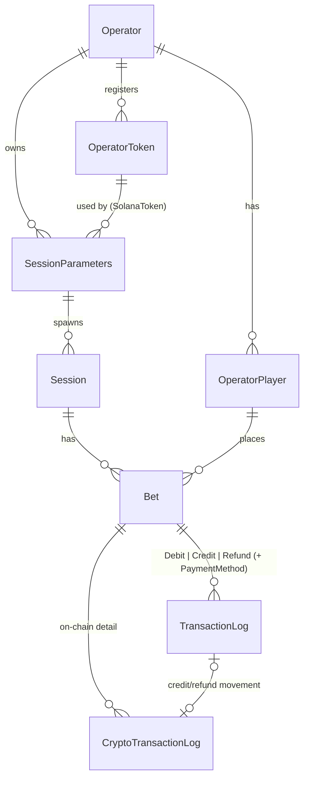
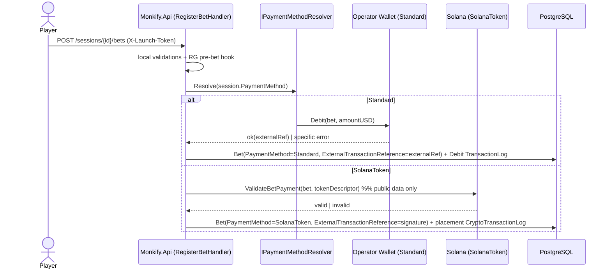
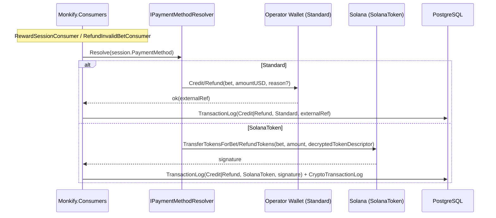

# Monkify — "Refactor payment models" Feature — Implementation Spec

> **Status: Shipped** — merged via `feature/payment-methods-refactor` → `main` in `monkify-backend`,
> `monkify-front`, `monkify-meta` on **2026-07-08**. Distilled current-state summary:
> `../features/payment-methods.md`. This spec remains the deep design archive; where implementation
> deviated (notably encryption — AES-GCM keyed from `GeneralSettings.SecretProtection` instead of
> ASP.NET Data Protection + Redis key ring, §6.6), the **feature doc describes what shipped**.
>
> **Status (original): Ready for implementation** — refined via Trello card
> [Refactor payment models](https://trello.com/c/FH5TMT0T) (2026-07-07).
> Repos affected: `monkify-backend`, `monkify-front`, and this doc in `monkify-meta`.
>
> **Purpose:** Remove the operator-level payment model (`Operator.PaymentModel = Regulated | Crypto`)
> entirely and move the payment choice down to **each session type**. A `SessionParameters.PaymentMethod`
> (`Standard | SolanaToken`) decides how a session settles: **Standard** = off-chain through the
> operator's wallet adapter (today's Regulated path, always USD); **SolanaToken** = on-chain through a
> Solana SPL token the operator **registers themselves** (today's Crypto path, token-native amounts).
> A single operator can offer both. Settlement is dispatched by a new unified `IPaymentMethod` strategy
> resolver, mirroring the existing `IOperatorWalletService` pattern.

---

## 1. Summary

Today payment behaviour is decided by `Operator.PaymentModel`. `RegisterBetHandler`,
`RewardSessionConsumer`, and `RefundInvalidBetConsumer` all branch on it: Crypto validates a Solana
signature the player paid client-side and settles on-chain via a **single global** token
(`GeneralSettings.Token`); Regulated debits/credits/refunds off-chain via `IOperatorWalletService`.
Identity, wallet-connect, and display currency are all operator-level too.

This refactor makes payment a **per-session** concern:

| Concept | Before (operator-level) | After (session-level) |
| --- | --- | --- |
| Discriminator | `Operator.PaymentModel` (`Regulated`/`Crypto`) | `SessionParameters.PaymentMethod` (`Standard`/`SolanaToken`) |
| Off-chain path | Regulated → `IOperatorWalletService` (USD) | **Standard** → same adapter, unchanged mechanics |
| On-chain path | Crypto → `ISolanaService` + global `GeneralSettings.Token` | **SolanaToken** → `ISolanaService` + the session's **registered `OperatorToken`** |
| Token | one global mint/owner for all crypto | operator registers **their own** token(s); a session type references one |
| Amounts | USD/USDC decimal by convention | **method-native**: Standard = USD; SolanaToken = the token's own units (never converted) |
| Identity | operator: Regulated → token `sub`, Crypto → wallet | **per session**: Standard → token `sub`; SolanaToken → connected wallet + signature |
| Dispatch | `if operator.PaymentModel == …` scattered | unified `IPaymentMethod` resolver keyed on the session's `PaymentMethod` |

**Availability gating** (drives the admin UI): an operator can pick **Standard** for a session type
only if it has a wallet-provider adapter configured (`GeneralSettings.OperatorWallets.Operators[opId]`),
and **SolanaToken** only if it has **≥1 active registered token**. Operators register tokens
(the `GeneralSettings.Token` fields minus `ClusterUrl`, plus a display label) in the admin portal; the
token's **private key is encrypted at rest**.

**Ledger:** `Bet` and `TransactionLog` drop the Solana `Signature`/`PaymentSignature` columns and each
carry a single `ExternalTransactionReference` + a `PaymentMethod`; a new `CryptoTransactionLog` holds
the on-chain specifics ("what the user passed": wallet, signature, mint, raw token amount, decimals).

**Migration is dev/greenfield** — no production bet/ledger data is preserved (decision 13).

---

## 2. Constraints (MANDATORY)

From `monkify-meta/constraints.md` (full list there):

- **Worktree-per-repo:** `feature/payment-methods-refactor` in `monkify-backend`, `monkify-front`,
  `monkify-meta` (already created + pushed; hubs stay on `main`).
- **Unit tests:** update/add in `Monkify.Tests`; **report changed tests** at end of implementation.
- **Integration tests (new feature — mandatory):** `Monkify.Tests.Integration` (Testcontainers) must
  get a **Standard** and a **SolanaToken** happy-path bet→reward test, plus a **refund-path** test
  (complex flow). See §11.2.
- **EF mapping:** inline in `MonkifyDbContext.OnModelCreating`; no `IEntityTypeConfiguration`.
- **Migrations:** under `Monkify.Infrastructure/Migrations/`; applied **only** by `Monkify.Consumers`
  at startup. Never hand-edit `MonkifyDbContextModelSnapshot.cs`; regenerate via `dotnet ef`.
- **Secrets/config:** `OperatorToken.TokenOwnerPrivateKey` is a **real signing secret** — encrypted at
  rest (§6.6), never returned by the API, never logged. Committed config/seed use **mock keys only**.
- **Operator messaging:** operator/contract-status errors stay **vague**. Player wallet errors
  (insufficient funds, etc.) stay **specific** (unchanged from the wallet-API feature).
- **Host split:** the API stays stateless and does not migrate. On-chain money movement (Credit/Refund)
  stays in `Monkify.Consumers`; the synchronous Standard debit at bet time is an outbound call only.
- **Coordination:** the in-flight `feature/play-page-ux-fixes` branch gates UI on
  `isCryptoOperator`/`paymentModel` (GameHeader wallet cluster, `GameTerminal` currency) — the exact
  operator-level gating this refactor removes. Reconcile at implement time (§7.6).

---

## 3. Resolved product decisions

| # | Decision |
| --- | --- |
| 1 | **Remove `Operator.PaymentModel`** and the `OperatorPaymentModel` enum. All operators are uniform. |
| 2 | **New `SessionParameters.PaymentMethod` enum = `{ Standard, SolanaToken }`** (+ nullable `OperatorTokenId`, set only for `SolanaToken`). Designed to extend to more crypto later. |
| 3 | **Standard = the existing operator-wallet path** (off-chain Debit/Credit/Refund via `IOperatorWalletService`), settlement always **USD**. |
| 4 | **SolanaToken = the existing on-chain path**, but parameterized by the session's **registered token** (its own mint/sender/owner-keypair/decimals) instead of the global `GeneralSettings.Token`. The **cluster URL stays global**. |
| 5 | **Amounts are method-native and never converted:** Standard = USD; SolanaToken = the token's own units (via its `Decimals`). No SOL↔USD, no price oracle. |
| 6 | **Unified `IPaymentMethod` strategy + resolver** (Debit/Credit/Refund), mirroring `IOperatorWalletService` registration. Handlers/consumers dispatch by the **session's** `PaymentMethod`, not an operator enum. The **RG pre-bet hook still runs before settlement** for both methods. |
| 7 | **Availability gating:** Standard offered iff the operator has a wallet-provider adapter configured; SolanaToken offered iff the operator has **≥1 active registered token**. An operator with neither can create no paid session type. |
| 8 | **`OperatorToken` entity** (per operator): the `GeneralSettings.Token` fields **minus `ClusterUrl`** — `MintAddress`, `SenderAccount`, `TokenOwnerPublicKey`, `TokenOwnerPrivateKey`, `Decimals` — **plus a display label/symbol**. Managed in the admin portal: **register / list / deactivate** (no edit). |
| 9 | **Private key encrypted at rest.** `TokenOwnerPrivateKey` is stored encrypted (ASP.NET Core Data Protection, Redis-persisted key ring shared by both hosts — §6.6). The API never returns it. |
| 10 | **Ledger:** `Bet` drops `PaymentSignature`, gains `ExternalTransactionReference` + `PaymentMethod`; `TransactionLog` drops `Signature`, gains `PaymentMethod` (keeps `Type`/`Amount`/`Reason`/`ExternalTransactionReference`); **new `CryptoTransactionLog`** holds on-chain specifics; for SolanaToken `ExternalTransactionReference` = the on-chain signature. |
| 11 | **Identity per session PaymentMethod:** Standard → player = launch-token `sub` (body wallet/signature ignored); SolanaToken → player = connected wallet + on-chain signature (unless the session allows free bets). Launch token still required everywhere (operator = `iss`). |
| 12 | **Preferred display currency applies ONLY to Standard sessions.** SolanaToken amounts always render token-native. The customization modal stays available to all operators. |
| 13 | **Migration is dev/greenfield** — no prod bet/ledger data preserved. |
| 14 | **Dev:** one dev operator (fixed GUID), pre-provisioned with a mock wallet (Standard) + one seeded `OperatorToken` from the `GeneralSettings.Token` section (SolanaToken) + default session types of **both** methods. Dev mint endpoints drop `?paymentModel`; the dev landing + admin dev button collapse to a single entry; the dev launch token carries a `sub`. |
| 15 | **Free bets:** amount-0 bets make no debit/credit/refund under either method; a free SolanaToken session **skips wallet-connect**. `AllowFreeBet` stays dev-only/hidden. |

---

## 4. Data model

### 4.1 New value objects / enums

**`Monkify.Domain/Sessions/ValueObjects/PaymentMethod.cs`** — NEW.

```csharp
public enum PaymentMethod { Standard = 0, SolanaToken = 1 }
```

**`Monkify.Domain/Sessions/ValueObjects/OperatorPaymentModel.cs`** — **DELETE** (and every reference; see
§4.7 removal checklist).

**`Monkify.Domain/Sessions/ValueObjects/SolanaTokenDescriptor.cs`** — NEW. Immutable descriptor passed
to `ISolanaService` at call time (replaces the global `GeneralSettings.Token` reads). The private key
is already **decrypted** by the caller (Consumers only).

```csharp
public record SolanaTokenDescriptor(
    string MintAddress, string SenderAccount,
    string TokenOwnerPublicKey, string TokenOwnerPrivateKey, int Decimals);
```

### 4.2 `OperatorToken` (new entity)

**`Monkify.Domain/Sessions/Entities/OperatorToken.cs`** — NEW. One registered SPL token per row, scoped
to an operator. `TokenOwnerPrivateKey` holds the **Data-Protection ciphertext**, never plaintext.

```csharp
public class OperatorToken : TableEntity
{
    public Guid OperatorId { get; set; }
    public Operator Operator { get; set; }
    public string Label { get; set; }                 // display symbol, e.g. "USDC", "MONK"
    public string MintAddress { get; set; }
    public string SenderAccount { get; set; }
    public string TokenOwnerPublicKey { get; set; }
    public string TokenOwnerPrivateKey { get; set; }  // ENCRYPTED at rest (§6.6); never serialized out
    public int Decimals { get; set; }
    public bool Active { get; set; } = true;
    public ICollection<SessionParameters> SessionParameters { get; set; }
}
```

### 4.3 `SessionParameters` changes

**`Monkify.Domain/Sessions/Entities/SessionParameters.cs`** — add two fields + nav.

```csharp
public PaymentMethod PaymentMethod { get; set; }      // NEW
public Guid? OperatorTokenId { get; set; }            // NEW — set only when SolanaToken
public OperatorToken? OperatorToken { get; set; }     // NEW nav
```

### 4.4 Ledger changes

**`Monkify.Domain/Bets/Entities/Bet.cs`** — **drop** `PaymentSignature` (L49 + the ctor params/sets at
L25/L29/L36/L38); **add**:

```csharp
public PaymentMethod PaymentMethod { get; set; }            // NEW — copied from the session at bet time
public string? ExternalTransactionReference { get; set; }   // NEW — SolanaToken: on-chain signature; Standard: debit ref
```

**`Monkify.Domain/Bets/Entities/TransactionLog.cs`** — **drop** `Signature` (L30 + ctor params at
L12/L15/L20); keep `Type`/`Amount`/`ExternalTransactionReference`/`Reason`; **add**:

```csharp
public PaymentMethod PaymentMethod { get; set; }            // NEW
```

`TransactionLogType` (`Monkify.Domain/Bets/ValueObjects/TransactionLogType.cs`, `Credit=0, Debit=1,
Refund=2`) is unchanged.

**`Monkify.Domain/Bets/Entities/CryptoTransactionLog.cs`** — NEW. On-chain detail for a SolanaToken
movement. Always tied to a `Bet`; `TransactionLogId` is null for the **bet-placement** record (what the
user passed) and set for **Credit/Refund** movements.

```csharp
public class CryptoTransactionLog : TableEntity
{
    public Guid BetId { get; set; }
    public Bet Bet { get; set; }
    public Guid? TransactionLogId { get; set; }       // null = placement payment; set = credit/refund movement
    public TransactionLog? TransactionLog { get; set; }
    public string Signature { get; set; }             // on-chain tx signature
    public string Wallet { get; set; }                // player wallet (sender for placement, recipient for credit)
    public string MintAddress { get; set; }
    public string SenderAccount { get; set; }
    public decimal Amount { get; set; }               // token-native decimal
    public long RawTokenAmount { get; set; }          // Amount * 10^Decimals
    public int Decimals { get; set; }
    public string? Reason { get; set; }
}
```

### 4.5 `Operator` change

**`Monkify.Domain/Sessions/Entities/Operator.cs`** — **remove** `OperatorPaymentModel PaymentModel` (L16).
Add `ICollection<OperatorToken> Tokens` (nav).

### 4.6 EF configuration (inline, `MonkifyDbContext.cs`)

- **DbSets (L15-25):** add `public DbSet<OperatorToken> OperatorTokens { get; set; }` and
  `public DbSet<CryptoTransactionLog> CryptoTransactionLogs { get; set; }`.
- **`Operator` block (L59-82):** **remove** `builder.Property(x => x.PaymentModel).IsRequired();` (L66).
- **`SessionParameters` block (L35-57):** add:

  ```csharp
  builder.Property(x => x.PaymentMethod).IsRequired();
  builder.HasOne(x => x.OperatorToken)
         .WithMany(t => t.SessionParameters)
         .HasForeignKey(x => x.OperatorTokenId)
         .IsRequired(false)
         .OnDelete(DeleteBehavior.Restrict);
  ```

- **`Bet` block (L145-161):** **remove** the `PaymentSignature` property mapping (L149) and its index
  (L158); add `builder.Property(x => x.PaymentMethod).IsRequired();` and
  `builder.Property(x => x.ExternalTransactionReference).HasMaxLength(100);`.
- **`TransactionLog` block (L169-180):** **remove** `Signature` property (L174) and its index (L178);
  add `builder.Property(x => x.PaymentMethod).IsRequired();`.
- **NEW `OperatorToken` block:** key; `Label` max 20 req; `MintAddress`/`SenderAccount`/
  `TokenOwnerPublicKey` max 100 req; `TokenOwnerPrivateKey` req (ciphertext, no max or generous max
  e.g. 2000); `Decimals` req; `Active` default true; `HasOne(Operator).WithMany(Tokens)
  .HasForeignKey(OperatorId).OnDelete(Restrict)`; index `{ OperatorId, Active }`.
- **NEW `CryptoTransactionLog` block:** key; `Signature`/`Wallet`/`MintAddress`/`SenderAccount` req
  maxes; `Amount` precision(18,9); `HasOne(Bet).WithMany().HasForeignKey(BetId)`;
  `HasOne(TransactionLog).WithMany().HasForeignKey(TransactionLogId).IsRequired(false)`; index
  `Signature`, `BetId`.

### 4.7 Removal checklist (compile-driven)

Removing `Operator.PaymentModel` / `OperatorPaymentModel` / `Bet.PaymentSignature` /
`TransactionLog.Signature` touches (from code exploration):

- `Operator.PaymentModel`: `MonkifyDbContext.cs:66`, `Consumers/Program.cs` (L223-224/239/251/258),
  `DevController.cs` (L35/40/50/68/73), `UpdatePlayerPreferencesHandler.cs:111`, `Operator.cs:16`,
  tests (`OperatorTests`, `SessionsControllerOperatorTests`, `DevControllerTests`, integration harness).
- `Bet.PaymentSignature`: `Bet.cs` (ctors + L49), `MonkifyDbContext.cs` (L149/L158),
  `BetExtensions.cs` (L7/L10), `SolanaService.cs` (L182/L186), `BetDto.cs:10`, RegisterBet handler/body.
- `TransactionLog.Signature`: `TransactionLog.cs` (L12-13/L20/L30), `MonkifyDbContext.cs` (L174/L178),
  `SolanaService.cs` (L105/L140).

### 4.8 Migration

`Monkify.Infrastructure/Migrations/<timestamp>_RefactorPaymentMethods.cs` — generate with:

```
dotnet ef migrations add RefactorPaymentMethods --project Monkify.Infrastructure --startup-project Monkify.Consumers
```

> Confirm the startup project locally: the repo pins none (no `IDesignTimeDbContextFactory`); migrations
> live in `Monkify.Infrastructure`, and both `Monkify.Consumers` and `Monkify.Api` build the DbContext.
> Follow the `20260630183419_AddOperatorWalletLedger.cs` style (explicit `AddColumn`/`DropColumn`).

Because this is **dev/greenfield** (decision 13), the migration is a straight schema change with simple
defaults — **no data-preserving backfill of signatures**:

1. `DropColumn` `Operators.PaymentModel`.
2. `AddColumn` `SessionParameters.PaymentMethod` (`integer`, NOT NULL, default `0`/Standard),
   `SessionParameters.OperatorTokenId` (`uuid`, null) + FK.
3. `CreateTable` `OperatorTokens`, `CryptoTransactionLogs`.
4. `Bet`: drop `PaymentSignature` (+ its index); add `PaymentMethod` (default `0`),
   `ExternalTransactionReference` (`varchar(100)`, null).
5. `TransactionLog`: drop `Signature` (+ its index); add `PaymentMethod` (default `0`).
6. Provide a best-effort `Down`. Regenerate the model snapshot via `dotnet ef`.

### 4.9 ER diagram



---

## 5. Configuration

- **`GeneralSettings.Token`** stays (single global) — but is now used only as the **seed source** for
  the dev operator's `OperatorToken` (§9) and the global **`ClusterUrl`** for all Solana RPC. It is no
  longer read for per-bet settlement.
- **`GeneralSettings.OperatorWallets.Operators[<operatorId>]`** stays and now keys **Standard**
  availability. In `monkifysettings.json`, re-key the existing `mock` entry to the **fixed dev operator
  GUID** (§9) so the dev operator has Standard available. **Mock values only.**
- **Data Protection (NEW, §6.6):** both hosts call `AddDataProtection().SetApplicationName("Monkify")`
  and persist the key ring to the **existing Redis** connection (already used for cache/SignalR) so a
  value encrypted in `Monkify.Api` decrypts in `Monkify.Consumers`. No new secret in committed config;
  in prod the key ring should itself be protected (certificate/KMS) — an ops concern, mock/omitted in dev.
- No new frontend env vars (§7); the repo stays on **`VUE_APP_*`**.

---

## 6. Backend behaviour

### 6.1 The payment-method strategy (`Monkify.Infrastructure/Services/Payments/`)

Mirror the `IOperatorWalletService` + resolver shape.

```csharp
public interface IPaymentMethodService
{
    PaymentMethod Method { get; }
    Task<PaymentResult> Debit(Bet bet, decimal amount, CancellationToken ct);
    Task<PaymentResult> Credit(Bet bet, decimal amount, CancellationToken ct);
    Task<PaymentResult> Refund(Bet bet, decimal amount, string reason, CancellationToken ct);
}
```

- **`PaymentResult`** — `{ bool IsSuccess; PaymentError? Error; string? ExternalTransactionReference; }`
  (reuse/alias the `OperatorWalletError` codes: `InsufficientFunds | PlayerBlocked | Duplicate | Timeout
  | Unavailable`).
- **`StandardPaymentMethodService`** (`Method => Standard`) — delegates to the existing
  `IOperatorWalletResolver.Resolve(operator).Debit/Credit/Refund` (USD). No behaviour change vs the
  shipped Regulated path; it just moves behind the strategy.
- **`SolanaTokenPaymentMethodService`** (`Method => SolanaToken`) — builds a `SolanaTokenDescriptor`
  from the session's `OperatorToken` (decrypting the private key via `ISecretProtector`, §6.6) and calls
  `ISolanaService` (§6.5). **Debit at bet time is validation-only** (the player already paid on-chain);
  Credit/Refund transfer tokens. Writes a `CryptoTransactionLog`.
- **`IPaymentMethodResolver` / `PaymentMethodResolver`** — `Resolve(SessionParameters)` returns the
  service whose `Method == parameters.PaymentMethod`; also exposes
  `GetAvailableMethods(Guid operatorId)` for the admin (§6.7): `Standard` iff
  `OperatorWallets.Operators` has a resolvable provider for the operator; `SolanaToken` iff the operator
  has ≥1 active `OperatorToken`.
- **DI (`DependencyInjection.cs`):** register both services as `IPaymentMethodService`, the resolver,
  `ISecretProtector`, and `AddDataProtection()` (near the existing wallet/RG registrations, L55-62).

### 6.2 Debit / bet placement — `RegisterBetHandler` (API host)

`Monkify.Infrastructure/Handlers/Sessions/RegisterBet/RegisterBetHandler.cs` +
`RegisterBetRequest`/`RegisterBetRequestBody`.

- **Replace the `_isCrypto = operator.PaymentModel == Crypto` branch (L81)** with
  `var method = _bet.Session.Parameters.PaymentMethod;` (the session is already loaded for validation).
- **Identity (decision 11):**
  - `Standard` → player id from the launch token `sub` (as regulated does today); **ignore** body
    `wallet`/`paymentSignature`.
  - `SolanaToken` → player = connected `wallet` from the body; require the on-chain signature.
- **Free-bet detection** no longer keys on `PaymentSignature` (dropped). Use amount only:
  `IsFreeBet = _bet.Amount == 0` (update `BetExtensions`, §6.8). Free + `AllowFreeBet` → skip
  wallet/signature entirely for both methods.
- **RG pre-bet hook** runs after local validation and **before** settlement, unchanged, for both methods.
- **Settlement step (last, after all local validations):**
  - `Standard`, non-free → `paymentResolver.Resolve(parameters).Debit(_bet, _bet.Amount, ct)`; on
    failure return the **specific** wallet message (`MapWalletErrorToMessage`, unchanged); on success set
    `_bet.ExternalTransactionReference = result.ExternalTransactionReference` and append a `Debit`
    `TransactionLog` (with `PaymentMethod.Standard`).
  - `SolanaToken`, non-free → validate the client signature via `ISolanaService.ValidateBetPayment(_bet,
    descriptor)` (§6.5) using the session's token; on success set
    `_bet.ExternalTransactionReference = body.PaymentSignature` and write a **placement**
    `CryptoTransactionLog` (`TransactionLogId = null`, wallet = sender, signature, mint, raw amount,
    decimals). Reuse the existing signature-reuse guard (was keyed on `Bet.PaymentSignature`; re-key on
    `CryptoTransactionLog.Signature` or `Bet.ExternalTransactionReference`).
- Set `_bet.PaymentMethod = parameters.PaymentMethod` before persisting.

> **Hidden blocker:** `RegisterBetRequestBody` currently always carries `paymentSignature`/`wallet`
> (populated for crypto). Make them **optional** and validate them **conditionally** on the session's
> `PaymentMethod` in the handler — not via a blanket `[Required]`. Standard bets post `{ amount, choice,
> seed }` with neither.

### 6.3 Credit — `RewardSessionConsumer`

`Monkify.Infrastructure/Consumers/RewardSession/RewardSessionConsumer.cs`.

- Replace the `isRegulated` branch (L84-85) with `parameters.PaymentMethod`.
- Keep the free-bet skip and `CalculateRewardForBet` math.
- Restrict the Solana blockhash pre-check (currently "paid winners") to **SolanaToken** paid winners.
- Pay via `paymentResolver.Resolve(parameters).Credit(winner, reward, ct)`:
  - `Standard` → operator wallet `Credit`; write `Credit` `TransactionLog` (PaymentMethod.Standard,
    external ref).
  - `SolanaToken` → `ISolanaService.TransferTokensForBet(winner, amount, descriptor)`; write `Credit`
    `TransactionLog` (PaymentMethod.SolanaToken, external ref = signature) **and** a
    `CryptoTransactionLog` (`TransactionLogId` = that log) with the on-chain detail.
- Failure handling unchanged (un-`Rewarded` → `ErrorWhenProcessingRewards`).

### 6.4 Refund — `RefundInvalidBetConsumer`

`Monkify.Infrastructure/Consumers/RefundInvalidBet/RefundInvalidBetConsumer.cs` (+ event).

- The event already carries `BetId` (added by the wallet-API feature). Load the real bet with
  `OperatorPlayer`, `Session.Parameters.Operator`, `Session.Parameters.OperatorToken`, `TransactionLogs`.
- Keep the amount-0 free-bet skip.
- Route by `parameters.PaymentMethod` via the resolver's `Refund`:
  - `Standard` → operator wallet `Refund`; write `Refund` `TransactionLog`.
  - `SolanaToken` → `ISolanaService.RefundTokens(wallet, amount, reason, betId, descriptor)`; write
    `Refund` `TransactionLog` + `CryptoTransactionLog`.
- Idempotency math (`BetDomainService`) already reads the ledger by `TransactionLogType`; unchanged.

### 6.5 `ISolanaService` — per-token parameterization

`Monkify.Infrastructure/Services/Solana/{ISolanaService,SolanaService}.cs`.

- The ctor currently builds a single `_ownerAccount` from `GeneralSettings.Token` (L33). **Remove** that
  field; the owner account is built **per call** from the passed `SolanaTokenDescriptor`.
- New signatures (add a `SolanaTokenDescriptor token` parameter):
  - `Task<ValidationResult> ValidateBetPayment(Bet bet, SolanaTokenDescriptor token)` — uses
    `token.MintAddress`, `token.TokenOwnerPublicKey`, `token.Decimals`, and `bet.GetWalletAddress()`.
    **Only public token data is needed here** (no private key), so the **API host** can validate at bet
    time without decrypting.
  - `Task<bool> TransferTokensForBet(Bet bet, BetTransactionAmountResult amount, SolanaTokenDescriptor token)`
    and `Task<bool> RefundTokens(string wallet, BetTransactionAmountResult amount, string? reason,
    Guid? betId, SolanaTokenDescriptor token)` — build `new Account(token.TokenOwnerPrivateKey,
    token.TokenOwnerPublicKey)` per call, use `token.MintAddress`/`token.SenderAccount`. These run in
    **Consumers** and require the **decrypted** private key.
  - `GetLatestBlockhashForTokenTransfer()` unchanged (global cluster).
- `BetTransactionAmountResult.ValueInTokens` scaling (`amount * 10^decimals`) must use the **token's**
  `Decimals`, not the global `GeneralSettings.Token.Decimals`. Update callers that construct it.

### 6.6 Secret protection (encryption at rest) — NEW

No encryption exists in the backend today; introduce it minimally.

- **`Monkify.Infrastructure/Services/Encryption/ISecretProtector.cs`** + `DataProtectionSecretProtector.cs`
  wrapping `IDataProtector` (`CreateProtector("Monkify.OperatorToken.PrivateKey")`): `Protect(string)` /
  `Unprotect(string)`.
- **Registration:** `services.AddDataProtection().SetApplicationName("Monkify")
  .PersistKeysToStackExchangeRedis(<existing Redis connection multiplexer>, "monkify:dataprotection-keys")`
  in `DependencyInjection.cs`, for **both** hosts (shared key ring → cross-host decrypt).
- **Write path:** the Admin **register-token** handler (API host) calls `Protect(privateKey)` before
  persisting `OperatorToken.TokenOwnerPrivateKey`.
- **Read path:** `SolanaTokenPaymentMethodService` (Consumers) calls `Unprotect(...)` to build the
  descriptor for Credit/Refund. The API's bet-time validation never unprotects (public data only).
- The private key is **never** returned by any DTO (§6.7) and never logged.

### 6.7 Admin: token registration + method availability

`Monkify.Api/Controllers/AdminController.cs` (route prefix `/admin`, already guarded by
`AdminTokenValidationMiddleware`; **no middleware change needed** — the new routes sit under `/admin`).
All handlers scope by `_adminContext.OperatorId`.

New endpoints + handlers (`Monkify.Infrastructure/Handlers/Admin/OperatorTokens/`,
`.../PaymentMethods/`):

| Route | Handler | Behaviour |
| --- | --- | --- |
| `GET /admin/operator-tokens` | `GetOperatorTokens` | active tokens for the operator → `OperatorTokenDto[]` (**no private key**) |
| `POST /admin/operator-tokens` | `RegisterOperatorToken` | validate + `Protect` private key + persist; returns id |
| `POST /admin/operator-tokens/{id}/deactivate` | `DeactivateOperatorToken` | `Active = false` (deactivate-or-create, no edit) |
| `GET /admin/payment-methods` | `GetAvailablePaymentMethods` | `PaymentMethodResolver.GetAvailableMethods(operatorId)` + the active token list for the form |

- **`OperatorTokenRequestBody`**: `Label`, `MintAddress`, `SenderAccount`, `TokenOwnerPublicKey`,
  `TokenOwnerPrivateKey`, `Decimals`. Validate: non-empty; `Decimals` 0–18; optionally verify the
  private key corresponds to the public key (`new Account(priv, pub)` round-trip) and reject on mismatch.
- **`OperatorTokenDto`**: everything **except** `TokenOwnerPrivateKey`.
- Update the controller `OPTIONS` `Allow` header / add `[HttpOptions("operator-tokens…")]`.
- **`SessionTypeRequestBody`** (`Contracts/Admin/`) gains `PaymentMethod PaymentMethod` +
  `Guid? OperatorTokenId`; `ToNewSessionParameters` maps them.
  **`CreateSessionTypeHandler`** validates availability: the chosen method must be available for the
  operator (§6.1), and for `SolanaToken` the `OperatorTokenId` must reference an **active** token owned
  by the operator. `SessionParametersValidation` gains these rules (method defined; token required +
  active + owned when SolanaToken; must be null for Standard). **`SessionTypeAdminDto`** and
  `SessionTypeList` expose the method + token label.

### 6.8 Domain helpers, DTOs, preferences

- **`BetExtensions.cs`:** redefine `IsFreeBet(bet) => bet.Amount == 0` (drop the `PaymentSignature`
  check); `IsFreeBetRequest(amount, …)` → `amount == 0`. `GetWalletAddress()` unchanged.
- **`SessionParametersDto`** (`Contracts/Sessions/`): add `PaymentMethod`, and for `SolanaToken` the
  display/transfer fields the client needs — `TokenSymbol` (label), `TokenDecimals`, `TokenMintAddress`,
  `TokenReceiverPublicKey` (= `OperatorToken.TokenOwnerPublicKey`). **All public data; never the private
  key.** Populated in `GetActiveParametersHandler` (include `OperatorToken`).
- **`BetDto`** (`Contracts/Sessions/`): drop `PaymentSignature`; the player-facing bet no longer exposes
  it. Keep `Amount`; add `PaymentMethod` if the UI needs it for labels (optional).
- **`UpdatePlayerPreferencesHandler`:** remove the `op.PaymentModel == Regulated ? fiat : USD-only`
  branch (L109-113). Allow the full supported-fiat list for **all** operators (decision 12); currency is
  display-only and applies only to Standard sessions client-side. `GetPlayerPreferences` unchanged.

### 6.9 Host ownership

| Operation | Host | Notes |
| --- | --- | --- |
| Standard debit | `Monkify.Api` (`RegisterBetHandler`) | outbound wallet call; API stays stateless |
| SolanaToken bet-time validation | `Monkify.Api` | public token data only; **no** private-key decrypt |
| Credit / Refund (both methods) | `Monkify.Consumers` | money movement; SolanaToken decrypts the key here |
| Token registration (Protect) | `Monkify.Api` (Admin) | encrypts before persist |

---

## 7. Frontend behaviour

Env stays **`VUE_APP_*`**. The through-line: **replace every operator-level
`isCryptoOperator`/`isRegulatedOperator`/`paymentModel` gate with the selected session's
`paymentMethod`.**

### 7.1 Types (`src/types/index.ts`)

- **Delete** `OperatorPaymentModel` (L85-89) and `OperatorBranding.paymentModel` (L91-98).
- **Add** `enum PaymentMethod { Standard = 0, SolanaToken = 1 }`.
- **`ActiveSession`** (L17-30) gains `paymentMethod: PaymentMethod` and optional
  `tokenSymbol?`, `tokenDecimals?`, `tokenMintAddress?`, `tokenReceiverPublicKey?` (present for
  SolanaToken).
- **`SessionTypeAdmin`** / **`SessionTypeBody`** (L136-163) gain `paymentMethod` + `operatorTokenId?`.
- **Add** `OperatorTokenDto` / `OperatorTokenBody` and a `PaymentMethodAvailability` type.

### 7.2 Composables

- **`useOperator.ts`:** remove `paymentModel`, `isRegulatedOperator`, `isCryptoOperator`, and the
  `branding.paymentModel` read (L47). Operator branding no longer carries a payment model.
- **`useSession.ts` `bet()` (L236-333):** branch on `selectedSession.paymentMethod`, not the operator:
  - `Standard` (non-free) → post `{ amount, choice, seed }`, `paymentSignature:''`, `wallet:''`
    (identity via launch token). *(Same body the old Regulated branch built.)*
  - `SolanaToken` (non-free) → `sendToken(new PublicKey(session.tokenReceiverPublicKey), new
    PublicKey(session.tokenMintAddress), amount)` → signature; post with signature + `publicKey` wallet.
    Replaces the hard-coded `tokenAddress`/`USDC_TOKEN_ADDRESS` (L44/L18) with the session's token.
  - `Free` → amount 0, empty signature (unchanged).

### 7.3 Wallet-connect gating

- **`GameHeader.vue` (L143-152):** replace `v-if="isCryptoOperator"` on the wallet cluster with a
  computed driven by the **current session's** method (e.g. `showWallet = selectedSession?.paymentMethod
  === PaymentMethod.SolanaToken`). `TokenBalance` uses the session's `tokenSymbol` + `tokenMintAddress`
  instead of the global `USDC_TOKEN_ADDRESS`. On the sessions-list page (no selected session), the
  cluster is hidden.
- **`GameConsole.vue` (L55-62):** the `connected` bet gate applies only for SolanaToken sessions
  (Standard + free never require a connected wallet).

### 7.4 Amount / currency display

- **`GameTerminal.vue` `formatAmount` (L57-61):** branch on the session's method — `SolanaToken` →
  `` `${amount} ${session.tokenSymbol}` `` using `tokenDecimals`; `Standard` → `formatUsd(amount)` with
  the player's preferred display currency (unchanged `useDisplayCurrency`). Applies to `> BET:` (L410),
  `> POT:` (L360, L427).

### 7.5 Player customization + admin

- **`PlayerCustomizationModal.vue`:** remove the `isCryptoOperator` gate on the currency select
  (L104-114 / save L56) — the currency preference is offered to all operators; it only affects Standard
  rendering. Display-name field unchanged.
- **Admin (`SessionTypeForm.vue`):** add a **Payment method** dropdown populated from
  `GET /admin/payment-methods` (only available methods), and when `SolanaToken` a **token** dropdown
  from `GET /admin/operator-tokens`. Submit maps `paymentMethod` + `operatorTokenId` into
  `SessionTypeBody`. **`SessionTypeList.vue`** adds a method/token column.
- **New token management UI** (`src/components/admin/OperatorTokenManager.vue` + form/list) mounted in
  `AdminPage.vue`/`SessionTypeManager.vue`: register (label, mint, sender, owner pubkey, owner **private
  key** (write-only input), decimals), list, deactivate. **`adminService.ts`** gains
  `getOperatorTokens`, `registerOperatorToken`, `deactivateOperatorToken`, `getPaymentMethods`.

### 7.6 Dev entry

- **`DevLandingPage.vue`** + **`DevAdminButton.vue`:** collapse the two `Crypto`/`Regulated` buttons into
  a single "Enter (dev)" / "Admin (dev)" action; `POST /dev/launch-token` and `/dev/admin-token` **drop**
  the `?paymentModel` query param.

> **Coordination:** `feature/play-page-ux-fixes` also edits `GameHeader`/`GameTerminal` currency+wallet
> gating on `isCryptoOperator`. Whichever merges second must re-point those edits at
> `session.paymentMethod`. Call this out in the PR.

---

## 8. Flow diagrams

### 8.1 Bet placement by method



### 8.2 Credit / refund (Consumers)



---

## 9. Dev seeding & endpoints

- **`Monkify.Consumers/Program.cs`:** replace `CreateDefaultOperatorAsync`'s two operators with **one**
  dev operator at a **fixed GUID** (constant), no `PaymentModel`. After creating it:
  - Ensure `GeneralSettings.OperatorWallets.Operators[<fixed dev GUID>]` maps to `mock` (config re-keyed
    in §5) → Standard available.
  - Seed **one `OperatorToken`** from `GeneralSettings.Token` (label e.g. `"DEVUSDC"`, mint/sender/owner
    pub+priv/decimals), **encrypting** the private key via `ISecretProtector` → SolanaToken available.
  - `CreateDefaultSessionParametersAsync` / `DefaultSessionParameters.GenerateDefaultParameters()` set
    `PaymentMethod` on the seeded types: a mix of **Standard** and **SolanaToken** (the latter
    referencing the seeded token's id). Update the `Base` helper.
- **`DevController.cs`:** `MintLaunchToken` / `MintAdminToken` **drop** the `?paymentModel` param and the
  operator-by-name selection; resolve the single dev operator. The launch token carries `sub` =
  `dev-player` (so Standard identity works); SolanaToken sessions still get their wallet from
  wallet-connect.

---

## 10. File checklist

### 10.1 Backend (`monkify-backend`)

| # | File | Change |
| --- | --- | --- |
| 1 | `Monkify.Domain/Sessions/ValueObjects/PaymentMethod.cs` | **NEW** enum `Standard \| SolanaToken`. |
| 2 | `Monkify.Domain/Sessions/ValueObjects/OperatorPaymentModel.cs` | **DELETE**. |
| 3 | `Monkify.Domain/Sessions/ValueObjects/SolanaTokenDescriptor.cs` | **NEW** per-call token descriptor. |
| 4 | `Monkify.Domain/Sessions/Entities/Operator.cs` | Remove `PaymentModel`; add `Tokens` nav. |
| 5 | `Monkify.Domain/Sessions/Entities/OperatorToken.cs` | **NEW** entity (encrypted private key). |
| 6 | `Monkify.Domain/Sessions/Entities/SessionParameters.cs` | Add `PaymentMethod`, `OperatorTokenId`, `OperatorToken` nav. |
| 7 | `Monkify.Domain/Bets/Entities/Bet.cs` | Drop `PaymentSignature`; add `PaymentMethod` + `ExternalTransactionReference`; fix ctors. |
| 8 | `Monkify.Domain/Bets/Entities/TransactionLog.cs` | Drop `Signature`; add `PaymentMethod`; fix ctors. |
| 9 | `Monkify.Domain/Bets/Entities/CryptoTransactionLog.cs` | **NEW** on-chain detail entity. |
| 10 | `Monkify.Domain/Bets/Services/BetExtensions.cs` | Free-bet check → `amount == 0` (drop signature). |
| 11 | `Monkify.Domain/Sessions/Services/SessionParametersValidation.cs` | Method defined; token required+active+owned when SolanaToken, null when Standard. |
| 12 | `Monkify.Infrastructure/Data/Context/MonkifyDbContext.cs` | DbSets + inline mappings per §4.6 (drops + new columns + `OperatorToken`/`CryptoTransactionLog`). |
| 13 | `Monkify.Infrastructure/Migrations/<ts>_RefactorPaymentMethods.cs` | **NEW** migration (§4.8) + regenerate snapshot. |
| 14 | `Monkify.Infrastructure/Services/Payments/IPaymentMethodService.cs` + `PaymentResult.cs`/`PaymentError.cs` | **NEW** strategy abstraction. |
| 15 | `Monkify.Infrastructure/Services/Payments/StandardPaymentMethodService.cs` | **NEW** → `IOperatorWalletResolver`. |
| 16 | `Monkify.Infrastructure/Services/Payments/SolanaTokenPaymentMethodService.cs` | **NEW** → `ISolanaService` + token descriptor. |
| 17 | `Monkify.Infrastructure/Services/Payments/IPaymentMethodResolver.cs` + `PaymentMethodResolver.cs` | **NEW** resolve-by-method + `GetAvailableMethods`. |
| 18 | `Monkify.Infrastructure/Services/Encryption/ISecretProtector.cs` + `DataProtectionSecretProtector.cs` | **NEW** Data-Protection wrapper. |
| 19 | `Monkify.Infrastructure/Services/Solana/{ISolanaService,SolanaService}.cs` | Per-call `SolanaTokenDescriptor`; owner account per call; drop global `_ownerAccount`. |
| 20 | `Monkify.Infrastructure/DependencyInjection.cs` | Register payment services/resolver, secret protector, `AddDataProtection().PersistKeysToStackExchangeRedis`. |
| 21 | `Monkify.Infrastructure/Handlers/Sessions/RegisterBet/RegisterBetHandler.cs` (+ `RegisterBetRequestBody`) | Branch by session method; identity per method; conditional wallet/signature; settle via resolver; set `PaymentMethod`/`ExternalTransactionReference`; placement `CryptoTransactionLog`. |
| 22 | `Monkify.Infrastructure/Consumers/RewardSession/RewardSessionConsumer.cs` | Credit via resolver; blockhash pre-check only for SolanaToken winners; write logs. |
| 23 | `Monkify.Infrastructure/Consumers/RefundInvalidBet/RefundInvalidBetConsumer.cs` | Refund via resolver by session method; write logs. |
| 24 | `Monkify.Infrastructure/Handlers/Admin/OperatorTokens/*` | **NEW** Register/List/Deactivate handlers + requests. |
| 25 | `Monkify.Infrastructure/Handlers/Admin/PaymentMethods/GetAvailablePaymentMethods*` | **NEW** availability handler. |
| 26 | `Monkify.Api/Controllers/AdminController.cs` | Add operator-token + payment-methods routes; OPTIONS `Allow`. |
| 27 | `Monkify.Infrastructure/Contracts/Admin/OperatorTokenDto.cs` + `OperatorTokenRequestBody.cs` + `PaymentMethodAvailabilityDto.cs` | **NEW** DTOs (never expose private key). |
| 28 | `Monkify.Infrastructure/Contracts/Admin/SessionTypeRequestBody.cs` + `SessionTypeAdminDto.cs` | Add `PaymentMethod` + `OperatorTokenId`; map in `ToNewSessionParameters`. |
| 29 | `Monkify.Infrastructure/Handlers/Admin/CreateSessionType/CreateSessionTypeHandler.cs` | Validate method availability + token ownership/active. |
| 30 | `Monkify.Infrastructure/Contracts/Sessions/SessionParametersDto.cs` (+ `GetActiveParametersHandler`) | Add `PaymentMethod` + token display/transfer fields (public). |
| 31 | `Monkify.Infrastructure/Contracts/Sessions/BetDto.cs` | Drop `PaymentSignature`; optional `PaymentMethod`. |
| 32 | `Monkify.Infrastructure/Handlers/Players/UpdatePlayerPreferences/UpdatePlayerPreferencesHandler.cs` | Remove PaymentModel currency branch; allow fiat for all. |
| 33 | `Monkify.Domain/Bets/ValueObjects/BetTransactionAmountResult.cs` (callers) | Scale `ValueInTokens` by the token's decimals. |
| 34 | `Monkify.Common/monkifysettings.json` | Re-key `OperatorWallets.Operators` to the fixed dev GUID; keep `Token` (seed source). **Mock only.** |
| 35 | `Monkify.Consumers/Program.cs` | Single dev operator (fixed GUID); seed mock wallet map + one encrypted `OperatorToken`; both-method default types; drop PaymentModel writes. |
| 36 | `Monkify.Consumers/DefaultSessionParameters.cs` | Set `PaymentMethod` (+ token id) on default types. |
| 37 | `Monkify.Api/Controllers/DevController.cs` | Drop `?paymentModel`; single operator; token carries `sub`. |

### 10.2 Frontend (`monkify-front`)

| # | File | Change |
| --- | --- | --- |
| 1 | `src/types/index.ts` | Remove `OperatorPaymentModel`/`paymentModel`; add `PaymentMethod`, token fields on `ActiveSession`, admin token/method types. |
| 2 | `src/hooks/useOperator.ts` | Remove payment-model state + `isCrypto/isRegulated`. |
| 3 | `src/hooks/useSession.ts` | `bet()` branches on `session.paymentMethod`; SolanaToken uses session token mint/receiver. |
| 4 | `src/components/GameHeader.vue` | Wallet cluster + `TokenBalance` gated on the session's method + token. |
| 5 | `src/components/game/GameTerminal.vue` | `formatAmount` branches on method (token symbol vs USD/preferred). |
| 6 | `src/components/game/GameConsole.vue` | `connected` bet gate only for SolanaToken. |
| 7 | `src/components/header/PlayerCustomizationModal.vue` | Remove `isCryptoOperator` gate on currency select. |
| 8 | `src/services/mainService.ts` | Session-type fetch carries the new fields (no signature-shape assumptions). |
| 9 | `src/services/adminService.ts` | Add token CRUD + `getPaymentMethods`. |
| 10 | `src/components/admin/SessionTypeForm.vue` + `SessionTypeList.vue` | Method dropdown (available only) + token dropdown; list column. |
| 11 | `src/components/admin/OperatorTokenManager.vue` (+ form/list) | **NEW** register/list/deactivate tokens. |
| 12 | `src/pages/AdminPage.vue` / `SessionTypeManager.vue` | Mount the token manager. |
| 13 | `src/pages/DevLandingPage.vue` + `src/components/header/DevAdminButton.vue` | Single dev entry; drop `?paymentModel`. |
| 14 | `src/constants/keys.ts` / `useConnection.ts` | Global USDC/game token becomes a per-session fallback only. |

### 10.3 Meta (`monkify-meta`)

| # | File | Change |
| --- | --- | --- |
| 1 | `specs/payment-methods-refactor.md` | This spec. |
| 2 | `INDEX.md` | Add spec row (Ready); update "Feature currently in flight". |
| 3 | `features/*` | **At ship time:** new `features/payment-methods.md`; update `launch-token-validation.md`, `operator-wallet-api.md`, `operator-admin-page.md`, `player-customization-modal.md`, `glossary.md` (PaymentModel → PaymentMethod). |

---

## 11. Tests

### 11.1 Unit tests (`monkify-backend/src/Monkify.Tests`)

| Test file | Cases | Expected |
| --- | --- | --- |
| `UnitTests/Services/Payments/PaymentMethodResolverTests.cs` (**NEW**) | resolve Standard/SolanaToken; `GetAvailableMethods` for: wallet-only, token-only, both, neither operator | correct service; availability matches config + active tokens. |
| `UnitTests/Services/Payments/SolanaTokenPaymentMethodServiceTests.cs` (**NEW**) | debit=validate, credit, refund with a token descriptor; decrypt called | delegates to `ISolanaService` with the session's token; writes `CryptoTransactionLog`. |
| `UnitTests/Services/Encryption/DataProtectionSecretProtectorTests.cs` (**NEW**) | protect→unprotect round-trip | value restored; ciphertext ≠ plaintext. |
| `UnitTests/Handlers/RegisterBetHandlerTests.cs` (**UPDATE**) | Standard valid → debit once + Debit log; Standard local-fail → no debit; debit InsufficientFunds/Timeout → specific msg, no persist; SolanaToken valid → signature validated + placement CryptoTransactionLog; SolanaToken bad signature → rejected; free (both methods) → no settlement | per-method branching + identity + `PaymentMethod`/`ExternalTransactionReference` set. |
| `UnitTests/Background/RewardWinnersHandlerTests.cs` (**UPDATE**) | Standard winner → wallet Credit; SolanaToken winner → Solana transfer + logs; blockhash pre-check only for SolanaToken | correct routing; failure → `ErrorWhenProcessingRewards`. |
| `UnitTests/Background/RefundInvalidBetConsumerTests.cs` (**UPDATE**) | Standard refund → wallet; SolanaToken refund → Solana; amount-0 skipped | correct routing + idempotent. |
| `UnitTests/Handlers/Admin/OperatorTokenHandlerTests.cs` (**NEW**) | register (private key encrypted, never echoed), list (no private key), deactivate; foreign/inactive token rejected | scoping + encryption + no leak. |
| `UnitTests/Handlers/Admin/CreateSessionTypeHandlerTests.cs` (**UPDATE**) | method not available → rejected; SolanaToken without/with valid token | availability + token validation. |
| `UnitTests/Domain/Sessions/SessionParametersValidationTests.cs` (**UPDATE**) | method/token combinations | rules per §6.7. |
| `UnitTests/Handlers/Players/UpdatePlayerPreferencesTests.cs` (**UPDATE**) | fiat allowed for any operator | no PaymentModel branch. |
| `UnitTests/Controllers/DevControllerTests.cs` (**UPDATE**) | mint without `?paymentModel` | single operator; token has `sub`. |

> Stack: xUnit + Shouldly + Moq + Bogus, in-memory EF. Mock `IPaymentMethodService`/resolver,
> `ISolanaService`, `ISecretProtector`. **Report every changed/added test file at the end.**

### 11.2 Integration tests (`monkify-backend/src/Monkify.Tests.Integration`, Testcontainers — MANDATORY)

| Test | Flow |
| --- | --- |
| `StandardBetToRewardTests` (**NEW**) | seed a Standard session type (mock wallet) → place a paid bet (token-`sub` identity, wallet debit) → run session → winner credited; assert `Debit`+`Credit` `TransactionLog` (PaymentMethod.Standard). |
| `SolanaTokenBetToRewardTests` (**NEW**) | seed a SolanaToken session type with a registered token → place a paid bet (signature validated) → reward; assert placement + credit `CryptoTransactionLog` and `TransactionLog` (PaymentMethod.SolanaToken). |
| `PaymentRefundTests` (**NEW, complex flow)** | a Standard and a SolanaToken bet that must be refunded (e.g. lottery under-subscription) → assert method-correct `Refund` rows. |

> Follow the `SessionFlowTests` pattern (real API + Consumers hosts against Postgres/RabbitMQ/Redis
> containers). The Solana leg uses the mock/dev token; assert ledger + status, not a live chain.

---

## 12. Acceptance criteria

From the Trello **Acceptance Criteria** checklist (1:1):

1. Given the codebase, when it builds, then `Operator.PaymentModel` and the `OperatorPaymentModel` enum no longer exist and no handler/consumer/DTO/frontend type branches on an operator payment model.
2. Given a session type, when it is created, then it carries a `PaymentMethod` of `Standard` or `SolanaToken`, and a `SolanaToken` type also references an active `OperatorToken` belonging to the same operator (validation rejects a missing/foreign/inactive token).
3. Given an operator, when they open the session-type create form, then `Standard` is offered only if the operator has a wallet-provider adapter configured and `SolanaToken` is offered only if the operator has ≥1 active registered token; an operator with neither can create no paid session type.
4. Given an operator admin, when they register a Solana token (MintAddress, SenderAccount, TokenOwnerPublicKey, TokenOwnerPrivateKey, Decimals, label), then it is stored against their operator with the private key encrypted at rest, and it appears in their token list; no list/get response ever returns the private key.
5. Given a registered token, when the admin acts on it, then they can list and deactivate it but cannot edit it in place (deactivate-and-recreate only), and deactivation removes it from the selectable tokens for new session types.
6. Given a Standard session, when a player places a paid bet, then the player is identified by the launch-token `sub`, no wallet or signature is required, and settlement debits/credits/refunds run through the operator wallet adapter in USD (happy path proven by an integration test).
7. Given a SolanaToken session, when a player places a paid bet, then wallet-connect + a valid on-chain signature are required, the transfer uses that session's registered token (its mint/sender/owner-keypair/decimals, global cluster URL), and debit/credit/refund settle on-chain in the token's own units (happy path proven by an integration test).
8. Given any bet, when settlement occurs, then debit/credit/refund is dispatched via the `IPaymentMethod` resolver keyed on the session's `PaymentMethod` (not an operator enum), and the RG pre-bet hook still runs before settlement for both methods.
9. Given the ledger, when a bet settles, then `Bet` has no `PaymentSignature` column and instead carries `ExternalTransactionReference` + `PaymentMethod`; `TransactionLog` has no `Signature` column and carries `ExternalTransactionReference` + `PaymentMethod` (plus Type/Amount/Reason); a SolanaToken transaction writes a `CryptoTransactionLog` row holding the on-chain specifics and its `ExternalTransactionReference` equals the on-chain signature.
10. Given a free (amount-0) bet, when placed under either method, then no debit/credit/refund occurs, and a free SolanaToken session does not require wallet-connect; `AllowFreeBet` remains hidden in the admin form and false in production.
11. Given a player in the game, when the sessions list contains both Standard and SolanaToken types, then wallet-connect is prompted only when entering/betting a non-free SolanaToken session and never for a Standard session, driven by the session's `PaymentMethod` (not an operator-level flag).
12. Given the `> BET:` / `> POT:` display, when rendering a SolanaToken session, then amounts show the registered token's symbol and decimals; when rendering a Standard session, amounts show USD (or the player's preferred display currency), and the preferred display currency has no effect on SolanaToken sessions.
13. Given local dev, when the environment is seeded, then exactly one dev operator exists, pre-provisioned with a mock wallet (Standard available) and one `OperatorToken` from the monkifysettings Token section (SolanaToken available), with default session types of both methods; the `/dev/launch-token` and `/dev/admin-token` endpoints take no `paymentModel` param and the dev launch token carries a `sub`.
14. Given a Standard bet whose operator-wallet debit fails, when the player submits, then the existing specific wallet message is returned (insufficient funds / blocked / duplicate / timeout) and no bet is persisted; unrelated operator-status messaging stays vague.
15. Given the test suites, when the feature is complete, then `Monkify.Tests` unit tests are updated/added for the new strategy/resolver, token registration, validation, and ledger, and `Monkify.Tests.Integration` has happy-path tests for both a Standard and a SolanaToken bet→reward plus a refund-path test; the changed/added tests are reported.

---

## 13. Manual QA (local, docker-compose)

1. Bring up the stack (`scripts/setup_local_environment.bat`); Consumers applies the migration and seeds
   the single dev operator + one encrypted token + both-method default session types.
2. Single dev entry → mint a launch token (no `?paymentModel`).
3. Enter a **Standard** session → place a bet with no wallet → confirm a `Debit` `TransactionLog`
   (PaymentMethod.Standard); force a mock "insufficient funds" → specific message, no bet row.
4. Enter a **SolanaToken** session → connect wallet → place a bet → confirm the placement
   `CryptoTransactionLog` and `Bet.ExternalTransactionReference` = signature; amounts show the token
   symbol.
5. Drive each to a win → confirm method-correct `Credit` rows; drive a refund → method-correct `Refund`
   rows.
6. Admin portal → register a token (confirm the private key is never returned by `GET`), create a
   SolanaToken session type referencing it; deactivate the token → it disappears from the form.
7. Confirm the customization modal offers a display currency for all operators, effective only on
   Standard amounts.

---

## 14. Trello / pipeline

- **Source card:** [Refactor payment models](https://trello.com/c/FH5TMT0T) — list **Specs created**;
  the **Implementation** section on the card lists the worktree, branch, and spec.
- **Coordination:** reconcile with in-flight `feature/play-page-ux-fixes` (§7.6).
- **After merge:** run `/monkify-ship-feature Refactor payment models` (reads branch + spec from the
  card), then create `features/payment-methods.md` and update the affected feature docs + `glossary.md`.

---

## 15. Revision log

| Date | Change |
| --- | --- |
| 2026-07-07 | Initial spec from the refined card + in-thread refinement decisions and two code-exploration passes (backend admin/persistence/encryption; frontend surface). |
