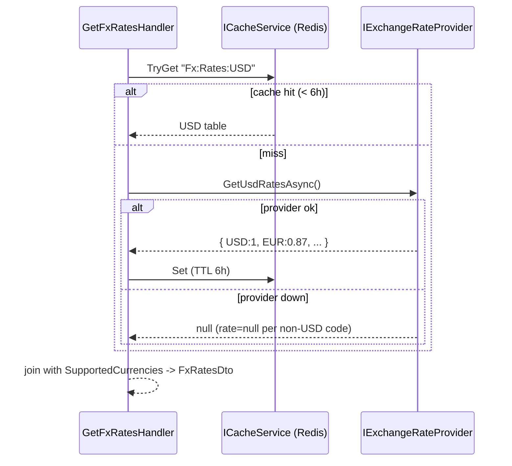

# SpaceStroker — "Player Customization Modal" Feature — Implementation Spec

> **Status: Shipped** — merged `feature/player-customization-modal` → `main` on 2026-07-02.
> Trello: [Player Customization Modal](https://trello.com/c/ZyJViMKI). Distilled rules:
> `../features/player-customization-modal.md`.
>
> **Purpose:** Give players a self-service **customization modal** — opened from a gear icon in the
> game header — to edit their **display name** and **preferred display currency**. Display names
> render across the game UI for all players; the preferred currency re-renders on-screen money
> amounts (converted from USD) for **regulated** operators. Conversion is **display-only**: every
> persisted value and every amount sent to an operator API stays in **USD**.

---

## 1. Summary

Two capabilities behind one header entry point:

| Capability | Who it applies to | What it does |
| --- | --- | --- |
| **Display name** | All operators (crypto + regulated) | Player edits a short display name; it renders wherever a player is identified (own `YOU` label, recent-bets rows, winners), for **all** players, falling back to the external id when unset. |
| **Preferred currency** | **Regulated operators only** | Player picks a fiat currency from a backend-served definitive set; the frontend re-renders all displayed amounts converted **USD → currency** with an `≈` indicator. Crypto operators keep their native SPL token display (no currency selector). |

**Architecture at a glance:** the backend keeps returning **USD everywhere** (REST + SignalR) and
never converts money. It gains (a) a token-gated `GET /fx/rates` that returns the definitive currency
list + current USD-based rates (fed by a cached FreeCurrencyAPI provider), (b) a token-gated
`GET /players/preferences` to prefill the modal, (c) payment-model-scoped allow-list validation on
the existing `PATCH /players/preferences`, and (d) `DisplayName` on the bet DTO + recent-bets event.
The frontend adds the modal, a `useDisplayCurrency` composable that multiplies USD amounts by the
chosen currency's rate client-side, and renders display names.

**No EF migration** — `OperatorPlayer.DisplayName` + `Currency` already exist.

---

## 2. Constraints (MANDATORY)

From `monkify-meta/constraints.md` (full list there):

- **Branch-per-repo:** `feature/player-customization-modal` in `monkify-backend`, `monkify-front`,
  and `monkify-meta`.
- **Unit tests:** update/add in `SpaceStroker.Tests`; report changed tests at the end of implementation.
  The bet-DTO / recent-bets change is game-flow-adjacent → also update `SpaceStroker.Tests.Integration`.
- **EF mapping:** inline in `SpaceStrokerDbContext.OnModelCreating`; no `IEntityTypeConfiguration`. **This
  feature adds no columns and no migration.**
- **Secrets/config:** the FreeCurrencyAPI key is written as a **MOCK/placeholder** in
  `spacestrokersettings.json`; the real key is bound only from the environment. Never commit a real key.
- **Operator messaging:** vague errors only; every token-gated endpoint returns a generic **401** on
  any auth failure (real reason logged server-side only). Never reveal contract status.
- **Display-only conversion:** conversion must **never** feed settlement, payout, refund, bet
  persistence, or any operator-wallet-API amount — those are always USD.
- **Design system:** all new frontend UI uses the existing design system (Tailwind + DaisyUI +
  `src/components/ui/*`); see `conventions/frontend.md`.

---

## 3. Resolved product decisions

| # | Decision |
| --- | --- |
| 1 | Entry point is a **gear icon on the right of the header** (`GameHeader.vue`). Because `GameHeader` renders once in `App.vue` (outside `<router-view>`), the gear + modal appear on both the lobby (`/space-stroker/game/games`) and live game (`/space-stroker/game/play`) screens automatically. |
| 2 | Modal has two controls: **Display name** (text, all operators) and **Preferred currency** (dropdown, **regulated only** — hidden for crypto). One **Save** button issues a single `PATCH /players/preferences` with both fields; on success the active currency updates and live amounts re-render. |
| 3 | **Currency conversion applies to regulated operators only.** Crypto operators keep showing their native SPL token; the crypto token↔{SOL,USDT} idea from the prior refinement is **dropped**. |
| 4 | **Definitive currency set** = the currencies returned by FreeCurrencyAPI `latest` (base = USD): `AUD, BGN, BRL, CAD, CHF, CNY, CZK, DKK, EUR, GBP, HKD, HRK, HUF, IDR, ILS, INR, ISK, JPY, KRW, MXN, MYR, NOK, NZD, PHP, PLN, RON, RUB, SEK, SGD, THB, TRY, USD, ZAR` (33 incl. USD; USD rate = 1.0). |
| 5 | **Backend is the source of truth** for currency metadata (`code → { symbol, name }`, e.g. `BRL → R$ / "Brazilian Real"`) and the allow-list. The frontend renders the dropdown from `GET /fx/rates`; it does **not** hardcode the list. |
| 6 | **Conversion is display-only and client-side.** Backend returns USD everywhere (REST + SignalR — sockets are game-scoped and carry no token, so the backend cannot know the viewer's currency; the frontend does). The frontend multiplies USD amounts by the USD→currency rate. |
| 7 | **Rate source:** an `IExchangeRateProvider` abstraction — `FreeCurrencyApiExchangeRateProvider` (prod; the first outbound `HttpClient` in the codebase) and `MockExchangeRateProvider` (dev/tests). The full USD rate table is cached in **Redis, 6-hour TTL** (respects the provider's 1000-req/month limit). |
| 8 | `GET /fx/rates` returns the **full definitive list** with metadata and rates (rate populated when available, `null` when the provider is unavailable and the cache is empty). It never returns 5xx for a provider outage — the frontend falls back to USD. |
| 9 | **New** `GET /players/preferences` (token-gated) returns `{ externalPlayerId, displayName, currency }` (defaults `displayName: null`, `currency: "USD"` when no `OperatorPlayer` row). Identity: regulated = token `sub`; crypto = optional `?wallet=` query param (crypto `sub` is empty). No row is created on read. |
| 10 | `PATCH /players/preferences` gains payment-model-scoped **currency allow-list** validation: regulated → the 33 codes; crypto → `USD` only (fiat rejected). Plus **display-name** validation: trimmed, length **1–20**, reject empty/whitespace-only. Invalid → generic validation failure, stored value unchanged. |
| 11 | **Display name renders for self + others.** Backend adds `DisplayName` to `BetDto` (covers the initial `GET /games/{id}` bets) and to `BetNotificationEvent` + the recent-bets push (covers streamed bets). The frontend renders it in the bets list and derives **winner** names client-side from the bets it already holds — the typer/status flow (`GameResult`) is left unchanged. |
| 12 | **Amount surfaces (regulated):** lobby ticket/stake price, live pot/total, recent-bets amounts, winnings. Format: chosen currency primary; when `!= USD` show `≈ {symbol}{value}` (2 decimals) with the authoritative USD amount on hover; `USD` selected → plain USD, no `≈`. Rate unavailable/stale → silent USD fallback, no error. |
| 13 | **No migration; settlement unchanged.** Existing players keep `Currency = USD`. Stake/payout/refund and operator-API amounts always use USD. |

---

## 4. Data model

**No entity, column, EF-mapping, or migration changes.** The feature reuses existing columns:

- `SpaceStroker.Domain/Games/Entities/OperatorPlayer.cs` — `DisplayName` (nullable, DB maxlen 100) and
  `Currency` (nullable, DB maxlen 10, defaults `"USD"` on new rows in the upsert handler). The 1–20
  display-name bound and the currency allow-list are **application-level** validation, not schema.
- Unique index `(OperatorId, ExternalPlayerId)` already enforced inline in `SpaceStrokerDbContext`.

### 4.1 New (non-persistent) domain types

A static, in-code **supported-currency registry** — the single source of truth for the definitive
set, its metadata, and the allow-list:

```csharp
// SpaceStroker.Domain/Fx/SupportedCurrency.cs
public sealed record SupportedCurrency(string Code, string Symbol, string Name);

// SpaceStroker.Domain/Fx/SupportedCurrencies.cs
public static class SupportedCurrencies
{
    // 33 entries; USD first. Symbol + human name per code.
    public static readonly IReadOnlyList<SupportedCurrency> All = new[]
    {
        new SupportedCurrency("USD", "$",   "US Dollar"),
        new SupportedCurrency("BRL", "R$",  "Brazilian Real"),
        new SupportedCurrency("EUR", "€",   "Euro"),
        // … AUD, BGN, CAD, CHF, CNY, CZK, DKK, GBP, HKD, HRK, HUF, IDR, ILS, INR,
        //   ISK, JPY, KRW, MXN, MYR, NOK, NZD, PHP, PLN, RON, RUB, SEK, SGD, THB, TRY, ZAR
    };

    public static readonly IReadOnlySet<string> Codes =
        All.Select(c => c.Code).ToHashSet(StringComparer.OrdinalIgnoreCase);

    public static bool IsSupported(string? code) => code is not null && Codes.Contains(code);
}
```

> Names must be correct (e.g. **Brazilian Real**, not "Dollar"). Keep this list in sync with the
> FreeCurrencyAPI `latest` response; it is the "definitive set" for the app.

---

## 5. Configuration

### 5.1 `GeneralSettings.Fx` (new section)

Model it on the existing `OperatorWalletConfig` pattern
(`SpaceStroker.Domain/Configs/Entities/OperatorWalletSettings.cs`).

```csharp
// SpaceStroker.Domain/Configs/Entities/FxSettings.cs
public class FxSettings
{
    public string Provider { get; set; } = "Mock";       // "Mock" | "FreeCurrencyApi"
    public string BaseUrl { get; set; } = "";             // https://api.freecurrencyapi.com/v1/
    public string ApiKey  { get; set; } = "MOCK_VALUE";   // real key bound from environment only
    public int    TimeoutSeconds { get; set; } = 10;
    public int    CacheTtlHours   { get; set; } = 6;
}
```

Add `public FxSettings Fx { get; set; } = new();` to
`SpaceStroker.Domain/Configs/Entities/GeneralSettings.cs`.

`SpaceStroker.Common/spacestrokersettings.json` — add under `GeneralSettings` (**mock values only**):

```json
"Fx": {
  "Provider": "Mock",
  "BaseUrl": "https://api.freecurrencyapi.com/v1/",
  "ApiKey": "MOCK_VALUE",
  "TimeoutSeconds": 10,
  "CacheTtlHours": 6
}
```

> Production overrides `GeneralSettings__Fx__Provider=FreeCurrencyApi` and
> `GeneralSettings__Fx__ApiKey=<real key>` via environment. **Never** commit the real key.

### 5.2 Provider selection

In `SpaceStroker.Infrastructure/DependencyInjection.cs` (`AddDefaultServices`), select the provider by the
`Fx.Provider` discriminator (same pattern as cache selection by config):

- `"FreeCurrencyApi"` → `AddHttpClient<FreeCurrencyApiExchangeRateProvider>()` (BaseUrl + timeout from
  `FxSettings`) and bind `IExchangeRateProvider → FreeCurrencyApiExchangeRateProvider`.
- anything else (default `"Mock"`) → `IExchangeRateProvider → MockExchangeRateProvider` (static
  table, no HTTP). This keeps dev + all tests off the network and within the rate limit.

Registered in the shared `AddDefaultServices` so **both** `SpaceStroker.Api` and `SpaceStroker.Consumers` get
it (only the API serves `/fx/rates`, but keeping it shared matches the existing wiring).

### 5.3 Frontend env

No new `VUE_APP_*` var required — the currency list + rates come from `GET /fx/rates`. (If a kill
switch is later wanted, add `VUE_APP_*` per the existing `featureFlags.ts` pattern; out of scope
here.)

---

## 6. Backend behaviour

### 6.1 FX rate provider (`SpaceStroker.Infrastructure/Services/Fx/`)

```csharp
public interface IExchangeRateProvider
{
    // USD-based rates: code -> units of `code` per 1 USD. Returns null on failure.
    Task<IReadOnlyDictionary<string, decimal>?> GetUsdRatesAsync(CancellationToken ct);
}
```

- **`FreeCurrencyApiExchangeRateProvider`** — typed `HttpClient`; `GET {BaseUrl}latest?apikey={key}`
  (optionally `&currencies=<comma-separated supported codes>`). Parses `{ "data": { "AUD": …, … } }`
  into the dictionary (USD included as `1.0`). On any HTTP/parse error, logs a warning and returns
  `null` (never throws to the handler). This is the **first outbound HttpClient** in the codebase —
  wrap the call defensively; optionally reuse `GeneralSettings.Polly` for a retry policy.
- **`MockExchangeRateProvider`** — returns a static USD-based table covering all
  `SupportedCurrencies.Codes` (use the sample values from the card for realism). No network.

### 6.2 `GET /fx/rates` (new — `SpaceStroker.Api/Controllers/FxController.cs`)

- `[Route("fx")] FxController : BaseController`; `[HttpGet("rates")]` → `ProcessRequest(new GetFxRatesRequest())`.
  Add an `[HttpOptions("rates")]` CORS method mirroring the other controllers.
- Handler `Handlers/Fx/GetFxRates/{GetFxRatesRequest.cs, GetFxRatesHandler.cs}`:
  1. `CacheHelper.GenerateFxRatesCacheSettings()` → key `"Fx:Rates:USD"`, TTL `Fx.CacheTtlHours` (6h).
  2. `ICacheService.TryGet` the cached USD table; on miss call `IExchangeRateProvider.GetUsdRatesAsync`
     and `Set` it (only cache a **non-null** result).
  3. Build the response by joining `SupportedCurrencies.All` with the rate table:
     `rate = table?[code]` (USD always `1.0`; `null` when unavailable).
  4. Return `FxRatesDto { Base = "USD", AsOf = DateTime.UtcNow, Rates = [{ Code, Symbol, Name, Rate }] }`.
     Never returns 5xx for a provider outage — a missing table yields `rate: null` for non-USD codes.
- **Host:** stateless `SpaceStroker.Api` (read-only). No Consumers work.

**Hidden blocker — token gating:** `/fx` is **not** in
`LaunchTokenValidationMiddleware.ProtectedPrefixes` (currently `/games`, `/operators`, `/players`).
**Add `/fx`** so `GET /fx/rates` is token-gated and returns a generic 401 on any token failure.
(`OPTIONS` stays exempt, as for the other prefixes.)

### 6.3 `GET /players/preferences` (new)

- `PlayersController` — add `[HttpGet("preferences")] GetPreferences([FromQuery] string? wallet)`:
  build `new GetPlayerPreferencesRequest(_launchContext.OperatorId, _launchContext.ExternalPlayerId, wallet)`
  and `ProcessRequest`. Extend the existing `[HttpOptions("preferences")]` `Allow` header to include `GET`.
- Handler `Handlers/Players/GetPlayerPreferences/{GetPlayerPreferencesRequest.cs, GetPlayerPreferencesHandler.cs}`:
  - Resolve identity like the PATCH handler: **regulated** → token `sub` (`ExternalPlayerId`);
    **crypto** → `wallet` query param. If neither resolves → return defaults
    `{ externalPlayerId: null, displayName: null, currency: "USD" }` (do **not** create a row).
  - Query `OperatorPlayers` by `(OperatorId, ExternalPlayerId)`. Found → return its
    `PlayerPreferencesDto`; not found → defaults with the resolved `externalPlayerId`.
  - Reuse the existing `PlayerPreferencesDto` (defined in the UpdatePlayerPreferences request file);
    consider moving it to `Contracts/Players/` if shared cleanly.
- `/players` is already token-gated, so no middleware change here.

### 6.4 `PATCH /players/preferences` — add validation (`UpdatePlayerPreferencesHandler`)

Today the handler only upserts (DataAnnotations `MaxLength` on the body). Add, **before** the upsert:

1. Resolve the operator via `IOperatorService.GetActiveOperatorById(OperatorId)` to read
   `PaymentModel` (inject `IOperatorService` into the handler).
2. **Currency allow-list** (only when `Currency` is provided; it is normalized `ToUpperInvariant`):
   - `Regulated` → must be in `SupportedCurrencies.Codes` (the 33), else
     `Messaging.ReturnValidationFailureMessage(...)` (generic) and return without persisting.
   - `Crypto` → must equal `"USD"` (fiat rejected). Same generic failure otherwise.
3. **Display name** (only when provided): trim; reject empty/whitespace-only and length `> 20` with a
   generic validation failure. (DB maxlen 100 is unchanged; app rule is 1–20.)
4. On validation failure the stored `OperatorPlayer` is unchanged (return before the `Update`/`Add`).

Keep the existing identity resolution (regulated `sub` / crypto `Wallet`) and the `Currency = "USD"`
default for new rows.

### 6.5 `DisplayName` on bets (self + others)

- **`BetDto`** (`Contracts/Games/BetDto.cs`) — add `DisplayName = bet.OperatorPlayer?.DisplayName`
  alongside the existing `ExternalPlayerId`. This flows through `GET /games/{id}` (initial bets,
  built via `GameService.GetBetsByGameId` which already `.Include`s `OperatorPlayer`).
- **`BetNotificationEvent`** (`Consumers/BetNotification/BetNotificationEvent.cs`) — add
  `string? DisplayName`. In **`GameService.InsertBet`**, capture `bet.OperatorPlayer?.DisplayName`
  into a local **before** the existing `bet.OperatorPlayer = null` line, and pass it to the event
  constructor. `BetNotificationConsumer` already serializes the whole event to the `{gameId}/Bets`
  channel, so the field reaches the client with no consumer change.
- **Winners:** unchanged on the backend. `GameResult.Winners` stays `IEnumerable<string>`
  (external ids). The frontend resolves winner display names from the bets it already holds (§7.5).
- **Integration tests:** `SpaceStroker.Tests.Integration/GameFlowTests.cs` — add an assertion that the
  recent-bets notification / `BetDto` carries `DisplayName` when the better set one (game-flow
  change per `constraints.md §3`).

### 6.6 Caching helper

`CacheHelper` — add:

```csharp
public static CacheSettings GenerateFxRatesCacheSettings(int ttlHours) =>
    new("Fx:Rates:USD", TimeSpan.FromHours(ttlHours));
```

Single global key (rates are operator-independent). TTL from `Fx.CacheTtlHours` (6h).

---

## 7. Frontend behaviour

### 7.1 Types (`src/types/index.ts`)

Reuse existing `PlayerPreferencesBody` `{ displayName?, wallet?, currency? }` and `PlayerPreferences`
`{ externalPlayerId, displayName?, currency? }`. Add:

```ts
export interface FxCurrencyRate {
  code: string; symbol: string; name: string; rate: number | null;
}
export interface FxRates { base: string; asOf: string; rates: FxCurrencyRate[]; }
```

Add optional `displayName?: string | null` to `AppliedBet`.

### 7.2 Service (`src/services/mainService.ts`)

Add two methods and export them from the default object:

- `getFxRates()` → `GET /fx/rates` → `DefaultResponse<FxRates>`.
- `getPlayerPreferences(wallet?: string)` → `GET /players/preferences` (append `?wallet=` when
  provided) → `DefaultResponse<PlayerPreferences>`.

Both ride the existing interceptor (`X-Launch-Token`, 401→`/error`). `updatePlayerPreferences`
already exists.

### 7.3 `useDisplayCurrency` composable (new — `src/hooks/useDisplayCurrency.ts`)

Module-scoped singleton (matching the other hooks):

- State: `rates: FxCurrencyRate[]`, `currency: string` (default `"USD"`), `displayName: string | null`.
- `loadPreferences()` — for regulated: `getPlayerPreferences()`; for crypto: pass the connected
  wallet (`useConnection` publicKey) so the display name prefills. Sets `currency`/`displayName`.
- `loadRates()` — `getFxRates()` once on load and after a successful save; store `rates`.
- `format(amountUsd: number)` — the core helper:
  - **Crypto operators**: return the native rendering unchanged (caller keeps `USDC`/native — this
    composable is a no-op for crypto). Currency conversion is regulated-only.
  - `currency === "USD"` (or rate missing/null): render plain USD (`$` + 2dp), no `≈`.
  - otherwise: `≈ {symbol}{(amountUsd * rate).toFixed(2)}`, and expose the authoritative USD string
    for a hover `title`. Silent USD fallback if the rate is unavailable.
- `setCurrency(code)` — updates `currency` reactively so live amounts re-render.

### 7.4 Modal (`src/components/header/PlayerCustomizationModal.vue` + gear in `GameHeader.vue`)

- **Gear button** in `GameHeader.vue`, on the right, placed **outside** the `v-if="!isRegulated"`
  wallet cluster so it shows for **both** payment models. Use the existing design system (a
  `SecondaryButton`/icon button, DaisyUI). Clicking toggles the modal.
- **Modal** built with **DaisyUI** `modal` classes + `PrimaryButton` (Save) / `SecondaryButton`
  (Cancel) — the first in-app modal (none exists to reuse; DaisyUI is already registered in
  `tailwind.config.js`). Fields:
  - **Display name** — text input, shown for all operators. Client-side hint for 1–20 chars
    (server enforces).
  - **Preferred currency** — `<select>` shown **only when regulated**
    (`useOperator().isCryptoOperator === false`). Options from `useDisplayCurrency().rates`, each
    label `"{code} — {symbol} ({name})"`.
  - On open, prefill from `useDisplayCurrency` state (loaded via `loadPreferences`).
  - **Save** → `mainService.updatePlayerPreferences({ displayName, currency, wallet? })` (include the
    connected `wallet` for crypto identity; omit for regulated). On success: update
    `useDisplayCurrency` state (`setCurrency`, `displayName`), refresh rates if needed, close. On a
    validation failure, keep the modal open and surface the generic message (existing toast handler).

### 7.5 Amount + display-name rendering

- **`GameTerminal.vue`:**
  - Replace the raw `{{ requiredAmount }} {{ betCurrency }}` (BET line), the `POT` line, and each
    recent bet's `amount` with `useDisplayCurrency().format(...)` **for regulated operators**. For
    crypto operators, keep the current `betCurrency` (`USDC`) rendering — `format` is a no-op there.
    Attach the USD `title` tooltip on converted values.
  - **Bets list identity** (currently `externalPlayerId === publicKey ? 'YOU' : (externalPlayerId ?? 'ANON')`):
    render `appliedBet.displayName` when present (still show `YOU` for the current player), else fall
    back to the truncated `externalPlayerId`, else `ANON`.
  - **Winners** (`> PAID TO` / winners list): resolve each winner id to a display name via a
    `Map<externalPlayerId, displayName>` built from `gameInstance.bets` (initial fetch) +
    streamed recent bets — the client already holds these. Fall back to the truncated id.
- **`useGame.ts`:** carry `displayName` through when appending streamed bets
  (`externalPlayerId: newBet.externalPlayerId ?? null, displayName: newBet.displayName ?? null`), and
  expose (or let `GameTerminal` build) the id→name map used for winners.
- **`GameMonkey.vue`:** no change (animation only; identity match unchanged).

### 7.6 Where prefs/rates load

`App.vue onMounted` already calls `useOperator().loadOperator()` on the `Game`/`Game` routes.
Add `useDisplayCurrency().loadRates()` + `loadPreferences()` there (after operator/paymentModel is
known, so crypto vs regulated is decided and the wallet is available for crypto identity).

---

## 8. Flow diagrams

### 8.1 Open modal, change currency (regulated)

```mermaid
sequenceDiagram
  participant U as Player
  participant H as GameHeader (gear)
  participant M as CustomizationModal
  participant S as mainService
  participant API as SpaceStroker.Api
  U->>H: click gear
  H->>M: open (prefill from useDisplayCurrency)
  M->>S: getPlayerPreferences() (if not loaded)
  S->>API: GET /players/preferences (X-Launch-Token)
  API-->>S: { displayName, currency }
  U->>M: pick EUR, edit name, Save
  M->>S: updatePlayerPreferences({ displayName, currency:"EUR" })
  S->>API: PATCH /players/preferences
  API-->>S: 200 { ... } (or 400 validation failure)
  M->>S: getFxRates() (ensure rate table)
  S->>API: GET /fx/rates
  API-->>S: { base:"USD", rates:[{EUR, rate}, ...] }
  M-->>U: close; live amounts re-render ≈ €value
```

### 8.2 `GET /fx/rates` caching



---

## 9. Out of scope

- Changing the actual stake/payout/settlement currency (always USD under the hood).
- Crypto (SPL token) display-currency conversion and SOL/USDT (dropped; possible future card).
- Expanding the currency set beyond the FreeCurrencyAPI definitive list.
- Historical backfill of display names onto past bets.
- Enriching the `GameResult` winners payload (winner names are resolved client-side instead).

---

## 10. File checklist

### 10.1 Backend (`monkify-backend`)

| # | File | Change |
| --- | --- | --- |
| 1 | `SpaceStroker.Domain/Fx/SupportedCurrency.cs` | **New** record `{ Code, Symbol, Name }`. |
| 2 | `SpaceStroker.Domain/Fx/SupportedCurrencies.cs` | **New** static registry: 33 entries, `Codes` set, `IsSupported`. |
| 3 | `SpaceStroker.Domain/Configs/Entities/FxSettings.cs` | **New** settings class (Provider, BaseUrl, ApiKey, TimeoutSeconds, CacheTtlHours). |
| 4 | `SpaceStroker.Domain/Configs/Entities/GeneralSettings.cs` | Add `Fx` property. |
| 5 | `SpaceStroker.Common/spacestrokersettings.json` | Add `GeneralSettings.Fx` block — **mock values only**. |
| 6 | `SpaceStroker.Infrastructure/Services/Fx/IExchangeRateProvider.cs` | **New** interface `GetUsdRatesAsync`. |
| 7 | `SpaceStroker.Infrastructure/Services/Fx/FreeCurrencyApiExchangeRateProvider.cs` | **New** typed-HttpClient provider; parse `data` map; null on failure. |
| 8 | `SpaceStroker.Infrastructure/Services/Fx/MockExchangeRateProvider.cs` | **New** static USD table for dev/tests. |
| 9 | `SpaceStroker.Infrastructure/Services/Cache/CacheHelper.cs` | Add `GenerateFxRatesCacheSettings(ttlHours)` → key `Fx:Rates:USD`. |
| 10 | `SpaceStroker.Infrastructure/Contracts/Fx/FxRatesDto.cs` | **New** `{ Base, AsOf, Rates:[{Code,Symbol,Name,Rate?}] }`. |
| 11 | `SpaceStroker.Infrastructure/Handlers/Fx/GetFxRates/GetFxRatesRequest.cs` | **New** request → `FxRatesDto`. |
| 12 | `SpaceStroker.Infrastructure/Handlers/Fx/GetFxRates/GetFxRatesHandler.cs` | **New** cache-first; join rates + metadata; never 5xx on outage. |
| 13 | `SpaceStroker.Api/Controllers/FxController.cs` | **New** `[Route("fx")]`, `GET rates` + `OPTIONS`. |
| 14 | `SpaceStroker.Api/Middleware/LaunchTokenValidationMiddleware.cs` | **Add `/fx`** to protected prefixes (token-gate `/fx/rates`). |
| 15 | `SpaceStroker.Api/Controllers/PlayersController.cs` | Add `[HttpGet("preferences")]`; extend `OPTIONS` `Allow` with `GET`. |
| 16 | `SpaceStroker.Infrastructure/Handlers/Players/GetPlayerPreferences/GetPlayerPreferencesRequest.cs` | **New** `(OperatorId, ExternalPlayerId?, Wallet?)`. |
| 17 | `SpaceStroker.Infrastructure/Handlers/Players/GetPlayerPreferences/GetPlayerPreferencesHandler.cs` | **New** read-only prefs lookup; defaults when no row; no row creation. |
| 18 | `SpaceStroker.Infrastructure/Handlers/Players/UpdatePlayerPreferences/UpdatePlayerPreferencesHandler.cs` | Add operator-scoped currency allow-list + 1–20 display-name validation before upsert. |
| 19 | `SpaceStroker.Infrastructure/Contracts/Games/BetDto.cs` | Add `DisplayName = bet.OperatorPlayer?.DisplayName`. |
| 20 | `SpaceStroker.Infrastructure/Consumers/BetNotification/BetNotificationEvent.cs` | Add `string? DisplayName`. |
| 21 | `SpaceStroker.Infrastructure/Services/Games/GameService.cs` | In `InsertBet`, capture `DisplayName` before nulling `OperatorPlayer`; pass to the event. |
| 22 | `SpaceStroker.Infrastructure/DependencyInjection.cs` | Register `IExchangeRateProvider` by `Fx.Provider`; `AddHttpClient` for the real provider. |

### 10.2 Frontend (`monkify-front`)

| # | File | Change |
| --- | --- | --- |
| 1 | `src/types/index.ts` | Add `FxCurrencyRate`, `FxRates`; add `displayName?` to `AppliedBet`. |
| 2 | `src/services/mainService.ts` | Add `getFxRates()`, `getPlayerPreferences(wallet?)`; export both. |
| 3 | `src/hooks/useDisplayCurrency.ts` | **New** composable: rates + prefs state, `format(amountUsd)`, `setCurrency`, loaders. |
| 4 | `src/components/header/PlayerCustomizationModal.vue` | **New** DaisyUI modal (name + currency dropdown; currency regulated-only); Save → PATCH. |
| 5 | `src/components/GameHeader.vue` | Add gear button (outside `v-if="!isRegulated"`); mount the modal. |
| 6 | `src/components/game/GameTerminal.vue` | Regulated: `format()` on BET/POT/bet amounts; render `displayName` in bets list + winners (id→name map). |
| 7 | `src/hooks/useGame.ts` | Carry `displayName` on streamed bets; expose/support the winner id→name map. |
| 8 | `src/App.vue` | On `Game`/`Game` mount, call `useDisplayCurrency().loadRates()` + `loadPreferences()`. |

### 10.3 Meta (`monkify-meta`)

| # | File | Change |
| --- | --- | --- |
| 1 | `specs/player-customization-modal.md` | **This spec.** |
| 2 | `INDEX.md` | Add spec row (status Ready); update "Feature currently in flight". |
| 3 | `conventions/frontend.md` | "Always use the existing design system" rule (added during refinement; committed here). |

---

## 11. Unit tests

Project: `monkify-backend/src/SpaceStroker.Tests`.

| Test file | Test cases | Expected |
| --- | --- | --- |
| `UnitTests/Services/Fx/MockExchangeRateProviderTests.cs` (new) | Returns a table covering all `SupportedCurrencies.Codes`; USD = 1.0. | Non-null, complete, USD anchored. |
| `UnitTests/Services/Fx/FreeCurrencyApiExchangeRateProviderTests.cs` (new) | Parses a sample `{ "data": {…} }` (mocked `HttpMessageHandler`); returns null on non-200 / malformed / timeout. | Correct dict; graceful `null` on failure. |
| `UnitTests/Handlers/GetFxRatesHandlerTests.cs` (new) | (a) cache hit returns cached table without calling provider; (b) miss calls provider + caches; (c) provider null → response lists all currencies with `rate: null` for non-USD, USD = 1.0; response always includes full metadata list. | Matches §6.2; no exception on outage. |
| `UnitTests/Handlers/GetPlayerPreferencesHandlerTests.cs` (new) | Regulated by `sub` returns stored prefs; no row → defaults (`USD`, null name), no row created; crypto by `?wallet=`; no identity → defaults. | Correct DTO; never creates a row. |
| `UnitTests/Handlers/UpdatePlayerPreferencesHandlerTests.cs` (extend) | Regulated accepts in-list (BRL), rejects out-of-list; crypto rejects fiat (EUR), accepts USD; display name empty/whitespace/>20 rejected, 1–20 trimmed accepted; stored value unchanged on any failure. | Generic validation failures; upsert only on valid. |
| `UnitTests/Contracts/BetDtoTests.cs` (new or extend) | `BetDto(bet)` surfaces `DisplayName` from `OperatorPlayer`; null when no player. | Field mapped. |
| `UnitTests/Services/GameServiceTests.cs` (extend) | `InsertBet` publishes `BetNotificationEvent` with `DisplayName` captured before the `OperatorPlayer` null-out. | Event carries name. |
| `SpaceStroker.Tests.Integration/GameFlowTests.cs` (extend) | Recent-bets notification / `BetDto` includes `DisplayName` for a named better through bet→run→reward. | Game flow unchanged; name present. |

Run via `scripts/run_tests.bat` (unit) and `scripts/run_integration_tests.bat` (integration).
**Report changed/added tests at the end of implementation.**

---

## 12. Acceptance criteria

(1:1 from the Trello **Acceptance Criteria** checklist.)

1. Given a player on the lobby or live-game screen, when they click the gear on the right of the header, then a customization modal opens with a display-name field and (regulated only) a preferred-currency dropdown.
2. Given a Crypto-operator player, when they open the customization modal, then only the display-name field is shown (no currency selector) and amounts continue to render in the native SPL token.
3. Given a player with saved preferences, when they open the modal, then display name and currency pre-fill from `GET /players/preferences`; a player with no saved prefs sees an empty name and USD selected.
4. Given the modal has unsaved changes, when the player clicks Save, then a single `PATCH /players/preferences` persists both display name and currency and the modal reflects success.
5. Given a Regulated-operator player opens the currency dropdown, then it lists exactly the backend-served definitive currency set, each shown as `CODE — symbol (Name)` (e.g. `BRL — R$ (Brazilian Real)`).
6. Given a Regulated-operator player who selected EUR, when they view the lobby ticket price, live pot/total, recent-bets amounts, and winnings, then each shows the USD amount converted to EUR as `≈ €{value}` (2 decimals) with the authoritative USD amount on hover.
7. Given a Regulated-operator player with USD selected (default), when they view amounts, then they render as plain USD with no `≈` indicator and no FX rate dependency.
8. Given a live game in progress, when the player changes their display currency and saves, then live amounts (pot, recent bets) re-render using the latest rate without disrupting the game.
9. Given the FX provider is down, the cached rate is stale beyond the 6h TTL, or no rate exists for the chosen currency, when amounts are displayed, then they silently fall back to the native USD amount + `$` with no error toast and the game stays fully playable.
10. Given a valid `X-Launch-Token`, when `GET /fx/rates` is called, then it returns `{ base:"USD", asOf, rates:[{code,symbol,name,rate}] }` covering the definitive set, with USD rate = 1.0.
11. Given a rate table was fetched within the 6h TTL, when `GET /fx/rates` is called again, then the cached Redis value is returned without calling FreeCurrencyAPI again.
12. Given a player with no `OperatorPlayer` row, when `GET /players/preferences` is called with a valid token, then it returns `{ displayName: null, currency: "USD" }` without creating a row.
13. Given a Regulated-operator player, when `PATCH /players/preferences` is called with an in-list currency (e.g. BRL), then it is accepted and persisted on the `OperatorPlayer`.
14. Given a Regulated-operator player, when `PATCH /players/preferences` is called with a currency outside the definitive set, then the request is rejected with a validation failure and the stored `Currency` is unchanged.
15. Given a Crypto-operator player, when `PATCH /players/preferences` is called with a fiat currency (e.g. EUR), then it is rejected with a validation failure (crypto allow-list = USD) and the stored `Currency` is unchanged.
16. Given the modal, when a display name that is empty/whitespace-only or longer than 20 characters is saved, then it is rejected with a validation failure; a trimmed 1–20 character name is accepted and persisted.
17. Given bets exist from players who set a display name, when a player views the recent-bets feed and winners, then each player is shown by their DisplayName (their own row shows their name/`YOU`), falling back to the truncated external id when no name is set.
18. Given any display currency is selected, when a bet is placed and a winner is paid out, then the stake/payout/refund and any operator-API amount still use USD (conversion never feeds money math).
19. Given a request without a valid `X-Launch-Token`, when `GET /fx/rates` or `GET /players/preferences` is called, then it returns a generic 401 (real reason logged server-side only), consistent with other operator-scoped endpoints.
20. Given the backend changes ship, then the FreeCurrencyAPI key is a MOCK placeholder (dev uses `MockExchangeRateProvider`) and `SpaceStroker.Tests` covers the provider (http+mock), the `/fx/rates` handler + 6h caching, GET/PATCH preferences (defaults, allow-list, name validation), and `DisplayName` DTO/event mapping — all passing — and `SpaceStroker.Tests.Integration` is updated for the DTO/SignalR change; changed tests reported.

---

## 13. Manual QA

1. `scripts/setup_local_environment.bat`, launch the stack (`docker-compose`), open `/space-stroker/game`
   → **Regulated** dev button.
2. Click the header **gear** → modal opens on the lobby; set a display name + pick **BRL**; Save.
3. Confirm the BET/POT/bet amounts render `≈ R$…` with the USD value on hover; reopen the modal →
   values prefilled.
4. Enter a game, place a bet, confirm the bets list shows your **display name** (as `YOU`) and the
   winner line shows a display name.
5. Switch currency to **USD** → amounts show plain `$…`, no `≈`.
6. Relaunch via the **Crypto** dev button → the gear opens a modal with **only** the display-name
   field; amounts still show `USDC`.
7. (Provider outage) With `Fx.Provider=Mock` removed / provider forced to fail, confirm amounts fall
   back to USD silently and the game stays playable.

---

## 14. Trello / pipeline

- **Source card:** [Player Customization Modal](https://trello.com/c/ZyJViMKI) — moved to
  **Specs created**; the **Implementation** section on the card lists the branch + spec path.
- **After merge:** run `/monkify-ship-feature Player Customization Modal` (reads branch from the card).

---

## 15. Revision log

| Date | Change |
| --- | --- |
| 2026-07-02 | Initial spec from the refined card (reshaped from "Player display-currency conversion") + backend/frontend code exploration. |
