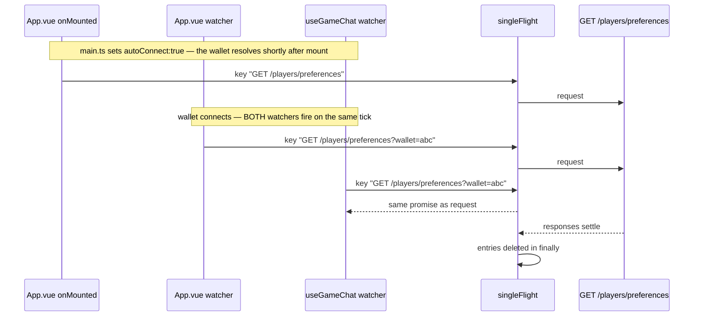

# SpaceStroker — "Player lockouts: duplicate concurrent API calls + Cloud Armor ban" — Implementation Spec

> **Status: Shipped (Terraform not yet applied)** — merged to `main` on **2026-07-27** from
> `feature/player-lockouts` (`monkify-front` + `monkify-meta`). **Minor change ⇒ no
> `features/player-lockouts.md`**; distilled into `features/terraform-gcp-deploy.md` → Cloud Armor,
> `architecture.md` → Edge, and `conventions/frontend.md` → Concurrent-request dedupe.
>
> **What was actually measured (§12 criteria 01/03/04 passed; the rest did not, and that is on purpose):**
> `/players/preferences` on a SolanaToken game page with a wallet went **4 → 3** — the two same-tick
> `?wallet=` calls collapsed into one, and the two `sub`-keyed calls (~6 s apart) correctly did not.
> **The lobby never duplicated at all (1:1 before and after).**
> ⚠️ **§1's "~143 → ~85-95" is WITHDRAWN.** It rested on the premise that every boot doubled its calls,
> which the baseline disproved. Real saving ≈ **1 request per game-page load, ~10%** of the incident's
> volume — not the ~40% claimed. **Criterion 02 also failed as written** (it demanded "exactly one"
> preferences call on the lobby; it is 1 **or 2** by design). **05** is partial, **06/07/08** were never
> exercised — see the card comments.
> **The Cloud Armor `throttle` change is the load-bearing half of this card**, and it is **not live**:
> no `terraform apply` has run. `action = "throttle"` remains **unproven** (see §7.3 — `validate` accepts
> a bogus action, so only `apply` can reject it).

> Refined via Trello card
> [Duplicate concurrent API calls + a 5-minute Cloud Armor ban lock players out — single-flight dedupe & throttle](https://trello.com/c/SpTvJGi9)
> (2026-07-27). Root cause was confirmed from production load-balancer logs **before** refinement; the
> card's "Measured evidence" section is the primary source and is not re-derived here.
>
> Repos affected: **`monkify-front`** (the fix) and **`monkify-meta`** (Terraform + this doc).
> **No `monkify-backend` change** — no entity, handler, consumer, migration, endpoint or header.
>
> **Purpose:** players are intermittently locked out of `app.spacestroker.com`. Cloud Armor returns
> `429` *before the app runs*, and Armor denials carry no CORS headers, so the browser reports a CORS
> error and the app "looks broken". Two causes compound: the SPA issues roughly twice the API calls it
> needs on every boot, and the Armor rule **bans** an offending IP for five minutes — so a brief
> overage becomes a multi-minute outage that the player's own reloads keep renewing.

---

## 1. Summary

Two independent changes, in two repos, that address the two halves of the incident.

| | Today | After |
| --- | --- | --- |
| Concurrent identical GETs | Each caller issues its own request — 7 identical `GET /players/preferences` in 14 ms were measured | Callers arriving while a request is in flight share that request's promise |
| API cost of the measured session | **143** requests | **~85-95** requests |
| Armor rule action | `rate_based_ban` — one overage bans the IP for **300 s**, so *every* later request 429s | `throttle` — only the requests *above* the rate are denied; the next interval is served normally |
| Armor threshold | 100 / 60 s (module default, never overridden) | 600 / 60 s |
| Recovery from an overage | Player sees a rendered shell with every API call failing, reloads, and each reload **renews** the ban | A few 429s during the burst; the app works again immediately after |

**The two halves are not redundant.** Single-flight is per-JavaScript-context and cannot dedupe across
tabs — the measured session had ~5 tab contexts and three tabs opened 12 ms apart. And the threshold of
100/60 s is below what a *single* normal player costs, so two players behind one VPN exit or corporate
NAT trip it with no misbehaviour at all. Neither change alone closes the incident.

---

## 2. Constraints (MANDATORY)

From `monkify-meta/constraints.md` (full list there):

- **Worktree-per-repo** (§2): work lives in `.worktrees/player-lockouts/<repo>`; branch
  `feature/player-lockouts` in `monkify-front` and `monkify-meta`. The shared hubs stay on `main` —
  never `git checkout -b` there. Push each branch to `origin` after branch work.
- **Unit tests** (§3): the backend test discipline **does not apply** — there is no backend change.
  `monkify-front` has no test framework (see §11); introducing one is explicitly out of scope.
- **`terraform apply` / `plan` against real infrastructure is an operator step** (§5). Merging the
  Armor change does **not** make it live. The `throttle` syntax check in §7.3 must be run by the user.
- **Frontend conventions** (`conventions/frontend.md`): API access goes through
  `src/services/mainService.ts` — a single axios instance with a request interceptor (baseURL +
  `X-Launch-Token`) and a response interceptor (401 handling). New endpoints and service-layer
  behaviour belong there and are exported from the default object.
- **Feature-specific:** single-flight shares data only between *simultaneous* callers, so no stale
  value can reach a bet, payout or refund. **Any deviation toward a time-based or identity-keyed cache
  re-opens that question and must be justified per endpoint.** This is the constraint that makes the
  whole change safe in a real-money app; do not relax it silently.

---

## 3. Resolved product decisions

Answer mode for the refinement run: **Complete**. Full trade-offs live on the Trello card; the
decision and the reason it beat its alternative are reproduced here.

| # | Decision |
| --- | --- |
| 1 | **A `singleFlight(key, fn)` helper lives in `mainService.ts` and is applied per endpoint via an allow-list.** Rejected a blanket dedupe on every GET (in the request interceptor): it would collapse deliberately-repeated reads — `getTokenBalance(..., { live: true })` exists precisely for "the moments that must not be stale (own bet, post-win settle, refund)", and a live read overlapping `TokenBalance.vue`'s 30 s poll would be served the poll's promise. That would turn a rate-limit bug into a payout bug. Also rejected per-hook guards: `getDefaultLaunchToken` is called from `useLaunch.ts:62` **and** from inside the response interceptor (`mainService.ts:72`), and a hook-level guard cannot cover the second path. |
| 2 | **No identity-keyed "already loaded" guard** in `useDisplayCurrency` — the helper alone. Accepted cost: when wallet auto-connect resolves *after* the boot fetch settles, the second `/players/preferences` still goes out, so the per-load average lands near **1.3-1.5, not 1.0**. Rejected restructuring `App.vue` (drop the `onMounted` call, make the watcher `immediate: true`): `immediate` fires during `setup()`, before `onMounted` runs `loadOperator()`, and `main.ts:83-94` guards only `['GameLobby', 'Game']` — so on `GameHistory` / `GameStats` (both in the watcher's route list) the request would go out before a launch token exists, 401, and land in the re-mint-or-`/error` path. That trades a rate-limit bug for a token-ordering bug. |
| 3 | **Allow-list = five boot-path endpoints:** `getGamesTypes`, `getPlayerPreferences`, `getFxRates`, `getOperator`, `getDefaultLaunchToken`. `getOperator` measured exactly 1/load and `getDefaultLaunchToken` 5 mints for ~5 tab contexts — both are included on **reasoning, not evidence**, and are marked as such in §6.3. `getDefaultLaunchToken` earns its place on a real latent race: on mid-session token expiry every in-flight request 401s at once and **each mints its own replacement**. |
| 4 | **Cloud Armor action changes from `rate_based_ban` to `throttle`**, threshold **600 / 60 s**, and `ban_duration_sec` is removed. Rejected keeping 100/60 s, and rejected merely raising the ban to 1200/60 s with a 60 s ban — that resizes the blackout instead of removing it. The incident's damage came from the **ban**, not the threshold. |
| 5 | **429 back-off and JA4 keying are out of scope**, split into Trello **#107** ([hIYEBjNL](https://trello.com/c/hIYEBjNL)) and **#108** ([jew9Girc](https://trello.com/c/jew9Girc)). Choosing `throttle` removed the self-sustaining loop that made back-off urgent. |
| 6 | **Verification is manual**, as the numbered criteria in §12. `monkify-front` has no test framework and introducing one was deliberately deferred (§11). |
| 7 | **Level: `Minor change`** — a bug fix plus an availability fix. No new capability, no game-flow change, no schema. Exempt from a new happy-path integration test and from a dedicated `features/player-lockouts.md`. **The KB obligation survives:** `features/terraform-gcp-deploy.md` must record the `rate_based_ban` → `throttle` change *and why the ban was abandoned* (§10.3). |

### 3.1 Corrections carried in from refinement

Four claims in earlier revisions of the card were wrong. They are recorded here so the implementer
does not act on the stale versions, and so they are not re-derived:

1. **The triple mint is not proof of a missing in-flight guard.** `POST /launch-token/default` at
   `22:15:41.247/.248/.321` is almost certainly **three tabs minting once each** — 5 mints for ~5 tab
   contexts, and the three tabs opened 1.8 s earlier. **Single-flight is per-tab and cannot dedupe
   across tabs.** The justification for wrapping it is the 401-storm race, not this.
2. **429s do not route to `/error`.** `mainService.ts:59-87` redirects only inside the
   `status === 401` branch; a 429 falls through to `return Promise.reject(error)` and each caller
   handles it — a toast in `GameTypes.vue:27-31`, a silent swallow in `useDisplayCurrency.ts:34-36,46-48`.
3. **The expected effect was overstated.** 75-80 assumed every duplicate was concurrent; corrected to
   **~85-95**.
4. **`feature/static-bucket-armor` does not collide with this change.** It touches
   `workload/main.tf`, `modules/static_site/main.tf` and `static_site/variables.tf` — **not
   `modules/edge/` at all**. Keeping this change inside `modules/edge/` avoids it entirely. (The INDEX
   warning about "three of the same Terraform files" refers to #102.)

---

## 4. Data model

**Not applicable.** No entity, column, EF mapping or migration. The change is a frontend service-layer
helper plus a Terraform attribute.

---

## 5. Configuration

### 5.1 Terraform variables (`monkify-meta`)

`deploy/terraform/workload/modules/edge/variables.tf` — both variables exist today and are **never
overridden** in any `*.tfvars.json`, so production runs on the module defaults. Only the defaults change:

| Variable | Today | After |
| --- | --- | --- |
| `rate_limit_count` | `100` | `600` |
| `rate_limit_interval_sec` | `60` | `60` (unchanged) |

`ban_duration_sec` is **not** a variable — it is hardcoded as `ban_duration_sec = 300` at
`modules/edge/main.tf:28` and is deleted outright (§7.2).

### 5.2 Frontend configuration

**None.** No new `VUE_APP_*` variable. The helper has no tunable — an in-flight window is not a
duration, it is the lifetime of the request itself.

---

## 6. Frontend behaviour (`monkify-front`)

### 6.1 The problem in code

`/players/preferences` has **four independent callers** with no coordination:

| # | Caller | Trigger | Wallet param |
| --- | --- | --- | --- |
| 1 | `App.vue:160` | `onMounted`, after `loadOperator()` | none ⇒ key is the launch-token `sub` |
| 2 | `App.vue:204-213` | watcher on `[effectivePublicKey, selectedGame?.paymentMethod]` | `walletForPrefs()` — the wallet **only** in a `SolanaToken` context |
| 3 | `useGameChat.ts:43-51` | watcher on `connected`, `{ immediate: true }` | always the connected wallet |
| 4 | `PlayerCustomizationModal.vue:92-100` | watcher on `[open, wallet]` | `walletId()` |

`main.ts:107` sets `autoConnect: true`, so on a `SolanaToken` game page **callers 2 and 3 fire on the
same wallet-connect tick** — that is the seven-identical-requests-in-14 ms burst from the logs, and it
is exactly the shape single-flight collapses.

`getGamesTypes()` has four equally uncoordinated callers: `GameTypes.vue:25`, `GamePage.vue:58`,
`GameHistoryPage.vue:130`, `GameStatsPage.vue:93`.

`useDisplayCurrency` is already a module-level singleton (`useDisplayCurrency.ts:18-23`) — the **state**
is shared, the **fetching** is not. That is the whole defect in one sentence.

### 6.2 The helper

Add to `src/services/mainService.ts`, above the endpoint functions. Module-local — **not** exported,
and **not** added to the default export object (it is not an endpoint).

```ts
// Collapses CONCURRENT identical requests: while a request for `key` is in flight, every later caller
// receives that same promise. Once it settles the entry is dropped, so the next call issues a fresh
// request.
//
// This is deliberately NOT a cache. Nothing is retained across time, so no caller can ever be served a
// value fetched before it asked — which is what keeps it safe to apply to endpoints the money path
// reads. See monkify-meta/specs/player-lockouts.md §2.
const inFlight = new Map<string, Promise<unknown>>();

const singleFlight = <T>(key: string, request: () => Promise<T>): Promise<T> => {
  const existing = inFlight.get(key) as Promise<T> | undefined;
  if (existing) return existing;

  // `.finally` MUST run on both settle paths — a leaked entry would serve one stale promise forever.
  const promise = request().finally(() => {
    inFlight.delete(key);
  });

  inFlight.set(key, promise);
  return promise;
};

// Deterministic key. Two calls with the same params must always collide; two with different params
// must never. `getPlayerPreferences(wallet)` and `getPlayerPreferences()` resolve DIFFERENT players
// (connected wallet vs launch-token `sub` — see App.vue:194-202) and must stay distinct.
const flightKey = (method: string, path: string, params?: Record<string, unknown>): string => {
  const entries = Object.entries(params ?? {})
    .filter(([, value]) => value !== undefined)
    .sort(([a], [b]) => a.localeCompare(b));
  if (!entries.length) return `${method} ${path}`;
  return `${method} ${path}?${entries.map(([k, v]) => `${k}=${String(v)}`).join('&')}`;
};
```

**Ordering note:** `request()` starts before `inFlight.set`, but the `.finally` callback can only run
in a microtask *after* the synchronous `set`, so there is no window where a settled request is still
registered.

### 6.3 Applying it — the allow-list

Exactly five functions are wrapped. **The other eight exported functions are not touched**, and that
is deliberate (§9).

| Function | Key | Why |
| --- | --- | --- |
| `getGamesTypes` (`:89`) | `GET /games/active-types` | Measured ~2.0/load, four uncoordinated callers |
| `getPlayerPreferences` (`:126`) | `GET /players/preferences` (+ `?wallet=`) | Measured ~2.3/load, four callers, two of which fire on one tick |
| `getFxRates` (`:133`) | `GET /fx/rates` | Called alongside preferences in the same `Promise.all` (`App.vue:160`) and from three other places |
| `getOperator` (`:113`) | `GET /operators/{id}` | **Defensive — not evidence-driven.** Measured exactly 1/load; the guard will simply never fire |
| `getDefaultLaunchToken` (`:45`) | `POST /launch-token/default` | **Defensive — not evidence-driven** for the incident, but closes a real race: on mid-session token expiry every in-flight request 401s at once and each mints its own replacement |

Worked example (the rest follow the same shape — wrap the axios call, leave everything else alone):

```ts
const getPlayerPreferences = async (wallet?: string) => {
  const params = wallet ? { wallet } : undefined;
  const { data } = await singleFlight(
    flightKey('GET', '/players/preferences', params),
    () => mainAPI.get<DefaultResponse<PlayerPreferences>>('/players/preferences', { params })
  );
  return data;
};
```

`getDefaultLaunchToken` keeps its existing `try { … } catch { return null; }` **outside** the
`singleFlight` call, so a shared rejection is still caught independently by each caller and each still
returns `null`. Its observable contract does not change.

### 6.4 What must not change

- **No call-site changes.** `App.vue`, `useGameChat.ts`, `useDisplayCurrency.ts`,
  `PlayerCustomizationModal.vue`, `GameTypes.vue`, `GamePage.vue`, `GameHistoryPage.vue` and
  `GameStatsPage.vue` keep calling exactly as they do. The dedupe is transparent.
- **No UI, copy, state or route change.** Nothing is player-visible.
- **No change to the request or response interceptors** beyond `getDefaultLaunchToken` now routing
  through the helper.

### 6.5 ⚠️ Shared response object

Every waiter on a deduped request receives the **same** resolved object — not a copy. Today no caller
mutates a response (`GameTypes.vue:26` assigns `data` straight to the `gameTypes` singleton ref;
`useDisplayCurrency.ts:43-45` reads three fields), so this is safe as written. **Treat these responses
as read-only.** If a future caller needs to mutate one, it must clone first — a mutation would
otherwise be visible to every other waiter on that same tick.

---

## 7. Infrastructure behaviour (`monkify-meta` → Terraform)

### 7.1 Today

One `rate_based_ban` rule at priority 1000 in
`deploy/terraform/workload/modules/edge/main.tf:11-31`, attached to
`google_compute_backend_service.api` only (`:84`) — the backend **buckets** carry no policy, which is
why static assets kept returning 200 throughout the incident while every API call 429'd.

### 7.2 The change

```hcl
  # Per-IP throttle. THROTTLE, not rate_based_ban: a ban denies every request from the IP for its
  # whole duration, so a player who briefly bursts (multiple tabs, a reload flurry) gets a rendered
  # shell whose every API call fails — and each reload RENEWS the ban. Throttling denies only the
  # requests above the rate, so the next interval is served normally. See
  # monkify-meta/specs/player-lockouts.md §7.
  rule {
    action   = "throttle"
    priority = 1000
    match {
      versioned_expr = "SRC_IPS_V1"
      config {
        src_ip_ranges = ["*"]
      }
    }
    rate_limit_options {
      conform_action = "allow"
      exceed_action  = "deny(429)"
      enforce_on_key = "IP"
      rate_limit_threshold {
        count        = var.rate_limit_count
        interval_sec = var.rate_limit_interval_sec
      }
    }
    description = "Per-IP throttle (excess denied; no ban)."
  }
```

`ban_duration_sec` is **removed** — it is meaningless without `rate_based_ban` and the provider
rejects it. The priority-900 OWASP WAF rule (preview) and the default-allow rule are **unchanged**.

### 7.3 ⚠️ `throttle` cannot be proven before `apply` — what was and was not verified

**Terraform 1.13.4 *is* installed locally** — the note carried in `INDEX.md` from #102 ("no terraform
binary in the authoring environment") is out of date. So this config got further than #102's did:

| Check | Result | What it proves |
| --- | --- | --- |
| `terraform fmt -check -recursive` | ✅ clean | Formatting is canonical |
| `terraform init -backend=false` | ✅ | Providers resolve; **no state, no credentials, no contact with production** |
| `terraform validate` | ✅ `Success! The configuration is valid.` | The config parses and every attribute **exists** in the provider schema — notably that `rate_limit_options` is still valid with `ban_duration_sec` **removed** |

**But `validate` does NOT check the action enum.** Verified directly on 2026-07-27 by substituting
`action = "not_a_real_action"`: `terraform validate` reported **`Success!`** just the same. The provider
carries no client-side validation on that field, so **neither `validate` nor `plan` can reject an
invalid action** — Cloud Armor rejects it server-side, at **`apply`**.

Consequences, stated plainly so nobody reads a green check as more than it is:

- `throttle` is a **documented Cloud Armor action** for `rate_limit_options` (the counterpart to
  `rate_based_ban`), which is the basis for choosing it. That is documentation-and-knowledge evidence,
  **not** tooling evidence.
- **A successful `terraform plan` is not evidence that this works.** Plan will succeed either way. Do
  not treat it as the gate — see the amended acceptance criterion 10 in §12.
- The real gate is a successful **`apply`** followed by the behavioural check in criterion 11. If
  `apply` rejects the action, the fallback is `rate_based_ban` with `ban_duration_sec` lowered to the
  shortest the API accepts — worse, but not a blocker for the frontend half of this card.

### 7.4 ⚠️ Apply ordering — this is the fourth un-applied change

Three Terraform/deploy changes are already merged to `main` and **not yet applied**:

| Trello | Change | What it needs |
| --- | --- | --- |
| #102 | Static-site HTTP status codes (404→200 SPA fallback) | `terraform apply` + CDN invalidation |
| #103 | Static-site upload `Cache-Control` | a deploy run (tool-side, not Terraform) |
| #105 | `X-Robots-Tag: noindex` on the front backend bucket | `terraform apply` |

The next `terraform apply` will land **all Terraform changes at once**, including this one. That is not
a blocker, but the operator must know that applying this card's change is not an isolated action, and
that #102's config has never been `terraform validate`-ed. Run `plan` and read it fully before applying.

---

## 8. Flow diagram

Boot of a `SolanaToken` game page with a wallet that auto-connects — the exact path that produced the
burst.



Before this change the same sequence issued **three** requests; after it, **two** — and the two that
remain are genuinely different identities, which must not be collapsed.

---

## 9. Out of scope

- **429 retry / failure-recovery UX** → Trello **#107** ([hIYEBjNL](https://trello.com/c/hIYEBjNL)).
- **Composite `IP` + JA4 rate-limit key** → Trello **#108** ([jew9Girc](https://trello.com/c/jew9Girc)).
- **Introducing a test framework to `monkify-front`** — deferred; deserves its own decision (§11).
- **Cross-tab deduplication.** Single-flight is per JavaScript context and cannot see other tabs. The
  measured session had ~5 tab contexts; that traffic remains, which is precisely why §7 is not optional.
- **Any change to the other eight service functions** — `getTokenBalance`, `getGameInstance`,
  `getGameVerification`, `getGameTypeStats`, `getGlobalStats`, `getGamesHistory`, `applyBet`,
  `updatePlayerPreferences`. Several are deliberately uncoordinated (§3 decision 1).
- **The second `/games/active-types` per load** (§13.4) — investigate only if the after-counts don't
  land; single-flight collapses it if the two calls are concurrent.

---

## 10. File checklist

### 10.1 Backend (`monkify-backend`)

**None.** No file changes. No branch or worktree was created for this repo.

### 10.2 Frontend (`monkify-front`)

| # | File | Change |
| --- | --- | --- |
| 1 | `src/services/mainService.ts` | Add module-local `inFlight` map, `singleFlight(key, request)` and `flightKey(method, path, params)` (§6.2). Wrap the axios call in `getDefaultLaunchToken` (`:45`), `getGamesTypes` (`:89`), `getOperator` (`:113`), `getPlayerPreferences` (`:126`), `getFxRates` (`:133`). Do not export the helper or add it to the default object. |

That is the **entire** frontend diff — one file.

### 10.3 Meta (`monkify-meta`)

| # | File | Change |
| --- | --- | --- |
| 1 | `deploy/terraform/workload/modules/edge/main.tf` | Priority-1000 rule: `action` `rate_based_ban` → `throttle`; delete `ban_duration_sec = 300`; update the rule comment + `description` (§7.2) |
| 2 | `deploy/terraform/workload/modules/edge/variables.tf` | `rate_limit_count` default `100` → `600` |
| 3 | `specs/player-lockouts.md` | This spec (already committed) |
| 4 | `INDEX.md` | Map row + "Feature currently in flight" (already committed) |
| 5 | `features/terraform-gcp-deploy.md` | **At ship time** — record the `rate_based_ban` → `throttle` change **and why the ban was abandoned**, so a future reader tightening the policy cannot reinstate it blind (acceptance criterion 13) |

---

## 11. Unit tests

**None — and this is a decision, not an omission.**

`monkify-front` has **no test framework**: `package.json` exposes only `serve`, `build`, `lint` and
`lint:fix`, and there is no jest / vitest / cypress / playwright dependency. `constraints.md` §3
mandates test discipline for **backend** changes, and this card has no backend change. The mandatory
happy-path integration test is waived by the `Minor change` level, and would in any case be
unsatisfiable in spirit: `SpaceStroker.Tests.Integration` drives the API against real containers and
cannot observe a browser's request count.

Introducing Vitest for `singleFlight` was considered and rejected during refinement: the helper is a
pure async function and easy to test, but **a helper unit test would have passed throughout the
incident** — the failure was four callers converging on one tick in a real browser. Frontend testing
deserves its own decision rather than riding along on an availability fix.

**The accepted consequence:** nothing prevents this regression returning. A fifth `loadPreferences`
caller added later is invisible until the next incident. §12 replaces automated coverage with numbered,
repeatable manual criteria — and criterion 1 is time-sensitive.

---

## 12. Acceptance criteria

Mapped 1:1 from the Trello **Acceptance Criteria** checklist.

1. Given the local Docker stack and DevTools filtered to the API host, when the lobby and a
   `SolanaToken` game page are loaded cold **before any code change**, then the per-endpoint request
   counts are recorded as the "before" baseline on the card.
2. Given the single-flight helper is applied, when the games lobby is loaded cold with no launch token,
   then exactly one `GET /players/preferences`, one `GET /fx/rates`, one `GET /operators/{id}` and one
   `GET /games/active-types` are issued.
3. Given a `SolanaToken` game page and a wallet that auto-connects, when the page loads, then
   `App.vue`'s watcher and `useGameChat`'s watcher share **one** `GET /players/preferences` instead of
   issuing two on the same tick.
4. Given `getPlayerPreferences(wallet)` and `getPlayerPreferences()` are called concurrently, when both
   are in flight, then **two** separate requests are issued — the connected-wallet and launch-token-sub
   identities must never collapse into one promise.
5. Given a request has settled (resolved **or** rejected), when the same key is requested again, then a
   fresh request is issued — the map entry is cleared in `finally`, never only on success.
6. Given a deduped request fails, when two or more callers awaited it, then every caller observes the
   rejection and each keeps its existing handling (toast in `GameTypes.vue` / `GamePage.vue`, silent
   swallow in `useDisplayCurrency`) — no caller hangs and none is left unresolved.
7. Given a launch token expires mid-session and several in-flight requests 401 simultaneously, when the
   response interceptor re-mints, then exactly **one** `POST /launch-token/default` is issued and every
   retried request carries the same fresh token.
8. Given the player navigates lobby → play → history → stats, when each route mounts, then each
   navigation still issues its own `GET /games/active-types` — single-flight deliberately does **not**
   cache across time, and this is the accepted trade-off, not a defect.
9. Given the "before" baseline from criterion 1, when an equivalent session is replayed after the fix,
   then total API requests fall by roughly 35-40% (~143 → ~85-95 for the measured incident shape) and
   the per-load `/players/preferences` average drops from ~2.3 toward 1.3-1.5.
10. **(Amended 2026-07-27 — see §7.3.)** Given the Terraform change to `modules/edge`, when the operator
    runs `terraform plan`, then it shows the priority-1000 rule changing to `action = "throttle"` with
    `rate_limit_threshold { count = 600, interval_sec = 60 }` and **no** `ban_duration_sec`.
    ⚠️ **A passing plan is NOT evidence the action is valid** — `terraform validate` was shown to accept
    a deliberately bogus action string, so the provider has no client-side enum check and plan cannot
    reject one either. The criterion is satisfied by the **diff being the intended one**; validity is
    proven only by a successful `apply` plus criterion 11.
    *(Locally verified before merge: `fmt -check` clean, `init -backend=false` + `validate` both pass —
    which confirms the config parses and that dropping `ban_duration_sec` is schema-valid, nothing more.)*
11. Given the Armor change is applied, when one IP exceeds 600 requests in 60 s, then only the excess is
    denied with 429 and the following interval is served normally — the IP is never banned and no
    blanket denial occurs.
12. Given the Armor change is applied, when a player opens 3 tabs and reloads a dozen times, then no
    request is denied and no `jsonPayload.enforcedSecurityPolicy.outcome="DENY"` appears in the LB logs
    for that session.
13. Given the feature ships, when the KB is synced, then `features/terraform-gcp-deploy.md` records the
    `rate_based_ban` → `throttle` change **and** the reason the ban was abandoned.

---

## 13. Manual QA

### 13.1 Capture the baseline FIRST (criterion 1)

This step is destroyed by the fix. Do it before writing any code.

1. Start the local stack (`setup_local_environment.bat`).
2. Open DevTools → Network, filter to the API host, tick **Preserve log**, and **disable cache**.
3. Load the lobby cold (new tab, cleared `sessionStorage` — the launch token is per-tab).
4. Record the count of each of: `/players/preferences`, `/fx/rates`, `/operators/{id}`,
   `/games/active-types`, `/launch-token/default`.
5. Repeat on a `SolanaToken` game page **with a wallet connected** — this is the path where callers 2
   and 3 collide, and it is where the biggest reduction should appear.
6. Paste both tables into a Trello comment.

### 13.2 After the fix

Repeat 13.1 steps 2-5 and compare. Criteria 2, 3 and 9 are read directly off these counts.

### 13.3 The error path (criterion 6)

Stop the API container, then load the lobby. Expect: the toast from `GameTypes.vue` fires, the
currency load stays silent, nothing hangs, and no unhandled promise rejection appears in the console.
Restart the API and reload — a **fresh** request must go out (criterion 5), proving the map entry was
cleared on the rejection path.

### 13.4 Open question — worth one look while you are in the network tab

The logs show `/games/active-types` at ~2.0 per load, but static reading accounts for only one
(`GameTypes.vue` on the lobby; `GamePage.vue` only on a cold `/play?type=` load). If the after-count is
still 2 per load, a component is mounting twice — note it on the card. Single-flight collapses it if
the two calls are concurrent; if they are not, the criterion 9 estimate shifts. Not a blocker.

### 13.5 Terraform (operator)

`terraform plan` per §7.3. Read §7.4 first — this is the fourth un-applied change and the apply will
land all of them.

---

## 14. Trello / pipeline

- **Source card:** [Duplicate concurrent API calls + a 5-minute Cloud Armor ban lock players out — single-flight dedupe & throttle](https://trello.com/c/SpTvJGi9)
  (#104) — list **Specs created**; the **Implementation** section on the card carries branch, worktree,
  spec path and level.
- **Level:** `Minor change` ⇒ no happy-path integration test, no `features/player-lockouts.md`.
  `features/terraform-gcp-deploy.md` **is** updated at ship time (§10.3 row 5).
- **Split-out cards:** #107 ([hIYEBjNL](https://trello.com/c/hIYEBjNL)) retry affordance,
  #108 ([jew9Girc](https://trello.com/c/jew9Girc)) IP+JA4 keying. Both Backlog, both unrefined.
- **Next:** `/monkify-implement-feature` → then `/monkify-ship-feature`.

---

## 15. Revision log

| Date | Change |
| --- | --- |
| 2026-07-27 | Initial spec from refined card #104. Carries the four refinement corrections (§3.1) and the apply-ordering warning (§7.4). |
| 2026-07-27 | **§7.3 rewritten + criterion 10 amended during implementation.** Terraform 1.13.4 turned out to be installed locally (the INDEX note from #102 was stale), so `fmt`/`init -backend=false`/`validate` all ran and passed. But `validate` was then shown to accept `action = "not_a_real_action"` — the provider has no client-side enum check, so **neither validate nor plan can prove `throttle` is valid**; only `apply` can. Criterion 10 previously implied a passing plan was the gate, which would have passed vacuously. |
