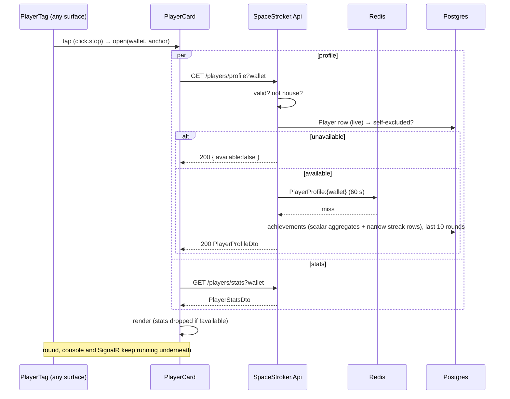

# SpaceStroker — "Profile V1" (public player profile + player tags) — Implementation Spec

> **Status: Ready for implementation** — refined via Trello card
> [#186 Profile V1 — public player profile + player tags (move personal stats here)](https://trello.com/c/cF0gPauc/186-profile-v1-public-player-profile-player-tags-move-personal-stats-here)
> (refined 2026-10-12, spec 2026-10-13).
> Repos affected: `monkify-backend`, `monkify-front`, and this doc in `monkify-meta`.
> Branch / worktree: `feature/player-profile` → `.worktrees/player-profile/<repo>`.
> Change level: **Feature** — mandatory happy-path integration test (`constraints.md` §3).
>
> ⚠️ **Design gate (AC 13).** No **UI** code (§7) may be written until a **design preview artifact**
> (interactive HTML, real sprites/fonts/colors) exists, the owner has iterated on it and **explicitly
> approved** it, and its link is on the card. The approved artifact is the visual source of truth for §7 —
> where it disagrees with the layout words in this spec, **the artifact wins**. Backend work (§4–§6) and
> the non-visual frontend plumbing (§7.1–§7.2) are not gated.
>
> **Purpose:** give every wallet a public profile at **`/player/:wallet`**, move the personal record there
> from the home page, add a first shelf of **10 trophies** derived from rounds already played, and make
> every player name in the app a tappable **player tag** that opens a mini profile card over the current
> screen. V1 of a three-version roadmap (V2 = icon, privacy switches, chat tags, donations; V3 = quests,
> seasons, cosmetics — separate Backlog cards).

---

## 1. Summary

| Surface | Today | **After V1** |
| --- | --- | --- |
| Personal record | Home "YOUR RECORD" panel (`HomePlayerStats.vue`), own wallet only | `/player/:wallet` for **any** wallet, public; home keeps a compact strip (rounds · win rate · best streak · `Full profile →`) |
| Trophies | none | 10 fixed achievements, computed on read, no table |
| Recent rounds | per-type `/game/history` only | last 10 completed rounds **across all modes** on the profile, each with **Verify** |
| Player names in game / boards | dead text (bet list even prints the full raw wallet) | shared `PlayerTag` → mini `PlayerCard` (popover ≥ `lg`, bottom sheet below) |
| ☰ menu | 8 cells, 9th slot free | 9th cell **PROFILE** |
| Wallet pill menu | Copy / Change / Disconnect (desktop) · Disconnect (phone) | + **My profile** |

Backend adds **one** public read (`GET /players/profile?wallet=`) and an additive **`isHouse`** flag on
bet payloads. **No entity, no column, no migration, no money path touched.**

---

## 2. Constraints (MANDATORY)

From `monkify-meta/constraints.md` (full list there):

- **Worktree per repo, hub stays on `main`:** `feature/player-profile` in `monkify-backend`,
  `monkify-front`, `monkify-meta`, checked out at `.worktrees/player-profile/<repo>`.
- **Unit tests:** `SpaceStroker.Tests` via `scripts/run_tests.bat` (not a bare `dotnet test` — it excludes
  the `ProductionGames` Monte Carlo suite); add tests per trophy rule and availability state; report the
  changed/added tests at the end.
- **Integration test (Feature):** happy path in `SpaceStroker.Tests.Integration` (§11.2).
- **EF:** nothing to map — no entity or column changes. **No migration.**
- **API stays stateless**; the new read lives on `SpaceStroker.Api`.
- **Mock-only config.** No new config keys are needed.
- **Vague messaging (§6):** an unavailable profile never says *why* (self-excluded / house / malformed
  are indistinguishable to a caller).
- **"gamble", never "wager"** in copy (owner rule, `leaderboards.md`).
- **No new bounded-unbounded reads:** do **not** copy `PlayerStatsService`'s load-every-bet pattern
  (known debt, out of scope to fix).

---

## 3. Resolved product decisions

| # | Decision |
| --- | --- |
| 1 | Route **`/player/:wallet`** (wallet is the only stable key; display names are not unique). Viewable by anyone, connected or not. Route name `Player`. |
| 2 | Own profile is reached from: the **9th ☰ cell PROFILE**, a **My profile** entry in the wallet pill menu, the home strip's `Full profile →`, and the player's own tag. PROFILE with no wallet starts the connect flow and routes to the profile once connected. |
| 3 | Home "YOUR RECORD" becomes a **compact strip**: rounds, win rate, best streak + `Full profile →`. Net / gambled / won leave home. `HomeHero`'s use of stats (new vs returning, "Play <usual game>") is unchanged. |
| 4 | **Embedded (iframe):** `Player` joins `EMBED_REDIRECT_ROUTES`; every `PlayerTag` renders as plain text (no card). |
| 5 | Profile header: display name (fallback short wallet), short wallet + copy + Solana explorer link, **joined date = `Player.CreatedDate`** (known to mean "first seen" — five flows create the row; accepted). Owner also sees **Edit name** → existing SETTINGS modal. |
| 6 | Stats = everything `GET /players/stats` returns (rounds, bets, win rate, best streak, most played, biggest win + multiplier, **gambled, won, net**). **Money is public** (owner: public on-chain data). All-time only. |
| 7 | Owner's own record block links to **`/responsible-gaming`**. Owner also gets **All history →** (`/game/history`). Visitors see none of the three owner-only items (Edit name, RG link, All history). |
| 8 | **Trophy shelf, 10 fixed achievements** (§6.3), derived on read, no table. Locked → greyed + unlock hint; unlocked → unlock date = end date of the **earliest qualifying round**. |
| 9 | **Counting rule:** every real completed round counts — paid, free, holder ticket, Orbit (manual + auto). **Active streamer wallets unlock nothing**; Practice never counts (server never sees it). No volume/money or round-count achievements. |
| 10 | **Recent rounds:** last 10 completed rounds across all modes — mode, choice, stake, won/lost, payout, **Verify**. No pagination. |
| 11 | **Player tag** replaces name rendering on: Sprint race cards, in-game bet list (Sprint + Jackpot), Duel open rooms + in-match opponent, leaderboard rows + podium, History YOU column (→ own profile), home strip. Icon slot reserved for V2. |
| 12 | Tapping a tag opens a **mini profile card** over the current screen — never navigates mid-round. Card: name, short wallet + copy, joined date, rounds / win rate / net, 3 most recent trophies, **View full profile**. "YOU" keeps today's YOU styling but is tappable. |
| 13 | **Not tappable:** VS HOUSE / Edson / house seed bets, house wallets, and players whose profile is unavailable. Chat names stay plain until V2 (messages carry no wallet). |
| 14 | Self-excluded wallet (active): visitors see a vague **"Profile unavailable"**; the owner sees their exclusion end date (or PERMANENT) + RG resources. Trophies are kept and return when it lapses. |
| 15 | House wallets (treasury, Orbit, HouseSeed, ReferralPayout) and a **malformed** wallet → the same "Profile unavailable". A valid never-played wallet → short wallet as name, "No rounds yet", all trophies locked. |
| 16 | **Design preview artifact** approved by the owner before any UI code (AC 13). |
| 17 | *(spec)* Wire contract: `GET /players/profile?wallet=` → `PlayerProfileDto` (§6.1). Unavailable is **HTTP 200 `{ available: false }`**, never 400/404. |
| 18 | *(spec)* Trophies are **money-free, so not floored at `SettlementCutoverUtc`** (card edge case). Consequence accepted: a USDC-era 5-streak can unlock *Win streak 5* while the (floored) Best streak stat shows less. |
| 19 | *(spec)* Streamer **play bets** (`EntryKind == Streamer`) never count for a trophy, even after the wallet is deactivated — keyed on the bet, like leaderboards. Their rounds still appear in recent rounds **unmarked** (no "DEMO", `streamer-wallets.md` decision 8). |
| 20 | *(spec, see §6.6)* "Self-excluded not tappable" is enforced **at the card**, not per bet: no exclusion flag is ever broadcast on bet payloads. A tag of an excluded player opens a card that says "Profile unavailable". |

---

## 4. Data model

**No change.** Everything reads existing rows:

| Need | Source |
| --- | --- |
| Joined date, display name, exclusion | `Player.CreatedDate`, `Player.DisplayName`, `Player.SelfExcludedAt/Until` |
| A player's bets | `GameBets` (`PlayerId`, `GameId`, `Choice`, `Amount`, `EntryKind`, `Status`, `FundedByOrbit`, `OrbitAutoPlaced`) |
| Round outcome / date | `Game.Status == RewardForWinnersCompleted`, `WinningChoice`, `EndDate ?? CreatedDate`, `BoardMode`, `DuelKind` |
| Mode | `GameParameters` flags (§6.2) |
| HYPER 10× | `GameBoardChoice (GameId, Choice, Multiplier)` |
| Payout | `TransactionLog` `Credit` rows by `BetId`; streamer bets via `IStreamerLedger.WonFor` |

Existing indexes `(PlayerId, GameId)` on bets and `(BetId, Type)` on transaction logs serve every
player-scoped query below.

---

## 5. Configuration

None. House wallets come from the existing `HouseWallets.Resolve(TokenSettings)`
(`Services/Leaderboards/HouseWallets.cs`, skips blank and `MOCK_`).

---

## 6. Backend behaviour

### 6.0 Code findings that shape this spec

1. **There is no game-mode enum.** Mode is derived from `GameParameters` flags; the code warns never to
   rely on the name. §6.2 defines one shared classifier.
2. **There is no `/verify?game=` deep link.** Verify on History = `GET /games/{id}/verification` → copy +
   download `round-{gameId}.json` → link to `public/verify.html`. A profile row needs only the `gameId`.
3. **`GET /players/stats` applies no house / streamer / self-exclusion filter** and answers any wallet,
   and **`GET /players/preferences` already returns `selfExcluded` + `selfExcludedUntil` for any wallet,
   unsigned.** Both are pre-existing and **out of scope**; the profile read must not *add* a reason
   signal, and the frontend must gate stats on `profile.available` (§7.4) so the profile surfaces never
   render a hidden wallet's figures. ⚠️ Flag for a future card: the preferences read leaks exclusion
   status publicly.
4. **Integration tests use non-base58 wallets** (`stats-{run}-rabbit`). The profile read rejects those as
   malformed, so its integration test must use real keypairs (`new Account().PublicKey.Key`, as
   `StreamerWalletsFlowTests` / `SelfExclusionFlowTests` do).
5. **Bet payloads carry no house marker.** The house seed bets in every Sprint round and renders like a
   player. §6.5 adds `isHouse`.
6. **No shared wallet validator.** Three private copies of `try { new PublicKey(w) } catch`. §6.1 adds one
   (`WalletAddress.IsValid`) and the new handler uses it; the existing copies may be left as they are.

### 6.1 `GET /players/profile?wallet=` (API, public)

- **Controller:** `PlayersController` — `[HttpGet("profile")] GetPlayerProfile([FromQuery] string? wallet)`
  + its `[HttpOptions("profile")]` CORS twin, like `stats`.
- **Request/handler:** `Handlers/Players/GetPlayerProfile/{GetPlayerProfileRequest,GetPlayerProfileHandler}.cs`
  — `record GetPlayerProfileRequest(string? Wallet) : IRequest<PlayerProfileDto>`.
- **Helper:** `SpaceStroker.Domain/Players/Services/WalletAddress.cs` (or the nearest existing domain
  helpers folder) — `static bool IsValid(string? wallet)` = trimmed, non-empty, `new PublicKey(...)` does
  not throw.

**Handler order (every unavailable branch returns the *same* `PlayerProfileDto.Unavailable`, HTTP 200):**

1. Trim. `!WalletAddress.IsValid` → Unavailable. *(never cached, never logged with the value at > Debug)*
2. Wallet ∈ `HouseWallets.Resolve(token)` → Unavailable.
3. `Players.AsNoTracking()` by `ExternalPlayerId` (projection: `Id`, `CreatedDate`, `DisplayName`,
   `SelfExcludedAt`, `SelfExcludedUntil`). **Never creates a row.**
4. Row exists and `IsSelfExcluded(now)` (evaluated in C# on the one loaded row — fine here) → Unavailable.
   Checked **live on every request**, before the cache, so a fresh exclusion hides the profile at once.
5. No row → available, `displayName = null`, `joinedAt = null`, all 10 achievements locked, no rounds.
   **Not cached** (one indexed lookup; caching unknown wallets would let a caller mint keys).
6. Row exists → body from cache `PlayerProfile:{wallet}` (**60 s**,
   `CacheHelper.GeneratePlayerProfileCacheSettings`) or computed by `IPlayerProfileService` (§6.3–§6.4).
   Display name is read from the live row and stamped on the returned copy (clone before stamp — never
   mutate the cached instance), so a rename shows immediately.

**DTO** — `Contracts/Players/PlayerProfileDto.cs` (camelCase on the wire):

```csharp
public class PlayerProfileDto
{
    public bool Available { get; init; }
    public string? Wallet { get; init; }            // echoed only when Available
    public string? DisplayName { get; init; }
    public DateTime? JoinedAt { get; init; }         // Player.CreatedDate; null = no row
    public IReadOnlyList<AchievementDto> Achievements { get; init; } = [];
    public IReadOnlyList<ProfileRoundDto> RecentRounds { get; init; } = [];
    public string TokenSymbol { get; init; } = "";
    public int TokenDecimals { get; init; }
    public static PlayerProfileDto Unavailable => new() { Available = false };
}

public record AchievementDto(string Key, bool Unlocked, DateTime? UnlockedAt);

public record ProfileRoundDto(
    Guid GameId, DateTime EndedAt, string Mode, string GameTypeName, string? BoardMode,
    bool DuelVsHouse, string Choice, decimal Stake, string Entry, bool Won, decimal Payout, bool ViaOrbit);
```

> ⚠️ **Nothing on the wire says a wallet is a streamer** (the `IsVerifiedActiveStreamer` anti-probing
> rule). An active streamer's profile is simply available with every trophy locked — do not add a flag.

- `Achievements` always has all **10** entries in the fixed order of §6.3 (keys are stable wire
  identifiers; titles/hints live on the front).
- `Mode` ∈ `sprint | hyperRoll | duel | jackpot`. `Entry` ∈ `paid | free | ticket` — **`Streamer` maps to
  `paid`** (unmarked, decision 19). `ViaOrbit = FundedByOrbit` (covers manual and auto-placed).
- Unavailable: `Available = false`, every other field default/empty — byte-identical for all three
  reasons.

### 6.2 Shared mode classifier

`Services/Players/GameModeClassifier.cs` — an expression usable inside EF queries plus a C# twin, with a
unit test pinning them together:

| Mode | Predicate on `GameParameters p` (first match wins) |
| --- | --- |
| `duel` | `p.IsDuel` |
| `hyperRoll` | `p.IsHouseEdge` |
| `jackpot` | `p.LotteryParameters != null` |
| `sprint` | otherwise |

### 6.3 Achievements — `IPlayerProfileService.ComputeAchievementsAsync(playerId, wallet)`

**Qualifying bets** `Q` (one shared `IQueryable`, every rule builds on it):

```
GameBets b JOIN Games g ON b.GameId = g.Id JOIN GameParameters p
WHERE b.PlayerId == playerId
  AND g.Status == RewardForWinnersCompleted
  AND b.Status NOT IN (NeedsRefunding, Refunded, Voided)
  AND b.EntryKind != Streamer
```

- **Won** = `b.Choice.ToUpper() == g.WinningChoice.ToUpper()` and `g.WinningChoice != null` — the same
  case-insensitive rule `PlayerStatsService` uses for `BestStreak`.
- **Round date** = `g.EndDate ?? g.CreatedDate` in the **SELECT** only (a COALESCE in a WHERE is
  unsargable — `stats-and-history.md`).
- **No `SettlementCutoverUtc` floor** (decision 18). Free, holder and Orbit bets are in `Q` (decision 9).
- **Active streamer wallet** (`StreamerWallets.Any(s => s.Active && s.Wallet == wallet)`) → skip all
  queries, return 10 locked.

Each unlock date is `MIN(round date)` over the rule's qualifying rows — a **scalar aggregate (one row)**:

| # | Key | Rule over `Q` | Locked hint (front copy) |
| --- | --- | --- | --- |
| 1 | `firstSprintWin` | won ∧ mode = sprint | Win a Cosmic Sprint round |
| 2 | `firstHyperRollWin` | won ∧ mode = hyperRoll | Win a Hyper Roll round |
| 3 | `firstDuelWin` | won ∧ mode = duel | Win a Monkey Duel |
| 4 | `jackpotWinner` | won ∧ mode = jackpot | Win the Space Jackpot |
| 5 | `hyperHit` | won ∧ mode = hyperRoll ∧ `g.BoardMode == "HYPER"` ∧ ∃ `GameBoardChoice c` (`c.GameId == g.Id ∧ c.Choice == b.Choice ∧ c.Multiplier >= 10`) | Hit a 10× word on a HYPER board |
| 6 | `rivalSlayer` | won ∧ mode = duel ∧ `g.DuelKind == OpenRoom` | Beat another player in a Monkey Duel |
| 7 | `crowdBeater` | won ∧ mode = sprint ∧ (players in round) ≥ **5** | Win a Cosmic Sprint with 5+ players |
| 8 | `winStreak3` | first round where the running streak reaches 3 | Win 3 rounds in a row |
| 9 | `winStreak5` | first round where the running streak reaches 5 | Win 5 rounds in a row |
| 10 | `explorer` | all four modes present in `Q` (won or lost); date = the **latest** of the four per-mode `MIN` dates | Play every game mode |

- **Players in round (rule 7)** — correlated subquery: distinct `b2.PlayerId ?? b2.Id` over the round's
  bets with the same status filter, **excluding house-wallet players** (join `Players` on
  `ExternalPlayerId ∈ houseWallets`). Anonymous free bets count individually, matching the min-player
  rule (`player.md`). ⚠️ Join through the **nullable side** (`leaderboards.md` trap 2).
- **Streaks (rules 8–9)** — the one non-scalar read: project **one narrow row per round**
  (`GameId`, `EndDate`, `CreatedDate`, `AnyWon`) via `GroupBy(GameId)` in SQL, order by
  `EndDate ?? CreatedDate`, then `CreatedDate` (BestStreak's order), and walk it in C#: a won round
  increments the run, a lost round resets it; record the round date when the run first hits 3 and 5;
  stop early once both are found. Two scalars per round, no entity materialisation — this is **not** the
  `PlayerStatsService` pattern. (Raw SQL gaps-and-islands was considered and rejected: the codebase has
  no `FromSql`/`SqlQuery` usage and the InMemory unit provider can't run it.)
- Mode-scoped rules 1–7 may be folded into one `GroupBy(mode)` aggregate or issued as separate scalar
  queries — implementer's choice; each must return ≤ 4 rows.

### 6.4 Recent rounds — `IPlayerProfileService.GetRecentRoundsAsync(playerId)`

1. From `Q` **without** the `EntryKind != Streamer` filter (rounds show unmarked, decision 19):
   `GroupBy(GameId)` → `MAX(round date)`, order desc, **take 10** → game ids.
2. Load those ≤ 10 games (+ `GameParameters` name and flags) and the player's bets in them.
3. **One row per round** — the winning bet, else the earliest by `CreatedDate` (same rule as
   `GameHistoryService.ApplyOwnColumnsAsync`).
4. `Payout` = `Σ Credit` for that bet from `TransactionLog`; a `Streamer` bet → `IStreamerLedger.WonFor`.
   Holder **credits** are shown (it is that player's real win; the money exclusion applies to aggregates,
   not to a single round's row). Lost → 0.
5. `Stake = b.Amount` (0 for free / ticket), `Entry` mapping per §6.1, `DuelVsHouse = g.DuelKind == House`,
   `BoardMode = g.BoardMode`, `GameTypeName = p.Name`.

### 6.5 `isHouse` on bet payloads (additive)

- `Contracts/Games/BetDto.cs`: add `public bool IsHouse { get; init; }`.
  `ActiveGameDto` (built in the active-session read) sets it from `HouseWallets.Resolve(token)` for each
  bet's wallet; `RegisterBetHandler`'s two `new BetDto(_bet)` returns leave it `false` (the caller is never
  the house through that path — the seed bet is placed by Consumers).
- `Consumers/BetNotification/BetNotificationEvent.cs`: append `bool IsHouse = false` (positional record,
  defaulted so every existing construction compiles); `GameService.InsertBet` sets it from the resolved
  house set. SignalR clients that don't read it are unaffected.
- Inject the house set where needed via `IOptions`/the existing settings accessor the leaderboard service
  uses (`settings?.Operator?.Token`); resolve once per instance.

### 6.6 Self-excluded players on tag surfaces (decision 20)

A self-excluded wallet **cannot place a new bet**, so it can only appear on a live surface through a bet
placed before the exclusion; leaderboards already drop it (`EligiblePlayers`). Broadcasting a per-bet
"profile hidden" flag on the public bet stream would publish exclusion status to every viewer (`legal.md`,
`constraints.md` §6), so **no such flag is added**. The tag stays tappable and the card renders the vague
"Profile unavailable" from `available: false`. This satisfies AC 9 fully and AC 8 for every house case; the
residual (a pre-exclusion bet in the same round) opens an unavailable card instead of being plain text —
the documented, accepted narrowing.

### 6.7 No new error messages

The read never returns an error body for a wallet problem; a server fault is a normal 500 and the front
shows offline-retry.

---

## 7. Frontend behaviour (`monkify-front/src`)

> §7.3 onward is **gated on the approved design artifact**. Layout/visual wording below states the
> behaviour; the artifact owns the look.

### 7.1 Types, service, utils (not gated)

- `types/index.ts`: `PlayerProfile`, `ProfileAchievement`, `ProfileRound`, `AchievementKey` (the 10
  keys); `AppliedBet.isHouse?: boolean`; `RaceCard.wallet?: string | null` (`utils/playerCard.ts`).
- `services/mainService.ts`: `getPlayerProfile(wallet)` → `GET /players/profile?wallet=`, wrapped in
  `singleFlight` (two tags of one player tapped quickly share one request); export it. Set
  `err.handled = true` in the composable so a failed card load does not toast.
- `constants/achievements.ts`: ordered catalog `{ key, title, hint, icon }` for the 10 keys (titles: First
  Sprint win · First Hyper Roll win · First Duel win · Space Jackpot winner · HYPER hit · Rival slayer ·
  Crowd beater · Win streak 3 · Win streak 5 · Explorer).
- `utils/explorer.ts`: `accountExplorerUrl(wallet)` from `VUE_APP_SOLANA_EXPLORER_URL` +
  `?cluster=${VUE_APP_SOLANA_NETWORK || 'devnet'}` (omit the param on `mainnet-beta`) — the shape
  `useConnection.ts:236` uses for transactions.
- `utils/clipboard.ts`: `copyText(text): Promise<boolean>` (try/catch around `navigator.clipboard`).
- `utils/verifyRound.ts`: extract `GameHistoryPage.vue`'s `verifyRound(gameId)` (fetch verification →
  copy → download `round-{gameId}.json`) so History and the profile share it; History keeps its behaviour.

### 7.2 Composables (not gated)

- `hooks/usePlayerProfile.ts` — `usePlayerProfile(walletRef)`: `{ profile, stats, loading, failed,
  reload }`. Fetches `getPlayerProfile` and `getPlayerStats` **in parallel** (stats always via the service,
  not the `usePlayerStats` singleton, which is pinned to the connected wallet); sequence guard like
  `usePlayerStats`; a module-level **30 s** per-wallet memo so reopening a card is instant. `stats` is
  **discarded when `profile.available === false`** (finding 3).
- `hooks/usePlayerCard.ts` — singleton `{ openWallet: Ref<string|null>, anchor: Ref<HTMLElement|null>,
  open(wallet, anchorEl), close() }`. Closes on route change.
- `hooks/useWalletConnectRequest.ts` — `requestConnect(): void`. Phone/deeplink context
  (`isMobileDeeplinkContext()`) → `useMobileWallet().openWalletModal()`; desktop → a function registered
  by the header `WalletButtons` instance (it already owns the hidden `<wallet-multi-button>` click). Plus
  `afterConnect(cb)` — one-shot watcher on `effectivePublicKey` used by PROFILE.
- Identity everywhere is **`useMobileWallet().effectivePublicKey`** (desktop + phone sessions), never
  `useWallet().publicKey`. On game surfaces `useGame().currentPlayerId` (unchanged).

### 7.3 `PlayerTag` and `PlayerCard` (`components/player/`)

- **`PlayerTag.vue`** — props `wallet: string | null`, `displayName?: string | null`, `you?: boolean`,
  `youLabel?: string` (e.g. `YOU · ORBIT`), `house?: boolean`, `houseLabel?: string`.
  - Text: `youLabel || 'YOU'` when `you`; else `houseLabel` when `house`; else `publicName(...)`
    (`utils/playerCard.ts` — name, else 4…4 wallet, else `ANON`).
  - **Tappable** iff `wallet && !house && !useEmbed().isEmbedded`. Renders a `<button>` with
    `@click.stop` (DuelBoard cards and race cards have their own click handlers) → `usePlayerCard().open`.
    Otherwise a plain `<span>`. An empty slot for the V2 icon.
  - Styling is inherited from the parent (YOU colours stay the surface's own classes).
- **`PlayerCard.vue`** — mounted **once** in `App.vue`. Two shells, one body (the `OrbitQuickPanel.vue`
  pattern): ≥ `lg` a **teleported** `z-popover` panel positioned from `anchor.getBoundingClientRect()`
  (teleport is required — race cards are `overflow:hidden` and the cabinet uses CSS zoom), with
  `useClickOutside` + Esc via `useOverlayStack`; below `lg` an `<ArcadeModal size="compact">` (bottom
  sheet).
  - Body: name, short wallet + copy, joined date (or "—"), tiles **rounds · win rate · net**, the **3 most
    recent unlocked trophies** (by `unlockedAt` desc; none → "No trophies yet"), **View full profile**
    (`router.push` to `/player/{wallet}` and close).
  - States: loading; `available: false` → "Profile unavailable"; failed → "> profile offline — retry".
  - ⚠️ **Never navigates or pauses anything on its own**; SignalR, the console and the round keep running
    underneath. Closing restores focus to the tag.

### 7.4 `/player/:wallet` page — `pages/PlayerProfilePage.vue`

- `routes.ts`: `{ path: '/player/:wallet', name: 'Player', component: PlayerProfilePage }` before the
  `/space-stroker` shim. `main.ts`: add `'Player'` to `EMBED_REDIRECT_ROUTES`. **Not** an
  `isPlayerRoute()` (no name prompt there); the page calls `usePlayerPreferences().loadPreferences(
  effectivePublicKey)` itself, like `ResponsibleGamingPage.vue`, to get the owner's exclusion state.
- `isOwner = effectivePublicKey === route.params.wallet`. Disconnecting turns the page into the visitor
  view live (owner bits disappear).
- **Sections** (single column below `lg`):
  1. **Header** — `publicName`, short wallet + copy + explorer link, "Joined <date>" (hidden when
     `joinedAt` null). Owner: **Edit name** → `useHeaderModals().openSettings()`; on save, reload.
  2. **Record** — all `PlayerStats` fields, amounts via `formatGameAmount` / `useAmountFormatter`
     (`sol.svg` mark like the leaderboard), win rate as %, multiplier as `×n` with no money mark. Owner:
     **Responsible gaming** link by the block.
  3. **Trophy shelf** — 10 tiles in catalog order; locked = greyed + hint; unlocked = title + date.
  4. **Recent rounds** — up to 10 rows: mode, type name (+ board mode), choice, stake (`FREE` / `TICKET`
     for `entry`), WON/LOST, payout, `via Orbit` chip when `viaOrbit`, **Verify** (`utils/verifyRound`,
     then the existing "open verify.html" hint). Owner: **All history →** `/game/history`.
- **States:** loading; **failed → "> profile offline — retry"** (inline, never `/error`); `available:
  false` → "Profile unavailable" — **except** when `isOwner && useSelfExclusion().selfExcluded`, which
  shows the owner's exclusion panel: "Self-excluded until <endsAtLabel>" (or PERMANENT) + the RG
  resources/link from `ResponsibleGamingPage`; no rounds (`stats.roundsPlayed === 0` and no recent rounds)
  → "No rounds yet" with all trophies locked.
- Reload on `visibilitychange` → visible and on `:wallet` param change (no polling, no SignalR).

### 7.5 Tag surfaces

| Surface | File(s) | Change |
| --- | --- | --- |
| Sprint / Jackpot race cards | `components/game/RaceScreen.vue` (build, ~231-258), `RaceMainTab.vue` (~110-130), `utils/playerCard.ts` | carry `wallet` + `isHouse` on `RaceCard`; render the name through `PlayerTag` (`you` + `youLabel` from the existing tag) |
| In-game bet list | `components/game/GameTerminal.vue` (`betPlayerLabel` ~117-125, list ~1483-1497) | `PlayerTag` with `wallet=externalPlayerId`, `house=isHouse`; fixes today's full-raw-wallet print |
| Duel open rooms | `components/game/DuelBoard.vue` (~79-83, ~221) | `PlayerTag` (click.stop inside the room card); drop the local `shortWallet` |
| Duel in-match opponent | `GameTerminal.vue` (`duelRivalLabel` ~268-272, ~1024, ~1121), `DuelCard.vue`, `DuelVsSplash.vue` | opponent rendered as `PlayerTag`; VS HOUSE → `house` + `houseLabel="THE HOUSE"` (plain). `DuelCard`/`DuelVsSplash` get an optional `rivalWallet` prop and render a tag when set |
| Leaderboard rows + podium | `components/leaderboard/LeaderboardRow.vue`, `LeaderboardPlinth.vue` | `PlayerTag` with `wallet`, `you=isYou` |
| History YOU column | `pages/GameHistoryPage.vue` (desktop ~213/231-240, mobile ~278-283) | the YOU label becomes an own `PlayerTag` (wallet = `effectivePublicKey`) |
| Home strip | `components/home/HomePlayerStats.vue` | see §7.6 |

Race lanes (`RaceLanes.vue`, labels `YOU` / `P{n}`), the winners tab and the "PAID TO" winner line carry
no wallet and **stay plain** (not in the card's surface list). Practice (`EDSON-BOT`, practice house) is
never tappable — it has no wallet.

### 7.6 Home, ☰ menu, wallet pill

- **`HomePlayerStats.vue` → compact strip**: rounds · win rate · best streak + `Full profile →`
  (`/player/{effectivePublicKey}`), own `PlayerTag`. Keeps `usePlayerStats`; loading / failed-retry /
  "No rounds yet" states kept in compact form. Net / gambled / won / biggest win / most played removed
  from home. `HomePage.vue` section order unchanged; `HomeHero.vue` untouched.
- **☰ PROFILE cell** (`GameHeader.vue` `menuCells`, 9th, after Settings; new pixel icon in
  `constants/icons.ts`): connected → route `/player/{effectivePublicKey}`; not connected → `action`:
  close menu, `requestConnect()`, `afterConnect(w => router.push('/player/' + w))`. **Hidden when
  embedded** (the embed grid stays History + Settings). Update the stale "nine"/"eight" comments
  (`routes.ts`, `LeaderboardPage.vue`, `GameHeader.vue`).
- **Wallet pill "My profile"** (`components/header/WalletButtons.vue`): phone session — add to the custom
  `showMobileMenu`; desktop — fill `solana-wallets-vue`'s `dropdown-list` slot with the library's three
  default entries **plus** My profile at the top (re-implement Copy / Change / Disconnect with the
  library's exposed actions so none is lost).
- New icons: profile/user, copy, external-link (`constants/icons.ts`) — per the artifact.

---

## 8. Flow diagrams



---

## 9. Out of scope

- V2: profile icon, privacy switches (ghost / hide stats / hide from leaderboards), clickable chat names,
  pinned/rarest showcase + rarity %, owner time windows, donations.
- V3: quests, seasons, cosmetic rewards, titles, share cards.
- Display-name moderation; moving settings into the profile; **fixing the History page phone-session
  wallet bug** (`GameHistoryPage.vue` uses `useWallet().publicKey` for MINE ONLY — only the new YOU tag uses
  `effectivePublicKey`); rewriting `PlayerStatsService`; the public exclusion leak in
  `GET /players/preferences` (finding 3 — separate card).
- Tags on race lanes, the winners tab, "PAID TO" and chat.

---

## 10. File checklist

### 10.1 Backend (`monkify-backend/src`)

| # | File | Change |
| --- | --- | --- |
| 1 | `SpaceStroker.Api/Controllers/PlayersController.cs` | `GET profile` + `[HttpOptions("profile")]` |
| 2 | `SpaceStroker.Infrastructure/Handlers/Players/GetPlayerProfile/GetPlayerProfileRequest.cs` | new request |
| 3 | `.../Handlers/Players/GetPlayerProfile/GetPlayerProfileHandler.cs` | §6.1 order, live exclusion check, cache, clone-then-stamp name |
| 4 | `.../Contracts/Players/PlayerProfileDto.cs` | DTO + `AchievementDto` + `ProfileRoundDto` |
| 5 | `.../Services/Players/IPlayerProfileService.cs` + `PlayerProfileService.cs` | §6.3 achievements, §6.4 recent rounds |
| 6 | `.../Services/Players/GameModeClassifier.cs` | §6.2 expression + C# twin |
| 7 | `SpaceStroker.Domain/.../WalletAddress.cs` | `IsValid` |
| 8 | `.../Services/Cache/CacheHelper.cs` | `GeneratePlayerProfileCacheSettings(wallet)` → `PlayerProfile:{wallet}`, 60 s |
| 9 | `.../DependencyInjection.cs` | register `IPlayerProfileService` (scoped) |
| 10 | `.../Contracts/Games/BetDto.cs`, `ActiveGameDto.cs` | `IsHouse` |
| 11 | `.../Consumers/BetNotification/BetNotificationEvent.cs`, `.../Services/Games/GameService.cs` | `IsHouse` (defaulted) set in `InsertBet` |

### 10.2 Frontend (`monkify-front/src`)

| # | File | Change |
| --- | --- | --- |
| 1 | `types/index.ts` | profile types, `AppliedBet.isHouse` |
| 2 | `services/mainService.ts` | `getPlayerProfile` (singleFlight) |
| 3 | `constants/achievements.ts` | catalog |
| 4 | `constants/icons.ts` | profile, copy, external-link |
| 5 | `utils/explorer.ts`, `utils/clipboard.ts`, `utils/verifyRound.ts` | new helpers |
| 6 | `utils/playerCard.ts` | `RaceCard.wallet` / `isHouse` |
| 7 | `hooks/usePlayerProfile.ts`, `hooks/usePlayerCard.ts`, `hooks/useWalletConnectRequest.ts` | new |
| 8 | `components/player/PlayerTag.vue`, `PlayerCard.vue` | new |
| 9 | `pages/PlayerProfilePage.vue` | new |
| 10 | `routes.ts`, `main.ts` | route `Player`; `EMBED_REDIRECT_ROUTES` |
| 11 | `App.vue` | mount `PlayerCard` once |
| 12 | `components/GameHeader.vue` | PROFILE cell, comments |
| 13 | `components/header/WalletButtons.vue` | My profile (both menus); register desktop connect trigger |
| 14 | `components/home/HomePlayerStats.vue` | compact strip |
| 15 | `components/game/RaceScreen.vue`, `RaceMainTab.vue` | tags on race cards |
| 16 | `components/game/GameTerminal.vue` | bet list + duel opponent tags |
| 17 | `components/game/DuelBoard.vue`, `DuelCard.vue`, `DuelVsSplash.vue` | tags; `rivalWallet` prop |
| 18 | `components/leaderboard/LeaderboardRow.vue`, `LeaderboardPlinth.vue` | tags |
| 19 | `pages/GameHistoryPage.vue` | YOU tag; use `utils/verifyRound` |

### 10.3 Meta (`monkify-meta`)

| # | File | Change |
| --- | --- | --- |
| 1 | `specs/player-profile.md` | this spec |
| 2 | `INDEX.md` | map row + in-flight entry |
| 3 | at ship: `features/player-profile.md` (new), `features/player.md`, `features/stats-and-history.md`, `features/leaderboards.md`, `features/frontend-ux.md` (☰ = 9 cells), `features/embedding.md` | KB sync |

---

## 11. Tests

### 11.1 Unit (`SpaceStroker.Tests`, `scripts/run_tests.bat`)

New `UnitTests/Services/PlayerProfileServiceTests.cs` (helpers modelled on `PlayerStatsServiceTests`:
`Type`, `Round`, `PlayerBet`, `Credit`, `At`):

| Case | Expected |
| --- | --- |
| Won Sprint / Hyper Roll / Duel / Jackpot round | matching `first*` / `jackpotWinner` unlocked, date = that round's `EndDate` |
| Two qualifying wins | unlock date = the **earlier** round |
| `EndDate` null on a completed round | date = `CreatedDate` |
| Non-completed round (`NotEnoughPlayersToStart`, `ErrorWhenProcessingRewards`, `GameEndedAbruptely`) | nothing unlocks |
| Bet `Refunded` / `NeedsRefunding` / `Voided` in a completed round | does not count |
| Win via **free** bet, **holder** ticket, Orbit **manual** and **auto-placed** bet | counts |
| Win with `EntryKind == Streamer` | does not count |
| Wallet is an **active** streamer (real-money win) | all 10 locked; inactive streamer row → counts |
| Hyper Roll win on `HYPER` with a 10× choice | `hyperHit`; same on `SUPER` or a < 10× word → locked |
| Duel won, `DuelKind == House` | `firstDuelWin` ✓, `rivalSlayer` ✗; `OpenRoom` → both ✓ |
| Sprint won with 4 players / 5 players / 4 players + house seed bet | ✗ / ✓ / ✗ |
| Anonymous free bets in the round | counted individually toward the 5 |
| W W L W W W | `winStreak3` date = the 6th round; `winStreak5` locked |
| 5 wins in a row, case-different choice vs `WinningChoice` | both streaks ✓ (case-insensitive) |
| Round with two bets, one winning | round counts as won (any-bet rule) |
| Played sprint/hyperRoll/duel/jackpot, all lost | `explorer` ✓, date = latest of the four firsts; 3 modes → ✗ |
| Pre-`SettlementCutoverUtc` win | still unlocks (no floor) |
| Recent rounds: 12 rounds | 10 newest, desc; one row per round (winning bet else earliest) |
| Recent rounds: payout from `Credit` rows; streamer bet → `WonFor`; free → stake 0, `entry = free`; holder → `ticket`; streamer → `paid` | as stated |

New `UnitTests/Handlers/GetPlayerProfileHandlerTests.cs`:

| Case | Expected |
| --- | --- |
| Malformed / blank wallet | `{ available:false }`, no DB/cache call |
| Each of the 4 house wallets | unavailable |
| Self-excluded (until future) / permanent | unavailable — **identical** DTO to the malformed case |
| Exclusion lapsed | available, trophies returned |
| Valid wallet, no `Player` row | available, `joinedAt` null, 10 locked, no rounds, **not cached** |
| Cached body + renamed player | returns new `displayName`; cached instance unchanged (clone before stamp) |
| Exclusion set while body cached | unavailable on the next call (live check before cache) |

Also: `GameModeClassifierTests` (expression ≡ C# twin across the four flag combos);
`BetDtoTests` / `ActiveGameDto` — `IsHouse` true for the house seed wallet only.

### 11.2 Integration (mandatory — `PlayerProfileFlowTests`, new)

Modelled on `PlayerStatsFlowTests` (`SeedIsolatedTypeAsync` → `SeedWaitingBetsGameAsync` → `PlaceBetAsync`
×2 → `WaitForStatusAsync(RewardForWinnersCompleted)`), with **real keypair wallets**
(`new Account().PublicKey.Key`, finding 4):

1. **Happy path:** two players bet on an isolated (sprint-class) type; the round settles.
   `GET /players/profile?wallet=<winner>` → `available`, `joinedAt` set, `firstSprintWin` unlocked with the
   round's end date, other 9 locked, `recentRounds[0].gameId` = the round with `won = true`, payout > 0;
   `GET /players/stats` for the same wallet agrees on rounds (1). Loser: same round, `won = false`,
   `firstSprintWin` locked. This proves the SQL translation (InMemory can't).
2. `SelfExcludeAsync(winner)` → `{ available:false }`; `ExpireSelfExclusionAsync` → available again with
   the trophy back.
3. `IntegrationTestFixture.HouseSeedWallet` and `"not-a-wallet"` → `{ available:false }`.

---

## 12. Acceptance criteria (from the Trello checklist)

1. Given any valid wallet that has played, when anyone (connected or not) opens `/player/:wallet`, then
   the page shows display name (or short wallet), short wallet with copy + explorer link, joined date, all
   `/players/stats` figures incl. gambled/won/net, the 10-trophy shelf, and the last 10 rounds across all
   modes each with a Verify link.
2. Given a connected player, when they open the ☰ menu, then a 9th cell PROFILE is present and opens
   `/player/{their wallet}`; and the header wallet pill menu has a "My profile" entry doing the same.
   Given no wallet connected, when PROFILE is tapped, then the connect-wallet flow starts.
3. Given a connected player on home, when the page loads, then the old YOUR RECORD panel is replaced by a
   compact strip with rounds, win rate and best streak plus "Full profile →" to their profile;
   net/gambled/won are no longer on home.
4. Given the owner views their own profile, when it renders, then they additionally see "Edit name" (opens
   SETTINGS), a `/responsible-gaming` link by their record, and "All history →"; given a visitor views it,
   then those three owner-only items are absent.
5. Given a player with completed rounds matching a trophy rule (first Sprint/Hyper Roll/Duel win, Jackpot
   win, HYPER 10× hit, Duel won vs a player, Sprint won with ≥5 players, win streak 3/5, played all 4
   modes), when their profile loads, then that trophy is unlocked with the date of the earliest qualifying
   round; non-matching trophies show locked with their hint.
6. Given qualifying rounds placed via free bet, holder ticket or Orbit auto-bet, when trophies are
   computed, then they count; given the wallet is an active streamer wallet, then no trophy unlocks; given
   a Duel won VS HOUSE, then Rival slayer stays locked.
7. Given a player name in Sprint race lanes *(race cards — §7.5)*, the in-game bet list (Sprint/Jackpot),
   Duel open rooms or match opponent, leaderboard rows/podium, or the History YOU column, when it is
   tapped, then a mini profile card opens over the current screen (popover desktop / bottom sheet mobile)
   with name, short wallet + copy, joined date, rounds, win rate, net, 3 most recent trophies and "View
   full profile" — and the live round keeps running underneath.
8. Given a house/Edson opponent (VS HOUSE, house seed bet), a house wallet, or a self-excluded player
   appears in any of those surfaces, when it renders, then the name is plain text and not tappable
   *(self-excluded: enforced at the card — §6.6)*.
9. Given a wallet with an active self-exclusion, when a visitor opens its profile or card, then a vague
   "Profile unavailable" is shown (no mention of exclusion); when the owner opens it, then they see their
   exclusion end date (or permanent) and RG resources; after the exclusion ends, the full profile and
   trophies return.
10. Given a house wallet or a malformed wallet in the URL, when `/player/:wallet` opens, then "Profile
    unavailable" is shown; given a valid wallet that never played, then the profile shows the short wallet
    as name, "No rounds yet" and all trophies locked.
11. Given the app is embedded in an iframe, when `/player/:wallet` is opened, then it redirects like
    `/leaderboard` does, and player names render as plain text (no card).
12. Given the backend test suites, when run, then unit tests cover each trophy rule and the availability
    states, and a Testcontainers integration test proves the happy path: a player completes rounds → the
    profile read returns their stats, unlocked trophies and last rounds.
13. Given V1 is about to be implemented, when UI work starts, then a design preview artifact already
    exists (profile page desktop+mobile, owner vs visitor, trophy shelf, recent rounds, mini card popover +
    bottom sheet, player tag on every surface, home strip, PROFILE ☰ cell, and all states), the owner has
    iterated on it and explicitly approved it, and its link is on this card as the visual reference.

---

## 13. Manual QA (local stack)

1. Rebuild the backend from the worktree (`compose --project-name monkify-backend up -d --build --no-deps
   api consumers`); serve the front from the worktree on a verified-free port (copy hub `.env.local` +
   `yarn.lock`).
2. Play a free-bet Sprint round with two wallets (`#launch_token=` free-bets operator, 6-char word + lever),
   win with one → open its profile: First Sprint win unlocked with today's date, round listed, Verify
   downloads `round-<id>.json`.
3. Tap the other player's name in the bet list mid-round → card opens, round keeps typing; close → same
   state. Phone width via CDP `emulate` → bottom sheet.
4. ☰ → PROFILE connected / disconnected (connect flow, then lands on profile). Wallet pill → My profile on
   desktop and in a phone session.
5. Self-exclude the second wallet (24h) → visitor sees "Profile unavailable"; owner sees the end date + RG.
6. `/player/not-a-wallet` and the house seed wallet → "Profile unavailable". A fresh keypair → "No rounds yet".
7. Embed (`?embed` / iframe) → `/player/x` redirects to the lobby; names are plain text.
8. Home → compact strip only; `yarn lint` + `yarn build` clean.

---

## 14. Trello / pipeline

- **Source card:** [#186](https://trello.com/c/cF0gPauc) — list **Specs created**; the **Implementation**
  section on the card lists worktree, branch and spec.
- **Next:** `/monkify-implement-feature` (backend + non-visual plumbing first; UI only after the design
  artifact is approved and linked — AC 13), then `/monkify-ship-feature`.

---

## 15. Revision log

| Date | Change |
| --- | --- |
| 2026-10-13 | Initial spec from the refined card (#186) + code exploration of both repos. Spec-level decisions 17–20 added (wire contract, no cutover floor on trophies, streamer play bets never count, self-exclusion enforced at the card). |
