# SpaceStroker — "Practice tutorial bubbles on mobile" — Implementation Spec

> **Status: Ready for implementation** — refined via Trello card
> [Practice mode's messages are weird in mobile](https://trello.com/c/exQzo2cX) (#171, refined
> 2026-08-13).
> Repos affected: `monkify-front` and this doc in `monkify-meta`. **`monkify-backend` is NOT
> affected** — practice mode never leaves the browser (no request, no socket, no wallet, no money),
> so there is no entity, handler, consumer, EF mapping, migration, endpoint or SignalR contract to
> touch, `SpaceStroker.Tests` is neither run nor changed, and `AGENTS.md` rule 8's integration test
> has nothing to drive (this is a **bug fix**, not a new feature).
>
> **Purpose:** on a phone (`< lg`) the practice-mode tutorial bubble is unreadable and partly
> unreachable — Edson's saucer paints over its third line and over the whole CONTINUE button, SKIP
> ALL is clipped at the right edge, and the terminal behind it reads
> `> YOUR BET IS IN! NEED 0 MORE PLAYERS...`. The player this hurts is the **first-time visitor**:
> practice mode exists precisely so someone can see a round without a wallet, and the tutorial is the
> first thing they read.

---

## 1. Summary

Four defects, one screen. Three are layout, one is copy.

| # | Defect | Root cause (confirmed in code) | Fix |
| --- | --- | --- | --- |
| 1 | Edson's saucer paints over the bubble's third line and over the **entire CONTINUE button** | `PracticePage.vue:180` gives the bubble `z-practice-cue`; `cueLift()` (`:113-114`) gives Edson's band the **same** `z`. Edson is later in the DOM, so he wins. **A stacking bug, not a sizing bug.** | A new z tier **above every band**: `--z-practice-bubble: 43` |
| 2 | SKIP ALL clipped at the right edge on a 320–360px phone | `.practice-bubble__actions` is a non-wrapping `flex` row of two `.btn-arcade`s (`PracticeBubble.vue:103-108`) | `flex-wrap: wrap` + `flex: 0 0 auto` on the buttons — SKIP ALL drops to a second line at full size |
| 3 | The bubble eats the terminal (~18% of the display) | The bubble needs ~150px of height; Edson's band floors at `min-h-[80px]` | Edson **sinks 50%** behind the cabinet while a bubble is up (~220ms), with a floor; the bubble anchors as low as it can go |
| 4 | `> YOUR BET IS IN! NEED 0 MORE PLAYERS...` sits there for the whole of beat 2 | Beat 2 holds at `'before-countdown'` **after** EDSON-BOT's bet is appended (`usePracticeGame.ts:370-387`), so `status` is frozen at `NotEnoughPlayersToStart` while `playersRemaining` (`:300-302`) is already `0` | A `remaining <= 0` branch — `> ALL BETS IN. STAND BY...` — in **both** `practiceStatusLabel` and `GameTerminal.gameStatusLabel`, word for word |

Layout options were mocked up and compared visually at real phone proportions before choosing:
**https://claude.ai/code/artifact/44a10d9d-b372-4075-bbdd-868d92041e6a** (four placements + a
sink-depth deck). Measured on those mockups: bubble-only ≈ **18%** of the display covered, 25% sink ≈
**10%**, 50% sink ≈ **2%**.

**Desktop (`>= lg`) is untouched.** The bug does not reproduce there — Edson has his own positioned
band and the bubble is a later sibling inside it, so it already wins the stacking contest, and a
360px-wide bubble in a desktop row has no wrap problem. Everything below is scoped to `< lg` except
§7.5 (the copy fix, which is shared).

---

## 2. Constraints (MANDATORY)

From `monkify-meta/constraints.md` (full list there):

- **Worktree-per-repo:** `feature/practice-mobile-bubbles` in an isolated worktree at
  `.worktrees/practice-mobile-bubbles/<repo>`; the `monkify-front` and `monkify-meta` hubs stay on
  `main`. Push the branch after every commit.
- **Unit tests:** N/A — no backend change, so `SpaceStroker.Tests` is not run and not changed.
  `monkify-front` has **no test runner** (no `.spec`/`.test` in the repo). See §11.
- **EF mapping / migrations / secrets / operator messaging:** N/A — nothing here reaches the backend
  or any config file.
- **Device evidence is required, not optional** (card constraint, and
  `specs/mobile-keyboard-dismiss.md` is the cautionary tale): a synthetic desktop repro of a mobile
  bug can encode the same wrong model and pass twice. Verification needs a **real phone** at ~360px
  width, all four beats. See §13.
- **`html.light-graphics` runs on every phone** (`arcade.css:2399+`). It strips `backdrop-filter`,
  `blur()`, `mix-blend-mode` and **infinite** animations by selector. Nothing added here may rely on
  a stripped property, and **the sink must be a `transition`, not an infinite animation** — do not
  add any new selector to that kill list.

---

## 3. Resolved product decisions

| # | Decision |
| --- | --- |
| 1 | **Placement = "over the display", tuned (mock option B).** The bubble gets its **own z tier above every band** — nothing (Edson, terminal, cabinet, dimmer, console) may ever paint over its text, its buttons or its tail. |
| 2 | The bubble is anchored **as low as it can go** with the tail still pointing down at Edson, and is **sized by its content**, not by a fixed band. Concretely: its bottom sits `20px` above the cabinet's top edge (14px of tail + a 6px gap). |
| 3 | **Edson sinks 50% while a bubble is up**, sliding down behind the cabinet over **~220ms**, and rises back when the bubble closes. |
| 4 | **The sink has a floor.** On a viewport short enough that a flat 50% would bury him, the sink is clamped so his **head and the bubble's tail target stay visible** (≥ 56px of him above the cabinet's edge). He must never disappear entirely — at the extreme the clamp resolves to a 0px sink, which is correct. |
| 5 | **He only sinks while a bubble is up** — not for the whole tutorial. Between beats, and for the whole race once beat 3 is dismissed, he is fully visible and his typing animation is unobstructed. **Four dips per round is accepted.** |
| 6 | **The action row wraps.** When CONTINUE + SKIP ALL do not fit, SKIP ALL drops to a second line. Buttons keep their size and tap target — never clipped, never shrunk. |
| 7 | **`NEED 0 MORE PLAYERS...` is fixed in BOTH places** — `practiceStatusLabel` **and** `GameTerminal`'s status map — with the **same string, word for word**, preserving the deliberate verbatim duplication documented in `specs/practice-mode.md` §7.3. |
| 8 | The zero-players string is **`> ALL BETS IN. STAND BY...`** (the card's example, adopted verbatim). Upper case with a trailing `...`, like every other line in those two maps. |
| 9 | **Desktop (`>= lg`) is untouched** — the bubble's position, Edson's position and the terminal stay exactly as they are. |
| 10 | **Two geometry tokens replace duplicated literals.** The cabinet's height and its upward overlap become `--practice-console-h` / `--practice-console-overlap` in `colors.css`, because the bubble's anchor **and** the sink's floor both have to agree with the cabinet, and three hand-copied `clamp()`s would drift on the first tweak. |
| 11 | **While the native keyboard is open the bubble rides the same lift the column gets** (`38dvh`). Without it the (now top-most) bubble would paint over the visor the player is typing into. Edson is `v-show`n off in that state, so the tail points at nothing either way. |
| 12 | Scope is **the bubbles + the zero-players line**. Not the full mobile-UX audit the original one-liner asked for (§9). |

---

## 4. Data model

**N/A.** No entity, column, EF mapping or migration — practice mode is browser-only and the copy fix
is two string literals.

---

## 5. Configuration

**N/A.** No `GeneralSettings` key, no `VUE_APP_*` env var, no seed data. Two new CSS custom
properties (§7.1) are design tokens in a committed stylesheet, not configuration.

---

## 6. Backend behaviour

**None.** `monkify-backend` is not touched: no branch is created there, `SpaceStroker.Tests` is not
run, and no integration test is added (`AGENTS.md` rule 8 applies to **new features**; this is a bug
fix with zero backend surface).

---

## 7. Frontend behaviour (`monkify-front`)

### 7.1 The tokens: one z tier and two geometry values

`src/assets/styles/colors.css` — extend the existing overlay scale (`:119-131`). The new tier sits
**above** `--z-practice-cue` (every lifted band) and **below** `--z-popover: 50`, so opening Settings
during the tutorial still covers everything:

```css
  --z-practice-dim: 41;
  --z-practice-cue: 42;
  /* The tutorial BUBBLE, one tier above every lifted band (#171). Edson's band, the terminal and the
     cabinet all share --z-practice-cue, and the bubble used to as well — so Edson, being later in the
     DOM, painted over its text and over the whole CONTINUE button. The bubble is the one thing in the
     tutorial that must never be covered: SKIP ALL is the only way out of the step-1 control lock. */
  --z-practice-bubble: 43;
  --z-popover: 50;
```

In the same file, next to it, the two geometry tokens the mobile practice/game column already
hard-codes (values copied **verbatim** from `PracticePage.vue:215`, so this is a pure extraction):

```css
  /* The mobile practice cabinet's geometry, in ONE place (#171). Three things have to agree with it:
     the cabinet itself, the bubble's anchor (it sits just above the cabinet's top edge) and the sink's
     floor (which must leave Edson's head above the cabinet's edge). They used to be hand-copied
     clamp()s in two files. */
  --practice-console-h: clamp(140px, 22dvh, 195px);
  --practice-console-overlap: clamp(16px, 3.6dvh, 34px);
```

`tailwind.config.js` — add the tier to the named `zIndex` scale (`:72-83`), keeping the file's rule
that `colors.css` owns the values:

```js
        'practice-cue': 'var(--z-practice-cue)',
        'practice-bubble': 'var(--z-practice-bubble)',
```

> ⚠️ The geometry tokens are consumed through **Tailwind arbitrary values**, and `calc()` requires
> whitespace around `+` and `-`. In an arbitrary value that whitespace is written as an
> **underscore**: `bottom-[calc(var(--practice-console-h)_+_20px)]`. Written without it,
> `calc(var(--x)+20px)` is invalid CSS and the declaration is dropped silently — the bubble falls back
> to `bottom: auto` and lands at the top of the column.

### 7.2 The bubble: its own tier, anchored to the cabinet

`src/pages/PracticePage.vue`, mobile branch (`:178-181`). Three changes — the tier, the anchor, and
the keyboard-open lift:

```html
    <practice-bubble
      v-if="tutorial.line.value"
      class="absolute inset-x-3 z-practice-bubble"
      :class="
        betInputFocused
          ? 'bottom-[calc(38dvh_+_var(--practice-console-h)_+_20px)]'
          : 'bottom-[calc(var(--practice-console-h)_+_20px)]'
      "
    />
```

- **`z-practice-bubble`** replaces `z-practice-cue`. This is the whole of defect 1, and it also fixes
  a second collision nobody filed: with the keyboard open the console is `z-practice-cue` **and later
  in the DOM**, so it painted over the bubble too.
- **`bottom-[calc(var(--practice-console-h)_+_20px)]`** replaces
  `bottom-[clamp(150px,24dvh,205px)]`. The cabinet's top edge is exactly `--practice-console-h` above
  the column's bottom (the `-mt` pulls it up over Edson but does not change where its own top sits),
  so `+20px` is 14px of tail plus a 6px gap: the tail tip lands just above the cabinet instead of
  overlapping it, which is what "as low as it can go, tail still on Edson" means. The old literal
  resolved ~15px above the cabinet on a 740px phone, i.e. with the tail **through** the cabinet's top
  edge.
- **The keyboard branch** adds the same `38dvh` the column reserves (`:192`). Without it the bubble —
  now the top-most thing on the screen — would paint over the visor the player is typing into.
  ⚠️ Do **not** move this to the scoped style block in `PracticeBubble.vue`: that block is scoped, so
  `.practice-bubble[data-v-…]` (0,2,0) beats the utility (0,1,0), and adding `position`/`bottom` there
  is exactly the bug already documented in that file's comments. **The call site owns positioning.**

`PracticeConsole`'s own class (`:215`) switches to the tokens — same computed values, no visual
change:

```html
      class="relative z-practice-cue mt-[calc(var(--practice-console-overlap)_*_-1)] h-[var(--practice-console-h)] shrink-0 shadow-[0_-2px_3px_rgba(0,0,0,0.9),0_-12px_22px_-4px_rgba(0,0,0,0.65)]"
```

> ⚠️ `-mt-[var(--x)]` does **not** work — Tailwind's negative-arbitrary prefix cannot negate a
> variable. Use `mt-[calc(var(--practice-console-overlap)_*_-1)]` as above.

`cueLift()` (`:113-114`) is left **exactly as it is**. It no longer collides with anything: the bands
it lifts sit at 42 and the bubble is at 43. The comment above it that says the bubble "deliberately
keeps its lift" stays true — update its wording to name the new tier.

### 7.3 The sink: which element carries it (read before coding)

⚠️ **`PracticeMonkey`'s `` already owns `transform`** — `practice-fly-in` / `practice-rise-in`
on entry and `practice-wobble 8s infinite` at rest (`:202-268`). A `translateY` on that element fights
them: the wobble's keyframes set `transform` outright and would erase the sink 5 times per 8s loop,
and the entry animation would erase it for its first 1.1s. This is the same class of bug already
documented on the bubble's tail (`transform` ownership — see its `margin-left` comment) and on the
bubble's positioning (scoped specificity beating a utility).

**The sink goes on the wrapper `<div>` at `PracticeMonkey.vue:178`** — the element between the
animated `` and the flex band. It carries no `transform` today, and translating it moves the
image without touching either animation.

`src/components/practice/PracticeMonkey.vue`:

```ts
  // #171: a bubble is up, so slide down behind the cabinet and give the bubble the room. Bound ONLY by
  // the mobile call site — desktop has its own positioned band and is untouched by this card.
  defineProps<{ sunk?: boolean }>();
```

```html
    <div
      class="practice-monkey__lift z-10 max-lg:flex max-lg:h-full max-lg:min-h-0 max-lg:items-end"
      :class="{ 'practice-monkey__lift--sunk': sunk }"
    >
```

```css
  /* #171 — the sink. On the WRAPPER, never on the : the image owns `transform` for its entry
     animation and for `practice-wobble`, whose keyframes would overwrite a translate here 5 times per
     8s loop. A transition, never an animation, so `html.light-graphics` (which every phone runs) has
     nothing to strip — do NOT add this selector to arcade.css's animation kill list. */
  .practice-monkey__lift {
    transition: transform 220ms cubic-bezier(0.4, 0, 0.2, 1);
  }

  /* 50% of his own height, FLOORED so his head and the bubble's tail target stay visible on a short
     viewport. `100%` is the band's height; the cabinet already covers its bottom
     `--practice-console-overlap`, and 56px is the head we refuse to give up. On a 360x740 phone the
     min() picks 50% (~103px, ~77px of Edson still showing); on a landscape phone (~740x380) the band
     floors at 80px, the max() resolves to 8px and the sink all but disappears — which is the clamp
     doing its job, not a bug. */
  .practice-monkey__lift--sunk {
    transform: translateY(
      min(50%, max(0px, 100% - var(--practice-console-overlap) - 56px))
    );
  }

  /* The sink JUMPS to its position — the bubble's own entry animation is already `none` here. */
  @media (prefers-reduced-motion: reduce) {
    .practice-monkey__lift {
      transition: none;
    }
  }
```

The mobile call site in `PracticePage.vue` (`:204-208`) binds it off the existing tutorial state —
nothing new is added to `usePracticeTutorial.ts`, because "a bubble is up" is exactly
`tutorial.line.value`:

```html
      <practice-monkey
        v-show="!betInputFocused"
        :sunk="!!tutorial.line.value"
        class="min-h-[80px] flex-[3_3_0%]"
        :class="cueLift(true)"
      />
```

The **desktop** call site (`:240`) binds nothing — `sunk` is optional and defaults to `undefined`
(falsy), so desktop renders byte-identically to today.

Why it is clipped rather than overflowing: `PracticeMonkey`'s root is `max-lg:overflow-hidden`, and
the cabinet is painted in front of the band's bottom (`z-practice-cue` + the negative margin). A sunk
Edson therefore disappears **behind the cabinet**, which is the intended read.

### 7.4 The action row wraps

`src/components/practice/PracticeBubble.vue` (`:103-117`):

```css
  .practice-bubble__actions {
    display: flex;
    /* #171 — on a 320px phone a right-aligned, non-wrapping row of two .btn-arcades overflowed the
       bubble and SKIP ALL was clipped at the edge. Wrapping drops SKIP ALL to a second line; the
       buttons never shrink, because a shrunken tap target on the only way out of the step-1 control
       lock is not an improvement over a clipped one. */
    flex-wrap: wrap;
    align-items: center;
    justify-content: flex-end;
    gap: 10px 14px;
  }
```

```css
  .practice-bubble__btn {
    flex: 0 0 auto;
    height: auto;
    padding: 8px 12px;
  }
```

DOM order is `[primary, SKIP ALL]`, so the primary (SHOW ME / CONTINUE / FINISH) keeps the first line
and SKIP ALL is the one that drops — matching the refined decision. Both stay right-aligned.

### 7.5 The zero-players line, in both places

`src/constants/practiceGame.ts` (`:325-326`):

```ts
    case GameStatus.NotEnoughPlayersToStart:
      // #171 — beat 2 holds the round AFTER EDSON-BOT's bet is appended, so `remaining` is already 0
      // and this branch used to print "NEED 0 MORE PLAYERS..." for as long as the bubble was up.
      // ⚠️ Verbatim-identical to GameTerminal's map (specs/practice-mode.md §7.3 — copy the strings,
      // not the component). Change one, change the other.
      return remaining <= 0
        ? '> ALL BETS IN. STAND BY...'
        : `> YOUR BET IS IN! NEED ${remaining} MORE PLAYER${remaining === 1 ? '' : 'S'}...`;
```

`src/components/game/GameTerminal.vue` — `gameStatusLabel`, the **race** branch (`:250-251`):

```ts
        [GameStatus.NotEnoughPlayersToStart]:
          playerInfo.remaining <= 0
            ? '> ALL BETS IN. STAND BY...'
            : userHasBet.value
              ? `> YOUR BET IS IN! NEED ${playerInfo.remaining} MORE PLAYER${playerInfo.remaining === 1 ? '' : 'S'}...`
              : `> NEED ${playerInfo.remaining} MORE PLAYER${playerInfo.remaining === 1 ? '' : 'S'} TO START...`,
```

and the **lottery** branch (`:235-236`) gets the identical guard. The card's frontend-impact list
names both call sites (`:235` and `:250`); `NEED 0 MORE PLAYERS` is exactly as wrong in a draw as in
a race, and `STAND BY` is already the lottery arm's own vocabulary (`> DRAWING WINNER. STAND BY...`).
The acceptance criterion (§12.11) only binds the **race** branch to the practice string — that parity
is unaffected by also guarding the lottery arm.

The zero guard goes **outside** the `userHasBet` ternary on purpose: with `remaining === 0` the
*other* arm reads `> NEED 0 MORE PLAYERS TO START...`, which is the same defect wearing a different
label.

**Already correct — do not "fix" these.** Both `WAITING FOR n MORE PLAYERS` blocks are guarded and
already vanish at zero: `PracticeTerminal.vue:226` (`v-if="playersRemaining > 0 && …"`) and
`GameTerminal.vue:508-512` (`!playerCountInfo.hasEnough`). They were checked during code exploration.

### 7.6 What is deliberately NOT changed

- `usePracticeTutorial.ts` — no structural change. The sink is driven off the existing `line`/`step`
  state; adding a "sunk" flag to the tutorial would duplicate `line !== null`.
- `usePracticeGame.ts` — the beat-2 hold is correct as designed (`:380-387` explains why the status is
  committed *after* the hold). The bug was the copy, not the state machine.
- The dimmer stopping below the header (`:170-173`) — a deliberate owner's call so the MUTE button
  stays reachable while practice autoplays music. Do not "fix" it while in here.
- Desktop's bubble (`:241-244`) and Edson (`:240`).

---

## 8. Flow diagram — when Edson sinks

```mermaid
stateDiagram-v2
    [*] --> Resting: page entry (rise-in, then wobble)
    Resting --> Sunk: tutorial.line != null (a bubble opens)
    Sunk --> Resting: tutorial.line == null (bubble dismissed / released)
    Resting --> [*]: tutorial finished (beat 4 released or SKIP ALL)

    note right of Sunk
      wrapper translateY(min(50%, max(0px, 100% - overlap - 56px)))
      220ms transition (none under prefers-reduced-motion)
      <img> keeps its own transform: entry + wobble untouched
    end note

    note left of Resting
      Four dips per round (beats 1-4), accepted.
      Between beats and for the whole race after beat 3
      he is fully visible.
    end note
```



Beat coverage of the terminal band, measured on the mockups: **no sink ≈ 18%**, 25% sink ≈ 10%,
**50% sink ≈ 2%** — which is what makes beat 3 (the bubble that rides the running race) acceptable.

---

## 9. Out of scope

- The **full mobile UX audit** of practice mode the original one-liner asked for (terminal
  readability, keyboard-open behaviour beyond the bubble, console/lever sizing, landscape) — split to
  its own card if still wanted.
- Any change to the tutorial's **script, beat count, timings or button labels**.
- **Desktop (`>= lg`)** layout.
- The real `/game/play` screen's layout — only its status-line string is touched, for parity.

---

## 10. File checklist

### 10.1 Backend (`monkify-backend`)

**None.** No branch, no worktree, no test run.

### 10.2 Frontend (`monkify-front`)

| # | File | Change |
| --- | --- | --- |
| 1 | `src/assets/styles/colors.css` | Add `--z-practice-bubble: 43` to the overlay scale; add `--practice-console-h` + `--practice-console-overlap` geometry tokens (values extracted verbatim from `PracticePage.vue`) |
| 2 | `tailwind.config.js` | Add `'practice-bubble': 'var(--z-practice-bubble)'` to the named `zIndex` scale |
| 3 | `src/pages/PracticePage.vue` | Mobile bubble: `z-practice-cue` → `z-practice-bubble`, anchor to `--practice-console-h + 20px`, add the keyboard-open `38dvh` branch; mobile monkey: bind `:sunk="!!tutorial.line.value"`; mobile console: use the two tokens; refresh the `cueLift()` comment to name the new tier. **Desktop branch untouched.** |
| 4 | `src/components/practice/PracticeMonkey.vue` | New optional `sunk` prop; `.practice-monkey__lift` (+ `--sunk`) on the wrapper `<div>` at `:178`; scoped transition + reduced-motion rule. **The `` and its keyframes are not touched.** |
| 5 | `src/components/practice/PracticeBubble.vue` | `.practice-bubble__actions`: `flex-wrap: wrap` + split `gap`; `.practice-bubble__btn`: `flex: 0 0 auto`. No `position` added to the scoped block |
| 6 | `src/constants/practiceGame.ts` | `practiceStatusLabel`: `remaining <= 0` → `> ALL BETS IN. STAND BY...` |
| 7 | `src/components/game/GameTerminal.vue` | `gameStatusLabel`: the same zero guard in the race branch (`:250`) and the lottery branch (`:235`), word-for-word identical to #6 |

### 10.3 Meta (`monkify-meta`)

| # | File | Change |
| --- | --- | --- |
| 1 | `specs/practice-mobile-bubbles.md` | This spec |
| 2 | `INDEX.md` | Map row + "Feature currently in flight" entry |
| 3 | `features/frontend-ux.md` / `features/home-and-onboarding.md` | **At ship time only** (`/monkify-ship-feature`), not now: distil the z tier, the sink and the zero-players parity rule |

---

## 11. Unit tests

**N/A — `monkify-front` has no test runner** (no `.spec`/`.test` file in the repo, no Jest/Vitest
config). No backend change, so `SpaceStroker.Tests` is neither run nor changed, and `AGENTS.md` rule 8's
integration test has no surface to drive (bug fix, browser-only).

Definition of done in place of a suite:

| Gate | Command / evidence |
| --- | --- |
| Lint | `yarn lint` clean in the worktree |
| Build | `yarn build` clean in the worktree |
| Device proof | Screenshots of **all four beats** on a **real phone** at ~360px (§13) — not a desktop emulation |

---

## 12. Acceptance criteria

Copied 1:1 from the Trello checklist.

1. Given a phone viewport (`< lg`) on `/game/practice`, when any of the four tutorial bubbles is
   showing, then **no part of Edson, his saucer, the terminal, the cabinet or the dimmer paints over
   the bubble's text, its buttons or its tail**.
2. Given a **320px-wide** phone, when a bubble is showing, then both CONTINUE and SKIP ALL are fully
   inside the bubble (SKIP ALL wrapping to a second line if needed), **at full size**, and both are
   tappable.
3. Given a phone viewport, when a bubble opens, then Edson slides down by **50% of his height over
   ~220ms** and the bubble sits just above his head with its tail on him; when that bubble closes, he
   slides back to his resting position.
4. Given a viewport short enough that a flat 50% sink would hide Edson's head behind the cabinet, when
   a bubble is showing, then the sink is **clamped** so his head and the bubble's tail target remain
   visible.
5. Given a phone viewport, when **no** bubble is on screen (between beats, and for the whole race
   after beat 3 is dismissed), then Edson is at his full resting position with his animation
   unobstructed.
6. Given **beat 3** (the bubble that rides the running race) on a phone, when it is showing, then the
   terminal's newest lines are still visible and the bubble covers **no more than ~5%** of the
   terminal band.
7. Given the **step-1 demo** is running on a phone (controls locked, Edson sunk), when the player
   looks for a way out, then **SKIP ALL is fully visible, enabled and tappable**, and pressing it
   exits the demo.
8. Given the phone's **native keyboard is open** (bet input focused), when a bubble is showing, then
   the bubble is still rendered and its buttons are reachable — Edson being hidden must never take the
   bubble with him.
9. Given **`prefers-reduced-motion`** is set, when a bubble opens on a phone, then Edson is in the
   sunk position **with no slide animation**, and Edson's entry animation and idle wobble are unbroken
   by the sink in all cases.
10. Given beat 2 holds the round after EDSON-BOT has already bet, when the practice terminal renders
    its status line, then it reads **`> ALL BETS IN. STAND BY...`** and never
    `> YOUR BET IS IN! NEED 0 MORE PLAYERS...`.
11. Given the real game screen's race branch with `remaining <= 0`, when `GameTerminal` renders its
    status line, then it prints **the same zero-players string as `practiceStatusLabel`, word for
    word**.
12. Given a **desktop viewport (`>= lg`)**, when the tutorial runs, then the bubble's position,
    Edson's position and the terminal are **visually unchanged** from before this card.
13. Given a **REAL phone (~360px wide, not a desktop emulation)**, when the tutorial is played through
    all four beats, then screenshots of each beat show no overlap, no clipping and no
    `NEED 0 MORE PLAYERS` — and `yarn lint` + `yarn build` pass.

---

## 13. Manual QA

Local stack per the workspace guide (the front dev server runs from the **worktree**, with the hub's
`.env.local` + `yarn.lock` copied in, on a verified-free port).

**On a real phone** (the card's hard constraint — DevTools emulation reproduces neither the soft
keyboard nor the real band heights):

1. Open `/game/practice` on the phone at ~360px width. Let Edson finish sliding in.
2. **Beat 1** — bubble 1 opens. Check: full text legible, CONTINUE/SHOW ME and SKIP ALL both fully
   inside the bubble, Edson sunk behind the cabinet. Screenshot.
3. Press **SHOW ME**, then during the ~4s control lock confirm SKIP ALL is visible and tappable
   (do not press it yet).
4. **Beat 2** — after the bet lands. Read the terminal's status line behind the bubble: it must say
   `> ALL BETS IN. STAND BY...`. Screenshot.
5. **Beat 3** — during the race. Confirm the newest terminal lines still stream in view behind the
   bubble. Screenshot.
6. **Beat 4** — the result. Confirm the head-pop art is not clipped and FINISH is reachable.
   Screenshot.
7. **Keyboard** — restart the round, tap the bet input, and confirm a showing bubble stays rendered
   above the lifted cabinet with its buttons tappable; press Android **BACK** and confirm the layout
   settles (the `#170` teardown must still work).
8. **Landscape** — rotate. Confirm Edson is still visible with a bubble up (the sink floor) and the
   column scrolls rather than crushing the bands.
9. **Reduced motion** — enable it in the OS, reopen practice, confirm Edson is sunk with no slide and
   his wobble still runs.
10. **Desktop** — reload at `>= lg` and compare against `main`: bubble and Edson unchanged.

---

## 14. Trello / pipeline

- **Source card:** [#171 — Practice mode's messages are weird in mobile](https://trello.com/c/exQzo2cX)
  — list **Specs created**; the **Implementation** section on the card carries branch, worktree and
  spec path.
- **Branch / worktree:** `feature/practice-mobile-bubbles` in `monkify-front` + `monkify-meta`,
  checked out at `.worktrees/practice-mobile-bubbles/<repo>`.
- **Next:** `/monkify-implement-feature 171`, then `/monkify-ship-feature 171`.

---

## 15. Revision log

| Date | Change |
| --- | --- |
| 2026-08-13 | Initial spec from refined card #171 (+ code exploration: the `cueLift` collision, the console's DOM-order collision with the keyboard open, the `transform`-ownership hazard on Edson's ``, and the two already-guarded `WAITING FOR n` blocks) |
