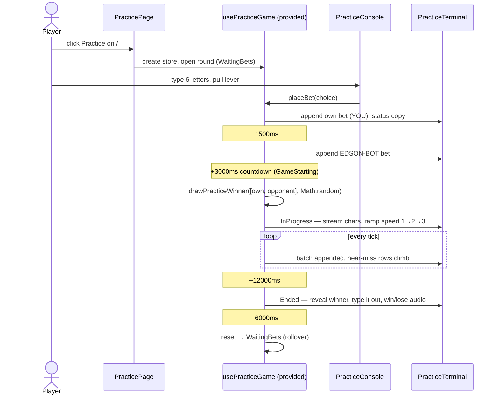

# Space Stroker — "Practice mode" — Implementation Spec

> **Status: Ready for implementation** — refined via Trello card
> [Practice mode](https://trello.com/c/WKXsNym4/129-practice-mode) (#129, refined 2026-08-02).
> Repos affected: **`monkify-front`** and this doc in **`monkify-meta`**. **`monkify-backend` is not
> touched.**
> Branch / worktree: `feature/practice-mode` → `.worktrees/practice-mode/<repo>`.
> Change level: **Frontend feature** — a new player-facing surface, no backend surface.
>
> **Purpose:** A first-time visitor cannot see what Space Stroker is. Watching one round end today
> requires a connected wallet, an on-chain USDC transfer, **and** a second player — every seeded type
> is `MinimumNumberOfPlayers: 2`. Practice mode is a fully interactive round that runs entirely in the
> browser: no backend call, no SignalR, no wallet, no money.

---

## 0. Sequencing — the blocker is cleared

The refined card sequenced this work **after** `feature/mobile-game-design-update` (#134), because
that card's whole deliverable is the mobile arcade cabinet and building a second one here would
design it twice.

**#134 shipped on 2026-08-02.** Its commits are on `monkify-front` `main` (`304684a`, `95910ce`,
`82829b6`), `specs/mobile-game-design-update.md` + `features/mobile-game-design-update.md` are on
`monkify-meta` `main`, INDEX's *Feature currently in flight* reads "Nothing is mid-implementation",
and the branches and worktrees are gone. Card decision 8 and **AC #21** are satisfied.

**Everything in §7.8 below is written against the post-#134 cabinet**, which is materially different
from the pre-#134 code (`GamePage` now owns `GameConsole` on mobile, the screen panel was re-skinned
to true-black glass in a `#5c6a8c` bezel, `visor1.png` is no longer imported). Do not consult
pre-#134 memory of these files.

---

## 1. Summary

A new route renders a self-contained practice round using the real arcade cabinet. The player types a
word, pulls the lever, and watches Edson type against one synthetic opponent. The round follows the
real lifecycle on compressed timings and then rolls over into another one, indefinitely.

| Area | Real game (`/game/play`) | Practice (`/game/practice`) |
| --- | --- | --- |
| Round source | `GET /games/{typeId}` + SignalR `ActiveGamesHub` | Local, in-memory |
| Bet | On-chain SPL transfer + `POST /games/{id}/bets` | A local object |
| Opponents | Real players, min 2 | **One** synthetic bettor |
| Winner | `SpaceStrokerTyper` (natural hit, else `DecideFallbackWinner`) | **Uniform local draw** over the 2 choices, then revealed |
| Money | Real USDC, real payout | Fixed `1 USDC` ticket / `2 USDC` pot, **nothing charged** |
| Wallet | Required to bet | Never required, never requested |
| Chat / side panel | `GameSidePanel` over SignalR | **None** |
| Rollover | `VUE_APP_NEW_GAME_DELAY` (30 s) after rewards | ~6 s after the result |
| Fairness | Commit-reveal, FAIR modal, `verify.html` | **None per round**, one honest pointer |

The three Practice CTAs that already exist on `/` are repointed at it, and the `/soon` placeholder —
whose last consumer this was — is deleted.

---

## 2. Constraints (MANDATORY)

From `monkify-meta/constraints.md` (full list there):

- **§2 Git — worktree per repo.** `feature/practice-mode` lives in
  `.worktrees/practice-mode/<repo>` for `monkify-front` + `monkify-meta`; the shared checkouts stay on
  `main`. Push to `origin` right after branch work (`AGENTS.md` rule 5). Already done for both repos.
- **§3 Unit tests.** No backend change ⇒ **no `SpaceStroker.Tests` change**. `monkify-front` has **no
  test framework** (`package.json` exposes `serve` / `build` / `lint` / `lint:fix` only).
- **`AGENTS.md` rule 8 / §3 Integration tests — WAIVED, deliberately.** The mandatory happy-path
  integration test does not apply: this card has **no backend surface** to exercise — no endpoint,
  DTO, entity, migration, consumer, SignalR contract or game-flow change. Precedent:
  `specs/analytics.md` ("Level Feature, but the integration test is waived — zero backend code") and
  `specs/mobile-wallet-connect.md` ("frontend feature ⇒ no `SpaceStroker.Tests.Integration`").
  Verification is §13.
- **§6 User-facing messaging.** Practice reveals no system state. The money lines must read
  unmistakably as practice; the self-exclusion refusal reuses existing RG copy and never explains more
  than it must.
- **§8 Scope.** `/game`, `/game/play` and every real-game guard are untouched. No secrets, no config,
  no migrations.

Feature-specific, verified in the codebase:

- **`monkify-front` has no test runner**, so the two decision-bearing pure functions (§7.5, §7.3) must
  be **exported and side-effect-free** so a future runner can pin them without a DOM.
- **Every viewport below `lg` runs `html.light-graphics`** (`usePerfMode.ts` — `lightMode = isMobile
  || weakRenderer`). Anything mobile-only must be built crisp: no `backdrop-filter`, no `blur()`, no
  infinite animations that the mode strips.

---

## 3. Resolved product decisions

Answer mode for the refinement run was **Complete**; every option carried today's behaviour plus
`Benefits` / `Issues that this approach brings`.

| # | Decision | Rejected alternative and why |
| --- | --- | --- |
| 1 | **Interactive**, not a watch-only demo. | Auto-demo teaches nothing about choosing a word and would falsify the shipped `/soon` copy. |
| 2 | Entry is **the three existing `/` CTAs only**. `/game` is untouched. **This supersedes the card's original "in the lobby" wording.** | A card in `GameTypes.vue` would need a synthetic `ActiveGame`, causing a `GET /games/<fake-id>` 404 per lobby load and meaningless TICKET/POT/PLAYERS chips. |
| 3 | **Its own screen.** Never branches the money guards; never writes `useGame` state. | Reusing the real screen needs an isolation seam through tab-scoped singletons plus a practice branch in four money guards; extracting shared components is a refactor of the live money screen with no test runner. |
| 4 | **Fixed free-text race, hard-coded**: 6 characters, letters-only. No catalogue call. | Mirroring a live type adds a network dependency to the one surface meant to be an unconditional first impression — and still needs the hard-coded fallback. |
| 5 | **One synthetic opponent, uniform draw (≈50/50).** | Solo/always-win teaches that you win. A rigged first round is a fixed outcome inside a product whose headline claim is provable fairness. |
| 6 | **Money shown, hard-coded**: ticket `1 USDC`, pot = `ticket × bets` = `2 USDC`, marked not-charged. | (Owner override of the recommended "no money" and "live price" options.) |
| 7 | **Full cabinet fidelity** — plate art, working lever, Edson, game audio. | A "faithful core" with a plain input would look like the mobile bet panel #134 just deleted. |
| 8 | **Sequenced after #134.** | Now satisfied — see §0. |
| 9 | **Full lifecycle on compressed timings**, reusing the shipped status copy verbatim. | Running+result only skips the two states players actually get stuck on. Real timings make a tutorial most visitors abandon. |
| 10 | **Auto-rollover** into another practice round. | See §3.1 — accepted with stated costs. |
| 11 | **No practice-specific "play for real" CTA**; the app header is the way out. | A persistent CTA competes with the round and has no home in the pinned mobile band layout. |
| 12 | **No per-round fairness content**, one honest pointer line. | Simulating commit-reveal has the browser generate *both* sides — fabricated evidence of fairness. |
| 13 | **No side panel, no chat, no mobile CHAT tab.** | Chat is SignalR-only with no history replay; a dead panel reads as a broken screen. |
| 14 | **Self-excluded wallets blocked, fail-open.** | Allowing it serves an excluded player the full round + win reveal, against the shipped rule that exclusion blocks free bets too. |

### 3.1 Consciously accepted — do NOT "fix" these

These were raised during refinement and chosen anyway. An implementer who "corrects" them is
reversing an owner decision.

- **The auto-rollover is an unbounded looping simulation** with no stopping point and no conversion
  ask. Both the responsible-gaming posture concern and the idle-CPU cost (the exact cost
  `useIdleDisconnect` exists to remove) were stated and accepted.
- **`1` and `USDC` are hard-coded** and will drift if the seeded price changes again — it already did
  once (`specs/fix-pricing.md` moved Cosmic Sprint 2 → 1).
- **The 6-character / letters-only shape is hard-coded** and can drift from an admin-created type.
  Practice does not claim to describe a live game.
- **Practice is faster than a real round**, so the real wait can still surprise.
- **Conversion now rests on the header.** Decisions 10 and 11 together mean the end-of-round moment is
  consumed by the rollover and there is no in-screen way into a real game.

---

## 4. Data model

**N/A.** No entity, column, enum, EF mapping or migration. Practice persists nothing — not to the
database, not to `localStorage`, not to a cookie.

---

## 5. Configuration

No `GeneralSettings`, no env var, no secret, no seed data. The practice round's parameters are a
frontend constant.

`monkify-front/src/constants/practiceGame.ts`:

| Constant | Value | Why |
| --- | --- | --- |
| `PRACTICE_CHOICE_LENGTH` | `6` | Cosmic Sprint's shape. |
| `PRACTICE_ALPHABET` | `'abcdefghijklmnopqrstuvwxyz'` | The backend's `Letters` pool, verbatim (`features/games.md` §1). |
| `PRACTICE_TICKET` | `1` | Decision 6. |
| `PRACTICE_TOKEN_SYMBOL` | `'USDC'` | Decision 6. |
| `PRACTICE_OPPONENT_NAME` | `'EDSON-BOT'` | Must read as unmistakably synthetic — **never** a wallet-shaped string (see §7.2). |
| `PRACTICE_OPPONENT_WORDS` | ≥ 12 lowercase 6-letter words | Drawn per round; must never equal the player's choice. |
| `PRACTICE_TIMINGS` | see §7.3 | One object, so pacing is tuned in one place. |

`PRACTICE_GAME` is a frozen object shaped like the subset of `ActiveGame` the reused helpers read
(`name`, `choiceRequiredLength`, `gameCharacterType: LETTER_GAME`, `acceptDuplicatedCharacters: true`,
`presetChoices: []`, `requiredAmount: PRACTICE_TICKET`, `tokenSymbol`, `minimumNumberOfPlayers: 2`).

> **It is deliberately NOT typed as `ActiveGame`.** Give it its own `PracticeGame` type. Typing it as
> `ActiveGame` invites someone to pass it into a real-game code path, which is exactly the
> contamination decision 3 exists to prevent. It only needs to satisfy the structural shape
> `formatGameAmount` accepts.

---

## 6. Backend behaviour

**N/A.** No handler, consumer, domain service, endpoint, header, DTO, SignalR contract or Hangfire job
changes. `SpaceStroker.Tests` and `SpaceStroker.Tests.Integration` are untouched and unaffected.

---

## 7. Frontend behaviour

### 7.1 Route and entry points

- New route in `src/routes.ts`: **`{ name: 'Practice', path: '/game/practice' }`**, registered in
  production. It sits in the `/game/*` tree beside `/game/play`, `/game/stats`, `/game/history`.
- **Joins `EMBED_REDIRECT_ROUTES`** in `main.ts` (today `{'Home','HowToPlay','ResponsibleGaming'}`).
  The guard is registered **before** the analytics `afterEach`, so a framed load never counts as a
  pageview and the component never mounts.
- **Not an `isPlayerRoute()`** in `App.vue`. Practice renders no display name, so booting player
  preferences globally for it is wasted work. It loads preferences **itself** for the self-exclusion
  check (§7.9) — the pattern `ResponsibleGamingPage` already uses.
- `HomePage.startPractice` changes from
  `router.push({ name: 'ComingSoon', query: { feature: 'practice' } })` to
  `router.push({ name: 'Practice' })`. **That is the only call-site change** — `HomeHero` (both hero
  states) and `HomeFeatureCards` both emit `practice` and already route through it.
- **Delete** `src/pages/ComingSoonPage.vue`, the `ComingSoon` route and the `/soon` path. Practice was
  its last consumer; the `wiki` entry went with #130.
  - **Decision on a bookmarked `/soon?feature=practice`:** let it fall through the generic catch-all
    to `/error`. No redirect is added. `/soon` was an internal placeholder reachable only from `/`,
    it was never linked externally, and per `specs/robots-txt.md` the app host serves
    `Disallow: /` **plus** `X-Robots-Tag: noindex`, so it was never indexed. `/error` always offers
    RETRY.
  - ⚠️ The strip-prefix shim and the generic catch-all in `routes.ts` coexist by vue-router
    **specificity ranking, not declaration order**. Adding a route does not change that; do not
    reorder them.

### 7.2 State ownership — provide/inject, not a module singleton

`usePracticeGame` is a **factory**: it returns a fresh store and is called **once**, in
`PracticePage.vue`, which `provide()`s it under a typed injection key added to
`src/constants/keys.ts`. `PracticeTerminal` / `PracticeConsole` / `PracticeMonkey` `inject()` it.

> This is a **deliberate departure from the repo's module-singleton idiom** (`useGame`, `useNearMiss`,
> `useIdleDisconnect` are all module-scope). The idiom is precisely the hazard decision 3 exists to
> avoid: module state survives unmount, so a stale rollover timer or a second mount would bleed across
> navigations. A factory + inject makes "practice state cannot outlive the practice page" structural
> rather than a rule someone has to remember.

The store owns: the round object, the status, the terminal output, the display speed, the near-miss
matchers, the drawn winner, and **every timer handle**. It exposes a `dispose()` that clears all of
them, called from `onUnmounted` in `PracticePage`.

**Hard rule:** nothing under `src/components/practice/`, `src/pages/PracticePage.vue`,
`src/hooks/usePracticeGame.ts` or `src/constants/practiceGame.ts` may import `useGame`, `useNearMiss`,
`useGameHub`, `useGameChat`, `useIdleDisconnect`, `mainService`, or `solana-wallets-vue`.

### 7.3 The round lifecycle and its timings

Practice reuses the **`GameStatus` enum from `src/types`** (`WaitingBets = 1` … `ErrorWhenProcessingRewards = 8`)
so the shipped status copy maps directly.

| Phase | Status | Duration | What happens |
| --- | --- | --- | --- |
| Open | `WaitingBets` | until the player bets | Terminal shows game name, BET, POT, `> PLACE YOUR BETS. PULL THE LEVER TO CONFIRM!` |
| Player bets | `WaitingBets` | — | The player's bet is appended, labelled `YOU`; Edson plays the bet one-shot |
| Opponent bets | `NotEnoughPlayersToStart` → `WaitingBets` | `opponentBetMs` **1500** | The synthetic bet is appended; the "need 1 more player" line shows in between |
| Countdown | `GameStarting` | `countdownMs` **3000** | `> RACE STARTS IN N SECONDS…`, counting down |
| Run | `InProgress` | `runMs` **12000** | The stream types; `displaySpeed` ramps 1 → 2 → 3 at ⅓ and ⅔ |
| Result | `Ended` → `RewardForWinnersCompleted` | `resultHoldMs` **6000** | Winner revealed, near-miss winner typed out, win/lose audio |
| Rollover | back to `WaitingBets` | — | Full reset, a new round opens |

- `Ended` → `RewardForWinnersCompleted` transitions immediately (there is nothing to pay); the
  `RewardForWinnersInProgress` and `ErrorWhenProcessingRewards` states are **never entered**.
- The status copy is copied **verbatim** from `GameTerminal.gameStatusLabel`'s **race branch** into
  `practiceGame.ts`. Practice is a free-text race, so the lottery branch is not copied.
  ⚠️ Copy the strings, not the component — this is a knowing duplication (decision 3 accepted drift).
- The countdown number must be **derived from a timestamp**, not decremented in a callback.
  Background tabs freeze timers; `GameTerminal`'s own countdown reads a target date for this reason.
- **Every** phase transition is scheduled through one helper that records its handle in the store, so
  `dispose()` can clear all of them.

### 7.4 The character stream

- A `setInterval` emits a batch of random characters from `PRACTICE_ALPHABET` and appends to the
  store's `terminalOutput`, mirroring the real `Terminal` handler in `useGame.initalizeWebsocketConnections`.
- The DOM refresh cadence and crop rules are copied from `GameTyper.vue`: refresh every
  `{1: 50, 2: 35, 3: 25}` ms by speed, and crop to the last 2000 characters once past 20000. Over a
  12 s run the crop will not trigger, but keeping the rule means the renderer behaves identically if
  `runMs` is ever raised.
- Emission rate should land the run at a readable density — roughly **60 characters/second**, i.e.
  ~700 characters per round. That number matters for §7.5.

### 7.5 ⚠️ The winner is DRAWN, not typed — read before coding

With a 26-character pool and a 6-character choice there are `26^6 ≈ 3.09 × 10^8` possible windows. A
12 s run at ~60 chars/s emits ~700 characters, so the chance that a *specific* word appears naturally
is roughly `700 / 3.09e8 ≈ 0.0002 %`.

**A "generate characters until someone's word appears" loop therefore never terminates.** This is the
single most likely way to get this feature wrong.

The correct model — and it is what the real game does, not a shortcut:

1. When the run starts, **draw the winner uniformly** from the placed choices (`[playerChoice,
   opponentChoice]`) with `Math.random()`. This mirrors `SpaceStrokerTyper.DecideFallbackWinner`,
   which draws from the ordinally-sorted choices whenever nothing is typed naturally inside the
   character cap (`features/games.md` §7). Real races resolve this way most of the time.
2. Stream random characters for `runMs`. Feed every batch to the near-miss matchers, so the rows climb
   on genuinely random data.
3. At `runMs`, set `Ended`, publish the drawn winner, and let the near-miss reveal **type the winning
   word out to full length** — `useNearMiss.finish(winningChoice)` does exactly this in the real game,
   at `FILL_STEP_MS = 80`.

The draw must live in an **exported pure function** taking the choice list and a `random: () => number`,
so it can be pinned by a future test runner and sampled for AC #7:

```ts
export const drawPracticeWinner = (choices: string[], random: () => number): string =>
  choices[Math.floor(random() * choices.length)];
```

**Do not** bias it toward the player, and **do not** describe practice as fair anywhere in the UI.

### 7.6 Near-miss rows

- Reuse `src/utils/nearMiss.ts` — `buildFailureTable` / `createMatcher` / `advance`. It is **pure, with
  no Vue imports**, so behaviour is identical to the real screen by construction.
- ⚠️ **Do NOT call `useNearMiss()`.** It is a **module singleton**: `attempts`, `entries`, `frozen`
  and its `setInterval` handle are all module-scope and shared with the live game screen. Calling it
  from practice puts practice rows on a real round and vice versa.
- Re-implement the composable's small display layer inside the practice store: the display high-water
  (`displayK`), the **2000 ms stall reset**, the 250 ms tick, and the 80 ms win fill. Those four
  constants are the feel of the feature — keep them identical.
- Only the **player's own** choice gets a row. The opponent's word is never tracked, exactly as the
  real screen only tracks `ownBetChoices`.

### 7.7 Money display

- Reuse **`usePlayerPreferences().formatGameAmount(game, amount)`**. It renders
  `` `${amount} ${game?.tokenSymbol || 'USDC'}` ``, so passing `PRACTICE_GAME` yields `1 USDC` and
  `2 USDC` with the real formatting and no fork.
- `> BET:` shows the ticket. `> POT:` shows `PRACTICE_TICKET × bets.length` — `1 USDC` after the
  player bets, `2 USDC` once the opponent has, matching how the real pot accumulates per bet.
- **Every money line carries a practice marker.** Put one persistent, unmissable line in the terminal
  header block — e.g. `> PRACTICE ROUND — NOTHING IS CHARGED, NOTHING IS PAID.` — rather than
  suffixing each amount, which would fight the terminal's format.
- No balance is read, no payout is rendered, and the `> SENDING REWARDS…` line is **not** shown.

### 7.8 The cabinet (post-#134)

Practice-owned components under `src/components/practice/` reproduce the real cabinet. All values
below are measured from the shipped code — copy them exactly.

**Desktop (≥ `lg`)** — mirrors `GamePage`'s three-sibling row, minus the side panel:

- `PracticeTerminal` + `PracticeMonkey`. **No `GameSidePanel`.**
- ⚠️ The real desktop terminal's width is computed in JS from `#game-terminal-container`'s
  `clientHeight × 0.984` to preserve `bg.png`'s aspect. Practice must reproduce that computation with
  **its own element id** — reusing `game-terminal-container` would collide if both ever mounted.
- ⚠️ The real row is three siblings; practice's is two, so the terminal + Edson proportions must be
  re-checked visually rather than assumed to carry over.
- `PracticeConsole` renders **inside** `PracticeTerminal` on desktop, as `GameTerminal` does
  (`<GameConsole v-if="!mobile" />`).

**Mobile (< `lg`)** — mirrors #134's three-band column, minus the tabs and chat:

- Column is `h-[calc(100dvh-54px)]`. **54, not 64** — `GameHeader` shrinks below `lg` and a mismatch
  pushes the cabinet off the bottom edge.
- Bands: `PracticeTerminal` (`min-h-[180px] flex-[5_5_0%] px-2 pb-2`) → `PracticeMonkey`
  (`min-h-[80px] flex-[3_3_0%]`) → `PracticeConsole`
  (`-mt-[clamp(16px,3.6dvh,34px)] h-[clamp(140px,22dvh,195px)] shrink-0 z-20` with
  `shadow-[0_-2px_3px_rgba(0,0,0,0.9),0_-12px_22px_-4px_rgba(0,0,0,0.65)]`).
- Band priority: **console > terminal > Edson**. The console never shrinks — the lever must always be
  reachable. The wrapper is `overflow-y-auto` so a short viewport scrolls.
- The console owns the input and emits `focus-change`; the page hides Edson and applies `pb-[38dvh]`
  while it is true, so the visor and lever clear the native keyboard.
- ⚠️ **`.mobile-terminal` cannot be reused verbatim.** It ships `border-top: 0` and
  `border-radius: 0 0 4px 4px` because `GameMobileTabs` supplies the top of that housing — the tab
  strip and the panel are *one piece of hardware*. **Practice has no tabs**, so its terminal needs a
  closed variant: `border: 7px solid #5c6a8c` on all four sides and `border-radius: 4px`. Keep the
  black glass (`background: #000`) and the inset/drop shadows.

**The console plate art**, both platforms — `terminal.png` is a **970×420 three-up sprite**:

- Both mobile modules show the **same** well (`x ∈ [0, 300)`) via
  `background-size: 323.333% 143.836%` and `background-position: 0% 15.625%`. A naive "one third per
  module" crop drags the 10 px seam and a sliver of the neighbouring well into the left plate.
- Wrapper carries the sprite's own navy `#424c6e` so the seam reads as cabinet metal.
- ⚠️ The inline comment block in `GameConsole.vue` still describes the older `y ∈ [12, 304)` /
  `9.375%` crop while the code uses `15.625%`. **The code and `features/mobile-game-design-update.md`
  are right**; do not copy the stale comment.

**The lever:**

- Frames `leverup.png` / `leverdown.png` / `lever_to_up.gif` / `lever_to_down.gif`, with the same
  500 ms down/up transitions and the 200 ms error twitch.
- **Always pullable** — never dimmed, never disabled. An invalid pull twitches and plays `error1.wav`.
- Sized with **padding on the button** (`px-[12%] py-[11%]`, `min-h-[44px]`), never by insetting the
  button: padding is inside the hit area, so the whole plate stays tappable.

**The visor input:** `#92a1b9` bezel around black, green text, `lowercase`, `maska` mask of
`'@'.repeat(6)` (letters). **Font size floored at 16 px** — `public/index.html` ships no
`maximum-scale`, so iOS Safari zooms the page for any focused input under 16 px. Trim with leading
and tracking instead. The desktop input id is `word-type-input`; practice must use a **different id**.

**Edson (`PracticeMonkey`):** reuse the eight GIFs and the status → animation mapping from
`GameMonkey` — `idle`, `typing`/`typing2`/`typing3` by display speed during `InProgress`, `finale` →
(3200 ms) `regen` → (1250 ms) `idle` on `Ended`. Play the `monkeyAddBet` + `phone_beep.mp3` one-shot on
the player's own bet. **Drop** the glasses delay and the `MAX_BET_ANIMATIONS` queue — practice has at
most two bets. Keep `monkey-rise-in` on mobile / `animate-fly-in` on desktop, and `.animate-wobble` at
rest (#134 removed it from the `light-graphics` kill list precisely so the mascot still moves on
phones).

**Audio:** wire the one-shots directly from the practice store (`playAudio` from `constants/helpers`)
— `victory.mp3` / `lose.mp3` on the result, `button_press.mp3`, `error1.wav`. **Do not mount
`GameAudio.vue`**: it reacts to `gameInstance.status` off the `useGame` singleton. Respect the same
tab-active gate the real screen uses (`document.visibilityState === 'visible' && document.hasFocus()`).

### 7.9 Self-exclusion gate

- `PracticePage` calls `usePlayerPreferences().loadPreferences(wallet)` itself on mount, exactly as
  `ResponsibleGamingPage` does. `loadPreferences` returns **`Promise<boolean>`** — whether the read
  succeeded — and internally calls `applySelfExclusionPreferences`, which populates
  `useSelfExclusion().selfExcluded`.
- **Fail-open, precisely:** block **only** when the read **succeeded** *and* `selfExcluded === true`.
  A failed read, an absent wallet, or a still-loading state must never block.
- Blocked state: render the RG refusal in place of the cabinet with a link to `/responsible-gaming`.
  Do not start a round, do not play audio.
- Reactive to wallet connection — a player who connects an excluded wallet mid-session gets blocked on
  the next successful read.
- ⚠️ This is a **partial** block by construction: exclusion is per-wallet, so someone who never
  connects can practise. That is the same honest gap `/responsible-gaming` already states about
  connecting a different wallet. Do not present it as airtight.

### 7.10 Analytics and teardown

- **No new events.** `trackHomeLinkClick({ link: 'practice' })` already fires at all three CTAs
  (`useAnalytics.ts:152` already types `'practice'` in the union), and the router `afterEach` gives
  `page_view` for free. Consistent with `features/analytics.md`: no identifiers, no amounts.
- `onUnmounted` calls `dispose()`, clearing the phase timer, the stream interval, the DOM-refresh
  interval, the near-miss stall loop and the win-fill timer. Leaving practice mid-round must leave
  nothing running.

---

## 8. Flow diagram



---

## 9. Out of scope

- Any backend change. Any `/game` (lobby) change. Any change to real-game behaviour or its guards.
- Preset and lottery practice rounds — a lottery practice round has nothing to watch.
- A practice leaderboard, practice stats, practice history, or any persistence of practice results.
- Simulated provably-fair verification.
- Chat in practice.
- Repointing anything other than the three existing `/` CTAs.
- A "play for real" CTA on the practice screen (decision 11).

---

## 10. File checklist

### 10.1 Backend (`monkify-backend`)

**None.**

### 10.2 Frontend (`monkify-front`)

| # | File | Change |
| --- | --- | --- |
| 1 | `src/constants/practiceGame.ts` | **New.** `PRACTICE_GAME`, alphabet, ticket, opponent name + word pool, timings, the copied race status copy. |
| 2 | `src/hooks/usePracticeGame.ts` | **New.** Factory store: round, status machine, stream, `drawPracticeWinner` (exported, pure), near-miss display layer, rollover, `dispose()`. |
| 3 | `src/pages/PracticePage.vue` | **New.** Creates + `provide`s the store, self-exclusion gate, desktop row vs mobile three-band column, `dispose()` on unmount. |
| 4 | `src/components/practice/PracticeTerminal.vue` | **New.** Terminal housing (closed 4-side `#5c6a8c` bezel), header block, practice marker, BET/POT, bets list, status line, near-miss dock, result block; renders the console on desktop. |
| 5 | `src/components/practice/PracticeConsole.vue` | **New.** Plate art crop, visor input, keyboard art, lever + animations, `focus-change` emit. |
| 6 | `src/components/practice/PracticeTyper.vue` | **New.** Stream renderer with the speed-tuned refresh cadence and crop rule. |
| 7 | `src/components/practice/PracticeMonkey.vue` | **New.** Edson: status → GIF mapping, own-bet one-shot, rise-in / fly-in, wobble. |
| 8 | `src/constants/keys.ts` | Add the practice-store injection key. |
| 9 | `src/routes.ts` | Add `Practice` at `/game/practice`; **remove** the `ComingSoon` route. |
| 10 | `src/main.ts` | Add `'Practice'` to `EMBED_REDIRECT_ROUTES`. |
| 11 | `src/pages/HomePage.vue` | `startPractice` → `router.push({ name: 'Practice' })`; drop the placeholder comment. |
| 12 | `src/pages/ComingSoonPage.vue` | **Delete.** |
| 13 | `src/components/home/HomeHero.vue` | Update the two `Trello #129 … not built yet` comments; no behaviour change. |

### 10.3 Meta (`monkify-meta`)

| # | File | Change |
| --- | --- | --- |
| 1 | `specs/practice-mode.md` | **New** — this file. |
| 2 | `INDEX.md` | Spec row + *Feature currently in flight*. |
| 3 | `features/practice-mode.md` | **At ship time** (`monkify-ship-feature`), not now. |

---

## 11. Unit tests

**Project: none.** No backend change ⇒ no `SpaceStroker.Tests` change. `monkify-front` has **no test
framework** and this card does not add one.

To keep the two decision-bearing behaviours pinnable later, both must be **exported, pure and
DOM-free**:

| Function | Location | Contract |
| --- | --- | --- |
| `drawPracticeWinner(choices, random)` | `usePracticeGame.ts` | Uniform index selection; no bias; injectable `random`. |
| `practicePhaseAt(elapsedMs, timings)` | `usePracticeGame.ts` | Pure `elapsed → GameStatus` mapping, so the countdown and phase transitions are timestamp-derived rather than callback-derived. |

AC #7 (the 40–60 % sample) is exercised against `drawPracticeWinner` directly, not through the UI.

---

## 12. Acceptance criteria

Copied 1:1 from the Trello **Acceptance Criteria** checklist (21 items).

1. Given a visitor on `/` with no wallet connected, when they click any of the three Practice CTAs (`HomeHero` cold state, `HomeHero` connected state, `HomeFeatureCards`), then they land on the practice route and a playable practice round is presented — no wallet prompt, no connect gate.
2. Given the practice screen is open, when the round runs from start to finish, then the browser makes zero requests to `mainService` and opens zero SignalR connections (verified in DevTools Network with the API stopped — the round still completes).
3. Given the practice round is waiting for bets, when the player enters a 6-character lowercase-letter word and pulls the lever, then their bet appears in the BETS PLACED list labelled `YOU`, a synthetic opponent's bet appears ~1.5 s later, and the status line advances through the shipped `gameStatusLabel` copy.
4. Given the practice stream is running, when characters are emitted, then a near-miss row for the player's own choice is visible and climbs toward it (`> N AWAY!` with the matched prefix highlighted), resetting after ~2 s without improvement.
5. Given a practice round reaches its end, when the winner is resolved, then it was **drawn uniformly** from the two placed choices (never "typed until it appears") and the winning word is then typed out to full length in the near-miss reveal — and the run always terminates within the compressed ~12 s budget, never hanging.
6. Given a practice round ends, when the player's choice was drawn, then the win terminal state renders and the victory audio fires; and when the opponent's choice was drawn, then the lose state renders with the opponent named and the lose audio fires. Both states must be reachable across repeated rounds.
7. Given 200 simulated practice rounds, when the winner draw is sampled, then the player wins between 40 % and 60 % of them.
8. Given the practice screen at any point in the round, when money is displayed, then the ticket reads `1 USDC` and the pot reads `2 USDC` (ticket × 2 bets), and every money line carries an unambiguous practice / not-charged marker. No real balance is read and no payout is ever performed.
9. Given a practice round has ended and the result has been held ~6 s, when the rollover fires, then a fresh practice round begins automatically in `WaitingBets` with the terminal, bets list, near-miss rows and pot fully reset — and the loop can repeat indefinitely without leaking timers or growing memory.
10. Given the player navigates away from the practice screen mid-round (or mid-rollover), when the component unmounts, then every timer is cleared and no practice code continues to run.
11. Given a player plays a practice round and then enters a real game, when the real game screen loads, then it shows none of practice's state — and the reverse also holds. Practice never writes to any `useGame` module ref and never calls `useNearMiss()`.
12. Given a wallet whose preferences confirm it is self-excluded, when the player tries to reach practice, then entry is blocked with the responsible-gaming message and no round runs; and given the preferences read fails or returns nothing, when the player reaches practice, then it is fully playable (fail-open).
13. Given the app is loaded inside an iframe, when the practice route is requested, then the router `beforeEach` redirects to `GameLobby` before the component mounts, no practice pageview is recorded, and the practice component never mounts.
14. Given the practice screen on desktop (≥ 1024 px), when it renders, then it shows the full cabinet — plate art, visor, keyboard, working lever with its up/down transition animations, and Edson — and an invalid lever pull twitches the lever and plays `error1.wav`.
15. Given the practice screen on a phone (< 1024 px, so `html.light-graphics` is always on), when it renders, then it uses the same three-band cabinet layout #134 ships for the real game, fits without page scroll in portrait and landscape, and carries no `backdrop-filter`, no `blur()` and no infinite animations.
16. Given the practice screen, when the player looks for fairness information, then no server-seed line, no commitment hash and no verification control is rendered for the practice round — only one honest line stating practice rounds are not verifiable. No simulated commit-reveal exists anywhere in the code.
17. Given the practice screen, when it renders on desktop or mobile, then there is no docked side panel, no chat panel and no `GAME | CHAT` segmented tab strip, and `useGameChat` / `useGameHub` / `useIdleDisconnect` are never imported on the practice path.
18. Given the card is shipped, when the repo is grepped, then `pages/ComingSoonPage.vue`, the `ComingSoon` route, the `/soon` path and the `FEATURES.practice` entry return zero live hits, and no call site anywhere still pushes to `/soon`.
19. Given the card is shipped, when `/game` and `/game/play` are loaded, then they behave and render exactly as before — no practice card in `GameTypes.vue`, no new branch in the wallet, self-exclusion, bet-limit or choice-exclusivity guards, and the `git diff` touches none of those guards.
20. Given the work is complete, when the gates are run, then `yarn lint` and `yarn build` pass, `SpaceStroker.Tests` and `SpaceStroker.Tests.Integration` are untouched, and manual QA has been done at desktop width, at 390 px, and with `html.light-graphics` forced — with 0 console errors.
21. Given implementation starts, when the branch is created, then `feature/mobile-game-design-update` (#134) has already merged to `main` in `monkify-front`. **✅ Satisfied — see §0.**

---

## 13. Manual QA

`monkify-front` has no test runner, so this is the verification. Run `yarn serve` from the worktree
(copy the hub's `.env.local` and `yarn.lock` in first — both are gitignored).

1. **Offline round (AC #2).** Stop the backend entirely. Load `/`, click Practice, play a full round
   through rollover. Network tab must show no `mainService` call and no websocket.
2. **Both outcomes (AC #6).** Play until you have seen one win and one loss. Confirm the audio, the
   terminal result block and the near-miss type-out on each.
3. **Draw fairness (AC #7).** In the console, call `drawPracticeWinner(['a','b'], Math.random)` 200×
   and confirm the split is 40–60 %.
4. **Contamination (AC #11).** Play a practice round to `InProgress`, navigate to `/game` and open a
   real game. Terminal, pot, bets and near-miss must be empty. Then reverse the order.
5. **Teardown (AC #10).** Enter practice, bet, navigate away mid-run, return. Exactly one stream must
   run; the character rate must not have doubled.
6. **Self-exclusion (AC #12).** Connect an excluded wallet → blocked. Then throttle the network to
   force the preferences read to fail → practice must be playable.
7. **Mobile (AC #15).** 390 × 844 and 844 × 390. Three bands, no page scroll, the lever tappable at
   ≥ 44 px, and the terminal's bezel **closed on all four sides** (the tab strip is gone).
8. **Keyboard (mobile).** Focus the visor: Edson hides, the console lifts, the lever stays reachable,
   and iOS does not zoom the page.
9. **Embedded (AC #13).** Load `public/embed-example.html` and try `/game/practice` in the frame →
   redirected to the lobby, component never mounts.
10. **Light graphics (AC #15).** Force `html.light-graphics` on desktop; confirm no blur and that
    Edson still wobbles.

---

## 14. Trello / pipeline

- **Source card:** [#129 Practice mode](https://trello.com/c/WKXsNym4/129-practice-mode) — list
  **Specs created**; the **Implementation** block on the card carries branch, worktree and spec path.
- **Next:** `/monkify-implement-feature Practice mode`, then `/monkify-ship-feature Practice mode`
  (which writes `features/practice-mode.md` and merges to `main`).

---

## 15. Revision log

| Date | Change |
| --- | --- |
| 2026-08-02 | Initial spec from the refined card + the in-chat refinement run. Written against the **post-#134** cabinet; §0 records that the sequencing blocker is cleared. |
