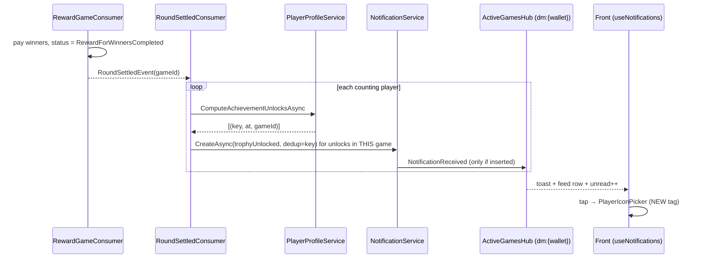
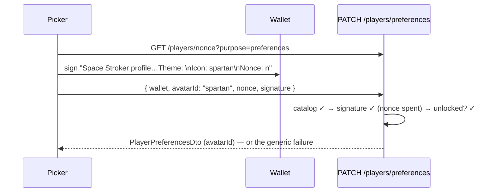

# SpaceStroker — "Profile V2" (Edson profile icons + notifications feed) — Implementation Spec

> **Status: Shipped (2026-10-23, branch `feature/profile-v2`)** in `monkify-backend`, `monkify-front` and
> `monkify-meta` — distilled in [`../features/profile-v2.md`](../features/profile-v2.md). Refined via Trello card
> [#202 Profile V2 — Edson profile icons + notifications feed](https://trello.com/c/FWV5xDzH) (refined
> 2026-10-22, spec 2026-10-22).
> ⚠️ **Post-ship notes — the code wins:** **(1)** the profile's *unavailable* body lists the free keys only, never
> staff keys (so it leaks no staff membership; §6.3 said "+ staff keys when allowed"). **(2)** `golden: true` rides
> on the last fresh trophy (catalog order) of the run that completes all 10, not on "max unlock round == this
> game" (rounds can settle out of order). **(3)** `jackpotWon` is one per **wallet** (Σ credits of its winning
> bets, `holder` = any holder ticket), not per bet. **(4)** `RoundSettledConsumer` adds a **loss gate** (skip the
> derivation when all the player's counting bets in the round lost and they already played that type). Both the
> gate and the derivation count a Word Lines (`LINES`) bet as won when credited more than its stake (S8 of
> `hyper-roll-word-lines.md`), fixed during the ship — before, LINES rounds never counted as wins for trophies. **(5)** The avatar guard runs after **every** successful bet refund, not only paid ones;
> the refund notification shows the amount actually returned. **(6)** Rode along: a Word Lines (`LINES`) bet
> counts as won for trophies and recent rounds when credited more than its stake (`hyper-roll-word-lines` S8);
> Hyper Hit still needs a `HYPER` board 10× word. **(7)** Extra surface: open duel room cards show the owner's
> icon. **(8)** Not done: the practice race (`PracticeTerminal.vue`) keeps the initial tiles; `PlayerTag` shows no
> icon when embedded. **(9)** Rode along (#209 follow-up): no phone beep on the own bet in Cosmic Sprint either.
> Repos affected: `monkify-backend`, `monkify-front`, and this doc in `monkify-meta`.
> Branch / worktree: `feature/profile-v2` → `.worktrees/profile-v2/<repo>`.
> Change level: **Feature** — mandatory happy-path integration test (`constraints.md` §3).
>
> **Purpose:** Profile V1 ([`player-profile.md`](player-profile.md), [`../features/player-profile.md`](../features/player-profile.md))
> gave every player a coloured tile with their initial. V2 lets a player pick one of **24 pixel-art Edson
> portraits** as their profile icon — 10 free, 10 unlocked one per existing trophy, **Golden** for all 10,
> and 3 staff-only icons gated by wallet lists in config — and shows it everywhere a player is drawn. The
> chat's 🔔 donations tab becomes a general **NOTIFICATIONS** feed (donations, trophy unlocked, refund
> issued, jackpot won), so a player learns the moment they unlock something.

---

## 1. Summary

| Surface | Today (V1 + chat revamp #205) | **After V2** |
| --- | --- | --- |
| Avatar | coloured tile + initial, built ad hoc per surface (no shared component) | shared **`PlayerAvatar`**: the player's Edson on their theme tile |
| Icon choice | none | owner clicks their icon on `/player/:wallet` → **icon picker**, signed save |
| Icons | none | 21 player icons (10 free · 10 trophy · Golden) + 3 staff icons |
| Where shown | header card, menu head, profile hero, mini card, race cards, DM rows | same **+ global chat, DM thread head, leaderboard rows + podium** |
| 🔔 tab | DONATIONS (RECENT / TOP DONORS) | **NOTIFICATIONS** feed (4 types, newest first) + TOP DONORS section |
| Unread on chat button | DMs + donations | DMs + **all notifications** |
| Toast | `DonationToast` (donations only) | `NotificationToast` (every type, ~6 s) |

Backend adds **one nullable column** (`Player.AvatarId`), **one table** (`Notifications`), one migration,
`avatarId` on the signed `PATCH /players/preferences`, avatar fields on the two profile reads, two
chat-session routes for the feed, one event + consumer for settled rounds, and a refund hook. **No money
path changes** — the notification writes happen after the money moved and never block it.

---

## 2. Constraints (MANDATORY)

From `monkify-meta/constraints.md` (full list there):

- **Worktree per repo, hub stays on `main`:** `feature/profile-v2` in `monkify-backend`, `monkify-front`,
  `monkify-meta`, checked out at `.worktrees/profile-v2/<repo>`.
- **Unit tests:** `SpaceStroker.Tests` via `scripts/run_tests.bat` (never a bare `dotnet test`); report the
  changed/added tests at the end.
- **Integration test (Feature):** happy path in `SpaceStroker.Tests.Integration` (§11.2) — signed icon save,
  locked icon refused, staff icon via config, trophy notification on settlement.
- **EF:** `Player.AvatarId` + the `Notification` entity mapped **inline** in
  `SpaceStrokerDbContext.OnModelCreating`; one migration via `dotnet ef migrations add`, applied only by
  `SpaceStroker.Consumers`. Never hand-edit the snapshot.
- **Hosts keep their roles:** reads/saves on `SpaceStroker.Api`; trophy detection and refund/jackpot
  notifications in consumers (`SpaceStroker.Infrastructure/Consumers/*`, hosted by `SpaceStroker.Consumers`).
- **Mock-only config:** the three staff icon wallet lists are committed **empty** (`[]`).
- **Vague messaging (§6):** a refused icon save (unknown, locked, staff-not-allowed) returns the same generic
  validation failure as every other refused preferences save — never *why*.
- **"gamble", never "wager"** in copy. No level-gated icons (levels = SOL gambled; volume rewards are an anti-goal).

---

## 3. Resolved product decisions

| # | Decision |
| --- | --- |
| 1 | **Icon catalog** (stable key = wire id; names are a first pass, the owner may rename — names live on the front only): see §5.1. |
| 2 | Everyone starts as **Edson**. `null` = never picked = Edson. No level-gated icons. |
| 3 | Unlocks are **derived on read** from the existing trophy derivation (`PlayerProfileService`) — no inventory table. Each trophy unlocks exactly one Edson; **Golden** needs all 10. |
| 4 | **Staff icons** (Elder, Phantom, Beanie): each has its **own wallet allow-list in backend config**, independent of the ADM/MOD lists. Empty = nobody. Staff may also pick any player icon they unlocked; nothing is auto-assigned. Commit placeholders only (empty lists). |
| 5 | **Picker:** the owner clicks their icon on `/player/:wallet` (visitors: not clickable). Grid of all 21 player icons (+ staff icons only for allowed wallets): locked = greyed + trophy hint, Golden shows `n/10 trophies`. A **NEW** tag on icons unlocked since the player last opened the picker. |
| 6 | **Save** through the existing signed `PATCH /players/preferences` with a new `avatarId` field: `null` = unchanged, `"default"` = clear, key = set. A save carrying an icon signs the profile message **extended with an `Icon:` line**; a name-only save signs today's message byte-for-byte; a theme save **without** an icon signs today's profile message byte-for-byte. Front twin byte-identical. Unknown, locked or not-allowed keys → the generic validation failure. |
| 7 | **Colour profiles stay.** The Edson sits on a tile in the player's theme colour. |
| 8 | **Where the icon shows:** header profile card, profile menu head, profile hero, mini card, Sprint/Jackpot race cards (replacing the initial tile), **global chat + DMs**, **leaderboard rows + podium**. House tags: no icon. Anonymous free bets / practice bots / guests: default Edson. |
| 9 | **Data path:** `GET /players/levels` gains `avatars: { wallet: key }` (only explicit, still-valid picks; absent = default), same 60 s per-wallet cache; `GET /players/profile` adds `avatarId` and `unlockedAvatars` (server-computed). |
| 10 | **Notifications feed:** the chat 🔔 tab becomes **NOTIFICATIONS** — one feed, newest first, unread count on the chat button (replacing the donations-only count). Types: `donation`, `trophyUnlocked`, `refundIssued`, `jackpotWon`. TOP DONORS stays as a section. |
| 11 | Each new notification: live push to the player + a ~6 s toast under the header + feed row. Reading the feed needs the chat session, like donations today. |
| 12 | **No** payout, level-up or per-round notifications. |
| 13 | *(spec)* **Config path is `GeneralSettings:PlayerIcons:<Icon>:Wallets`** (env `GeneralSettings__PlayerIcons__Elder__Wallets`), not the card's bare `PlayerIcons__Elder__Wallets`: staff lists already live on `GeneralSettings` (`Admins`, `Moderators`), which is injected directly — no `IOptions` section exists to bind a root-level key. Same intent, one settings object. |
| 14 | *(spec)* **A trophy's "unlock round" is new internal data.** `PlayerProfileService` only keeps a date per trophy today. It gains an internal `ComputeAchievementUnlocksAsync` returning `(Key, At, GameId)`; the wire `AchievementDto` is unchanged. A trophy is **new** for a settling round only when its unlock `GameId` == that round — this is what makes "no backfill flood on deploy" and "retry adds nothing" hold. |
| 15 | *(spec)* **Trophy + jackpot detection runs in a new consumer off the payout path.** `RewardGameConsumer` only publishes `RoundSettledEvent(GameId)` after the round reaches `RewardForWinnersCompleted` (both exits: no-winners and winners). Payout latency and failure modes are untouched; a failing notification never fails a payout. |
| 16 | *(spec)* **Idempotency by a unique `(Wallet, Type, DedupKey)`**: trophy → the trophy key; refund → the bet id; jackpot → the game id; donation → the transfer signature. A retried settlement / refund / donation report inserts nothing and pushes nothing. |
| 17 | *(spec)* **A lost trophy icon is cleared, not hidden.** Re-checking trophies on every batched levels read (≤ 50 wallets × ~10 queries) is too heavy, so the stored `AvatarId` is **revalidated where a trophy can be lost** — the refund hook (`MarkRefunded`) — and on every profile read (which already computes trophies). If the equipped trophy/Golden icon is no longer unlocked, `AvatarId` is set to `null` and the levels cache dropped. The player re-picks if the trophy returns. Staff icons are checked **live against config** on every read (cheap, in memory). |
| 18 | *(spec)* **Donations push both events.** `DonationReceived` stays (it still feeds TOP DONORS / RECENT data); the **unread count and the toast** come only from the new `NotificationReceived`. Marking notifications read also stamps `Donation.ReadAt`, so the two never disagree. |
| 19 | *(spec)* **Jackpot = any round `GameModeClassifier` puts in `jackpot`** (Space Jackpot holder draw and any paid lottery). Each winner credited `> 0` gets one `jackpotWon` with their credited amount (Σ `Credit` transaction rows of their bet, as recent rounds read it). Streamer play wins and zero-credit (free bet) wins get none. |
| 20 | *(spec)* **Refund notification** only on the bet path that sets `BetStatus.Refunded` (`RefundInvalidBetConsumer.MarkRefunded`), only for `EntryKind == Paid` with `Amount > 0`. `RefundWithoutBet` (a deposit with no bet row — never sets `Refunded`), streamer, free and holder refunds create none. Destination = `orbit` when `FundedByOrbit`, else `wallet`. |
| 21 | *(spec)* **The picker is mounted once in `App.vue`** (`usePlayerIconPicker`), so a trophy toast / feed row opens it over any page without navigating mid-round. It only ever opens for the connected wallet. |
| 22 | *(spec)* **NEW tag is client-side:** `localStorage` `space-stroker.icons-seen.{wallet}` (array of keys). The first open (no entry) seeds it with the free icons, so free icons are never NEW. Opening the picker writes the current unlocked set. Storage failure → no NEW tags, nothing breaks. |
| 23 | *(spec)* **No design gate.** V2 reuses V1's approved tile shapes and sizes; the icon replaces the initial inside the existing tile. Owner reviews on the local deploy during `/monkify-implement-feature`. |

---

## 4. Data model

### 4.1 `Player.AvatarId` (`SpaceStroker.Domain/Games/Entities/Player.cs`)

```csharp
/// Equipped profile icon key (PlayerIcons). null = never picked / cleared = default Edson.
public string? AvatarId { get; set; }
```

### 4.2 `Notification` (`SpaceStroker.Domain/Chat/Entities/Notification.cs`, new)

```csharp
public class Notification : TableEntity            // Id, CreatedDate
{
    public string Wallet { get; set; } = null!;     // recipient
    public string Type { get; set; } = null!;       // NotificationTypes: donation | trophyUnlocked | refundIssued | jackpotWon
    public string DedupKey { get; set; } = null!;   // see decision 16
    public string Payload { get; set; } = null!;    // camelCase JSON, shape per type (§6.6)
    public DateTime? ReadAt { get; set; }           // null = unread
}
```

`SpaceStroker.Domain/Chat/NotificationTypes.cs` — the four string constants.

### 4.3 EF configuration (inline, `SpaceStrokerDbContext.cs`)

```csharp
// Player block (next to ProfileTheme):
builder.Property(x => x.AvatarId).HasMaxLength(20);

modelBuilder.Entity<Notification>(builder =>
{
    builder.ToTable("Notifications");
    builder.HasKey(x => x.Id);
    builder.Property(x => x.Wallet).IsRequired().HasMaxLength(44);
    builder.Property(x => x.Type).IsRequired().HasMaxLength(20);
    builder.Property(x => x.DedupKey).IsRequired().HasMaxLength(100);
    builder.Property(x => x.Payload).IsRequired();                 // text
    builder.HasIndex(x => new { x.Wallet, x.Type, x.DedupKey }).IsUnique();
    builder.HasIndex(x => new { x.Wallet, x.CreatedDate });
});
```

`DbSet<Notification> Notifications`. Follow the `Donation` mapping style for `TableEntity` columns.

### 4.4 Migration

```
dotnet ef migrations add ProfileV2AvatarsAndNotifications \
  -p SpaceStroker.Infrastructure -s SpaceStroker.Consumers
```

Additive only: one nullable column, one table, two indexes. **No backfill** (no notification is created for
anything that happened before deploy; existing players have `AvatarId = null` = Edson). Latest migration
today: `20261021142416_AddDonations`.

---

## 5. Catalog and configuration

### 5.1 Icon catalog (`SpaceStroker.Domain/Players/PlayerIcons.cs`, new; modelled on `ProfileThemes.cs`)

| Source file | Key | Front name | Unlock |
| --- | --- | --- | --- |
| `1.Edson.png` | `edson` | Edson | default, free |
| `2.Edson.png` (suit) | `suit` | Suit | free |
| `3.BlueEdson.png` | `blue-hoodie` | Blue Hoodie | free |
| `4.BrasilEdson.png` | `brasil` | Brazil | free |
| `5.StonedEdson.png` | `stoned` | Weed | free |
| `7.GremioEdson.png` | `blue-jersey` | Blue Jersey | free |
| `9.brokeEdson.png` | `broke` | Fries in the Bag | free |
| `10.PepeEdson.png` | `pepe` | Pepe | free |
| `15.CopeEdson.png` | `copium` | Copium | free |
| `18.NoirEdson.png` | `noir` | Noir | free |
| `8.RacerEdson.png` | `racer` | Racer | trophy `firstSprintWin` |
| `20.BoxEdson.png` | `boombox` | Boombox | trophy `firstHyperRollWin` |
| `17.SolEdson.png` | `sol` | Solana | trophy `hyperHit` |
| `19.WarEdson.png` | `spartan` | Spartan | trophy `firstDuelWin` |
| `11.GoreEdson.png` | `ghoul` | Ghoul | trophy `rivalSlayer` |
| `13.PimpEdson.png` | `pimp` | Pimp | trophy `jackpotWinner` |
| `16.GIBBY.png` | `gibby` | Gibby | trophy `crowdBeater` |
| `14.ColdEdson.png` | `cold` | Subzero | trophy `winStreak3` |
| `12.MasterEdson.png` | `old-master` | Old Master | trophy `winStreak5` |
| `6.GreekEdson.png` | `greek` | Greek | trophy `explorer` |
| `15.GoldEdson.png` | `golden` | Golden | all 10 trophies |
| `Admin1.png` | `elder` | Elder | staff list `Elder` |
| `Admin2.png` | `phantom` | Phantom | staff list `Phantom` |
| `Admin3.png` | `beanie` | Beanie | staff list `Beanie` |

```csharp
public static class PlayerIcons
{
    public const string Default = "default";   // wire value that clears the pick
    public const string Edson = "edson";
    public const int MaxLength = 20;
    public enum UnlockKind { Free, Trophy, AllTrophies, Staff }
    public sealed record IconRule(string Key, UnlockKind Kind, string? Trophy = null, string? StaffList = null);
    public static readonly IReadOnlyList<IconRule> All = [ /* table above, in this order */ ];
    public static IconRule? Find(string key);    // exact, case-sensitive
}
```

Trophy keys reference `AchievementKeys` (Infrastructure) by string value; a unit test pins that every
trophy rule names a real `AchievementKeys.Ordered` key and every trophy maps to exactly one icon.

### 5.2 Staff allow-lists (`SpaceStroker.Domain/Configs/Entities/GeneralSettings.cs`)

```csharp
// Profile V2 (#202): staff icons. Each list is independent of Admins/Moderators. Empty = nobody.
public PlayerIconSettings PlayerIcons { get; set; } = new();

public class PlayerIconSettings
{
    public StaffIconList Elder { get; set; } = new();
    public StaffIconList Phantom { get; set; } = new();
    public StaffIconList Beanie { get; set; } = new();
}
public class StaffIconList { public List<string> Wallets { get; set; } = new(); }
```

`spacestrokersettings.json` (`GeneralSettings`, next to `Admins`/`Moderators`) — **mock-only, empty**:

```json
"PlayerIcons": { "Elder": { "Wallets": [] }, "Phantom": { "Wallets": [] }, "Beanie": { "Wallets": [] } }
```

Env override: `GeneralSettings__PlayerIcons__Elder__Wallets__0=<wallet>`. Wallets are cleaned like
`GetChatStaffHandler.Clean()` (trim, drop blanks, ordinal distinct). Real staff wallets are set in the deploy
env by the owner — never committed.

### 5.3 `PlayerIconRules` service (`SpaceStroker.Infrastructure/Services/Players/PlayerIconRules.cs`, new)

One place for "what can this wallet use":

```csharp
IReadOnlySet<string> Unlocked(string wallet, IEnumerable<AchievementDto> achievements); // free + trophy + golden + staff
bool IsStaffAllowed(string wallet, string staffList);                                    // live config read
string? Effective(string wallet, string? storedAvatarId);  // drops a staff icon no longer allowed → null; else stored
```

Injected with `GeneralSettings`. `Effective` does **not** check trophies (decision 17).

---

## 6. Backend behaviour

### 6.1 `PATCH /players/preferences` (`Handlers/Players/UpdatePlayerPreferences/`)

- `UpdatePlayerPreferencesRequestBody` gains `[MaxLength(20)] string? AvatarId` (null = unchanged,
  `"default"` = clear, key = set). `PlayerPreferencesDto` gains `AvatarId`.
- Message builders (public static on the handler; **byte-identical** with the front):

  ```csharp
  // unchanged:
  BuildMessage(wallet, displayName, nonce)                  // name-only save
  BuildProfileMessage(wallet, displayName, theme, nonce)    // theme save without an icon
  // new:
  public static string BuildProfileIconMessage(string wallet, string displayName, string theme, string icon, string nonce)
      => string.Join("\n", "Space Stroker profile", $"Wallet: {wallet}", $"Display name: {displayName}",
                     $"Theme: {theme}", $"Icon: {icon}", $"Nonce: {nonce}");
  ```

  Selection: `avatarId != null` → `BuildProfileIconMessage` (empty string for an absent name or theme);
  else `profileTheme != null` → `BuildProfileMessage`; else `BuildMessage`. The `icon` value signed is the
  **raw body value** (`"default"` included).
- Validation, in today's order, before the nonce/signature step: `avatarId` must be `"default"` or
  `PlayerIcons.Find(key) != null`, else the generic failure. "At least one of name / theme" becomes "at
  least one of name / theme / icon".
- **After** the signature is valid and the nonce consumed: if `avatarId` is a key (not `"default"`), check
  it is in `PlayerIconRules.Unlocked(wallet, achievements)` where `achievements =
  IPlayerProfileService.ComputeAchievementsAsync(player.Id, wallet)`. A new player row (first save) has no
  trophies → only free icons pass. Not unlocked / staff not allowed → `ReturnValidationFailureMessage(
  ErrorMessages.SelfExclusionRequestInvalid)` (the generic one) and **nothing is written** (name and theme
  in the same request are not saved either — one signed request, all or nothing).
  - *Why after the signature:* an unsigned caller must not be able to probe which icons a wallet has
    unlocked. The nonce is spent either way; the client asks for a new one on retry (today's behaviour).
- Store `"default"` as `null`. When `avatarId` (or theme) was provided, drop `PlayerLevel:{wallet}`.

### 6.2 `GET /players/levels` (`Handlers/Players/GetPlayerLevels/`)

- `CachedPlayerBadge(int Level, string? Theme)` → `(int Level, string? Theme, string? AvatarId)`; the
  explicit-themes read projects `AvatarId` too (`ProfileTheme != null || AvatarId != null`).
- `PlayerLevelsDto` gains `IReadOnlyDictionary<string, string> Avatars` — only wallets whose
  `PlayerIconRules.Effective(wallet, cached.AvatarId)` is non-null (applied **after** the cache, so a staff
  removal takes effect at once). Same 50 cap, same 60 s cache, never an error.

### 6.3 `GET /players/profile` (`Handlers/Players/GetPlayerProfile/`)

- `PlayerProfileDto` gains `string? AvatarId` and `IReadOnlyList<string> UnlockedAvatars` (catalog order).
  `Unavailable` and the empty (no row) body: `AvatarId = null`, `UnlockedAvatars` = the free keys (+ staff
  keys when allowed).
- The live row projection adds `AvatarId`. After the body is resolved (cache or compute), stamp live
  values: `AvatarId = PlayerIconRules.Effective(...)`, `UnlockedAvatars = Unlocked(wallet,
  body.Achievements)` (staff part live).
- **Self-heal (decision 17):** if the stored `AvatarId` is a trophy/Golden icon not in the unlocked set →
  `ExecuteUpdateAsync` it to `null`, drop `PlayerLevel:{wallet}`, return `AvatarId = null`. (Uses the
  cached achievements — a lost trophy may take ≤ 60 s to clear here; the refund hook clears it at once.)
- Self-excluded: still byte-identical `{ available: false }` — no icon leaks via the profile. The batched
  levels read returns the icon for any valid wallet, like levels/themes (card edge case, accepted).

### 6.4 Trophy unlock rounds (`Services/Players/PlayerProfileService.cs`)

- New `Task<IReadOnlyList<AchievementUnlock>> ComputeAchievementUnlocksAsync(Guid playerId, string wallet, CancellationToken)`
  with `record AchievementUnlock(string Key, DateTime At, Guid GameId)`. Same rules as today;
  the per-mode `MinAsync` aggregates become order-by `(EndDate ?? CreatedDate, GameId)` + first, so each
  unlock carries the round id:
  - first-win / `hyperHit` / `rivalSlayer` / `crowdBeater` → the earliest qualifying round.
  - `winStreak3` / `winStreak5` → the round that **completes** the 3rd / 5th consecutive win.
  - `explorer` → the round of the latest of the four first-play dates.
- `ComputeAchievementsAsync` becomes a projection of it (wire unchanged; `PlayerProfileAchievementsTests`
  must stay green untouched).

### 6.5 Settled-round consumer (`Consumers/RoundSettled/`, new)

- `RoundSettledEvent(Guid GameId)` published by `RewardGameConsumer` **after** the status write to
  `RewardForWinnersCompleted` — at the no-winners exit (line ~71) and after `UpdateGameStatus*` when
  `newGameStatus == RewardForWinnersCompleted` (line ~268). Never on `ErrorWhenProcessingRewards`.
  Publish failure is logged, never thrown (the payout already happened).
- `RoundSettledConsumer : BaseConsumer<RoundSettledEvent>`, registered in `SpaceStroker.Consumers/Program.cs`
  (`AddConsumer` + `ReceiveEndpoint`, like the others). For the game:
  1. Load bets with `Player`, `TransactionLogs`, and `Parameters`. Guard: status must be
     `RewardForWinnersCompleted`.
  2. **Trophies** — for each distinct player with a counting bet (`EntryKind != Streamer`, status not
     `NeedsRefunding`/`Refunded`/`Voided`, not a house wallet): `unlocks = ComputeAchievementUnlocksAsync`.
     `fresh = unlocks.Where(u => u.GameId == game.Id)`. For each fresh key → `trophyUnlocked`
     (`DedupKey = key`, payload `{ trophy, icon, golden }`). `golden = true` on the notification whose
     unlock completes all 10 (all 10 unlocked and the max unlock round is this game). If `fresh` is
     non-empty, drop `PlayerProfile:{wallet}` so the picker sees the new icon at once.
     - Short-circuit: cache `TrophiesComplete:{wallet}` (1 h) once a player has all 10, and skip them —
       Hyper Roll Orbit loops settle a round every few seconds.
     - An active streamer wallet unlocks nothing (existing rule) → no notification.
  3. **Jackpot** — if `GameModeClassifier.Classify(game.Parameters) == jackpot`: for each winning bet
     (`Status == Rewarded`, not `Streamer`) whose Σ `Credit` rows `> 0` → `jackpotWon`
     (`DedupKey = gameId`, payload `{ gameId, amount, holder: bool }`).
- Any per-player failure is logged and skipped; the consumer never re-throws for one bad player (the
  unique index makes a MassTransit retry harmless anyway).

### 6.6 Notifications service (`Services/Notifications/NotificationService.cs`, new, scoped)

```csharp
Task<NotificationDto?> CreateAsync(string wallet, string type, string dedupKey, object payload, bool push = true, CancellationToken ct = default);
```

- Insert; a unique violation (`DbUpdateException` on the `(Wallet, Type, DedupKey)` index) → return null,
  no push. On insert → push `NotificationReceived` (`NotificationDto`) to
  `ActiveGamesHub.DirectMessageGroupFor(wallet)` via `IHubContext<ActiveGamesHub>` (try/catch +
  `Log.Warning`, like `ReportDonationHandler`). Works from both hosts (Redis backplane).
- `NotificationDto(Guid Id, string Type, DateTime CreatedAt, bool Unread, JsonElement Payload)`
  (`Contracts/Chat/NotificationDto.cs`). Payloads:

  | Type | Payload |
  | --- | --- |
  | `donation` | `{ donationId, signature, donorWallet, donorDisplayName, amount }` |
  | `trophyUnlocked` | `{ trophy, icon, golden }` |
  | `refundIssued` | `{ betId, gameId, amount, destination: "wallet" \| "orbit" }` |
  | `jackpotWon` | `{ gameId, amount, holder }` |

- `ChatEvents` gains `NotificationReceived`, `NotificationsRead`.

### 6.7 Writers

- **Donations** — `ReportDonationHandler`: after the `Donation` row is recorded, `CreateAsync(recipient,
  donation, signature, …, push: !blocked)` (same block rule as `DonationReceived`). `DonationReceived` is
  still sent (decision 18).
- **Refunds** — `RefundInvalidBetConsumer`: after `MarkRefunded` succeeds on the normal bet path, when
  `bet.EntryKind == Paid && bet.Amount > 0` → `refundIssued` (`DedupKey = betId`, destination from
  `FundedByOrbit`). Not on the streamer branch, `RefundWithoutBet`, free (`Value == 0`) or holder. Then call
  `IPlayerAvatarGuard.RevalidateAsync(bet.PlayerId)` (§6.8).
- **Trophies / jackpot** — §6.5.

### 6.8 `PlayerAvatarGuard` (`Services/Players/PlayerAvatarGuard.cs`, new)

`RevalidateAsync(Guid? playerId)`: load `AvatarId`; if it is a `Trophy`/`AllTrophies` icon, compute
achievements; if no longer unlocked → set `AvatarId = null`, drop `PlayerLevel:{wallet}` and
`PlayerProfile:{wallet}`. No notification about the loss. Called from the refund hook and reused by §6.3's
self-heal.

### 6.9 Feed routes (`ChatController`, header `X-Chat-Session`, `RejectWithoutSession`)

| Route | Handler | Behaviour |
| --- | --- | --- |
| `GET /chat/notifications?before=<iso>` | `Handlers/Chat/GetNotifications/` | Newest first, 30 per page, `CreatedDate < before` when given; `{ items, hasMore, unreadCount }` (unread over all of the wallet's rows). |
| `POST /chat/notifications/read` | `Handlers/Chat/MarkNotificationsRead/` | `ExecuteUpdateAsync` `ReadAt = now` on the wallet's unread rows **and** `Donation.ReadAt` on its unread donations; if any changed, push `NotificationsRead {}` to `dm:{wallet}` (other tabs). 204 via `NoContentUnlessFailed`. |

Add both to the controller's `[HttpOptions(...)]` list. `GET /chat/donations` + `POST /chat/donations/read`
stay (TOP DONORS + old clients). No purge: like donations, notifications are kept (volume is bounded:
≤ 10 trophies per player, refunds/jackpots rare).

---

## 7. Frontend behaviour

### 7.1 Assets + catalog

- Copy the 24 PNGs from the card's zip (source: `C:\Users\kurok\Downloads\Edson Profiles-20261022T210709Z-1-001\Edson Profiles\`)
  into `src/assets/player-icons/`, renamed by key (`spartan.png`, …). Downscale **nearest-neighbour** to
  **128 px** (`<key>.png`) and **48 px** (`<key>-48.png`) with a throwaway script in the scratchpad (no new
  dependency in `package.json`); commit only the outputs. Render with `image-rendering: pixelated`.
- `src/constants/playerIcons.ts`: `PLAYER_ICONS: { key, name, unlock: { kind: 'free'|'trophy'|'all'|'staff', trophy? } , src, src48 }[]`
  in the §5.1 order, `iconFor(key | null | undefined)` → Edson fallback (unknown key → Edson too). The
  lock hint reuses `achievementDef(trophy).title` (`constants/achievements.ts`).

### 7.2 `PlayerAvatar` (`src/components/player/PlayerAvatar.vue`, new)

Props: `wallet?: string | null`, `size: number` (CSS px), `house?: boolean`, `fallbackColor?: string`,
`avatarId?: string | null` (override, e.g. own preview), `theme?: ProfileTheme` (override). Renders the
theme tile (`themeNow(wallet)`; no wallet → `fallbackColor` or grey) with the Edson image
(`size > 48` → 128 px source, else 48 px). `house` → today's initial tile (no icon). The Edson comes from
`usePlayerLevels().avatarNow(wallet)`; a failed read → Edson (no toast).

### 7.3 `usePlayerLevels` + types

- `PlayerLevels` gains `avatars?: Record<string, string>`; `Known` gains `avatar: string | null`;
  exports `avatarOf`, `avatarNow(wallet)` → key or `'edson'`, and `rememberAvatar(wallet, key|null)`
  (seeds/creates the entry so the owner's surfaces repaint at once).
- `PlayerProfile` gains `avatarId?: string | null`, `unlockedAvatars?: string[]`; `PlayerPreferencesBody`
  gains `avatarId?`; `PlayerPreferences` gains `avatarId?`; `usePlayerPreferences` gains an `avatarId` ref
  + `setAvatarId`.

### 7.4 Surfaces (replace the hand-built initial tiles with `PlayerAvatar`)

| Surface | File | Notes |
| --- | --- | --- |
| Header profile card | `components/header/ProfileCard.vue` | own wallet; signed out → grey guest tile with **Edson** (replaces `AppIcon profile`) |
| Profile menu head | `components/header/ProfileMenuHead.vue` | own wallet |
| Profile hero | `pages/PlayerProfilePage.vue` | owner: a `<button>` (aria "Change icon") that opens the picker; visitor: plain |
| Mini card | `components/player/PlayerCardBody.vue` | |
| Race cards | `components/game/RaceMainTab.vue` (+ `RaceScreen.vue` builds `RaceCard`) | real wallet → avatar; `isHouse` → today's initial tile; no wallet (anon free bet) → Edson on `card.color` |
| Practice race | `components/practice/PracticeTerminal.vue` | bots + GUEST → Edson on their `avatarColor` / `OWN_CARD_COLOR` |
| Global chat | `components/chat/GlobalChatView.vue` | 20 px avatar before the name; the `LV` square stays |
| DM rows + thread head | `components/chat/DirectMessagesView.vue` | rows replace `.dm-row__tile`; thread head gains a 24 px avatar |
| Leaderboard rows + podium | `components/leaderboard/LeaderboardRow.vue`, `LeaderboardPlinth.vue` | via `PlayerTag`'s new `avatar` prop (the reserved "V2: profile icon slot") |
| Donate sheet + Settings preview | `components/player/DonateModal.vue`, `components/header/PlayerCustomizationModal.vue` | consistency; Settings preview shows the equipped icon |

`PlayerTag` gains `avatar?: boolean` (default `false`, so V1 surfaces don't change size) and
`avatarSize?: number`; when set and the tag is a player (not house), it renders `PlayerAvatar` in the slot.
Embedded: tags stay plain text (not tappable) but may show the icon.

### 7.5 Icon picker (`components/player/PlayerIconPicker.vue` + `hooks/usePlayerIconPicker.ts`, new)

- `usePlayerIconPicker()` → `{ isOpen, open(), close() }`; mounted once in `App.vue`. `open()` is a no-op
  without a connected wallet.
- `ArcadeModal` `size="standard"` `variant="grey"`, title `PROFILE ICON`. Loads the own profile
  (`usePlayerProfile` / `forgetPlayerProfile` first) for `avatarId` + `unlockedAvatars`.
- Grid (4 cols phone, 6 desktop) of the 21 player icons in catalog order, then the staff icons present in
  `unlockedAvatars`. Each cell: icon on the owner's theme tile + name. Locked: greyed, lock glyph, hint
  `"Unlock: <trophy title>"`; Golden: `"<n>/10 trophies"`. Selected: `aria-pressed`. NEW chip (decision 22).
- Footer: `SAVE` (disabled when unchanged or locked) → `useDisplayNameSigning.savePreferences(wallet, null,
  null, avatarKey)` (sends `"default"` for Edson only when the stored value is not null; picking Edson when
  already null is "unchanged"). Success: `rememberAvatar`, `setAvatarId`, `forgetPlayerProfile`, toast
  `Icon saved`, close. Failure → `dialog__strip--err` *"That icon could not be saved."* (vague).

### 7.6 Signing (`hooks/useDisplayNameSigning.ts`)

```ts
export const buildProfileIconMessage = (wallet, displayName, theme, icon, nonce) =>
  ['Space Stroker profile', `Wallet: ${wallet}`, `Display name: ${displayName}`, `Theme: ${theme}`, `Icon: ${icon}`, `Nonce: ${nonce}`].join('\n');
```

`savePreferences(wallet, displayName | null, theme?, avatarId?)`: `avatarId` present → icon message
(empty strings for absent name/theme) and body `avatarId`; else today's logic unchanged.

### 7.7 Notifications (`hooks/useNotifications.ts`, `components/chat/NotificationsView.vue`, `NotificationToast.vue`)

- `useNotifications` (module singleton, modelled on `useDonations`): `items`, `hasMore`, `unreadCount`,
  `toast`, `toastExtra`, `NOTIFICATION_TOAST_MS = 6000`; `load()`, `loadMore()`, `markRead()`; reloads on
  `authenticated`/`authWallet` change and `hub.onChatRejoined`; `onNotification` de-dupes by id, prepends,
  bumps unread unless the tab is visible (then marks read), shows the toast; `trophyUnlocked` also calls
  `forgetPlayerProfile(own)`.
- `useGameHub` `CHAT_EVENTS` += `notification: 'NotificationReceived'`, `notificationsRead:
  'NotificationsRead'`; `DirectMessageHandlers` gains `onNotification`/`onNotificationsRead`, bound in
  `bindDmHandlers`. `useDirectMessages.setNotificationListener`.
- `useDonations` keeps RECENT/TOP DONORS data but **no longer** owns the unread count or the toast
  (`DonationToast.vue` is replaced).
- `useChatDrawer`: tab `'donations'` → `'notifications'` (accept the old value in `open()` / resume state
  from `MobilePendingChat` as an alias). `ChatDrawer` tab: bell icon, aria `Notifications`, count =
  `notifications.unreadCount`. `ChatButton` badge = unread DMs + `notifications.unreadCount` (99+);
  click opens `notifications` when it has unread and DMs don't.
- `NotificationsView` (replaces `DonationsView`): same CONNECT / `SIGN IN TO CHAT` states; header
  `NOTIFICATIONS · private`; segment `ALL | TOP DONORS` (TOP DONORS = today's section from `useDonations`).
  Rows newest first, unread dot, relative time, `LOAD MORE` when `hasMore`:

  | Type | Row | Tap |
  | --- | --- | --- |
  | `donation` | `<PlayerTag donor> donated <amount> SOL` + THANK | THANK → DM (today) |
  | `trophyUnlocked` | icon thumb · `TROPHY: <title> · new Edson unlocked: <name>` (+ ` · GOLDEN unlocked` when `golden`) | opens the picker |
  | `refundIssued` | `Refund: <amount> SOL sent to your wallet` / `… returned to your Orbit balance` | — |
  | `jackpotWon` | `SPACE JACKPOT! You won <amount> SOL` | — |

  Opening the tab calls `markRead()`. Amounts are exact (no truncation), formatted like the donation rows.
- `NotificationToast` (mounted in `App.vue` in place of `DonationToast`, same position/timer, hidden when
  embedded): same copy as the row; body tap → trophy opens the picker, others open the drawer on
  `notifications`; donation keeps THANK.

---

## 8. Flow diagrams





---

## 9. Out of scope

Privacy switches, trophy showcase / rarity, week/month windows, payout & level-up notifications, uploads /
custom icons, quests / seasons (V3 #203), Terms / LP changes, name moderation, notification purge or
per-type mute, renaming icons (front-only later).

---

## 10. File checklist

### 10.1 Backend (`monkify-backend/src`)

| # | File | Change |
| --- | --- | --- |
| 1 | `SpaceStroker.Domain/Games/Entities/Player.cs` | `AvatarId` |
| 2 | `SpaceStroker.Domain/Players/PlayerIcons.cs` (new) | catalog + rules |
| 3 | `SpaceStroker.Domain/Chat/Entities/Notification.cs`, `Chat/NotificationTypes.cs` (new) | entity + type constants |
| 4 | `SpaceStroker.Domain/Configs/Entities/GeneralSettings.cs` | `PlayerIcons` (`PlayerIconSettings`, `StaffIconList`) |
| 5 | `SpaceStroker.Common/spacestrokersettings.json` | empty staff icon lists |
| 6 | `SpaceStroker.Infrastructure/Data/Context/SpaceStrokerDbContext.cs` | `AvatarId` max 20; `Notifications` mapping + `DbSet` |
| 7 | `SpaceStroker.Infrastructure/Migrations/*_ProfileV2AvatarsAndNotifications.cs` (+ snapshot, generated) | migration |
| 8 | `Infrastructure/Handlers/Players/UpdatePlayerPreferences/*` | `avatarId`, `BuildProfileIconMessage`, unlock check, cache drop |
| 9 | `Infrastructure/Handlers/Players/GetPlayerLevels/GetPlayerLevelsHandler.cs`, `Contracts/Players/PlayerLevelsDto.cs` | `Avatars`, `CachedPlayerBadge.AvatarId`, `Effective` after cache |
| 10 | `Infrastructure/Handlers/Players/GetPlayerProfile/GetPlayerProfileHandler.cs`, `Contracts/Players/PlayerProfileDto.cs` | `AvatarId`, `UnlockedAvatars`, self-heal |
| 11 | `Infrastructure/Services/Players/PlayerProfileService.cs` (+ interface) | `ComputeAchievementUnlocksAsync`, `AchievementUnlock` |
| 12 | `Infrastructure/Services/Players/PlayerIconRules.cs`, `PlayerAvatarGuard.cs` (new) | §5.3, §6.8 |
| 13 | `Infrastructure/Services/Notifications/NotificationService.cs` (+ interface, new) | create + push |
| 14 | `Infrastructure/Contracts/Chat/NotificationDto.cs`, `NotificationsPageDto.cs` (new) | wire shapes |
| 15 | `Infrastructure/Services/Chat/ChatEvents.cs` | `NotificationReceived`, `NotificationsRead` |
| 16 | `Infrastructure/Handlers/Chat/GetNotifications/*`, `MarkNotificationsRead/*` (new) | §6.9 |
| 17 | `SpaceStroker.Api/Controllers/ChatController.cs` | two routes + OPTIONS |
| 18 | `Infrastructure/Handlers/Chat/ReportDonation/ReportDonationHandler.cs` | donation notification |
| 19 | `Infrastructure/Consumers/RewardGame/RewardGameConsumer.cs` | publish `RoundSettledEvent` at both completion points |
| 20 | `Infrastructure/Consumers/RoundSettled/RoundSettledEvent.cs`, `RoundSettledConsumer.cs` (new) | §6.5 |
| 21 | `Infrastructure/Consumers/RefundInvalidBet/RefundInvalidBetConsumer.cs` | refund notification + avatar guard |
| 22 | `SpaceStroker.Consumers/Program.cs` | register `RoundSettledConsumer` |
| 23 | `Infrastructure/DependencyInjection.cs` | register `PlayerIconRules`, `PlayerAvatarGuard`, `NotificationService` |
| 24 | `Infrastructure/Services/Cache/CacheHelper.cs` | `TrophiesComplete:{wallet}` (1 h) |

### 10.2 Frontend (`monkify-front/src`)

| # | File | Change |
| --- | --- | --- |
| 1 | `assets/player-icons/*.png` (new, 48 files) | 128 px + 48 px nearest-neighbour |
| 2 | `constants/playerIcons.ts` (new) | catalog, names, `iconFor` |
| 3 | `components/player/PlayerAvatar.vue` (new) | tile + Edson |
| 4 | `components/player/PlayerIconPicker.vue`, `hooks/usePlayerIconPicker.ts` (new) | picker |
| 5 | `hooks/usePlayerLevels.ts`, `hooks/usePlayerPreferences.ts`, `types/index.ts` | avatar fields |
| 6 | `hooks/useDisplayNameSigning.ts`, `services/mainService.ts` | icon message + body |
| 7 | `components/player/PlayerTag.vue` | `avatar` / `avatarSize` props |
| 8 | §7.4 surfaces: `ProfileCard.vue`, `ProfileMenuHead.vue`, `PlayerProfilePage.vue`, `PlayerCardBody.vue`, `RaceMainTab.vue`, `RaceScreen.vue`, `PracticeTerminal.vue`, `GlobalChatView.vue`, `DirectMessagesView.vue`, `LeaderboardRow.vue`, `LeaderboardPlinth.vue`, `DonateModal.vue`, `PlayerCustomizationModal.vue` | use `PlayerAvatar` |
| 9 | `hooks/useNotifications.ts` (new), `hooks/useDonations.ts` | feed; donations lose unread/toast |
| 10 | `components/chat/NotificationsView.vue`, `NotificationToast.vue` (new); delete `DonationsView.vue`, `DonationToast.vue` | feed UI |
| 11 | `components/chat/ChatDrawer.vue`, `ChatButton.vue`, `hooks/useChatDrawer.ts`, `hooks/useMobileWallet.ts` (resume alias) | tab + badge |
| 12 | `hooks/useGameHub.ts`, `hooks/useDirectMessages.ts` | events + listener |
| 13 | `services/chatService.ts`, `types/chat.ts` | `getNotifications`, `markNotificationsRead`, types |
| 14 | `App.vue` | mount picker + `NotificationToast` |

### 10.3 Meta (`monkify-meta`)

| # | File | Change |
| --- | --- | --- |
| 1 | `specs/profile-v2.md` | this spec |
| 2 | `INDEX.md` | map row + in-flight |
| 3 | `features/player-profile.md`, `features/chat.md` | at ship (`/monkify-ship-feature`) |

---

## 11. Tests

### 11.1 Unit (`SpaceStroker.Tests`, run `scripts/run_tests.bat`)

| Test file | Cases | Expected |
| --- | --- | --- |
| `UnitTests/Domain/PlayerIconsTests.cs` (new) | catalog has 24 unique keys ≤ 20 chars; every trophy rule names an `AchievementKeys.Ordered` key; each trophy → exactly one icon; `Find` case-sensitive | AC 1, 2 |
| `UnitTests/Services/Players/PlayerIconRulesTests.cs` (new) | free always; trophy icon only when unlocked; Golden only with all 10; staff only in its own list (not via ADM/MOD); `Effective` drops a removed staff icon | AC 4, 5, 8 |
| `UnitTests/Handlers/UpdatePlayerPreferencesIconTests.cs` (new) | pins `BuildProfileIconMessage("W","","","spartan","N")`; name-only save still verifies with `BuildMessage`; theme-only with `BuildProfileMessage`; unlocked icon saves + drops `PlayerLevel:`; locked / unknown / staff-not-allowed → generic failure and nothing written (name in the same request not saved); `"default"` clears; a name signature cannot set an icon | AC 3, 4, 6 |
| `UnitTests/Handlers/GetPlayerLevelsHandlerTests.cs` | + `avatars` only for explicit picks; staff icon removed from config disappears even when cached | AC 1, 8 |
| `UnitTests/Handlers/GetPlayerProfileHandlerTests.cs` | + `avatarId`, `unlockedAvatars`; self-heal clears a lost trophy icon; unavailable body unchanged | AC 2, 8 |
| `UnitTests/Services/Players/PlayerProfileAchievementsTests.cs` | + unlock `GameId` per rule (earliest round, streak-completing round, explorer's latest first-play) | AC 9, 10 |
| `UnitTests/Consumers/RoundSettledConsumerTests.cs` (new) | first Duel win → one `trophyUnlocked` (spartan); re-run → none; trophy unlocked in an older round → none; 10th trophy → `golden: true`; streamer → none; jackpot winner → `jackpotWon` with credited amount; zero-credit win → none | AC 9, 10, 12 |
| `UnitTests/Consumers/RewardGameConsumerTests.cs` | publishes `RoundSettledEvent` on completed (both exits), not on errored | AC 9 |
| `UnitTests/Background/RefundInvalidBetConsumerTests.cs` | paid refund → `refundIssued` (wallet / orbit); free, holder, streamer, `RefundWithoutBet` → none; refund that loses the equipped trophy icon clears it | AC 8, 11 |
| `UnitTests/Services/Notifications/NotificationServiceTests.cs` (new) | insert + push; duplicate → null, no push; `push: false` | AC 9, 13 |
| `UnitTests/Handlers/NotificationsHandlerTests.cs` (new) | list newest first, paging, unread count; mark read stamps notifications + donations and pushes `NotificationsRead` once | AC 13 |
| `UnitTests/Handlers/DonationHandlerTests.cs` | + donation writes one notification; blocked donor → stored, not pushed | AC 13 |
| `UnitTests/Api/PlayerIconSettingsBindingTests.cs` (new, like `HolderJackpotSettingsBindingTests`) | committed JSON binds three empty lists | AC 5 |

### 11.2 Integration (`SpaceStroker.Tests.Integration`) — MANDATORY

`ProfileV2FlowTests.cs` (new, `[Collection(IntegrationCollection.Name)]`, real keypairs as in
`PlayerPreferencesTests` / `PlayerProfileFlowTests`):

1. **Happy path:** a fresh wallet saves `avatarId = "suit"` (signed icon message) → 200; `GET
   /players/profile` shows `avatarId: "suit"`; `GET /players/levels` shows `avatars[wallet] == "suit"`.
2. **Locked refused:** the same wallet saves `"spartan"` → 400 generic body; stored icon still `"suit"`.
3. **Staff via config:** a wallet put in `GeneralSettings:PlayerIcons:Elder:Wallets` through the fixture's
   config overrides saves `"elder"` → 200; a wallet not in the list → 400.
4. **Trophy notification on settlement:** play the wallet to its first win through the existing game-flow
   helpers (a Sprint round is the cheapest: `firstSprintWin` → `racer`), `WaitForStatusAsync(…,
   RewardForWinnersCompleted)`, then poll `GET /chat/notifications` (chat session via
   `MintChatSessionAsync`) until one `trophyUnlocked` `{ trophy: firstSprintWin, icon: racer }` exists and
   a hub connection on `NotificationReceived` got it; then saving `"racer"` → 200.

---

## 12. Acceptance criteria

1. Given a wallet that never picked an icon, when any icon surface renders it, then the default Edson shows on the player's theme-coloured tile.
2. Given the owner on their own /player/:wallet page, when they click their icon, then a picker opens listing all player Edsons with locked ones greyed + trophy hint and Golden showing n/10; a visitor's click does nothing.
3. Given an unlocked icon selected, when the owner signs and saves, then PATCH /players/preferences stores avatarId and the new icon shows on their own surfaces at once and to other viewers within ~60 s.
4. Given a locked, unknown, or staff icon the wallet is not allowed to use, when a signed save sends it, then the server refuses with the generic validation failure and the stored icon is unchanged.
5. Given a wallet listed in the Elder staff list (`GeneralSettings__PlayerIcons__Elder__Wallets`, decision 13), when it opens the picker, then Elder is offered and saves; a wallet not in that list never sees Elder.
6. Given a name-only preferences save, when signed, then the signed message is byte-identical to today's; a save carrying an icon signs the profile message with the Icon: line, matching the front twin.
7. Given players with picked icons, when the header card, menu head, profile hero, mini card, race cards, global chat, DMs, leaderboard rows and podium render, then each shows that player's Edson; house tags show no icon.
8. Given a player whose equipped icon's trophy is later lost (round refunded/voided) or who is removed from a staff list, when their icon renders, then the default Edson shows.
9. Given a round that settles and is a player's first Duel win, when settlement completes, then exactly one trophyUnlocked notification (First Duel Win · Spartan) is stored, pushed live and toasted; a retried settlement adds no duplicate.
10. Given trophies earned before this feature deployed, when any later round settles, then no notification is created for those older trophies.
11. Given a paid bet that is successfully refunded, when it becomes Refunded, then a refundIssued notification with amount and destination (wallet or Orbit) is created; free bets, holder tickets and streamer bets create none.
12. Given a Space Jackpot draw settles, when a player wins, then that player gets a jackpotWon notification with the pot.
13. Given a signed-in chat session, when the player opens the 🔔 NOTIFICATIONS tab, then donations, trophy, refund and jackpot notifications appear newest first, the unread count on the chat button covers all types, and opening marks them read; TOP DONORS is still available.
14. Given a trophyUnlocked toast or feed row, when the player taps it, then the icon picker opens with the new Edson marked NEW.
15. Given the backend integration suite, when it runs, then a happy-path test covers signed icon save, locked icon refused, staff icon via config, and a trophy notification on settlement.

---

## 13. Manual QA

1. Local stack (`docker compose`, front `yarn serve`). Connect a wallet → header/menu/profile show Edson on the theme tile.
2. Own profile → click the icon → picker: 10 free selectable, trophy icons greyed with hints, Golden `0/10`. Pick Suit → sign → every surface repaints; a second browser sees it within ~60 s.
3. Play a free-bet Sprint round to a win (`memory: local-dev-free-bet-testing`) → toast "TROPHY: First Sprint win · new Edson unlocked: Racer"; tap → picker with Racer NEW. Unread count on the chat button includes it; opening 🔔 clears it.
4. Add the wallet to `GeneralSettings__PlayerIcons__Elder__Wallets__0` (compose env, mock only, revert after) → Elder appears; remove → icon falls back to Edson.
5. Refund a paid bet (admin path / failed round) → refund row with destination.
6. Global chat, DMs, leaderboard rows/podium, race cards show icons; the house seed bettor keeps its initial tile; embedded (`?embed=1`) tags are plain.

---

## 14. Trello / pipeline

- **Source card:** [#202](https://trello.com/c/FWV5xDzH) — list **Specs created**; **Implementation** section on the card lists worktree, branch, spec.
- **Next:** `/monkify-implement-feature Profile V2 — Edson profile icons + notifications feed`, then `/monkify-ship-feature` (syncs `features/player-profile.md` + `features/chat.md`).

---

## 15. Revision log

| Date | Change |
| --- | --- |
| 2026-10-22 | Initial spec from the refined card (#202). Code findings: no shared avatar component (each surface hand-builds a tile); trophies keep only a date (unlock round added, decision 14); staff lists live on `GeneralSettings` (config path, decision 13); trophy-loss revalidation at the refund hook instead of on every levels read (decision 17); `RefundWithoutBet` never sets `Refunded` (decision 20). |
