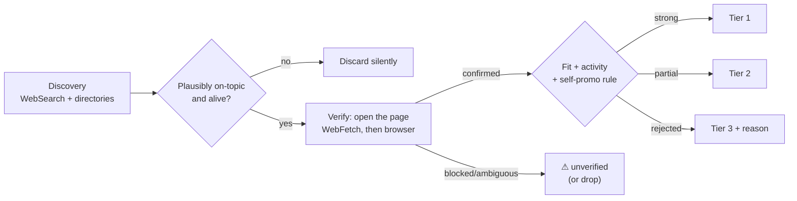

# Space Stroker — "Promotion channels directory" — Implementation Spec

> **Status: Ready for implementation** — refined via Trello card
> [identify crypto groups, communities, places where we can try to promote our app and reach people](https://trello.com/c/L3qmI4qj)
> (#100, 2026-07-26).
> Repos affected: **`monkify-meta` only** (non-code content deliverable; no `monkify-backend` /
> `monkify-front` / `monkify-lp` change).
>
> **Purpose:** Produce **`marketing/promotion-channels.md`** — a researched, **live-verified**,
> prioritized directory of the actual crypto / gambling / web3-gaming / meme communities, servers,
> subreddits, creators and X Spaces hosts where Space Stroker can be promoted. The two shipped launch
> campaigns (X #76, Telegram #77) have paste-ready copy and a schedule but **no named targets** — both
> deferred exactly this research. This spec is the **blueprint**; the implementer performs the research
> pass and writes the deliverable.

---

## 1. Summary

`marketing/twitter-launch-campaign.md` §4.3 and `marketing/telegram-launch-campaign.md` §4.4 currently
tell the reader to *"search directories, verify handles, build a list of 20–30 accounts."* That
research was deliberately punted. This card does it.

| | |
| --- | --- |
| **Deliverable** | `monkify-meta/marketing/promotion-channels.md` (new) |
| **Kind** | Content / research. **No code**, no schema, no test project change. |
| **Shape** | A **directory** — where to go, how big, how alive, whether self-promo is allowed, and a one-line angle. **Not** an outreach runbook; message copy stays in #76 §4.7 / #77 §4.8. |
| **Hard rule** | Every entry **opened live at write time**. Nothing from model memory. Unverifiable ⇒ dropped or flagged `⚠ unverified`. |
| **Also edits** | `marketing/twitter-launch-campaign.md` §4.3, `marketing/telegram-launch-campaign.md` §4.4 (repointed at the new doc), `INDEX.md` |
| **Language** | English only (matches #76 / #77) |
| **Budget** | $0 organic; openly-published paid rates parked in a fenced appendix |

Sibling context that is already true and must not be re-litigated:

- The game is **live** — `[PLAY_URL]` = `https://app.spacestroker.com`, LP at `spacestroker.com`.
- Official socials are wired: **X `@SpaceStroker`** (`https://x.com/SpaceStroker`) and
  **Telegram `t.me/spacestroker`**. Discord was removed at #79 — we do **not** run a Discord server,
  so every Discord entry in this directory is **someone else's** server we would visit as guests.
- Token-free: USDC on Solana, provably fair, "No token. Yet."

---

## 2. Constraints (MANDATORY)

From `monkify-meta/constraints.md` (full list there):

- **Worktree-per-repo:** work lives in `.worktrees/promotion-channels/monkify-meta`; the shared
  `monkify-meta` checkout stays a clean `main` hub. Branch `feature/promotion-channels` is the PR ref
  and is already pushed.
- **Unit tests:** **N/A** — no backend change, nothing in `SpaceStroker.Tests` to touch.
- **Integration test (`AGENTS.md` rule 8):** **does not apply** — content-only, no backend behavior, no
  new application feature. Same treatment as #76 / #77.
- **EF mapping / migrations:** **N/A** — no database change.
- **Secrets/config:** **N/A** — the doc records no credentials, API keys, bot tokens or account logins.
  If a discovery tool needs an API key, do **not** commit it; use unauthenticated endpoints or the
  browser.
- **Operator messaging:** **N/A** — no user-facing product copy.
- **`features/` doc:** **none** — content card. `INDEX.md` row only, matching #76 / #77.

Feature-specific constraints from the card:

- **No fabricated data.** No invented community names, member counts, engagement figures or rates.
  This is the single highest-risk failure mode of this card — see §4.1.
- **Token-free integrity.** The doc must not imply a token, ticker, contract address or airdrop exists.
- **No platform-ToS / gambling-compliance research** — excluded by explicit user decision (§3, D8).

---

## 3. Resolved product decisions

| # | Decision |
| --- | --- |
| **D1** | Deliverable is **one new file**, `monkify-meta/marketing/promotion-channels.md`, styled as a sibling of the #76 / #77 campaign docs (same blockquote header, `§`-numbered sections, tables, honest-expectations tone). |
| **D2** | It is a **directory**, not an outreach runbook: where to go + a one-line angle per entry. No who-does-what-when, no per-entry message copy, no CRM columns. |
| **D3** | **Every platform named on the card gets researched and an explicit verdict** — either named entries or a short *"assessed — not worth it, because…"*. Nothing silently absent. In scope: X (Communities · accounts · Spaces hosts), Telegram, Discord, Reddit, streamers (Twitch / Kick / YouTube), Farcaster, Facebook. The implementer **may add** any other surface that genuinely turns up (dapp aggregators, ecosystem directories, newsletters, podcasts). |
| **D4** | **Live verification is mandatory.** Every entry must be found and opened at write time: working URL, approximate size, an activity signal, and its self-promo rule read from its own rules/description. Nothing from model memory. Unverifiable ⇒ dropped, or kept with an explicit `⚠ unverified` flag — never presented as confirmed. Every entry carries an `as of YYYY-MM-DD`. |
| **D5** | **Entry schema:** platform · name · verified link · approx size · activity signal · fit tags (`crypto` / `gambling` / `web3 games` / `memes`) · self-promo rule · tier · one-line "the move here" · risk/impersonation note · verified-on date. |
| **D6** | **Tiers:** **T1** "start here this week" ~10–15 cross-platform · **T2** secondary ~20–40 · **T3** assessed-and-rejected, named **with the reason** so nobody re-researches them. **Per-platform minimums:** ≥8 Telegram, ≥8 Discord, ≥6 X communities/accounts, ≥5 subreddits, ≥8 streamers/Spaces hosts. A minimum that cannot be met is **stated as a shortfall**, never padded with weak entries. |
| **D7** | **Budget:** the directory is $0 organic. Where a place **openly sells access** (paid announcement slot, published KOL rate, Spaces sponsor slot), the asking price goes in a **clearly-fenced §7 "Paid options — not endorsed, decide separately"** appendix, never as a T1/T2 organic entry. Committing spend is a separate decision. |
| **D8** | **Positioning:** Space Stroker is written up as a **web3 dapp on Solana** (USDC, provably fair, no token) — **not** a licensed gambling operator. **No platform-level ToS / gambling-compliance research section.** Flagged during refinement that platform enforcement (Twitch, Reddit, Discord) keys off *"real-money betting site"* rather than licensing status, so being unlicensed does not lower takedown risk; **reaffirmed by the user and accepted as a known, unresearched risk.** |
| **D9** | The **per-community self-promo rule is kept** — it is operational intel ("this Discord bans project links", "this sub allows self-promo Saturdays only"), not a compliance section. |
| **D10** | **KB wiring:** `twitter-launch-campaign.md` §4.3 and `telegram-launch-campaign.md` §4.4 are repointed at the new doc so targets live in exactly one place; `INDEX.md` gains a row. No duplicated lists. |
| **D11** | **English-only.** Non-English (PT-BR etc.) communities are a possible follow-up card, not this one. |

---

## 4. Research method (the core of this card)

There is no data model, backend or frontend to design here — the engineering content of this card **is
the research method**. This section is normative: an implementer who follows §4 and §5 produces the
deliverable.

### 4.1 The anti-fabrication rule

> **Do not write any community name, member count, activity figure, rule, or price that you did not
> observe on a page you actually fetched during this pass.**

This is the failure mode that would make the deliverable worse than nothing: a plausible-looking list
that routes the team into dead rooms, or worse, into look-alike/impersonator groups. Model-memory
recall of "popular Solana Telegram groups" is **not** research.

Concretely:

- Each entry records **what was observed** and **when** (§4.4).
- If a fetch fails, is blocked, or returns something that does not clearly identify the community,
  the entry is either **dropped** or kept with `⚠ unverified` **and a note saying what could not be
  confirmed**. Never silently downgrade a guess into a fact.
- The names already sitting in `twitter-launch-campaign.md` §4.3 (the "PLAY SOLANA" X Community,
  `@solanagaming`, `@SolanaInsiders`, r/solana, r/CryptoGaming) were themselves written from memory.
  Treat them as **candidates to verify in this pass**, not as confirmed entries to copy forward.

### 4.2 Tooling

| Tool | Use |
| --- | --- |
| `WebSearch` | **Discovery** — finding candidates. Never the source of a recorded fact. |
| `WebFetch` | **Verification** — opening the community's own page / public API and reading size, activity, rules. Primary verification tool. |
| `mcp__claude-in-chrome__*` | **Fallback verification** for surfaces that block automated fetches (X especially). Use when `WebFetch` returns a login wall, a JS shell, or an anti-bot page. |

If both fail for a given entry, that entry is `⚠ unverified` or dropped. There is no third option.

### 4.3 Per-platform discovery + verification

For each platform: **discover** candidates broadly, then **verify** each one individually. The
verification methods below are the recommended first attempt — if an endpoint or URL shape has changed
by the time this runs, fall back to the platform's own public listing page and say so in the entry's
evidence note. Do not treat a failed endpoint as licence to guess.

| Platform | Discovery sources | Verification (first attempt) | Observable size / activity |
| --- | --- | --- | --- |
| **Telegram** | Group-directory catalogs, TGStat / Telemetr-style analytics sites, links from Solana project sites, links posted in verified X bios | `https://t.me/<name>` public preview page (title, member count, description). For channels, `https://t.me/s/<name>` also shows recent posts | Member count from the preview; **last-post date** from `/s/` where available |
| **Discord** | Disboard / top.gg style server listings, official project sites and X bios (an invite link on a verified project site is the strongest anti-impersonation signal) | Invite metadata endpoint — `https://discord.com/api/v10/invites/<code>?with_counts=true` returns the guild name plus `approximate_member_count` and `approximate_presence_count` | Member count **and online count** (`presence` is an excellent activity proxy — a 50k server with 300 online is a dead server) |
| **Reddit** | Subreddit sidebars ("related communities"), search, r/solana's own wiki | `https://www.reddit.com/r/<sub>/about.json` → `subscribers`, `active_user_count`; `https://www.reddit.com/r/<sub>/about/rules.json` → the **rules text**, which is where the self-promo policy lives | Subscribers + active users; scan `/new` for last-post recency |
| **X — accounts** | Solana ecosystem accounts, replies under large Solana-gaming posts, follower overlap | `x.com` blocks unauthenticated fetches aggressively → **use the browser tools**. Confirm the handle **character by character** (the capital-I `@SoIana…` trap) | Followers; recency of last post; whether replies get engagement |
| **X — Communities** | X Communities search, links from ecosystem accounts | Browser tools on `x.com/i/communities/<id>` | Member count; posts-per-day feel |
| **X — Spaces hosts** | Recurring Solana/web3-gaming Spaces; the host account is the entry | Verify the **host account** (as above) and note the recurring slot **only if the host publishes it** | Host followers; whether the recurring Space is still running |
| **Twitch** | The crypto/gambling-adjacent directories and category pages; "Solana" search | Channel page `https://www.twitch.tv/<channel>` | Followers; **last stream / schedule** — a channel dark for 3 months is T3 |
| **Kick** | Kick's own category/search | `https://kick.com/<channel>` | Followers; last stream |
| **YouTube** | Search for Solana-gaming / crypto-casino channels | Channel page | Subscribers; **last upload date** |
| **Farcaster** | Channel directory in the current Farcaster web client (confirm the current domain before citing URLs — the client has been rebranded once) | Channel page | Followers / member count; recent cast recency |
| **Facebook** | Group search for crypto / Solana / web3 gaming | Public group page | Members; last-post recency. **Expected outcome: a §5 rejection verdict** (near-zero Solana degen presence) — but it must be *assessed*, not assumed. If real candidates do turn up, list them. |

### 4.4 Evidence recorded per entry

Every entry carries an evidence trail thin enough to keep the doc readable and thick enough to be
checkable:

```
verified <YYYY-MM-DD> — <what was observed>, e.g. "t.me preview: 18.4k members, last post 2026-07-25"
```

The `as of` date is the date of **this pass**, not the date the community was created.

### 4.5 Screening funnel and effort shape

Expect to screen substantially more candidates than survive. A candidate is worth verifying if it
looks plausibly on-topic and plausibly alive; it becomes an **entry** only after §4.3 verification.
Rejected candidates that were *actually assessed* go to **T3 with the reason** — that is the point of
T3, so nobody spends the same effort twice next quarter.

Tiering rule, stated so it is not a judgement call:

- **T1** = high fit **and** demonstrably alive **and** self-promo is `allowed` or `ask an admin`.
- **T2** = good fit but smaller / quieter / stricter, or fit is partial (e.g. crypto but not gaming).
- **T3** = assessed and rejected — dead, off-topic, hostile to self-promo with no realistic angle,
  scam-ridden, or unverifiable.

**Activity beats raw size.** Where a big member count and a dead room conflict, the activity signal
decides the tier, and the entry says so.



---

## 5. Deliverable structure — `marketing/promotion-channels.md`

The implementer writes exactly this shape. Section numbers are normative (the acceptance criteria
reference them).

### 5.0 Header + §0 — how to use, and the staleness banner

Open with a blockquote header in the house style of #76 / #77, then §0. §0 must contain a **staleness
banner**, e.g.:

```markdown
> ⚠️ **This list decays.** Every entry was verified on the date in its `as of` column and nowhere else.
> Crypto communities die, rename, and get taken over. **Re-verify before each outreach wave — §6.**
```

§0 also gives the 60-second runbook: read §1 to know what a good target looks like, work §2 (Tier 1)
first, use the self-promo column before you post anything, and get the actual message copy from
`twitter-launch-campaign.md` §4.7 / `telegram-launch-campaign.md` §4.8.

### 5.1 §1 — Who we're hunting

The ideal audience and what "good fit" means, expressed through the card's **four axes**:

| Axis | What it looks like | Why we fit |
| --- | --- | --- |
| **crypto** | Solana-native degens, wallet-first users | We are USDC-on-Solana, wallet-only, no signup |
| **gambling** | People who already bet on-chain | We are a betting game; provably fair answers "is it rigged?" |
| **web3 games** | On-chain gaming communities | We are a live web app, not a bot, not a token |
| **memes** | Meme/lore-driven communities | Edson's lore is the shareable asset |

Plus what makes a target **bad**: dead rooms, pure-airdrop-farming crowds, token-shill-only rooms
(we have no token to shill), and anything that requires claiming a licence we do not hold.

### 5.2 §2 — Tier 1: start here this week

~10–15 entries, cross-platform, **ordered**. Each is a short block: the stable entry id (§5.5), the
name, and **one or two sentences on why it is first and what the opening move is**. The full row
lives once in §5 — §2 references it by id, so nothing drifts out of sync.

### 5.3 §3 — Tier 2: secondary

~20–40 entries as a compact list of **ids grouped by platform** with a half-line qualifier each.
Again: the canonical row lives in §5.

### 5.4 §4 — Tier 3: assessed and rejected

Its own table — these do **not** belong in the "go here" tables:

| Name | Platform | Link | Why rejected | as of |
| --- | --- | --- | --- | --- |

"Why rejected" must be concrete and reusable ("18k members, last message 2026-03; effectively dead",
"rules ban all project links, no exception channel", "could not confirm this is the official group —
three look-alikes").

### 5.5 §5 — Per-platform sections (the canonical rows)

One subsection per platform, **each opening with a one-paragraph verdict** (`worth it because…` /
`assessed — not worth it because…`). Then the canonical table. Every entry appears **exactly once in
the whole document**, here, with a stable id: `TG-01`, `DC-01`, `X-01`, `XC-01` (Communities),
`XS-01` (Spaces hosts), `RD-01`, `TW-01` (Twitch), `KK-01`, `YT-01`, `FC-01` (Farcaster), `FB-01`.

| id | Name | Link | Size | Activity (as of) | Fit | Self-promo | Tier | The move here | Risk / impersonation |
| --- | --- | --- | --- | --- | --- | --- | --- | --- | --- |

Column vocabulary is fixed:

- **Fit** — any of `crypto` · `gambling` · `web3 games` · `memes` (comma-separated).
- **Self-promo** — exactly one of `allowed` · `ask an admin` · `banned` · `unknown — ask first`.
  **Never assume `allowed`**: if the rule is not published, it is `unknown — ask first`.
- **Tier** — `T1` · `T2`. (T3 lives in §4.)
- **Activity (as of)** — a concrete observable plus the date, per §4.4. Not "active".
- **The move here** — one line, specific to that place ("lore-first, never link-drop; they have a
  Friday self-promo thread"). Not message copy.
- **Risk / impersonation** — the look-alike hazard or other caveat. `—` is permitted **only** when the
  entry has an unambiguous canonical identity confirmed from an official source.

Where a platform minimum (D6) could not be met, the verdict paragraph **states the shortfall
explicitly** ("only 4 subreddits cleared verification; the rest are in §4") rather than the table
being padded.

### 5.6 §6 — Re-verification protocol

What decays and how fast, what to re-check before an outreach wave, and how long an entry stays
trustworthy. Must be concrete enough to execute: which columns to re-check (link resolves, size,
last-activity, self-promo rule unchanged), the fast path (the §4.3 endpoints), and an explicit
"entries older than <N> months should be treated as leads, not facts" line with a stated N.

### 5.7 §7 — Paid options (fenced appendix)

Opens with an unmissable fence:

```markdown
> 💰 **Not endorsed, not part of the plan.** The campaign is $0 organic. This appendix only records
> prices that were *openly published* at research time, so we never have to research them twice if
> paid promotion is ever funded. Listing a price here is not a recommendation.
```

Then: place · what is being sold · asking price (as published) · link · as of. Nothing from this
appendix may appear as a T1/T2 organic entry.

### 5.8 §8 — Guardrails

Short form, inherited from #76 §6 / #77 §6.6: token-free (no ticker, no CA, no airdrop claim), no
financial promises, no fabricated metrics, verify every handle before engaging, responsible/18+ tone,
and the positioning line (**web3 dapp on Solana**, not a licensed operator — D8).

---

## 6. Data model / 7. Backend behaviour / 8. Frontend behaviour

**N/A — all three.** This card produces documentation in `monkify-meta` only. No entity, column, EF
mapping, migration, endpoint, header, event, consumer, composable, service, type, component, env var
or user-facing copy changes. `monkify-backend`, `monkify-front` and `monkify-lp` are untouched.

---

## 9. Out of scope

- **Doing the outreach** — no posting, no DMs, no joining, no admin contact. Identify and document only.
- **Message / DM copy** — already in #76 §4.7 and #77 §4.8.
- **Paid promotion, ad buys, sponsored posts, KOL payments** — prices recorded in the fenced §7
  appendix only; committing spend is a separate decision.
- **A contacted / posted / accepted tracker** — the directory is not a CRM.
- **Referral / affiliate / giveaway programs** — a future lever per #76 §4.9, not this card.
- **Any `monkify-front` / `monkify-lp` / `monkify-backend` change**, including new social links.
- **Platform ToS / gambling-compliance research** — excluded by D8.
- **Non-English communities** — possible follow-up card (D11).
- **Creating a Space Stroker Discord server** — Discord was deliberately removed at #79. Discord
  entries here are other people's servers.

---

## 10. File checklist

### 10.1 Backend (`monkify-backend`)

**None.**

### 10.2 Frontend (`monkify-front` / `monkify-lp`)

**None.**

### 10.3 Meta (`monkify-meta`)

| # | File | Change |
| --- | --- | --- |
| 1 | `marketing/promotion-channels.md` | **NEW.** The deliverable, structured exactly per §5 (§0–§8). |
| 2 | `marketing/twitter-launch-campaign.md` | Rewrite **§4.3 "Where the audience is"**: **keep** the impersonation warning (it is still the right instinct), **replace** the from-memory "good starting points" bullets and the "build a private list of 20–30 accounts" instruction with a pointer to `promotion-channels.md` (§2 Tier 1 first, X entries in §5). No other section touched. |
| 3 | `marketing/telegram-launch-campaign.md` | Rewrite **§4.4 "Where the audience is"** the same way: keep the verify-first warning, replace the directory-hunting bullets and the "list of 10–20 groups" instruction with a pointer to `promotion-channels.md` (Telegram entries in §5). No other section touched. |
| 4 | `INDEX.md` | (a) Add a knowledge-base-map row for **`specs/promotion-channels.md`** (status **Ready**) whose text **explicitly names the deliverable `marketing/promotion-channels.md`** and describes it as the named-targets directory backing #76 / #77 — matching how the #76 / #77 spec rows are written. (b) Update **"Feature currently in flight"** with this feature, spec path, branch `feature/promotion-channels`, repo `monkify-meta`, Trello #100. |

Neither #76 nor #77 gets a new list of targets — the pointer replaces the guidance, it does not
duplicate the data (D10).

---

## 11. Tests

**Unit tests: N/A** (no backend change). **Integration test: N/A** (`AGENTS.md` rule 8 does not apply —
content-only, no new application feature; same as #76 / #77).

The equivalent of a test here is a **self-audit of the deliverable**, run from the
`monkify-meta` worktree before committing. Model it on #76 §6:

```bash
# 1. Guardrail scan — expect NO hits outside the §8 guardrails section.
grep -niE "guarantee|risk[- ]free|\broi\b|get rich|[0-9]+ ?x\b|to the moon|can'?t lose|\\\$SPACE|airdrop is live|passive income|licen[cs]ed" marketing/promotion-channels.md

# 2. Placeholder scan — expect NO hits.
grep -niE "TBD|TODO|<placeholder>|lorem|example\.com" marketing/promotion-channels.md

# 3. Every entry row carries an as-of date — eyeball that no row in a §5 table
#    or the §4 table has an empty Activity/as-of cell.
grep -nE "^\| (TG|DC|X|XC|XS|RD|TW|KK|YT|FC|FB)-[0-9]" marketing/promotion-channels.md | grep -vE "20[0-9]{2}-[0-9]{2}-[0-9]{2}"

# 4. Per-platform minimums (D6) — count ids per prefix and compare against
#    ≥8 TG, ≥8 DC, ≥6 X+XC, ≥5 RD, ≥8 TW+KK+YT+XS; a shortfall must be stated in that
#    platform's verdict paragraph.
grep -oE "^\| (TG|DC|X|XC|XS|RD|TW|KK|YT|FC|FB)-[0-9]+" marketing/promotion-channels.md | sort | uniq -c
```

Check 3 prints rows **missing** a date — expect no output. Checks 1 and 2 expect no output. Check 4 is
a count to compare by eye against D6.

---

## 12. Acceptance criteria

Copied 1:1 from the Trello **Acceptance Criteria** checklist on card #100.

1. Given the card is complete, when the repo is inspected, then `monkify-meta/marketing/promotion-channels.md` exists and no file outside `monkify-meta` has been modified.
2. Given the finished doc, when its sections are read, then it contains §0 runbook + staleness banner, §1 who-we're-hunting, §2 Tier 1, §3 Tier 2, §4 Tier 3 rejected, §5 per-platform sections, §6 re-verification protocol, §7 fenced paid-options appendix, and §8 guardrails.
3. Given any entry in the directory, when it is inspected, then it carries platform, name, a verified link, approximate size, an activity signal, fit tags from {crypto, gambling, web3 games, memes}, a self-promo rule, a tier, a one-line "the move here", a risk/impersonation note, and an `as of YYYY-MM-DD` date.
4. Given an entry presented without a `⚠ unverified` flag, when its link is opened, then it resolves to the named community and its stated size/activity/self-promo rule match what that page shows — i.e. every unflagged entry was opened live at write time, none came from model memory.
5. Given a community that could not be opened or confirmed, when it still appears in the doc, then it is explicitly marked `⚠ unverified` (or its gate is stated, e.g. "invite-only") and is never presented as confirmed.
6. Given the tiers, when they are counted, then Tier 1 holds ~10–15 cross-platform entries, Tier 2 holds ~20–40, and Tier 3 names every assessed-and-rejected candidate together with the reason it was rejected.
7. Given the per-platform minimums, when entries are counted per platform, then there are ≥8 Telegram, ≥8 Discord, ≥6 X communities/accounts, ≥5 subreddits and ≥8 streamers/Spaces hosts — or, where a minimum could not be met, that platform's verdict states the shortfall explicitly instead of the list being padded with weak entries.
8. Given every platform named on the card (X incl. Spaces, Telegram, Discord, Facebook, streamers) plus Reddit and Farcaster, when §5 is read, then each one has either named entries or an explicit "assessed — not worth it, because…" verdict; none is silently absent.
9. Given a place that openly sells access (paid announcement slot, published KOL rate, Spaces sponsor slot), when it is recorded, then it appears only in the fenced §7 "Paid options — not endorsed, decide separately" appendix with its asking price, and never as a Tier 1/2 organic entry.
10. Given §6, when it is read, then it states what decays, exactly what to re-check before an outreach wave, and how long an entry stays trustworthy — so a reader can tell at a glance whether the list is still current.
11. Given `marketing/twitter-launch-campaign.md` §4.3 and `marketing/telegram-launch-campaign.md` §4.4, when they are read after the change, then each points at `promotion-channels.md` as the source of named targets instead of telling the reader to go find some, and neither duplicates the list.
12. Given `INDEX.md`, when it is read after the change, then it has a row for `marketing/promotion-channels.md` describing it as the named-targets directory for the #76/#77 campaigns.
13. Given the guardrails, when the doc is scanned, then it contains no token ticker, contract address or airdrop claim, no financial promise, and no invented member counts or engagement figures — and the positioning throughout is "web3 dapp on Solana", not "licensed gambling operator".

---

## 13. Manual QA

No app to run. Verify the deliverable itself:

1. Run the four §11 scans; confirm the expected empty output and eyeball the §11 check-4 counts
   against D6.
2. **Spot-check verification honesty:** pick **5 entries at random** across different platforms, open
   each link, and confirm the community is the one named and that the recorded size / activity /
   self-promo rule match what the page shows. Any mismatch means the pass was not done live — fix the
   entry, then re-check 5 more.
3. Confirm every `⚠ unverified` entry says **what** could not be confirmed.
4. Read §2 Tier 1 top to bottom and ask: *could someone open this and start today?* If an entry's "the
   move here" is generic ("engage authentically"), it is not done.
5. Open `twitter-launch-campaign.md` §4.3 and `telegram-launch-campaign.md` §4.4 and confirm each reads
   as a pointer, still carries the impersonation warning, and lists no targets of its own.
6. Confirm `git status` in the worktree shows changes **only** under `monkify-meta`.

---

## 14. Trello / pipeline

- **Source card:** [#100 — identify crypto groups, communities, places where we can try to promote our app and reach people](https://trello.com/c/L3qmI4qj) — list **Specs created**; the **Implementation** section on the card carries branch, spec path, worktree and repos.
- **Worktree:** `.worktrees/promotion-channels/monkify-meta` · **Branch:** `feature/promotion-channels` (pushed).
- **Next:** `/monkify-implement-feature` to run the research pass and write the deliverable; then
  `/monkify-ship-feature` to sync the KB and merge to `main`.
- **Siblings:** #76 ([gApr5z7v](https://trello.com/c/gApr5z7v)) Twitter/X campaign · #77 ([LTrjTgdy](https://trello.com/c/LTrjTgdy)) Telegram campaign — this card supplies the targets both of them deferred.

---

## 15. Revision log

| Date | Change |
| --- | --- |
| 2026-07-26 | Initial spec from refined card #100 (refinement and spec authored in the same session). |
