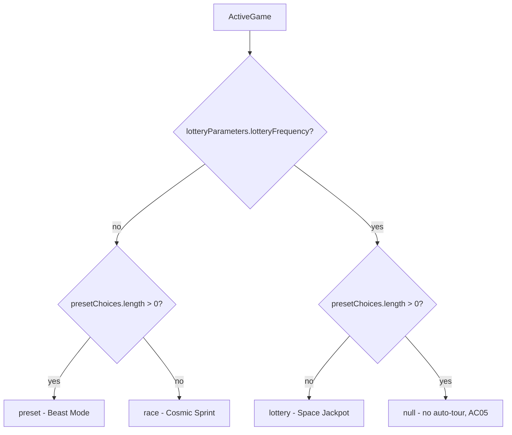

# SpaceStroker — "Quick Tour Modals" Feature — Implementation Spec

> **Status: Shipped** — merged via `feature/quick-tour-modals` on **2026-07-30**. Distilled summary:
> `../features/quick-tour-modals.md` (read that first; this file is the design archive).
>
> ⚠️ **The whole backend chapter of this spec (§4, §6, §10.1, §11.1) was NOT shipped.** While the
> branch was in flight, `remove-operators` replaced `OperatorPlayer` with `Player` and made
> `PATCH /players/preferences` a **signature-proved, display-name-specific** write. Persisting a tour
> dismissal would then require prompting the player to sign a Solana message to close an onboarding
> modal — and the overview fires on the lobby, where no wallet is connected. A new *unsigned* endpoint
> was rejected too (it would let anyone suppress a stranger's tutorial). So `SeenTours`, its migration,
> `SeenToursSerializer`, both handler edits and their tests were **all dropped**: the seen-set is
> `localStorage` only, and the accepted cost is that a tour can reappear on another browser. The
> feature shipped **frontend-only**. See `../features/quick-tour-modals.md` → "Why there is no server
> half".
>
> **Other shipped deltas.** (1) The mode header art is **one sprite reel**
> (`src/assets/tours/game-modes.gif` + `TourModeReel.vue`), not the three separate gifs copied from
> `monkify-lp` that §7.8 lists. (2) The auto-open guards gained **two** overlays that did not exist
> when this was written — the **18+/Terms gate** (`z-[70]`, which *outranks* the modal, so both
> watchers take `termsAccepted` as a dependency and fire on ACCEPT) and the **display-name prompt**.
> (3) The mobile overview is **4 steps**, folding PULL THE LEVER into "tap PLACE BET" to match the
> mobile bet panel. (4) Two adjacent fixes rode the branch: a **sticky header** (with the
> horizontal-overflow guard moved to `<html>`) and the **wallet cluster on the lobby/history/stats**.
> (5) `walletForPrefs` moved into `usePrefsWallet` and carries the `!getPlayerIdFromToken()` arm.
> (6) **AC18's Standard/4-step half is unverified** — Main is all-`SolanaToken`, so no Standard game
> exists to enter.
>
> Originally refined via Trello card
> [Quick Tour Modals](https://trello.com/c/dwPf7li8/115-quick-tour-modals) (2026-07-28).
> Repos affected: `monkify-backend`, `monkify-front`, and this doc in `monkify-meta`.
>
> **Purpose:** New players land in Space Stroker with no explanation of what the game is or how a
> given mode works. This feature adds a short, visual, pixel-art **Quick Tour** modal that
> auto-opens once per surface (the lobby, and each game-mode archetype), plus a single
> **`How to play`** re-open point in the ☰ header menu. Dismissals persist in `localStorage`
> **and** — once the player has a server identity — on a new `OperatorPlayer.SeenTours` column,
> merged as a union so a tour is never shown twice.

---

## 1. Summary

Four tours. Three of them are **mode archetypes matched by game SHAPE**, never by id or name —
`gameTypeId` GUIDs change on every teardown + reseed, and operators create their own types through
the admin portal, so both are unusable as content keys.

| Key | Match rule (against `ActiveGame`) | Today's type | Auto-open surface |
| --- | --- | --- | --- |
| `overview@1` | — (the basics tour) | — | Lobby `/space-stroker/game`, first visit |
| `preset@1` | `presetChoices.length > 0` **and** not a lottery | **Beast Mode** | `/space-stroker/game/play`, after the type resolves |
| `race@1` | free-text (`presetChoices` empty) **and** not a lottery | **Cosmic Sprint** | idem |
| `lottery@1` | free-text **and** lottery (`lotteryParameters.lotteryFrequency`) | **Space Jackpot** | idem |

A **preset lottery matches nothing** and gets **no auto-tour**. That is not an error state — no such
type exists today, an operator could create one, and the player simply sees no modal while
`How to play` keeps working (falls back to the overview).

| Concern | Today | After this feature |
| --- | --- | --- |
| Onboarding | None. The lobby shows three arcade cards; `/game/play` shows a terminal, a lever and a keypad, and nothing says what to do. | A 3-step mode tour + a 4/5-step overview, auto-opened once each. |
| Re-open | N/A | One **`How to play`** row in the ☰ menu (Settings · Stats · Fair · History · **How to play**). |
| Dismissal memory | N/A | `localStorage` `space-stroker.tour.seen` **∪** server `OperatorPlayer.SeenTours`, pushed up once on wallet connect. |
| Embedded (regulated iframe) | N/A | Nothing auto-opens; the menu row is absent — same gate as Stats and Fair. |

Backend surface is one nullable column and two handler edits on the **existing** prefs GET/PATCH.
No new endpoint, no consumer, no event, no SignalR contract change, no change to game flow, bets,
payouts, refunds, operators, caching or rate limiting.

---

## 2. Constraints (MANDATORY)

From `monkify-meta/constraints.md` (full list there):

- **Branch/worktree-per-repo:** `feature/quick-tour-modals` in each affected repo; work lives in
  `.worktrees/quick-tour-modals/<repo>`; each hub stays on `main` (`constraints.md` §2,
  `AGENTS.md` rules 5–6). Push after branch work.
- **Level = Feature ⇒ mandatory integration test** (`AGENTS.md` rule 8, `constraints.md` §3):
  `SpaceStroker.Tests.Integration` must contain a happy-path test that drives
  `PATCH /players/preferences { seenTours }` → `GET /players/preferences` and asserts the **union**.
  Plus handler unit tests in `SpaceStroker.Tests`; **report changed/added tests** at the end.
- **EF mapping:** inline in `SpaceStrokerDbContext.OnModelCreating` — **no** `IEntityTypeConfiguration`
  (`constraints.md` §4).
- **Migrations:** added under `SpaceStroker.Infrastructure/Migrations/`, applied **only** by
  `SpaceStroker.Consumers` at startup. Never hand-edit `SpaceStrokerDbContextModelSnapshot.cs`.
- **Secrets/config:** nothing secret here; no new config key at all.
- **Operator messaging:** nothing in the tour may reveal operator contract status; the existing vague
  "not found / unavailable" path is untouched (`constraints.md` §6).
- **Host split** (`constraints.md` §8): read/write on the stateless **API**. Consumers is not touched
  beyond applying the migration.
- **`conventions/frontend.md`:**
  - Modals are `<Teleport to="#app">` — `GameHeader.vue`'s root carries `backdrop-blur-md`, which
    makes it the containing block for `position: fixed` descendants (`fair-modal-off-screen`, #109).
  - `arcade.css` beats equal-specificity Tailwind utilities — use `.btn-arcade` **as-is** or plain
    Tailwind + arcade tokens; never half-adopt the class.
  - Build with the existing design system (`src/components/ui/`, arcade tokens).
  - `singleFlight` responses are **shared and read-only** — clone before mutating.
- `monkify-front` has **no test framework** — frontend verification is `yarn lint` + `yarn build` +
  manual QA on desktop (GPU), phone, and light-graphics.

---

## 3. Resolved product decisions

| # | Decision |
| --- | --- |
| 1 | Tour content is keyed by **game shape**, never by `gameTypeId` or name (GUIDs churn on reseed; operators create their own types). Archetypes: `overview`, `preset`, `race`, `lottery`. |
| 2 | A **preset lottery matches no archetype** → no auto-tour, no console error; `How to play` still opens the overview. |
| 3 | Mode name, ticket price and lottery frequency are read **live from the `ActiveGame` DTO**, never hard-coded, so copy stays true for any operator-created type. |
| 4 | The mockup's *"Pick an animal number (1-8)"* is **not shipped**: preset choices are operator-configured free text, the mobile keypad is name-based and uncapped since `mobile-preset-keypad` (#94), and only the desktop cabinet still uses numbered art. Ship "pick a beast / back one of the runners" — no "animal", no "1-8". |
| 5 | Overview copy: *"Follow these simple steps to play and win!"* → CONNECT WALLET (conditional) · SELECT A GAME MODE · BET OR TYPE · PULL THE LEVER · WAIT THE BLAST. |
| 6 | **Step 1 of the overview is conditional** on a SolanaToken context. A Standard/regulated game never shows a wallet, so those players get a **4-step** tour. Production Main is all-SolanaToken ⇒ today every player sees 5. The layout must survive **3 / 4 / 5** steps. |
| 7 | Mode copy — **Beast Mode (`preset`)**: *"Back a beast and wait until Edson types it!"* → PICK A BEAST · WAIT FOR EDSON · WIN IF HE TYPES IT. **Cosmic Sprint (`race`)**: *"Call your sequence and wait until Edson types it!"* → TYPE YOUR BET · WAIT FOR EDSON · WIN IF HE TYPES IT. **Space Jackpot (`lottery`)**: *"Grab a ticket — the pot fattens all day."* → TYPE YOUR BET · WAIT FOR THE DRAW (*runs once every {frequency}*) · WIN THE JACKPOT. |
| 8 | **"First time" = local OR server.** `localStorage` `space-stroker.tour.seen` is the only store that works for the common case: production Main mints an **anonymous launch token with an empty `sub`** (`LaunchController.MintDefault`), so a player has **no server identity until a wallet connects** — and the overview fires on the lobby, where none is connected. |
| 9 | Server side: new **`OperatorPlayer.SeenTours`** (nullable text, CSV), returned by `GET /players/preferences` and written through the existing `PATCH`, reusing the shipped **wallet-then-`sub`** identity rule (`wallet-display-name`, #46). |
| 10 | **Seen = local ∪ server.** When a wallet connects and local holds keys the server lacks, PATCH them up **once**. A tour is never re-shown to someone who already dismissed it. |
| 11 | **The PATCH unions, it does not overwrite** — two devices can't clobber each other, and the write is idempotent. |
| 12 | **Keys are versioned** (`overview@1`, `preset@1`, `race@1`, `lottery@1`). Bumping the number is how a future copy/art rewrite re-shows a tour. **Ships at `@1`; nothing is bumped here**, so no existing player sees a tour twice. |
| 13 | `overview` auto-opens **once, on the first lobby visit**. A mode tour auto-opens **after the game type resolves** on `/game/play` so it can name the mode and its price. |
| 14 | A mode tour does **not** re-fire on round rollover, and is **suppressed** while the boot-recovery or idle-disconnect overlay is up. |
| 15 | **Never two modals at once.** If the player has seen neither, the mode tour is skipped for that entry and opens on the next one. |
| 16 | **Dismissal:** X, **GOT IT!**, **Esc** and a backdrop click all close **and** mark seen — nobody is nagged for closing it "the wrong way". Esc is new (`GameFairModal` deliberately has none; a modal that opens *unprompted* needs a keyboard escape). |
| 17 | **Re-open:** a single **`How to play`** row in the ☰ header menu. On `/game/play` it opens the **current mode's** tour; anywhere else the **overview**. No `?` button on the chat panel, no in-tour link between tours. |
| 18 | **Hidden entirely when embedded** (`useEmbed().isEmbedded`), same gate as Stats and Fair. |
| 19 | **Art reuses existing assets only** — no new commissions (that is card **#116**'s territory). Every slot is filled with a real asset and stays swappable. |
| 20 | **Analytics (GA4, consent-gated, no identifiers):** `quick_tour_open` (`{ tour, trigger: auto \| menu }`) and `quick_tour_dismiss` (`{ tour, how: got_it \| x \| esc \| backdrop }`). |

---

## 4. Data model

### 4.1 Entity change

`monkify-backend/src/SpaceStroker.Domain/Games/Entities/OperatorPlayer.cs` — one nullable property:

```csharp
public class OperatorPlayer : TableEntity
{
    public Guid OperatorId { get; set; }
    public Operator Operator { get; set; }
    public string ExternalPlayerId { get; set; }
    public string? DisplayName { get; set; }
    public string? Currency { get; set; }
    // Comma-separated versioned quick-tour keys the player has dismissed (e.g. "overview@1,race@1").
    // Null = has seen nothing. Written as a UNION so two devices never clobber each other.
    public string? SeenTours { get; set; }
    public DateTime LastSeenAt { get; set; }
    public ICollection<Bet> Bets { get; set; }
}
```

CSV (not a child table, not `jsonb`) is deliberate: the value is a tiny bounded set read and written
only through the prefs endpoints that already load the row, so a join or a document type would buy
nothing and cost a migration + query surface.

### 4.2 EF configuration (inline)

`monkify-backend/src/SpaceStroker.Infrastructure/Data/Context/SpaceStrokerDbContext.cs`, inside the
existing `modelBuilder.Entity<OperatorPlayer>(builder => { … })` block (currently ~line 106) —
one line beside `DisplayName` / `Currency`:

```csharp
builder.Property(x => x.SeenTours).HasMaxLength(200);
```

No index: the column is never queried or filtered on, only read back with the row that the existing
`(OperatorId, ExternalPlayerId)` unique index already locates.

### 4.3 Migration

Additive, nullable, **no backfill** (null reads as "seen nothing" — see AC15):

```bash
cd monkify-backend/src
dotnet ef migrations add AddOperatorPlayerSeenTours \
  --project SpaceStroker.Infrastructure \
  --startup-project SpaceStroker.Consumers
```

Latest existing migration for ordering context: `20260724030110_AddBetExclusiveChoice`. The migration
is applied **only** by `SpaceStroker.Consumers` at startup; the API never migrates.

---

## 5. Configuration

**None.** No `GeneralSettings` key, no `VUE_APP_*` env var, no seed change. The tour content map and
the version numbers live in frontend source (`src/constants/quickTours.ts`), which is exactly where a
copy/art rewrite + version bump will happen.

Assets are **copied** into `monkify-front` (see §7.8) — no runtime dependency on `monkify-lp`.

---

## 6. Backend behaviour (`monkify-backend`)

Host: **`SpaceStroker.Api`** only. `PlayersController` itself is **unchanged** — both endpoints already
exist and are launch-token gated by `LaunchTokenValidationMiddleware`.

### 6.1 Contract additions

`SpaceStroker.Infrastructure/Handlers/Players/UpdatePlayerPreferences/UpdatePlayerPreferencesRequest.cs`
(`PlayerPreferencesDto` lives at the bottom of this file):

```csharp
public class PlayerPreferencesDto
{
    public string ExternalPlayerId { get; set; }
    public string? DisplayName { get; set; }
    public string? Currency { get; set; }
    // Dismissed quick-tour keys. Always a list (empty, never null) so the client needs no null guard.
    public List<string> SeenTours { get; set; } = new();
}
```

`…/UpdatePlayerPreferences/UpdatePlayerPreferencesRequestBody.cs`:

```csharp
// Quick-tour keys to ADD to the stored set (union, never a replace). Invalid entries are dropped
// silently; they must not fail the whole PATCH (a display-name save must never die on a bad key).
public List<string>? SeenTours { get; set; }
```

Wire format is a **JSON array** on both sides; the CSV is a storage detail that never leaves the
handler.

### 6.2 `GetPlayerPreferencesHandler`

`…/Handlers/Players/GetPlayerPreferences/GetPlayerPreferencesHandler.cs`. Identity resolution is
**unchanged** (wallet query param wins, else token `sub`; empty ⇒ defaults). Two edits:

1. `Defaults(...)` returns `SeenTours = new List<string>()`.
2. The found-player branch returns `SeenTours = ParseSeenTours(player.SeenTours)`.

The handler still **never creates a row** — an unknown player reads defaults. A null column therefore
parses to an empty list, which is exactly the backward-compatible behaviour AC15 asks for.

### 6.3 `UpdatePlayerPreferencesHandler`

`…/Handlers/Players/UpdatePlayerPreferences/UpdatePlayerPreferencesHandler.cs`. Identity resolution is
**unchanged** (`request.Body.Wallet` wins over `request.ExternalPlayerId`; empty ⇒ vague validation
failure and `null`). Insert the union between the existing display-name/currency writes and
`SaveChangesAsync`:

```csharp
if (request.Body.SeenTours != null)
    player.SeenTours = UnionSeenTours(player.SeenTours, request.Body.SeenTours);
```

Union semantics, as a static helper on the handler:

- Parse the stored CSV into an ordered `HashSet<string>` (`StringComparer.Ordinal`).
- Validate each incoming key against **`^[a-z]+@\d+$`** (compiled `Regex`, case-sensitive). Anything
  that fails — malformed, uppercase, over-long, empty — is **dropped**, not rejected: the PATCH still
  succeeds and still stores the valid keys (**AC14**).
- Cap at **20 keys** and **200 characters** total. If adding a key would exceed either cap, stop
  adding — existing keys are never evicted (dropping a dismissal would re-show a tour).
- Re-serialize as a comma-joined string; an empty set stores `null`, not `""`.

`ParseSeenTours` is the inverse: split on `,`, drop empties, no validation on read (a value that got
in is already valid, and a hand-edited DB row must not crash a read).

Three properties fall out of this shape and are worth stating explicitly:

- **Idempotent.** Re-sending a key the player already has is a no-op write.
- **Non-destructive.** A PATCH carrying only `seenTours` leaves `DisplayName` untouched (the existing
  guard is `if (request.Body.DisplayName == null) return (false, null)`) and leaves `Currency`
  untouched (the existing guard is `IsNullOrWhiteSpace`). Symmetrically, a display-name-only PATCH
  leaves `SeenTours` untouched because of the `!= null` guard above.
- **Row-creating.** ⚠️ A bare `seenTours` PATCH will **create** an `OperatorPlayer` row if none
  exists (the handler's existing upsert). This is intended and harmless — the same row is created
  today by any display-name save — but it means a wallet's first *tour dismissal*, not its first bet,
  can be what materializes the row. No other code path assumes `OperatorPlayer` implies a bet.

### 6.4 What does **not** change

No new endpoint. No consumer, event, SignalR contract, Redis cache key, rate-limit rule or Cloud
Armor rule (the prefs endpoints already carry theirs). No change to game flow, bets, payouts,
refunds, operator scoping, or `RegisterBetHandler`. `GameParameters` is untouched — the archetype is
derived client-side from data the DTO already carries.

---

## 7. Frontend behaviour (`monkify-front`)

### 7.0 Hidden blockers found in the code (read this first)

These were confirmed by reading the live code and each one changes the implementation:

1. **⚠️ Do not add a second prefs GET.** `useDisplayCurrency.loadPreferences` (`src/hooks/useDisplayCurrency.ts:39`)
   is the *only* prefs read on the boot path, and it discards everything but `currency`,
   `displayName` and `externalPlayerId`. `singleFlight` dedupes **concurrent** calls only, so a
   separate `getPlayerPreferences()` from `useQuickTour` would be a genuine extra request against the
   very budget `player-lockouts` (#104) and `entry-path-recovery` (#110) just clawed back. Fix:
   `loadPreferences` also publishes `seenTours` into a module-level ref exposed by
   `useDisplayCurrency`, and `useQuickTour` **reads that** — it never fetches.
2. **⚠️ `singleFlight` responses are shared objects.** Every waiter on `getPlayerPreferences` resolves
   to the **same** object (`conventions/frontend.md`). Treat `seenTours` as read-only and **clone**
   (`[...prefs.seenTours]`) before merging.
3. **⚠️ Teleport does not escape the recovery/idle overlays.** `App.vue:252` renders
   `<boot-recovering v-else-if="recovering" />` **instead of** `<main>`, and `GameIdleOverlay` is
   `z-40` while modals are `z-50`/`z-[60]`. A tour teleported to `#app` is a *sibling* of both and
   would paint straight over them. Suppression must be an **explicit guard in `useQuickTour`**
   (`useBootRecovery().recovering`, `useIdleDisconnect().isIdleDisconnected`, `useEmbed().relaunching`),
   not something the DOM does for us (**AC17**).
4. **⚠️ `selectedGame` is assigned in two places**, not one: `GameTypes.vue:38` (lobby click) and
   `GamePage.vue:59` (direct `?type=` load / refresh). Triggering the mode tour from either call site
   misses the other. Trigger on a **`watch` of `selectedGame`** in the modal host instead.
5. **⚠️ `formatLotteryFrequency` is not reusable today** — it is a local `const` inside
   `GameTerminal.vue:101` (and a near-duplicate `formatFrequency` exists in `GameTypeCard.vue`). The
   lottery tour needs it, so extract it (§7.9). It already carries the `fix-pricing` day-component fix
   (`"1.00:00:00"` ⇒ `24 HOURS`, not `1 HOUR`) — extract, do not re-derive.
6. An anonymous player (empty-`sub` Main token, no wallet) has **no identity**:
   `UpdatePlayerPreferencesHandler` returns a vague validation failure for an empty
   `externalPlayerId`. The client must therefore **not** PATCH until an identity exists (**AC10**).

### 7.1 Types + service

`src/types/index.ts`:

```ts
export interface PlayerPreferences {
  externalPlayerId: string;
  displayName?: string | null;
  currency?: string | null;
  // Dismissed quick-tour keys ("overview@1", …). Always present; empty when nothing was dismissed.
  seenTours?: string[];
}

export interface PlayerPreferencesBody {
  displayName?: string;
  wallet?: string;
  currency?: string;
  // Keys to ADD — the backend unions, it never replaces.
  seenTours?: string[];
}
```

`src/services/mainService.ts` — **no signature change**. `updatePlayerPreferences(body)` already takes
the whole body and `getPlayerPreferences(wallet?)` already returns `PlayerPreferences`. The
`singleFlight` allow-list is **not** extended (both functions are already on it / already correct).

### 7.2 `src/hooks/useDisplayCurrency.ts` — publish `seenTours`

Add a module-level `const seenTours = ref<string[]>([])`, set it in `loadPreferences`
(`seenTours.value = prefs?.seenTours ?? []`), and expose `seenTours: computed(() => seenTours.value)`
from the returned object. This is the whole change here — no extra request, no new call site
(`App.vue:163` / `:214`, `PlayerCustomizationModal.vue:97` and `useGameChat.ts:47` all keep working
unchanged and all now refresh the tour set for free).

### 7.3 `src/hooks/useQuickTour.ts` (new) — the module singleton

State (module-level refs, shared across components — the established pattern):

```ts
const STORAGE_KEY = 'space-stroker.tour.seen';   // same convention as 'space-stroker.audio'
const localSeen = ref<string[]>([]);             // hydrated once from localStorage
const openTour = ref<TourKey | null>(null);      // null = closed
let pushedUpFor: string | null = null;           // externalPlayerId we already pushed local keys for
```

API:

| Member | Behaviour |
| --- | --- |
| `resolveTourKey(game)` | Pure. `undefined` → `null`. Lottery = `!!game.lotteryParameters?.lotteryFrequency` (the exact test `GameTypeCard.vue:21` and `GameTerminal.vue:96` already use — **not** `gameInstance.isLottery`, which is unavailable until `updateNewGame` resolves). Preset = `(game.presetChoices?.length ?? 0) > 0`. Then: preset && lottery → `null`; preset → `preset`; lottery → `lottery`; else → `race`. |
| `seen` | `computed` — `localSeen ∪ useDisplayCurrency().seenTours`. |
| `hasSeen(key)` | `seen.value.includes(versioned(key))`. |
| `open(key, trigger)` | Sets `openTour`, fires `quick_tour_open`. Refuses when `openTour` is already set (**AC06**). |
| `dismiss(how)` | Clears `openTour`, marks seen (local write + server push when identified), fires `quick_tour_dismiss`. |
| `maybeAutoOpen(key)` | The guarded auto-open — see below. |
| `syncSeenToServer()` | The push-up — see below. |

**`maybeAutoOpen(key)` refuses when any of these hold** (order is cheapest-first):

1. `key === null` (no archetype — AC05).
2. `useEmbed().isEmbedded` (AC09).
3. `openTour.value !== null` — never two modals (AC06).
4. `hasSeen(key)` (AC02, AC11, AC12).
5. `useBootRecovery().recovering` **or** `useIdleDisconnect().isIdleDisconnected` **or**
   `useEmbed().relaunching` (AC17 — see §7.0 note 3).

**Marking seen** writes both stores:

- **Local, always.** Append to `localSeen`, persist `JSON.stringify` under `STORAGE_KEY` inside
  `try/catch` — exactly like `GameHeader.persistAudioPrefs`. A throwing/absent `localStorage`
  (private mode, quota) must degrade to "shows again next visit", never throw (**AC16**). Hydration
  on first use is likewise `try/catch`-wrapped with a defensive `Array.isArray` check.
- **Server, only when identified.** `useDisplayCurrency().externalPlayerId` non-empty ⇒
  `mainService.updatePlayerPreferences({ seenTours: [key], wallet: walletForPrefs() })`,
  fire-and-forget with a swallowed catch (a failed dismissal write must not toast or block the UI —
  the local write already stuck). Anonymous ⇒ **no request at all** (**AC10**).

`walletForPrefs()` mirrors `App.vue:202-205` exactly — the wallet is sent **only** in a SolanaToken
context, because the backend prefers a wallet when present and a stray one would mis-route the write
to the wrong identity. Extract that helper so the two cannot drift.

**`syncSeenToServer()` — the push-up (AC11).** Watch `useDisplayCurrency().externalPlayerId`; when it
becomes non-empty and differs from `pushedUpFor`:

```ts
const serverSet = new Set(useDisplayCurrency().seenTours.value);
const missing = localSeen.value.filter((k) => !serverSet.has(k));
pushedUpFor = externalPlayerId.value;             // set BEFORE the await — "once", even on failure
if (missing.length) await mainService.updatePlayerPreferences({ seenTours: missing, wallet });
```

`pushedUpFor` is keyed on the identity, not a bare boolean, so switching wallets pushes again for the
new one. It is set **before** the await so a rejected request cannot cause a retry storm on the next
tick — the keys are still in `localStorage` and will ride the next dismissal anyway.

Because `seen` is the **union**, a tour dismissed anonymously five minutes ago cannot re-open when
the wallet connects, even before the push-up lands.

### 7.4 `src/constants/quickTours.ts` (new) — the content map

The single place copy, art and versions are edited:

```ts
export type TourKey = 'overview' | 'preset' | 'race' | 'lottery';

// Versioned dismissal keys. Bump a number to re-show that tour once (AC23). SHIPS AT 1 — do not bump.
export const TOUR_VERSIONS: Record<TourKey, number> = { overview: 1, preset: 1, race: 1, lottery: 1 };
export const versioned = (key: TourKey) => `${key}@${TOUR_VERSIONS[key]}`;

export interface TourStep {
  title: string;                      // e.g. 'PICK A BEAST'
  caption: string;                    // one sentence
  art: string;                        // imported asset URL — never empty (AC21)
  artClass?: string;                  // per-asset object-fit/position tweak
}

export interface TourContent {
  title: string;                      // e.g. 'QUICK TOUR'
  subtitle: (ctx: TourContext) => string;
  steps: (ctx: TourContext) => TourStep[];
}

// Everything dynamic the copy may interpolate — all read LIVE off ActiveGame (decision #3).
export interface TourContext {
  gameName?: string;                  // selectedGame.name
  price?: string;                     // formatted requiredAmount + currency/tokenSymbol
  frequency?: string;                 // formatLotteryFrequency(lotteryParameters.lotteryFrequency)
  showsWallet: boolean;               // decision #6
}
```

`steps` is a function precisely so the lottery step can read *"runs once every {frequency}"* and the
mode header can name the live type; **no string is hard-coded from the seeded catalogue**. The
overview's step list is built by filtering out CONNECT WALLET when `showsWallet` is false, giving the
4-step variant (**AC18**).

`showsWallet` resolution:

- On `/game/play` (a game is selected): `selectedGame.paymentMethod === PaymentMethod.SolanaToken`.
- Off-game (the lobby overview): `gameTypes.some(t => t.paymentMethod === PaymentMethod.SolanaToken)`.
  To make this deterministic the lobby auto-open is **gated on `gameTypes` having loaded** (§7.6) —
  otherwise the very first paint could decide from an empty list. Production Main is all-SolanaToken
  ⇒ 5 steps.

**Copy that must not appear anywhere:** the word *"animal"*, and any *"1-8"* / numeric cap
(decision #4, **AC21**).

### 7.5 `src/components/game/QuickTourModal.vue` (new)

One generic, content-driven modal — there is **no** per-mode component. Props: `open: boolean`,
`content: TourContent | null`, `context: TourContext`. Emits: `dismiss(how)`.

Structure, following `GameFairModal.vue` verbatim where possible:

```
<Teleport to="#app">
  <div v-if="open" class="fixed inset-0 z-[60] flex items-center justify-center p-3 md:p-6">
    <div class="absolute inset-0 bg-black/70" @click="$emit('dismiss','backdrop')" />   <!-- no backdrop-blur -->
    <div class="arcade-panel relative z-10 flex max-h-[90dvh] w-full max-w-2xl flex-col overflow-hidden">
      header: press-start-2p title + X button (aria-label="Close")
      subtitle line (vt323)
      steps: numbered badge + art + TITLE + caption
      footer: GOT IT!  (.btn-arcade, used AS-IS)
```

Rules baked into the markup:

- **`<Teleport to="#app">`** — mandatory (§2; #109). `z-[60]` matches `GameFairModal`.
- **`max-h-[90dvh] overflow-y-auto`** as `PlayerCustomizationModal.vue:145` does, so a 5-step tour
  scrolls on a short phone (**AC19**).
- **Steps layout:** horizontal row at `md+`; **stacked vertically below `md`**. Must render correctly
  at **3, 4 and 5** steps — use a wrapping flex/grid, not a fixed 5-column grid.
- **No `backdrop-filter`, no `blur()`, no infinite animation** anywhere in this component. Mobile is
  *always* `html.light-graphics` (`usePerfMode` short-circuits below `lg`), and `arcade.css` strips
  those properties there — a design that depends on them silently degrades (**AC19**).
- **Esc:** a `keydown` listener added on open and removed on close **and** on unmount (not a
  permanently-registered global). `Escape` ⇒ `$emit('dismiss','esc')` (**AC07**).
- Every art slot renders a real imported asset with `pixelated` + `draggable="false"`; **no empty
  dashed placeholder** is acceptable (**AC21**).
- Long operator type names must wrap, not overflow — the title uses `break-words`.

### 7.6 Wiring — `src/components/GameHeader.vue`

`GameHeader` is the right host: `App.vue:247` mounts it app-wide **except** on `chromeless` routes, so
the wallet-bridge popup and the background page correctly get no tour, and both the lobby and the game
screen get one without duplicating state.

1. **Menu row.** Add a `How to play` button beside Settings · Stats · Fair · History, inside the
   existing `<template v-if="!isEmbedded">` block (**AC09**). On click: `menuOpen = false`, then
   `open(route.name === 'Game' ? resolveTourKey(selectedGame) ?? 'overview' : 'overview', 'menu')`
   (**AC08** — a no-archetype type still opens the overview, per AC05).
2. **Mount** `<quick-tour-modal v-if="!isEmbedded" … />` next to `<GameFairModal …>`.
3. **Overview auto-open:** `watch` on `route.name`, immediate — when it is `GameLobby` **and**
   `gameTypes.value?.length` (see §7.4), call `maybeAutoOpen('overview')`. Watching `gameTypes` as
   well covers the first visit, where the list arrives after the route settles.
4. **Mode auto-open:** `watch(() => selectedGame.value?.gameTypeId, …)` → `maybeAutoOpen(resolveTourKey(selectedGame.value))`,
   **only when `route.name === 'Game'`**. Keying the watch on `gameTypeId` (not the object) means a
   round rollover — which replaces `gameInstance`, never `selectedGame` — cannot re-fire it
   (**AC17**), while a lobby→game click and a direct `?type=` load both do (§7.0 note 4).

The interaction between 3 and 4 gives AC06 for free: a player who has seen neither goes
lobby → overview opens → clicks a game → `maybeAutoOpen` is refused because `openTour` is still set
(the modal is on screen) or because the mode key check runs after the overview was dismissed *and*
the guard in `maybeAutoOpen` step 3 held during navigation. The mode tour then opens on the **next**
entry into that game.

### 7.7 Analytics — `src/hooks/useAnalytics.ts`

Two methods on the returned object, following `trackBetPlaced`'s shape (no identifiers, no amounts):

```ts
trackQuickTourOpen: (info: { tour: string; trigger: 'auto' | 'menu' }): void =>
  track('quick_tour_open', { tour: info.tour, trigger: info.trigger }),

trackQuickTourDismiss: (info: { tour: string; how: 'got_it' | 'x' | 'esc' | 'backdrop' }): void =>
  track('quick_tour_dismiss', { tour: info.tour, how: info.how }),
```

`track` is already a no-op when consent is denied or no measurement id was baked in, and
`useAnalytics` is already wholly disabled when embedded (**AC22**). `tour` carries the **versioned**
key so a later bump is legible in GA4.

### 7.8 Assets

Copy into `monkify-front/src/assets/` — no new artwork (**AC21**, decision #19). All verified present:

| Slot | Asset | Source |
| --- | --- | --- |
| Select a game mode | `assets/types/123-type.png`, `a9-type.png`, `abc-type.png`, `horse-type.png` | already in repo |
| Bet or type | `assets/game/keyboard.png` *or* `assets/gifs/monkeyTyping.gif` | already in repo |
| Pull the lever | `assets/game/lever_to_down.gif` | already in repo |
| Wait the blast | `assets/gifs/torpedo.gif` / `assets/gifs/monkeyFinal.gif` | already in repo |
| Connect wallet | `assets/coin.png` | already in repo |
| Beast Mode keypad | `assets/game/buttons/button1..8.png` | already in repo (8 files confirmed) |
| Edson | `assets/edson.png`, `assets/gifs/monkeyTyping.gif` | already in repo |
| Mode headers | `beastmode.gif` · `cosmicsprint.gif` · `spacejackpot.gif` (+ `*-poster.png`) | **copy** from `monkify-lp/src/assets/cards/` |

Copy the three gifs and their posters into a new `monkify-front/src/assets/tours/`. They are LP
build-time assets; `monkify-lp` is **not** modified by this card.

### 7.9 `src/utils/lotteryFrequency.ts` (new) — extracted helper

Move `formatLotteryFrequency` out of `GameTerminal.vue:101` into a pure exported function and import
it back there (3 call sites in that file) as well as into the tour content map. Keep the
`fix-pricing` day-component handling verbatim — `"1.00:00:00"` must read **"24 HOURS"**, not
"1 HOUR". `GameTypeCard.vue`'s near-duplicate `formatFrequency` should point at the same helper so
the lobby badge, the terminal and the tour can never disagree.

### 7.10 What does **not** change

`GameSidePanel` / `GameChatPanel` (no `?` affordance), `GameTypeCard` (card **#116** owns the lobby
cards), `GameConsole`, the bet path, `routes.ts`, `mainService` signatures, the `singleFlight`
allow-list, and the embedded postMessage contract.

---

## 8. Flow diagrams

### 8.1 Seen-set lifecycle (anonymous → wallet connect)

```mermaid
sequenceDiagram
  participant P as Player (browser)
  participant Q as useQuickTour
  participant L as localStorage
  participant D as useDisplayCurrency
  participant API as SpaceStroker.Api

  Note over P,API: Anonymous — Main token with an EMPTY sub, no wallet
  P->>Q: first lobby visit
  Q->>Q: maybeAutoOpen('overview') — guards pass
  Q-->>P: overview modal
  P->>Q: GOT IT!
  Q->>L: write ['overview@1']
  Q--xAPI: NO request (no identity) — AC10

  Note over P,API: Wallet connects → identity exists
  P->>D: wallet connect → App.vue watcher
  D->>API: GET /players/preferences?wallet=…
  API-->>D: { displayName, currency, seenTours: ['preset@1'] }
  D->>Q: seenTours published (no extra request)
  Q->>Q: seen = local ∪ server = {overview@1, preset@1}
  Q->>API: PATCH { seenTours: ['overview@1'], wallet } — once, AC11
  API->>API: UnionSeenTours → 'preset@1,overview@1'
  Note over Q: overview never re-opens; Beast Mode never auto-opens (AC12)
```

### 8.2 Archetype resolution



---

## 9. Out of scope

- Any `?` affordance on the chat panel, the game terminal/console, or the lobby cards — card **#116**
  is already reworking those cards.
- New or commissioned artwork (**#116**'s territory); this card only reuses existing assets.
- Operator-editable tour content (admin-portal fields) — copy lives in the frontend.
- Re-showing a tour to existing players: **no version bump ships here**.
- Translations / i18n — English only, as the rest of the app.
- Tours for the Stats, Fair, History or Admin surfaces.
- `monkify-lp` changes — assets are copied **from** it, it is not modified.

---

## 10. File checklist

### 10.1 Backend (`monkify-backend`)

| # | File | Change |
| --- | --- | --- |
| 1 | `src/SpaceStroker.Domain/Games/Entities/OperatorPlayer.cs` | Add `public string? SeenTours { get; set; }` |
| 2 | `src/SpaceStroker.Infrastructure/Data/Context/SpaceStrokerDbContext.cs` | Inline mapping `builder.Property(x => x.SeenTours).HasMaxLength(200);` in the existing `OperatorPlayer` block (~line 106) |
| 3 | `src/SpaceStroker.Infrastructure/Migrations/<ts>_AddOperatorPlayerSeenTours.cs` (+ `.Designer.cs`, snapshot) | Generated additive nullable column; no backfill |
| 4 | `src/SpaceStroker.Infrastructure/Handlers/Players/UpdatePlayerPreferences/UpdatePlayerPreferencesRequest.cs` | `PlayerPreferencesDto.SeenTours` → `List<string>`, defaults to empty |
| 5 | `src/SpaceStroker.Infrastructure/Handlers/Players/UpdatePlayerPreferences/UpdatePlayerPreferencesRequestBody.cs` | Add `List<string>? SeenTours` |
| 6 | `src/SpaceStroker.Infrastructure/Handlers/Players/UpdatePlayerPreferences/UpdatePlayerPreferencesHandler.cs` | Union write + `UnionSeenTours`/`ParseSeenTours` helpers + key regex/caps; return the set in the DTO |
| 7 | `src/SpaceStroker.Infrastructure/Handlers/Players/GetPlayerPreferences/GetPlayerPreferencesHandler.cs` | Return parsed `SeenTours`; `Defaults(...)` returns an empty list |

`PlayersController.cs` is **unchanged**.

### 10.2 Frontend (`monkify-front`)

| # | File | Change |
| --- | --- | --- |
| 1 | `src/constants/quickTours.ts` | **NEW** — `TourKey`, `TOUR_VERSIONS`, `versioned()`, the 4 tours' copy + art + context interpolation |
| 2 | `src/hooks/useQuickTour.ts` | **NEW** — module singleton: `resolveTourKey`, open state, seen union, local↔server merge + push-up, auto-open guards |
| 3 | `src/components/game/QuickTourModal.vue` | **NEW** — generic Teleported modal (X · GOT IT! · Esc · backdrop), 3/4/5-step layout, mobile-safe |
| 4 | `src/utils/lotteryFrequency.ts` | **NEW** — `formatLotteryFrequency` extracted from `GameTerminal.vue:101` (keeps the `fix-pricing` day handling) |
| 5 | `src/components/GameHeader.vue` | `How to play` menu row (inside the `!isEmbedded` block); mount `QuickTourModal`; overview + mode auto-open watchers |
| 6 | `src/hooks/useDisplayCurrency.ts` | Publish `seenTours` from `loadPreferences` (no new request) |
| 7 | `src/hooks/useAnalytics.ts` | `trackQuickTourOpen` + `trackQuickTourDismiss` |
| 8 | `src/types/index.ts` | `seenTours` on `PlayerPreferences` + `PlayerPreferencesBody` |
| 9 | `src/components/game/GameTerminal.vue` | Import the extracted `formatLotteryFrequency`; delete the local copy |
| 10 | `src/components/game-selection/GameTypeCard.vue` | Point `formatFrequency` at the shared helper |
| 11 | `src/assets/tours/*.gif` + `*-poster.png` | **NEW** — copied from `monkify-lp/src/assets/cards/` (beastmode / cosmicsprint / spacejackpot) |

### 10.3 Meta (`monkify-meta`)

| # | File | Change |
| --- | --- | --- |
| 1 | `specs/quick-tour-modals.md` | **NEW** — this spec |
| 2 | `INDEX.md` | Spec row (status **Ready**) + "Feature currently in flight" |
| 3 | `features/quick-tour-modals.md` | **At ship** (`monkify-ship-feature`), not now |

---

## 11. Unit tests

Project: `monkify-backend/src/SpaceStroker.Tests` (xUnit + Shouldly + Moq, in-memory EF).

| Test file | Test case | Expected |
| --- | --- | --- |
| `UnitTests/Handlers/UpdatePlayerPreferencesHandlerTests.cs` | `SeenTours_FirstWrite_StoresKeys` | A PATCH with `['overview@1']` on a new player stores it; DTO returns it |
| ″ | `SeenTours_SecondWrite_UnionsWithExisting` | Stored `overview@1`, PATCH `race@1` ⇒ both present, neither dropped (**AC13**) |
| ″ | `SeenTours_DuplicateKey_IsIdempotent` | Re-sending a stored key leaves the set unchanged |
| ″ | `SeenTours_MalformedKeys_AreDroppedAndValidOnesKept` | `['OVERVIEW@1','race','x@','race@1', <300 chars>]` ⇒ only `race@1` stored, request succeeds (**AC14**) |
| ″ | `SeenTours_ExceedingCap_KeepsExistingKeys` | Beyond 20 keys / 200 chars, no existing key is evicted |
| ″ | `SeenTours_NullInBody_LeavesStoredValueUntouched` | A display-name-only PATCH does not clear `SeenTours` |
| ″ | `SeenTours_Only_DoesNotClearDisplayNameOrCurrency` | A `seenTours`-only PATCH preserves the other two fields |
| ″ | `SeenTours_IdentifiedByWallet_WritesToWalletIdentity` | Wallet-in-body wins over token `sub` (existing #46 rule holds for the new field) |
| `UnitTests/Handlers/GetPlayerPreferencesHandlerTests.cs` | `SeenTours_NullColumn_ReturnsEmptyList` | Existing row with `SeenTours == null` ⇒ `[]`, no exception (**AC15**) |
| ″ | `SeenTours_StoredCsv_IsParsedToList` | `"overview@1,race@1"` ⇒ `['overview@1','race@1']` |
| ″ | `UnknownPlayer_Defaults_IncludeEmptySeenTours` | Defaults path returns `[]`, still creates no row |

### 11.1 Integration test (MANDATORY — Feature)

Project: `monkify-backend/src/SpaceStroker.Tests.Integration` (Testcontainers), extending the existing
`PlayerPreferencesTests.cs` (`[Collection(IntegrationCollection.Name)]`, `_fixture.MintToken`,
`CreateLaunchClient`, `ReadEnvelopeAsync<PlayerPreferencesDto>`, `GetOperatorPlayerAsync`).

| Test | Flow | Asserts |
| --- | --- | --- |
| `SeenTours_PatchUnionsThenGet_ReturnsBothKeys` (**happy path**) | Mint a regulated token → `PATCH { seenTours: ['overview@1'] }` → `PATCH { seenTours: ['race@1'] }` → `GET /players/preferences` | 200s; the GET returns **both** keys; the DB column is the CSV union (**AC13**) |
| `SeenTours_MalformedKey_IsIgnoredAndValidKeysPersist` | `PATCH { seenTours: ['race@1', 'NOT A KEY'] }` → GET | 200 (not 400); only `race@1` stored (**AC14**) |
| `SeenTours_ByWallet_RoundTrips` | Crypto token (empty sub) → `PATCH { seenTours, wallet }` → `GET ?wallet=` | Written on the wallet identity, not the sub (**AC12**) |

---

## 12. Acceptance criteria

Copied 1:1 from the Trello **Acceptance Criteria** checklist (23 items).

1. **AC01** — Given a player who has never dismissed the overview, when they open the games lobby, then the Quick Tour overview modal opens automatically exactly once.
2. **AC02** — Given the overview was dismissed, when the player returns to the lobby in the same browser, then no modal opens.
3. **AC03** — Given a preset-choice race type (Beast Mode) never toured, when the player enters it and the game type resolves, then the `preset` tour opens showing the live type name and ticket price.
4. **AC04** — Given a free-text race type (Cosmic Sprint) and a free-text lottery type (Space Jackpot), when each is entered for the first time, then the `race` and `lottery` tours open respectively, with the lottery tour stating the type's real draw frequency.
5. **AC05** — Given an operator-created type that matches no archetype (a preset lottery), when the player enters it, then no tour opens, no console error is raised, and `How to play` still opens the overview.
6. **AC06** — Given a player who has seen neither the overview nor a mode tour, when they go straight from the lobby into a game, then only one modal is shown at a time and the mode tour opens on a later entry — never stacked over the overview.
7. **AC07** — Given a tour is open, when the player closes it with the X, GOT IT!, Esc, or a backdrop click, then the modal closes and that tour is marked seen in every case.
8. **AC08** — Given the player is on the game screen, when they open the ☰ menu and click `How to play`, then the current mode's tour opens; given they are anywhere else with operator context, then the overview opens.
9. **AC09** — Given the game is embedded in an iframe (`isEmbedded`), when the player opens the lobby or a game, then no tour ever auto-opens and the `How to play` menu row is absent.
10. **AC10** — Given an anonymous player with no connected wallet (empty-`sub` Main token), when they dismiss a tour, then the dismissal persists in localStorage, no prefs request is sent, and the tour does not reopen on the next navigation.
11. **AC11** — Given a player dismissed a tour anonymously and then connects a wallet, when preferences load, then the local-only keys are PATCHed up exactly once and the dismissed tour does not reopen.
12. **AC12** — Given a wallet whose server `seenTours` already contains `preset@1`, when that wallet is used on a fresh browser with empty localStorage, then the Beast Mode tour does not auto-open.
13. **AC13** — Given a player whose stored `seenTours` is `overview@1`, when a PATCH sends `race@1`, then `GET /players/preferences` returns both keys — the write unions and never drops an existing key (integration test).
14. **AC14** — Given a PATCH containing a malformed or over-long tour key, when it is processed, then the invalid key is ignored, the valid keys are still stored, and the request does not fail the whole update.
15. **AC15** — Given an existing player row with `SeenTours` null, when preferences are read, then the response is valid and the player is treated as having seen nothing (no backfill, backward compatible).
16. **AC16** — Given localStorage throws (private mode / quota), when a tour is opened and dismissed, then nothing throws and the app keeps working — the tour merely shows again next visit.
17. **AC17** — Given a round rolls over, or the boot-recovery / idle-disconnect overlay is showing, when the player is on the game screen, then no tour opens or re-opens over it.
18. **AC18** — Given a SolanaToken context, when the overview opens, then it shows the 5-step tour including CONNECT WALLET; given a Standard game, then the wallet step is absent and the 4-step layout renders correctly.
19. **AC19** — Given a phone viewport (< lg, always light-graphics), when a tour opens, then the steps stack vertically, the modal scrolls within 90dvh, every control is tappable, and the modal uses no backdrop-filter, blur() or infinite animation.
20. **AC20** — Given a GPU-rasterizing desktop (where the header's backdrop-filter traps fixed descendants), when a tour opens, then it is centered in the viewport with a full-viewport dim — verified against the #109 regression.
21. **AC21** — Given every tour, when it renders, then every step art slot shows a real existing asset (no empty dashed placeholder), and no copy mentions "animal" or a "1-8" numeric cap.
22. **AC22** — Given analytics consent is granted, when a tour opens and is dismissed, then `quick_tour_open` ({tour, trigger}) and `quick_tour_dismiss` ({tour, how}) fire with no wallet, amount or player identifier; given consent is denied or no measurement id is built in, then nothing is sent.
23. **AC23** — Given the tour content is edited later, when a key's version is bumped (e.g. `preset@1` → `preset@2`), then that tour re-opens once for players who had dismissed v1 — and shipping at v1 re-shows nothing.

---

## 13. Manual QA (local Docker stack)

`monkify-front` has no test runner, so these are the gate alongside `yarn lint` + `yarn build`.

1. `setup_local_environment.bat` (or `docker compose up -d --build`), then open
   `http://localhost:8080/space-stroker/game` in a **fresh profile / cleared `localStorage`**.
2. **AC01/AC02** — overview auto-opens; GOT IT!; reload the lobby ⇒ no modal.
3. **AC03/AC04** — enter Beast Mode, Cosmic Sprint and Space Jackpot in turn; each mode tour opens
   once, names the live type + price, and the Jackpot states the real frequency (**24 HOURS**, not
   "1 HOUR" — the `fix-pricing` regression).
4. **AC07** — re-open each via ☰ → `How to play` and close with X / Esc / backdrop / GOT IT!; each
   marks seen (reload ⇒ nothing re-opens).
5. **AC10/AC11** — with no wallet, dismiss a tour and confirm in DevTools → Network that **no**
   `PATCH /players/preferences` fires. Connect a wallet ⇒ exactly **one** PATCH carrying the local
   keys; the tour does not re-open. Reload with the same wallet on a cleared `localStorage` ⇒ still
   nothing re-opens (**AC12**).
6. **AC16** — block storage (`Application → Storage → block`, or private mode) and repeat step 2:
   no exception in the console; the tour simply shows again.
7. **AC17** — throttle the network to force `> RECONNECTING…`, and let the idle overlay fire
   (temporarily lower `VUE_APP_IDLE_DISCONNECT_*`): no tour paints over either.
8. **AC19/AC20** — DevTools device emulation (iPhone SE portrait + landscape) for the stacked/scroll
   layout, then a **GPU-enabled desktop** window for the #109 centring check. Also run once with
   Chrome's hardware acceleration **off** (light-graphics).
9. **AC09** — open `http://localhost:8080/space-stroker/game?embed=1`: no auto-open, no menu row.
10. **AC22** — with `VUE_APP_GA_MEASUREMENT_ID` set and `?ga_debug`, confirm both events and their
    params; with it empty, confirm nothing is sent.

---

## 14. Trello / pipeline

- **Source card:** [Quick Tour Modals #115](https://trello.com/c/dwPf7li8/115-quick-tour-modals) —
  moved to **Specs created**; the **Implementation** section on the card carries branch, worktree,
  spec path and repos.
- **Worktrees:** `.worktrees/quick-tour-modals/{monkify-backend,monkify-front,monkify-meta}`;
  branch `feature/quick-tour-modals` in all three (hubs stay on `main`).
- **Next:** `/monkify-implement-feature Quick Tour Modals`, then
  `/monkify-ship-feature Quick Tour Modals` (which also writes `features/quick-tour-modals.md`).
- **Related cards:** **#116** owns the lobby-card rework and new artwork — do not touch the lobby
  cards here.

---

## 15. Revision log

| Date | Change |
| --- | --- |
| 2026-07-28 | Initial spec from refined card #115 + live code exploration (prefs handlers, `OperatorPlayer` mapping, `GameHeader`/`GameFairModal`/`PlayerCustomizationModal`, `useDisplayCurrency`, `useQuickTour` hosts, asset inventory). Added §7.0 hidden blockers: no second prefs GET, shared `singleFlight` objects, Teleport does not escape the recovery/idle overlays, `selectedGame` has two assignment sites, `formatLotteryFrequency` must be extracted. |
